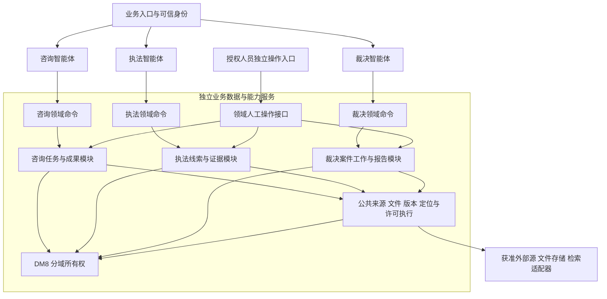

# ADR-AGENT-DATA-01：三智能体与业务数据服务边界

日期：2026-09-24。关联任务：`ARC-AGENT-DATA-DECISION-01`。依据：用户最初要求评估三个独立智能体与数据服务分工，本轮明确要求“三智能体与数据服务边界定案”；原始三域需求总览、`docs/01`架构护栏、`docs/02`第20/23节产品决定、整体评估报告第11节。本文是受用户委托作出的技术边界决定，不是原始业务需求，也不代签中心数据、安全或生产运维批准。执行状态只见总计划。

## 1. 决定

采用三个独立领域智能体，加一个独立部署、内部按领域分模块的业务数据与能力服务。全部**需要持久保存的业务事实及运行恢复依据**由该服务负责；智能体只持有可丢弃的执行上下文，不能成为业务真相的唯一保存位置。

咨询、执法、裁决是三个独立应用入口、编排策略、服务身份、工具白名单、发布和评测单元，可分别启动、停止和扩容。共享代码包、模型访问组件和来源资源，不建立一个拥有全域权限的总智能体。初期目标是三个Agent部署单元加一个业务数据服务部署单元；开发机可以同机运行。副本数、主机数、网络区、DM8实例及高可用配置须经环境核实，不在本决定中虚构。

业务数据服务不仅提供存取，还执行各域的确定性规则、命令校验、版本控制、授权检查、状态转换和事务。Agent通过受控领域命令提交意图和候选结果，不能得到任意表/字段CRUD权限。三个领域内部模块分别拥有自己的数据、状态和专业含义，公共模块不决定证据采信或法律适用。

## 2. 方案取舍

| 方案 | 本项目取舍 | 理由及适用条件 |
|---|---|---|
| 只把公共资料抽服务，各Agent内保留业务数据 | 不作为当前主线 | 容易让编排、持久任务、权限与领域规则再度耦合；重复处理恢复与审核。若以后分域部署，也应拆出域服务，不能让Agent接回数据库 |
| 全部数据放一个通用CRUD服务 | 不采用 | 不变量和状态会被迫落回Agent，难以限制任意写入；共享表容易混合三域含义 |
| 全部业务持久化外置，按领域模块提供业务命令 | 采用 | 适合当前从咨询先打通、再验证执法裁决的顺序；Agent重启不丢业务任务，当前授权和版本校验有明确执行方，可逐域演进 |

这里选择的是职责和首期部署单元边界，不意味着已经证明性能、高可用或生产隔离。共享进程和数据库会形成共同故障面，接受此首期成本并设置后续拆分条件。

## 3. 结构

人工入口提交具名、可信动作，不通过模型生成审批身份或决定。图中公共许可执行基于可信身份与已获批准的策略；不自行创造中心角色或跨域授权。

## 4. 职责与数据所有权

| 所有者 | 负责 | 明确边界 |
|---|---|---|
| 咨询Agent | 理解目标、追问关键缺口、选择获准检索/对照动作、解释候选并继续任务 | 不自行修改事实确认、证据充分性规则、任务持久版本或权利状态 |
| 执法Agent | 组织线索解析、待证事项、支持/反证/缺口及人工工作包 | 不采信证据、认定违法、决定处罚、发布专业规则或推进正式程序 |
| 裁决Agent | 组织争点、材料、历史法条、专利分析、报告草稿与人工回流 | 不决定管辖、正式受理、事实认定、签发、送达或办结 |
| 咨询域模块 | 目标/事实版本、结果集与焦点、检索尝试、技术对照、回答成果、人工请求、检查点 | 查询成功与用户目标完成分开；商标/案例不套专利专业模型 |
| 执法域模块 | 线索、收集过程、证据关联、待证事项、规则版本、流程检查、分析/文书/处罚建议及人工记录 | 原件完整性与合法性/真实性/采信分开；专业规则只执行经确认版本 |
| 裁决域模块 | 案件工作引用、双方主张/材料、争点、权利要求、法律引用、分析/报告及复核记录 | 本地任务与权威案件分开；审核、签发、正式文件等分别按真实事实/回执处理 |
| 公共资源模块 | 授权源接入、不可变来源版本、文件引用、定位、索引元数据、用途限制和撤回传播 | 保存事实来源和可访问性，不把公共可读等同可入模/可分享，不决定领域证据是否充分 |
| 领域服务内的治理支撑 | 最小幂等、并发版本、检查点、运行记录、审计、已授权模型/工具配置版本 | 共享技术机制；任务、审核和正式状态仍由所属领域定义，不统一万能状态机 |
| 外部权威系统/授权人员 | 身份、源记录、专业规则批准、采信、正式决定与回执 | 数据服务保存受控映射/依据并校验，不取代权威系统 |

领域模块是工作数据的唯一写入责任方。公共法规服务可由三域消费，执法/裁决分别决定适用性；同一文件可共享受控来源引用，但进入不同案件的证据关系、人工意见和用途授权分别建立。跨域引用不能自动复制授权，更不能直接查询另一域的表。

## 5. “全部数据外置”的精确范围

外置内容包括用户目标、消息与已确认事实、任务及子执行版本、结果集合/焦点、来源/材料/证据引用、生成与人工修订成果、人工交接请求/受理/决定、所用配置版本、恢复检查点和必要运行审计。需要保存的模型输入输出按已获许可与保留策略进入受控记录；没有许可不能以“可追溯”为由扩大原文保存或入模范围。

Agent可保留单次执行的内存、连接、短期缓存和临时文件；它们不承担任务恢复或历史证明。Agent失效后应能从服务重建获准上下文。业务成功须以服务提交回执为准，不能凭Agent内存或UI流式文本宣布已保存。

“外置”不等于所有字节放进DM8。结构化业务及受控文件元数据使用DM8；文件二进制使用获准文件存储；检索索引由适配器维护；密钥在受控密钥配置设施；不含业务正文的基础设施日志和发布包可在相应运维设施。发布配置可以来自版本库，但被任务实际选用的版本要在业务记录中可追溯。具体保留、删除和备份期限仍由有权责任方提供。

## 6. 调用、权限与模型边界

1. Agent调用必须绑定可信主体、所属域、任务及当前版本、请求目的和允许动作。领域服务自行解析资源归属和当前授权，不信任模型或前端传入的角色/机构/可访问范围声明。
2. 数据访问、检索召回、文件下载、导出、跨域引用和进入模型上下文都需要对应用途授权。Agent服务身份不自动获得用户全部权限；只有经校验的交集可执行。授权服务不可用时停止需要新授权的动作，不把历史快照作为通行证。
3. 领域命令必须具有业务含义，例如提交检索尝试、记录候选对照、申请人工接收；不是任意修改状态或写表。Agent提交的AI结果按不可信候选校验、落版；确定性规则在领域内执行。
4. 模型调用经受控端口/适配器处理，可复用客户端代码或已有模型配置能力；首期不要求另建统一模型网关服务。Agent不持中心源写权限或DM8业务账号，模型适配器不获得人工决定和正式状态写接口。
5. 跨域协作通过显式请求及受控成果引用交接。接收域重新检查身份、用途、对象版本和允许范围；Agent之间不能直接转发全量上下文或代替对方作领域决定。

以上是技术执行责任，真实角色、数据用途许可和专业决定流程不由此文件确定。具体接口字段、路由、状态转换和错误协议由当前Task详细设计冻结。

## 7. 持久运行与故障责任

| 场景 | 执行责任与结果 |
|---|---|
| Agent在模型/工具执行中崩溃 | 领域服务保留已提交输入和检查点；替代实例取得有效执行权后重建上下文，复查当前授权与源版本；不把未提交输出当成果 |
| 同一任务两实例并发、重试或迟到结果 | 服务用预期版本、幂等及执行权校验拒绝过期提交；如何取得/回收执行权在D中具体设计，不能声称端到端恰好一次 |
| 数据服务不可用 | Agent停止需要读取/提交的后续动作，明确显示技术失败或待恢复；不私建本地业务库、不凭缓存继续确认业务成功 |
| 执法任务过载 | 分域并发和队列/资源预算、有界重试与超时限制影响面；单进程或DM8故障仍可能影响三域，不能将逻辑限额当作物理隔离证明 |
| 文件上传成功但业务提交失败 | 暂存文件尚不成为已登记证据；有提交关联和可对账清理策略，不能创建孤立已采用引用，清理须遵守批准保留规则 |
| 外部人工/权威系统响应超时 | 保存请求及绑定版本，查回执或对账；不能默认成功，也不能盲目重复正式动作 |
| 权限撤回、来源更新或事实纠正 | 公共模块传播变化，领域判断具体依赖影响；历史留痕，当前读取重授权，失效的人工批准不得套用到新成果 |
| 备份恢复 | 恢复DM8、文件引用、配置与必要审计的一致关系；索引可由获准源版本重建；正式状态需与权威系统对账，恢复本地备份不等于撤销/重放外部动作 |

同域命令的业务变更、结果版本、依赖关系、检查点和回执应在可证明的事务边界提交；模型、检索、文件转换等长调用放在数据库事务外。跨域和外部动作采用可追溯请求、幂等、回执/对账，不引入全域分布式事务或通用工作流平台。具体原子性方案属于下一项D。

## 8. 首期部署与演进

三个Agent独立发布，业务数据服务内部模块化起步；基础设施先复用经验证的DM8/文件/检索适配器。服务内按域拥有表/迁移，数据库凭据仅授予服务侧需要的模块；物理schema/账号/表空间、连接池和备份粒度由D及环境验证确定。共享实例不意味着三域进程级/物理隔离已达成。

出现以下真实约束时，将对应领域模块拆成独立域服务：部门要求物理隔离；独立团队需要分开发布；数据保留/恢复要求不可共同满足；共享资源经实测无法满足已确认可用性或容量要求。拆分保留领域接口、数据所有权和跨域授权合同，业务规则仍不搬回Agent。没有这些证据时不先拆成大量微服务。

## 9. 对后续任务的约束

`NEXT-V2-D-DATA-01`可按已完成的咨询R开始详细设计准备：先定义首条任务最小领域命令、主体委托、版本/并发、检查点、幂等、文件关联、失败恢复和现有API迁移边界。随后咨询6个纵向设计按依赖实施；执法和裁决各3个设计补充自己的领域状态与专业语义。首条设计不冻结三域全量物理表，不创建通用Agent Runtime/Workflow/知识图谱平台。

下列设计验收反例必须具备明确预期：Agent重启继续同一目标；过期实例不能提交新版本；跨域读取未授权材料被拒绝；撤权后缓存/文件/模型入口不可泄露；数据服务失败不显示成功；共享资源过载与恢复有可观察结果；纠正只影响相关下游；内部实际领取、审核通过和权威正式回执互不替代。它们是D及后续验证的验收输入，尚未执行，不代表本次实现或故障测试通过。

旧Adapter按当前契约验证后复用；历史Mock、Fixture和旧任务模型仅提供开发证据，不能直接晋升新主线。旧数据与消费者迁移先列清单、映射、试迁移和回滚方案，不在本次删除或移动。

生产环境、角色/委托协议、源/模型许可、保留期限、专业规则与SLO等未决事实继续见`docs/02`第21/24节；只阻相关真实设计参数、接入与验收。此次定案完成技术方向选择，未通过任何实现Task的D门，也不修改原需求。
