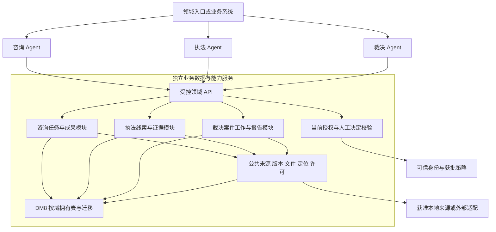

# V2 项目整体评估报告

评估日期：2026-09-24。评估对象：本次当前工作区（含已有未提交代码），以及 `docs/v2/00`～`15` 当日重写的 16 份提案。任务：`GOV-V2-WHOLE-ASSESS-01`。

**结论：重新建立产品主线，选择性复用技术资产，不在旧 V0/V1 流程上继续堆功能，也不全库推倒重写。推荐三个独立领域智能体＋一个按领域分模块的数据与业务能力服务；所有业务持久化由该服务承载，Agent 只持有执行中的临时上下文。** 数据服务不是通用 CRUD，更不是能自动认定证据或发布处罚的万能中台。

本报告是一次性评估、候选基线和决策依据，不是第二份任务、Gate、Trace 或 OPEN QUESTION 状态台账。[总计划](08-总开发实现计划.md)唯一维护状态，[待确认清单](02-待确认事项清单.md)保存外部决定证据。所有保留、调整、合并、延后、废弃均为建议，不擅自取消合同义务；本轮不通过任何新 R/D 门，不修改业务代码、原需求或当前 V2 原稿。

## 1. 当前项目真实状况与证据边界

### 1.1 当前可以证明什么

- 本轮修改前 `node scripts/verify-all.mjs` 通过：47 份需求 Markdown 摘要与登记一致，41 行需求台账存在；29 项机器 R 为 ready，咨询 12 项仍 stale；41 项正式 D/V/A 没有完成证据。没有发现要求停止评估的新增原需求基线漂移。
- 检查器同时报告 445 个历史任务、0 READY、18 个计划健康警告、44 个结构体量警告。任务数和结构健康度不是产品完成率。正式台账空白也不等于代码不存在，表示整项义务尚没有完整证据链。
- 当前包含三种不同实现：旧 V0 合成纵向流程；公开资料/本地 DM8 开发功能；新专利 `patenttask` 的组件契约与 Fixture 工作面。它们不能合并宣称为一个已可用产品。
- 存在真正的 JDBC、HTTP、来源导入、模型适配代码。不能把“不是正式能力”误写成“全部是假代码”。反过来，真数据库中存放合成材料，仍然只是合成业务输入。
- 当前工作区未提交内容较多；本报告评估磁盘实物，不声称某个 Git 提交可以重放全部成果。评估期间记录受保护文件摘要，结束时复核未改业务代码、需求与 V2 原稿。

### 1.2 本轮核查方式与测试结果

读取总计划、架构/治理、现行 V2 全部 16 文件；对照 47 份需求中的业务目标、处理规则及验收边界，逐项映射 41 能力；反查入口、装配、领域用例、Adapter、存储、测试及历史报告。下述矩阵是**功能级真实性评估，不是全部 MUST/MUST_NOT 的正式语义验收**；不报虚假的“未覆盖条款为 0”。

本轮新运行与历史证据分开：

| 核验 | 本轮结果/证据 | 能证明与不能证明 |
|---|---|---|
| 治理前检 | 退出码 0，47/41 一致 | 摘要、链接与状态结构；不证明专业正确 |
| `mvn -q test` | 退出码 0；458 项，0 failure/error，75 skipped，即 383 实际执行通过；[输出](evidence/v2-assessment-20260924/java-test.log)、[逐模块及报告时间](evidence/v2-assessment-20260924/java-report-summary.json) | 62 项新专利模块测试、platform-api 与 mock-center 中已执行测试的断言；本轮 DM8 环境未配置，不能宣称真实 DM8 联调通过 |
| 前端 `vitest run` | 4 文件/4 测试通过；[输出](evidence/v2-assessment-20260924/frontend-test.log) | 已有少量组件/辅助逻辑断言；不证明三域用户完成工作 |
| 全站浏览器入口 | 退出码 1；39 通过、13 失败、2 未运行；[输出](evidence/v2-assessment-20260924/browser-test.log) | 同时存在伪响应与真实后端依赖；配置只启动 Vite、未启动 8080 API，已经出现 ECONNREFUSED，不能称完整真实集成 |
| 历史报告 | [真实性报告](30-智能体真实性验收报告.md)、[咨询调用链审计](31-咨询智能体调用链审计报告.md)、[专利复核](47-咨询首批核心修复独立复验记录.md) | 仅作为历史观察；不沿用其中旧记录数、旧缺陷关闭状态或旧浏览器通过数冒充本轮结果 |

未执行真实数据/身份/人工/专业验收，也未调用真实模型来证明专业正确；没有生产现场观察，不宣称“真实用户已验证不好用”的统计结论。能够确定的是：下述可见断点足以阻止目标闭环；其余能力只能标为尚无充分证据。

## 2. 原需求 → V1 实际设计 → 当前代码 → 测试 → 可用性差异矩阵

这里的 V1 指现有实现主线，不假定所有历史文档构成一致的 V1 产品。设计族：D-C＝`docs/11～17` 咨询 V0；D-P＝`docs/38/40/42/43/44` 新专利任务；D-E＝`docs/20～28` 执法 V0；D-A＝`docs/29～36` 中标题为裁决 MVP 的系列（同编号有不同文件，必须按标题定位）；D-L＝主计划各库/检索/公开数据窄任务设计。D-P 的历史通过只限其既定窄任务，不能覆盖当前 V2。

设计族可复核入口：[咨询 V0 实现设计](17-咨询MVP-V0实现任务设计.md)、[执法 V0 实现设计](26-执法MVP-V0实现任务设计.md)、[裁决 V0 实现设计](34-裁决MVP-V0实现任务设计.md)、[专利任务详细设计](38-咨询智能体专利任务详细设计.md)。

每行原需求链接指当前只读来源，具体代码/测试名称在附录提供可点击定位。测试列描述断言范围，不代表本轮各测试都通过；环境跳过以机器输出为准。“未见专用实现”指当前源码/路由/配置检索及窄流程反查未找到满足本项的独立闭环，不用通用 Service 的存在填补证据。

### 2.1 咨询 12 项

| 需求与真实用户工作 | V1 实际设计 | 当前代码事实 | 当前测试到底证明什么 | 实际可用性与差异 |
|---|---|---|---|---|
| [CON-01] 查询商标、商品服务及异议/无效历史 | D-L 只读库、公开试点 | `TrademarkLibraryService`、DM8/公开 Adapter；公开源为 USPTO 开发记录 | `TrademarkLibraryHttpApiTest` 及 DM8 类：字段、分页/错误；不证中国商标覆盖 | 有限查询；不能把海外样本、历史项未提供当完整业务库 |
| [CON-02] 查询具体专利文献/全文/状态历史 | D-L 公开库查询 | `PatentLibraryService`；源版本与栏目存在，法律事件未采集分支存在 | `PatentLibraryHttpApiTest`：查询/来源契约 | 有限资料查询；全文/历史状态覆盖和逐用途许可未满足正式需求 |
| [CON-03] 案例原文、提取、标注审核 | D-L 本地派生版本 | `CaseLibraryService`、`CaseAnnotationWorkflowService` | `CaseAnnotationWorkflowHttpApiTest`：编辑、版本、审核流程；不是提取质量 | 开发期标注流程可复用；未证明真实案例专业要点可用 |
| [CON-04] 自然语言启动、同范围迭代、候选有范围/依据 | D-L 独立检索任务；D-P 新执行壳 | `PublicLocalPatentCatalogAdapter` 固定包含匹配、标题30/正文15、封顶100；`PatentRetrievalService` 有版本化调用壳 | `PublicLocalPatentCatalogAdapterTest`、`PatentRetrievalShellContractTest`：排序/调用与停止契约；不证 Recall | 原检索不是语义专业检索；新壳未接生产源与持久运行，不满足持续真实任务 |
| [CON-05] 商标文字/读音/含义/图像召回 | D-L 受限文字检索 | `PublicLocalTrademarkCatalogAdapter` 实际名称匹配/类别过滤；未配置维度披露未分析 | `TrademarkSearchApplicationServiceTest`、HTTP：任务与能力缺失 | 可运行文字路径；图形、读音、语义及跨类覆盖未完成 |
| [CON-06] 确认特征、逐项技术对照、纠错与来源 | D-L 独立对照；D-P 待核对结构 | `PatentComparisonService` 使用 `claimsText.contains`；准备特征来自空 `featureTags`；新 Fixture 对照均 UNKNOWN | `PatentComparisonHttpApiTest`/`PatentComparisonShellContractTest`：字段/版本/拒绝及结构；不证要素专业关系 | 当前真实资料页面会阻断，缺补件继续；UNKNOWN 表不是实际分析；需要重写专业对照 |
| [CON-07] 商品服务关系及商标多维辅助意见 | D-L 受限观察 | `TrademarkComparisonService` 与公开源显式限制；无图不得分析 | `TrademarkComparisonHttpApiTest`：准备/创建及缺失维度 | 部分文字观察，不能视为完整多维近似参考 |
| [CON-08] 案例相关点与关键差异 | D-L 本地检索 | `CaseSearchApplicationService` 基于公开样本生成候选/解释 | `CaseSearchHttpApiTest`、`CaseSearchPublicLocalHttpApiTest`：查询/准备/结果边界 | 候选链路存在；专业排序、程序/历史法差异完整性未验收 |
| [CON-09] 发布可运行智能体、版本/暂停/统计 | D-C 配置草稿与模型注册；未完成 Release | `ConsultationAgentDraftService.validate` 固定 publishReady=false；`ManagedModelConfigurationService` 管模型 | `ConsultationAgentDraftServiceTest`/`ModelFailoverRouterTest`：草稿/路由，不证发布智能体 | 配置保存不是生效发布；不可把模型管理页当三个智能体管理闭环 |
| [CON-10] 用户引导及内部 Prompt 版本治理 | D-C 引导/运行提示分散 | `ConsultationGuidanceService`、模型 Adapter 模板；未见完整用户模板发布闭环 | `ConsultationGuidanceHttpApiTest` 与模型 Adapter 测试：引导/输出合同 | 片段能力；不能认定全量版本发布、撤销和依赖治理已具备 |
| [CON-11] 理解复合目标、保留已确认事实并澄清 | D-C Intent/slot 路由 | `ConsultationIntentParserService`＋`ExternalModelIntentAdvisor`；模型故障退为空建议 | `DailyConsultationServiceTest`/Intent HTTP：有限候选/槽位/规则 | 可以分流；不等于持续 Goal 模型，失败原因和纠正跨轮语义不足 |
| [CON-12] 同一任务持续检索、纠正、恢复、人工和完成 | D-C 轮次/固定流；D-P 版本命令 | `DailyConsultationChat` 用 React turns、只传历次用户文本；Fixture Flow 的 sessions 是 ConcurrentHashMap、内存命令仓储 | `PatentConsultationFixtureFlowTest`、62 项 patenttask 契约：合成版本/失效/取消；非进程恢复 | 新核心有复用价值；旧日常入口与新样例入口分离，尚无真实持久闭环 |

### 2.2 执法 17 项

| 需求与真实用户工作 | V1 实际设计 | 当前代码事实 | 当前测试到底证明什么 | 实际可用性与差异 |
|---|---|---|---|---|
| [ENF-01] 获准源接入、同步游标与更新 | D-L 数据源管理 | `EnforcementSourceManagementService` 装配 `DevelopmentEnforcementSourceAdapter`，仅 local 开发地址、固定3条 | `EnforcementSourceManagementServiceTest`/HTTP/浏览器：同步/状态开发场景 | 真实存储机制≠真实来源连接；定时和游标不能外推中心/正式源 |
| [ENF-02] 发现规则配置、试运行、发布 | D-L 发布规则子集 | `EnforcementDiscoveryRuleService`＋V019 | `EnforcementDiscoveryRuleServiceTest`：条件、版本/试跑 | 确定性机制可复用；法律分类/语义模型、发布人未正式确认 |
| [ENF-03] 规则命中成待核实线索、去重提醒 | D-L 固定本地批次 | `EnforcementClueDiscoveryService`＋V020 | 对应 Service/HTTP 测试：冻结批次、去重、核实 | 开发线索可演示；正式数据、通知真实受理、跨源归并未证实 |
| [ENF-04] 从原材料抽事实/多主体、人工修订 | D-L 结构化输入解析 | `EnforcementClueParsingService` 从 payload.subjects/facts 等读值，版本 STRUCTURED_LOCAL_V1 | 对应 Service/HTTP：缺字段、角色、修订、审核 | 是结构化字段解析，不是自由文本/OCR 智能抽取完成 |
| [ENF-05] 原件/派生材料、收集过程、受控访问 | D-L 证据管理＋V022 | `EnforcementEvidenceService`/DM8 存储有记录管理和范围控制 | 对应服务/HTTP/DM8 测试：关联、版本、错误 | 目录管理可复用；真实文件链、取证合法性/采信、生产授权未成立 |
| [ENF-06] 案件类型的待证明事项规则发布 | D-E 使用 activeRule 引用 | `EnforcementSourcePort.activeRule`；未见完整独立证据链规则管理闭环 | `EnforcementApplicationServiceTest` 仅窄关系输入 | 规则引用不是可配置/审查/发布的规则体系 |
| [ENF-07] 支持/反证/缺口和时间线、纠正回流 | D-E `relationSet` | 从 source.EvidenceData 的 issue/relationType/reason 投影关系 | `EnforcementApplicationServiceTest`/DM8：固定关系、缺口和版本 | 来源预填关系≠自动证据链分析；真实待证事项覆盖未验收 |
| [ENF-08] 期限/程序/例外的可发布规则 | D-E 排除专业公式 | 未见符合本项的日历/程序规则发布服务 | 通用发现规则测试不能替代本项 | 待设计与有权规则；不以 ENF-02 冒充全部 Rule |
| [ENF-09] 逐项流程校验、无法判断与整改 | D-E 无完整流程事实 | 未见程序事件、日历、例外执行闭环 | 未见本项真实专业测试 | 不具备完整程序合规校验 |
| [ENF-10] 侵权要件/排除/程序规则 | D-E 辅助分析窄切片 | source activeRule 及固定信息项，不是完整可发布要件规则 | V0 分析用例证明输入/缺口 | 不具备专业规则配置完整能力 |
| [ENF-11] 逐要件分析并保留事实性质 | D-E `auxiliaryAnalysis` | 来源关系转机器推论、缺历史状态返回不足；无完整专业判断 | `EnforcementApplicationServiceTest`：不造正式状态、缺项分支 | 诚实降级合理；不能把流程组装称专业侵权分析 |
| [ENF-12] 有权 DOCX 模板维护/试填/发布 | D-E 未纳入完整模板 | 未见符合原文 DOCX 模板发布与渲染闭环 | 未见本项模板验收证据 | 新建业务能力；不建通用排版平台 |
| [ENF-13] 字段来源与生成规则、缺项阻断 | D-E 未纳入 | 未见模板字段映射及试生成发布闭环 | 通用快照测试不证明字段来源 | 未满足；需与 ENF-12/14 同一成果切片 |
| [ENF-14] 可编辑文书、保留人工版、导出 | D-E 辅助分析不是文书 | 未见完整 DOCX 生成/修改/审核/同版导出链 | 浏览器工作项测试非文书生成验收 | 需要新实现；不得伪造调查笔录/正式文号 |
| [ENF-15] 职权/裁量/公式/例外批准与试算 | D-E 专业规则未准入 | 未见有权处罚规则服务 | 发现规则和普通版本测试不证明裁量正确 | 待法律证据，不能以模型 Prompt 填空 |
| [ENF-16] 已确认事实下的可解释处罚建议 | D-E 未实现正式建议 | 未见确定性金额、法定范围及人工调整链 | 未见金额口径/边界专业测试 | 依赖 ENF-15；缺事实与规则必须停止本分支 |
| [ENF-17] 历史时点法条与规范引用 | D-E SourceLocator＋公开参考 | 来源引用/公开法规资料存在，无完整适用/文书位置绑定 | 来源导入/摘要校验，非适用性审核 | 可借用引用机制；完整法律适用与引用需重设计 |

### 2.3 裁决 12 项

| 需求与真实用户工作 | V1 实际设计 | 当前代码事实 | 当前测试到底证明什么 | 实际可用性与差异 |
|---|---|---|---|---|
| [ADJ-01] 法规导入维护、历史版本、条款定位 | D-A 法规候选快照 | `Dm8AdjudicationSourceAdapter` 读 `adj_local_legal_snapshot`，公共来源导入 | `AdjudicationApplicationServiceTest`/本地来源测试：快照/摘要 | 不是完整法规管理；与咨询既有法规3文件共用资源义务不能遗漏 |
| [ADJ-02] 外部条文解析接收、人工编辑审核 | D-A 未纳入全功能 | 未见外部解析任务、导入审核完整服务 | 固定法规候选不证智能解析 | 依赖外部解析通道和审核，不能只建 CRUD 验收 |
| [ADJ-03] 要点导入、关联维护及审核可用 | D-A 未纳入全功能 | 未见独立要点/场景/案例关联闭环 | 无完整要点专业测试证据 | 与共享法规资源合并建设，保留裁决用途约束 |
| [ADJ-04] 案件工作任务、承办及进度，正式状态隔离 | D-A `openWork`/Work | `AdjudicationApplicationService` 工作项固定 SYNTHETIC_V0；不是权威案件主档 | `AdjudicationHttpApiTest`/Store：工作项/版本 | 合成任务可运行；正式受理、分配、归档不能据此声明 |
| [ADJ-05] 基于事实/时点/程序找法条候选 | D-A `matchLegalCandidates` | DM8 `legalCandidates(inspection)` 没有使用 inspection 过滤，返回快照表全部可用候选 | 固定候选测试不证法条与事实匹配 | 是目录投影，需重写实际匹配与适用性回流 |
| [ADJ-06] 人工选择条文、逐字引用、报告位置 | D-A `cite` | 只从 latest candidates 按 code 取；缺原文独立选择及完整报告锚点流程 | `AdjudicationApplicationServiceTest`：候选选取/引用历史 | 窄引用记录；不能满足直接选条文、同版绑定/失效全部要求 |
| [ADJ-07] 所选权利要求结构与从属展开 | D-A 未纳入 | 未见案件级权利要求树/OCR修订确认闭环 | 专利字符串对照测试不能替代 | 新领域能力；复用文献获取，不复用 contains 作为专业解析 |
| [ADJ-08] 官方时点状态与稳定性风险分栏 | D-A 未纳入 | 未见状态时间线和单篇/组合证据分析闭环 | 无对应专业效果证明 | 拆分实施；无效申请不能作无效决定 |
| [ADJ-09] 双方/反证、逐必要要素、采信分离 | D-A 材料检查 | `inspectMaterials` 汇集预结构化 statements/unresolved/conflicts | `AdjudicationApplicationServiceTest`：缺项/冲突/来源不可用 | 不是逐要素侵权证据分析；需新建领域关系与人工校核 |
| [ADJ-10] 裁决用途模板配置、试生成、发布 | D-A 固定 template 来源 | DM8 `template()` 取快照，不是模板生命周期 | 固定模板引用/DM8映射测试 | 不能认为具备可发布模板管理 |
| [ADJ-11] 多源报告草稿、逐章修订、同版 DOCX/PDF | D-A `createDraft/reviseDraft` | DM8 `draftSections` 固定两段合成文案；修订只改第一段 | `AdjudicationApplicationServiceTest`/浏览器伪响应：版本/页面 | 不能生成可专业使用报告；重写生成与修订领域服务，迁出 Adapter 业务逻辑 |
| [ADJ-12] 真实人员领取/转派/退回/复核、签发分离 | D-A `TestReview` | 固定 v0 reviewer、SYNTHETIC_PROCESS_TEST；CONFIRM/RETURN 窄动作 | 服务/HTTP：开发复核身份和缺项拒绝 | 只证明测试复核；真实职责分离、人工回执与依赖失效未成立 |

另外 6 份文件为三域总览和既有法规/解析/要点文档，不是另 6 个功能；它们的国产化、DM8、交付服务、当前授权、异步、源版本、人工边界与真实验收要求横向约束全部 41 项。不能因为合并到公共数据服务而丢失这些义务。

## 3. 当前最影响可用性的断点与根因

### 3.1 可直接从代码证实的失败路径

1. **对照无法从实际资料完成**：公开专利 `document()` 的 featureTags 固定空 → `prepare()` 无建议特征 → 当前 `ComparisonWorkspaces` 阻止创建并提示补全文，但无补材料/新特征继续路径。历史“错误提交”已改善为诚实阻断，不能继续引用旧报告称仍必然提交报错；功能本身仍未闭环。
2. **上下文不稳定**：旧日常页只累积问题文本，比较又跳到独立页面；没有把用户看到的结果集、明确选择、确认事实和纠正依赖统一到持久任务。新 `patenttask` 补了部分语义但 Fixture Flow 仍内存 sessions，重建服务对象/内存仓储回放不能证明操作系统进程重启恢复。
3. **专业能力被结构外壳替代**：旧对照是字符串包含，新 Fixture 对照全部 UNKNOWN；裁决 DM8 Adapter 生成固定草稿、法条候选忽略案件检查参数；执法解析读取已经结构化好的字段。诚实标识限制是必要防线，却不是能力完成。
4. **来源校验只对静态快照成立**：`PublicLocalPatentCatalogAdapter` 构造时一次读取 `library.records()`，`isSourceAvailable()` 只查此内存列表；没有证明运行期间源撤回/新版本实时可见。`candidate()` 展示片段取摘要，但只要 claimsText 非空就标“权利要求节选”，定位标签与片段类型可能不一致。必须以摘要与权利要求不相同的文献反例修复，不得用“有 citation”通过。
5. **身份与业务审核不能上生产**：V0 授权用字符串相等，执法/裁决默认缺 Bean 时装配 V0 实现；API Key 开关默认 false。已有 Key 验证是技术资产，不是实际人员/组织/目的/资源授权与专业审核身份。
6. **恢复和人工没有真正接通**：Fixture 配置必须 test-synthetic＋显式开关，命令仓储为内存；人工显示 UNAVAILABLE 是正确行为，但不是接管已完成。执法主入口人工处置阶段明确不可用。
7. **版本规则仍可能旁路**：执法/裁决旧服务先查幂等重放，命中后直接返历史 snapshot，再鉴权路径未执行。单靠读取接口鉴权不能证明重放内容安全；具体暴露面还取决于外层 Filter。生产候选必须增加“同键重放前撤权”的端到端反例，而非本轮臆断已发生泄漏。

这些是新主线的放行阻断项，不在本轮未经设计直接修复。身份/撤权可能构成发布级 P0；核心闭环、真实持久化与专业分析缺失为 P1。历史缺陷编号的关闭仍以主计划原证据为准，本报告不再开第二本 Finding 状态册。

### 3.2 为什么前面做出来不好用

| 根因类别 | 项目证据与因果关系 | 纠偏方式 |
|---|---|---|
| 需求问题 | 原始方案用库、相似度、提示词、意图等列功能；全文/规则/权限/专家期望依赖未确定。现行细化需求已经要求闭环，不能把当前失败全归咎原文 | 先冻结每种用户任务的目标、产物、失败及完成定义；把新增、已有、未知分开 |
| 产品设计问题 | 独立检索/对照/聊天页面由用户手工接续；“缺资料”只挡住按钮，没有补件继续；任务结束仍由结果/工具状态近似决定 | 一项工作一个可恢复任务和成果包，补件/纠正/再检索回同一任务 |
| 架构问题 | 旧 Service 聚合快照、Adapter 生成裁决草稿；来源、分析、运行和人工边界混合；多套 Task/Flow/Pilot 并行 | Agent、领域行为、数据存储分责；重写错误依赖方向，保留端口模式 |
| 实现问题 | contains 对照、固定候选/草稿、前端 turns、V0 身份、公开源启动快照 | 用新契约替换专业算法/任务入口/授权；不继续给旧固定流程叠分支 |
| 测试问题 | 浏览器 route.fulfill 自己生成成功业务结果；部分开发验收只断言按钮；DM8 缺环境跳过仍测试绿色 | 区分四层证据，真实验收禁止伪响应、关键环境缺失阻断，测试失败不能被总数掩盖 |
| 数据问题 | 公开参考不等案件底层材料；摘要不等权利要求；本地公开样本不等权威完整库 | 按目标验证资料覆盖、定位/历史版本、许可与刷新；数据不足时诚实停止，但能力仍记未满足 |
| 外部依赖问题 | 正式身份、专业规则、实际人工受理、合法数据与验收人员未到位 | 分域依赖明确到用途/动作；提前取证，不能等41项全写完才发现无法验收 |
| 项目治理问题 | 445 个任务数量大于可用产品证据；总计划保留大量历史“当前/最近完成”，V2反复评审与旧代码释放并存 | 唯一当前入口覆盖历史，按用户成果而非文件数推进；每个任务退出都反查真实链路 |

**不是“没有写测试”，而是测试的命题与用户的命题不同。** 测试问“预造候选到页面能显示吗”，用户问“我的真实材料能得出可核查结果，纠正后还能继续吗”。V0 的窄范围本来合理，问题在于窄任务的完成不断累计，却没有升级为完整产品验收；自动开发据旧任务依赖继续推进，优化了局部而没有纠正产品目标。

## 4. 现有架构与数据库评估

保留：端口/Adapter 分层、AI/Rule/Human 分权、源版本与人工修订不覆盖历史、DM8/国产化要求、正式状态与辅助输出隔离。它们符合原需求，也没有因为产品体验不足而失效。

必须改变：旧日常咨询固定路由是任务入口事实上的中心；领域对象部分带 V0 范围常量；公共持久化模块同时覆盖多域且装配中直接创建 DM8 Store；数据 Adapter 承担裁决候选/草稿生成。新 Agent 不能调用任意表 CRUD 来绕过领域服务。

| 存储族 | 可保留的资产 | 限制与 V2 处理 |
|---|---|---|
| V001～V006 V0 工作/检索/对照/标注表 | 来源/输入快照、幂等、版本、事务与并发经验 | 分散 task_id 与固定流程无法自然表达同一 Goal、跨轮结果/纠正依赖；建新任务模型，旧表只读兼容，不强加一列 status 伪迁移 |
| V008 公共知识 JSON 载荷 | 来源摘要/导入和实际公开字段 | JSON 完整性不证明稳定文献语义或源授权；补文献版本、定位与逐用途策略契约，先设计再迁移 |
| V009～V016 本地来源/公开参考/授权包 | 记录级批准、原始快照及导入验证 | SYNTHETIC、公开历史参考、AUTHORIZED_LOCAL 分开；授权标签不能复制成新的正式使用许可 |
| V017 模型配置 | 凭据保护、可用模型目录 | 它不等于逐任务数据通道政策或发布快照；凭据保管与模型选择分离 |
| V018～V022 执法管理 | 源/规则/线索/解析/证据局部持久化 | 需实际用户链路接入、真实授权和事务边界复评；不能整体搬表即上线 |
| 新 patenttask 内存仓储 | 版本命令、冲突和反例契约 | 无新持久化/恢复验证；需要真实 DM8 Task 聚合提交与检查点设计，不让会话 Map 成为第二真相 |

迁移原则：新数据模型独立版本；经确认身份/来源映射后才迁移获准记录；保留旧 ID 映射、来源、当时数据模式与许可证版本。合成记录禁止自动升格。先离线试迁移和计数/引用/权限对账，再只读并行对照，按域切换写入口；失败回旧只读/受控停机，不用两边同时写业务状态。旧 API 在有实际消费者清单与退役通知后淘汰，未找到消费者不等于可以立即删除。

## 5. 现有测试体系为什么不能代表可用

`scripts/run-quality-gates.mjs` 按前端浏览器→Java 顺序执行，前一步非零即退出，因此一次 npm test 失败后不能顺便宣称 Java 已测。其 Java 摘要只扫描 platform-api，不覆盖 consultation/mock-center 全部测试；DM8 环境缺失只打印 may be skipped，最终文字仍可能“Quality gates passed”。本轮独立运行 Java并按所有模块汇总，避免该口径误差。

`workflow-full-flow.spec.mjs` 用 route.fulfill 在浏览器端制造工作项、分析、修订、复核成功；这能验证 UI 消费约定结构，不能证明后端因果链。`patent-fixture-flow.spec.mjs` 多数动作真实打开发 API，另一个反例使用 route.continue 修改期望版本；不能把所有 page.route 都等同伪造响应，但这个新套件后端仍是 Fixture。

**通过正确拒绝测试，证明的是安全拒绝，不代表需求已经满足。** 无图提示未分析、无权返回403、无全文阻断对照必须保留，同时相应图像/对照能力仍不能标“已验证完成”。不以增加 happy-path 用例数量代替用户成果证据。

## 6. 当前 V2 逐项分析与优化稿

### 6.1 V2-01～12 取舍

评价“是否解决问题”的证据来自第2～3节；影响列覆盖任务、状态、权限、证据、数据、API与测试，返工是影响范围判断，不是无依据工期。所有项与三域辅助目标一致，但多数是已有义务的明确化，不应重复记为十二项全新商业功能。

| V2项 | 结论及优化后的可执行要求 | 重复/新增/行为变化性质 | 影响与返工 |
|---|---|---|---|
| V2-01 Goal | **调整**：领域持有目标/确认事实/用途/范围；只阻断影响结论的缺口，号码精确查询不强制全填表 | CON-11/12、ADJ-04 已有；目标版本深化行为 | Task/Context/API/数据/测试，高；旧Intent不再权威 |
| V2-02 Completion | **拆分**：工具完成、辅助成果可用、专业接受、正式办理完成分别判定；“已完成”须说明是哪一层 | 完成义务已有；统一完成合同是新增产品约束 | 状态/证据/人工/API/Eval，高；禁止全工具成功直接完成 |
| V2-03 Agent | **调整**：低风险许可内连续行动；只在需要多轮的任务用循环，确定性查询允许直接结束 | 咨询9月22日已确认，另两域推广须分域评审；循环是实现候选 | 编排/预算/数据用途/恢复测试，高；不为每个CRUD建Agent |
| V2-04 Evidence | **保留**：关键陈述明确支持/反证/缺口及直接定位，充分性归领域；采信归人 | 原需求已存在；支持关系显式化 | Evidence/Source/权限/检索API/专业测试，高 |
| V2-05 Correction | **保留并调整**：版本依赖局部失效；显式区分事实修正、范围变化、目标替换；不把重检一律改写成新独立任务 | CON-12/ADJ已有；跨模块回流变化 | Task/焦点/产物/存储/幂等测试，高；复用新核心反例 |
| V2-06 Boundary | **保留**：服务端决定所有者，Agent不得写权限/复核/正式状态 | 安全与法律边界已有，非新增智能能力 | 授权/领域命令/负向测试，中高；替换V0身份 |
| V2-07 Human | **拆分**：ASK/CONFIRM是任务交互；REVIEW/TAKE_OVER需要真实责任人/回执；截止期限保持待确认 | 复核已有，四动作抽象是产品组织方式 | 人工/状态/通知/恢复，高；本地请求不可伪受理 |
| V2-08 Artifact | **调整**：首任务仅保留必需成果，不每条闲聊建复杂证据图；有内容版本和人工采用事件 | 原报告/候选已有，统一包络技术新增 | 数据/导出/Review/版本，高 |
| V2-09 Failure | **保留**：无结果、缺证、缺权限与技术失败独立；恢复要跨真实进程并防迟到覆盖 | 原异步契约已有；目前落地不足 | 状态/API/运行持久化/故障测试，高 |
| V2-10 Safety | **保留并调整**：逐用途当前授权；撤权时服务器立即拒绝，异步清缓存不作为安全前提；不承诺撤回用户已合法下载的离线副本 | 原权限已有；派生传播细化 | 所有读取/重放/入模/导出、数据服务，高 |
| V2-11 Eval | **保留**：任务失败/拒答/部分完成纳入分母；专家判断与工时观察分开，过度拒答不能用安全率美化 | 原真实验收已有，任务对照方法深化 | 测试/样本/发布门，中；无金标不能宣布专业通过 |
| V2-12 Release | **合并、部分延后**：保留最小不可变依赖清单、发布/撤销/回滚；先结构配置，延后通用Studio/灰度平台 | 原配置发布已有；全平台组合是技术扩展 | 配置/版本/权限/API/回归，中高；无第二消费者不平台化 |

### 6.2 全部16份V2文件的剩余要求核查

| 文件 | 处理及理由 |
|---|---|
| 00 重构摘要 | **调整**“平台”为产品组合名称，不预设平台建设任务；保留三个工作目标；第一黄金任务仍是价值假设 |
| 01 产品需求 | 按上表修订；公众/内部、API/UI交付不能由内部首切片推断；不能用“专业标准未定”否认已经明确的产品行为 |
| 02 蓝图/ADR | 01/03/04/05/07/08/09/11保留方向、缩到当前Task；02循环按需；06检索分层保留；10共享内核调整为数据服务边界；12 Studio延后；13动态模型优化延后；14路线提前并行收取真实样本，避免全功能后才验证价值 |
| 03 Runtime | **重设计边界、延后通用引擎**：同一 task revision 的提交/恢复由领域数据服务负责，Agent执行循环无自有业务真相；DAG只用于实际复合任务；不强制三域九状态同构 |
| 04 三域工作流 | **保留、修正焦点冲突**：其“上次选中或展示”不能与现行D-P明确焦点规则并行。默认已明确选择优先；无唯一绑定时澄清。若要展示即绑定，必须作为产品变更过R/D，不能偷改 |
| 05 领域模型 | **调整**：共享Source/Version/Locator和技术包络，Support/充分性/采信各域拥有；禁止一个全局Evidence对象承载三域采信状态 |
| 06 Skill/Tool | **合并**为当前领域用例目录及受控工具契约；领域服务写派生结果，Agent不得用Artifact/Save写任意状态；Rule依据/发布保留；通用Skill市场删除出当前方案 |
| 07 Context/RAG | **保留**稳定结果集、范围/原文/版本；长期跨任务记忆**延后**；缺许可默认不继承。不要求先建向量/图数据库 |
| 08 人工 | **调整**四动作按第6.1节；没有SLA证据不配置虚构到期；拒绝/超时不能自动采信或完成 |
| 09 工作面/Studio | **拆分**任务工作面与治理后台；保留同任务补件/纠正/来源；管理画布与复杂灰度**延后**；页面交付范围待确认 |
| 10 模型路由 | **调整**先选一个获批且经该任务评测的模型通道；保留故障/入模禁止，动态多模型寻优**延后**，不因为有注册表就建路由平台 |
| 11 安全 | **保留、补边界**：跨智能体委托、幂等重放、后台恢复和日志/导出全需当前授权；数据服务也不能凭Agent服务账号取得整域权限 |
| 12 可观测 | **合并**进每个纵向Task的最小运行证据；日志只存受控引用/必要摘要，不为指标复制全文；复杂分析看板延后 |
| 13 Evaluation | **调整** E0～E4 为证据层级映射，不另开Gate台账；真实集成和专家质量不能都缩成E2一次测试；拒答率/复核工时与完成率联读 |
| 14 Roadmap | **重设计顺序**：纠正/恢复/权限/来源和成果闭环先于41项铺开；第三阶段才正式接入不等于第三阶段才索取授权和样本；用户本次优先级覆盖旧路线默认推进 |
| 15 追踪 | **保留**41来源与6共用文件；分类优化补删除/淘汰的只是错误机制，不悄悄删除业务义务。历史V2.2.1已删除，不引用其结论为当前批准 |

“通用Skill市场”在当前V2并非已承诺交付项，此处是明确禁止由Skill规格外推的平台任务；不是声称删掉原文要求。同理不引入通用 Workflow 设计器或全局 Event Sourcing。

### 6.3 V2本身必须先解决的不足

1. “已有产品行为”和“待确认专业参数”仍混在一起，可能造成反复评审而停滞。咨询 P0-20 已确认的行为可直接作为来源；真实指标/权限仍待证据，不重新请求已经确认的行为授权。
2. 同一术语的细节不一致：显示/明确选择的焦点规则、Task outcome混合等待与完成、Artifact审核与可访问性既单枚举又正交维度。先按真实场景建立转换与反例，再冻结详细字段。
3. “最小 Runtime”罗列了全域DAG、预算、发布组合、事件和撤回，若同时做仍是大平台。首条任务只实现其确实需要的版本提交、检查点、有限执行和取消；其余有第二消费者或实测需求再提取。
4. 尚没有具体真实样本、金标、接受人和数值通过线，不能声称新V2必然有价值。先观察并对照真实工作，总工时包含复核和纠错。
5. 未明确三个独立Agent的部署/授权/数据写所有权。第11节补充方案比较，属于候选ADR，不把服务数量伪装成原需求事实。

## 7. 原需求与V2合并后的最终产品目标

最终交付是三个能够协助人完成知识产权工作的独立智能体：咨询人员获得有来源的技术、商标和案例参考；执法人员得到可核对的疑似事实、待证明事项、程序检查和文书/建议草稿；裁决人员得到双方材料、争点、正确时点法规、逐项分析及可复核报告。共同价值是减少找资料、拼材料、查证和反复修订的成本，保持专业责任和正式决定在人或权威系统。

完整用户旅程：输入目标 → 系统提出理解及关键缺口 → 必要补充/确认 → 精确查询和获准检索 → 检查原文/反证并分析 → 每项关键陈述可查证 → 用户纠正形成新版本 → 保留无关成果、继续受影响分支 → 需要时请求并确认人工受理 → 返回已完成辅助成果、部分成果、缺证或技术失败及下一步。任务关闭、页面退出、Agent进程重启都不使成果和确认事实丢失。

第一条专利技术参考是验证方式，不是最终产品边界。商标图形/读音/含义与商品服务，案例差异与历史法，执法完整17项，裁决完整12项仍保留；专业/数据条件不够时延后对应分支，不用第一切片验收冒充三智能体完成。

## 8. V2 产品能力基线及四级可用口径

| 能力级别 | 必要证据 | 可对外表达 |
|---|---|---|
| 演示 | 静态/Fixture/UI样例，明确数据模式 | 演示了交互；不说已实现业务 |
| 技术验证 | 真实执行代码在合成或许可开发资料上通过具体契约 | 此环境此输入的机制通过；不说专业正确 |
| 生产候选 | 真实身份/逐用途数据/持久化与恢复/授权模型/人工通道、故障安全、任务质量均达已批准门槛 | 可进入受控试点；不等正式验收 |
| 正式业务 | 冻结范围与版本、真实用户任务、专业/安全/运维/交付责任方接受证据 | 仅对已验收域/任务/来源宣称正式能力 |

必须真正可用的基础：任务与事实持久化、结果集稳定指代、逐项证据定位、纠正依赖失效、真实失败语义、权限逐次校验、人工修订与回流、取消/恢复、同版导出。必须可验证的领域核心：咨询真实召回与要素对照；执法事实/证据关系和确定性专业规则；裁决历史状态/法规与双方材料分析。图像、金额、正式系统等未接通分支可明确不可用，但不能据此验收其原需求。

## 9. V1能力保留、重构、重写、冻结、淘汰矩阵

| 资产/旧能力（涵盖41项去向） | 推荐处置 | 理由、复用前提与退出方式 |
|---|---|---|
| CON-01/02/03 资料目录与来源导入 | **重构**，复用Adapter/校验 | 移入公共资源模块；原文/派生分开；补版本/许可/撤回与权威覆盖验证 |
| CON-04 专利检索 | **重写**专业召回/迭代，复用端口/范围披露 | 固定字面算法可作低阶基线比较，不继续冒充语义检索 |
| CON-05 商标检索 | **重构**文字路径，**重写/新建**图形等缺失分支 | 商品服务及维度逐项专业验收，缺图不能用OCR顶替 |
| CON-06 专利对照 | **重写** | contains只留历史测试基线；新专业对照必须原文要素、关系/数值/否定及人工复核 |
| CON-07 商标对照 | **重构**多维契约，补缺失分析 | 保留缺材料降级，不保留固定文案作完整综合意见 |
| CON-08 案例参考 | **重构** | 复用只读目录，重建争点/程序/历史法与差异成果 |
| CON-09/10 发布与Prompt | **合并重构** | 模型目录/凭据保护可复用；草稿页不可自动变生产发布，先最小发布清单 |
| CON-11/12 日常路由/聊天/旧Flow | **重写**任务入口与编排；旧Intent规则可作工具 | 不兼容旧“单次回答即完成”语义；旧接口仅依消费者决定保留适配 |
| 新 patenttask 核心 | **保留并重构** | 复用版本/幂等/焦点/纠正及62项反例；移除Fixture会话双真相，补DM8/源/真实授权/进程恢复 |
| ENF-01～05 | **重构**局部服务和持久化 | 已有源/规则/发现/解析/证据资产有价值；替换开发源、补材料解析和真实授权；逐项保留验证 |
| ENF-06/07/10/11 | **重设计并重写**分析闭环 | 把Source预填关系转为领域待证明事项、支持/反证/缺口；规则发布由有权者 |
| ENF-08/09/12/13/14/15/16 | **新建**缺失业务能力 | 不把“新建”称重写已完成服务；期限/金额/模板先取证后设计 |
| ENF-17、ADJ-01/02/03/06 与既有法规3文件 | **合并基础、重构领域应用** | 公共法规/版本/定位复用，原文、解析审核和具体法律适用不可合成一个状态 |
| ADJ-04/05/07/08/09/10/11/12 | **重建产品主线** | 工作项/事务代码可参考；固定候选/合成草稿/TestReview冻结；缺失专业能力新建 |
| DM8驱动/事务映射/并发与导入摘要验证 | **选择性保留** | 在新契约下运行真实集成后复用；旧表形状和JSON载荷不是新领域模型 |
| HTTP/模型协议、失败类型/脱敏 | **选择性保留** | 替换供应商仍过同契约；模型适配成功不证明效果，真实许可单独检查 |
| V0身份、Synthetic/MockCenter、Fixture Flow、旧快照演示 | **冻结为历史技术证据** | 隔离测试构建/运行；不当生产兜底；旧材料不可迁移为正式案件 |
| 不可达旧页面、误导名称、旧接口兼容、无消费者适配器 | **候选删除/淘汰** | 新主线通过替代验收、查清调用方与历史追溯、备份后再退役；本轮不删代码 |

取舍理由以行为正确性为准，不以代码行数或已投入工期为准。重写范围集中在核心任务入口、专业分析和真实授权/数据链，保留成熟机制；不进行无证据的大重写。

## 10. V2 契约变化

| 边界 | 旧问题 | 新产品合同（候选，非冻结HTTP URL） | 放行反例 |
|---|---|---|---|
| 创建/继续Task | question/context文本、独立检索ID | 目标版本、确认事实/范围、当前主体；一次动作携预期revision及幂等键 | 同键不同载荷冲突，补问不生成无关新任务 |
| 读取/检索Source | 全量启动快照/模糊定位 | 按当前用途授权返回明确文献版本、真实定位、覆盖与源错误 | 摘要不得标权利要求，撤回后旧缓存不返回 |
| 结果集/焦点 | 序号易跟随新排序 | 不可变结果集ID/版本/顺序＋明确绑定；歧义询问 | 结果V2生成不把“原第二个”静默改绑 |
| 纠正/产物提交 | 覆写或整个重新跑 | 原事实/人工版保留；依赖影响集、CAS提交与采用版本 | 晚到旧模型结果不能覆盖人工纠正 |
| Agent到领域服务 | 通用工具随意编排/直接存状态 | 限定domain、goalVersion、用途、动作和资源；领域服务执行不变量 | 服务账号不能代用户确认事实/复核 |
| Human | 字符串reviewer、布尔通过 | 请求、受理、决定、采用产物版本分别记录；真实身份 | 同一旧批准不可用于新报告 |
| 完成 | SUCCEEDED/ANSWER_READY | 技术运行、辅助成果、专业接受、正式办理分别返回 | 只有候选、模型失败、人工未接通不得全完成 |
| Release | 草稿配置/模型注册 | 不可变依赖清单；停用/紧急撤销区分 | 在途任务不得继续用紧急撤销规则/模型 |

变更API版本不等于承诺与所有旧API兼容。先清点调用方，按动作提供限定转换；旧请求缺任务语义不能猜值补齐，返回需要升级的明确错误。跨服务事件只携受控引用、对象版本、eventId/因果ID，不广播原文；消费者拒绝重复/过时事件。

## 11. 三个独立智能体与数据服务架构选择

2026-09-24后续技术定案：本节原始候选比较保留；当前采用C的具体边界及演进约束见[ADR-AGENT-DATA-01](54-三智能体与数据服务边界ADR.md)，依据用户本轮委托完成技术选择。下列“待评审/候选”描述是评估时点记录，不再代表技术方向未定；生产部署参数、专业/数据许可和详细设计仍须各自取证。

### 11.1 三种方案比较

| 维度 | A 公共资料服务＋三Agent各自业务库 | B 所有持久数据放一个通用CRUD服务 | C 所有持久数据放一个按领域分模块的业务数据服务（推荐） |
|---|---|---|---|
| Agent职责 | 易把域规则/授权/存储混进Agent应用 | Agent拿CRUD自行维护不变量，越权风险大 | 只做各自计划/工具选择/候选解释，域服务掌握状态与规则 |
| 数据复用 | 公共资料复用，任务/审核/审计重复建设 | 物理共享但语义混杂 | 公共源/文件/许可共享；咨询/执法/裁决数据各自所有权 |
| 事务与恢复 | 每域事务容易；跨域需额外协调 | 容易开放任意写与跨域巨事务 | 同域工作/产物/检查点本地事务；跨域显式交接与对账 |
| 权限 | 四处实现、撤回传播成本高 | 容易只有服务身份，无用户用途 | 数据服务最终校验；Agent携委托上下文，跨域重新授权 |
| 部署/团队成本 | 三套迁移/备份/运维，维护成本较高 | 初期简单，后期共享表耦合大 | 三Agent可独立部署；一数据服务初期较省运维，模块可演进拆分 |
| 故障隔离 | 域库独立，但公共服务仍瓶颈 | 单点故障影响全体 | 共享故障风险仍存在；域配额/并发隔离/熔断、可恢复任务与运维恢复缓解 |
| 未来扩展 | 分团队后适合 | 难以拆分，所有调用依赖表结构 | 按模块所有权与接口将来拆域服务，Agent无需知道DM8表 |
| 结论 | 多独立团队/强隔离或不同部署要求证实后可选 | **不推荐** | **当前优先候选**，仍需部署/容量与责任方确认 |

### 11.2 推荐边界

三个Agent分别拥有工具白名单、领域目标策略、发布版本、预算、评测集和故障开关；可以独立启动/停止、发布和扩容。共用代码包不等于共用一个总Agent。跨域协作是显式请求和受控成果引用，不是一个Supervisor读取全域材料并代替另两域决定。

**“所有数据在独立服务”指所有持久业务真相**：领域Task/Goal、结果集/焦点、事实/证据/产物、人工请求/决定、执行检查点与必要运行审计均由它持久化。Agent只保留可丢弃执行上下文，从服务读取/提交下一步；崩溃可换实例恢复。文件可在独立文件存储、索引可用专用引擎、模型凭据在受控密钥设施；不要求所有字节塞进DM8，也不把基础设施监控日志都当业务数据。

“一个服务”不等于“一个模型/一张表/一个万能status”。咨询模块拥有选定文献和技术陈述；执法模块拥有待证明事项、收集过程和程序检查；裁决模块拥有争点、双方主张和裁决报告。公共来源模块只回答这份文献哪个版本、是否可用以及定位，不回答该证据是否足够处罚/裁决。专业规则执行位于各域服务，不在Agent或数据库Adapter。

### 11.3 可靠性和安全代价

- 数据服务不可用时Agent停止新提交，不能凭缓存宣布成功；恢复后核对task revision/当前权限/来源再继续。单服务成为故障集中点是明确代价，需要配额隔离、超时、有界重试、备份恢复和容量实测，不因“服务化”就宣称高可用。
- 单一Task内检查点、结果版本、依赖和命令回执原子提交；耗时工具调用在事务外。无法原子覆盖外部动作时记录意图/回执/对账，不把分布式事务平台作为首期条件。
- 三域模块只经发布接口交互，不跨域写表；DM8物理实例可共享，账号/表空间/备份恢复粒度在D门确定。三个Agent均不持DM8业务写凭据。
- 委托必须绑定真实主体、目的、task/goal版本、有效范围；服务端查资源归属，不接受模型/前端自报DataScope。人工决定从独立可信入口提交，不经过Agent自由生成。
- 先在一个领域证明契约和恢复；第二领域验证公共来源/版本协议，才抽取重复。不因计划三Agent就先实现全功能公共Runtime、跨域知识图谱或工作流引擎。
- 转向A的触发条件：不同部门要求物理隔离/独立运维、共享服务容量或可用性实测不达标、独立团队需要解耦发布。届时按模块拆分数据服务，不搬业务规则回Agent。

### 11.4 候选架构决策记录

**ADR-ASSESS-01：三Agent＋领域化业务数据服务。** 依据：用户本轮提出独立三Agent及数据外置选择，原架构要求Agent不拥有领域数据。选择C，拒绝B；A作为有隔离/团队证据后的演进。收益：减少重复、任务可恢复、域规则可测。代价：数据服务故障集中、接口调用与版本管理增加。验证：咨询Agent重启后准确恢复，执法Agent身份不能读裁决材料，源撤回阻断全部出口，单域过载不拖垮他域；数值SLO待环境责任方。状态：技术建议，非已批准部署基线。

**ADR-ASSESS-02：重建主线而非兼容旧完成语义。** 依据：第2～3节断点。新Task合同优先；旧API仅做有消费者的有限桥接。代价：迁移/双版本维护。退出：真实Task替代验收、历史可读与引用对账通过；未确认前不删旧数据/代码。

**ADR-ASSESS-03：开发验收与生产/业务证据分层。** 依据：第1、5节实际测试。保留现有合成反例，但真实集成关键环境不可用不得跳过后算通过。代价：环境准备和人工评价。退出：第13节任务场景取得相应层级证据，不新增平行Gate台账。

## 12. V2 领域模型变化

| 领域/公共模块 | 新主线最小对象与关系 | 不得迁移的错误语义 |
|---|---|---|
| 咨询 | GoalVersion→确认事实/特征→RetrievalAttempt→ResultSetSnapshot→明确焦点/SelectedDocumentVersion→FeatureComparison→ReferenceArtifact | 消息文本=全部上下文；候选序号=永久ID；字符串未命中=技术不同 |
| 执法 | Clue/Statement→MatterToProve→MaterialVersion/Collection→Support/Refutation→RuleEvaluation→AuxiliaryDraft→HumanReview | 材料在库=已采信；发现命中=违法；程序缺项=通过；自动分析=处罚 |
| 裁决 | CaseReference→PartyAssertion/DisputedIssue→ClaimStructure→LegalStatusAtTime与StabilityRisk→ElementEvidence→LawCitation→ReportRevision→Review | 处罚域状态套裁决；现时状态代历史；全部法规快照=匹配；TestReview=正式复核 |
| 公共资源 | SourceObject/DocumentVersion/Locator/Provenance、FileVersion、PurposeGrant、撤回/可读性 | 源版本/资料完整性/当前授权混为一个available；同哈希=相同证据过程 |
| 域内运行 | CommandReceipt/Attempt/Checkpoint/ArtifactDependency；同域Task决定完成 | 共享Runtime拥有所有领域事实，Run成功推导Official状态 |

Task、Run、Artifact审阅、来源可用性、Human受理、Official六个维度分开。当前咨询九种对外状态来自P0-20，保留其用户语义；内部如何拆成状态＋原因由当前Task详细设计决定，不在评估稿先冻结三域数据库枚举。

## 13. V2 测试与真实验收体系

### 13.1 四层证据规则

| 层 | 数据/执行方式 | 通过条件 | 不能升级成 |
|---|---|---|---|
| Fixture/UI | 可伪响应/合成；醒目标识 | 页面能呈现约定状态、纠错/补件入口 | 后端实现、真实源、专业可用 |
| Component/Contract | 真实领域代码、隔离端口 | 目标条款正反例、幂等/版本/失效/越权全部通过；跳过单列 | 真DM8/身份/模型/人工联调 |
| Real Integration | 真实API、DM8、文件/索引、可信身份和批准模型/接收端 | 禁止伪成功响应；记录实际源与版本；跨进程恢复/故障/撤权；关键环境缺失即未通过 | 专业成果正确及真实工作价值 |
| Business Acceptance | 获准真实用户任务、专家/责任人、人工基线 | 预注册质量/安全/总工时与允许差异达标；正式签收 | 其他域、其他资料或其他发布版本自动通过 |

V/A门仍只维护在主计划；E0～E4是评测过程证据，不能造另一套通行状态。发布数据集/模型/规则版本变化按影响范围复验。测试通过≠产品可用的机器规则建议为：正式验收字段必须引用BA任务包及责任证据；Fixture不得作BA；必需集成项 skipped/未运行/环境失败不能计pass；零关键越权/禁止副作用之外的专业阈值须事先批准，不拍定“95%准确率”。

### 13.2 必测的15类用户任务

每例包含明确Goal、身份/用途、来源版本、输入、预期成果、禁止行为、环境和观察记录；测试层级不能只打一个统一绿色勾。

| 场景 | 操作与可观察预期 | 最低证据链 |
|---|---|---|
| 正常任务 | 三域各走一项真实任务至参考包/辅助包/报告草稿及接受条件 | Contract→Integration→BA |
| 缺失信息 | 非关键缺口先给受限成果；缺关键日期/特征补问后同任务继续 | UI/Contract＋BA判断追问必要性 |
| 信息冲突 | 两份相反材料并列，标争议，不自行择一成事实 | Contract/Integration＋专家 |
| 用户纠正 | 改一事实，只有依赖产物失效，人工版和原始输出均保留 | 依赖负向测试＋真实工作观察 |
| 多轮任务 | 确认事实/目标/焦点跨页面和进程保留，不反复询问 | 真持久化重启＋BA |
| 结果不足 | 缺关键特征/低覆盖显示范围；不因有候选即完成 | 源范围断言＋金标召回 |
| 继续检索 | 同范围换获准方式，无新信息/预算上限停止；扩大范围先确认 | Tool记录＋成本/遗漏联合评估 |
| 证据不足 | 摘要不可形成权利要求对照；缺状态不输出有效 | 原文定位反例＋专家复核 |
| 权限失败 | 召回/历史/导出/入模/幂等重放/跨域委托撤权后全拒绝 | 真实身份策略＋各出口负向联调 |
| 数据失败 | 超时、未提供、截断、撤回、真零结果分开 | 注入真实适配故障＋UI理解测试 |
| 模型失败 | 无批准备选则受控失败或人工；不得云端绕行，不丢已存成果 | 模型适配故障＋数据通道审计 |
| 人工升级 | 请求未受理不能称转接；有权者修订后回同任务，版本不串 | 真实受理/拒绝/超时回执＋BA |
| 任务恢复 | 工具前/后/提交间强制停进程，重启核验版本和授权、不重复发布 | DM8事务/命令回执/外部对账联调 |
| 取消 | 取消获胜后晚到工具仅审计，不发布也不自动复活 | 并发Contract＋进程Integration |
| 跨轮结果引用 | V1选择第二个→V2排序变化→仍绑定明确V1；歧义补问 | 稳定结果ID/版本测试＋真实语言样本 |

额外领域反例：商标无图/跨类商品服务；案例审级不同/历史法；执法无合法公式/例外日历/反证；裁决无效请求≠决定、销售≠内部结构、改报告后旧批准失效、导出失败不丢草稿。严重风险挑战样本单列，不能被大量容易样例稀释。

验收包必须含真实用户目标与工作环境、代码/契约/模型/资料版本、许可、人工基线、原始机器输出、人工修订差异、专家理由与分歧处理、失败/拒答/未评数量、总工时、发现问题和具名接受记录。指标同时看完成率与错误/漏项/复核负担，不能用一项加权总分抵消安全失败。

## 14. 外部依赖与开放问题

既有问题仍在 `docs/02` 第20～21节及原P0条目，不另设OQ编号体系。下表只引用其阻断范围；本轮补充“三Agent部署/领域数据所有权”和“分层验收时序”待确认内容到同一清单，不冒充已确认。

| 问题组 | 责任方与解除证据 | 阻断范围 | 安全可继续事项 |
|---|---|---|---|
| 三域角色/公众入口、API/UI合同范围、41项取舍 | 项目/合同/业务验收：来源、版本、姓名或主体、日期、范围、逐项结论 | 正式范围变更、删功能、交付承诺 | 本报告映射及候选成果样例 |
| 本地/权威数据主路径与逐用途许可 | 数据/安全：字段、原文/索引/入模/出域/保留/撤回/备份许可 | 相应真实数据处理 | 合成协议与默认拒绝反例；已有开发许可仅在原范围使用 |
| 当前人员/组织/目的和人工接收 | 身份/业务：可信认证、资源归属、职责分离、受理回执 | 生产权限、专业审核/接管 | Fixture身份、未接通/越权测试 |
| 全文、图形、历史法/权利状态、专业规则/模板 | 数据/专业/法律：实际样例、适用范围和发布版本 | 相应深度分析、期限金额、正式格式 | 候选、缺项与结构化草稿；不编造公式 |
| 三域真实任务、金标/阈值、接受人 | 业务/专家/评测：许可任务包、人工基线、预注册通过线 | 生产候选及BA | 固定合成场景、评测协议草案 |
| 国产环境、DM8/模型/文件/检索/容量 | 运维/安全：环境版本、批准通道、备份恢复/容量实测 | 环境交付与生产SLO | 存储无关契约与开发集成准备 |
| 三Agent独立部署与全数据服务边界 | 项目/运维/数据：认可职责、部署隔离、接口所有权与恢复职责 | 物理拓扑/数据库/API详细设计 | 方案比较，不先搭微服务平台 |

当前“项目方定义数据格式”和“先开发功能后真实接入”的已有决定保留，但没有给出真实使用许可，也不能消除合同方分段验收确认。数据服务用本地DM8是现有项目方向；是否满足外部权威与交付义务仍需责任证据，不能重新偷换为强制中心接入。

## 15. 按用户成果重新拆任务

任务状态、依赖和门禁只在主计划7.8.3/7.10；本节说明任务存在理由、独立验证与工程展开方式。以下ID不是旧模块任务清单续写；旧任务只能在重新核对后引用为技术子资产。

| 任务 | 用户问题/成果及对应能力 | 前提、依赖与退出验收 | 独立验证/外部证据/自动推进 |
|---|---|---|---|
| REQ-3AGENT-REVIEW-03（更新既有） | 决定最终交付什么，避免做错产品 | 本报告＋当日V2；逐项41取舍、三域完成定义、入口和分段验收，决定进docs/02 | 可独立评审；需负责人/专业/合同；不得自动代签 |
| NEXT-V2-JOB-EVIDENCE-01 | 证明首批用户实际需要、数据足以做事 | 已有许可或新获准真实观察；三域任务包、人工基线、必需资料、接受条件 | 可先分域取证；缺授权只做脱敏方案；不自动编金标 |
| NEXT-V2-R-REBASE-01 | 用单一现行契约消除stale与旧新冲突 | 责任评审＋目标场景；逐项来源/禁止项/焦点/失败回查，受影响R逐项批准 | 可独立反查；R变化需证据；不批量恢复41项 |
| NEXT-V2-D-DATA-01 | 重启不丢任务、三Agent不越权/互相污染 | 对应R＋三Agent边界决定；域所有权、事务/恢复、委托/撤回、API版本详细设计 | 先设计反演可独立；真实身份参数影响部分待证据；不准先写表 |
| NEXT-V2-D-CON-JOB-01 | 专利参考从目标到可核查成果 | R＋数据边界；完整正常/失败/纠正/恢复设计，复用patenttask逐项证明 | 详细设计独立走查；专业分支须样例；D通过才释放实现 |
| NEXT-V2-IMP-CON-JOB-01 | 咨询首条同任务完整闭环 | 上述D与当前Task许可；目标/检索/原文/对照/纠正/人工/恢复完整运行 | 可获准开发包独立验证，标相应层级；真实效果仍需专家；门齐可连续 |
| NEXT-V2-D-ENF-JOB-01 | 线索变可核实材料与缺口包 | 执法R＋数据边界；事实性质/待证事项/反证/人工回流与异常设计 | 不依赖咨询专业验收；需执法样例/范围；设计通过后自动工程工作 |
| NEXT-V2-IMP-ENF-JOB-01 | 同一线索贯通发现、核实、材料、辅助包 | 执法D；重用ENF01～05后验证跨模块实际因果和恢复，禁止处罚副作用 | 开发包可独立；真实专业认可另验；门齐可连续 |
| NEXT-V2-D-ADJ-JOB-01 | 双方材料变争点/法条/可复核草稿 | 裁决R＋数据边界；历史时点/双方/引用/章节修订/复核设计 | 不以执法状态代替；需裁决专业样例；D后工程连续 |
| NEXT-V2-IMP-ADJ-JOB-01 | 草稿可核验、人工改完仍可继续 | 裁决D；真实内容生成替代固定草稿，确切版本复核、同版导出/恢复 | 开发包可独立；无正式规则不进入法律决定；门齐可连续 |
| NEXT-V2-INT-REAL-01 | 三域真实身份/数据/模型/人工组合可运行 | 分域切片和逐用途批准；各域真实API/DM8、撤权、跨进程恢复、故障证据 | 分域可先验，不等全三域；关键环境缺失不能skip算过 |
| NEXT-V2-EXP-JOBS-01 | 覆盖剩余完整41项用户工作 | 第一真实任务反馈＋目标R/D；商标/案例、程序/文书/处罚、专利解析/风险分别新增稳定子Task | 每个子Task开工前写用户目标/依赖/退出/状态；未知专业条件阻断相应分支 |
| NEXT-V2-BA-ALL-01 | 能正式交付并被真实用户接受 | 各域真实集成、批准范围全部覆盖或书面取舍；专家、安全、国产运行/恢复及合同签收 | 外部接受必须真实；不自动代签，不以测试绿替代 |
| NEXT-V2-RETIRE-LEGACY-01 | 避免新旧入口/数据混用再漂移 | 替代域BA、消费者清单、历史可读/迁移对账/回滚验证；按域退役 | 可分域验证；删除/不可逆切换需既定批准范围，不自动扫库 |

实现任务是**领域用户成果纵向工作包**，不是预先批准的一次性大开发。内部可以按持久任务、来源/权限、检索/产物、纠错/恢复展开，但每个可执行子Task必须先在同一主计划登记稳定ID/依赖/R-D/退出条件，禁止把本表的高层工作包直接当全范围READY。

## 16. 自动驾驶开发策略

沿用项目已有 `scripts/codex-turn.mjs` preflight/closeout 与主计划生成器，优化准入判断，不另建调度平台。本节是项目执行政策建议，不声称已开启任何定时任务或后台自动运行。

连续循环：核对原需求摘要和已批准决定 → 读唯一当前主线与依赖 → 选择确有用户成果出口且R/D有效的可执行Task → 实现/反例与受影响回归 → 检查原文一致性和未覆盖项 → 写回主计划与证据 → verify-all生成派生看板 → 自动选下一就绪Task。完成小Task不需要人工重新调度。

自动推进条件必须同时成立：需求/契约明确；该Task详细设计通过；依赖完成且环境可用；无影响该Task的P0/P1或开放业务规则；数据/模型/人工动作在已批准范围；测试、语义反查与证据有效。允许在固定设计范围内修复普通实现错误并持续回归，不允许自动改变专业标准以让测试通过。

停止相应工作流的条件：新业务/法律/工作流规则、需求冲突或源摘要变化；外部数据/权限或专业标准缺失；P0/P1；R/D/阶段Gate失效；必要验收无法取得。原需求基线变化必须立即报告，不继续业务设计实现。某域受阻可转主计划已就绪的无依赖域，但不自行扩范围或绕过统一门禁。

每次停止写明阻断方、受影响Task、解除条件、最小需要输入和可继续事项，不只写“等待确认”。真实业务决定、权限授予、专业验收和正式状态不能由Codex自己填证据。每轮交付摘要必须分别报告实际通过、跳过、未运行、模拟/真实范围和未验收；不能把没有缺陷记录解释成P0/P1为零。

防止再次沿错方向运行的关键是：计划只释放“能闭合一个已批准用户行为”的Task；新代码必须回到主线入口，或者明确仍是实验资产；每一阶段先有可证伪真实任务及禁止事项，再写正向测试。旧445任务的完成率不作为V2释放条件。

## 17. 最终推荐实施顺序

**开始前先优化并确认产品合同。** 本轮产出已给出V2取舍和候选架构；下一步是按责任决定更新R和目标Task设计，不直接开发V2。

**第一阶段：修复造成“真正不可用”的基础闭环。** 先确定三Agent/数据服务责任，重建咨询同一任务的目标、确认事实、持久化、真实来源定位、结果集/焦点、纠正/取消/恢复和诚实失败；新旧入口隔离。用获准开发材料证实技术闭环，优先替换错误授权与专业占位。同步收集三域真实任务/许可/专家基线；没有这些输入，不承诺效果。

**第二阶段：做依赖第一阶段的领域工作成果。** 在已通过的领域契约上分别形成执法线索—待证事项—证据/缺口包、裁决材料—争点—时点法规—报告草稿/复核包；复用公共源/版本协议，不复制咨询Task状态。已明确且不依赖首阶段实现的设计/样本准备可提前，实际代码只在对应D门后启动。

**第三阶段：逐域接入真实条件并校准，随后扩完整能力。** 实际可信身份、逐用途数据、批准模型、人工受理和专业规则/模板进入每条切片；先跑真实集成和受控用户任务，再基于证据修正产品/检索/分析，按41项剩余义务扩展。不得再次把“41项先全写完”设为拿真实反馈的前提；任一域条件先到即可先验。

**最终阶段：完整 Business Acceptance 与按域退役旧线。** 冻结三域完整交付范围或具名批准取舍，分别完成专业质量、人工负担、安全、DM8/国产环境、恢复、性能、接口消费方和合同验收；留存原始输出/差异/签收。替代验收后退役旧V0生产入口、错误契约和无消费者代码，历史技术证据保留。

V2成功的判据不是“比V1多几个模块”，而是同一个真实目标在遇到缺资料、冲突、纠正、权限变化和进程中断之后，仍能得到可核查成果或诚实的未完成结论，并且用户为此付出的总工作成本可接受。是否达到该判据，必须由真实任务证据回答。

## 附录A：核验记录与可定位代码/测试

本节文件链接是证据索引，不维护任务或问题状态。函数名与当前文件内容一起使用；后续代码变化后本报告仍是2026-09-24快照，不能冒充最新验收。

- [AdjudicationApplicationServiceTest](../backend/apps/platform-api/src/test/java/cn/xinji/agentplatform/adjudication/AdjudicationApplicationServiceTest.java)
- [EnforcementApplicationServiceTest](../backend/apps/platform-api/src/test/java/cn/xinji/agentplatform/enforcement/EnforcementApplicationServiceTest.java)
- [AdjudicationApplicationService](../backend/adjudication/src/main/java/cn/xinji/agentplatform/adjudication/application/AdjudicationApplicationService.java)
- [AdjudicationHttpApiTest](../backend/apps/platform-api/src/test/java/cn/xinji/agentplatform/adjudication/AdjudicationHttpApiTest.java)
- [CaseAnnotationWorkflowHttpApiTest](../backend/apps/platform-api/src/test/java/cn/xinji/agentplatform/consultation/caselibrary/CaseAnnotationWorkflowHttpApiTest.java)
- [CaseAnnotationWorkflowService](../backend/case-reference/src/main/java/cn/xinji/agentplatform/consultation/caselibrary/application/CaseAnnotationWorkflowService.java)
- [CaseLibraryService](../backend/case-reference/src/main/java/cn/xinji/agentplatform/consultation/caselibrary/application/CaseLibraryService.java)
- [CaseSearchApplicationService](../backend/case-reference/src/main/java/cn/xinji/agentplatform/consultation/casesearch/application/CaseSearchApplicationService.java)
- [CaseSearchHttpApiTest](../backend/apps/platform-api/src/test/java/cn/xinji/agentplatform/consultation/casesearch/CaseSearchHttpApiTest.java)
- [CaseSearchPublicLocalHttpApiTest](../backend/apps/platform-api/src/test/java/cn/xinji/agentplatform/consultation/casesearch/CaseSearchPublicLocalHttpApiTest.java)
- [ComparisonWorkspaces](../frontend/src/features/comparison/ComparisonWorkspaces.tsx)
- [ConsultationAgentDraftService](../backend/consultation/src/main/java/cn/xinji/agentplatform/consultation/agentconfig/application/ConsultationAgentDraftService.java)
- [ConsultationAgentDraftServiceTest](../backend/apps/platform-api/src/test/java/cn/xinji/agentplatform/consultation/agentconfig/ConsultationAgentDraftServiceTest.java)
- [ConsultationGuidanceHttpApiTest](../backend/apps/platform-api/src/test/java/cn/xinji/agentplatform/consultation/guidance/ConsultationGuidanceHttpApiTest.java)
- [ConsultationGuidanceService](../backend/consultation/src/main/java/cn/xinji/agentplatform/consultation/guidance/application/ConsultationGuidanceService.java)
- [ConsultationIntentParserService](../backend/consultation/src/main/java/cn/xinji/agentplatform/consultation/intent/application/ConsultationIntentParserService.java)
- [DailyConsultationChat](../frontend/src/features/consultation/DailyConsultationChat.tsx)
- [DailyConsultationServiceTest](../backend/apps/platform-api/src/test/java/cn/xinji/agentplatform/consultation/unified/DailyConsultationServiceTest.java)
- [DevelopmentEnforcementSourceAdapter](../backend/enforcement/src/main/java/cn/xinji/agentplatform/enforcement/adapter/out/synthetic/DevelopmentEnforcementSourceAdapter.java)
- [Dm8AdjudicationSourceAdapter](../backend/adapters/persistence-dm8/src/main/java/cn/xinji/agentplatform/adjudication/adapter/out/dm8/Dm8AdjudicationSourceAdapter.java)
- [EnforcementClueDiscoveryService](../backend/enforcement/src/main/java/cn/xinji/agentplatform/enforcement/application/EnforcementClueDiscoveryService.java)
- [EnforcementClueParsingService](../backend/enforcement/src/main/java/cn/xinji/agentplatform/enforcement/application/EnforcementClueParsingService.java)
- [EnforcementDiscoveryRuleService](../backend/enforcement/src/main/java/cn/xinji/agentplatform/enforcement/application/EnforcementDiscoveryRuleService.java)
- [EnforcementDiscoveryRuleServiceTest](../backend/apps/platform-api/src/test/java/cn/xinji/agentplatform/enforcement/EnforcementDiscoveryRuleServiceTest.java)
- [EnforcementEvidenceService](../backend/enforcement/src/main/java/cn/xinji/agentplatform/enforcement/application/EnforcementEvidenceService.java)
- [EnforcementSourceManagementService](../backend/enforcement/src/main/java/cn/xinji/agentplatform/enforcement/application/EnforcementSourceManagementService.java)
- [EnforcementSourceManagementServiceTest](../backend/apps/platform-api/src/test/java/cn/xinji/agentplatform/enforcement/EnforcementSourceManagementServiceTest.java)
- [EnforcementSourcePort](../backend/enforcement/src/main/java/cn/xinji/agentplatform/enforcement/application/EnforcementSourcePort.java)
- [ManagedModelConfigurationService](../backend/apps/platform-api/src/main/java/cn/xinji/agentplatform/modelconfig/ManagedModelConfigurationService.java)
- [ModelFailoverRouterTest](../backend/apps/platform-api/src/test/java/cn/xinji/agentplatform/consultation/agentconfig/ModelFailoverRouterTest.java)
- [PatentComparisonHttpApiTest](../backend/apps/platform-api/src/test/java/cn/xinji/agentplatform/consultation/patentcomparison/PatentComparisonHttpApiTest.java)
- [PatentComparisonService](../backend/patent/src/main/java/cn/xinji/agentplatform/consultation/patentcomparison/application/PatentComparisonService.java)
- [PatentComparisonShellContractTest](../backend/consultation/src/test/java/cn/xinji/agentplatform/consultation/patenttask/PatentComparisonShellContractTest.java)
- [PatentConsultationFixtureFlowTest](../backend/consultation/src/test/java/cn/xinji/agentplatform/consultation/patenttask/PatentConsultationFixtureFlowTest.java)
- [PatentLibraryHttpApiTest](../backend/apps/platform-api/src/test/java/cn/xinji/agentplatform/consultation/patentlibrary/PatentLibraryHttpApiTest.java)
- [PatentLibraryService](../backend/patent/src/main/java/cn/xinji/agentplatform/consultation/patentlibrary/application/PatentLibraryService.java)
- [PatentRetrievalService](../backend/consultation/src/main/java/cn/xinji/agentplatform/consultation/patenttask/application/PatentRetrievalService.java)
- [PatentRetrievalShellContractTest](../backend/consultation/src/test/java/cn/xinji/agentplatform/consultation/patenttask/PatentRetrievalShellContractTest.java)
- [PublicLocalPatentCatalogAdapter](../backend/adapters/public-source/src/main/java/cn/xinji/agentplatform/consultation/patentsearch/adapter/out/publiclocal/PublicLocalPatentCatalogAdapter.java)
- [PublicLocalPatentCatalogAdapterTest](../backend/apps/platform-api/src/test/java/cn/xinji/agentplatform/consultation/patentsearch/PublicLocalPatentCatalogAdapterTest.java)
- [PublicLocalTrademarkCatalogAdapter](../backend/adapters/public-source/src/main/java/cn/xinji/agentplatform/consultation/trademarksearch/adapter/out/publiclocal/PublicLocalTrademarkCatalogAdapter.java)
- [TrademarkComparisonHttpApiTest](../backend/apps/platform-api/src/test/java/cn/xinji/agentplatform/consultation/trademarkcomparison/TrademarkComparisonHttpApiTest.java)
- [TrademarkComparisonService](../backend/trademark/src/main/java/cn/xinji/agentplatform/consultation/trademarkcomparison/application/TrademarkComparisonService.java)
- [TrademarkLibraryHttpApiTest](../backend/apps/platform-api/src/test/java/cn/xinji/agentplatform/consultation/trademarklibrary/TrademarkLibraryHttpApiTest.java)
- [TrademarkLibraryService](../backend/trademark/src/main/java/cn/xinji/agentplatform/consultation/trademarklibrary/application/TrademarkLibraryService.java)
- [TrademarkSearchApplicationServiceTest](../backend/apps/platform-api/src/test/java/cn/xinji/agentplatform/consultation/trademarksearch/TrademarkSearchApplicationServiceTest.java)
- [application.yml](../backend/apps/platform-api/src/main/resources/application.yml)
- [AppRoutes.tsx](../frontend/src/app/AppRoutes.tsx)
- [workflow-full-flow.spec.mjs](../frontend/e2e/workflow-full-flow.spec.mjs)
- [patent-fixture-flow.spec.mjs](../frontend/e2e/patent-fixture-flow.spec.mjs)
- [run-quality-gates.mjs](../scripts/run-quality-gates.mjs)
- [codex-turn.mjs](../scripts/codex-turn.mjs)
- [V001__consultation_mvp_v0.sql](../db/dm8/V001__consultation_mvp_v0.sql)
- [V003__adjudication_mvp_v0.sql](../db/dm8/V003__adjudication_mvp_v0.sql)
- [V008__local_public_knowledge_base_v1.sql](../db/dm8/V008__local_public_knowledge_base_v1.sql)

[CON-01]: ../requirements/知识产权咨询助手/商标库管理需求文档.md
[CON-02]: ../requirements/知识产权咨询助手/专利库管理需求文档.md
[CON-03]: ../requirements/知识产权咨询助手/案例库管理需求文档.md
[CON-04]: ../requirements/知识产权咨询助手/专利相似度检索需求文档.md
[CON-05]: ../requirements/知识产权咨询助手/商标相似度检索需求文档.md
[CON-06]: ../requirements/知识产权咨询助手/专利相似度判断需求文档.md
[CON-07]: ../requirements/知识产权咨询助手/商标相似度判断需求文档.md
[CON-08]: ../requirements/知识产权咨询助手/相似案例检索需求文档.md
[CON-09]: ../requirements/知识产权咨询助手/知识产权咨询智能体管理需求文档.md
[CON-10]: ../requirements/知识产权咨询助手/知识产权咨询提示词管理需求文档.md
[CON-11]: ../requirements/知识产权咨询助手/知识产权咨询意图管理需求文档.md
[CON-12]: ../requirements/知识产权咨询助手/知识产权咨询对话流管理需求文档.md
[ENF-01]: ../requirements/知识产权执法助手/01-违法线索数据源管理需求文档.md
[ENF-02]: ../requirements/知识产权执法助手/02-违法线索发现规则管理需求文档.md
[ENF-03]: ../requirements/知识产权执法助手/03-违法线索发现需求文档.md
[ENF-04]: ../requirements/知识产权执法助手/04-违法线索解析需求文档.md
[ENF-05]: ../requirements/知识产权执法助手/05-违法证据管理需求文档.md
[ENF-06]: ../requirements/知识产权执法助手/06-违法证据链整理规则管理需求文档.md
[ENF-07]: ../requirements/知识产权执法助手/07-违法证据链自动整理需求文档.md
[ENF-08]: ../requirements/知识产权执法助手/08-执法流程合规性校验规则配置需求文档.md
[ENF-09]: ../requirements/知识产权执法助手/09-执法流程合规性校验需求文档.md
[ENF-10]: ../requirements/知识产权执法助手/10-侵权行为分析规则配置需求文档.md
[ENF-11]: ../requirements/知识产权执法助手/11-侵权行为分析需求文档.md
[ENF-12]: ../requirements/知识产权执法助手/12-执法文书模板配置需求文档.md
[ENF-13]: ../requirements/知识产权执法助手/13-执法文书生成规则配置需求文档.md
[ENF-14]: ../requirements/知识产权执法助手/14-执法文书自动生成需求文档.md
[ENF-15]: ../requirements/知识产权执法助手/15-处罚建议规则配置需求文档.md
[ENF-16]: ../requirements/知识产权执法助手/16-处罚建议生成需求文档.md
[ENF-17]: ../requirements/知识产权执法助手/17-法律依据引用需求文档.md
[ADJ-01]: ../requirements/知识产权裁决助手/01-法律法规管理需求文档.md
[ADJ-02]: ../requirements/知识产权裁决助手/02-条文解析需求文档.md
[ADJ-03]: ../requirements/知识产权裁决助手/03-条文要点管理需求文档.md
[ADJ-04]: ../requirements/知识产权裁决助手/04-裁决任务管理需求文档.md
[ADJ-05]: ../requirements/知识产权裁决助手/05-法律条文匹配需求文档.md
[ADJ-06]: ../requirements/知识产权裁决助手/06-法律条文引用需求文档.md
[ADJ-07]: ../requirements/知识产权裁决助手/07-专利解析需求文档.md
[ADJ-08]: ../requirements/知识产权裁决助手/08-专利有效性分析需求文档.md
[ADJ-09]: ../requirements/知识产权裁决助手/09-专利侵权证据分析需求文档.md
[ADJ-10]: ../requirements/知识产权裁决助手/10-专利裁决报告模板配置需求文档.md
[ADJ-11]: ../requirements/知识产权裁决助手/11-专利裁决报告生成需求文档.md
[ADJ-12]: ../requirements/知识产权裁决助手/12-人工复核需求文档.md

### 本轮最终核验记录

- 文档变更后治理全检退出码 0：[原始输出](evidence/v2-assessment-20260924/governance-after.log)。47 份需求基线、41 行台账一致；总计划生成 462 个任务、0 READY；健康度 64/100、18 个既有计划警告、44 个结构体量警告。结构通过不消除这些债务，也不证明业务正确。
- 新登记任务采用 NEXT-V2 前缀以兼容现有依赖解析器；核查未新增断链警告。未为通过检查而修改治理脚本或批准门禁。
- 对评估开始前登记的 730 个受保护文件逐一复核：0 变化、0 缺失，覆盖当前业务源码、原需求与 V2 原稿；[开始摘要](evidence/v2-assessment-20260924/protected-before.json)、[比较结果](evidence/v2-assessment-20260924/protected-comparison.json)。保留此前工作区已有修改，本次不将它们计作评估成果。
- Java 458 项中 383 实际通过、75 跳过；前端单测 4 通过；浏览器 54 项中 39 通过、13 失败、2 未运行。浏览器存在后端未启动导致的连接拒绝，也有旧页面/按钮断言差异，不能将全部失败归为同一原因。没有完成真实集成或 Business Acceptance。
- 报告的本地文件链接及 41 个原需求引用均核对存在。任务、Gate、Trace 状态仅由总计划维护；本报告不形成平行状态台账。
