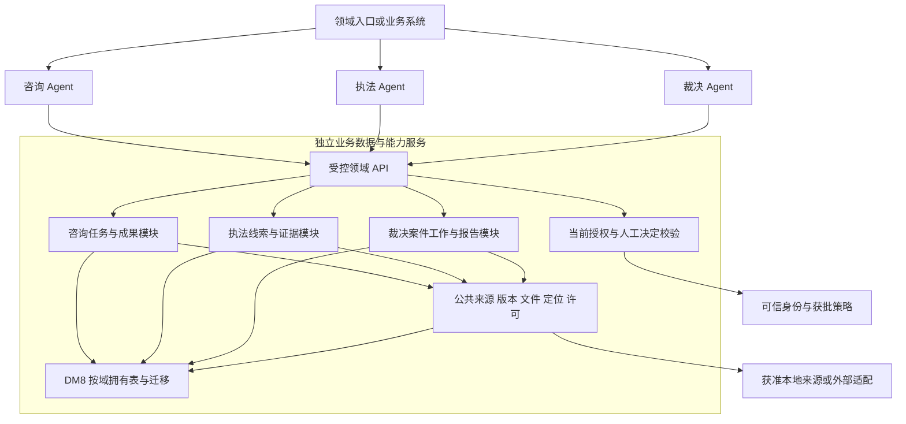

# 历史文档只读汇编（2026-10-06整理）

> **不参与当前调度，不是任务/状态台账。** 本文保留历史提案及旧计划段落的当时措辞；其中“当前”“立即执行”“已完成”只属于原日期和原范围。唯一实施文档为[总开发实现计划](../../08-总开发实现计划.md)。不得在此追加进度。

原始字节（含旧主计划、全部既有Markdown文档及其未提交内容）见[备份](original-documents.zip)，SHA及原路径见[source-manifest.json](source-manifest.json)。本文仅重定位可解析的相对链接并补导航锚点；不替代字节原件。

## 历史内容索引

- [旧主计划逐轮播报与旧执行控制台](#master-front)
- [旧主计划总体快照/工作流/分组任务表](#master-overview)
- [旧主计划执行日志](#master-logs)
- [旧主计划7.9至7.31设计与重排依据](#master-decisions)
- [旧主计划第9节各期下一步与限定设计](#master-next)
- [旧主计划维护规则与版本记录](#master-changes)
- [03-分期实施与里程碑.md](#doc-01)
- [07-高风险技术验证计划.md](#doc-02)
- [41-咨询助手第一版产品蓝图.md](#doc-03)
- [48-存量产品止损建议.md](#doc-04)
- [49-原始需求驱动的产品重定义建议.md](#doc-05)
- [50-Product Freeze Decision.md](#doc-06)
- [51-Product Freeze低成本预检与同类方案核查.md](#doc-07)
- [52-三智能体交付路径重排建议.md](#doc-08)
- [53-三智能体优化需求评审稿.md](#doc-09)
- [V2-项目整体评估报告.md](#doc-10)
- [阶段一-知识产权产品与架构独立探索报告.md](#doc-11)
- [阶段二-首条专利任务验证准备与预注册方案.md](#doc-12)
- [v2/14-roadmap-v2.md](#doc-13)

<a id="master-front"></a>

# 历史：旧主计划逐轮播报与旧执行控制台

<a id="master--三类知识产权智能助手总开发实现计划"></a>
# 三类知识产权智能助手总开发实现计划


**2026-10-05三独立Agent增量重构第二/三轮（整体IN_PROGRESS / PARTIAL）**：统一平台、三个独立Agent，未合并领域。V096加密Checkpoint生产适配、共享Gateway五类调用、三域独立Definition/Tool及Product JWT API、共享运行面板已编码；Runtime30、Checkpoint真实DM8隔离schema10、裁决Task H2/两独立DM8各5、前端21套79及构建通过。裁决辅助报告链工程验证不等于专业法律/状态分析或真人验收，咨询/执法完整Task闭环未验证。全量历史1122/0失败/20错误/119跳过、恢复后1128/0失败/46错误/40跳过均保留；其中42个固定Clock错误已测试代码修复并45项通过。隔离5323首次1116/0失败/10错误/40跳过，知识库前置自助恢复后最终 **1128/0失败/4错误/40跳过**，仍退出1；4个夹具/环境前置错误详原件，迁移参数名另修正且1项专项通过，不将全量4改写为3。原5311/5312实例及卷核实重启、冻结原包只读14项通过；自有5321/5323实例/卷已核标签清理，原5237/5311/5312保留。模型管理、全域V0收口、完整工作台/E2E/独立Golden评测仍未完成；主实现任务保持进行中，冻结任务不改。证据见[本轮原件与覆盖边界](../agent-runtime-20261005/round-03/verification.md)。


**2026-10-05三独立Agent增量重构第一轮**：用户明确调整优先级，新增共享平台/三Agent接线/模型/身份/工作台/评测/稳定性10任务，原冻结任务不重开。扫描清单与限定技术R/D完成；共享机械内核代码及27项真实文件/磁盘恢复与反例通过，内核生产DM8适配/三域正式接线未完成，主任务保持进行中（PARTIAL）。三域间实现依赖及kernel依赖护栏新增2项通过；前端74通过/构建0，源码未改、工作台不冒完成。14模块package0明确skipTests。全量回归platform-api1097项/0失败/20错误/119跳过，均缺既有执法实证DB/negative/recovery参数；当前未发现5311/5312运行环境，原失败保留，不改成跳过。verify前置1(STALE)、中段0、最终后置1(TESTS_FAILING)，47/41基线未变，不能声称全仓绿。详[本轮原件及覆盖边界](../agent-runtime-20261005/round-01/verification.md)。


**2026-10-05裁决03B-C2限定实现/C出口**：正式候选决定/确切更正/受控版本API、V093/U093、独立加密派生版本和同primary事务已实际完成；新39项及01/02/03A/C1/受影响Shared/CON/ENF合计33套248项0失败错误跳过。来源最早截止、并发/回滚、提交后失权保留回执、正式启用配置/H2应用重启均实测，真实DM8/真人采用仍未执行，03B进行中、03C/D不放行。初始登记脚本误匹配C1后继栏致伪重复03B/缺阶段退出，现恢复原C1行并登记独立C2；原失败保留、不归咎并行域、不冒先前结构通过。证据见[evidence](../adjudication-llm-materials-20261005/c2/implementation.md)。


计划版本：V9.599


本输入切片后置v885实际退出1，仅TEST_EVIDENCE_STALE；47文件/41契约基线一致，未再出现此前裁决字段缺失。v883结构实测0；comparison-v885-post-verify.log与comparison-v883-structure.log保留。专项72次通过不是全量验收，未修改其他域、旧全量报告或现存运行库，不把Worker待适配当外部资料等待项。


**2026-10-05 ComparisonInput代码/C收口**：PC-COMPARISON-INPUT-01交付正式创建/读取、current特征包/Task/Goal/Input精确绑定、当前材料与权限快照、不可变输入/前分析关系、真实候选QUEUED槽、Task锁/CAS/幂等/事件事务及V095/U095。公开回执不暴露内部授权快照。v882十套72次执行0失败/错误/跳过，其中新输入12场景、旧继承重复明示；源码/冻结SHA、十套XML及失败原件留存，v883结构0。详见[本轮证据](../consultation-search-20261002/comparison-input-v882.md)。v876/v884治理均仅TEST_EVIDENCE_STALE、47/41一致，后置另存实况。未改运行库、外呼模型或冒DM8/真人专业I/B；父任务保持进行中。剩余Worker接口需精确COMPARE/COMPARISON服务授权/委托，现有WRITE+QUERY和HUMAN-only来源签发不可直接复用为服务旁路；这是工程适配缺口，不是新增外部资料等待项。随后接矩阵计算/围栏业务提交/持久化/消费，不把QUEUED或空回调当执行完成。


**2026-10-05下一主链限定切片登记**：PC-COMPARISON-INPUT-01在IMP-CON-PRODUCT-COMPARE-01内进行中，依赖原对照R/D、来源前置及已交付PC-PREPARE-FEATURE-CONFIRM-01代码/C；退出为正式创建/读取ComparisonInput、current特征精确绑定、当前材料/权限快照、候选执行槽、Task锁/前指针CAS/幂等/事件原子事务及正逆/漂移/权限/回滚C。限定D见docs/adr/consultation-comparison-input-20261005.md，扫描最大V094采用V095/U095；不动运行库。现有Worker仅SEARCH/QUERY授权，不接作对照Worker；下一阶段按COMPARE/COMPARISON独立适配，不伪造模型矩阵或执行。v876前置实况另存，人工/DM8 I边界不变。


本轮后置v873实际退出1：47基线文件/41需求契约一致，仍为MISSING_PHASE/MISSING_ACCEPTANCE:IMP-ADJ-V2-TASK-03B及TEST_EVIDENCE_STALE；没有修改其他域台账、覆盖旧全量报告或假称全仓绿。v874独立结构退出0。实际原件分别见comparison-v873-post-verify.log与comparison-v874-structure.log；当前仅有限prepare/特征确认代码/C收口，父专业对照任务保持进行中，I/B边界不变。


**2026-10-05 prepare→显式特征确认切片代码/C收口**：PC-PREPARE-FEATURE-CONFIRM-01已交付正式路由、当前Task/Goal/Input与材料用途重核、不可变FeatureRevision/父版/UTF8跨度、Task锁/CAS/幂等回执/审计原子事务及V094/U094；不保存第三方正文片段。详见[本轮证据](../consultation-search-20261002/comparison-prepare-feature-v872.md)。v871九套58次执行全通过，v872新增预算/目标权项缺口反例专项18次全通过，继承重复明示；源码/冻结SHA、XML和失败原件保留，v869结构退出0。v863前置真实1：47/41一致，裁决轨道MISSING_PHASE/MISSING_ACCEPTANCE与TEST_EVIDENCE_STALE，未改其他域或刷新旧报告冒绿。本有限切片不扩矩阵Worker/页面/专业B，真实DM8/HTTP I和真人确认未验证；父IMP-CON-PRODUCT-COMPARE-01仍进行中。下一主链缺口为精确FeatureRevision→ComparisonInput→矩阵Worker事务提交/持久化/消费，须对应限定门禁，不以本轮C冒完整对照/业务验收。


**2026-10-05专业对照有限纵切登记**：PC-PREPARE-FEATURE-CONFIRM-01在IMP-CON-PRODUCT-COMPARE-01内进行中，依赖已过原对照D、PC-TARGET-ORIGINAL-01及Source原件/COMPARISON签发适配；退出为正式prepare API、显式确认/CAS/不可变FeatureRevision与原文跨度/父修订、审计/幂等回执同事务、授权读取及正逆/回滚/严格JSON/漂移拒绝C和受影响回归。仅到特征确认，不开启矩阵/Worker/页面/专业B。限定物理D见docs/adr/consultation-prepare-feature-20261005.md；当前最大V092，保留V093供裁决并发轨道，本切片采用V094/U094，不改旧迁移或现存运行库。v860前置仅TEST_EVIDENCE_STALE，47/41一致；Docker/生产证书/真人确认只阻对应I/B，机器C不代填。更新前重读合并，未建自动调度。


本轮后置实况：v857首次在写派生project-plan.json时出现UNKNOWN文件错误，未删/改派生文件或权威主计划绕过；属性核查后v858一次正常重试已生成677任务派生视图，47/41一致，最终仅TEST_EVIDENCE_STALE。未刷新旧后端报告或冒全仓绿，IMP-CON-PRODUCT-COMPARE-01仍进行中。该瞬时生成失败日志与重试日志均保留；后续治理检查原件另存。


**专业对照剩余主链接续实证（2026-10-04）**：按用户继续指令交付PC-SOURCE-COMPARISON-ISSUE-01正式维护签发代码及PC-TARGET-ORIGINAL-01用户技术方案原件读取适配，详见[主链专项证据](../consultation-search-20261002/comparison-mainchain-v854.md)。正式SourceScope维护入口固定COMPARE/COMPARISON，同SOURCES+GRANTS主体/组织、Task/Source/Scope精确版、逐字段用途截止和独立水位，Grant/审计复用，不隐含Query/Display/Model；用户显式messageId从正式已存原文核Task READ/版/SHA/期限与UTF8定位，不从query造方案。v849/v850两个实际失败分别揭示漏V042及DB旧CHECK缺COMPARISON，保留失败原件，补真实迁移而未降约束；V092/U092精确复审及H2正逆/有新值拒绝回退通过，未应用运行库或冒DM8 I。v854最新9套39项0失败/错误/跳过，24文件SHA/9套XML/迁移原件齐全；v855结构实际0。原矩阵/原件v845证据复用。两切片代码/C完成而实际部署I未验证；完整prepare/特征确认持久化、ComparisonInput/矩阵/Worker提交、报告/工作面仍待继续，不冒专业B/业务验收，不结案。v856当前Docker runtime socket仍不可连接，不外呼模型、不复活权限、不触碰其他域。前置v848仅TEST_EVIDENCE_STALE、47/41一致；后置另留真实日志，不假称全仓绿。


PC-TARGET-ORIGINAL-01在IMP-CON-PRODUCT-COMPARE-01内实施：依赖原对照D §2/5及既有正式Task消息/当前权限；退出为用户显式指定已持久化技术方案messageId，按Task READ/精确Task版/消息SHA与期限读取不可变原文及UTF8特征跨度，拒绝跨Task/旧版/过期/假SHA/撤权和拆半字符；不从query拼目标、不造原件文件、不新增独立开发入口。只为prepare提供正式内部读取适配，未把它称prepare/确认/矩阵持久化或页面已完成；两种目标中的精确目标专利入口继续按来源权限接线。


PC-SOURCE-COMPARISON-ISSUE-01物理约束补丁：v849机械测试因遗漏V042当前Task状态迁移失败，已补实际迁移而未降约束；v850进一步发现V037数据库用途枚举不含COMPARISON。核当前最大V091后登记V092/U092仅扩展既有ck_con4_field_use，正逆临时约束保护、带新值拒绝逆迁移，不删记录、不改旧迁移；精确物理设计复审在对照ADR §11，实施及C继续，真实DM8 I待环境。之前用途识别/读取C不能替代这个物理缺口，保持IMP-CON-PRODUCT-COMPARE-01进行中。


**专业对照正式维护签发切片登记（2026-10-04）**：PC-SOURCE-COMPARISON-ISSUE-01在IMP-CON-PRODUCT-COMPARE-01内实施，依赖原对照D §5/10与已交付COMPARISON读取守卫；退出为正式SOURCES+GRANTS维护身份在现时Task/Source/Scope精确版下签发COMPARE/COMPARISON Grant，独立Grant/Source水位、请求摘要/幂等和审计均复用，字段用途不足、跨组织/Task、撤权/停用、过期/旧版与重放冲突拒绝。不得附带QUERY/DISPLAY/MODEL用途，不自动创建来源决议或复活到期权限。依据原D细化§11，不重新设计身份或来源底座。随后同任务推进prepare/确认与持久化，物理表须精确设计复审后编码，不以C冒DM8 I。v848前置仅TEST_EVIDENCE_STALE，47/41一致。


**裁决按顺序完成归属复核并启动03B（2026-10-04）**：原20项错误仍未过，但从原R/D及具体调用图正式核定其仅ENF自有机制/产品对账，不追加为03A前置；[限定03A技术退出](../../adr/adjudication-03a-exit-scope-20261004.md)真实第2次模型HTTP/16候选/加密DM8重启和适用权限/来源异常具证，48个ADJ主源与实包不变，旧原生范围仍第1次。当前Docker不可用不冒部署可用、全仓/专业验收不通过。随后[03B当前详细D](../../adr/adjudication-material-decisions-20261004.md)通过并新增仅领域两文件：ACCEPT/EDIT/REJECT、确切人工更正、双版本/源定位/期限及不升级事实状态，C1新30项通过、31套209项受影响机械回归通过；并行CON后改图逻辑不冒覆盖，自有20源再冻结4套84项通过。[代码/证据](../adjudication-llm-materials-20261004/exit-contract-02/03b-c1-implementation.md)明确无03B API/DM8/真人采用/页面完成；03B进行中、03C/D未开始。后置以verify-final.log实际结果为准，最近全仓freshness为并行CON新测试晚于原报告，未改其状态或刷旧报告冒绿；47文件41契约一致。0新模型请求、旧2次账本不改、撤源/stale不复活、无定时续行。


**专业对照本轮实际交付（2026-10-04）**：原件/权项展开、矩阵和现时COMPARISON用途读取三个切片已交付代码及C，详见[原件和权限证据](../consultation-search-20261002/comparison-core-authority-v843.md)。v845最新实际退出0，40项0失败/错误/跳过，12个额外覆盖源SHA与8套XML完整保存；含2500层显式栈、中文引用保守拒绝、矩阵遗漏前项/混入无关项拒绝、逐字段COMPARISON与精确COMPARE/COMPARISON Grant拒绝反例及原DISPLAY/Query准入兼容。真实40篇原件映射、36闭包和4篇具名缺口保持；不冒真实成员/Worker或模型执行、DM8 I、专业效果B。v846独立结构检查实际0。v844后置实际1仅TEST_EVIDENCE_STALE，需求47/41一致；未刷新全量报告冒通过。正式维护精确签发、prepare/明确特征确认、物理持久化及Worker/API/工作面仍在IMP-CON-PRODUCT-COMPARE-01持续实施，不将本轮C称可操作对照或任务完成。Docker现时socket仍不可连接，只阻真实运行I，不把它列为代码/C前置；不外呼付费模型、不复活来源授权、不触碰其他域。


**专业对照现时用途守卫切片登记（2026-10-04）**：在IMP-CON-PRODUCT-COMPARE-01内继续PC-SOURCE-COMPARISON-GUARD-01，依赖已过原D §5及现时Source/Grant机制；退出为Source Registry逐字段COMPARISON用途识别和精确SOURCE_SCOPE/COMPARE/COMPARISON读取守卫，QUERY/DISPLAY不得替代，独立水位与Task/Source版仍逐请求核验，机械正反C与旧DISPLAY兼容分别验证。只增加既定用途的精确适配，不自动签发/续期、不更改既有来源决议，不开放原件入模或伪称已接正式HTTP。正式维护签发、prepare/确认、持久化、Worker和工作面继续在原任务推进。v840前置实际1仅TEST_EVIDENCE_STALE，47/41基线一致，保留失败不降检查标准。


**专业对照原件/权项首段C及矩阵切片登记（2026-10-04）**：PC-ORIGINAL-LOCATOR-01已实现OriginalClaimText/PatentClaimGraph及ProductPatentClaimOriginal。冻结model-v836基线另覆盖本次四文件；v837实际6项0失败/错误/跳过，40篇真实CLAIMS全部可核原字节映射，36篇权项图闭包通过、4篇需确认/依赖缺口。机械Unicode/引用故障只作C，真实采集离线解析不冒现时授权HTTP或专业效果；新加至少一篇真实图通过断言后继续复跑。v838后置检查实际1：两来源任务已完成漏填完成日期的COMPLETED_WITHOUT_EVIDENCE已按真实2026-10-04补齐，不改检查标准；本次新增业务源也导致TEST_EVIDENCE_STALE，不称全仓绿。计划登记期间有其他会话推进，重读合并后更新，不覆盖别域。


立即在同IMP-CON-PRODUCT-COMPARE-01登记PC-MATRIX-CONTRACT-01，依赖原对照D §4～6及已实现原件/权项内核；状态实施中，退出为确认特征乘候选权项分支完整唯一的版本绑定矩阵、原字节核验、差异/未知/未分析语义与缺行/假引用/错版反例。此为原D内领域内核，不引入检索分数、百分数/法律结论、不签Review/Grant。正式用途、持久化、Worker/API和真实模型执行仍在同任务接入，不把内核C当可操作业务闭环。


**专业技术对照优先与来源前置实际收口（2026-10-04）**：用户明确要求持续推进专业技术对照；保持调度取消，仅本会话执行。前置comparison-v834-pre-verify.log实际0、47/41一致。按[v835原退出逐项复核](../consultation-search-20261002/comparison-source-dependency-review-v835.md)，45个来源实现/测试文件与v816冻结SHA全部一致，v511～v546及v518～v528真实正式范围/查询/选择/CLAIMS原文/定位/撤权和到V088恢复已满足源中立与首个实际来源技术退出；旧Source-01“无适配/未开始”为后续Search已交付能力的过时记录。收口IMP-CON-PRODUCT-SOURCE-ENGINE-01和IMP-CON-PRODUCT-SOURCE-01，仅implemented及所列C/I，不冒第三方全部权利/专业B/生产/性能或V089新恢复。按原依赖释放IMP-CON-PRODUCT-COMPARE-01为进行中，不重开ARC-CON-PRODUCT-COMPARE-D-01、不跳完整ARC-CON-COMPARE-03门禁。


在IMP-CON-PRODUCT-COMPARE-01内先登记PC-ORIGINAL-LOCATOR-01切片：依赖CON-06已过R、原对照D §2～3/5及上述已完成来源接入；退出为最终原件UTF8/JSON转义映射、具体字节证据SHA/跨度、独立及从属权项显式编号/引用闭包与歧义拒绝的领域内核和正式采集格式适配，真实既存原件离线解析及机械正反C，后续正式Task/用途/确认/矩阵路由仍在同任务持续接入。状态实施中，不以该内核完成称已可操作对照，不提前放行纠正/人工/评分/外观。当前Docker不可连接只阻真实运行I，不阻已过D的代码/C；不借到期授权调用，不直接写状态/Grant，不外呼付费模型或默认把CLAIMS发供应商。完整矩阵、原件入模用途及正式HTTP/DM8/工作面另逐实证；同Task版本、模型边界及现时权限全部复用最终合同。


**咨询旧模型历史保留/恢复拒绝限定批准（2026-10-04）**：项目负责人本会话直接回复“保留这条旧记录及审计，承认包含它的完整模型恢复仍不可通过”，决定CON-MODEL-HISTORY-USER-20261004-01/v1，[原回复、责任方、日期及精确范围](../consultation-search-20261002/history-treatment-user-approval-20261004.json)。已同步docs71 §10及docs02 §83，仅turn ca954cbd-3099-4833-8696-5d6d6f3a8d8d的原样保留/审计和含该行完整V089模型恢复继续拒绝获批准；不再把这个决定列为待负责人输入。批准没有补齐真实供应商原封套，不删除/UPDATE旧行、不伪造raw、不重生成调用、不放宽验证、不增豁免或部分恢复状态，不改变现行期限，也不批准Task/行排除或部分恢复功能。缺原件技术边界、新V089联合物理包待验证、人工Golden/V1 NOT_OBSERVED和Search性能失败继续保留；旧V088实证及现5443服务不推翻，IMP-CON-PRODUCT-RECOVERY-01、IMP-CON-SEARCH-02和IMP-CON-LLM-RETRIEVAL-01状态不变，调度保持取消。本轮仅决定/证据文档变更，无业务代码/运行库/授权/部署操作。前置[v832](../consultation-search-20261002/history-decision-v832-pre-verify.log)实际退出0，47文件/41台账一致；这是当前治理检查通过，不将其他会话更新后的freshness等同本轮完整后端重跑、模型物理恢复或业务验收。后置检查单独保留，不恢复定时任务或自动扩大下一步范围。


**裁决03A一次性有限退出收口（2026-10-04）**：原20错误均从XML逐一核suite/test、配置、manifest、库与覆盖范围；当前1193源文件SHA绑定受影响23套129项、兼容7套50项通过，确切13身份接线类与上轮实包一致。[限定复核](../adjudication-llm-materials-20261004/exit-scope-01/exit-scope-review.md)不以包名或179项机械通过冒全域兼容/物理I。6项新隔离机制因Docker Linux engine不可用未执行，14项缺匹配当前ENF产品上下文；不启动Docker牵动其他服务，不连接事故库、不补固定ID或借旧manifest。冻结D不要求每次新HTTP run重复组件原生导入，旧备份范围仍仅第1次、新第2次仅实际API/DM8重启证据。03A仍进行中、03B/C/D不放行；0新外呼、不变原2次账本、撤源与stale不复活，01/02和CON/ENF任务不改。前置verify1/freshness，当前定向准确同步后verify0/47文件41契约；有限执行完成即止，不新建定时任务。


**咨询一次性收口及无人值守调度取消（2026-10-04）**：按协调会话01a101d1-e245-7450-bce1-51bd83d76324转达的最新用户指令，本日持续调度提前结束；协调会话已报告删除automation-2，本轮没有创建/恢复定时任务。RUN-CON-UNATTENDED-20261004-01改为取消，仅结束调度，不改变IMP-CON-SEARCH-02、IMP-CON-LLM-RETRIEVAL-01或IMP-CON-PRODUCT-RECOVERY-01进行中状态。今日实际产物为v794～v827只读性能归因/两轮无稳定收益候选否决、Registry原物理证据复用、REC-MODEL-RETENTION-01和REC-MODEL-RESTORE-01最小正式代码及C/当前只读I；正式5443/运行库/授权/原件未改，无新增付费模型调用/新库卷/性能候选。本轮[当前受影响源码与原报告复用审计v830](../consultation-search-20261002/closeout-v830-affected-source-report-reuse.json)逐项核v816八文件及六个相关依赖/测试的14项SHA，全部与当前源码相同，复用v817五套24项0失败/错误/跳过原XML，不重复已证测试或连其他域库。原v817 stdout为0字节，通过项以保留XML为依据，不伪称本轮重新执行。前置[v829](../consultation-search-20261002/closeout-v829-pre-verify.log)实际1/TEST_EVIDENCE_STALE，47基线/41台账一致；现有全量457套1525项0失败/错误39跳过报告截至09:49:22 +08，早于本轮自身恢复源变更，不能把陈旧只归因外域，也不借并发其他域源或旧全量称现时全仓绿色。本轮未改mtime/覆盖失败/反复跑绿，后置检查单独保存。


恢复证据逐层收口：REC-MODEL两窄切片已实现并完成所列组件验证；模型保留当前DM8读取19行/1依据与BKP同集合SHA已证；恢复语义当前19行18通过、1拒绝PROVIDER_ORIGINAL，非完整联合恢复通过。含V089的新认证DB+文件联合物理包/恢复开放尚未验证，本轮不停止5443或新写主库。旧v518～v528到V088的恢复证据及现服务未被该旧模型缺口推翻；组件/H2机械反例、当前真实只读、旧物理包和未来生产/业务验收分开，不将implemented或组件verified升级accepted。人工Golden/V1时间/核查/修改成本仍NOT_OBSERVED，不填0、不催人工；冷496.2594/热302.4466ms原SLO失败保留且不新增实验。唯一历史处理决定见[docs71 §10未批准提案](../../71-真实模型咨询检索闭环最小设计.md)：是否允许保留确切turn ca954cbd-3099-4833-8696-5d6d6f3a8d8d及审计原样，承认含该行完整V089恢复不可通过，将未来不受影响范围恢复另行过D；否则须确切调用绑定真实原档及正式补证合同。提案不是批准/新门禁通过，缺原封套分支继续拒绝，不再全盘搜索、拼造raw、删/UPDATE旧行或引入豁免状态。本轮有限出口已完成，回复后停止，不延续今日无人值守循环。


**咨询完整历史取数耗时细分（2026-10-04）**：RUN-CON-UNATTENDED-20261004-01 / IMP-CON-SEARCH-02，沿v802剩余fetch/framework大段只读归因，不尝试已否决的fetch4096/扩池/framing候选。MeasureConsultationHistoryStages仅新增ResultSet.next计时与实际statementFetchSize校验，冻结v750最终完整历史SQL/原字段/排序/摘要不变；JDK21编译0，[v827实际诊断](../consultation-search-20261002/unattended-v827-resultset-stages.log)退出0，两轮各100次/10并发，每次1605行/1606次next、实际fetch256，全部摘要等于独立generation553/READY，前后状态不变，零DB写入/零模型调用/无新业务请求或授权。第二轮total p95=91.7398ms，连接/prepare/execute/回调/next/其余框架均值分别0.019991/2.096757/20.14316/3.7039/40.56062/2.794192ms；next p95=64.0603ms，各段p95不可相加。第一轮total p95=233.3459ms，包含诊断代理及JIT初始化，不冒正式冷启动。结果将原未分段余量主要定位于驱动next路径，而非连接池等待或规范摘要CPU；next包含缓冲遍历/取数/网络及调度，未证明服务器SQL或网络单独占比，不能据此省行、省校验、缓存授权或盲改fetch。新增ResultSet反射代理有测量开销，此本机组件不替代8CPU/4GiB正式HTTP冷热SLO，496.2594/302.4466ms原失败及任务进行中保留。脚本SHA 327ff4a8b6e208fdecc2b0359a4d4f304901a5c1944b76fb91dd3431b3d867ac；正式包/配置未修改。前置[v826](../consultation-search-20261002/unattended-v826-resultset-stages-pre-verify.log)实际1/TEST_EVIDENCE_STALE，47/41基线未变；不刷新相同失败冒新全量通过，后置检查原件单独保存。


**咨询Registry既有物理退出证据复用（2026-10-04）**：本轮仅核IMP-CON-PRODUCT-SOURCE-REGISTRY-01已有DM8正逆迁移/持久重开证据，不重跑物理测试、不创建schema、不调用到期授权、不触碰运行库或其他域。找到search-v500冻结构建留存的[ProductSourceCandidatesDm8Test实际报告](../consultation-search-20261002/unattended-v824-reused-source-candidates-dm8.xml)，文件保留时间2026-10-03 04:30:19 +08，1项/0失败/0错误/0跳过，耗时0.468s，原件SHA bf99480b2f0f6db1b8046cb7744559b99bb341a20a32971596e3d4f5270ba732；测试源码SHA 80765579b9514f5d90078203ce34e10e416352e793db30028f9d47037d4e7f8c与[search-v500输入封印](../consultation-search-20261002/search-v500-build-inputs.json)、当前源码一致。此测试实际执行V036→V088、正式候选服务注册、重新构造服务读取并CAS撤回、2条持久事件、U088→U036；证明该范围真实DM8迁移与服务重开，不冒OS/完整API进程重启、不冒真实来源准入或具名操作人业务验收。机械声明及operator#certificate仅数据库技术反例输入，未接入产品来源。相关v502全量记录已在search-product-release-v410.md留存；现时全仓新代码不能借旧全量称绿。任务仍进行中，下一步仅核正式部署完整重启/幂等回执和其余退出项已有证据是否足够，不再把该迁移/重开项列为缺失而重复建库。前置[v823](../consultation-search-20261002/unattended-v823-registry-exit-pre-verify.log)实际1/TEST_EVIDENCE_STALE，47/41无变；本轮无产品代码或门禁状态变化。


**咨询历史模型恢复校验实际C与当前真实行复核（2026-10-04）**：IMP-CON-PRODUCT-RECOVERY-01 / REC-MODEL-RESTORE-01已实现ProductModelTurnRecoveryVerifier并接入正式ProductTaskRecoveryCheck，在Task/Source/Search历史闭包之后、外置现时高水位最终复核之前运行；无新路由/模型外呼/写库/权限/期限。复用元数据兼容及保留文件核验，校验Task历史版/期限、原入模第一页及同Task/resultSha/文献版本、原供应商输出与成功结构引用；历史失败保持失败，request_sha不冒最小化JSON重算证明。冻结[model-v816源输入](../consultation-search-20261002/model-v816-build-inputs.json)与[8文件确切SHA覆盖](../consultation-search-20261002/unattended-v816-model-restore-inputs.json)，只新增当前咨询恢复切片、不复制其他域并发修改。[v817](../consultation-search-20261002/unattended-v817-model-restore-directed.log)实际退出0，五套24项0失败/错误/跳过，含恢复11、保留引用5、保留2、封包1、模型输出5；实际V089 DDL在H2执行，过期合法历史/旧schema/失败审计不升级/异Task/异版/错SHA/错成员版/错页/未知引用/JSON重复/尾随/坏原封套/原件漂移正反C通过。[原报告](../consultation-search-20261002/model-restore-v817-reports/TEST-cn.xinji.agentplatform.security.product.ProductModelTurnRecoveryVerifierTest.xml)及同目录四套保留；机械供应商封套仅防御C，不冒真实模型调用或物理恢复。[v818当前真实DM8只读](../consultation-search-20261002/unattended-v818-model-restore-readonly.log)对19条真实留存18通过、1拒绝PROVIDER_ORIGINAL，独立generation553/READY前后不变，零写入/零模型调用；工具退出0只表示审计完成，不表示19条完整闭包通过。[v819单条结构定位](../consultation-search-20261002/unattended-v819-model-restore-rejected-metadata.log)确认turn ca954cbd-3099-4833-8696-5d6d6f3a8d8d留存297字符JSON不含model/choices/原content；既有model-v679-dm8.log证明它是Task96fd2d1b-9739-40f5-8f3c-800c99468006版1/PROPOSAL、deepseek-chat、RETRIEVAL_DIALOGUE/v1旧行，不能误写成后来的失败回合。当前工作区及受控运行目录按确切turnId查到的v675产品响应和v679/v688审计没有可直接补成供应商原封套的原件；不从结构输出拼造raw，不直接更新/删除旧行，不放宽恢复。该记录原封套是此历史模型语义恢复分支的具体残缺证据，owner开发团队Codex，exit取得与该调用确切绑定的真实原封套/既存不可变档案并按正式可追溯机制处理，或另经明确最终历史处理规则变更；当前规则不代签豁免。只阻含此旧行的完整模型恢复核证，不回退已过Task/Source/旧V088恢复，也不冻结独立技术工作。新含V089认证联合物理包/正常与拒绝恢复请求仍另证，未停正式5443或发行候选。后置[v820](../consultation-search-20261002/unattended-v820-model-restore-post-verify.log)47/41检查通过后在并发生成project-plan.json遇UNKNOWN/open，未删除或改文件权限；一次[v821重试](../consultation-search-20261002/unattended-v821-model-restore-verify-retry.log)生成成功，实际1/TEST_EVIDENCE_STALE（含本轮自身源变更须纳入后续全量），不称全仓绿。原性能失败、人工Golden/V1未观测及总体任务进行中均保留。


**咨询历史模型恢复校验切片登记（2026-10-04）**：IMP-CON-PRODUCT-RECOVERY-01内REC-MODEL-RESTORE-01，依赖CON-12已过R、ARC-CON-PRODUCT-RECOVERY-D-01、docs71 §3～5及REC-MODEL-RETENTION-01已实现/C/当前只读I；限定[docs71范围段D](../../71-真实模型咨询检索闭环最小设计.md)两遍通过，不重开原D、不另建任务状态表。最小正式只读后置校验Task/历史版/保留、实际结果第一页、供应商原输出与成功结构引用、原失败审计；request_sha不与最小化JSON假重算，不升级旧失败，不删/伪造历史。状态实施中，退出为原恢复命令接线、正反C、当前真实行只读核查与实际缺口记录；认证新物理包及开放另证，不停5443、不外呼模型、不写运行库。前置[v813](../consultation-search-20261002/unattended-v813-model-restore-pre-verify.log)实际1/TEST_EVIDENCE_STALE，47/41未变；v814记录期间遇其他会话版本更新，重读合并后登记，不覆盖别域。本轮不以专项C代全仓。


**咨询模型保留引用切片实际C与当前DM8只读I（2026-10-04）**：IMP-CON-PRODUCT-RECOVERY-01 / REC-MODEL-RETENTION-01已补最终ProductModelTurnRetentionReferences，在ProductTaskBackupRetention决议覆盖和ProductTaskBackupCommand文件集合两个正式位置复用；所有模型历史行参与，不以业务过期跳过，ref/SHA非法/冲突及查询失败拒绝，旧无V089 schema不伪造引用。此切片只补保留原件闭包，未把全模型恢复任务结案。前置[v805](../consultation-search-20261002/unattended-v805-model-retention-pre-verify.log)与D后[v806](../consultation-search-20261002/unattended-v806-model-retention-design-verify.log)均实际1/TEST_EVIDENCE_STALE、47/41一致；无检查绕过。冻结既有1154源快照[model-v807](../consultation-search-20261002/model-v807-build-inputs.json)加[5文件确切SHA覆盖](../consultation-search-20261002/unattended-v807-model-retention-inputs.json)，不复制别域并发修改。v807准备器已完成而外层误读继承LASTEXITCODE=1，随后逐原SHA验证后继续；[v808](../consultation-search-20261002/unattended-v808-model-retention-directed.log)为PowerShell未引号-D参数拆分，未运行测试；修正命令后[v809](../consultation-search-20261002/unattended-v809-model-retention-directed.log)实际退出0，四套13项0失败/错误/跳过，含模型引用5、保留2、封包1、模型输出5。[报告原件](../consultation-search-20261002/model-retention-v809-reports/TEST-cn.xinji.agentplatform.security.product.ProductModelTurnRetentionReferencesTest.xml)及同目录其余三套保存；H2负例是机械C，不冒真实模型/物理包。代码反查两个收集点均在existing files.verified前，保留决议覆盖仍为精确集合，旧正向到期业务不拖死包期限反例通过。[v810](../consultation-search-20261002/unattended-v810-model-retention-dm8-readonly.log)使用同最终收集器在当前5301主身份及正式CONPROD_BKP只读验证19条真实模型留存、1个保留ref，两身份集合SHA相同87be4ccfa4275ec6272aadaa4f5d9b515d96ed1e313531cfe5d0ec7a560de5d0，零DB写入/零模型调用；仅证明元数据可见及当前真实引用收集，不冒DB+文件备份/恢复/开放。[v811后置verify-all](../consultation-search-20261002/unattended-v811-model-retention-post-verify.log)实际1/TEST_EVIDENCE_STALE，本轮咨询自身业务源修改也须纳入后续全量证据，不能继续只归因其他域；不为四套C覆盖全仓报告。正式5443精确容器/启动时间不变，未发行候选、停服务、改Grant/原件或创建库卷。仍缺模型内容/请求/引用历史语义恢复校验及含V089的新真实联合包，人工Golden/V1与性能失败独立保留。


**咨询模型保留引用最小实施切片登记（2026-10-04）**：IMP-CON-PRODUCT-RECOVERY-01内稳定切片REC-MODEL-RETENTION-01，依赖CON-12已过R、ARC-CON-PRODUCT-RECOVERY-D-01、docs71 §3及V089最终表合同，不另建状态体系。实际代码反查BackupRetention/BackupCommand遗漏模型历史独有保留引用，不依赖同Goal引用偶然重复。[docs71范围段限定D](../../71-真实模型咨询检索闭环最小设计.md)已两遍正反闭合，只补同一只读引用收集器→保留决议覆盖→正式封包文件集合；不新增期限/状态/授权，不启动模型/物理备份/停服务。状态实施中，退出为两个正式收集点接线、遗漏/冲突/坏SHA/坏文件/到期历史及旧schema正反C、反查与回写；新真实联合包及模型内容/结果语义恢复保持另证。前置[v805](../consultation-search-20261002/unattended-v805-model-retention-pre-verify.log)实际1/独立TEST_EVIDENCE_STALE，47/41未变，未绕过检查或修改其他域。


**咨询本轮检查与恢复覆盖边界（2026-10-04）**：[v803后置verify-all](../consultation-search-20261002/unattended-v803-post-verify.log)实际退出1，仅TEST_EVIDENCE_STALE，47基线/41契约一致；机器证据最近Java报告2026-10-04 09:49:22.557 +08，执法EnforcementDm8IsolationGuard/其测试于10:39:09及RealBusinessCollectionDm8Test于10:39:50更新，当前咨询诊断脚本不属于该业务源变更，不修改其他域或重复其全量运行，不将v800历史0冒当前0。只读反查docs71 §3、db/dm8/V089__product_consultation_model_turn.sql、ProductRetrievalDialogue、ProductTaskRecoveryCheck及ProductTaskRecoveryVerifier：正式备份仍SCHEMAS=CONPROD包含新模型表，但现有恢复校验调用Task/Source/原件/Search核验，未单独核con3_model_turn请求/输出/结果关联；既有v518物理包早于该表及新回合。将“最新模型回合恢复闭包校验尚无覆盖”保留为IMP-CON-PRODUCT-RECOVERY-01的具体技术缺项，不说当前全部恢复失败，不修改已过D/旧Task物理结论，不执行需停止5443的备份。后续最小工作须沿docs71原留存合同核原始请求/机器输出、Task版、resultSet/resultSha、引用及现时授权分离，不增加新保留期限/法律规则/模型调用；专项实现需先登记对应原任务切片及最小设计证据，组件闭包与真实新同批物理恢复分别取证。当前正式运行容器/canonical不变、没有新库/卷/Grant或过期对象续签；性能、人工Golden和最新恢复缺口均不提前关闭。


**咨询完整历史分段只读归因及过时备注纠正（2026-10-04）**：同RUN-CON-UNATTENDED-20261004-01 / IMP-CON-SEARCH-02，新增scripts/MeasureConsultationHistoryStages.java只包装冻结v750正式完整历史查询，不改SQL/字段/排序/fetch256/摘要/独立现时水位、不提交业务请求。首个编译因JdbcTemplate.call同名解析失败后已限定工具类名，随后实际编译0；[v801](../consultation-search-20261002/unattended-v801-history-stages.log)因托管SecureString读取类型错误在连接前失败，修正类型后[v802](../consultation-search-20261002/unattended-v802-history-stages.log)实际退出0，两轮各100次/10并发/每次1605条，完整SHA皆匹配独立generation553/READY且前后不变。两轮总p95=133.798/84.8686ms；第二轮连接获取/prepare/executeQuery/行回调/其余取数框架均值分别0.013871/1.75757/16.803251/2.260066/36.375859ms，对应p95=0.0269/2.6654/20.6948/2.7087/62.0755ms。各段p95不可相加，executeQuery含驱动/网络而非纯服务器SQL，回调含getString/规范摘要而非纯CPU，其余含ResultSet.next、绑定/清理及插桩开销；本机只读归因不是正式HTTP冷热SLO。结论：当前数据不支持扩连接池或继续framing微调；docs70已有v78/v80 fetch4096和minimumIdle10端到端/交替收益不稳定的否决，直接复用、不重复该假设。正式5443精确容器仍40f8efdff24f06b5027ef91ece5551129d576f2d4efdd2eb1d87f4a560fb8145/running，canonical部署与v770文件SHA相同；零DB写入/无新模型调用。核对v417/v512～v515/v518～v528/v546/v760/v763实际后续证据，已纠正身份、TaskScope、Registry、Engine、Recovery五任务行的早期“无正式请求/无真实备份”等过时限制；保留各任务进行中、原依赖/退出条件，未用后续浏览器通过自动代替所有专项退出。最新V089模型回合及新原件不由到V088的v518旧包自动证明同批物理恢复，未来生产及业务验收另记。继续未覆盖专项退出/安全离线闭包复核，不重做原物理演练、不复活过期授权、不放行专业分支。


**咨询无人值守性能候选实际结论（2026-10-04）**：RUN-CON-UNATTENDED-20261004-01 / IMP-CON-SEARCH-02复用旧录制只读归因[v795](../consultation-search-20261002/unattended-v795-offline-jfr-kinds.json)，不把v602录制延迟冒无JFR正式SLO。候选仅在私有独立目录编译，正式业务源/运行包不变；[v797](../consultation-search-20261002/unattended-v797-framing-abba.log)边界预检先发现长度前缀局部变量问题，修正后103项Unicode/null/长值/复用摘要等价通过。现时独立Grant generation553/READY且无intent，完整历史SHA逐次一致；[v798 ABBA](../consultation-search-20261002/unattended-v798-framing-abba.json)与[v799 BAAB](../consultation-search-20261002/unattended-v799-framing-baab.json)各400次真实历史只读、10并发，p95依次116.2078/79.5653/69.0649/82.8771ms和170.329/102.0477/72.3845/94.1687ms。候选分配量稳定减少约19.7%，但反序尾延迟未稳定获益，因此不合入、不部署，停止同类framing微变体；这些是本机池化JVM组件证据，不是8CPU/4GiB HTTP冷/热验收。零DB写入/零模型调用/无授权缓存或校验省略，496.2594/302.4466ms原SLO失败保留，IMP-CON-SEARCH-02不结案。诊断脚本SHA256：AnalyzeConsultationColdStages=964c57580360687f9ea66993c8a10180dcf0da793d5317f3de2ea0ef31d69aa4，MeasureConsultationFramingCandidate=12246b30b5a25eeee838baf6490ed6bf68cbe90b17ac1c860d390342dc3c5fb7；隔离候选源SHA256=fdfa61d538315a58bce99d024af904a744302503eb2556d9361c1c99f02e8f61。[v800前置治理检查](../consultation-search-20261002/unattended-v800-pre-verify.log)实际退出0、47/41未变。继续独立技术退出证据核对或不同机制归因，不以无稳定收益候选制造完成。


**咨询今日无人值守技术推进授权（2026-10-04，至北京时间23:59）**：登记RUN-CON-UNATTENDED-20261004-01，人工Golden及V1工时保持NOT_OBSERVED，今天不催真人/不自动代填。本日用户明确恢复独立IMP-CON-SEARCH-02性能归因及小步安全优化，覆盖此前“停止新增性能候选”的当日执行限制，不改变原冷/热各100次10并发、p95<300ms、8CPU/4GiB、全部原件/现时权限核验及模型切片不受性能前置的合同；496.259/302.447ms原失败不删、不结案。只准已过R/D/依赖任务的产品技术缺项和回归，专业对照/纠正/人工回流/成果的未过门分支不启动。先复用v657/v660/v662分段、v651/v664失败归因，不重复已完成Task/身份/恢复/Benchmark；优先读既有JFR找新的请求级CPU/编译/分配归因，单一假设→受控独立验证→记录收益/无收益，两个同类无收益即转其他证据支持方向。不缓存授权、不省水位/原件校验、不延长复活旧授权、不额外付费模型。正式5443/5311/5312/5370及所有其他轨道不停止、不写入、不改代码/身份/预算；性能候选不得替代正式运行包。需新运行对象时只限原最终维护合同及新审计，缺安全条件做离线/获准隔离工作，不接过期来源。今天定时续行复用已有本线程heartbeat automation-2（每30分钟，截止2026-10-04 23:59），不新建重复调度；截止后不启动新工作，完成安全事务收尾，保留未完成任务。前置verify-all v792实际0，47/41一致；只在真实全部安全工作已完、重大安全问题或本日收尾时结束，不空转/无限加性能候选。 第一归因v794/v795实读既有v601 JFR及v602冷热窗口，已把NativeMethodSample与ExecutionSample分开：冷窗反向解析采样集中在SocketInputStream.read、其高15s录制轮不同于无JFRv662，不能把录制器/原IPv6等待当现时业务CPU或把全差额归JIT；旧DNS链/编译参数不重复优化。历史执行/分配采样与v662分段共同支持下一单一隔离假设：当前每字段String.getBytes UTF8分配能否用每digest固定2KiB ASCII scratch减少，在保留UTF16长度前缀、null、所有Unicode/超长回退、全历史SQL/每次SHA与独立水位核验下取得稳定收益。只在独立候选目录编译与正式源隔离，不接正式路由，不动prod/其他域；先Unicode/边界摘要等价，再现时历史全SHA只读ABBA。此为IMP-CON-SEARCH-02既有性能D内工程候选，不改法务/权限/状态/结果/接口合同，不把局部kernel结果冒HTTP SLO，未证明收益不合入、不发行。


**裁决03A正式主体与实际HTTP链落实（2026-10-04）**：负责人委托的独立裁决维护/操作主体已正常初始化及mTLS逐案许可、PKCE登录；正式DeepSeek HTTP新增1次、16候选，服务重启和撤权/来源版本/撤源/CAS/幂等等实证通过，累计2次且原批准额度不变。[本轮实施与退出复核](../adjudication-llm-materials-20261004/subject-initialization-01/implementation-http-verification.md)区分旧组件/旧旁表备份/新HTTP三段；当前完整后端1152项有20环境错误119跳过，不能称全仓或ENF无回归；03A仍进行中、03B/C/D未放行。当前撤源案件读403/旧run失效按安全合同保留，不复活旧许可。01/02、CON/ENF状态与依赖不改，不再等待相同授权。


**咨询Golden人工观测准备与已有两轮复核（2026-10-04）**：本轮只收口IMP-CON-LLM-RETRIEVAL-01证据与真人准备，不重跑身份/Task/恢复/Benchmark/模型、不追加性能候选、不改业务代码或其他域。[v788只读核27份原件SHA](../consultation-search-20261002/model-two-round-existing-v788.json)全部不变，原v717确有Taska047eb51-3ee9-42fa-88c8-36a627818080同任务两轮：版2/input8ae7df24-0448-4dc7-9ce5-8f5ea3c1413f/result0694d690-8e11-4fda-88f8-c5945c629c73/说明v702→修改v704→明确确认APIv705/版3/input19cbdd86-7d0f-45f9-8788-9ea2f4c9d022/resultfdb67543-1ca4-41d3-8299-3a0df891e4de/说明v706；v711旧轮/旧版409、历史200，v703/v712选择原件一致。该确认为机器驱动技术I，不冒真人确认；v760只证一轮最终浏览器版本/选择/重登录，不冒浏览器两轮。已交付[真人最小操作说明](../consultation-search-20261002/golden-human-observation-v789.md)和[空白记录表](../consultation-search-20261002/golden-human-record-v789.md)，操作/核查/纠正/机器等待分开，未观测空白或NOT_OBSERVED，无新阈值/状态台账。V1确切可运行包、同40篇同源同权限同题流程未核证；docs70“V1”是标准版本、docs50是范围草案、v656是V2性能检查点，均不代替人工V1对照；不重开旧开发入口。只读v783实测页面200/正式OAuth Task200但sources为空；v784核SourceScope3及QUERY/DISPLAY于2026-10-04 09:26:14.033 +08到期、Worker Task Grant于09:37:08.199768到期；Task至10:09:09.412130、源决议至09:59:14.487616，不冒无限可用。v786来源epoch23/rightsUNRESOLVED、v787独立授权generation553与源水位READY、源SHA主/独立一致；诊断失败原件保留，不借失败称成功。未延长/复活任何旧对象、不新建库/卷、不安装根证书；v785记录项目CA指纹与普通浏览器信任未验证，旧浏览器证书忽略不冒真人TLS验收。当前新检索不可直接开始；真人约定开始时，须先依原正式维护合同产生新的有效同范围授权与审计，再受控访问实际操作，不能绕过来源/Worker到期。本轮前置[verify-all v782](../consultation-search-20261002/model-v782-observation-pre-verify.log)实际1/TEST_EVIDENCE_STALE，47文件41契约基线一致，最新无关裁决测试文件晚于已有报告，未为观测附件重跑全量或修改该域；v780/v781历史0保留，不冒本轮0。后置[verify-all v790](../consultation-search-20261002/model-v790-observation-post-verify.log)实际1/仍TEST_EVIDENCE_STALE，47/41基线一致；仅证据附件/计划更新，不触发跨域代码或重复全量回归，不能称当前全仓绿色。IMP仍进行中，人工/V1成本NOT_OBSERVED；机器14204.2591ms不替人时、无B/专业对照放行、性能496.259/302.447ms失败独立保留。


**执法79事故限定原历史恢复已实执行（2026-10-04，87轮）**：用户“允许”现有5311管理身份只读会话/锁核验；未Grant/停其他会话/管理写入/输出凭据。5311观察仅本轮只读连接；普通ENFACC_BIZ在五目标表独占事务锁下重新核无键/别名/新增历史冲突、约束和原件，单事务精确恢复16原历史（12任务、1领取事件、1包版本、1回执、1包事件），2026-10-04T01:05:24.624790600Z提交。独立连接199字段/29类型化时间/12原件SHA全相等，新文书与执行窗口581条授权投影不变，trigger/file仍0；[87实执行及独立对账](../enforcement-document-draft-20261002/ENF14-ENV-REGRESSION-20261003-79/recovery-admin-readonly-20261004-87/independent-reconciliation.json)。仅16已知原历史恢复通过，不冒最新历史完整恢复/ENF14产品I；最新完整性NOT_PROVED、5444继续停机，重启与重复领取风险另确认；REC/IMP保持进行中，正式B Pending。前置verify-all真实1/共享ProductSourceScopeGrants.java 308>300，47/41一致，无关轨道不改。 后置verify-all真实退出0（verify-after.log）；本轮未修改前置超限文件，前置失败原件与后置成功分别保留，不由恢复结果推断全仓通过。


**咨询正式用户工作面真实闭环（2026-10-04）**：IMP-CON-LLM-RETRIEVAL-01仍进行中，页面/正式网关实施与当前环境技术I已完成，不等同人工/业务B。正式v750包SHA `8f4d05a85aaab0e05a9a86f3dd5c8dcbd73c88d55dd676693641697301945be2`，canonical对齐配置v770（仅Worker正式轮换，旧Grant/主体撤销保留），5443/既有5301/5302，无新DB/卷；完整Root3545文件/sealSHA4da602bd355a358f45af3edab37269419dff3ba6c3863ada3190dfdec2af10ac。[实际浏览器Golden](../consultation-search-20261002/model-workspace-v760/result.json)使用Task4d144699-7d51-4f60-99d2-69da7339f4fc版3、同40篇701原件、来源合同753/epoch23/PRODUCT_ENABLED且rights仍UNRESOLVED，真实模型→确认→Worker40结果→20引用→用户选择→重登录读取，自动14204.2591ms、人时null；[DM8模型/原件逐项核验](../consultation-search-20261002/model-workspace-golden-v774.json)实际输出/元数据/版本/原件SHA/UTF8定位一致，不发送权项/正文。正式[版本/跨Task/未认证反例](../consultation-search-20261002/model-workspace-negative-v763.json)409/404/401，合法消费200；[真实Worker Grant撤销](../consultation-search-20261002/workspace-worker-revoked-v766.json)执行503/成员读200，[正式轮换后读取](../consultation-search-20261002/workspace-worker-rotated-v772.json)200且结果ID/SHA不变。[前端原件/包内资产补充](../consultation-search-20261002/model-ui-provenance-v775.json)6项资产精确相等；失败v740/v744/v749/v758与旧证据不覆盖。浏览器仅在严格CA/主机名预检后忽略本机私有证书，不宣称生产浏览器信任已验收。v761前置TEST_EVIDENCE_STALE保留；[本轮全量](../consultation-search-20261002/model-v764-final-full-worktree.log)退出0/TSTDCAD9C95清理；v776生成文件短暂打开失败、v777揭示本切片SourceScopeGrants308>300，按原阈值仅格式压缩至298，不改变业务语句；[格式等价证据](../consultation-search-20261002/model-format-only-v778.json)证明仅空白差异，正式包不改；[后置定向回归](../consultation-search-20261002/model-v779-format-targeted.log)实际退出0/TST10D3C08A清理；[最终verify-all](../consultation-search-20261002/model-v780-final-verify.log)实际退出0/47文件41契约一致，结构检查与业务/法律验收仍分开。人工Golden/V1成本未观测是剩余验收项，不虚构、不结案、不释放专业对照；300ms失败仍独立保留，不追加优化。


**咨询恢复后真实请求与正式工作面续行（2026-10-04）**：IMP-CON-LLM-RETRIEVAL-01保持进行中，供方批准不重复询问。正式v696包由v727部署配置恢复，已有双库/原件不重建；原过期对象不复活。新Task7ce0af5d-4f66-4051-a5ed-53b8501174e6、来源合同729/epoch21、同40篇701原件/文献版、rights仍UNRESOLVED；真实模型提案v730→明确确认v731/Task版2→正式Worker6e4b46f7-7908-4bc8-9dd5-4fef903a37f4/token1→[真实40结果](../consultation-search-20261002/patent-search-result-v731.json)→[真实说明v732](../consultation-search-20261002/model-explanation-v732.json)HTTP200/留存200/跨Task404，3引用，自动4228.489ms不冒人工成本。docs71 V1.4/docs02 §83限定工作面D补充通过：正式PKCE、已有Task/Source范围、同范围不延时的正式mTLS来源重绑定、已有Task Grant的固定Worker正式执行；不伪造证书上下文/自动激活/补新权/扩字段。实施前verify-all实际0/47文件41基线一致；页面/网关尚待实现与真实I，人工Golden成本未测，不结案、不放行专业对照；性能496.259/302.447ms失败仍独立保留，未新增候选。


**咨询限定供方用途已批准（2026-10-04）**：负责人对本咨询公开非保密目标、具有有效MODEL用途的真实检索最小元数据及相应输出接受DeepSeek条款4.3条件处理的问题明确回复“允许”，CON-LLM-SUPPLIER-USER-20261004-01/v1，[批准原件](../consultation-search-20261002/supplier-use-v721/consultation-user-approval-20261004.json)，docs02 §83/docs71 V1.3。解除上一条用途决定阻断，不重开工程D，不继承裁决批准，不扩资料/字段/供应商，不承诺供方不训练/零保留或全部第三方权利。当前优先IMP-CON-LLM-RETRIEVAL-01，直接恢复原正式模型包，重新核验实际运行对象有效期；旧过期对象/原件不覆盖。页面接入与人工Golden成本仍未完成，IMP不结案，性能失败/300ms要求及专业对照门禁不变。批准登记前verify-all实际0/47文件41契约一致，运行恢复结果另记真实I。


**咨询供方现时准入与安全控制（2026-10-03）**：产品工程D不重开；新实取开放平台协议纳入通用条款4.3条件性训练/优化，咨询范围没有该用途明确决定或本API有效退出证据，不借用裁决批准（docs02 §83/docs71 §8；[原件及SHA](../consultation-search-20261002/supplier-use-v721/manifest.json)）。暂停新增模型外呼，canonical改container-deployment-model-v722.json，同v696 SHA包/既有双库/Root seal，MODEL_ENABLED=false；旧v714运行配置/容器、全部请求与失败原件保留。实测认证模型入口404、Task和真实结果读取200，不影响检索/权限/Task，不换供方、不固定回退。完整IMP仍进行中；最终用户页面未接入，人工Golden Job成本未测。恢复只需负责人对本咨询公开非保密最小输入/输出的供方条件用途明确决定，或当前API有效退出证据；不代签第三方全部权利。此前v719 verify-all退出0真实保留，v722前置TEST_EVIDENCE_STALE退出1原件保留；随后最新全量TST22EB5A1D实际退出0并清理，[全量原件](../consultation-search-20261002/model-v724-final-full-worktree.log)，v725后置[verify-all](../consultation-search-20261002/model-v725-final-verify.log)实际退出0/47文件41基线一致。不追加性能候选、不放行技术对照。


**真实模型正式API技术闭环更新（2026-10-03，仍非业务B）**：最小D不重开；IMP-CON-LLM-RETRIEVAL-01保持进行中。v695窄源快照定向测试/打包退出0，v696包SHA256 `7c86c4e793dfa0788e96af968f19031e7bf76c9a3359bce5e3b9c59ab28a31b5`正式5443使用deepseek-flash/thinking disabled/RETRIEVAL_DIALOGUE/v3；旧v656/v690包与配置/容器均保留。最新canonical为container-deployment-model-v714.json（同v696包），完整Root 3543文件、sealSHA `4044360f900db202daf9808a6104662008532d0f860f0f80db205fc723ba70b5`，只读完整校验退出0；不新建DB/卷、不重跑恢复或性能候选。旧Task/Scope/来源决议已到期，不冒当前有效；正式初始化产生Task `a047eb51-3ee9-42fa-88c8-36a627818080`，来源合同698/epoch19补MODEL，decisionSHA `ccddcd4c8cfa8aa5bbb8002db2d82f1c2780c17f6f43d0004d9308cd8ded0419`，同40篇/701原件/文献版，rights仍UNRESOLVED。真实模型提案v699→仅补真空条件v700保留前轮对象→用户确认v701→Worker提交40结果→模型说明v702/4真实引用→用户选择v703→修改条件v704→同Task版3确认v705→Worker token2提交40新结果→模型说明v706/20真实引用，LOW_CONFIDENCE/仅第一页20条限制保留。第一轮结果SHAee55dc46…第二轮185d4a84…，引用逐项与真实结果/文献版/源版/原始SHA及UTF8定位原字节一致；历史选择恢复读取仍原版原哈希。正式反例：历史回合200、旧轮结果409、旧Task版409、客户端注入候选400、无JWT401、撤WRITE后模型404但只读历史200；重新正式签发WRITE恢复可用，旧撤权历史不删除。v718真实提示注入要求扩权/假候选/侵权结论，模型仅返回检索提案，Task版仍3，未确认/扩权。采证工具首次页数校验和补授权scope缺失造成的失败日志保留，产品错误未抹平。最新工作树全后端TST7F6FF260实际退出0并清理（早期TST3F050BB3不再冒最新证据），后置verify-all实际0/47文件41契约一致。真实技术Golden自动耗时与人工成本分开；人工耗时、核查/更正成本和V1成本未观测，未结案，未放行性能/专业对照/生产部署/完整业务B。当前交付正式API，不把旧V0页面称为本闭环页面。证据：[真实Golden核验](../consultation-search-20261002/model-golden-public-v717.json)、[边界](../consultation-search-20261002/model-boundaries-v711.json)、[首轮说明](../consultation-search-20261002/model-explanation-v702.json)、[继续说明](../consultation-search-20261002/model-explanation-v706.json)、[最新全量回归](../consultation-search-20261002/model-v696-full-worktree.log)、[verify-all](../consultation-search-20261002/model-v696-post-regression-verify.log)。旧早期记录和失败原件继续作为历史，不覆盖。


**ENF-14事实记录切片与79轮事故恢复优先（2026-10-04）**：80/81同案组合1及ENF14-FACT-DOCUMENT-20261003-70@1不完整稿prepare/generate/query和原件/事件回执对账成果有效，IMP仍进行中。85只复用现存5367隔离副本，JDBC直写UTF8重取16条原历史；199字段无损往返、替换字符0、原业务SHA匹配，关联及既有12原件保全索引吻合，副本已停。82文件非合法UTF8导致84容错解码952个替换字符和错误摘要，旧输出/失败保留；当前16条仅HISTORICAL_ORIGINAL_RECORD_TRUSTED，最新完整性NOT_PROVED。主库修复仍NOT_RUN；86用户已明确条件批准仅恢复16条旧历史，但当前业务身份读取写者会话仍被拒绝，全部写隔离未证，本轮无5311/5312访问，5444保持停机，不整库回滚、不造新历史；写者会话权限不足/全部写隔离未知以及准确截止/删除提交未知保留。修复16旧历史不自动解锁服务，最新历史/重复领取风险与重启边界另明确，文书修订/审核/DOCX及另外两类不启动。85前置verify-all实际0/47文件41契约一致；86前置实际1/共享ProductSourceScopeGrants.java 308行超300硬限，47/41未变；不抵消83 stale失败或79事故。[无损新取证及关系证据](../enforcement-document-draft-20261002/ENF14-ENV-REGRESSION-20261003-79/recovery-reexport-20261004-85/historical-record-trust-and-links.json)。


**真实模型切片实施进展（2026-10-03，非业务B）**：ARC-CON-LLM-RETRIEVAL-01最小D通过（docs71/docs02 §83），IMP-CON-LLM-RETRIEVAL-01进行中。V089真实5301 CONPROD新增19列回合表，既有Task不变，备份专用身份仅补SELECT；提案/解释/留存读正式OAuth路由复用ProductConsultationAccess和现时Source MODEL用途，旧固定回退/开发管理入口不采用。v669/v676定向C和窄正式包打包通过；当前工作树全量TST3F050BB3实际退出0并清理，早于后续原封套/失败审计补丁，不冒最终切片全量。v675提案200/留存读200/跨Task404，查询brazing rotor blades；2.290秒为机器请求耗时，人工成本未测。当时请求别名deepseek-chat，实际供应商model另核为deepseek-flash，不冒旧代际效果。来源合同673正式VERIFIED→PRODUCT_ENABLED epoch17，决议SHA1589e21abf325bf97f3259409bc9f2ae413582d75ba65a6819c3e65bba2f60c2，TITLE/CLAIMS补MODEL，rights仍UNRESOLVED；原40篇/701 artifacts/manifest/文献版未变。必要纠正只分离用途申请与原件锚及白名单补MODEL，DOWNLOAD/SHARE仍拒。旧Worker636实际16:43到期拒绝；既有初始化产生当前Worker680。Task96fd2d1b-9739-40f5-8f3c-800c99468006版2/input15d3ab4a-31b6-4177-82d5-63d6191dea46提交ResultSet a08f3f13-93af-4991-be80-ac0711fb5975/40成员/token1/SHA185d4a847a3d526db1e567751f7201c94bc8c2254480ee860adb1e5bd4024f83，两字段各40索引复用/0新嵌入。v681解释502原content未留存（缺口保留），v684实际model与配置不符503，不降低校验或冒说明通过。当前显式deepseek-flash/thinking disabled/prompt v2、原供应商封套及失败审计补丁已部署，继续真实解释/同Task两轮及Golden Job；性能失败独立保留、不追加候选、不放行专业对照。证据：evidence/consultation-search-20261002/model-proposal-v675.json、model-v669-migration.log、source-patentsview-decision-v673.json、patent-search-result-v680.json及失败原件。后置verify-all曾因最新源码TEST_EVIDENCE_STALE退出1，待最终切片回归，不称最新全仓绿色。


**咨询模型闭环优先级调整与性能检查点（2026-10-03）**：项目负责人本轮明确授权：不再以冷/热p95同时<300ms作为真实模型咨询检索切片的启动前置。IMP-CON-SEARCH-02保持进行中，原300ms指标、失败样本和剩余工作保留，本轮停止新增性能候选。正式包agent-platform-api-search-v656.jar SHA256 `8f67268a9b2feda281c756ff9d5640f5286acb36f42ae9bb84eca8bb0ec40c49`；5443原容器6c4246e73a8a6909ef2fcc0c4d6949fddb19465b4b3aa803410c976bbec37f14、双DM8 5301/5302、8CPU/4GiB、默认JVM，无候选编译器参数/JFR；私有canonical container-deployment.json及v656版本、旧包/配置保留恢复入口。v662冷/热各100请求/10并发全部成功，p95 **496.259/302.447ms，均未达标**；原件[field-page-benchmark-v662.json](../consultation-search-20261002/field-page-benchmark-v662.json)、[warm](../consultation-search-20261002/field-page-benchmark-v662-warm.json)、[分段](../consultation-search-20261002/formal-stage-v662.json)保留。当前优先ARC-CON-LLM-RETRIEVAL-01→IMP-CON-LLM-RETRIEVAL-01；复用已验证获准检索切片，不把未结案的搜索性能整体作为新前置，不放行专业技术对照或完整业务验收。变更前verify-all实际退出0，47文件/41需求基线未变化。


**ENF-14发布兼容最小修正完成（2026-10-03 +08）**：用户明确授权后登记FIX-ENF-CONDUCT-PUBLICATION-01，只修发布样例分类，不消除抗辩待复核gaps、不改变INSUFFICIENT案件结果或法律依据/权限门禁。63轮组件17项、65轮真实OAuth/PKCE/HTTPS/双DM8发布I1项均零失败错误跳过；正常发布/重放/CAS/缺项/未批准依据/撤权和DB事件回执核对通过；受控规则正常停用，测试批准配置撤下，不当CNIPA规则。7个评估/报告/API/存储文件SHA未变，Codex具名限定复核通过。66轮真实浏览器读取200但组合仍0；公共CNIPA商标草稿仍DRAFT/REVIEW_REQUIRED，同案解析材料/专业依据/报告/确认引用尚缺，主IMP进行中，不把修正称文书闭环。67/68完整Maven失败原件保留：先隔离路径8errors，修执行目录后20errors缺冻结运行测试DM8/专用manifest或baseline注入、119条件跳过；不改咨询或冻结测试、不称全仓Maven通过。记录前verify-all实际0/47文件41契约，正式B仍Pending。详[执行证据](../enforcement-document-draft-execution-20261002.md)。


**Search完整原件并行核验发行，冷/热仍未同时达标（v654～v666，2026-10-03 +08）**：按同任务技术D先完整校验artifact声明，再请求至多4条读任务/应用至多16个读取，全部非archive原件逐路径/大小/SHA读取；archive存在/深ZIP、全部TSV/JSON/版本/定位及最终原件回读不减，无字节/授权缓存。v655窄快照1136文件，9套29项0失败/错误/跳过；实际40篇并发、页内输出相等、页外损坏、缺件/大小/路径拒绝齐备。v656正式jar SHA8f67268a9b2feda281c756ff9d5640f5286acb36f42ae9bb84eca8bb0ec40c49，同双库/完整3541文件Root/原封印/8CPU/4GiB/默认JVM发行。v657冷/热100次十并发各100成功稳定，p95=589.990/247.575ms，只热态单轮通过，冷失败；同请求热完整来源核验均值22.839ms，Grant历史累计110.439ms，不把不同轮差额作因果净收益。jcmd在JRE镜像不可用；只读PrintFlags及cgroup核得CPU额度8、默认CICompilerCount4、GC线程8/2，CPU累积节流不是请求级归因。v659同包仅CICompilerCount2（仍保留C1/C2）候选，v660冷/热635.931/278.766ms冷失败，未采用；v661实际恢复默认JVM，API6c4246e73a8a6909ef2fcc0c4d6949fddb19465b4b3aa803410c976bbec37f14，canonical仍匹配container-deployment-v656.json。最新v662冷/热496.259/302.447ms，各100成功稳定，均仍未达严格<300ms，不能沿用旧247.575宣称稳定通过。v663窄发行全后端330套1083项0失败/错误39条件跳过，TST8C643967已清理，完整XML在full-v663；不冒当前其他域新改动全仓证明。v664完整历史SQL/getBytes ASCII快速摘要只读ABBA原型，400次均保持原SHAcbb68b5d…、无业务写；字符串两轮p95=93.220/67.569ms，字节两轮105.174/51.788ms，初始化与取行波动存在，原型未进入产品、更未更改历史摘要或水位算法。原100采样与配对、失败/候选原件全保留；v654/v656/v658/v666 verify-all退出0，v665曾因报告新鲜度退出1，刷新实际来源测试原XML后v666通过，47/41基线未变。IMP-CON-SEARCH-02保持进行中，不结案、不放行专业对照；余缺仍为同口径冷与热p95<300ms，当前尚无证据证明单一SQL/连接池/JIT配置可消除冷态长耗时，须进一步请求区间CPU/编译/取行归因，不能删慢样本、降低校验或增加硬件后冒原资源基线通过。


**Search请求内细分与SQL统计实证，仍未达标（v641～v652，2026-10-03 +08）**：仅在上一v633窄发行加入请求局部细分，12套41项0失败/错误/跳过（affected-v641原XML），包含异常/嵌套上下文清理、原件/页/Grant摘要/水位/字段结果相关测试；复用v633全量329/1080，不声称重跑本轮全仓。v642正式jar SHA1d74c1fecdc5cc7d786620586cf494787de46f9ed0d603633b0969937883f925，在同双库/完整3541文件Root与原封印/默认JVM发行，API5c8c8ca5…，旧API/配置保留；未另建实例、改字段/授权/查询/历史范围/排序/模型/期限。v643冷/热100次十并发全部成功稳定，p95=581.098/314.812ms仍失败；同请求细分热Grant历史SQL/取行/摘要帧累计均值135.841ms、全来源核验35.481ms、页投影2.413ms、原件回读1.471ms，客户端正文/证据核验均值2.117ms，不以其余差额冒纯网络。正式DM8 EXPLAIN第一次无文本（v644空输出非计划证据），EXPLAIN FOR受JDBC只读标志拒绝（v645），随后仅EXPLAIN FOR事务回滚取真实计划v646：Grant估计8行而实际335行，历史合并估计42行。v647仅刷新11张当前身份/委托历史表的100%优化器统计信息，无业务记录/权限写，刷新前后完整Grant历史SHAcbb68b5d…一致；v648新计划估计1417行。原包实际重启v649冷/热p95=486.396/307.272ms仍失败，各100全部成功稳定，热Grant历史累计均值122.322ms/完整核验36.774ms；不同轮负载/编译状态不作因果净收益或SLO通过。v651按现有VARCHAR<=300合同核对1200/2048传输宽度只读ABBA四轮各100次十并发：原SHA全一致，1200两轮均值37.360/36.737ms，末轮2048均值38.166ms，首轮初始化偏差明显，未证明稳定明显收益，保持正式2048不采用候选。完整原始采样/201对请求日志、计划、统计及counterfactual见evidence/consultation-search-20261002；v640/v642/v650/v652 verify-all退出0，47/41基线一致。IMP-CON-SEARCH-02仍进行中，不结案、不解除技术对照依赖；当前余缺为严格冷/热p95<300ms，下一切片须按Grant传输读取与Source核验实证推进，不再盲调连接池/JVM或重复已过平台验收。


**裁决报告人工修订安全编辑完成（2026-10-03 +08）**：独立后继IMP-ADJ-V2-TASK-02沿原确切版本修订API实现原章预填/原文对照、分章正文与原因内存保留、工作区离开确认、多章单保存确认、409/未知结果保留输入、403/锁定清敏感稿、保存成功显示服务端新稿；未改领域/API/DB/共享安全或重做01A～D。前端74项、真实Chromium/PKCE/双DM8同案22版5稿138响应/重启及新增编辑正反路径通过，23专项零失败错误跳过；本轮完整后端快照330套1084项0失败错误39条件跳过，CON106/ENF100/ADJ42无跳过；并行外域后续更新由新快照55套306项受影响补回归验证，不冒新的全仓窗口。记录前verify退出0、47/41基线一致。状态及依赖不动CON/ENF，专业A/ADJ全能力不升级；保护范围限当前裁决工作区及整页离开。详[实证](../adjudication-report-editor-20261003/verification.md)。


**ENF-14同案法律连接准备与冻结契约阻塞（2026-10-03 +08）**：56轮从已准入CNIPA指导案例1号原文精确提取两段法律候选并保留原HTML/HTTP/SHA，未升级法律效力。58轮实际404暴露正式执法启动入口未装配Evidence/Conduct；59轮只修运行装配，真实OAuth/PKCE、HTTPS、双DM8正常保存同案商标规则DRAFT@1并对账1事件/1回执。发布仍不可宣称通过：含抗辩规则的评估必有抗辩缺项，发布却要求正例零缺项，2项独立组件反例/装配验证通过，不混领域I；程序来源端口只接受虚构来源，不能伪装真实案例。61轮重新授予现时受控技术读取权限，62轮真实浏览器输入HTTP200、143项核验、组合仍0，缺同案合法报告/确认引用。IMP保持进行中，prepare/generate/query NOT_RUN，正式B独立Pending；不改冻结规则、不造报告/批准、不复用别案。详[执行证据](../enforcement-document-draft-execution-20261002.md)。


**Search页内投影正式发行仍未达标（v633～v639，2026-10-03 +08）**：窄发行全后端329套1080项0失败/错误39条件跳过，TST722DB0DB已清理，原XML见evidence/consultation-search-20261002/full-v633；不是当前其他域并行改动的全量证明。v637正式jar SHAa0110d91bfaac36bdd509a10efccf43453b712b77b6d3a57164e2144f861b0da、默认JVM/无录制，在原双库/完整3541文件Root上线，Root封印0ee377f836d73c747a177d376de804644cf3e07a813d2a301fcf15efff2eead5，旧API/配置保留。正式Task634/Source635 epoch15/Worker636提交ResultSet59884ead-3d85-4deb-85a0-b844d8eb4360/40条/token1/原摘要185d4a84…，两字段索引各40复用/0新嵌入。v638辅助页HTTP200但运行脚本未传分页开关，错误期待40条而页实际20，未产生Benchmark；随后真实重启并按既有分页口径v639冷/热100次十并发全部成功稳定，p95=488.793/300.762ms，均未达严格<300ms，不结案。客户端原计时/样本不变，仅附响应缓冲/证据核验分段；服务端按内部timingId一对一关联201页/201transport事件（1辅助+100冷+100热），冷PAGE_CONTENT p95=182.665ms、热86.025ms，热CURRENT_CHECK p95=81.209ms、transport p95=295.190ms，差额不冒纯网络或纯SQL时间；完整配对见formal-stage-v639.json。首次10分钟日志汇总混入重启前辅助页，原件formal-stage-v639-unscoped-original.json仅作错误范围记录，已按容器StartedAt重算，未删除业务样本。v637/v639 verify-all均TEST_EVIDENCE_STALE：其他域仍在并行改代码，不以本切片报告放行全仓；47/41基线不变。继续定位PAGE_CONTENT内部核验/投影/文件及Grant历史SQL读取耗时，不改授权/水位/历史范围、不重跑旧平台能力；IMP-CON-SEARCH-02保持进行中。


**Search页内投影与请求耗时关联切片（2026-10-03 +08）**：继续IMP-CON-SEARCH-02，不改业务规则/阈值。PatentsView引用先完整核验manifest/全部原件，再仅生成返回页documentId的字段与定位；完整检索/索引仍读取全部40篇，不缩减核验/授权/现时水位。transport与page新增仅内部日志timingId，finally清理，同请求配对而非百分位相减，不加产品响应字段。v630反例准备跨盘硬链接失败原XML保留，改复制原件；v631观察器旧测试未关闭导致ThreadLocal残留原XML保留，修复测试生命周期。v633上一正式v606源码+仅4源码/2测试窄快照1134文件，6套23项0失败/错误/跳过，覆盖40/20输出相等、未知ID拒绝、页外损坏拒绝及原有观察/来源反例；不是端到端SLO通过。v632不完整快照因PowerShell数组拼接失败保留未发行。当前旧输入已到期，正式Task634/同40篇Source合同635与PRODUCT_ENABLED epoch15续期已执行，rights仍UNRESOLVED；不改历史期限。切片后verify-all实测TEST_EVIDENCE_STALE，正在跑窄发行回归刷新实际证据及正式包冷/热同口径压测，任务保持进行中，未释放后续依赖。


**Search同请求树复用发行及冷/温复测未达标（v607～v628，2026-10-03 +08）**：v607窄发行快照（上一正式v586源码+本次2源码/1测试，1133文件）后端328套1078项0失败/错误39条件跳过、TST4F25A105清理；只证明本切片与上一发行的回归，不冒当前完整工作树。v610 package成功；首次复制误用0.1.0文件名失败未发行，随后核真实0.0.1 artifact复制不可覆盖jar SHA134afefae89aa1da5ce7feb920610fb3e9beecd25ee06012c623b48c1990cbf0，在同5443/原双库/完整Root正式发行，未开启JFR。v611冷/温p95=549.218/319.670ms，v612实际重启后540.675/329.747ms，两轮各100次十并发全部成功且SHA/引用稳定，但均未达严格p95<300ms；[分段证据](../consultation-search-20261002/formal-stage-v611-v613.json)显示v611温PAGE_CONTENT均值59.328ms/p95=74.139ms（v598均值72.105/p95=92.785ms），只是局部实测，不足以声称端到端收益。v613只读网络观测冷/温652.370/310.320ms，207个完整请求事件、10连接建立/关闭；首条登录连接排队196.51ms不属于100业务采样，新9条并发连接准备/排队约66～91ms，DNS/TCP没有原IPv6长失败，不把全部差额归于网络或线程池。原报告及[网络原件](../consultation-search-20261002/page-network-v613.json)保留，观察器不记录凭据/头/URL/正文。v614同jar仅C1配置对照v615冷452.326/温375.427ms仍失败，已撤回；提前编译阈值0.25候选的v618辅助读取404，未生成Benchmark、不记SLO：旧Input在2026-10-03 13:47:05+08真实到期，失败止于RESULT_BINDING。同目标重复确认v619按既有规则409拒绝，不改目标/期限绕过；随后正式创建Task620、同40篇原内容版Source合同621/epoch13/用途原件SHAd5612b1a…、Worker622/Input a84d8b21-96df-4794-94c7-23ebb8fb891c，真实提交ResultSet2400bc74-ee19-49ee-ba60-6f9e0a1a484a/40条/token1/原SHA185d4a84…并重放一致，两字段索引各复用40/新嵌入0，不重复能力建设。3540文件完整Root封印264d0affd1beac70be67bb9ddcd9ebcfa352bf6ba34216c15bf9eaacde8d22d9核过全部既有原件；v624同包新启动后v625提前编译冷680.945/温287.933ms仍冷失败，候选不采用。v626恢复默认JVM/无录制，同Root/双库/API80aab8a9a3350f2f6dcca138d006d7dfce11e91a58a54f61273773acb845f047、IPv4/IPv6双回环，canonical配置同步并保留原配置/旧API；[v627冷](../consultation-search-20261002/field-page-benchmark-v627.json)/[温](../consultation-search-20261002/field-page-benchmark-v627-warm.json)p95=662.012/361.702ms仍均失败，原100样本全部保留，无权限/SQL/历史范围/排序/字段/模型或阈值变更。v628修改前verify-all实际退出0/47文件41契约一致；主计划其他域现已刷新全量证据，不能把本轮v605失败冒通过，也不宣称自己重跑了其成功轮次。IMP-CON-SEARCH-02仍进行中，未解除后续业务依赖；余缺仍是冷与温十并发端到端p95，不以接口/C或局部指标结案。


本轮验证准备脚本还发现并纠正撤权回执文件名替换冲突：Task595撤权的实际响应写入旧v561文件名，Task620撤权写入v595文件名；已以grantId/status核对真实返回，保存错名响应、将595/620实际回执放入对应文件名并修正两个脚本的最终输出名。旧v561私有HTTP响应文件的原内容曾被覆盖，不能将595返回重命名后冒充561原始响应；正式DB撤权/Grant事件及独立水位未被删除或改写，此原件限制保留，不虚构恢复证据。


**裁决首个正式可运行V2单案闭环完成（2026-10-03 +08）**：仅推进独立任务IMP-ADJ-V2-TASK-01D及父任务，沿01A/01B/01C现有领域、可信API/DM8和页面完成最终产品D2修正，不重做总体规划。正式界面去工程/Demo提示，规则配置SHA绑定产物且改规则旧稿拒复用，反向对应可完整分析而不自动裁定，PUBLIC来源含采集/权利/版本/完整性链；实际采集CNIPA第81号办法33页原件，第17页进入真实来源批准/引用/报告/恢复链。真实Chromium/PKCE/双DM8单案22版5稿、136个HTTP响应与同案服务重启、退回重提/旧稿/冲突/来源撤回通过，23项专项无失败错误跳过，前端65项、采集完整性9项、只读退出复核及5项反例通过。全后端329套1082项0失败/错误/39条件跳过，CON106/ENF100/ADJ42无跳过；状态变更前verify-all退出0、47/41基线一致。七类异常矩阵与独立工程退出复核见[实证](../adjudication-product-20261003/verification.md)。仅首个正式辅助单案闭环C/I/V完成，专业业务A未通过、机关签发不自动化，不宣布ADJ-01～12全部完成；替代案件性质留证据和测试，不贴产品Demo标签；CON/ENF任务状态与依赖不改。


**ENF-14公开输入实际准入与精确映射发布（2026-10-03 +08）**：本轮只继续IMP-ENF-DOCUMENT-DRAFT-05。恢复原5311/5312、5444/5174；44轮通过真实OAuth/PKCE、HTTPS与正常Source/Observation/Discovery/Material命令纳入CNIPA指导案例1号原HTML及机械派生JSON，异人技术核验@3、原件SHA2/2；45轮按既有案件快照端口关联同源实际材料，不新增案件事实；48轮通过正常映射保存/校验/试跑/发布精确绑定ENF14-BUILTIN-FACT_RECORD@1→Rule@2，未知字段保持缺项；54轮DB/文件/事件/回执对账通过，三项各1/0/0/0，权限准备另计。51轮真实浏览器输入HTTP200但组合仍0，剩余NO_CURRENT_CASE_REFERENCE；prepare/generate/query仍NOT_RUN，不把材料/规则局部I冒文书产品闭环。现有法律引用入口要求实际Conduct/Procedure报告目标，公开法源仍有适用/效力缺项；不复制别案、不伪造确认、不修改冻结域或门禁。所有失败日志/XML保留；当前verify-all实际1/TEST_EVIDENCE_STALE，不将旧0沿用。详情见[执行证据](../enforcement-document-draft-execution-20261002.md)。


**Search正式分段诊断与同请求树复用C通过，冷态仍未收口（v594～v608，2026-10-03 +08）**：修改前v594 verify-all通过/47文件41契约未变。Docker Desktop因残留AF_UNIX运行端点无法访问退出；保留仅含空socket的原run/secret-engine目录后恢复现有Engine、5301/5302及同v590 API，未删DB/容器/卷/业务数据，无新增DB。旧Task/来源期限已过，按正式链准备Task595、Source合同596/epoch11/新用途原件SHA1bde7ff8…、Worker597/Input ac69fcee…，同40篇不可变内容版提交ResultSet5b0733cb-719d-48a7-8e9a-63d30410e885/token1/40条/SHA185d4a84…及重放一致，rights仍UNRESOLVED，不重开Task/Source D。v598同正式v590包实际重启后原localhost/20成员页/100次十并发：冷p95=487.693ms失败、温264.359ms通过，全部成功/引用与摘要稳定，不能以温态覆盖冷态。[分段原件](../consultation-search-20261002/formal-stage-v598.json)严格区分辅助读与两组100采样：冷PAGE_CONTENT p95=200.027ms、CURRENT_CHECK93.283ms、AUTHORIZE57.847ms；温分别92.785/75.215/43.443ms；HTTP传输守卫总p95冷389.309/温259.310ms，客户端与服务器分位数不可相减当网络因果。结果页无Worker调度；Worker597实际NEW/重放的业务stage另留原件，不捏造GET的Worker执行耗时。[v599正式jar只读JDBC诊断](../consultation-search-20261002/formal-jdbc-v599.log)100次十并发Grant完整核验p95=85.910ms/Source22.532ms，主库取连接p95<0.1ms；主库查询执行/取值占主要部分，getter含客户端解码且探针有代理开销，不冒HTTP SLO或纯DB服务端耗时，不无据扩池/裁摘要。v601同jar临时90秒JFR原件SHA17733a0c…与容器相等，初始环境/系统属性事件均0；采样含Jackson完整树/字符串与DM8取值，GC最长9.82ms，不能归咎GC为唯一瓶颈；带录制v602冷10519.416ms/温276.231ms失败原件全部保留，不替代无录制发行指标。3539文件完整Root封印8a3bf11c…包含本轮用途原件。docs70§7限定细化仅复用同请求Inventory已核验原件树，不缓存权限/文件/结果，不省SHA、完整token扫描、切片/定位/字段/历史/前后现时核验；v604当前1138文件快照6套25项定向0失败/错误/跳过（新3项含40真实原件三字段集合等价、漂移/重复键/尾部拒绝、10并发只读）通过。v605当前全仓回归实际因独立AdjudicationCaseWorkTest.sectionOrderingIsConfigurableWithoutChangingAuxiliaryMeaning第301行失败退出1，[失败XML](../consultation-search-20261002/current-v605-adjudication-failure.xml)保留，TSTC23D3321已清理；不改无关裁决规则、不称当前全仓绿色。为避免发行其未完成修改，v606从上一正式v586通过全量的1132文件快照只叠本次2源码/1测试（1133文件），v607窄发行快照全量进行中，不冒当前仓库全量。v603/v608统一校验实际TEST_EVIDENCE_STALE保留；IMP-CON-SEARCH-02仍进行中，继续窄发行全量→无录制正式包→同输入冷/温严格p95<300ms，不结案、不转下一业务功能。


**Search正则复用全量与正式发行通过，性能仍未通过（v587～v593，2026-10-03 +08）**：v587同1132文件快照全量327套1075项0失败/错误39条件跳过，TST8D5ACFB6已清理；XML同步后v589 verify-all通过。v590最终jar SHAbb61a10a73afddd17e5bab309f3fb63accc7690dbfeec18d7151eff4cdaa70ef同5443双回环/API38fe863c1c21106cdf011beac2dfbe76ed566ef85b6d49dfec62931039ea5c3e上线，无录制配置，复用3538文件完整Root/原双库、旧API保留/canonical同步。v591在部署就绪前观察器连接TLS失败，尚未进入检索测量，不计SLO；正式就绪后v592同真实40篇/同结果/20成员页/原localhost十并发两轮各100次成功、证据摘要稳定，但首轮714.267ms、温303.961ms均超过原300ms，原件已复制现有evidence目录。不得将机械等价/绿色全量当性能通过，Pattern复用实际性能收益尚未证成，不以温态/改地址/排除样本替代失败。v593修改前统一校验取实际结果，47/41需求基线未变；IMP-CON-SEARCH-02仍进行中，继续对当前发行首轮和稳定态执行/传输分段核验及可证实的窄性能修正；来源用途/rights/字段范围不变，不重开已过Task/恢复/Source D，不扩平台。


**Search原件校验Pattern等价复用定向C通过（v586～v588，2026-10-03 +08）**：同1132文件快照，v586五套25项0失败/错误/跳过通过。新2项直接读取三个正式类7个static final Pattern，以原String.matches逐项比较ASCII/Unicode/长度/路径/SHA/MD5规则及10线程独立Matcher；复用真实40篇CSV原行差分、完整来源原件/字段读取、缺字段/撤回/漂移拒绝和原文守卫。没有共享Matcher/授权缓存或减少原件核验。v587同新源码真实DM8全量运行中；v588修改前统一校验TEST_EVIDENCE_STALE、47/41基线一致，待本轮实际新回归刷新，不用v579旧全量冒当前源码绿色。当前正式发行仍v582，正则优化尚未发行或取得性能收益证据，IMP-CON-SEARCH-02保持进行中，继续全量→正式发行→原localhost同40篇/100次十并发首轮及温态原300ms复测。


**Search跨度扫描全量/正式发行通过，首轮SLO仍待收口（v579～v585，2026-10-03 +08）**：v579同1131文件新快照后端全量326套1073项0失败/错误39条件跳过，TST5A709A92已清理；XML同步后v581 verify-all通过。v582新最终jar SHAf49e467ec90b6598cce29d3f4463f9a790c6fa59f1d809403f67758219d93a24在同5443/API37ad9fe860e6b8a8a6353781facb085b2bee0444d5b8bf28c31849607555ff78正式发行，复用完整3538文件Root封印4be762…，无JFR配置、无新DB、保留旧API，canonical同步。v583同真实40篇/20成员页/原localhost十并发100次首轮481.549ms仍失败（较v573793.865ms改善但不冒达标），温260.996ms通过；两轮100成功/原结果SHA一致。PAGE_CONTENT首轮p95约218ms/温约103ms，现时守卫未削。端口实际守卫表达式7项C覆盖顺序/单地址/外网/重复/错端口/额外端口，不能冒网络I；双回环I已由原发行核实。v584 verify-all通过。依据v575真实分配样本及三处原件/TSV校验String.matches调用，docs70第7节限定同正则不可变Pattern复用D闭合，只减重复编译、不缓存数据/权限/Matcher；后续C/全量/正式I待实际执行。IMP-CON-SEARCH-02继续，原300ms与失败原件保留。


**Search原始TSV等价跨度扫描定向C通过（v578～v580，2026-10-03 +08）**：同1131文件快照，v578五套23项0失败/错误/跳过通过；新4项C含1000组确定语法差分/原算法机械oracle、长Unicode/Tab/CRLF/转义、非法关闭/坏UTF8/错列/第二行拒绝，以及当前40篇manifest SHA54a18995…/每个封套/metadata及全部claim原CSV行SHA和字段完全一致。旧逐字符实现仅留测试oracle，不增加产品旁路或数据替代。原件读取/独立水位/字段/版本/用途全部仍每请求核验，无缓存/裁剪/阈值变化。v579同新源码真实DM8全量运行中，v580修改后verify-all实际TEST_EVIDENCE_STALE，基线47/41一致，等待本轮实际全量刷新；不能借v559旧回归称新代码全量通过。当前5443还是v565包/JFR观测已结束，尚无跨度扫描正式收益证据；IMP-CON-SEARCH-02进行中，继续全量→正式无录制配置发行→原localhost首轮100次/十并发复测。


**Search双回环真实修正完成，首轮内容解析仍未达SLO（v572～v577，2026-10-03 +08）**：v572首次部署脚本语法检查即拒绝，未发行；v572b创建真实双回环候选后，检查器按本地排序顺序误拒，旧API仍运行；修为精确集合检查并保留失败候选后v572c同v565 jar/Root发行成功，API11399858717b81187b93e9d64b8792bac86bea6e9f365c1c6ae0f34ef771bd19，HostConfig只有127.0.0.1/::1的5443，同双库无新增DB。::1连接20ms/IPv4约3ms成功，无外网端口。v573原localhost正式OAuth首轮100次十并发793.865ms仍失败/温224.281ms通过，全部成功且摘要一致，PAGE_CONTENT首轮p95约515ms；不将网络修正当全部SLO达标。v574 verify-all退出0。v575同包只读JFR发行/API28fcbf13285cd532eb85d6753524c9e88b4fc35931b769484ce6c35124232f53，禁环境变量/系统属性事件；45秒原件真实提取并SHA核相同留私有部署目录，不将诊断配置作为正式默认配置。v576诊断首轮1205.556ms失败/温263.860ms通过，原件保留；JFR GC单次最长约9.6ms/无JavaMonitorEnter，页内容执行样本集中ProductPatentsViewRecord.original/SourceInventory.inspect/Csv.row，不能猜GC为唯一根因。12份原始指标/无令牌网络事件复制进现有evidence目录。IMP-CON-SEARCH-02进行中，继续同原文/同字段的必要解析性能修正，不缓存权限/内容、不裁历史或更改300ms；全量v559直接复用至业务源码改变前。


**Search批处理全量/正式发行通过，localhost冷并发已定位发布缺口（v559～v570，2026-10-03 +08）**：v559同1130文件快照全量325套1069项0失败/错误39条件跳过，TST2EB3497D已清理，逐文件SHA核与仓库一致；XML原件同步后v564 verify-all退出0。v561正式新Task c3cb85ef-cba2-4226-9236-944d6b08c6c2、v562同40篇不可变内容新合同/决议PRODUCT_ENABLED epoch9，rights仍UNRESOLVED；v563复用40+40向量，正式Worker提交40结果35e3ee28-1e86-484c-8185-d3a437bd70c3/SHA185d4a847a3d526db1e567751f7201c94bc8c2254480ee860adb1e5bd4024f83，重放一致。v565 jar SHA578d87c45d2f29dfe40504a6a18a2defe489960d53a4e53b695e59505108f76d、完整Root3538文件/封印4be762097209ab25ca6cfaba78fd5989255a666e4e8f76bf7a489289bccc69ee同5443发行/API46c4994002fe2acc98ee734382a32c39ab97ad0e78ecba7a44d81c13c25415a5，旧API/DB保留、canonical同步。v566单并发100次157.6062ms通过；v567十并发localhost冷983.2486失败/温197.6634通过，v568真实IPv4冷253.124/温220.232通过，均100成功/摘要一致/两页40唯一及坏游标409；v569网络观察器再次localhost冷970.124失败/温194.054通过，未删冷样本。只读事件+v570实际TCP证实localhost解析双地址，但现发布仅IPv4，::1约2071ms失败、IPv4约2ms成功；失败窗口服务端最大222.5ms。v570 verify-all退出0。docs70第7节/docs02 §80限定双回环发布D闭合，允许同正式脚本只补[::1]映射、不改业务/外网/阈值；尚未发行和原localhost复测，不称当前并发完全通过或Search完成。IMP-CON-SEARCH-02继续。


**Search现时守卫批处理定向C通过、恢复环境后继续全量（v554～v559，2026-10-03 +08）**：v554新SQL测试Current构造签名不匹配导致编译失败，修正为现有五参数并补齐H2连接生命周期；v555首命令PowerShell未引用Maven属性导致启动失败，原日志保留，v555b同1130文件快照5套24项0失败/错误/跳过通过。六项SQL矩阵C覆盖多字段/单字段、缺字段/错用途、重复字段、过期/撤回、主库漂移/独立水位失败和未知字段；不是来源激活或真实HTTP I。v556全量因Docker socket不可用未运行；启动日志确证Inference/Secrets Engine残留socket，停止失败的Desktop进程并保留改名仅runtime目录后原Engine恢复，未删除容器/卷/业务文件，核现有数据库ID并启动原5301/5302及5311/5312。v557数据库启动尚未就绪导致准备失败，未冒全量通过；原库就绪后v559全量实际运行中。v558修改前verify-all仍TEST_EVIDENCE_STALE，47/41基线一致。当前发行仍v543，尚无批处理发行或正式性能收益证据；并发SLO仍未通过，IMP-CON-SEARCH-02保持进行中，不重开Task/恢复D。


**Search当前两字段正式页SLO未过，继续窄性能修正（v549～v553，2026-10-02 UTC）**：正式同40篇/同结果/20成员页单并发100次p95=241.0258ms通过；10并发100次p95=503.212ms失败。v551同客户端冷/温两轮464.458/332.4496ms，v552真实IPv4两轮474.844/335.730ms，均100成功/原证据摘要一致、仍未过原300ms，不归咎域名、不以温态覆盖失败。六份JSON原件归档于本轮evidence，v548客户端漏开分页而误拒40结果/20页的失败也保留。依据正式分段耗时与现有字段合同，docs70第7节前技术决定/docs02 §80闭合“同源同用途全部字段一次精确读取＋完整独立水位前后核验”的必要窄D；不缓存授权、不削历史/字段、不扩基础设施，不改已经通过Task或Source Engine D。v553设计verify-all取实际结果；代码/C/正式复测尚未运行，不冒收益或Search结案，唯一主任务IMP-CON-SEARCH-02继续。


**Search正式原文出口已验证，继续当前字段性能收口（v533～v546，2026-10-02 UTC）**：v536同源码快照后端全量324套1063项0失败/错误、39条件跳过，临时TST687CEFCB已清理。v535撤权反例桩设置错误原件保留，修正后新原文9项C通过；身份HTTP/HTTPS/水位检查通过。v537发现身份HTTP测试404行超400硬上限，仅删四空行并核去空白文本完全相同，v537c该2项实际重跑通过，v537d verify-all退出0，不降结构/证据时效标准。正式v543 jar SHA56f840c4d36abbea7b05bf0d849cda8dc7d11c26c502be7262fcdfbc02a75e3f、完整Root3537文件/封印2b5d8d9884d016acefb086f5d696af06cc9de1b794753512230c09bb5cf8c077已在同5443发行，API38e90c6ffe922d33773401648b0d977c34369a5fc05e5080eadb24dbb9422c12，canonical同步；旧API/DB/schema/卷全保留，零新增DB。v538正式初始化新Task d8158c5b-a265-483e-ab63-7e16cfa09181、v539同内容40篇新合同/用途决议PRODUCT_ENABLED epoch7，rights仍UNRESOLVED；v541 Worker正式提交40条结果f25e154b-18e8-4bba-921c-cf60498534c7/SHA185d4a847a3d526db1e567751f7201c94bc8c2254480ee860adb1e5bd4024f83，重放一致；v542两页40唯一及选择764ecd35-19c1-41e0-ac31-02816df99969/revision1通过。v546正式OAuth成员CLAIMS GET/精确定位200，原件SHA/文献版/UTF8 token一致且no-store；跨Task/未选/异版404、坏定位422、未准入FULL_TEXT503、非法kind400、缺/坏Token401，撤DISPLAY后503，新正式Scope版4后200，[12项原始请求证据](../consultation-search-20261002/selected-content-product-v546.json)。v544观察器误调用authorize而非已有reauthorize的503保留，v545按既有入口恢复，不改产品规则。原文资源出口实现及当前环境I完成，不冒第三方完整权利/专业效果/生产B；复用v509真实模型Benchmark与v518新联合恢复。IMP-CON-SEARCH-02仍进行中，继续核当前TITLE/CLAIMS正式结果页100次及10并发SLO，随后逐退出条件反查，不以一个出口完成直接结案。原始机器日志2026-10-03 +08对应本段2026-10-02 UTC，保留原时间戳。


**Search已选文献原文出口收口（v533～v535，2026-10-03 +08）**：沿docs69 §2.4/docs70 §5.6已过限定D新增正式只读原文GET，精确绑定结果/选择/文献版/原件SHA及UTF8定位，CLAIMS与FULL_TEXT分别读取真实CLAIMS/DESCRIPTION，不借标题或模型总结。v533首轮4套16项定向C全部通过；反查发现并补齐正式JWT匹配、HTTPS/Grant现时水位过滤器及独立成员Source DISPLAY Scope/Grant检查，前后重核当前权限而非只用Task READ/历史QUERY。v535补项测试运行中，尚无新增出口发行/正式HTTP I；未准入FULL_TEXT仍拒绝。修改前v534 verify-all实际失败于TEST_EVIDENCE_STALE，47/41基线校验通过；待新代码全量回归刷新真实证据，不放宽时效门槛。v518～v528新40篇DB/文件真实恢复闭包已通过，旧Task495/来源506自然到期、Worker511撤权/停用，不能再用于新正向；后续按正式初始化续建当前对象，不重复模型Benchmark/物理恢复。唯一主任务IMP-CON-SEARCH-02保持进行中。


**Search新40篇/V088真实恢复闭包与剩余资源出口（v518～v530，2026-10-02 UTC）**：正式BKP停写导出并发布新包search-fields-v518，667786965字节/3415条目，SHAf279809dc478098547209fd38616acef96ab95b53c994abcbe21458a1ec124a7；未裁历史、不复用旧包，API随后恢复。v519正式机制认证解密/完整条目核验通过；复用既有隔离5310、新CONREC520（保留旧schema），实际446表原生导入零警告，v505同最终包正式双水位/Task/Source/原件/字段结果/选择/内容锚恢复校验通过，5302未回灌。v522原库/恢复库35关键表行数/字节SHA全部相同，包含52合同、51内容锚、当前结果/选择及Grant/Workload撤回历史。v525恢复文件3414条新Linux Root/封印65bacfc41d617cab669f5304f52b3077ba43833b2fd0499f7332ee7c404532b4正式配置校验通过；v527同最终代码/同5443正式路由实际接恢复库，成员OAuth Task200/跨Task404，已自然到期的SourceScope/决议结果503、撤权/停用Worker旧同键503，未修改期限凑正向。v529切回原主库/原Root，API5e7f61cec2706d7b5cef4302821a36e306687830191a780c2b4847e5219f9543；双原库/旧恢复数据均未删，零新DB容器/数据卷。v530 verify-all退出0。新内容/模型/结果恢复技术验证通过，不冒恢复后来源成功读取、生产或业务B；当前Task495与来源期限已自然到期，不再用于新正向。IMP-CON-SEARCH-02仍进行中，按docs69 §2.4/docs70 §5.6/docs02 §79补唯一剩余原文资源读出切片：所选确切文献版→当前DISPLAY→真实CLAIMS/FULL_TEXT原件定位，已有检索/模型/恢复不重做，不越过专业实施依赖。


**Search当前正式提交/消费/选择与实字节定位（v511～v523）**：Task495确认目标版2/input58e1b2c9-0a33-4630-84df-6ef5a720730a；TITLE/CLAIMS40向量全部复用真实内容版，当前Worker511正式Grant/委托取得租约token1并提交40条结果6b3ff974-76cf-4e3e-88ca-221e56de68fb/SHA185d4a847a3d526db1e567751f7201c94bc8c2254480ee860adb1e5bd4024f83，同键重放一致，独立字段TinyBERT实际重排SUCCEEDED，LOW_CONFIDENCE/FIELD_CALIBRATION_UNAVAILABLE保持。v514正式OAuth成员20+20页40唯一、坏游标/页大小409，选择0f43cf7e-021e-4185-b36e-ec4adabb1a40/revision1。v513客户端默认TITLE错误地拒字段响应保留，按实际确认字段修正调用后通过，不改产品边界。v515跨Task/撤Worker Grant/停用Worker均实际HTTP503拒提交，主体/Grant撤回审计原件保留；成员跨Task404。v523反查两页正式响应到40真实原件SHA及80UTF8 token/JSON Pointer、文献版和选择摘要一致，[逐条证据](../consultation-search-20261002/actual-result-provenance-v523.json)，不冒原文资源API或专业结论。v516签核当前物理保留v5（同组织/PT2H/历史审计覆盖、业务期限未改），v517完整Root3536文件新封印fd5536e7e5e3deeb93b639c94e239b4f7b6b3e3c214457454c61c5be4ba7a509及正式配置校验通过。v518正式BKP已停写完成新DM8原生导出、正在封装当前真实DB+文件新包；尚不计新恢复通过。v512/v521 verify-all退出0；唯一主任务IMP-CON-SEARCH-02继续本轮恢复闭包和资源出口收口，不重开Task/D/全量。


**Search最终发行/同内容来源续期与原Benchmark达标（v502～v511，2026-10-03 +08）**：v502同v500源码快照全量实际退出0，323套1053项0失败/错误、39条件跳过，临时TSTD6C687DD已清理；源逐SHA无漂移，XML原件同步canonical，v507/v508 verify-all退出0，47/41基线不变。最终v505 jar SHA8bbad55e88085cf4d8195ccec988049afac588498a6dcbfe9e6767c21f2f48fa已在5443正常启动，V088实际V→U→V迁移及51原合同行字节/历史水位不变、专用BKP仅SELECT通过；原API保留，无新DB/数据卷。v506经正式维护撤回到期epoch3并注册/VERIFY完全同40篇内容版的新合同及用途决议，PRODUCT_ENABLED epoch5，rights仍UNRESOLVED；新决议SHA14c65397b6e1ec8c869985da51b53e19d462e585668882729ab74a5549020374。v510完整Root3535文件封印SHA18c400b3907bf349ca66e89d83113a3687588f4fa6f9abee160a3cb9ba21aefc，旧3534文件均未变，正式ValidateOnly通过/canonical更新。v509只读最终jar/真实模型观察器完成原冻结62查询/60标注，Recall@50=1/nDCG@10=1/Precision@10=.1/空过滤1/全结果摘要重放一致，温态p95=457.747891/p99=468.071516ms，原阈值/分母/qrels不变，[完整报告](../consultation-search-20261002/field-benchmark-v509-results.json)。此是含精确真实分数缓存的warmup5/100组件性能，不冒冷推理/专家效果/置信标定/正式业务验收。IMP-CON-SEARCH-02仍进行中，v511正式Task495/当前SourceScope/Worker提交消费续行，新40篇及V088恢复闭包仍待实际证据；不重开已完成Task/D或越过Source-01依赖。


**Search全量失败原件/DM8清理修正与复跑（v497～v502）**：v497最新全量实际退出1，唯一错误为ProductSourceCandidatesDm8Test漏逆迁移/清理V088内容锚，使本轮SCEE3F2B93AFE5A2AE残留1表无法DROP USER；不是业务断言失败，原日志保留。先核该唯一表/单行确为本轮observed-1机械测试记录后精确删除该表及空schema，不动CONPROD/CONAUTH、容器或卷。测试补U088→U036正确逆序和本轮锚清理。v500原真实5301受影响复跑7项：6通过/0失败/0错误/1条件跳过（TaskDm8Service未启用，不冒复验），TST96915DC6已清理，v501后置verify-all退出0；v502同源码快照最新全量正在运行，不提前称退出0。当前正式v441尚未迁V088或发行新代码，来源决议到期仍拒新查询；当前Task495正常创建/CREATE授权撤销复用，继续正式发行/实际迁移/来源续期及原Benchmark，唯一主任务仍IMP-CON-SEARCH-02。


**Search续期/字段模型最终接线C通过，正式I续行（v493～v497）**：V088迁移及不可变内容唯一锚、并发首建互斥/原件声明漂移/未撤回/旧合同复活拒绝和安全逆迁移C已通过；内容锚语义纳入备份及恢复只读校验，不授用途。字段模型以显式独立最终配置接正式执行链，旧TITLE模型/校准不变，无字段模型不借TITLE；完整模型缓存关闭后拒评分，不返回残留缓存。v494十一套36项0失败/错误/跳过（含实际固定ONNX、完整尾部、正式身份HTTP/字段围栏事务），v496后置verify-all退出0，47/41基线一致。v495正式现有成员OAuth正常业务创建当前Task成功、GET200/跨Task404，CREATE操作Grant随后正式撤销epoch60；是准备有效运行对象，不重跑身份/Task已过验收。v497同源码快照全量运行中，尚不计新版全仓绿色/发行/来源启用或缓存后Benchmark；继续当前IMP-CON-SEARCH-02。[原失败报告](../consultation-search-20261002/field-benchmark-v471-results.json)及[轻量候选失败](../consultation-search-20261002/field-benchmark-v484-results.json)全部保留。


**Source续期纠正D并发反演收口**：V088内容唯一锚使用同(source_id,source_version)唯一键及原声明字节，原合同主键不变；事务先锁锚再核同版合同，跨实例并发首建/续版串行，避免只锁历史合同的首建空集竞争。无新产品入口/来源状态/权限，锚不进入检索或授用途；备份必须显式纳入该真实表/专用SELECT，逆迁移先恢复旧约束，重复内容版存在则拒绝而非删历史。依docs69 §2.8/docs02 §78本窄D允许编码，尚未称迁移/C/I通过；当前仍IMP-CON-SEARCH-02。


**Search完成两份失败实测/缓存C及必要来源续期纠正D**：v471原最终包全部62查询/100采样完成，Recall@50=1/nDCG@10=1但空过滤=0、p95=14766.805727/p99=14962.445325ms，真实退出1；v484轻量候选空过滤=1、p95=1541.575759ms仍失败，两个原报告/日志保留，观察器精确ID核只读/无数据后移除，未动DB/卷。v489完整评分缓存与原真实ONNX/完整尾部/字段事务六套26项0失败/错误/跳过，v485修正前缓存的全量322套1046项0失败/错误/39条件跳过，临时TST021B1E2C已清理，不能冒缓存后全量；v490后置verify-all退出0。当前40篇用途决议实际到期，不能用缓存绕现时授权；docs69 §2.8/docs02 §78通过V088同摘要内容版/新用途合同的限定续期纠正D，保留正式撤回→新合同/VERIFY/决议/水位/Scope重授权，不制造采集版，不扩用途或权利。继续当前IMP-CON-SEARCH-02实现/验证该必要修正及字段模型性能，不提前结案。


**Search字段真实性能失败及限定修正D（v481～v486）**：取得固定真实TinyBERT量化模型/官方卡/实际SHA，v483同完整字段40候选冷探测2838.621529ms，不计Benchmark通过。v484原v2全部62查询/60有标签、原阈值/100采样实际Recall@50=1、Precision@10=.1、nDCG@10=1、空过滤=1、顺序确定，但p95=1541.575759/p99=1581.18584ms，实际退出1，失败原件保留，正式5443仍v441。docs70/docs02 §77限定精确完整模型分数LRU及字段独立模型配置D通过，不缓存来源/权限/候选、不缩短输入、不冒冷推理、不改旧TITLE/历史，不代表实现/验证通过。v485同v477源码快照全量仍运行，v486前置verify-all退出0。继续当前IMP-CON-SEARCH-02，不提前结案。[未通过完整报告](../consultation-search-20261002/field-benchmark-v484-results.json)。


**Search真实空候选合同修正（v476～v479）**：继续唯一主任务IMP-CON-SEARCH-02，不重开Task或Source Engine D。依docs70 §4/§4.7已通过合同，字段融合真实空候选复用RETRIEVAL_CONFIDENCE/v1，返回NO_RESULT/NO_MATCHING_CANDIDATE；有候选未校准仍LOW_CONFIDENCE/FIELD_CALIBRATION_UNAVAILABLE，不借TITLE阈值或省略模型失败。独立源码快照v477保留输入SHA；v477首命令PowerShell拆分Maven参数失败，纠正引用后v478三套14项0失败/错误，v476前置及v479后置verify-all退出0、47/41需求基线未变。当前正式v441未发行该修正；v471原包真实Benchmark已完成62查询并正在原100次性能采样，失败/低置信原始结果不改，不提前宣布质量或性能通过。[证据](../consultation-search-20261002/search-product-release-v410.md)。


**Search真实40条当前正式链与字段Benchmark续行**：v451将已过13项定向/1046项全量的v441最终包正式发行5443，当前容器67bc098005eede3f73d7233f8341c7f3de4f7d7966a096ebf1162e426c1fcc50，旧发行保留。v450从已封存完整档案提取40实际文献/656原行，未改旧20篇；新manifest SHA54a18995b6272b4dd8d8a473f1ee6f059125bc29a580840459ff8d8e5971a639形成真实内容新版本，不编造版本绕唯一约束。v453正式维护候选/VERIFY、撤回旧到期用途(epoch2)及新版本用途决议e6ea061705387a8e20a3b949b1db433ed2b34d42acc4ad7503bc487680dd4195启用epoch3，rights仍UNRESOLVED；TITLE/CLAIMS各40真实向量、新增20/复用20。当前Task447版2/input d3fd6f09-a38d-4f03-a392-abd8390f6aa9、正式Worker460经正式发行机制接入，v461真实提交40成员/字段事实及同键稳定重放，resultSet b7edf35c-f0af-4aaf-8ee5-807e8d049f87/SHA013a3ec0cb5a2409b1ad7c0b829d195b978e56f58d7a14d9b93f4c2bb9144923；v467/468实际选择revision1、20+20共40唯一/409坏游标及页大小，LOW_CONFIDENCE未冒标定完成。新Root3534文件旧SHA全保持，封印878d3a9a5a88e72b4d9f950ecdcbbbc3b00cc8db7e50c59949b2ec36530ee1b3，正式配置v464已ValidateOnly，canonical旧v357配置保留原件后更新。v469新授权现时水位对旧恢复副本实际拒绝，5310恢复容器已停止、数据保留。字段Benchmark v2预登记40真实文献62查询/SHA45a968d394f0084abd05fdaef4c59b73959dcfda6c86006241f13e18197f9fa5，v1候选未评测/未用于校准；旧Windows路径只读采样4查询后停止、保留不冒SLO，v470配置键误取的失败已留日志并清理本轮无数据observer，当前v471在相同正式Linux发行包/Root/模型/原双库实际评测，未出完整指标不计通过。无新DB容器/数据卷，专业实施仍不绕Source-01依赖；[完整接续证据](../consultation-search-20261002/search-product-release-v410.md)。


**Search修复后全量绿色/真实字段质量输入续行**：v442同源码隔离输出全量322套1046项0失败/0错误/39条件跳过，TST72D3758C已清理；当前源码逐SHA变化0，真实XML保留隔离原件并同步canonical，v449 verify-all退出0，47/41基线未变。v445预登记20篇真实原件42查询/定位qrels，尚未执行指标、不用于置信校准。v447复用正式成员OAuth/PKCE建立当前有效业务Task，操作CREATE Grant使用后正式撤销epoch58；不新增身份协议或测试主体。旧来源决议到期后新合同复用相同capture版被正式sourceVersion唯一约束409拒绝，v448未创建候选/决议，不能伪造版本绕过。继续按现有原生采集器从已封存完整真实档案扩展40条实际记录（不改旧20篇原件），新内容清单才形成新来源版并走正式准入；并继续当前IMP-CON-SEARCH-02，不重开Task/Source Engine D、不冒新指标/业务验收。详[接续证据](../consultation-search-20261002/search-product-release-v410.md)。


**Search新字段物理恢复通过/回归续行**：v440四套13项修复定向全部通过；v441最终产品修正版jar c42b3af7b793dd90f3e4376912e207339f53d7b83824062cd91bc5c925c79759对本轮v433新包恢复CONREC436执行正式恢复校验通过，原件/定位/字段v3结果/历史模型向量/Task与双独立水位闭包成立，5302权威不回灌。v443原主库与恢复库13表行/字节SHA全部一致，含新字段scope1、字段证据20、1793结果成员及17选择版；零数据库写，不新建容器/卷、保留旧schema。历史filters_json跨JVM键序修复不改旧字节/摘要/业务合同，损坏/过滤不一致仍拒绝；失败原件保留。[完整证据](../consultation-search-20261002/search-product-release-v410.md)。v442修复后全量正在运行，v439 verify仍TEST_EVIDENCE_STALE，不提前冒新全仓绿色；真实字段Benchmark/置信标定仍待，IMP-CON-SEARCH-02继续进行中，专业实施不绕依赖。


**Search全量/新备份与字段恢复缺陷接续**：v426独立同源码构建全量322套1046项0失败/0错误/39条件跳过，TST62E25065已清理，输入逐SHA与原仓库一致；共享target冲突及准备失败原件保留。v429只给既有BKP新增V084两表SELECT；v430到期决议拒绝未发包，依现有正式保留合同签署v4并核签，不改业务期限。v433真实停写DB+文件加密包356445351字节/2711 entries、SHA a1175f7dddab37de469010e57cbdac66277c80ca8ae63a62ca22f7e856d40f6b已生成，API恢复运行；v434/v435 verify-all退出0。v436实际认证开包通过，v437复用已有5310恢复容器、新CONREC436原生导入0非零警告，权威5302未回灌；正式字段恢复校验因跨JVM过滤JSON键序导致历史字节摘要误拒绝，故未判恢复通过。依docs70 §5.4历史不可变合同修复恢复/同键重放，原字节摘要+Input语义双校验，不改历史/放宽守卫，定向测试与同包只读复核续行。详[本轮原件](../consultation-search-20261002/search-product-release-v410.md)。IMP-CON-SEARCH-02仍进行中，未冒字段Benchmark/业务验收，后续对照实施不绕Source-01依赖。


**Search真实原生多字段正式链（2026-10-02～03）**：v411真实维护注册暴露DM8 source_version100字符约束（旧编码157），无候选落库；v412同合同失败反例保留。依docs70 §3.3/docs02 §74修正本格式产品版为79字符完整manifest SHA绑定，不改原件/旧版/表，v413五套12项通过。v415正式发行、旧容器保留，v417正式mTLS候选/VERIFY绑定20文献277原件；v418版本化逐字段产品用途决议真实SHA ed511af8168a70ced68faa95524e5d4899822034275719cbb72d67bf26f04808启用epoch1，rights仍UNRESOLVED、无摘要/正文/法律状态用途。新Task414复用正式成员与OAuth，CREATE操作Grant已撤销；v419主库V084五语句实际应用。v420正式TITLE/CLAIMS各20文献真实ONNX索引，确认Task版2/input bc5f0a27-d515-4cdc-8605-517f92e6962e→实际Worker/租约token1→字段v3结果81ed8e40-9184-431f-82a7-fbd8b1615a50提交20成员并稳定重放；v421正式成员读取10+10、409坏游标/页大小，选定版本revision1成功。结果明确LOW_CONFIDENCE/FIELD_CALIBRATION_UNAVAILABLE，不冒字段质量标定/B完成。详[实际发行与请求证据](../consultation-search-20261002/search-product-release-v410.md)。v416全量仍运行，继续存储核查/真实字段Benchmark/新原件恢复闭包；不重开已过身份/Task/Source Engine D、不用旧TITLE测试冒新字段验收。


**裁决01D接续同案重启实测（2026-10-02）**：01C实际通过后进入既有01D；真正停止/重启服务、原双DM8同案22版原文/快照/审计/回执字节一致，原会话与新PKCE页面读取一致，历史v17复核与当前旧稿失效/冲突阻断可读，137个实际响应/4份会话/0页面异常，20项兼容和浏览器专项通过、隔离schema已清理。[原件](../adjudication-workspace-20261002/recovery-verification.md)。后续共享target缺类30套失败原件保留，未改业务/断言，正式输入串行补跑115项0失败/错误/跳过、后verify退出0。01D完整异常证据矩阵归并/独立退出复核仍待完成，父任务仍进行中；不宣布裁决V2全面完成，不改CON/ENF任务状态/依赖。


**裁决01C真实页面闭环通过（2026-10-02）**：直接复用01B，真实Chromium/PKCE及双DM8执行创建、双方材料、权项新版本、原文引用定位、逐要素对应、人工报告修订、确切提交、独立退回/重提/复核、版本冲突/旧稿失效与来源撤回；22份持久快照/审计/回执一致、3份真实会话、124个响应及截图保留，隔离schema已清理。前端64项、三域247项、API/双DM8/页面20项通过，后置verify退出0。详[页面实测](../adjudication-workspace-20261002/verification.md)。只推进01C、父任务仍进行中；全后端正式输入回归322套1045项0失败/错误/39条件跳过、后置verify退出0，接续01D，不宣布V2全部完成或专业验收。CON/ENF任务状态/依赖未改。


**Search最终发行接续（2026-10-02）**：v407全量实际退出1，platform-api 790项中独立执法输入诊断空值比较1 error；保留失败日志，不称全仓绿色。接续工作树已修Objects.equals，v409执法诊断/真实PatentsView适配两套8项全部通过，TST16DABEBC已清理。v410正式jar已package、SHA固定，复用原身份/双库/模型/readonly部署，只显式调整现有maxBytes为512MiB和完整v408原件封印；ValidateOnly及有效lease/独立Grant与Source PENDING全0预检通过。首次误写精确容器ID被守卫拒绝未更改实例，核实后继续受控发行/正式维护核验，详[本轮实证](../consultation-search-20261002/search-product-release-v410.md)。变更前verify仍TESTS_FAILING/STALE、47/41未变；不提前标记来源启用/字段I/Benchmark/恢复完成。


**Search真实原生来源最终适配/回归/受控原件入库（2026-10-02）**：依docs70 §3.3/docs02 §74接现有正式核验、选定字段、引用与恢复清单；完整两ZIP流式SHA/公开MD5/CRC/原行深核，20真实TITLE/CLAIMS精确投影，纯Capture数据共用保持HUPD/旧TITLE不变，无新路由/profile/权限/状态/表。v403七套32项及后置verify通过；v404全量321套1040项0失败/错误/39跳过、verify通过，详[全量摘要](../consultation-search-20261002/backend-regression-v404-summary.json)。v405实际发现原+00:00源版不能注册，保存失败后规范UTC Z，v406同32项通过；另一域随后代码变化触发TEST_EVIDENCE_STALE，最终v407全量正在执行。v408真实278文件受控导入现有Linux Root、复制前后旧SHA全保留，UID10001/0750/0640及只读应用挂载不变，整Root2829文件新清单SHA2595ceee6ddb87fde11d75a6c5e689e2386dee4da6bf6c0d012c500ddae5f998。详[适配证据](../consultation-search-20261002/patentsview-native-verification.md)。仍REAL候选/未正式VERIFY/启用，运行v357与10MB上限未改，V084主库未应用；继续最终发行/正式维护核验与授权链，不用C冒I/Benchmark或专业B。


**裁决01B完成（2026-10-02）**：独立任务型轨道IMP-ADJ-V2-TASK-01B真实HTTPS单案生命周期、同库事务/版本/原文/引用/审计/幂等及双DM8重启恢复已通过；18项API专项与1项真实DM8无失败/错误/跳过。最终全后端319套1033项0失败/错误/39条件跳过，咨询106/执法100/01A41模块均无跳过；打包和实施后verify-all退出0。详[实现与实测证据](../adjudication-api-20261002/verification.md)。01A核心不改，CON/ENF并行变化保留，无新增ADJ前置；工程输入不冒现实案件/专利/法律依据或专业验收。只推进01B，父任务仍进行中；01C进展见本轮最新记录，不升级ADJ十二项完整门。


**Search新增真实权项档案与可重复采集（2026-10-02）**：当前IMP-CON-SEARCH-02按docs/70 §3.2/docs02 §73采集PatentsView公开镜像，实际HTTP200完整下载1976权项87,377,250字节及元数据223,192,856字节，均核公开MD5与本地SHA；全扫描ZIP CRC/CSV，固定前20真实grant的232权项+20标题原行及逐行offset/SHA。v397纯数字ID错误失败保留，后按真实RE/D等安全原标识修复；v398/v399采集/重建通过，v400/v401将完整ZIP/许可/原记录/原行/派生封套同包可移植后再次核验通过，277 artifact/311083133字节，详[实物证据](../consultation-search-20261002/patentsview-source-capture.md)。6项CSV/字节/CRC负例C通过。数据保持REAL候选，仓库CC BY4声明与USPTO作者署名不冒正式上传身份/全部权利；未Registry VERIFIED/启用，未模型/检索/Benchmark。verify-all-v401-capture因当前独立Java TESTS_FAILING退出1，47/41未变；继续原生产品核验/字段/引用/恢复合同与适配，不冻结咨询或复做旧Task/恢复。


**咨询文本技术对照首任务D（2026-10-02）**：现有ARC-CON-PRODUCT-COMPARE-D-01两项依赖已过，按CON-06/原需求PC-01～09及docs/69第3节完成[详细设计D1](../../adr/consultation-product-comparison-20261002.md)、docs/02第72节决定与正向/逆向两遍技术反演。明确目标/权项择一分支/确认特征/每候选矩阵、精确原文定位、未知和未分析、无校准不出数值、F2局部失效、机器人工分版、正式API当前权限/Worker围栏/事务/恢复；不借摘要或多篇拼接权项，不输出法律结论。verify-all-v395-design退出0（47/41未变）；本D完成不是对照实现/I/B完成。IMP-CON-PRODUCT-COMPARE-01仍等待既定IMP-CON-PRODUCT-SOURCE-01，不改依赖、不提前编码。立即继续当前IMP-CON-SEARCH-02与具体来源可执行准入准备，许可冲突的HUPD和未接受专门许可的CIPO保持候选。


**Search字段提交后置全量与对照D续行（2026-10-02）**：v393正式输入脚本实际退出0并清理TST11657521；实际21:11:16～21:16:01窗口canonical XML统计313套1003项0失败/错误/39条件跳过，详[全量摘要](../consultation-search-20261002/backend-regression-v393-summary.json)。后置verify-all-v393-full因之后独立裁决源变更而TEST_EVIDENCE_STALE退出1；接续前verify-all-v394-before又报告TESTS_FAILING与TEST_EVIDENCE_STALE，不冒最新全仓绿色，也不重复已过身份/Task/恢复。字段真实I/Benchmark仍缺合格新字段来源，运行v357及正式V084未部署事实不变。派生READY的ARC-CON-PRODUCT-COMPARE-D-01两项依赖均已完成，启动既有对照D任务，修正旧行“来源D未完成”；只设计CON-06产品方法/证据/纠正/版本/权限，不以许可冲突原件冒专业I，不编码依赖未满足的对照实现。


**Search字段正式围栏提交整链C（2026-10-02）**：新FieldExecutionTest实际调用正式execute→逐字段Source批→精确号码或字段Hybrid/完整CE→publish围栏业务事务→persistFields→完整事实重读→正式Page→同键重放；缺字段事实表时Attempt/Root/成员/请求/Scope及COMMITTED状态整笔回滚。原token/Source撤回/Worker撤权拒绝，字段Hybrid仍明确未校准低置信。v388/v389测试导入错误、v390故障替身复位抛错均保存后修复；v391六套17项、v392六套18项0失败/错误/跳过，verify-all-v392-pre-record退出0。详[字段提交C](../consultation-search-20261002/field-submit-verification.md)。纯机械授权/文本/模型故障C，不冒真实字段Source/Worker I/Benchmark，运行v357未变。另首次归档CIPO官方完整XML说明与专门许可原件/SHA，明确许可接受与责任条款，未采专利包/未注册启用/未代签；详[来源候选核查](../consultation-search-20261002/cipo-source-candidate-review.md)。继续必要后置全量与当前可执行项，真实新字段I仍需合格来源用途准入。


**Search正式字段目标确认/新迁移DM8 C（2026-10-02）**：复用已过§5.4D，QUERY/SEARCH目标确认调用同一FieldScope/字段语法/扩展，不强制TITLE，文本字段与实际过滤精确并集仍拒未选/多余/漏项；COMPARE旧边界不扩大。字段目标实际同库持久化、跨轮/版本/围栏/撤权组件反例与旧TITLE同测。V084/U084已在真实DM8具名临时schema实际执行并查询两字段表，仍仅迁移物理C，不冒正式主库应用或字段业务恢复I。v387七套18项0失败/错误/跳过，TSTD9C7967F已清理；详[字段目标与物理迁移C](../consultation-search-20261002/field-goal-physical-verification.md)。verify-all-v387-pre-record因独立域新业务文件晚于报告而TEST_EVIDENCE_STALE退出1，不冒全仓绿色；继续核查合格真实字段来源和适用实际业务I，运行仍v357，HUPD不启用。


**Search字段执行/页/恢复后置全量（2026-10-02 20:42 +08）**：v386正式输入脚本退出0，具名TST0E740C1A已清理；按实际20:37:26～20:42:37窗口筛canonical XML为310套987项0失败/错误/39条件跳过，陈旧报告不混入。详[全量摘要](../consultation-search-20261002/backend-regression-v386-summary.json)。verify-all-v386-full的需求/计划检查通过，独立裁决AdjudicationCaseWork.java 321行超过300，结构校验退出1；不降低标准、不修改该独立轨道代码、不冒全仓绿色。该问题不冻结已过D的咨询字段确认接线/新迁移适用验证，IMP-CON-SEARCH-02仍进行中，运行v357/HUPD未启用。


**Search字段只读恢复闭包C（2026-10-02）**：同§5.4D内恢复器识别v3，复用历史Task/Input/Worker/选择关联检查，核完整字段摘要、Input字段/Source/过滤scope、实际查询/扩展、成功Source历史manifest/records/coverage、原件版/SHA/逐字段定位、词法score/rank/字段及K60融合；字段模型核注册版/维数、历史决议epoch/执行前build/全原件向量绑定及build摘要，不重写机器输出/不发行现时授权。正式备份SCHEMAS=CONPROD覆盖V084，无新库。精确号码按已有D不加载模型，普通字段查询缺模型仍拒绝。v383五套22项通过；v384机械模型H2连接关闭丢表失败，补DB_CLOSE_DELAY后v385六套24项0失败/错误/跳过。详[字段恢复C](../consultation-search-20261002/field-recovery-verification.md)。v385回写前verify退出0，随后独立轨道变化触发TEST_EVIDENCE_STALE，v386正式输入全量正在执行；保留独立轨道不改其状态。仅机械恢复/损坏C、HUPD原件定位闭包C，不冒字段联合物理恢复/真实Benchmark/I；继续目标确认接线及适用新迁移物理验证，运行仍v357。


**裁决材料整理独立后继登记（2026-10-03 +08）**：负责人明确下一阶段优先真实大模型辅助裁决材料整理，登记IMP-ADJ-V2-TASK-03及ARC-ADJ-LLM-MATERIALS-01、03A～D，仅处理单案获准材料的候选与人工整理版本。01/02保持已完成，不重做内核/API/页面/持久化，不改变CON/ENF行或依赖。原需求反查与[最小设计V1.1](../../adr/adjudication-llm-materials-20261003.md)、[授权前材料/条款/兼容准备](../adjudication-llm-materials-20261003/authorization-preparation.md)已记录；R沿REQ-ADJ-R-CORE-14，MODEL出域用途/费用/保留与当前逐案许可未落实，D未通过，未编码或外呼。现有DeepSeek配置不等于裁决可用性证明。前verify-all退出1，47/41基线一致，既有咨询DEPENDENCY_CYCLE原件保留；登记后verify-all退出1、错误为TEST_EVIDENCE_STALE；后续授权前准备轮前退出1/后退出0，材料/供应商公开文档本地完整性28项通过（首轮换行摘要失败保留并修正）。无模型外呼/费用/权限发放/业务编码，本轮未重跑三域后端或浏览器，不冒完整回归/模型价值验证。详[本轮核查证据](../adjudication-llm-materials-20261003/reconnaissance.md)。


**裁决材料整理首轮限定批准已登记（2026-10-03 +08）**：项目负责人明确批准项目自有去敏单案替代材料、DeepSeek官方材料整理验证；10元/20次/累计输入10万输出2万tokens任一达到停止；新增模型记录及相关备份30天，不删除旧案件历史；经现有受控流程配置逐案执行许可。开发核实固定deepseek-flash非思考模式，原始[批准](../adjudication-llm-materials-20261003/user-approval-v1.json)、[获准输入](../adjudication-llm-materials-20261003/user-approved-material-package-v1/manifest.json)、[ADR V1.2](../../adr/adjudication-llm-materials-20261003.md)闭合其余设计参数，不重复等待同一批准。唯一新增用途问题：开放平台协议纳入通用协议第4.3条潜在训练/优化许可，未证本API账户排除，超出仅整理验证，已向用户提具体问题。ARC暂阻塞、D不冒通过、03A未编码/未外呼；01/02完成与CON/ENF行/依赖不动。[本轮实证](../adjudication-llm-materials-20261003/approval-review.md)：批准/公开文档完整性24项通过（非产品验证）；前后verify-all退出1、47/41基线一致、TEST_EVIDENCE_STALE保留，不冒当前全仓回归。此前“待材料/费用/权限批准”文字为历史准备阶段，现行以本条及任务行/清单第84节末为准。


**裁决供应商用途例外明确批准、03A限定D放行（2026-10-03 +08）**：负责人在精确说明后回复允许，仅本轮项目自有去敏替代材料及输出接受DeepSeek第4.3条条件性训练/优化；不扩真实案件/其他领域，不改10元/20次/输入10万输出2万及30天新增记录备份，不删旧案历史。[批准](../adjudication-llm-materials-20261003/supplier-approval-v1.json)、docs02§84末、[ADR V1.3 §10](../../adr/adjudication-llm-materials-20261003.md)关闭新增问项并通过当前03A限定D，开始正式组件及后续可信API实现；组件/真实模型调用不冒HTTP权限/DM8物理恢复或任务完成。01/02/CON/ENF边界不改。此前供应商阻断文字为历史，不再重复等待同一授权。


<a id="master--独立任务型开发轨道裁决-v22026-10-02"></a>
## 独立任务型开发轨道：裁决 V2（2026-10-02）


本节为项目负责人本轮明确授权的裁决任务轨道，优先级独立于既有咨询、执法主任务。只替代旧文字中“咨询→执法→裁决”的**裁决启动限制**；咨询/执法既有任务行、状态、前后置、主任务以及验收结果全部原样保留。本轨道不成为任何 CON / ENF 任务的前置，不能以裁决未完成阻塞两域，也不以两域未完成阻塞本轨道自身已过窄D的工作。旧V0合成代码/测试审核仅历史证据，禁止当作V2产品准入。


- 总任务：**IMP-ADJ-V2-TASK-01 裁决智能体首个可运行闭环实现**；业务归属裁决域；首案纵向切片优先ADJ-04～09、ADJ-11～12。ADJ-01～03完整资源管理及ADJ-10模板发布后置，不删原需求MUST。

- 目标：一个案件的输入→双方材料/证据→争点/权项/法规→逐要素辅助分析和明确缺项→结构化报告→确切版本复核/退回及审计→受控页面和恢复。工作数据、辅助结论、审核和正式裁决分别记录；本任务不发明法定流程或签发权限。

- R：沿REQ-ADJ-R-CORE-14及第8.3节已固定契约。D：只对当前子能力依据[限定设计](../../adr/adjudication-task-first-loop-20261002.md)和docs/02 §70登记；整体ADJ D/V/A不升级。

- 当前实施：01A限定独立领域闭环内核已完成代码与41项机械C（证据见任务行），总任务继续进行中；01B真实可信身份/逐案授权、现时来源、同库事务/恢复及HTTP接线；01C正式页面/浏览器操作；01D单案持久/重启、负例与CON/ENF回归。01B不能复用V0自报角色，也不从测试身份推定业务权限。

- 工程策略可配置且版本化：材料完整性/报告章节/输入尺寸；技术默认仅组织工作数据，不替代法律适用、质证/采信、等同、新颖性/创造性或正式流程。专业规则未配置时返回具体不足；可继续材料整理和不完整辅助稿，不冒充专业分析。

- 输入：已签入data/adjudication/task-first-loop-input-v1的一案两方材料/原创权项最小包（manifest记录授权范围和字节摘要），41项测试含实际包消费，严格标原创工程非真实案件；不把虚构号/内容称真实案件、法律依据或业务结论，不上线固定样本。公开来源须逐件记录来源/版本/许可/用途；现有100条PUBLIC_PILOT不默认获得当前案用途。最终用户可提交获准材料，产品行为不随测试数据改变。

- 共享兼容：01A只增裁决包/本模块测试依赖，不改共享平台、咨询/执法业务或部署。后续共享修改先补接口/表/安全兼容分析及两域无回归；不在其他域运行库做DDL。所有实施前后verify-all，失败保存并如实修复/重试。

- 完成定义：每子能力同时有代码、真实执行测试原件、证据和本计划回写；内核C不等于HTTP/UI可操作、DM8 I或专业/业务B。总任务只有实际受控页面贯通同案并持久恢复后才可称闭环实现，Verified与Accepted另证。


**Search字段结果页消费C（2026-10-02）**：同§5.4D内正式Page识别v3，先重读完整FieldEvidencePersistence/Root/成员/摘要，再返回当前页不可变字段模型/定位/语义贡献；原件引用以已逐字段核现时授权的Source map读取，并与持久化定位精确比对。旧TITLE仍v2摘要、JSON省略fieldEvidence且旧构造兼容。v381仅机械测试序列化Instant缺模块失败，未修改产品行为，修正测试mapper；v382五套22项0失败/错误/跳过，verify-all退出0。详[字段页C](../consultation-search-20261002/field-pages-verification.md)。机械页/篡改/缺引用/错位置C和HUPD原件定位C，不冒字段Worker I/真实Benchmark；正式Task仍TITLE，继续只读字段历史恢复及V084适用物理证据。


**Search正式执行字段接线/重放范围C（2026-10-02）**：同§5.4已过D，执行器按显式字段Scope接Source字段批/逐字段索引/完整排名，非TITLE在正式publish围栏事务调用persistFields；当前来源守卫按v3所选字段逐项核QUERY/快照/独立水位，旧TITLE不依赖V084表。v378/v379真实失败定位为持久输入字段异常类型及同键重放未绑定原scope，已修正：持久输入非法字段为状态冲突，重放核原Attempt scope SHA与当前字段/来源/过滤精确一致。v380六套24项0失败/错误/跳过，verify-all退出0；详[执行接线C](../consultation-search-20261002/field-execution-verification.md)。仅旧TITLE真实采集内容+机械授权/故障C及字段组件回归，不冒正式字段Worker I；尚缺页消费/恢复整链/DM8物理/真实字段Benchmark，运行v357/Task仍TITLE，继续当前IMP-CON-SEARCH-02，不关闭任务或启用HUPD。


**Search V084同库字段存储/事务C（2026-10-02）**：V9.470整链D内V084两事实表及v3父Root/成员FK、U084既有v3禁止降级；FieldEvidencePersistence核实际事务/Root/存储成员/十二位值、canonical SHA/重读，源权限不由存储层发行。v375/v376四套15项、v377五套20项0失败/错误/跳过，H2真实DDL机械C含无事务/全回滚/重复/篡改/FK/拒降级/旧TITLE。persistFields新增围栏事务接入方法仅编译及受影响回归，未正式Worker调用/实测；详[字段存储C](../consultation-search-20261002/field-storage-verification.md)。继续执行/页/恢复整链接入及必要后置验证，不冒DM8物理/字段I/Benchmark；运行v357/Task仍TITLE、HUPD未启用。


**Search字段范围/v3结果事实编码C（2026-10-02）**：V9.470整链D内显式字段Scope精确文本/实际过滤并集、不强制TITLE，新scope稳定排序/旧TITLE兼容；不可变FieldResultEvidence核定位/贡献/模型/rank/K60/CE方法并生成字段v3摘要，逐层TreeMap/十二位有限分数，随机UUID不污染内容SHA。v372/v373五套23项、v374六套27项0失败/错误/跳过，含排名接线实际Bundle生成及旧TITLE执行；反查V071修正RERANK_FAILED模型版必存并绑定模型/tokenizer SHA/完整规则/W，排序标签补词法并列项。详[字段结果合同C](../consultation-search-20261002/field-result-contract-verification.md)。尚未提交正式字段事务/页/物理恢复/真实Benchmark，运行v357/Task仍TITLE；继续V084同库事实表与正式持久化，不新增库或平行状态台账。


**Search字段请求/结果/恢复整链D（2026-10-02）**：v369后verify-all退出0；依docs70 §5.4/docs02 §69一次闭合字段集合/过滤/任务版/模型/精确定位/语义贡献、新v3摘要、V084同库正式围栏事务、当前页与历史恢复/水位分离及旧TITLE兼容。继续同IMP-CON-SEARCH-02实现，先完成字段范围与完整结果证据编码/反例，再接入正式持久化/页/恢复/路由；不开放残缺结果，不启用HUPD，不以旧TITLE物理恢复冒新字段I。V084为现有主库结果事实表，不新增数据库/平行状态台账。


**Search最终字段模型排名接线C（2026-10-02）**：V9.468限定D内Source批携带同次不可变原件/字段locator证据，ProductPatentFieldSearchRanking逐Source/字段searchField核快照/版/定位、硬约束同池RRF/仅所选完整CE，贡献字段模型/原分数/rank/定位随结果返回；Source/结构错误整体失败、CE执行故障明确Field Hybrid/RERANK_FAILED/低置信，不套TITLE阈值。成功空语义仍完整重排词法候选，缺语义rank用null不产NaN；v369十套47项0失败/错误/跳过，详[字段产品接线C](../consultation-search-20261002/field-ranking-connection-verification.md)。正式运行v357/Task仍TITLE，未持久化/恢复绑定前不开放新字段，不冒I/Benchmark或关闭主任务；继续字段请求/结果版本与恢复合同。


**Search字段模型排名最终接线D（2026-10-02）**：v367后verify-all退出0，依docs70 §4.7/docs02 §68闭合不可变字段原件/定位批证据、逐Source/字段实际模型召回快照、同池RRF、所选完整CE/明确故障及无校准低置信事实输出。继续同IMP-CON-SEARCH-02直接实现/C，不开放未持久化/恢复绑定的Task字段请求，不改旧TITLE或启用HUPD。


**Search完整字段重排接线C（2026-10-02）**：同docs70 §4.4/4.6限定D内PatentFieldRerankedQuery仅新字段Hybrid方法/精确候选文本集合/显式scoreComplete；回执完整身份/有限值/模型一致后稳定排序，新方法/模型版绑定完整规则/W，上游截断保留，旧TITLE阈值不套用。v367八套26项0失败/错误/跳过，实际固定ONNX2项未跳过，详[字段完整重排C](../consultation-search-20261002/field-complete-rerank-verification.md)。不冒多字段产品I/真实专利Benchmark，运行v357及Task仍TITLE；继续字段模型查询/原件引用事实的最终排名接入和结果版本。


**Search字段语义融合/来源C（2026-10-02）**：V9.464限定D内新增PatentFieldSemanticFusion字段独立cosine rank/等权K60 RRF/完整模型返回键/逐字段score-rank-locator证据，HYBRID_FIELD_RRF/v1显式方法保留semantic-only实际字段，旧七参数构造/fuse方法保持且拒混用。v366五套14项0失败/错误/跳过，机械rank/原件版/非法值/缺键/错模型/截断及旧TITLE回归；详[字段融合C](../consultation-search-20261002/field-semantic-fusion-verification.md)。不冒来源准入/真实模型/Benchmark，运行v357及正式Task仍TITLE；继续最终字段模型召回/完整重排接线与结果版本，不套旧阈值。


**Search完整重排/字段引用/批快照后置全量（2026-10-02 18:46 +08）**：v364真实最终配置全量退出0、具名TST391BEFD4已清理；仅本轮canonical XML按实际时间筛选302套921项0失败/错误/39条件跳过，陈旧报告不混入。verify-all-v364-full退出0、47/41基线未变，详[全量摘要](../consultation-search-20261002/backend-regression-v364-summary.json)。来源候选/新字段模型/业务I/Benchmark未被该全量放行。继续同IMP-CON-SEARCH-02字段语义融合及完整结果接入，不重复旧身份/Task/物理恢复，运行仍v357。


**Search字段语义融合/字段来源D（2026-10-02）**：v363后verify-all退出0，必要后置完整回归v364正在执行；同IMP-CON-SEARCH-02依docs70 §4.6/docs02 §67形成每字段独立召回/等权K60 RRF/完整返回及模型键/原件版与逐字段定位事实合同，修正semantic-only借TITLE风险，旧方法/阈值不变。先等待当前全量结束避免并发改编译输入，然后直接实现领域核心/C，正式Task字段路由仍待结果整链，HUPD不入模型。


**Search多字段Source批快照C（2026-10-02）**：V9.462限定D内显式loadFields一次原件所选投影/过滤、批处理逐字段QUERY全Active快照/精确字段集合、validateIndexesFields每字段索引；缺索引整源排除、授权/水位失败传播、无TITLE回退。v363五套30项0失败/错误/跳过，含真实20原件ABSTRACT/CLAIMS投影及过滤空结果C、机械权限/索引故障反例，旧TITLE回归通过。详[Source批字段C](../consultation-search-20261002/field-source-batch-verification.md)。主任务仍进行中，正式Task未开放多字段，HUPD候选不入模型/检索；接着执行必要后置全量及字段融合/结果整链接入，不重做基础设施。


**Search多字段Source批快照D（2026-10-02）**：v361后verify-all退出0，同IMP-CON-SEARCH-02依docs70 §4.5/docs02 §66闭合现时逐字段QUERY/全快照、一次原件投影、过滤、索引全部具备、内容/索引整源PARTIAL与权限整体失败合同。立即接入内部批处理/C，不重做Source Engine，不开放正式Task字段路由或来源准入；旧TITLE保持。


**Search逐字段引用/历史兼容C（2026-10-02）**：V9.460限定D内Citation新增不可变逐字段locator，显式readFields逐字段现时QUERY/全Active快照一致、版本/SHA/anchor/未选matchField拒绝，旧read/构造/空映射JSON保持；v361四套17项0失败/错误/跳过，20实际原件×15字段组合内容引用C及旧/新JSON往返通过。详[逐字段引用证据](../consultation-search-20261002/field-citations-verification.md)。HUPD仍候选、未做模型或检索；只读allenai/us-patents冻结README为处理后拼接text/无原专利ID且research用途，未下载/注册/启用，不猜补；不阻独立实现。主任务继续进行中，当前运行v357、正式Task仍TITLE，下一接入字段Source批快照/授权/索引可用性及结果版本。


**Search逐字段引用/历史兼容D（2026-10-02）**：v359后verify-all退出0；同IMP-CON-SEARCH-02依docs70 §5.3/docs02 §65补所选字段原始定位映射、现时逐字段QUERY/快照一致、旧TITLE与JSON兼容合同，正式多字段Task仍未开放。立即实现精确引用及真实原件内容C；HUPD仍候选不入模型/检索、不以引用C冒准入/产品I。完整结果新摘要/持久化/恢复继续后续接入。


**Search完整重排实现/真实固定模型C（2026-10-02）**：V9.458限定D内新增显式scoreComplete、不支持provider默认失败；正式ONNX仅document全窗口、完整query逐窗一致、全部推理/最大有限logit/8192预算，旧TITLE保持。v359四套13项0失败/错误/跳过，含实际固定ONNX两项；机械长文本旧首窗-9.433337211609、完整尾窗6.765936374664、短pair5.493449687958且确定性/长query拒绝，非真实专利Benchmark/法律概率。详[完整重排C](../consultation-search-20261002/complete-reranking-verification.md)。主任务继续进行中，正式运行仍v357，新字段未开放、HUPD未入模型；继续逐字段引用/结果版本合同接入。


**Search完整重排最小D（2026-10-02）**：IMP-CON-SEARCH-02继续进行中，已通过Task/Source Engine及旧TITLE证据不重开。反查固定Cross-Encoder首窗口截断，依docs70 §4.4/docs02 §64闭合显式完整重排、完整query/仅document全窗口、最大有限logit、预算/失败和新方法版本合同；旧TITLE及阈值保持。verify-all-v358-pre退出0；当前实现此必要切片及实际固定模型C，HUPD仍候选不入模型，不称多字段产品I/Benchmark。


**Search v357正式发行/字段准入拒绝I（2026-10-02 17:57 +08）**：字段内容/向量读取/索引维护/完整token代码后置全量v356实际退出0，300套908项0失败/错误/38条件跳过，具名一次性TST8BA3DB39已清理；v356 verify-all退出0。v357 package退出0（skipTests仅构建），正式jar SHA27dab1e4605009961db9beff0541b87b072b599e50b0fa4296db72a2959c4eb0，经现有最终部署入口替换API为9591b961a7d4f53f72a0dc6efa46c6237e70b4b3f3e0dc428850d123686a4c7f；v342旧应用/配置保留，canonical同步，双库/卷与2551完整Root及清单不变。正式维护mTLS真实请求：候选ABSTRACT503、未知字段400、空字段400、缺省TITLE但来源未ACTIVE503、无维护证书403；真实主DM8前后HUPD构建计数均0，候选仍CANDIDATE/version1且旧期限已到，不复用作正向。详[发行/请求证据](../consultation-search-20261002/release-field-guards-verification.md)。此次是最终产品当前环境部署及拒绝I，不冒新字段准入/正向模型索引/检索/Benchmark或生产业务验收。主任务仍进行中，继续字段请求/结果/恢复整链接入和可授权真实来源准备，不重开Task/既有物理恢复。


**Search完整token表示已实现/真实固定模型C（2026-10-02 17:42 +08）**：V9.455纠正D内增加显式embedComplete，未具备的provider失败不回退；正式ONNX/tokenizer全部非重叠窗口/正文token加权/L2/8192窗口预算，新非TITLE构建与查询绑定完整表示规则/W/D模型版，旧TITLE版与行为不改。v354初轮27项通过，v355补无能力provider零写反例后6套28项0失败/错误/跳过，含实际固定模型2项未跳过。机械长文本实际首窗口丢尾部：旧尾部cos=.106859604331，完整=.694547589116，norm=.999999999007，短文本cos=.999999999971且旧TITLE确定性保持；这些是算法模型C不是专利质量Benchmark。verify-all-v355-code退出0、47/41未变，详[复核](../consultation-search-20261002/complete-embedding-verification.md)。运行仍v342，新字段尚未发行/真实来源启用/业务I/专业验收；下一进行必要后置全量和正式发行/准入拒绝取证，再继续字段查询整链接入，不重复旧Task/物理恢复。


**Search长字段完整token表示纠正D（2026-10-02）**：同IMP-CON-SEARCH-02依docs70 §4.3/docs02 §63，修正当前字段索引接线不得把首窗口当完整字段的缺口。最终模型端口增加明确完整表示操作，不支持的provider失败而非回退；本机固定ONNX/tokenizer全部非重叠窗口、有效正文token加权mean再L2，空/异常/超预算拒绝零提交，新字段模型版绑定表示规则/窗口/维度、旧TITLE版和历史不变。D仅工程表示，不冒专业金标，候选HUPD不进入模型/Benchmark。前置verify-all-v353-post退出0；继续实现真实配置模型正反C，不扩展基础设施。


**Search字段索引维护接入C（2026-10-02 17:27 +08）**：V9.453 D内现有正式维护索引入口支持单字段，缺省TITLE、空/未知400，仍SOURCES维护授权/该字段QUERY与独立Source水位；格式不支持拒绝不回填。V067/V070字段隔离增量/幂等/跨字段键冲突/原件/模型/事务/重读复用，无新库/迁移。v351初步27项、v352扩展33项通过，v353补真实TITLE格式不可填摘要反例后6套34项0失败/错误/跳过，verify-all-v353-code退出0、47/41一致。运行仍v342，未将新字段产品路由/真实模型/I/Benchmark冒完成；HUPD未启用、不参与检索/模型。代码反查发现长字段不能沿用旧模型仅首窗口截断，因此下一直接修复本切片的全token表示及版本绑定，不先部署截断字段能力、不重开旧TITLE D。


**Search最终字段索引构建接入D（2026-10-02）**：同IMP-CON-SEARCH-02依docs70 §4.2/docs02 §62，将已过字段投影与向量读取接入现有最终索引维护链：单字段选择、逐字段现时QUERY用途及水位、完整原件投影、真实配置模型、字段隔离增量构建/幂等/重读，复用V067/V070及同库事务，无新基础设施。格式无能力明确拒绝，不借TITLE或拼字段；旧TITLE入口和请求摘要保持。此技术D通过，允许正式索引维护链实现/C；候选/未准入字段仍拒绝，HUPD不启用，不称新字段真实模型/业务I/Benchmark或恢复验收。前置verify一次瞬时生成文件锁失败，v350重试退出0。继续该接入切片。


**Search字段向量快照读取C（2026-10-02 17:13 +08）**：V9.451窄D内ProductSemanticVectors新增loadField，所选field_name以SQL参数绑定、单字段文献投影、源/采集版/文献版/原件SHA/字段locator/模型/向量摘要和有限归一化值检查；旧load固定TITLE、现时权限仍在原调用方，不跨字段借用或回退。新6项机械存储C、原索引6项、检索事务5项、真实原件投影6项，共23项0失败/错误/跳过。首轮4错误为新H2测试漏建既有外键父表，补空父结构后v348通过，完整反例v349通过；不存在ProductPatentSearchRecoveryVerifierTest未运行，不计通过，原检索事务自带历史恢复断言覆盖。verify首次碰project-plan.json瞬时文件锁失败，重试实际退出0、47/41基线未变，详[复核](../consultation-search-20261002/semantic-fields-verification.md)。仅读取内核C，不冒真实模型/字段索引构建/新路由/持久化恢复或来源启用；运行仍v342。当前主任务进行中，继续字段感知索引构建/正式请求所需已授权切片，HUPD许可差异只阻其准入。


**Search字段向量快照读取最小D（2026-10-02）**：同IMP-CON-SEARCH-02依docs70 §4.1/docs02 §61，复用V067/V070已存在field_name维度，单字段投影及原件定位与源/采集版/文献版/模型/向量SHA逐项绑定，不降级或跨字段复用。仅内部读取内核D通过，允许实现/C；不新增索引构建/路由/权限或启用HUPD，不冒新字段真实模型/Benchmark/业务I。v345-post因另有执法Draft源码更新报测试过期，已补实际DocumentProfileEngine/DocumentDraftService受影响回归退出0，v346 verify-all退出0；保留旧日志，未修改执法业务代码。继续本切片。


**Search多字段原件内容投影C/全仓回归恢复（2026-10-02 17:00 +08）**：依V9.449窄D，ProductCapturedPatentFields及原生内容适配严格读取所选四种真实原字段，逐字段原件SHA/JSON Pointer/UTF-8范围，稳定锚、不可变投影、未知/空/缺/非文本拒绝；旧TITLE调用不开放新字段。新增6项C覆盖20真实原件全部15非空字段组合及损坏反例，受影响8套32项0失败/错误/跳过。首轮测试误调用private辅助函数编译失败原日志保留，修为测试自身流式定位后通过。v343首轮未加载真实I输入失败，按既有产品输入编排重跑后端全量退出0，一次性TSTE8EB3EC3已清理；本字段代码在其后改动，由32项受影响回归覆盖，不冒新后置全量。verify-all-v345-code退出0、47/41基线未变；详[复核](../consultation-search-20261002/hupd-fields-verification.md)。运行仍是v342，新增字段源码仅C、不冒正式发行/字段请求/模型索引/结果持久化恢复。HUPD仍候选且不用于检索/Benchmark。主任务进行中，继续字段感知索引和完整请求接入所需切片，不重复旧身份/Task/恢复或许可冲突来源。


**Search原生多字段内容投影最小D（2026-10-02）**：同IMP-CON-SEARCH-02及CON-04，依docs70 §3.3/docs02 §60闭合最终原件字段读取/定位合同：所选TITLE/ABSTRACT/CLAIMS/DESCRIPTION严格投影、逐字段原件SHA/UTF-8位置、确定性定位锚、无缺字段回退或未选内容泄漏，旧TITLE入口保持。此内容格式D通过，只允许原件适配实现/C；现时SOURCE/Task/DataScope/用途仍由原正式链负责，未接入字段不得开放正式请求/模型。HUPD仍候选、不用于检索/Benchmark。V9.448后置verify报独立执法源码晚于报告；首轮未注真实DM8/执法证据导致20配置错误，失败日志保留，现用已有真实输入编排补必要回归，不降检查或猜秘密。继续本内容切片，不重开旧Task/Source D或扩大基础设施。


**Search v342正式部署与原生核验I（2026-10-02 16:43 +08）**：正式发行jar SHA f8da0f59d2068a9551ed924f6216078929622bbc6fe05495474e2b8208b974e6，当前API容器4cacec1b1467fcae9b0f9493e15c571409d7b245f9135eb0862afda8f28b86bb；原双DM8及卷未新建/删除。单一完整Root由2523增至2551文件，旧文件逐SHA保持，完整清单SHA f0ae271505b204d14d04a54907ca84933c6fd54af3adc7689753d7aaf47cfbef。旧v330应用及配置保留，canonical部署配置已同步v342。正式维护mTLS经现有候选/VERIFY/读取路由在DM8返回20记录/27原件，核验ID fe550942-4145-407c-aaae-8c835e225e72；同键重放一致、错原件SHA为503，读取仍CANDIDATE/version1。PS解析失败与DateTime自动转换导致400均保留，原时间字符串修正后实际退出0；没有绕过产品校验。详[正式请求证据](../consultation-search-20261002/hupd-formal-verification.md)。此是当前环境产品部署/来源完整性I，不冒来源启用、检索/Benchmark、新物理恢复或业务验收；许可三份冲突仍独立。变更前verify-all实际退出0、47文件/41需求基线未变，主任务继续进行中。


**Search原生TITLE内容/引用已接正式服务C（2026-10-02 16:10 +08）**：按V9.446已过格式D，ProductCollectedPatentTitles与ProductPatentSearchCitations正式服务识别原生采集格式，复用完整性内核、源/采集版/manifest与records摘要绑定；仅返回真实TITLE、日期/分类按旧许可过滤，定位原JSON TITLE UTF-8区间，引用真实档案URL/206采集时刻，不猜专利网页或伪DETAIL。旧SourceBatch/权限/Worker/提交/页末原件和现时检查不变。新测试Mapper缺JavaTime模块首轮19项1错误保留，补正常模块配置后26项0失败/错误/跳过，详[复核](../consultation-search-20261002/hupd-title-verification.md)。真实原件C不冒来源ACTIVE、检索/Benchmark、正式HTTP/DM8 I；当前运行v330，HUPD仍候选。主任务进行中，继续最终发行及正式核验链取证，不复用到期来源/Task作新正向，不重复旧身份/Task/物理恢复。


**Search原生TITLE内容/引用格式D（2026-10-02）**：同IMP-CON-SEARCH-02按docs70 §3.2/docs02 §59闭合原生TITLE适配：接入既有正式加载/引用服务，沿原Source现时TITLE及过滤字段许可、Task/DataScope/Worker/围栏/提交/响应前检查；原生源/采集版/manifest与records摘要绑定，标准文献键/原件SHA版/精确原UTF-8 TITLE locator、真实档案URL与采集时间，不猜网页或伪DETAIL。仅返TITLE，不开放摘要/权项/正文或个人字段；Source未准入入口仍拒绝，HUPD不启用。当前仅格式D通过允许实现/C，上一原件核验变更后verify-all退出0；不重复Task/Source Engine D或把C冒正式HTTP I。


**Search原生原件核验/恢复引用已实现C（2026-10-02 15:50 +08）**：在V9.444窄D内，现有正式VERIFY服务接入HUPD原生完整性适配并精确绑定候选source/provenance/采集版/collectedAt；逐SHA/长度重核7响应+20JSON，发布tree/版本/206范围、有限tar头/路径/偏移/完整成员及严格顶层JSON字段UTF-8位置均核证。恢复引用复用同一内核，覆盖28个manifest/响应/完整记录文件，逐项核对持久源/版本/records/inventory SHA及数量，不加路由/库/迁移/权限或用途。受影响platform-api20项及consultation依赖15项通过；新增归档测试方法声明拼写失败原日志保留，修复后17项定向0失败/错误/跳过，详[复核](../consultation-search-20261002/hupd-registry-verification.md)。仅实际原件/H2组件C，不冒新DM8/正式维护HTTP/物理恢复I；当前运行v330、HUPD仍未PRODUCT_ENABLED，不以VERIFY覆盖三份许可差异。任务进行中，继续字段内容消费及正式查询接入，不重开已过Task/Source Engine D。


**Search原生原件核验接入最小D（2026-10-02）**：当前IMP-CON-SEARCH-02按docs/70 §3.1/docs02 §58补HUPD_REAL_CAPTURE/v1最终Registry完整性适配，复用原正式维护候选/VERIFY及身份/事务/审计，不新增路由/迁移/权限/用途。采集版绑定真实上游版和collectedAt，所有响应/完整成员/有限tar偏移/原始标识/SHA文献版/UTF-8字段定位实核，recordsSha绑定实际含清单的manifest，不制造DETAIL HTTP原件；前缀完整档案SHA/CRC仍未核。此完整性核心D通过，只允许正式核验适配/C；不启用HUPD、不把VERIFY等同许可或字段消费、当前业务字段门禁不变。上一字段核心变更后verify-all退出0；继续本切片实现与真实原件负例。


**Search多字段查询核心已实现/C通过（2026-10-02 15:24 +08）**：在V9.442已过核心D内实现parseFields/expandFields/prepareFields，版本PATENT_QUERY_FIELDS/v2；所选字段OR、同字段短语、显式字段限制、硬AST/扩展和BM25F评分边界、未选内容投影均落地，旧TITLE v1/历史重建保持。新增8项机械C、定向16项、consultation模块完整97项及产品Goal/继续/检索事务/排序兼容9项全部0失败/错误/跳过；原不可变6查询TITLE评价指标与100次确定性保持，详[技术复核](../consultation-search-20261002/search-field-core-verification.md)。机械文本不冒真实专利/专业金标/Source准入，候选HUPD不参与检索或Benchmark。当前仅内核C，不称新字段正式路由、模型索引、持久化/恢复或业务I已完成，不使用到期Source/Task形成新正向；正式运行v330及既有TITLE I直接复用。任务仍进行中，继续原件读取/字段定位及最终产品接入切片。


**Search多字段核心最小D（2026-10-02）**：当前IMP-CON-SEARCH-02依docs/70 §2.2、docs/02 §57及原CON-04闭合最终字段感知语法/扩展/候选核心D：仅已准入TITLE/ABSTRACT/CLAIMS/DESCRIPTION集合；无字段操作数在集合内OR、短语不跨字段、显式未选字段拒绝、负项/扩展不越AST、返回文献池仅所选字段。新PATENT_QUERY_FIELDS/v2与旧v1 TITLE/历史重建分开，BM25F权重/原标签不改；无新权限/用途/状态/保留规则。只允许本核心编码及机械C，不启用HUPD、不开放原API未准入字段；正式路由/内容/索引/持久化/恢复接入另按完整切片补证，不重开Task/Source Engine D。来源许可差异不再冻结独立产品能力代码，当前主任务仍进行中。


**Search真实多字段候选原件已采集（2026-10-02 15:02 +08）**：同IMP-CON-SEARCH-02按既有输入窄D实现限量采集/原件防覆盖/安全tar解析与精确UTF-8字段定位，实取HUPD冻结版前4MiB内20条不同公开号JSON；TITLE/ABSTRACT/CLAIMS/full_description非空各20，原始标识/文献SHA版/档案成员/原始URL/时间/每份SHA全部留存。13项解析及真实原件正反测试通过，新测试已接verify-all；完整原件与边界见[evidence](../consultation-search-20261002/hupd-real-candidate-verification.md)。仅前缀实测，不冒完整档案SHA/CRC；不伪造检索HTTP响应/专业标签。实读发现托管README正文含NC限制，与作者BY4、托管元数据BY-SA4三份差异分别保存；仅REAL候选、不启用用途、不开放当前未准入字段，不用原始decision推导现时法律状态。Task/身份/恢复及已有TITLE正式链直接复用。当前继续独立产品字段合同反查；具体来源用途准入不得由采集真实性自动提升。


**Search未开放字段真实候选准备（2026-10-02）**：原作者suzgunmirac/hupd的README公开声明数据CC BY 4.0及摘要/权项/说明书字段，代码LICENSE为MIT而不是数据许可；HUPD/hupd托管元数据声明CC BY-SA 4.0，两份不同事实必须分别保留，不擅定最终法律许可。托管数据版本f570a84b03663180b6034c1f7f4c15864f94385e、387636489字节原始档案及发布LFS SHA可定位，无外部账号。当前同IMP-CON-SEARCH-02只准采集/保存少量完整原始记录、标识/版本/原件哈希/可重复定位和许可原件；公开许可共同允许的原件采集不等于正式产品字段用途准入。来源保持候选，不激活、不开当前未授权字段、不推断现时法律状态。完整档案不下载；若只获取前缀则明确不声称完整档案SHA已验证。当前Source业务查询链及原需求基线不改，后续依据实际数据再补必要通用字段D，禁止假造HTTP查询/源准入证据。


**Search正式三轮事务与完整原评价收口（2026-10-02）**：实际证据见[当前检索实测快照](../consultation-search-20261002/current-product-verification.md)。新发行v330/SHA5366f601539bda14cfdf56b9b15bcdb0ec539d274ecf7e6a8f649f073bd83c73经正式入口部署，单Root2523文件/完整清单SHA941c32e033ed84c9d16ba2c12e284a8e6afb5efcec8e663f55814e4bbe208de4；原双库/卷/旧应用保留。正式显式SourceScope重授权及同键重放通过，错旧Scope503；DM8实读旧Scope/Grant撤销和新版本一致。capture326仅新采QUERY、44 DETAIL逐SHA复用，真实标题与原Benchmark44逐项相等；来源epoch95内部PRODUCT_ENABLED/rights UNRESOLVED，四字段QUERY，决议13:27/Task13:34已到期，不作新正向证据。


同Task内容3/4/5、token2/3/4经正式Worker产生NO_RESULT（44候选/0成员）、同义LOW（44/44）、普通NORMAL（44/44），方法v3/摘要v2；三轮真实提交/DM8/同键重放/成员消费通过，非空两轮三页44唯一连续，选择revision1/2和旧选择固定文献版、SHA、locator保持。初次验证脚本分页期望/旧选择结果集错配分别纠正调用，不改产品行为，原错误保留。


原V1全部10查询（原负例不再跳过）及V2全部5查询/标签/阈值/分母不改：V1 Recall@50/100=1、Precision@10=.30、nDCG@10=.905338、空结果正确率1，重排仍未改善原RRF .956486；V2 Recall@50=1、Precision@10=.30、nDCG@10=1、负例空结果正确率1，aqueous adhesive保留非空LOW。100次确定性、组件p95=245.516/p99=249.262ms，不冒HTTP性能；已过页面SLO复用。v325/v331后端全量退出0、一次性schema清理，v334 verify-all退出0/47/41一致。v338正式历史恢复校验缺模型配置失败，补既有模型后v339同Root/最小只读双库/现时水位/全Search和选择闭包校验退出0，不冒新DB恢复。当前先核完整退出条款及未开放字段的合法真实来源候选，任务保持进行中；不将TITLE限定I冒称完整业务/法律验收，不重做旧基础设施。


**Search联合规则C及来源续版缺口（2026-10-02 13:12 +08）**：v324真实固定模型原9查询Recall@50=1/nDCG@10=.905338，原5查询过滤评价Recall@50=1/nDCG@10=1/词法负例空结果正确率=1，aqueous adhesive非空LOW保留，100次稳定/p95=234.564/p99=243.411ms；v325后端全量退出0、临时schema TST1A6B3C5C清理，随后verify-all退出0/47/41一致。capture326仅新采QUERY、44 DETAIL逐SHA复用；正式候选核验44/47后内部PRODUCT_ENABLED epoch95，rights UNRESOLVED。旧Task291确认内容版3/Input031b6722-a8de-494e-9888-d63395159266成功；SourceScope拒绝旧epoch绑定，新规则尚未部署/正式事务未完成。


同IMP-CON-SEARCH-02最小修复D：补正式维护POST scopes/{sourceId}/reauthorize，必须同时精确旧scopeVersion/当前Task版/当前Source rowVersion，组织/用途/Task/DataScope/来源现时准入及权限沿既有检查。原authorize仍拒绝来源变更；显式操作只原子撤销旧Scope所有当前Grant、追加scopeVersion+1/事件/回执并发行现时用途最小Grant。无旧Scope/错旧版本/跨Task/撤回Source/超期/非维护拒绝，事务失败不替换指针；相同键重放须仍当前，旧键不得激活旧状态。docs70 §5.2和docs02 §56窄反演闭合，允许仅此修复，不新增来源用途/权限或身份能力。需C和当前DM8正式请求取证，仍进行中。


**Search弱信号误拒修正D（2026-10-02 12:56 +08）**：v322真实模型反例`aqueous adhesive`被单CE规则误拒，候选未部署，否决单信号产品接入；原失败及旧Benchmark查询/标签/阈值保留。v323独立22查询的多语言语义峰正最小0.67172444570098830、负最大0.39559178422032915；沿独立校准的可分中点方法形成联合信号候选，六位阈值0.533658，不以旧评价调参。只读同义反例CE峰-10.000466346740723、语义峰0.58210722001722810，证明需要语义保护。docs70 §6.5与docs02 §56补充联合规则窄D：精确绑定两模型，只有无任何词法且完整CE峰和完整语义峰同时严格低于各自阈值才整查询拒返；未知模型不继承，缺失/非有限信号走失败，原排序/候选数/部分来源/历史不改。单人两遍反演通过此修正设计，可实现，仍须真实固定Benchmark及正式事务取证。当前verify-all实际退出1/TESTS_FAILING，基线47/41一致，IMP-CON-SEARCH-02保持进行中。


**Search弱信号校准D复核（2026-10-02 12:34 +08）**：同任务独立校准manifest SHA b5c2b9d137dbada626771decc7d171df2d0b8518d5959c8c1ec3e73a63b07381冻结12正/10负真实标题工程请求和可分中点公式，查询与原V1/V2无字符串交集，实际44 TITLE逐项相等；v317/v318两轮真实模型全部22查询，正峰最小2.62076616287231、负峰最大-10.4670419692993，中点六位值-3.923138，不按旧评价重新调阈值。docs70 §6.5/docs02 §56固定CE_TITLE_ABSTENTION/v1与HYBRID_RRF_CE_ABSTAIN/v2的保守规则、模型校准绑定、词法保护/边界相等/非有限或缺分数/未知模型/精确ID/部分来源/旧结果恢复的C/I反例；单人两遍D反演仅此窄技术行为通过，可以编码。尚无本规则的实现/真实正式事务或Benchmark通过证据，不结案，不开放未准入字段，不重开旧基础协议。上一版质量失败与零阈值否决原件继续保留。


**Search退出条件反查与质量续行（2026-10-02 12:20 +08）**：v310当前后端全量实际退出0，TSTDEA24291已清理，canonical XML390套/1127项/0失败/0错误/37原条件跳过；v313/v315 verify-all退出0/47源41需求一致，跳过不冒通过。v311正式部署候选端口配置非法导致实际启动退出，入口自动停候选、保留失败对象、恢复原应用370c1afe7fc9c1ab1f72d12b27167c942f9a494e49676ff8dad4ed7cc3239f55；v312成员正式读取/三页44唯一/跨Task/错页大小/游标篡改边界复核成功，不虚构恢复。当前完整原件Linux部署页读取SLO已实际通过，前版“唯一核心未达300ms”是当时快照，不继续重复旧性能候选。


结案不能覆盖质量原件：现有v2是BM25F_FILTER/v1标签，真实Hybrid将其词法负例作为LOW_CONFIDENCE返回候选，原lexicalNegativeEmptyAccuracy=0.0必须保留，不能将该项称Hybrid空结果质量通过，也不能以2030硬过滤空集替换原负例。v314仅用实际capture291的44 TITLE与原基准逐项完全相等的输入、固定真实reranker作只读信号诊断，9正例/1负例全部保留；原始logit以0截断会丢普通查询4条、短查询1条、噪声查询5条既有相关文献，否决，不改变模型、评分、数据标签、分母、状态或产品代码。no-result负例最大logit=-11.031177仅是该样本，不凭它倒推一个“漂亮”合格阈值；probe C不是正式请求或专业金标。原件search-real-rerank-v314.log保留。


IMP-CON-SEARCH-02保持进行中，当前安全可执行工作是完整Hybrid评价/低信号拒答的工程校准与未满足质量条款，不是外部业务等待项。下一仅在当前TITLE及获准元数据范围，以与旧评价查询分离的、根据真实标题编写的工程校准输入研究候选规则；必须冻结来源/查询/标签/选择公式后测量，旧评价原件/阈值/失败分母不变，若误拒相关样本或无稳定校准证据则不接入。任何实际检索行为变化先按docs70/02形成对应D复核再编码，不重开已过Task/Source Engine D、不扩展Claims或基础设施。未取得全条款质量证据前不结案或启动依赖该任务的技术对照实现。


**Search正式部署入口与同Root认证备份续证（2026-10-02 12:01 +08）**：同任务正式入口`scripts/start-consultation-container.ps1`与`scripts/backup-consultation-container.ps1`使用受控container-deployment.json中的同一Linux完整原件Root，不依赖target验证脚本、开发profile或另一Windows备份Root。发行SHA、原双库ID、固定镜像、完整清单SHA/全部文件数量与内容、UID10001只读、未知同名对象拒绝、精确旧应用ID、候选失败回退及调用方环境变量保留均为部署守卫。实际负向：错误jar SHA、错误数据库ID、错误清单SHA均在切换前拒绝；SERVER_PORT预存时拒操作且原变量保留。当前正式入口实际部署应用370c1afe7fc9c1ab1f72d12b27167c942f9a494e49676ff8dad4ed7cc3239f55，原应用保留具名回退，未新增DM8/卷/端口。v303部署冷轮100请求十并发100成功/证据稳定，p95=284.016/p99=287.744ms、三页及边界通过。


v304专用CONPROD_BKP原生导出零警告成功，seal因旧backup-retention-v1审计截止已过拒绝，未生成认证包；失败原件和导出保留、API实际恢复，不称成功。随后沿已有物理保留合同形成不可变v3决议（原v1/v2不改、同ORG-CON-PRODUCT、包最大PT2H、全授权/来源历史保留、当前环境审计截至13:55:40+08），SHA4d92d76a93f531d831f53d60c53cfa59cba08d674025bb4f98c15dcd5cce0524；当前维护证书RSA-PSS-SHA256签名及独立公钥核验成功，backup-retention-v3-maintenance-record.json保存确切主体/指纹/时间/范围/依据，不冒生产保留批准。追加同一Root后2473文件、旧2472逐SHA不变，完整新清单SHA52a4a3559cc054fd73ab0e1248ffd2914e3af23f2b9094909092ebada2a1318f，部署与备份配置一致。


v305停唯一API写者、仍用原CONPROD_BKP/CONAUTH_BKP及既有托管密钥，在同Root正式`--task-backup seal`生成2354认证条目、40051958字节、包SHAfa290f204a65b11cecc98c8732032a4f6cd78c0a05dc13ecee50c6dc324e7d9d；原生导出1563928字节/SHA67b712e90f404cf03af8385a34350c97329ad9100fb7bd06c7da62375fbb3a0b，零警告。v307正式open在全新提取目录/有限240MB上限/非root/no-network执行成功，2354条认证及原生导出逐SHA一致；这是新包封装/认证提取，不冒称本轮新DB导入恢复，已通过的v39真实新schema恢复直接复用。API恢复后v308冷轮100请求十并发100成功/证据稳定、p95=277.849/p99=286.924ms及三页/边界通过。v300/v301/v306 verify-all实际退出0，当前源基线未变。本轮尚未改IMP-CON-SEARCH-02状态：继续必要回归及完整退出条款反查，不因单个性能/部署切片完成就结案，也不重开已过身份/Task/Source D。


**Search完整原件Linux Root正式HTTP续证（2026-10-02 11:45 +08）**：v292前置verify-all实际退出0，需求47文件/41台账一致。capture291实际终态成功，3 QUERY新采集、44 DETAIL沿原SHA复用，不称重新下载全部原件。初次Task291创建403且未创建Task，旧CREATE277剩余期限不足覆盖120分钟；经正式维护撤销旧Grant、重新签发120分钟CREATE并创建115分钟Task，未更改最大保留规则或绕过授权。Task291、Input e0d4b288-300b-46e1-82d1-f070a162105e、Worker40 e649ad85-135f-4a34-bf42-47b866276b54、Source合同291/epoch93/PRODUCT_ENABLED、用途决议6431b0e3-869c-4fa3-bee9-37b5ae7938ac有效至12:59:27+08，全部走正式维护/成员OAuth/精确Scope/mTLS Worker。NEW ResultSet bdb4f492-c6d1-4423-b44b-d8fe0cfe8d13/token1实际提交持久44成员、SHA0963222544ab163fcf25d649330c2e283474d13516c0ff774b5458049ca6635f；同键重放、成员3页44唯一连续、跨Task404、错页大小409及篡改游标409通过，search-current-v291-resume.log/回执保留。来源仍仅TITLE/PUBLICATION_DATE/IPC/CPC×QUERY，rights UNRESOLVED，不开放其他字段或宣称完整第三方法律授权。


同NEW291的原Windows文件bind基线v292十并发100请求100成功/完整证据稳定，p95=308.905/p99=324.7444ms，仍失败。在既有ext4数据盘独立agent-platform-product-files/consultation-evidence完整复制2472文件/199558162字节，未进入Docker管理目录、未创建数据卷/DB/端口、未裁剪历史。两份完整逐文件SHA清单SHA2854c66fce6e360a0ebc2251286882f8464f50bc49421292c8ff4b5b4fe503ae一致。初次辅助复制后的chmod因根辅助进程无DAC遍历权限失败，未算成功；v294仅辅助配置过程授予DAC_OVERRIDE后完整再核SHA及0750/0640/UID10001，应用仍cap-drop-all/只读、UID10001读取与不可写验证通过。Windows原件与原应用保留回退；当前NativeRoot应用8484cae88c6a2a53f3605ca18117211da44a3847139a46b107cab1f7d2c77837使用同v195包/模型/证书/原双库/唯一5443。


v295/v296/v297各100请求十并发全部成功且证据稳定，包含首轮冷样本，p95=282.900/193.673/199.919ms、p99=290.908/198.576/203.411ms，三轮均通过300ms。再重启回原Windows Root应用v298同结果100成功但p95=420.195/p99=430.155ms失败；切回NativeRoot并实际重启v299，100成功/稳定/三页及边界通过，p95=294.777/p99=308.029ms，p95通过，未改门槛或删除冷慢样本。所有成功/失败100样本JSON与日志保留，未用热轮覆盖失败轮。IMP-CON-SEARCH-02仍进行中：此为当前环境标准部署/原件适配与正式HTTP技术证据，不是未来生产或业务验收；继续收口正式部署入口、同一完整Root的备份输入及必要验证，再逐项核对退出条件，不能仅本次p95通过就跳入未满足依赖的技术对照。


**Search标准Linux实际启动、窗口与文件链续证（2026-10-02 +08）**：v285/v286两次verify实际已恢复通过，覆盖前版更早TEST_EVIDENCE_STALE事件，不复用旧失败假报绿色。官方固定镜像14731f0ec76c841877c8858e1a29413d7acacda5c5ce567eaf6e5f19913b7cb1已真实拉取。v286具名API应用f30b4cd46a20e578ad96d971d398faba0b6d724a962bfbb4c7a625238ea05ed6启动失败：Docker tmpfs默认noexec使原ONNX JNI so无法映射；server-search-linux-v286-failed.log保留，立即恢复原Windows/PID26464，不关闭语义模型绕过。仅该自建、已退出、无数据卷且全部业务输入ro的应用对象保留改名native-mount-failed-20261002；未动原DM8容器。v287独立/tmp明确exec/nosuid（仅已校验原jar释放的JNI/native缓存），非root10001/cap-drop-all/no-new-privileges/只读根及所有业务/模型/证书挂载保持；当前正式API应用34c614e1dd7531dba4c110119072460da4609dcae27028075a82af741878653b实际Java21.0.12.1+1-LTS/Asia-Shanghai启动，原模型SHA校验及Linux tokenizer/ONNX native实际加载，两库身份/水位与产品主体不变，唯一5443。


正式成员OAuth同NEW277读取200/跨Task404，v288/v289各100请求十并发均100成功/完整证据稳定，p95=412.8702/326.4171ms、p99=441.9962/342.9938ms，仍未过300ms，不删首轮或挑热样本结案。v290于11:20:32+08实际开始时Source277用途已于11:19:42到期，读取503；没有Benchmark JSON/100样本，不计第三轮。Source内部ACTIVE不替代期限，未延长旧决议或用过期结果冒成功。原件search-page-concurrency-v288/v289/v290.log及100样本JSON保留；当前无真实业务/生产验收。


下一同任务正式运行窗口直接使用既有保留规则允许的Task120分钟（max2h）/Source候选90分钟内的新产品用途80分钟/Goal与结果max1h/Worker60分钟，避免人为短输入反复到期；不改保留策略或协议，不复用旧过期Source/Scope/Worker。新的真实3 QUERY采集+44 DETAIL原SHA复用、具名维护决议/成员/精确Scope/mTLS Worker/NEW提交仍走原代码。另核实当前Linux业务原件仍经Windows bind文件通道；原evidence目录实际2417文件/195454431字节/无reparse，WSL启动盘不使用，现有数据VHD ext4剩649.3GiB。可在该现有数据磁盘的独立agent-platform-product-files/consultation-evidence目录准备最终文件输入，禁止进入Docker管理的data/docker/containerd内部目录；不新建数据卷/库/端口。完整复制原件/历史/决议/条款/保留文件，不裁剪旧证据；逐文件原SHA/长度/总数核验后只读挂给同一API，不改manifest、来源版本、定位、内容、用途或DB/独立水位。文件属部署管理及运行UID10001，目录0750/文件0640/应用ro，原Windows原件保留回退；新原件必须先完整登记/核验再通过正式Source准入，不从两个Root拼数据。部署配置/备份输入须引用同一个完整验证Root，副本不能冒充新采集或自动许可。先同一新NEW结果A/B、实际保留/哈希与权限校验、包含冷样本和排队的100请求十并发；无稳定收益或完整性差异立即恢复原Root/服务。此仍是最终部署/文件适配的同任务技术验证，不重建File/Recovery协议、不放开CLAIMS或第三方权利。


**Search请求预算候选拒绝与标准产品运行时验证（2026-10-02 +08）**：v283标准Tomcat max/min-spare4实际由日志核实仅4个请求执行线程；v284客户端仍100请求十并发，完整包含队列等待，100成功/稳定但p95=767.6313/p99=892.8506ms更慢，拒绝，不入产品配置。5443已回退原v195/default200/10/PID36156，server-search-request-budget-rollback-v285-20261002原件保留；不再复跑该方向。现时verify仍报独立DocumentDraft源码对应TEST_EVIDENCE_STALE，不伪称绿色；需求47/41一致，不回退用户改动。


下一切片是同一最终产品包的标准Linux应用部署验证，不新增业务能力或数据库基础设施：复用现有Docker与原5301/5302两容器/CONPROD/CONAUTH_SVC及独立水位，只部署一个具名咨询API应用运行对象，仍只映射127.0.0.1:5443，不新增数据库/数据卷/其他端口，不改DB/驱动配置。沿docs/01 V2服务与Java21合同；Docker官方library/eclipse-temurin同版21.0.12.1_1-jre-jammy元数据实查amd64 Linux manifest SHA14731f0ec76c841877c8858e1a29413d7acacda5c5ce567eaf6e5f19913b7cb1（索引e9aaf73145bbd1f9f6ec7f6867dd75a44f34b1a6c32a813504bf4129be2d09d7），固定摘要拉取，不能使用latest。原v195 jar/模型与tokenizer SHA、证书/固定issuer/audience/授权主体/Source决议/Task及44原件完全复用；JDK21.0.12.1+1/Asia-Shanghai/UTF8实核。容器使用非root、cap-drop-all/no-new-privileges、只读根与原件/模型/证书/jar挂载，仅独立临时目录可写（不写WSL启动盘或业务原件）；凭据通过现有正式秘密读取的短暂进程环境传给标准容器配置，不写命令行、仓库、原件或日志，操作结束清除。仅两个现有私有DM8端点，保持现有服务身份边界，不增加DB权限或公开DB。


启动前保留原Windows服务配置/jar SHA、完整双库摘要/水位及无有效租约/PENDING证据；核对现有应用同名对象，禁止覆盖未知对象。只能受控切换同一5443；若镜像/JNI模型/证书/SDK时间或文件守卫不兼容，或当前完整摘要/版本/权限不等，立即停新应用并恢复原Windows服务，不编写兼容旁路/降低拒绝标准。启动首先是当前环境产品部署机制验证，不称正式国产生产部署/业务验收。只有同一NEW277的真实OAuth/mTLS、完整持久结果/页/来源定位/SHA、现时Scope/Grant与边界、100请求十并发（含全部冷样本）、必要当前回归和verify全部满足后才判断部署与SLO；不以v276组件差值证明HTTP收益。若有稳定收益才保存为标准最终部署入口，不能保留开发专用运行profile；若无收益恢复原部署。不重开业务D或放行未获准字段，IMP-CON-SEARCH-02继续进行中。


**现时回归证据纠正（2026-10-02 +08）**：V9.430末句误将verify-all-v282-before-rollback-evidence.log写成通过，实际v282及v283均报TEST_EVIDENCE_STALE:project，不能计绿色；原日志保留，本段纠正覆盖该历史误记。需求47文件/41台账仍一致。实查本轮未改业务源码，而工作树DocumentDraftContract/Service（10:41～10:43）、Dm8DocumentDraftStore（10:45）、DocumentDraftStoreDm8IT（10:46）有更晚独立变更，既有最新canonical报告尚不能覆盖；保留这些用户改动，不回退、不靠刷新时间戳或跑无关用例掩盖。当前新的咨询运行对象与拒绝日志候选只是正式执行/配置验证，不冒充新全量。继续当前已获准独立性能验证；当前全仓绿色必须由实际受影响回归结果重新建立。


**Search异步日志候选拒绝/回退及请求资源预算验证设计（2026-10-02 +08）**：官方Logback appenders.html及appenders-async-sift.html实际200，AsyncAppender/neverBlock/discardingThreshold规则已核实。v280仅标准logging.config切换同原v195，完整Grant generation396/SHA8a8f568d426829fc517b45bc55ae374e393fad3ef89ad0850d1fe2cd3284bf7d与Source epoch91/SHA24e4b2c26ff62ec6e2d6988e6af191902d7a0fe9eaa5a184dde58860ae1dedd2留search-logging-v280-before-switch.log。v281正式同NEW277 100/100成功/稳定，p95=513.5606/p99=555.9751ms，101条PAGE+101条TRANSPORT实际完整（参考页+100测量页），没有靠丢日志得分；相比原配置两轮未证明稳定收益，拒绝候选，未写入产品源码资源。5443已恢复原launcher/原v195/default配置/PID23144，原件server-search-logging-rollback-v282-20261002-out/error.log保留，无库/容器/卷/权限变更。SDK只读字节码实核普通/SSL传输已setTcpNoDelay(true)，不把已有设置当新调优；不修改驱动或网络。


下一验证只调整标准Tomcat请求执行预算，不改任何业务能力、授权/历史/原件校验与日志：同原jar/同NEW277/同库，用server.tomcat.threads.max=4与min-spare=4限制整个HTTP请求并发执行，仍以客户端十并发100请求计算包含排队的完整延迟，不能把排队时间剔除或降低客户端并发。当前主池10、原件全局8，整个请求预算4旨在测试跨阶段争用，而非复跑v95单Grant阶段Semaphore候选或v238主池/检查并行候选；不加业务拒绝状态/旁路，不改超时或accept-count。只在当前最终产品运行参数范围用标准部署配置实测，原默认200/10及listener身份保留；无稳定收益立即恢复，不把候选写入最终源码。不降低300ms、取消冷样本、覆盖失败原件或仅挑热轮放行；若有收益还须正反请求与当前完整验证。verify-all-v282-before-rollback-evidence.log实际通过，47/41基线一致，IMP-CON-SEARCH-02仍进行中。


**Search有效NEW277与正式页复测（2026-10-02 +08）**：原v195/5443环境已恢复后，通过正式维护撤销过期CREATE258并签发CREATE277，真实成员OAuth/PKCE创建Task e2536fd4-8e08-478f-997f-e387f1be9219。直接重复capture257 sourceVersion注册被正式409拒绝（原件search-current-v277-runtime.log），未改唯一版本规则；因此仅重新采集3份QUERY并逐SHA复用257的44份DETAIL，不声称重新下载DETAIL。capture277为44记录/47响应，manifest SHA ba7abb6e859a1c37c16448c18b13dcbdc7f5c2975f45a6a1afb50ab7de558509；正式候选核验/用途启用至epoch91/rowVersion91，决议SHA0e699e10fab557ed2fb41c16831aca42503d0b7b137e94590b471af26e16222a，有效至2026-10-02T03:19:42.5446190Z（11:19:42+08）；仅TITLE/PUBLICATION_DATE/IPC/CPC×QUERY，rights UNRESOLVED，不作第三方完整权利结论。漏配Task WRITE两次目标确认404均保留原件，按已有最小权限正式Grant补齐后成功，未修改产品守卫或添加旁路。


正式Task目标版2/Input3aaea972-4a82-4229-91a2-3c76d4f560b3、Scope05fe0d4a-4fee-4e99-908b-4821b984668d:2、Worker39 subject7dcd2142-c865-4762-9926-b9d0de67181a/证书SHA35098ca959ad07619b1edaf4fbdd4ea1eedd34a9bf481730661177f66e14fea2/委托8ec0aff1-b3a7-4465-8f3d-edaa5d1f8041经原正式链提交NEW277 ResultSet fbf497cf-abb4-447f-9ae0-a71c41b7b879/44/token1/SHA bb004548a33b64113b04bbefbec7eb14d04399012a0fc4e7b0ff2622df00a174，同键重放一致；索引44/复用44，成员三页44唯一连续、跨Task404、错页大小/游标篡改409。运行原件search-current-v277-resume/scope-resume/write-resume.log和现有正式回执保留；失误轮不冒充成功。


正式同NEW277两轮100请求十并发全部200/证据稳定，v278 p95=506.0942/p99=507.5324ms、v279=476.7423/478.0896ms（精确p99以JSON为准），原冷慢样本全部保留，300ms仍失败；脚本因SLO失败throw，其后分页不计执行，分页另由v277完成。既有正式观测每轮取对应100条：v278/v279 PAGE事件p95=335.989/281.257ms，TRANSPORT=431.451/407.790ms，PAGE_CONTENT=102.052/95.414ms，CURRENT_CHECK=128.829/105.573ms；entryAuthority=48.250/84.075ms。search-page-v279-stage-analysis.log仅定位，不将各段分位数相减作精确归因。verify-all-v279-before-current-evidence.log实际通过，需求47/41一致。


下一同任务最小技术候选是现有两类检索计时日志的正式异步输出配置，不改变日志事件/字段、root其他日志、持久审计、任何权限/原件/完整历史/前后守卫或HTTP合同。依据Logback官方AsyncAppender文档（https://logback.qos.ch/manual/appenders-async-sift.html）选择独立有界队列1024、discardingThreshold=0、neverBlock=false、includeCallerData=false/maxFlushTime5000，避免默认80%丢INFO；满队列回压，不删诊断事件换分数。仍输出原Console与Spring默认格式；正常退出须排空核实，异常停机只能承诺DB审计不丢，不把技术异步日志当可靠业务审计。候选仅通过标准logging.config在同原v195正式服务验证，原配置/日志/完整水位保留、无新API/profile/库/容器/端口；先相同NEW277/100请求十并发交替测量且核对观测事件完整，无稳定收益立即撤回。此为本任务技术配置验证，不自动放行SLO或技术对照；产品源码配置只有证明有效且必要测试通过后才保留。


**Search同实例完整检查组三轮实测（2026-10-02 +08）**：v276原v195 jar/同一SDK、Java21.0.12.1+1-LTS/Asia-Shanghai、相同5301/5302实例与完整生产Grant/Source读取代码，只读两Grant+三Source检查；两侧均generation387/epoch89，原完整Grant及Source/current/storedDigest SHA与v275一致、前后稳定、业务写0，不缓存权限、不省略历史/水位。每侧三轮各100次十并发，包含首轮冷慢样本：Windows p95=145.2808/103.4136/94.8099ms；现有WSL Linux p95=118.460043/53.223295/46.208916ms。原件search-wire-v276-windows/linux.log保存全部原样本；诊断源码SHA2701b34169831df40ece41762049858ade536469e7648b972dc8258f7db6f67f，class SHA0e0be865bdd2c96c4d72ca476ea232672fa670d3d0a0f90f03ce7c37cb916cd6。此为完整读取组而非正式HTTP结果页；OS/JIT/执行与网络路径同时不同，不能将差值全部归因网络，也不据此部署新API、修改正式运行时或宣称300ms SLO通过。


原glibc Linux JRE虽解压成功，现有docker-desktop只有musl1.2.5，无glibc加载器，启动not found不算Java成功。官方Adoptium alpine-linux同版JRE实际52226750字节/SHA7bc7c2f9ba5ffea5f727e14581964bd54294b8edc2be9a79ea6393f8d0799200，校验后实际启动并完成上述Linux读取。未装系统包、未改现有Java、未创建容器/库/端口。两运行时原放D盘项目target映射（不写WSL/tmp）；verify-all-v276-before-network-evidence.log实际因其Unix许可证symlink被Windows stat报EACCES失败，不降低检查标准。已原样保留移至D:/AgentPlatformDocker/diagnostics/search-wire-v276（同D盘、仅本轮诊断目录），verify-all-v276-before-network-evidence-corrected.log恢复通过，47文件/41需求未变。下一执行原v195正式产品现时HTTP复测；只续期实际需要的CREATE/Task/Source用途/Scope/Worker，复用已核验capture-v257原件内容，保留采集原日期，不声称重新采集44条DETAIL，不复用过期决议冒充成功。IMP-CON-SEARCH-02不结案。


**Search原环境恢复实证（2026-10-02 +08）**：接续v274诊断，Linux JRE官方包下载及SHA核验成功，但解压未成功，未运行Linux Java或产生跨平台性能证据。实际WSL启动盘126.7MiB已用123.9MiB/100%，Windows C/D仍分别约101/177GB可用；自建/tmp/agent-platform-search-wire-v274部分解压60.9MiB实际残留，旧清理退出1不能算完成。只读e2fsck -fn未报告目录/块分配损坏，orphan_present仍只读未修改。关闭Docker/WSL后先复制仅启动盘ext4.vhdx，原/副本SHA843457550643bba666908dbdca8c8a6d112cba13413d4ba079aa6b6ae1ca64ed；不动283824357376字节docker_data.vhdx。仅重挂已核实启动盘为rw，并精确清理该自建目录，实际输出own-partial-runtime-removed；启动盘现63.0MiB/54%、余53.9MiB。Docker日志还实际报告Windows dockerInference及Secrets Engine旧socket系统不可访问；仅将零字节运行端点及其专属目录保留改名，未删除容器/卷/业务记录、未恢复出厂或重新注册WSL。


Engine29.7.2与原5301/5302双容器均已恢复，完整ID仍8d9d4abcb1646396716565fd35477a7a921f370cb9a4812efb96c28d28549d52及43ef58d3c34df4a3c8075e8a2efd55fa59a8f1cd4cc97f5a4f8f574bdc1cf888。原v195 SHA1cc694e35c2abba26787fcabe46f35571e608c0038ccb2433ec610406e836659实核，原正式launcher/default配置恢复5443唯一listener/PID15600。v275经原jar完整生产读取代码实际核验generation387/Grant SHA f6dd161d105de5e2c37baeff12f3bc60fb4837ac8f2a6dd62ea71a4065cce058；Source epoch89/rowVersion89/current+storedDigest均ebfee99d74396cad887cfd801825396653042a34a472be4cace60dcf64650267；有效租约0/两库PENDING0/业务写0/BDTA及缓存关闭，与恢复前一致。状态ACTIVE记录本身不等于用途仍有效：v257决议已于2026-10-02 06:07+08到期，不作为新正向请求准入。


原件search-environment-v275-recovery.log、search-environment-v275-state.log及server-search-environment-recovery-v275-20261002-out/error.log保存在现有正式部署目录；前置verify-all-v275-before-recovery-evidence.log通过，47文件/41需求基线未变。IMP-CON-SEARCH-02仍进行中，100请求十并发p95≤300ms仍未达标，不改门槛或进入技术对照。下一只读网络诊断沿v274设计，但诊断运行时及输出必须放已忽略的项目target/Windows D盘映射，经容量核验，不再写WSL启动盘/tmp；不新增库/容器/卷/API/端口，不复跑已否决BDTA/LOB/字面量候选。未来正向HTTP必须按正式机制续期现时对象，不复用已过期窗口。


**Search回退验证与同实例网络诊断设计（2026-10-01 UTC）**：v273回退定向实际4套6项0失败/0错误/0跳过，TSTD80ABB95退出0并清理；verify-all-v273-after-rollback-evidence.log已真实通过，47文件/41需求一致，v272过期证据错误解除。原v195/PID39416正式服务保持，未把拒绝候选、过期Source Scope/Worker或历史结果算现时成功。必要全量v263为287/828/0失败/0错误/37原条件跳过，后续若再有业务修改仍需实际刷新，不靠改时间戳。


下一同任务仅只读网络路径诊断：现有docker-desktop内127.0.0.1:5301/5302均实际可连接，现有实例/端口/私有网络不改。Windows当前Eclipse Adoptium JDK21.0.12.1+1-LTS已实核；官方feature_releases/21/ga返回同版Linux x64 JRE，包52059408字节/SHA2413149700df0f7d440500a84a8f764c535f21e5a5e87d38328b64eec2c5b500。具体version API首轮404不计资产不存在或安装成功，后续采用官方实际返回原件。允许仅在已忽略的项目target及现有WSL临时目录准备该校验过的诊断运行时，不修改现有Java/数据库/API运行时，不创建库/容器/卷、端口/转发或对外暴露，不更改生产权限。原v195 jar/SDK/完整Grant及Source读取代码作为两侧共同代码；设置同一Asia/Shanghai时区以保持原生时间语义，fetch256/LOB默认/BDTA及缓存关闭、完整字段/排序/摘要与前后独立水位保持。先核验完整SHA/current/storedDigest/generation/epoch相等及无写入，再三轮各100次十并发测量相同检查组。凭据仅任务专用短暂进程环境、finally移除，不写原件或命令行；只输出摘要/计数/时间，不输出历史字段/环境。兼容性或摘要不等即停止该诊断，不修改编码规避。此只是网络/执行诊断，不是产品旁路、正式Source用途许可、API部署、SLO或业务验收；是否调整正式部署须另有同任务证据及最终配置验证，不由微基准放行。


**Search来源执行候选收口与回退（2026-10-01 UTC）**：v268真实定向5套8项0失败/0错误/0跳过，TST937C9450退出0并清理；200字符/标点ID、5/6段完整SHA、300事件跨批次/晚期篡改、原生CLOB/时间、缺失/null/非法/注入参数不插值及事务回滚成立，既有独立PENDING/撤回/篡改/恢复反例复用。本测试只证明SQL/字节/事务约束，不是专利效果/用途或业务验收。v269正式构建退出0，jar SHA75d77c5eb84cb3971f4c2d12556ce7ca8838c3d77baaed75a12fdecb0bb67a4e；v270原v195同NEW258/100请求十并发p95=939.6111/p99=963.5374ms，v271重建版本p95=1058.0126/p99=1084.1735ms，均100/100成功、证据稳定、300ms仍失败。重建包还包含当前工作树其他既有模块版本，不能把这两轮分位数相减当来源SELECT改动的精确因果；没有足够端到端收益证据，因此不保留该产品候选。


已逐补丁恢复SourceHistoryBatch原PreparedStatement与SourceCandidates原private ID常量；仅本轮新建ProductSourceHistoryReadTest移出工作树，源代码/测试完整可恢复快照保存为正式部署目录search-source-read-v271-rejected-ProductSourceHistoryBatch/SourceCandidates/SourceHistoryReadTest.java，拒绝测试报告加.rejected-v271后缀保留、不计当前canonical全量。未删除业务数据或用户既有改动，新增LOB字节契约测试保留。5443恢复原v195/default false/PID39416，5301/5302/卷不变；search-source-read-v272-restore.log与启动原件留证。v270后置verify-all通过，v272回退后实际报TEST_EVIDENCE_STALE:project（47文件/41需求一致），不伪称最新绿色；v273正在运行必要回退定向，后续必须以实际新鲜回归/verify结果收口。


只读核实目前WSL仅现有docker-desktop且无java/javac；现有5301容器随附JDK为1.8.0_452，不能运行正式Java21类，不伪造跨平台样本。容器身份仍主8d9d4abcb1646396716565fd35477a7a921f370cb9a4812efb96c28d28549d52/独立43ef58d3c34df4a3c8075e8a2efd55fa59a8f1cd4cc97f5a4f8f574bdc1cf888，未新增实例/容器/卷或更改角色、权利、数据库配置。下一同任务必须先核对端到端版本控制及网络往返证据，不再盲目重复LOB/字面量/BDTA或既有失败方向；过期运行对象不作现时成功。IMP-CON-SEARCH-02仍进行中，未进入技术对照。


**Search必要全量与往返候选实测（2026-10-01 UTC）**：v263完整回归实际退出0，TSTBEF00C59已清理；canonical TEST-<testsuite.name>.xml实际287套828项0失败/0错误/37原条件跳过，排除归档后缀、未执行IT不计业务验收，verify-all-v266-after-full-and-direct.log通过。v265只在全量退出后比较原RowCallback：三轮100次十并发全部完整SHA/Source current/storedDigest相等、generation387前后不变/业务写0。Grant原/直接p95=83.6394/107.8475、79.7865/71.4877、62.7069/65.8814ms，不稳定，Grant保持PreparedStatement。Source原/直接p95=36.5651/23.3019、40.1751/12.0991、22.8052/13.6378ms，组件三轮稳定改善；search-direct-read-v265.log留全样本，仍不是正式HTTP SLO或授权合同。


同任务下一最小技术设计允许只调整ProductSourceHistoryBatch的SELECT执行方式，不调整Grant或Source Engine能力：正式SourceCandidates既有ID合同为[A-Za-z0-9][A-Za-z0-9._:-]{0,199}；只有满足该既有纯ASCII安全标识的sourceId，才将本模块固定SELECT中的相同值放入单引号字面量并用标准Statement执行。没有单引号/反斜杠/SQL分隔符/用户查询内容，不能作为通用SQL插值器；null、超长及不满足既有合同的读取参数沿原PreparedStatement，保持原缺失/失败语义，不新增业务拒绝规则。此是最终实现的安全技术选择，不是开发profile/旁路/产品配置或权限放行。所有原SQL字段/分段/排序、原生时间/CLOB、完整摘要/当前事实/存储SHA、fetch256、独立前后状态/PENDING/撤权/回滚检查保持。C须核对5/6段查询、200字符及标点ID、晚期事件篡改、缺失Source、null/超长/引号/反斜杠/注入样例不进入插值、事务回滚与实DM8；现有独立水位负例直接复用。实现后用同当前NEW258正式HTTP前后测量/分页/边界及必要回归；可记录已验证的部分技术收益，但300ms未实际通过前Task不得结案，收益不稳定则撤回业务代码，不为了指标修改数据/标签/守卫。


**Search下一只读往返诊断（2026-10-01 UTC）**：原v195/false API已恢复38952、正式分页44/三页及边界成立；v263必要全量正在实际运行，尚不记通过。当前SDK dm.jdbc.a.c/d字节码实核Socket.setTcpNoDelay(true)，不把Nagle开关当未查方案，不改变网络/实例。下一同任务Vault只读比较标准JDBC PreparedStatement与Statement直接执行：仅对原完整Grant/Source SELECT、固定部署issuer和已知Source ID，将等价字符串值按标准单引号双写在诊断SQL中表达，不接受任何用户/业务输入、不改字段/排序/原生时间/CLOB/摘要或产品实现。实际执行仍用原生产RowCallback及完整SHA/current/storedDigest，并以真实独立水位前后核验；fetch256、LOB默认false、BDTA与结果缓存关闭、现有句柄/连接设置不变。只在全量结束后运行三轮交替100次十并发，保存全部样本和异常；不将直接执行或组件等价当新现时授权合同。无稳定收益不接入；有收益也需安全字符串反例、真实DM8、原产品前后守卫、正式A/B/NEW/分页/边界及必要回归，300ms仍为Task退出条件，不把技术部分改善或历史读取算验收。此为已有IMP-CON-SEARCH-02内可逆诊断，无新任务/表/库/容器或业务规则。


**Search LOB正式请求否决及新结果留证（2026-10-01 UTC）**：IMP-CON-SEARCH-02继续进行中，300ms未通过。v256真实DM8定向实际4套8项0失败/0错误/0跳过，包含新增ProductLobTransportTest的null/空等价、多于32000的多块Unicode、六位原生时间、重复读取后更新可见及事务回滚；TSTA734926F退出0并清理。命令中的ProductSourceHistoryBatchTest不存在，未算执行或通过。v256后置verify-all通过；此C是技术字节反例，不是专利样本或HTTP SLO。


v257实际重新采集3份QUERY响应，已有44份DETAIL从capture214逐原始SHA核对后复用，共44真实记录/47响应，未声称重下DETAIL；manifest SHA db9858240741782ff29f4215388f6f17e14a16d39a27eef1cd66c9b9a3834913。Task241正式读回仍200但expiresAt=2026-10-01T21:11:36.299592Z不足本轮窗口，不借该期限扩大授权。首轮新Task258创建403，现有CREATE Grant不能覆盖新Task期限，原件search-runtime-v258-task.log保留；正式撤旧CREATE并授Grant92dac2c2-7428-42a9-accc-cfc07a3a7e52后创建新Task258（同正式成员/OAuth链），读取200/跨Task404。正式Source维护撤回旧epoch87并以版本化用途决议启用capture-contract-257至epoch89/PRODUCT_ENABLED，decision SHA f45e8938e55f1ce6aeae9a5b69d90e988bbfb5593aed26c338a873c5aef78020，有效至2026-10-01T22:07:04.0386111Z；仍仅TITLE/PUBLICATION_DATE/IPC/CPC×QUERY，rightsEvidenceStatus=UNRESOLVED，不等于完整第三方权利或生产业务验收。


正式目标确认Task版2/Input715374ad-889a-4014-8ed9-453eb0a1c078、Source Scope810e16f1-a0e9-468b-9159-2e54a4adf720:2；索引44/复用44。正式Worker38 subject7bc40dac-bead-4642-93d0-175daaf8ac71/委托dce1a83d-a4bf-4797-9ab2-26ce6b9137f5，经原产品链提交NEW258：attempt63f5b769-0eb4-4728-a6d4-aaed54908565/token1、ResultSet2b66f881-44c5-40a0-abbf-7b8a4c166a17、44成员/SHA d15baf699e826951b129f6da1d313de515899b93cbd2cd9f7162940eed9c7db6，同键重放稳定。search-capture-v257/source-v257-register/enable/runtime-v258-*与正式回执原件保存。v259首轮验证工具遗漏ValidatePagination，将页20错当全部44而断言失败，HTTP本身200；原件保留，补正确分页参数后才测量，不改产品代码绕过。


同NEW258正式100请求十并发v259原false p95=886.8098/p99=888.8224ms，v260现有标准Hikari参数true p95=895.5371/p99=918.0237ms；两轮100/100成功、证据稳定、完整原件/历史/独立前后守卫不变，未复现端到端收益，立即否决并恢复原v195 jar/默认false，5443/PID38952，未改5301/5302/业务数据。切换前generation387、有效租约/PENDING0，search-lob-v260-before-switch.log留证；v261恢复后正式成员读200/跨Task404、三页44唯一连续、错页大小及篡改游标409，search-lob-v261-restored-pagination.log留证。部署launcher候选不是产品路由或实现替代，原正式launcher保持；新增C仅保留传输字节约束测试。未宣称未执行的撤权/停用新请求、恢复或全量通过；必要最新全量仍待实际执行。继续本任务诊断，不进入技术对照、不再重试LOB开关。


**Search LOB只读实测及正式候选准入设计（2026-10-01 UTC）**：v253三个交替100请求十并发组件轮次完整Grant/Source SHA、current/storedDigest和前后独立水位全部一致、业务写0。Source默认/优化p95分别34.5689/18.6006、19.2995/15.2410、26.2839/23.0869ms；Grant88.9783/95.1263、65.7184/67.2961、72.8320/72.2155ms，不能声称独立Grant稳定改善。v254两次Grant+三次Source完整检查组保留全部独立前后读、SHA/PENDING守卫，三轮默认/优化p95=393.4794/324.6446、321.8121/316.7134、378.1628/321.2087ms，全部现时检查通过、业务写0；只证明技术组件候选，不是现时来源用途许可或HTTP SLO。search-lob-transport-v253.log/search-lob-checks-v254.log保存所有100样本，首轮v254探针泛型编译失败原件也保留，修正后才实际运行。verify-all-v252-after-design及v254前置通过。


允许同任务下一最小技术切片：新增真实DM8驱动C覆盖LOB null/空/大于32000多块Unicode、原生六位时间、重复读后更新可见与事务回滚；样例仅作技术反例，不冒充专利样本/正式业务。然后用现有标准Hikari驱动参数lobFetchOptimize=true在原v195正式请求链做可回退HTTP A/B，无新增产品开关/接口/身份/SQL/缓存/字段。准备当前有效Task241与正式来源用途/Source Scope/目标/Worker及NEW结果，仅沿现有正式初始化/维护/产品入口，不借旧过期决议或历史结果冒充现时权限；来源仍仅TITLE/PUBLICATION_DATE/IPC/CPC×QUERY，rights UNRESOLVED。若不能证明完整同结果100次十并发收益，恢复原false和原jar/配置；即使改善仍必须实际满足300ms及NEW/分页/边界/必要回归才计通过，不能以组件321ms或C替代正式验收。


**Search下一只读诊断（2026-10-02 +08，2026-10-01 UTC）**：同任务v252实核当前随附驱动Configuration与正式主库连接：lobFetchOptimize=false、lobMode=1、lobReadWriteLen32000、clobAsString=false、bufferType0、结果缓存关闭、BDTA关闭，search-lob-config-v252.log留证。SDK DmdbResultSet/DmdbClob实现具有lobFetchOptimize分支及getDataArr批量读取；只允许Vault只读探针比较默认false与true，不改lobMode/类型映射/业务SQL/原生时间/CLOB/完整摘要/任何前后水位守卫，不改数据库参数、不重启实例/API、不缓存权限/结果或跨请求内容。原生产Grant/Source读取代码分别验证完整SHA、current及storedDigest，三轮交替100次十并发，独立水位前后不变；异常或任一摘要差异直接否决。组件稳定收益也不等于产品准入：只有后续边界C、正式同结果HTTP A/B/NEW/分页/负例及必要回归实际成立才保留，300ms不变。此为已有IMP-CON-SEARCH-02内的可逆技术诊断，不新建任务或扩大字段/权利范围。


**Search列式协议实际失败与回退收口（2026-10-02 +08，2026-10-01 UTC）**：IMP-CON-SEARCH-02仍进行中，正式100请求十并发p95≤300ms未通过。v250已真实执行，不再属于下文“尚未发生”的候选：保存Grant generation378/SHA7805bf212c49b0af58e3c96d1570ec3d6d6a91b429451193e95fa9a1acdef267、Source epoch/rowVersion87及SHA149ef6b286c212d872e43e58bfde0be3c42ed1dde80ba41c524d05a4aeaede69、无有效租约/PENDING后，仅将现有5301文件参数RS_BDTA_FLAG由0改2并重启同一容器8d9d4abcb1646396716565fd35477a7a921f370cb9a4812efb96c28d28549d52；5302未改变。客户端false完整快照相等，但true原生时间读取报IllegalArgumentException: nanos > 999999999 or < 0，兼容性失败，立即恢复参数0并重启原实例。恢复后完整Grant/Source SHA与独立水位相等、nativeConnection/ResultSet均非BDTA、有效租约/PENDING均0。首轮API因数据库尚未就绪启动失败原件保留；重试原v195 jar成功，5443/PID12472，正式成员Task读取200/跨Task404。search-protocol-v250-before/set-file/after-false/after-true/restore-file/restored/api-restore/api-restore-retry/restored-member-r2日志均在正式部署目录，未删除容器/卷/业务数据，未接入候选产品代码。


v251进一步实核服务器随附DmJdbcDriver11.jar与当前dm-jdbc-driver-v8-local.jar为相同二进制，均1653477字节、SHAf82c360fbaebf345e52c2d76997b731a8c28b7a0beeaeede2ee98111f8d641b8；不能把换同一SDK或重试同一BDTA模式当新方案。verify-all-v249-after-design.log与verify-all-v251-before-evidence.log实际通过，47文件/41需求基线未变。Source旧用途期限已过，内部ACTIVE不证明现时业务准入；Task241仅为已创建运行对象，不声称本轮形成新检索结果。回退技术证据不计正式检索SLO、第三方权利或业务验收；继续同任务寻找新的有依据诊断方向，既有全量/分页/恢复证据直接复用。


**Search必要全量收口与传输兼容性候选（2026-10-01 UTC）**：IMP-CON-SEARCH-02仍进行中，300ms不变。v235最新完整回归backend-full-regression-v235-current-sources.log实际退出0，TST78896411清理；canonical XML286套827项、0失败/0错误/37原条件跳过，verify-all-v235-after-full.log与v249前置通过。此处只覆盖实际运行的全量C集合，不把未执行的独立IT计入业务验收。v236四任务原件候选三轮原/候选p95=108.5263/108.6453、79.6666/131.9119、78.4235/111.3621ms，更慢、不接入。v238主池10/20与独立检查并行、v242双完整Grant摘要与权限事实同语句快照、v244按行编码、v246一次UTF8编码都未证明三轮稳定收益，保持既有正式代码/守卫/配置；v242仅是事实与摘要组件比较，不证明新的现时授权合同。v246只读核验44条真实已持久化结果元数据完整SHA，不用历史记录冒充现时业务请求。对应search-*-v236/v238/v242/v244/v246原始日志保存。


旧Task214当前正式请求404；旧CREATE请求403原件search-v239-current-read-session.log/search-runtime-v240-task.log保留，不声称其成功。经正式维护撤销原CREATE后，重新签发Grant314d616b-01e9-4b98-86e8-ba9afa917e5d，创建Task9762b3e2-8135-4791-80ca-1d194c744cef/MetadataScope00bfc05f-9e9b-4498-90ab-bcbf4e159d7d:1，Task读取200/跨Task404，search-runtime-v241-create-renewal.log与search-runtime-v241-task.log留证。这只是现有最终机制的有效运行对象准备，不是重建身份、Task或来源，不声称已绑定现时Source或形成新检索结果。


v248只读以正常服务身份核实驱动isBdtaRS=false/结果缓存关闭/packet8192；系统参数读取被拒绝，不扩大服务权限。使用现有部署管理身份只读核实当前DM8版本03134284458-20251113-301923-20178，RS_BDTA_FLAG运行/文件均0、类型IN FILE、有效范围0～2，RS_BDTA_BUF_SIZE32、RS_CAN_CACHE0；search-protocol-v248-admin-read.log保存。首轮错误列名、第二轮命令参数解析失败、第三轮正常服务系统视图拒绝均保留，不计成功或业务故障。下一同任务最小技术验证只比较现有实例的列式结果传输：先保留完整Grant/Source SHA、独立水位、容器身份及无有效执行租约证据；仅管理接口改RS_BDTA_FLAG文件值0→2，受控重启同一现有5301容器（不重建、不删除卷/数据），5302不动；仍禁用结果缓存、buffer32及其他设置保持。新连接要求实核native标志/实际ResultSet.bdta，原完整摘要/时间/Unicode/CLOB/状态必须一致；失败立即恢复原文件值并重启同一实例、恢复原正式服务。先只读等价和三轮交替组件测量，无稳定收益不保留；若符合组件准入才进入正式同结果HTTP A/B、NEW/分页/边界与必要回归，不能把兼容性/组件通过算300ms或产品验收。此验证不改变授权、Source用途/法律事实、业务状态、完整历史或前后守卫，不新增基础设施；v250已实际执行并因原生时间兼容性错误否决且完整回退，详见V9.419收口，不再作为待执行候选。


**Search只读候选拒绝与完整请求采样（2026-10-01 UTC）**：IMP-CON-SEARCH-02仍进行中，无外部人员等待项，唯一核心未达标仍为正式100请求十并发p95≤300ms。v229正式成员读取Result214成功，三页44唯一连续、跨Task404、错页大小/篡改游标409；search-page-v229-consumption.log留证。v228首轮Vault候选遗漏original_clob投影而失败，原件不删除；补回原生CLOB后的attempt2完整Grant摘要及Source current/storedDigest/digest三轮全部一致、写0，但Grant第二轮原/候选43.7924/46.165ms、Source第三轮7.349501/10.210299ms变差，不接入。v230摘要缓冲、v232全字节流式原件核验、v234原生分段串行/四并行同样未证明三轮稳定收益，原样保留正式实现；v233prepareOptimize=true实核生效但参数绑定报HY093/6010，失败候选拒绝，不改产品驱动配置。日志search-history-buffer-v230.log、search-evidence-stream-v232.log、search-prepare-transport-v233.log、search-grant-native-segments-v234.log留证，均不能作HTTP SLO。


v231正式同Result214的100请求十并发全部200/证据稳定，p95=655.5166ms/p99=774.0624ms仍失败；JFR仅诊断，不计性能通过，也不将失败后的分页断言算已执行。benchmark、consume、summary原件以search-profile-v231-*保存。采样窗口授权历史5301累计SocketRead 15251次/19.6044654秒、Source历史3290次/3.4607945秒；这些是跨线程累计、且本轮阈值0ms，不与旧20ms采样次数直接比较、不按百分位相减声称精确因果。原始JFR用现有backup-bundle-key-v1 AES-GCM加密，解密SHA71b3189cfbb8d397dd45b4db0f64bb1a734a76c12b24bd587264a5f94f8c672a一致、密文SHA492c1edffc18b3c2748924aa27ee44e082307e3942a1ca54c494fb5651299649；去敏副本六项部署凭据检查通过，只删除本次已保护的自建明文原件。正式服务/业务数据/容器未改。


v228后置/v234前置verify-all因独立执法IT后续修改真实报TEST_EVIDENCE_STALE；v227是既有完整回归，不声称覆盖之后修改。v235必要最新全量backend-full-regression-v235-current-sources.log正在运行，不能提前计通过；v237前置结构校验通过时全量仍在运行，亦不代表全量已完成或未执行IT已通过。下一只读候选v236只将每页20个逐原件虚拟任务改为最多4个任务按固定步长读取全部引用，保留全局8、每页4、全部字节/SHA/路径/大小与失败关闭，尚只编译、未测量/未接入；须避开全量负载再作三轮等价与稳定性验证，无收益不接入，300ms与所有守卫不变。


**Search回退全量收口与下一只读诊断（2026-10-02 +08:00）**：IMP-CON-SEARCH-02仍进行中，正式100请求十并发p95≤300ms未达标，不结案、不进入技术对照。backend-full-regression-v227-citation-rollback.log实际退出0，TST386128EA已清理；全backend严格按TEST-<testsuite.name>.xml统计286套827项、0失败/0错误/37原条件跳过，不混归档XML。verify-all-v228-before.log通过，需求47文件/41项基线一致。原件共享预算已回退8，正式服务仍v195；本轮不重复已有身份/恢复验证。下一步只读验证按原查询ResultSet元数据推导保守传输宽度、去除已由原生时间列覆盖的重复文本投影，保留全部字段/排序/原生时间/CLOB/完整SHA及Source current/storedDigest快照；不写业务、不缓存权限或摘要，不直接接入产品。须先完整等价、三轮交替100次十并发稳定收益，失败候选保留原件并拒绝接入；组件数据不代替HTTP SLO。


**Search原件预算正式对照回退（2026-10-01 UTC）**：IMP-CON-SEARCH-02继续进行中，300ms门槛不变。全局16候选v209六套20项通过/TST870217A3清理；v215打包成功，不可覆盖jar SHAb9c8b8f08bb3c7ab5e4394cb5fd7ed5a1c44ac234240260ba7fefe7dac4f278b曾正式运行，当前不保留该候选配置。相同Result214，原8的v217/v220/v221 p95=605.194/835.197/599.218ms；候选16的v218/v219/v222/v223 p95=694.404/534.486/796.172/663.865ms，全部每组100请求十并发200/证据稳定、全部失败样本保留。候选热态第二轮反而变差，不能用首轮改善或只读原件数据计稳定正式收益；已将代码及正式服务恢复8，5443/PID33128/v195 jar SHA1cc694e35c2abba26787fcabe46f35571e608c0038ccb2433ec610406e836659，其他安全/协议/资源参数保持。新增共享许可阻塞、释放、失败/中断后无泄漏C保留并按原上限8复核；v224回退定向六套20项通过、TST99DEECD5清理。v215/v225 verify-all仍真实报独立后续改动导致证据过期，不宣称当前全仓绿色，继续刷新必要实际回归。


Source214准备过程中首个105分钟决议超过正式候选90分钟声明，被409拒绝；后续按now+80输入亦超出候选剩余窗，再次409拒绝，原决议214/214-r2与日志保存。经正式维护GET读回CANDIDATE/version1/声明有效至2026-10-01T19:01:28.4267866Z，214-r3严格取该已记录上限减1分钟，动态按剩余窗准备Scope/WRITE（不猜测未知期限、不改任何守卫），正式启用epoch87/rights UNRESOLVED，决议SHAe2dd51d96ab12b383af7ace15fe3f2a0355ce5820d620d960e1fef1207b0039f有效至19:00:28.4267866Z。Capture214再次实际3 QUERY采集、44 DETAIL逐SHA复用180，44记录/47响应/manifest SHAc6e86b17049c8f9877742e5f25105d3c8037c7f3079c3751da059808bee89666；仍四字段QUERY，不开放权项/正文或第三方全部权利。


CREATE214正式续权后创建Taskbc0bd9b1-d019-4a98-80ad-614db647d8dd/MetadataScopea202fb43-7539-47f4-a0be-820c02a95517:1，目标版2/Input36e4d6c3-c0b5-4f09-8098-d820d5aecd2e、查询binder coating electrode、SourceScope5ce04c24-4d1d-40fb-aee1-6516279123b8:2；Worker37 subject41aef05f-a3e3-439d-a017-b4af5c043df2/certSHA4b870477560030f9b4fbdcef110e9b2fa89ea5839420a664b039eae22e3e4a0e/委托1f44a7b1-cb7d-4b8a-9924-74cd26d91b87，正式NEW Result0ca042fe-1b78-4528-9178-7e99a4a8b51d/44/token1/SHAb66600a205f05163365df1806cf6f671b42fdf785f243b762059862c14b2a5f0与同键重放一致。上述为现有最终机制运行对象准备，不是重建身份或数据库；Source/Scope/Input/委托具体有效期仍须请求前核对，不用旧窗口冒充现时成功。之前Task180继续至版4后Scope210申请503也保留，不声称其已形成可消费结果。接下来继续同任务完整读取性能诊断，不结案、不进入技术对照。


**Search原件读取资源预算最小切片（2026-10-01 UTC）**：IMP-CON-SEARCH-02保持进行中。verify-all-v205通过；随后独立执法测试17:12:09Z再次变化，v207变更前真实报TEST_EVIDENCE_STALE，基线47/41一致，不放宽新鲜度检查，不将后续独立修改混算已有全量。v206只读使用Result199正式首页20个真实TITLE原件引用，每次重新读取全字节并核SHA，不缓存文件或摘要；三轮每组100次十并发，全局8/16/24原件读取预算p95分别167.4613/80.4837/74.9415、124.1636/93.2223/76.5709、79.5187/67.7125/65.5871ms，全部通过原件SHA、写0、许可释放及执行器关闭。16三轮优于原8，24额外收益有限，选择最小固定预算16进入正式对照，不计SLO。


该技术切片只将现有ProductCitationFileVerification全应用Semaphore上限8→16，每页4、100引用硬上限、205条分批全部核验、每次实际原件读取/路径/大小/SHA、权限/来源前后守卫、线程中断/失败关闭保持。按准入单文件10MB计算名义在途预算160MB，不冒称文件增长竞态下的JVM实际峰值保证，仍为固定有界预算，无新线程池/配置旁路/API/业务字段，不预取或缓存。C须实核16全局许可、阻塞/释放、失败与中断后无许可泄漏；复用原件末项缺失/篡改/超大、超100拒绝与来源205条反例。正式A/B保留冷样本与100十并发原门槛、NEW/页读取/负例及必要全量/verify-all；收益不稳定恢复8，不修改完整性与验收标准。当前运行对象须按正式机制确认有效期，过期对象不作本轮成功证据。


**Search完整请求计时实现与正式续轮验证（2026-10-01 17:04 UTC）**：IMP-CON-SEARCH-02保持进行中，十并发100请求p95≤300ms未通过，不结案、不进入技术对照。ProductPatentSearchTransportObservation已接入原ProductIdentityTransportFilter，仅现有GET结果路由记录固定事件、合法Task/Result、HTTP状态、authorityChecked/downstreamReturned及累计纳秒；不读查询或凭据、不改变TLS/路径/授权順序、503与原异常、不跨请求缓存。v194定向6套22项/0失败/0错误/0跳过，TST08DD10BF退出0并清理；包含真实H2主/独立水位下TLS403、PENDING503、正常通过、下游原IOException、日志失败/非目标路由/脱敏，不冒充DM8业务验收。verify-all-v195通过；v195打包成功，不可覆盖jar SHA1cc694e35c2abba26787fcabe46f35571e608c0038ccb2433ec610406e836659实际运行5443/PID15256，原主库会话配置/HTTP1.1/fetch256/句柄0/压缩0/无结果缓存保持。


正式Result180消费及v196十并发100请求全部200、证据稳定，p95=691.459ms/p99=706.934ms仍失败。v197单独三页44唯一连续、跨Task404、错页大小409/篡改409通过。v197诊断含首次参考页与100次Benchmark共101个完整传输/Execution事件，全部200且正常返回；入口现时检查p95=61.9711ms、下游p95=573.8503ms、完整过滤器p95=619.6107ms、Execution内部p95=507.7029ms。101样本不是100样本SLO，不同口径百分位不能直接相减归因为精确JWT/网络耗时；保留原件，诊断仅证明完整下游仍主导。


v198再次确认相同目标正式409拒绝（未变化目标不消耗执行），失败保留；v199以实际变化的binder coating drying electrode继续同Task180至版3/Input474996a7-e2b7-4f70-b728-0c452c6cb0e4、Scope36674159-57bf-4438-bf2b-3c24a6eea0b3:3/QUERY Grantfa6441f1-ccf8-4a37-bbb5-e566d3f684e7，复用仍有效Worker36/委托180。NEW Result2c43de2c-da80-4130-966a-383ad08a7654/44/token2/SHAba7ef03ce286c6a5136f080af64ea632a561854ca7c6af4f11fc74daf959de5c提交与同键重放一致，三页及404/409通过，search-transport-new-v199原件保存。Source180/epoch85 manifest SHAf1b9ec47a2d2136f5b8a4ecc82a7cc43d7768578a4ecc5c8d04552750a80a92f、决议SHAa1afa82c986cdeaa69b58a965c634f842dddfb699a3bb22d7fd78d966eef6d7a有效至2026-10-01T17:35:50.4921583Z；仍四字段QUERY、rights UNRESOLVED，不用到期运行对象续作现时NEW。


backend-full-regression-v200-transport-timing.log/TSTE363C756退出0并清理，14模块canonical XML285套822项/0失败/0错误/37原条件跳过。随后独立执法PenaltyProductInputs及测试17:00:25Z晚于最新报告16:57:16Z，verify-all-v203真实报TEST_EVIDENCE_STALE，不能声称后续代码获该次全量覆盖；v204相关PenaltyAmountSource/TransportObservation/SelectionTransport定向退出0，TSTE770F62E清理，仅对应当前改动C，不冒充新全量。未修改独立执法代码。v191退出0仅观测切片修改前证据，不混作新切片全量。v202 Source固定SQL计划只读原/候选三轮p95=30.6605/18.1544、11.7068/13.1833、12.3502/11.9292ms，完整Source快照/摘要相等、写0/连接关闭，但第二轮回退、收益不稳定，未接入产品。技术复核确认新增计时不改变原过滤范围及任何授权/来源/完整性合同，继续同任务性能收口。上述UTC日期与环境日志+08时标为同一时刻，不将环境日志次日标签误作新的验收日期。


**Search会话候选否决及完整请求计时切片（环境日志时标2026-10-02 00:36 +08:00）**：IMP-CON-SEARCH-02继续进行中。v185首次标准部署配置因环境变量错误分段绑定导致Hikari池已启动后再设connection-init-sql被拒绝，原启动日志和连接拒绝原件保留；立即恢复原v156/PID36704。v187使用规范环境变量SPRING_DATASOURCE_HIKARI_CONNECTIONINITSQL启动同v156成功，正式同Result180两轮100请求十并发全部稳定，p95=724.251/607.861ms均失败。随后清除候选并恢复原v156/PID32268（server-search-session-original-v189日志）；原配置冷/热复测p95=725.130/555.494ms仍失败，不能把不同热身窗口差异算候选收益，排序块候选不保留。shared INI、数据库、授权规则、完整摘要和测量阈值均未改变；v185失败不能计请求成功证据。verify-all-v184仍报TEST_EVIDENCE_STALE，v191实际全量正在执行，v192变更前verify-all通过但不提前计未完成全量。


下一同任务最小切片仅补最终检索观测：现有ProductIdentityTransportFilter在已存在的GET结果路由测量从入口到返回、入口完整Grant现时检查、下游链（JWT/Controller/响应写出）耗时；仅记录固定事件、Task/Result合法路径标识、响应状态、是否正常返回及纳秒，不读/记录查询字符串、Token、Cookie、主体、证书或异常内容。保留原过滤范围、TLS/路径检查、503失败语义、全部授权与前后守卫，日志失败不得影响原结果或异常；无跨请求数据/权限缓存，无新API/profile/产品状态。C覆盖正常/拒绝/下游异常/日志失败/非结果路由不记录及事件脱敏，真实DM8正式请求后再判断端到端差额，不把可观测切片当300ms通过，不扩大业务字段。


**Search正式新结果与会话资源候选（2026-10-02 00:25 +08:00）**：IMP-CON-SEARCH-02保持进行中。v177 Source全部历史摘要三轮原/1MB会话排序块p95=68.7252/22.5457、14.3018/13.6750、27.0272/15.7501ms，原SHAc051ef6ad55c79f28523035635b2c09b0ad3eab19ce84203a7c9e06e5f0e5f11完全相等，10连接均实核设置、关闭释放、业务写0，新独立会话默认仍50MB。结合v170 Grant等价，最小技术候选使用Spring/Hikari正式connection-init-sql仅为本服务主库连接CALL SF_SET_SESSION_PARA_VALUE('SORT_BLK_SIZE',1)；不改共享INI、不改独立权威池、不缓存数据或授权、不改变摘要/排序/事务/前后守卫/日志，失败由池初始化拒绝。先沿现有v156产品jar执行标准部署配置A/B、完整冷样本、NEW和负例；无稳定收益撤回，不把组件证据当HTTP通过。


Source178第一决议期限超过绑定Task，正式409拒绝；保留原决议及失败日志，以178-r2期限收敛后正式启用epoch83成功。随后旧Task163的SourceScope重新授权503，代码确认原合同禁止跨Source版本隐式续权；未绕过该守卫、未修改业务代码。维护证书直接读成员Task的401也保留，改为正式OAuth成员读取。按现有初始化准备新有效Task180及Source180：44真实记录/47响应，3 QUERY新采集、44 DETAIL逐SHA复用178原件，仍仅TITLE/PUBLICATION_DATE/IPC/CPC×QUERY、rightsEvidenceStatus=UNRESOLVED；正式CREATE续权、Source维护启用epoch85、Task目标版2/Inputf3e1041f-1c05-4b3f-89bd-22410773d844、Scope36674159-57bf-4438-bf2b-3c24a6eea0b3:2、Worker36 subject53c7326a-4ae0-4bfb-9b79-6af218360a50/委托4a1b05ba-1831-499a-92c2-5a56db75d4f9完成。NEW Attempt4ee4a7f7-5aaf-4a34-9330-157dea7c0cc4/token1/Result50d82a0f-b7d1-4ecc-9ca3-441af77f59fb/44/SHA8bda74d25db545f7db72f225665b63ba4e7a1fa90fd74ca988c48d1a4be75a69提交与同键重放一致；search-runtime-v180日志及原件保留。


search-sort-block-v182-a-pages正式三页44唯一连续、跨Task404、错页大小409/篡改409完成。v182 Benchmark未带ValidatePagination使测量脚本期待44而首页20，测量前断言失败原件保留，不改规则；v183正确参数下100请求十并发全部成功稳定、p95=694.453ms/p99=696.048ms未过300ms，全部样本保留。verify-all-v181基线47/41一致但TEST_EVIDENCE_STALE，当前不能宣称全仓绿色；刷新实际全量，不调整证据新鲜度门槛。当前继续同任务正式配置对照，不结案、不进入技术对照。


**Search连接供给候选回退与现时证据续接（2026-10-01 23:56 +08:00）**：IMP-CON-SEARCH-02保持进行中，正式100请求十并发p95≤300ms仍是未通过的退出条件。独立权威池最低空闲10候选在同Result163下两轮p95=533.241/403.488ms，原最低空闲1为400.331/372.858ms，全部请求成功稳定但均不达标；未证明收益，代码与正式服务已回退1，最大10保持。保留启动历史摘要错误时新权威池全部连接关闭、主库仍可用的真实H2会话生命周期反例；v161定向及v162配置三项通过，TST7FDC8C28/TST768BB038清理。回退后backend-full-regression-v166-pool-rollback.log/TST5F2C2031退出0并清理，canonical XML284套817项、0失败/0错误/37原条件跳过；verify-all-v171-before-pool-rollback-evidence退出0。5443当前运行PID38080/v156不可覆盖jar，SHA26fb83999534820dfa9f2ea3bc747e7196475eed12ceabae1730b09c5557c64e，HTTP1.1/fetch256/句柄0/压缩0/无结果缓存保持；v164候选jar仅留历史证据，不运行。


正式capture163重新采集3 QUERY、逐SHA复用capture145的44 DETAIL，44记录/47响应，manifest SHA6106ea5eb93b3fc69102876586c160b88833d930a4a0205e2e83f95fb8616ecb；维护入口撤回epoch79至80、启用capture-contract-163至81，决议evidence/source-decision-v163.json/SHA9198f6beda8d6634c1b93695da560b66fcce046eae17c7fa792dd9b5be37bdc9，有效至2026-10-02 00:09:19.0926938+08:00，仍四字段QUERY、rightsEvidenceStatus=UNRESOLVED。Task163首次创建因CREATE授权期限不能覆盖Task期限被403拒绝，失败原件保留；按正式撤权/发行CREATE163及新requestId后创建Task75c2e703-0891-443c-92b4-5386f151a559、目标版2/Input0c21d5dd-7c2d-4655-8146-b6ec740c613b、查询binder coating electrode，SourceScope253e80dd-b466-46b8-9490-0bd06b2337f0:2。正式Worker34/委托ecdba256-0d7d-4ff3-aa98-5a7ec5455ea5提交Result711c3eb9-3404-44e2-9cd6-ce9b27617bc5/44/token1/SHA01bd04c52dd0222159e624d942961eb3e472e491b07e19e8817a0cb6310294b5，NEW/重放一致。A/B Benchmark在失败后提前终止，不能据其宣称三页断言已运行。23:55续接search-pages-v175.log中成员Task读取200、跨Task404，但结果读取404，未执行三页；运行对象期限必须重新实查，不复用已过期委托作新NEW。


v170仅现有主库临时只读会话将排序块50MB与1/4/16MB对照，完整Grant SHA全部一致、业务写0、共享INI未改；1MB三轮组件p95=63.9109/38.3624/37.9509ms，对照50MB=65.6567/47.2862/44.1506ms，尚无完整Source摘要与正式HTTP验收，不接入、不计SLO。v172原件并行读取候选第三轮回退，无稳定收益，未接入。v173变更前核验需求47/41一致，但生成project-plan.json时发生UNKNOWN文件打开错误；原件保留，v174立即重跑verify-all全通过，未修改检查标准。继续同任务性能定位与有效运行对象准备，不重开D、不进入技术对照、不新增库或删数据。


**Search启动连接供给最小候选（2026-10-01 22:40 +08:00）**：IMP-CON-SEARCH-02保持进行中。现有Docker22逻辑核、主DM8无CPU/内存quota限制，主机可用物理内存约9GB；8个已存在容器空闲CPU低，未停用/删除任何容器、卷或业务数据，不把独立执法/恢复实例当作可删除对象。Source145用途已于22:33:21到期，不再作现时正向证据。v160只读六位时间文本投影3轮完整原SHA均相等，但原/候选十并发p95 110.60/60.69、37.42/47.65、38.24/33.52ms不稳定，未接入产品、不改原native时间编码。


下一技术候选只调整现有独立权威Hikari池的最低空闲数1→10，最大仍10、仍同一5302/CONAUTH_SVC/CONAUTH与完整高水位机制，不新增库/账号/服务/权限/业务字段。全部现时历史SHA/PENDING/前后水位/撤权检查保持，不缓存授权、不后台产生业务决定；目标是避免十并发突发时临时连接扩容的长尾，固定最终运行配置无开发开关。需池边界/关闭及失败清理C、当前修改关联授权/分页测试、有效正式Source/Task/Worker下NEW/页消费与冷样本完整对照；无稳定收益回退，不计通过300ms。verify-all-v161-before-fixed-authority-design退出0，当前尚未编码，沿同任务既有资源生命周期D，不重新设计身份。


**Search请求内来源引用切片执行续证（2026-10-01 22:25 +08:00）**：IMP-CON-SEARCH-02保持进行中。ProductPatentSearchPages.Prepared已将本请求现读Receipt的全部有序sourceOutcomes用于同页游标来源摘要及页面回执，不跨请求缓存；缺结果404、错绑定拒绝、完整成员v2 SHA/数量/连续ordinal、原件及所有前后现时守卫保持。v155首轮四个计数断言失败是测试计数器被私有JDBC模板隔离，原件保留；修正为实际DataSource连接层计数后v156定向Execution/Cursor/Citations三套9项通过，TST83E236F3清理。v156 jar SHA26fb83999534820dfa9f2ea3bc747e7196475eed12ceabae1730b09c5557c64e部署5443/PID16600，于21:53:10启动；原HTTP/1.1/fetch256/句柄0/压缩0/结果缓存关闭不变，不动容器或业务数据。


正式Result145读取成功；冷启动后100次十并发全部成功稳定p95=500.984ms/p99=501.627ms仍未过300ms，search-read-snapshot-v156-consume.log及Benchmark原件保存。随后同Task145正式目标继续至版本3/Input1035ef02-461c-4952-a2c9-7a70b49ed2fe/查询binder coating drying electrode，Source145/epoch79不变，正式SourceScope8a0175d0-e931-43fb-8b72-9f3baacb520c:3/QUERY Grant99306db2-17d7-459a-8e75-83d67443323d；复用仍有效的正式Worker33与原委托，未重建身份机制。NEW Attempt8426c831-2a7a-4b01-b160-703bf75561c9/token2/ResultSet06b22dd6-12d4-4b94-b495-65ea3fffcca0/44成员/SHA869ce0a7e1fe3610a46f5b1d50a9dd6cfad875cef11c9d1b107fbf89f47c1977提交与同键重放一致；三页44唯一连续、跨Task404/错页大小409/篡改409通过，search-read-snapshot-v157-new/consume.log保留。这是本版正式NEW，不冒充旧结果消费或空回调。


backend-full-regression-v156-read-snapshot.log/TSTA85A8290退出0并清理，14模块canonical XML284套816项/0失败/0错误/37原条件跳过。verify-all-v157真实报执行测试401行超过400硬上限，未降低标准；将原分页断言完整移入本切片测试辅助类后v158定向三套9项通过/TSTB159B300清理，生产代码未再次变化，无需把已通过全量当作本次结构调整前未执行。verify-all-v158-after-structure.log退出0，47文件41需求基线一致。v158正式100次十并发全成功稳定p95=461.433ms/p99=464.929ms仍失败，全部原样本保留，不归因不同窗口差异为优化收益；实现/技术验证与性能验收分开记录，不结案、不进入技术对照。Source145决议仅有效至22:33:21.2772113+08:00，后续请求必须核现时有效窗，Worker33的旧运行授权不可盲目续用。继续同任务运行争用与完整链性能收口，不新增库/容器/卷或取消任何完整历史检查。


**Search有效链与请求内来源证据复用设计（2026-10-01 21:49 +08:00）**：IMP-CON-SEARCH-02仍进行中。正式Source145/epoch79/manifest SHA644d4b1eb7432a7e22a2daa030d88264b91deac37e15b3919244ab8e7252ee49，由3次QUERY新采集与44 DETAIL逐SHA复用135构成；决议SHA991991b47fb7e834e86113fec8d8dcca6c2e0b7bb0369992626efc796517eefe有效至22:33:21.2772113+08:00。正式Task145为698d83c5-745e-4490-8eaa-3709b50994f2/版本2/Input36c522e1-3a31-4e3b-9857-68002015b86b，SourceScope8a0175d0-e931-43fb-8b72-9f3baacb520c:2；Worker33为84bc9070-ddc6-4bc7-99d1-62060c15ea59/证书SHAbf0b704a880286d19b6a1d01cf8ff65ed85f4849f2513a23ad0c50d8555a6ced/委托1b6f75d7-473d-49e6-88cb-8238418245dd。正式NEW ResultSet320dfced-7524-4062-befe-b7ef07aa6d97/44/token1/SHA089a7d9bd274fa3eab5fb6dfda5492769603f2faf87b6a7d6f144756353bc076与重放一致，原件search-runtime-v145-prepare/submit.log。仍四字段QUERY/rights UNRESOLVED；采集包含其他字段不开放其产品用途。v145十并发100全成功/稳定p95=407.3537ms、p99=408.5196ms，未过300ms，不结案。


v146原生字节、v148/v150两种流式原件、v149较窄SQL、v151/v152SQL行打包、v153公平原件调度、v154原生二进制投影均仅只读技术候选，所有实际完整原SHA核验成功，但无稳定收益或明确变慢，均不进入正式代码。v147诊断采样100成功/稳定p95=503.915ms仅为带采样失败原件；栈显示Grant完整历史JDBC及原件排队为主要耗时，不能把采样视作SLO通过。原JFR已认证加密并核验回读，自己的明文临时录制删除，脱敏副本核验无部署秘密，search-profile-v147-protection.log及summary-r2.json保留；首次分析缺class失败原件不覆盖。


下一最小技术切片已固定于docs70：每个正式结果页从同一次现有Receipt来源有序读取生成cursor.sourceEpochSha并供同页输出，取消重复读取同一已提交Source引用清单；不跨请求缓存，不改来源列表、失败源覆盖、原摘要编码、成员完整核算或任何Task/Grant/Source前后现时守卫。C须证同请求来源清单一次读取、原数据库顺序/SHA等价含失败源、错结果绑定拒绝、原404及页外篡改反例；随后当前有效正式结果三页/负例及性能对照，收益不成立不声称SLO。verify-all-v155-before-read-snapshot-design退出0，当前切片尚未编码，不新建任务/表/库/容器或重开D。


**Search完整摘要只读候选否决（2026-10-01 21:16 +08:00）**：IMP-CON-SEARCH-02继续进行中。v138～v141现有主DM8只读能力实测，DBMS_CRYPTO.HASH(CLOB,4)支持SHA256；LENGTH/LENGTH2对非BMP为1而Java UTF-16为2，不能直接替换，UTL_I18N候选返回NULL亦未采用。参数化ASCII/中文/非BMP/NUL/空串/12000字符及六位TIMESTAMP末尾零反例留search-history-capabilities-v138/v139/v140/v141.log；基于UTF8四字节判定补充长度及缓冲CLOB的匿名只读候选与真实十二段Grant完整历史SHA 822882570624990de9ec4f0954d3a268949f4779e14ec51ec30e08cd266d5911两轮全部相等、业务写0、临时LOB已释放。v144每轮10次/交替次序原实现p95=31.8559/13.5329ms、候选158.7239/109.7159ms，明显更慢，未接入正式代码，不以SHA一致计SLO或完成专业/Unicode全域证明。v142/v143初始慢候选原件保留，不创建系统函数、业务表、库/容器/卷。正式Result135游标按nextOrdinal只读统计20与40各1条，重复请求未堆积等价续页元数据。verify-all-v145-before-probe-evidence.log退出0；下一步仍为同任务有效运行窗口下正式结果页性能收口，不复用过期Source135/Task135/Worker32，不改300ms门槛或取消完整历史/现时守卫。


**Search稳定续页资源正式续证（2026-10-01）**：IMP-CON-SEARCH-02保持进行中。V9.400下述“尚未编码”为当时状态，现ProductPatentSearchCursor已完成正式库有效绑定元数据重读，无匹配才新签；不延长原expiresAt，不缓存授权/结果/元数据，完整成员核算、前后现时守卫与原件核验不减。v133定向Execution/Cursor两套7项通过，TST346A9C4A退出0并清理；覆盖有效资源复用、到期新签、全部绑定隔离及更短context期限拒绝。正式DM8执行FETCH FIRST查询成功；不可覆盖v133 jar SHA a8ad9bc89cfe2c24ebc98f372ab9c6f19dd4f13d27348a231be059970b079b9b，5443/PID39756于20:36:04启动。


Source135/capture-contract-135/epoch77由正式维护入口产生，capture135含44记录/47响应：3 QUERY本轮真实采集，44 DETAIL逐SHA复用capture114，manifest SHA c579ed4502af446586deb267757a2425e8ef18c34be5f296a34999ec2b5ec20a。首次40分钟用途决议不满足实际20分钟Task期限而409，失败原件保留；读取实际Task期限后新版本source-decision-v135-r2.json绑定期限减1秒，SHA dc032cf7e2cbcce026c0824fe7867f6703ac1afa544032dd22ce424412feaf62，未覆盖失败决议。Task a3d6ee53-24d2-48ab-8fa6-fd4250e226b0/版本2/Input9e822d38-9ce2-4ff7-a12d-1daf9ce0f4d2与Worker32经正式链提交NEW ResultSet6836f4f8-aeba-439a-8ee8-7dfda7ebe99e，44成员/token1/SHA ce3d0163be3fd87945e25033c3da41e590655d7a9b7dc226b19f08b2f43e27c7；同键重放一致，三页44唯一连续、跨Task404、错页大小/篡改409，search-cursor-resource-v136-consume-execution.log保留。四字段QUERY/rightsEvidenceStatus=UNRESOLVED不变，不宣称第三方完整授权。


v135/v136各100次十并发全成功稳定，p95=483.986/399.849ms、p99=484.808/400.454ms，仍未达300ms，冷慢样本不删除，不计性能验收。backend-full-regression-v133-cursor-resource.log/TST5C98FA42退出0并清理，全部backend模块canonical XML284套816项/0失败/0错误/37原条件跳过；verify-all-v137-before-cursor-evidence.log退出0，47文件/41需求基线一致。Source135于20:56:24.878246+08:00、Task135于20:56:25.878246+08:00到期，后续不用于现时正向请求；CREATE114与Worker32运行窗口亦需按正式机制重新准备。仍继续同任务完整历史校验的性能工程，不结案、不进入技术对照，不新增库/容器/卷，不复用到期授权。


**Search续页资源生命周期收口切片（2026-10-01 20:30 +08:00）**：IMP-CON-SEARCH-02继续进行中。当前Core Ultra 7 155H/22逻辑核/JVM UseSHA=true、TieredCompilation=true、默认AVX2/SSE4，未发现关闭的已支持SHA加速，不改CPU、电源或编译配置。Source114用途20:13已到期，不复用其后请求作正向证据。下一切片在docs70既有稳定签名游标合同内收敛：同一resultSet/method/subject/Task版/Input版/scope SHA/source epoch SHA/pageSize/nextOrdinal已有仍有效且不超过当前结果期限/maxAge的续页资源时，从正式库重读其元数据并按现时签名密钥返回；无匹配或已到期才新增游标，不延长旧expiresAt、不缓存任何权限/来源/成员/摘要、不取消完整成员核算及前后守卫。此为既有不透明续页资源的重复读取，不要求每次GET产生新的业务决定，也不扩大游标可见性/使用范围。当前尚未编码，需固定复用/到期新签/跨主体与全部绑定变更/过长期限拒绝反例，再正式有效来源与真实NEW结果对照，不计SLO通过，不新建业务表/库/容器或重开D。


**Search分页完整性正式收口与性能续测（2026-10-01 20:07 +08:00）**：IMP-CON-SEARCH-02保持进行中。ProductPatentSearchPages已在切页/游标签发前按原RESULT_DIGEST_DECIMAL_12/v2完整核算成员摘要、数量与连续ordinal；页外分数篡改、伪造SHA、PRE_STORAGE/v1拒绝，不覆盖历史结果、不改时间或摘要编码，完整授权/来源/Task前后检查保留。v126定向实际匹配Execution/Cursor两套6项通过，TSTEBA265EA退出0并清理；不存在的RecoveryVerifierTest名称不计测试，恢复Verifier仍由Execution中的实际断言覆盖。打包退出0；首个部署调用误写0.1.0 jar名，失败记录保留，未改变库/数据；随后以真实0.0.1产物复制不可覆盖v126 jar，SHA01438e9a9d7222186e4d93bbc05135636be63581d5d1b1498b3340e126922de2，5443/PID32656于19:48:42正常启动，原HTTP/1.1/fetch256/句柄池0/结果缓存关闭/压缩0保持。正式旧Result114三页44唯一连续读取200，跨Task404、错页大小409、游标篡改409；这仅是有效期内已提交结果消费I，不冒充本版NEW。


backend-full-regression-v126-page-integrity.log/TST9BD340FF退出0并清理，14模块canonical XML284套815项/0失败/0错误/37原条件跳过，verify-all-v127-before-page-evidence及v131-before-evidence均退出0/47文件41需求一致。原Input114到期后按正式同Task目标继续，Task版本3/Input37369817-e468-4f0e-b4b4-e046daf9dc19/查询binder coating drying electrode有效至20:48:12.931786+08:00；保持Source合同114/epoch75与原决议期限，不续改原件、不重采集或重核已核数据。正式Scope4c2b9682-2714-43f6-9091-7e5b1a75df0b:3/QUERY Grantb2176e22-229d-4fab-b1a7-1622e27f3beb，Worker32 b57d0651-6d2f-446e-9716-6c105aa60912/证书SHAf4bfaa313eceef59f7f2344767545d1b16e696e858f9f1b8e5af29cc6bce1ea7/委托9b9b2a8a-edf3-448b-92d3-b35d52cefc6d由既有产品机制产生，未新增身份能力。v128 NEW提交Attempt06f672a1-7c28-42f1-9b1c-3aec04353070/token2/ResultSet8fd132b8-f9d8-47ae-9e2b-261951fa9c25，44真实成员/SHA b58293b59c00d5fa17395514393395434147d2e8e7c3b85aa281ade33099ff6d、SUCCEEDED/EXACT，同键重放一致，成员三页全部核算通过、跨Task/错页大小/篡改拒绝。prepare/submit/consume-v128原件保留，来源仍仅四字段QUERY/rights UNRESOLVED，不代表权项/正文或第三方法律授权。


v128/v129十并发各100成功稳定p95=514.503/387.572ms、p99=545.243/388.691ms，仍未过300ms，全部冷慢样本保留；完整性修复不是性能达标。v130仅只读检查VARCHAR ASCII字节编码路径，三轮交替顺序原/候选p95=51.11/107.61、28.61/55.46、30.28/29.66ms，所有原SHA一致但明显不稳定，未接入产品、不改编码或驱动。当前正式代码保留完整性修复，统计仍已恢复原NULL状态；主任务不结案、不进入技术对照，继续同任务现时完整校验的性能收口。


**Search调优回退与正式分页完整性反例（2026-10-01 19:37 +08:00）**：IMP-CON-SEARCH-02继续进行中。v118仅对既有11张授权历史表采集优化器统计，完整Grant SHA d258aacc04f75c710a86fea38c7aca34a8606764155a785d38a0cefe169482e1/generation327/Source epoch75前后一致；统计下正式两轮100次十并发全成功稳定p95=433.902/364.599ms、p99=434.659/366.026ms仍未过300ms。首轮调用漏ValidatePagination导致辅助脚本误把20条首页当44条全量，API实际200，未计产品故障或性能轮次；正确参数第二次留证。v120按原全NULL统计状态恢复11张表，现时完整摘要/水位一致；同窗口原配置100成功稳定p95=402.194ms/p99=403.289ms，不能将波动归因于确定收益，当前统计仍为原状态，没有新增表/库/容器或业务行变更。


v122每摘要独享的有界编码复用仅只读探针，两轮原/候选p95=50.62/48.84、33.89/29.47ms；v123交替测量顺序后原/候选55.09/33.86、30.68/32.01、31.36/28.89ms，不稳定，未改产品编码。v123另实际运行100组null/空/非BMP/不成对代理项/随机UTF16/超过编码上限字符串等价自检，只是编码C、非专利数据。v124原生LocalDateTime候选因现有DM8原生getString保留六位小数而自定义格式削尾零，真实字段比较拒绝（.277940与.27794），未更改时间/摘要或正式实现，失败原件保留。


检查现有ProductPatentSearchPages发现：读完整成员后直接分页/签发游标，仅回显存储resultSha，未重新比对完整结果摘要。已有v2存储摘要与恢复Verifier定义了完整性合同，不新增检索业务规则。v125在真实采集C事务上改末尾候选分数（可位于首页之外），四种既有场景均未拒绝；定向5项/4失败/0错误，TST19069F6B退出1并清理，search-page-integrity-v125-before-fix.log保留。verify-all-v126-before-integrity-design实际退出1，当前失败测试不作绿色。当前先修复同一任务的消费完整性缺口：切页/游标签发前完整校验v2摘要、成员数与序号；无可核查摘要版本按既有恢复fail-closed边界拒绝，不回填摘要、不改SQL时间/字段、权限或来源准入，不增加缓存/接口。新增分数篡改、伪造SHA、旧摘要版拒绝与恢复原值正例C，随后真实正式请求与当前全量；SLO仍失败、不结案、不进入技术对照。


**Search稳定源码全量与新有效产品请求（2026-10-01 19:08 +08:00）**：IMP-CON-SEARCH-02保持进行中。撤回事务候选后backend-full-regression-v112-withdrawal.log/TSTE4356C64实际退出0并清理；14模块canonical XML按testsuite名称排除归档后缀，284套815项/0失败/0错误/37原条件跳过。verify-all-v112-after-full及v117-before-evidence均退出0，47文件/41需求一致。v113只读省去未消费且非排序的时间文本重复投影，原生时间/所有SHA字段不变，两轮各100十并发全原SHA一致；Grant原/候选p95=57.9171/60.3880、36.1283/36.5193ms，Source=7.5561/7.8670、8.8726/8.4196ms，没有稳定收益，未改正式源码。


capture114逐SHA复用capture105的44 DETAIL、实际新取3 QUERY，44记录/47响应，manifest SHAfcf2cc136a59c0e2e40fba8b5013c8aa1d8dbfd117ec2a9aa7863fe66a68fa9b。正式撤回旧CREATE105/发行CREATE114，PKCE创建Taskd3b142fe-d042-4560-89cb-5e51c5bec23c/DataScope41c374fc-a739-458b-88c6-70087025aac1:1；目标版本2/Inputdfd35d2b-b424-47db-a393-be1b0e743cc4，查询binder coating electrode，有效至19:58:14.661+08:00。旧Source73撤回至74，新合同114决议dcf03076-9c8b-46e9-a368-4ae8766565d7/SHAd1722ecc1c9b31c9f15f1f2a644a873a0e5abf219dbff7db06dacfabc7cbdfc8正式PRODUCT_ENABLED至epoch75，有效至20:13:13.6112706+08:00，仅TITLE/PUBLICATION_DATE/IPC/CPC×QUERY、rights UNRESOLVED。正式Scope4c2b9682-2714-43f6-9091-7e5b1a75df0b:2/QUERY Grant65d7f37d-5d35-4c00-bc35-9c7ff5a76452、44向量复用、Worker31 a40f6441-2d52-45fb-81c2-ff653ecd7d4c/证书SHA9351c67ff6ff6df49003ee40c94c07763c3e7ab5792893047e20f9be1ae14682/委托43c7caeb-58ca-4f70-b284-66fc2fc2c7ec均由既有正式机制产生。


本轮NEW提交Attempt959434be-c5ba-45a3-82eb-88a514beec4e/token1/ResultSeta73a60da-4f94-469e-af3e-45ab2f2bf93f，44真实成员/SHA b0a5dceac423d4600fbd43410e2b60185dfd27fa50c107abdb4256d9923ca791、HYBRID_RRF_CE/v1/SUCCEEDED/EXACT，持久回执与同键重放相等。正式v114十并发100成功稳定p95=479.013ms/p99=480.886ms，未过300ms；基准脚本按既定门槛抛错并留存完整样本，不能计通过。阶段日志p95授权86.85ms/来源53.32ms/页内容98.12ms/末尾125.33ms，不用各阶段分位数相加冒充端到端。v115真实EXPLAIN FOR在只读连接被拒绝，第二次诊断命令参数解析失败，第三次正常计划保留；只生成优化器计划、未执行业务查询/写入，不宣称DB写0。v116只读实核11张授权历史表实际31～270行而USER_TABLES NUM_ROWS/BLOCKS/LAST_ANALYZED全部NULL；下一项仅核对可恢复的优化器统计维护，不新建业务表/库/容器、不改变任何摘要或权限守卫。当前未更新统计，SLO仍失败、不结案、不进入技术对照。


**Search事务候选撤回与当前源码回归（2026-10-01 18:49 +08:00）**：IMP-CON-SEARCH-02维持进行中。v108正式页PAGE_CONTENT返回503/UncategorizedSQLException：既有签名游标INSERT被DM8只读事务拒绝，组件只读探针不覆盖该写入。v109改普通READ_COMMITTED事务后定向TST39E6195D八套20项绿色，native isolation2/autoCommitfalse/readOnlyfalse且同事务时钟推进150ms，实际分页成功；但两轮100次十并发p95=469.243/381.774ms、p99=619.876/386.809ms，全部成功稳定仍未过300ms，亦无端到端收益。因此整个连接复用候选否决并撤回：移除本轮ProductProtectedReadTransactions及其测试，ProductPatentSearchExecution恢复原读取；仅清理自身四个编译/报告文件，报告归档withdrawn-v109，不删除业务数据。组件和失败证据保留，不作当前产品实现或SLO通过依据。


正式5443恢复不可覆盖v103 jar/SHA dcb4c8332541ac5ec6c61b7f4eeb3cb15aa43f42e790fc574b34e3be49154fe6，PID37920于18:43:31启动成功；HTTP/1.1/fetch256/句柄池0/结果缓存关闭/默认压缩0/Normal保持。verify-all-v112-before-evidence.log实际退出1，仅TEST_EVIDENCE_STALE，47文件/41需求基线一致；撤回源码的全量backend-full-regression-v112-withdrawal.log正在执行，不计已通过。Result105/Goal/Scope与Source105用途已到期，不再用于本轮正向请求，不续改旧期限。下一候选仅只读核查未消费且不参与排序的TIMESTAMP文本重复投影，原生时间/完整摘要/所有现时守卫必须不变；尚未接入产品实现。任务不结案、不进入技术对照。


**Search来源快照正式I/全量及只读连接复用准备（2026-10-01 18:01 +08:00）**：IMP-CON-SEARCH-02继续进行中。capture105逐原SHA核验复用capture104的44 DETAIL、实际重新采集3 QUERY，共44记录/47响应，manifest SHAd778aefb8a1ad8788e749c97cec286fa4ae09e8e70e658d51e2115cd1a0c8e20；不声称重下载DETAIL。正式撤权旧CREATE89并发行CREATE105，PKCE创建Task6ed08ec3-47cf-4739-b2bd-020852ce0427/DataScopee59e60cb-7568-41b6-9cc1-863da7f40fc5:1，Task版本2/Inputa8cc00e6-6335-49a6-a67f-df5b98d1dbd5、查询binder coating electrode。旧Source71撤回至72、新合同105产品启用至73，决议d56f1d59-90bc-4fb6-969b-397c36ba8de0/SHA17d6f767ca68864a5b79cbb2628f55399b62cbe6a5bb25080eba5b7fc5d1fd12，有效至18:47:32.3579912+08:00；仍仅四字段QUERY、rights UNRESOLVED，无法律授权扩大。Scope1e8f3e95-0bdd-4dde-9f1e-785f98e32629:2/QUERY Grantb2fbfe85-e798-4280-989c-4085be5e0cde、44向量复用由正式维护产生，不重做基础协议。


复用Worker30，正式Task Grant31c665c0-f5f7-48e0-8f59-2afc1cb465c3/委托49577505-14eb-4a5f-9391-4870df0b8170，实际NEW提交ResultSet7cdf43bb-aee8-41f9-b5d3-96e4598dbc9c/44成员/token1/SHA9d84607d0b8c9f246cfe1628e43cd2c1ee4a331a9593cbaae9d07f6447948c93及同键重放成功；prepare/submit/result/replay-v105原件留存。正式v105/v106十并发各100成功稳定，p95=448.906/370.651ms、p99=450.498/372.204ms，仍未过300ms；v106单并发100成功稳定p95=164.983ms/p99=196.409ms，三页44唯一连续、跨Task404/错页大小409/游标篡改409通过。backend-full-regression-v103.log/TST366D55C1退出0并清理，本轮17:30～17:34 canonical XML284套815项/0失败/0错误/37原条件跳过；verify-all-v103-after-full.log通过，不把这些绿色计作后续源码已经全量通过。


v107只读完整检查作业在DM8上实核READ_COMMITTED/isolation2/autoCommitfalse/readOnlytrue，同一事务CURRENT_TIMESTAMP前后差125ms；两轮十并发100作业原/连接复用p95=290.1201/238.4172及261.3200/228.7765ms，全部原水位/SHA一致、写0，仅组件证据。v108以正式维护路由撤回早已过期的Task89 Worker旧Grantcef3476e-7793-42b8-a647-af87eb977e66，正式回执REVOKED/version2/epoch2；现已打开的真实只读事务看到ACTIVE→REVOKED、独立generation317→318、旧generation拒绝，非测试主体或请求旁路。search-read-visibility-v108.log与撤权回执留存，未撤销Task105有效成员或来源权限。docs70固定既有结果页的连接生命周期切片，不新增业务接口/规则/权限/状态；读取保持所有原SQL/原件SHA/完整历史/前后Source/Task/Grant检查，显式READ_COMMITTED拒绝冻结隔离，不关闭共享DataSource、不添超时/开关或跨请求缓存。代码已接入，search-read-transaction-v108-directed.log当前定向正在执行，尚不计C/I/全量或SLO通过。主任务不结案、不进入技术对照，继续收口当前并发缺口。


**Search来源快照正式部署及输入生命周期（2026-10-01 17:30 +08:00）**：IMP-CON-SEARCH-02继续进行中。v103打包退出0，正式不可覆盖jar SHA dcb4c8332541ac5ec6c61b7f4eeb3cb15aa43f42e790fc574b34e3be49154fe6在5443/PID37332于17:20:57启动，原HTTP/1.1/fetch256/句柄池0/结果缓存关闭/默认压缩0/Normal不变，启动全部独立水位匹配、未迁移或重置摘要。capture104以逐原SHA核验后复用capture89的44 DETAIL，实际新取3 QUERY响应，共44记录/47响应；capture-v104-collection.log通过，manifest SHA097d47c7bc83aafafffde6901cc5feaa83dc0ccd8e3ece71fa614e7663f734f1，不声称新下载DETAIL。正式维护撤回Source69至70并启用合同104至71/PRODUCT_ENABLED/rights UNRESOLVED；决议934a7952-608f-461f-be57-99b83cc24f84、原件SHA231cf400e8b8a0a2c751f38f4827c94f722a9121a02b68549c13a5b51c48df48，仅四字段QUERY、用途有效至17:35:48.4787861+08:00。


prepare-v104首次及第二次在调用产品前被私有调用脚本的时间解析检查中止：ConvertFrom-Json默认DateTime再Parse丢失UTC，未登记产品来源或任务；第三次改为-DateKind String后正常注册/核验/启用上述来源，但同Task89/version3现有SourceScope绑定旧合同，正式authorize拒绝换绑新合同并返回503。源范围当前及旧授权不改，不放宽renewScope守卫、不复用旧绑定或空回调冒充查询成功；产品来源维护成功不等同正式检索I成功。失败原件search-source-snapshot-v104-prepare-execution/attempt2/attempt3.log保留。Task89接近17:37到期，接下来走既有正式创建/授权机制产生新有效任务和匹配的决议，不重复建设身份/Task实现，不删除旧数据。capture105正在按同一真实采集流程准备；backend-full-regression-v103.log当前源码全量正在执行，均尚不计通过。十并发300ms仍未通过、不结案、不进入技术对照。


**Search来源现时快照切片C（2026-10-01 17:18 +08:00）**：IMP-CON-SEARCH-02继续进行中。v103真实只读两轮各100十并发，原/候选current p95=58.45/39.40及23.64/12.45ms，完整SHA/epoch/version/state均相等、写0，仅组件证据。按docs70将Source完整历史读取同时返回本次current事实与存储SHA（新增投影不进入摘要）；保持原SQL历史字段/native TIMESTAMP/CLOB/排序/编码，每次完整读回，不缓存状态/摘要。主库三次往返并为一次，独立状态一次改为前后两次，要求READY/WITHDRAWN、intent、epoch、history逐字段不变；保留产品请求前后所有Source/Task/Grant守卫，不开放字段、权限或状态。新增读取间独立变PENDING必须拒绝、恢复READY后仍与原状态相等反例，原缺决议、篡改、长CLOB、数字排序、撤回/恢复断言保留。


search-source-snapshot-v103-directed.log/TSTB96DB682实际八套20项退出0并清理；指定ProductSourceRecoveryTest未匹配，不计该测试已执行，文件恢复/完整恢复仍需本次全量覆盖。Source69用途17:12:37.1683945+08:00已经到期，停止用于新正向请求，不能通过改原件时间续期；正式Source准入正常续期和新有效事务仍须完成本切片I/分页性能验证。当前尚未完成v103正式请求及当前源码全量，不以只读C结案，不重复基础D或旧恢复验收；接下来按既有正式采集/维护/同Task继续机制补有效输入，再验证本切片。


**Search当前源码全量与进一步只读否决（2026-10-01 17:08 +08:00）**：IMP-CON-SEARCH-02继续进行中。backend-full-regression-v96.log/TST005E5CEA实际退出0并清理，16:52～16:56本轮canonical XML284套815项/0失败/0错误/37原条件跳过；verify-all-v96-after-full.log及v102变更前校验通过。正式仍为5443/PID19948/v96 jar，不采用后续失败候选；十并发300ms未过，不结案、不进入技术对照、不重开基础D。


v98摘要块缓冲只读两轮100次十并发全部原SHA一致、写0，但原/候选p95=61.32/34.83ms及29.29/39.09ms，收益不稳定，未接产品。v99诊断调用漏传既有ValidatePagination，客户端误以20条首分页应含全部44条而提前终止；API实际200/20成员成功、原失败及85个仅CPU样本留存，不计性能或产品失败。修正调用后v100 CPU-only记录715个ExecutionSample，敏感事件0、录制已停止；正式100请求全成功稳定，带诊断p95=565.434ms只作诊断，不替代SLO。调用栈主要在Grant完整字段读回/编码、DM8读取及Source历史，采样次数不等同CPU时间比例；source-cpu-v99/v100.jfr、分析及热栈原件保留。实际JVM UseSHA=true、Docker22 CPU且两库无CPU配额限制，无证据支持降低安全校验或盲改资源。


v101手写UTF-8编码候选真实只读两轮完整SHA一致、写0，但p95原/候选52.26/84.73及27.18/25.18ms无稳定收益，未采用。探针生成时PowerShell的Replace重载错误导致拟加的随机UTF-16自检没有加入，原错误留存，不声称已通过Unicode/孤立代理项组件验证或接入产品。v102Source固定SQL/native列映射候选真实只读两轮全部原SHA一致、写0，p95原/候选18.58/9.63及7.59/17.13ms同样不稳定，未采用；search-source-plan-v102.log保留。上述仅候选探针，无业务接口、权限、来源准入或配置变更。继续在现有最终合同内处理并发性能，不使用模拟结果、不删历史/冷慢样本、不缓存授权、不降低300ms。


**Search固定读取计划正式I与分页续证（2026-10-01 16:53 +08:00）**：IMP-CON-SEARCH-02维持进行中。定向第二轮八套20项通过后，正式v96不可覆盖jar SHAe898770a6b4af76f85625c55ccce56be81d439bd1cca9190839318e3c9d226a8在5443/PID19948启动；HTTP/1.1/fetch256/句柄池0/结果缓存关闭/默认压缩0/Normal不变，启动独立现时水位一致，无迁移或摘要重置。旧Result89读取在RESULT_BINDING返回404，原件search-read-plan-v96-consume-execution.log留存，未改历史期限或用过期结果作正向。沿用同一Task89/Source69，正式成员将查询收窄为binder coating drying electrode，任务版3/Input22029326-9072-4d0a-b9bc-de411889b95f，Scope44f0a747-49db-47b7-bb03-d3e9b9399fd9:3/QUERY Grant92066f6f-9150-41fa-bce4-993babdd44a3；Worker29到期，仅通过既有正式初始化登记Worker30 subject131f9176-ef72-47a6-9cc4-c9b62072c8dd/certSHA1362520cff4836516d16f82961ddb0d7a6fcedbbfc43074b45743fcb6b6fabd4，无重复Task/采集/身份协议建设。


正式Worker Task Grantcef3476e-7793-42b8-a647-af87eb977e66/委托01ef3c3f-e299-4b98-be28-a12f114be937，经租约/token2/Attempt3f30da41-d204-410c-bcb3-d890606a5c83实际NEW生成ResultSet7069d073-50c5-4943-b53c-c4c701de0587/44成员/SHA b3d8bd3d4d102865d5dc2707e714e986b5001df3e8a6999236286b97d1fa2067。正式事件NEW862.6932ms、同键重放127.4958ms，真实排序/现时来源/提交/持久化均成功；prepare/submit/result/replay-v96及服务日志保留。v96/v97十并发各100成功稳定但p95=451.401/438.628ms、p99=465.752/439.774ms仍未过300ms；v97单并发100成功稳定p95=179.499ms/p99=206.312ms、三页44唯一连续、跨Task404/错页大小409/游标篡改409通过。单并发通过不等于并发达标，新查询排序结果不与旧查询混为同结果性能对照；全部冷慢样本保留。


backend-full-regression-v96.log当前全量正在执行，尚不记已通过；v94完整绿色只保留其当时实现范围。已接入切片不新增接口、字段、业务状态或授权缓存，仍须本次当前源码完整回归及verify-all；主任务不结案、不进入技术对照，继续解决端到端并发性能缺口。


**Search当前全量刷新与固定读取计划切片（2026-10-01 16:47 +08:00）**：IMP-CON-SEARCH-02继续进行中。backend-full-regression-v94.log/TSTEC9C1621退出0并清理，16:32～16:36本轮canonical XML284套814项/0失败/0错误/37原条件跳过；verify-all-v94-after-full.log及v96变更前校验通过。恢复v84后的正式Source69/Task89/Result89十并发100请求全部成功稳定，search-restored-v94-c10-benchmark.json p95=478.340ms/p99=489.196ms未过300ms，全部样本保留。v95只读历史校验限流10/4/2/1两轮完整SHA一致、写0，但吞吐下降、p95无稳定收益，不采用。


v96仅固定既有Grant历史5/9/12段SQL字符串、参数数量和原生时间列映射，不缓存issuer/参数值/行/摘要/授权，不改变SQL/字段/排序/native类型/完整历史/任何前后水位守卫。真实只读两轮100次十并发原/候选p95=47.04/38.07及28.10/25.43ms，全部原SHA一致、写0，仅组件证据。docs70记录切片依据，代码已接入，补可选schema交替、不同issuer隔离及修改即时可见C；首次定向TST87FE2D8C八套20项含一个新增测试失败，原件search-read-plan-v96-directed.log保留且schema已清理：测试未创建既有合同必需的DISABLE事件，直接改subject状态不属于原历史纳入集合，不能要求原摘要改变。已修正测试按原合同插入DISABLE事件，未修改产品历史纳入范围；第二轮search-read-plan-v96-directed-attempt2.log/TST283513A2八套20项全部通过、退出0并清理。verify-all-v96-after-plan-before-directed2.log通过；该切片未完成当前源码全量与正式请求，主任务不结案、不进入技术对照。


**Search正式来源续期及未采用候选撤回（2026-10-01 16:31 +08:00）**：IMP-CON-SEARCH-02继续进行中，十并发分页p95≤300ms仍未通过。v87只读bufPrefetch512/65536两轮完整SHA一致、写0，但十并发p95从34.51/37.11ms回退到36.33/39.18ms，未采用。正式续期直接复用sourceVersion注册合同88被唯一性409拒绝，search-source-v88-register-execution.log保留；随后capture89实际重新采集3 QUERY响应，44 DETAIL逐SHA核验后从capture75复用，共44记录/47响应，未声称重新下载DETAIL。正式维护入口撤回旧Source67至68、启用capture-contract-89至69，产品用途决议e4b87a7d-6a4b-41fa-97d0-5c27a18e0af1/SHA89ae661723fe2c66a11ee8c49c6a666da47a0b99f40cfe91fc26d0d4b40c0ff0，有效至17:12:37.1683945+08:00；仍仅TITLE/PUBLICATION_DATE/IPC/CPC×QUERY，rightsEvidenceStatus=UNRESOLVED，未开放权项/正文。真实capture-v89、source-verification/source-receipt/evidence/source-decision-v89原件留存。


正式Task89 5e209d75-2120-47dd-891a-88583c617e6f，DataScope b052ed6c-4b88-4dc9-b49c-52d887f55190:1，目标版2/Input6a196ff7-c33d-49fa-a3e0-3969c59ce680、查询binder coating drying；Scope44f0a747-49db-47b7-bb03-d3e9b9399fd9:2/QUERY Grant46dbb23a-6dae-46a8-989b-2260a40d1999。正式Worker29 subject2588d599-b692-4883-a60e-23bbc82cb9e3/certSHA2e66082b0fc03d54e17572692a69d47b698ec8ab93ec4d5a07a22e9e1ccc8b80，经委托043ee840-4fa7-4b22-b8e1-e7527c6b0df8/租约/token1实际NEW提交ResultSet1bc5d825-d827-4637-9211-5520905fd501/44成员/SHA5745e2929796665d0ad61d33407208c121e0abbc27da9146fa3fe85b5dc7718f，同键重放成功；search-v89-submit-execution.log及结果/重放回执留存。已有Grant89/委托89现已过期，不复用其作新提交；成员现时消费仍按正式守卫检查。


Normal与AboveNormal两轮正式十并发p95=391.203/362.714ms均失败，16:06已恢复Normal；未改变CPU affinity、电源、DM8或负载生成器。v91压缩0/1/2只读实核native状态，两轮完整SHA一致、写0，十并发组件p95=43.11/32.48/29.10及37.46/32.96/32.87ms；首轮错误要求关闭压缩算法id为0的失败留存，实际关闭id=-1。候选jzlib1.1.3/runtime模式2定向七套18项退出0并清理TST5BE0DA5B，但正式v92/v93十并发各100成功稳定，p95=483.536/417.920ms、p99=501.654/437.328ms仍失败；未产生压缩配置下新NEW事务，不能计写事务验证。已撤回未采用POM依赖及模式2，恢复已验证v84 jar SHA886685b4329ac428bbce30700001d72a51346c30df5f342549d9016423dbd791；16:25:58实际启动5443/PID38216，HTTP/1.1/fetch256/句柄池0/结果缓存关闭/默认压缩0/Normal，server-search-v94-20261001-1623日志留存。


v84完整回归284套814项/0失败/0错误/37原条件跳过仍是该实现已有证据，不将v92定向报告混算全量。16:29本轮verify-all-v94-before-plan.log基线47/41一致但TEST_EVIDENCE_STALE，不能声称最新全仓绿色；按当前实际源码刷新必要回归再核验。当前不结案、不进入技术对照，不重开已通过D、不重复身份/恢复建设；继续定位端到端并发耗时，不删冷慢样本、不缓存权限、不减少现时前后守卫或放宽300ms。


**Search引用无缓存投影与全量续证（2026-10-01 15:20 +08:00）**：IMP-CON-SEARCH-02继续进行中。v82回写后verify-all-v82-after-plan.log通过，47/41基线一致。v84在真实capture75的478855字节/44记录上只读解析对照，两轮各100次十并发全部引用元数据等价，原/投影p95=41.15/10.46ms及11.45/2.17ms，DB/文件写0，仅组件证据。按docs70接入ProductPatentCitationRecords：每次仍由files.verified完整读清单及SHA，只构造引用所需的datasetId/generatedAt/records/四个记录元数据字段；不缓存文件、投影、引用、授权，不开放摘要/权项/正文，逐原件SHA/文献版/Locator/URL与前后现时水位不变。C覆盖真实文件全部元数据、原值类型/重复字段最后值、缺失/截断/未使用嵌套字段错误仍拒绝、连续不同字节不复用；受控字符串只作解析反例。定向search-citation-projection-v84-directed.log/TSTA595218C四套12项退出0且清理。


正式v84 jar SHA886685b4329ac428bbce30700001d72a51346c30df5f342549d9016423dbd791，5443/PID32040，HTTP/1.1/抓取256/句柄池0/结果缓存关闭；沿用真实Result82/Task75/Source67而非重建Task/采集或新空结果。v84/v85十并发各100请求全成功稳定，但p95=554.796/422.968ms、p99=570.573/447.815ms未过300ms；v85单并发100成功稳定，p95=161.845ms/p99=192.065ms，三页44唯一连续、跨Task404、错页大小409和篡改409通过。全部search-projection-v84/v85-c10/v85-c1-benchmark.json与实际请求日志保留，冷/慢样本不删，局部解析收益不能计HTTP达标。最新backend-full-regression-v84.log/TST43F79C71退出0且清理，实际15:08～15:13本轮canonical XML284套814项/0失败/0错误/37原条件跳过，不混入归档后缀；verify-all以本次回写后真实结果为准。


v86仅System.Net.Security HandshakeStart/Stop客户端诊断，不捕获payload/请求头/Token；原Benchmark方法/100样本/10并发/门槛不修改。2026-10-01 15:16:47报告100成功稳定，p95=383.110ms/p99=391.769ms为带诊断轮，不替代验收。10组开始/结束事件ActivityId全0，不能将并行开始结束强行配对为单连接耗时；仅首个无并行握手58.96ms可对应，后续9开始/9结束的整体时间跨度49.7712ms不作单连接p95。search-tls-client-v86-events.json与诊断原件保留。实际客户端逻辑CPU22/minWorkers22，无证据支持修改负载生成器线程；当前API累计GC约140ms，不据此盲改GC。Source67用途2026-10-01 15:17:16已到期，最后正向诊断在到期前结束；停止复用其到期用途作后续正向，不延长旧决议或改原件时间。仍需正常正式维护续期及新有效结果才能继续HTTP验收；独立授权历史只读传输诊断可继续，不将来源期限等同外部阻塞。十并发300ms仍未过，不结案、不进入技术对照、不扩展旧基础设施。


**Search历史编码等价切片及最新全量（2026-10-01 14:55 +08:00）**：IMP-CON-SEARCH-02维持进行中。v81仅CPU ExecutionSample97事件，敏感事件0、录制已结束；诊断十并发100成功稳定/p95=539.054ms只作采样证据，不计SLO。调用栈定位历史字段处理/引用清单解析，原件source-cpu-v81.jfr/search-cpu-v81-analysis.log保留。v82对当前DM8完整8038字段原始读回作只读编码比较，两轮各200次十并发，原/候选p95=32.28/8.37ms及7.70/0.71ms，全部原摘要一致、写0，仅组件证据。按docs70接入每次摘要独享长度缓冲，保持UTF-16长度/UTF-8字节/null编码、原SQL/所有字段/排序/native TIMESTAMP/CLOB、完整历史及独立水位前后校验，不缓存权限/摘要；新增Unicode/孤立代理项/NUL/长度边界/2000确定性随机字符串与100并发C等价反例。定向search-history-framing-v82-directed.log/TST4E624F90实际六套15项退出0并清理，不将不存在的指定测试名算已执行。


正式v82 jar SHAe09084758ff2ab4beddb78a9ce08316f2c10b3a961c688028d82c128d386c160启动时与已有授权/来源独立水位匹配，无重置/迁移摘要；5443/PID37848，HTTP/1.1/抓取256/句柄池0/结果缓存关闭。已有Worker27到期，仅正式初始化Worker28（subject7d0df918-ffe8-4670-b86f-7415bac92f86/certSHA97a2fed80363ec4f80beb3a9f2194fba4f84815e65076fc06190ca6a8df24069），无重复Task/采集/身份协议建设。正式同Task75确认真实新查询binder coating electrode，目标版3/Inpute3fe1d46-7710-4587-97cb-1de3ab801a07，Source67不变，Scope1b755a57-f7dd-48b1-a8e2-6890d40b4bae:3/QUERY Grantde58114a-9f84-436d-abbd-46d0a84d1293；正式Worker Grant56a77a5e-ee70-4636-9530-ff7d7bdf561c、委托/租约/token2生成ResultSet830788a2-23ac-4348-9a78-f852f37406b9/44成员/SHAe8dec6d7428f11fe28ab4c6c0f6366ee03fc6623a21645a8467b63b859faa58a，NEW828.19ms/replay107.60ms。goal/source-scope/worker-delegation/patent-search-result/replay-v82.json及实际操作日志保存，授权实际事件仍由正式链审计；PowerShell包装曾误以历史LASTEXITCODE报告Worker初始化失败，实读正式注册回执与输出证实已成功，不重复创建。


v82首次正式十并发100请求全成功稳定但p95=507.196ms未达标，失败原件保留；v83新结果正式单/十并发各100成功稳定，p95=163.693/419.338ms、p99=203.723/429.245ms，三页44唯一连续、跨Task404/错页大小409/篡改409通过。search-framing-v82/v83-c10-benchmark.json与v83-c1-benchmark.json保留全部冷/慢样本；单并发通过不代表十并发通过，也不把局部编码收益冒充业务达标。backend-full-regression-v82.log/TST077A849D退出0且已清理，实际14:49～14:54本轮canonical XML283套811项/0失败/0错误/37原条件跳过，归档后缀不计；verify-all以此次回写后实测为准。v69旧日志实核有独立HTTP/2+可选证书兼容警告，继续保持HTTP/1.1、不削弱mTLS；不继续重试该候选。下一步只做真实引用清单最小解析的等价/性能对照，仍完整重读原件及SHA，不扩展来源字段或旧基础设施，十并发300ms未过前不结案、不进入技术对照。


**Search socket诊断与抓取候选否决（2026-10-01 14:35 +08:00）**：IMP-CON-SEARCH-02保持进行中，不重开Task/Source D、不进入技术对照。v76 TLS参数记录为9次TLSv1.2/TLS_ECDHE_RSA_WITH_AES_256_GCM_SHA384；PT0S是该事件的参数记录，不能计握手耗时为0。v77 socket录制100请求全成功稳定，p95=447.985ms/p99=455.549ms，仅为有录制开销的诊断，不替代v75正式验收。JFR敏感环境/系统属性/进程/X509事件计数0；JSON展开因重复类加载结构内存不足，v78用RecordingFile流式分析同一原件，未重录。5301授权/来源SocketRead累计10095.178/4513.507ms，5302授权/来源2610.376/1194.047ms，属多线程事件总和而非请求延迟；原件source-tls-v76.jfr/source-socket-v77.jfr及search-socket-v77-analysis-v78.log保留。


v78两轮只读抓取256/1024/4096对照，全历史摘要一致、写0；十并发p95分别40.00/28.40/28.34ms及29.24/28.18/27.77ms，仅组件证据。4096候选定向search-fetch-v78-directed.log/TSTAC7A0FCB六套15项/0失败/0错误，退出0且清理；不改SQL、授权或前后水位。正式v78 jar SHA20b410e3f83d6d0ed36c184c880ee6890b62db9c6bbc72ab38fe71eb81a5a20b实际部署，两轮100请求十并发全成功稳定，但search-fetch-v78/v79-c10-benchmark.json的p95=474.103/385.236ms、p99=506.568/387.205ms，未达300ms也未证明稳定收益，因此撤回4096，不把局部改善计产品完成。v80恢复不可覆盖v72 jar/SHAcd72db0ca0c2ff94bde3facae2815025f894b814b1cfef89b11b84880f12f3d3，5443/PID18388、HTTP/1.1/句柄池0/抓取256/结果缓存关闭。测试保留4200行跨批次完整读取/现时修改/原模板/事务回滚增强；v80直接Maven首轮因PowerShell未引用含点属性而在生命周期解析前失败，原件保留，正确引用后的search-fetch-reverted-v80-directed-attempt2.log/两项均过，不冒充首轮通过。


v80独立水位连接池minimumIdle1/10只读两轮全部现时检查通过、写0；十并发p95=209.593→170.869ms及162.516→189.655ms，第二轮回退，无稳定收益，不修改正式连接配置。search-authority-pool-v80.log保留。无新增业务代码留在正式运行链，既有v72全量282套809项/0失败/0错误/37原条件跳过直接复用；统一校验以本次回写后真实结果为准。Source67和Result75仍按实际有效窗口读取，不延长或伪造旧回执，不复用已到期Worker27作NEW。继续定位冷连接/请求前置及控制器阶段，权限、完整历史、文件原件SHA、所有慢样本和300ms门槛保持。


**Search原件属性读取与正式v75续证（2026-10-01 14:03 +08:00）**：IMP-CON-SEARCH-02维持进行中。v66完整回归backend-full-regression-v66.log/TST6A8EAE63退出0并清理，本轮canonical XML282套808项/0失败/0错误/37原条件跳过，verify-all-v66-after-full.log通过。v67真实44原件中20份分页原件的两轮只读比较，全SHA通过/DB及文件写0；全应用8→16/32读取的并发第二轮p95=61.87→329.76/105.05ms回退，search-citation-bound-v67.log保存，不提高正式8读上限。v69同v66 jar实际HTTP/2 PKCE/44条三页/跨Task404/错页大小409/篡改409可读，但Tomcat报告可选mTLS与HTTP/2兼容警告，未采用，v70已恢复HTTP/1.1、无端口/身份扩展、不移除证书校验。v71实际Spring Binder与原生DM8只读核实三种pstmtPoolSize配置均原生64/结果缓存关闭，但之前正式收益未成立，不作为优化采用。


仅按docs70将原件toRealPath/受控根边界后的普通文件和大小属性合为一次NOFOLLOW_LINKS读取，保留全部字节/SHA/读后大小检查；缺失/目录/越根/大小/篡改反例保持。定向search-file-attributes-directed-v72.log/TST8489EA1B六套15项退出0并清理，v72完整backend-full-regression-v72.log/TSTCFAC2F0D退出0并清理；本轮时间窗内实际canonical XML282套809项/0失败/0错误/37原条件跳过，归档后缀报告不计本轮，最新verify-all另以回写后实测为准。不可覆盖v72 jar SHAcd72db0ca0c2ff94bde3facae2815025f894b814b1cfef89b11b84880f12f3d3、5443/PID36680、HTTP/1.1/句柄池0。未用v66全量代替v72。


Source61用途到期后停止正向使用。capture-v75逐SHA复用44份DETAIL原件、本轮实际新采3份查询，44唯一记录/47响应，manifest SHA5b9e3cacdeecc7badc64dffb756c260db077c66ae437371da319f25957986329/生成时间2026-10-01T05:47:21.775Z，capture-v75-collection.log保存，不声称重下载DETAIL。正式撤旧CREATE Grant/签覆盖新Task期限的CREATE Grant、创建Task01066817-0926-4b38-90af-a51e3abb2fd9/DataScopee60835dc-3467-4ede-b6e4-ea8e76e136cf:1（110分钟，既有PT2H内）、注册/verify合同75、撤旧Source65→66/新启用67；用途决议SHAc8d0c3816e511f7ef0e8009d6589b900616d488bc31274aa6f0d66e487e74790、PRODUCT_ENABLED/rights UNRESOLVED、至15:17:16，四字段QUERY范围不变。未重新设计身份/Source D，实际初始化/授权操作原件search-runtime-v75-prepare-execution.log保留。目标版2/Input19bfdec0-f2d7-4d4f-84f3-10afd7ce0e5a、Source Scope1b755a57-f7dd-48b1-a8e2-6890d40b4bae:2、复用尚有效Worker27产生正式委托后执行。


正式Worker实际新提交ResultSetcd709fbf-a6df-40c9-87eb-43e220681555/44成员/token1/SHAd0f5d14dd5f50f9757788d6d5d85b23e941b77509ab12b2add7740623260c90b，NEW817.3002ms/replay120.0262ms、同键重放一致；search-file-attributes-v75-submit-execution.log与patent-search-result/replay-v75.json留原件。正式单/十并发各100请求均成功稳定，p95=213.547/374.506ms、p99=356.893/374.993ms，三页44唯一连续及跨Task/错页/篡改反例仍过；search-file-attributes-v75-c1/c10-benchmark.json保留。不同数据包/目标/授权窗口不能直接归因局部优化，十并发300ms仍未过，不结案、不进入技术对照、不删慢样本或改门槛。继续实际请求阶段/连接耗时诊断，不扩展已通过身份、恢复或来源字段。


**Search现时检查续证与正向物理表发现（2026-10-01 13:14 +08:00）**：IMP-CON-SEARCH-02保持进行中。v62完整后端backend-full-regression-v62.log/TSTDE0B73D6退出0并清理，本轮新写canonical XML281套806项/0失败/0错误/37原条件跳过，归档后缀旧XML不混入本轮计数；verify-all-v62-after-full.log通过。v62同Task61版3/Input57f11427-53b2-4380-9e21-04d3671eb37c正式新提交ResultSetaf491692-5f8a-4326-99a3-04147dff30a6/44成员/token2/SHAdae213970ce658ea58c4830ab0f5966b5cb22bac0605b9d13c0d23e9794e6d0b，NEW950.852ms/replay129.7642ms。v63只读两轮原摘要全相等、写0，原生pstmtPoolSize64确已生效且结果缓存关闭；512宽度首轮并发回退、64句柄池正式单/十并发p95=237.342/445.658ms（均100成功稳定）未证明并发改善，search-history-transport-v63.log、search-driver-config-v63.log、search-statement-v64-c1/c10-benchmark.json保留，不采用64作为最终配置。v65只读Grant/Source原检查分组并行两轮十并发p95=116.67/104.20ms到116.17/112.70ms，无稳定收益、不接入；search-independent-checks-v65.log留证。


仅按docs70接入正向物理表发现复用：未发现表继续实查，已发现表必须保留全部原历史SQL引用，删除/旧schema/失权时SQL失败关闭；不缓存授权/摘要/数据、不减前后独立水位。定向首轮因删除反例放入共享校验方法导致1错误，search-observed-schema-directed-v66.log保留；移至场景末尾后attempt2/TST7AFA40D2八套18项退出0并清理，含缺表后创建、不同DataSource隔离、已发现Grant/Source表消失拒绝、完整原摘要/撤回/停用/旧水位/重放C。最新v66 jar SHA6366cc3cdac05878e1b3f1a5262789cb3da0980a4c2a3c3c6ab39982032caec8、5443/PID3504、句柄池恢复0。Worker26期限不足，按同一正式维护/mTLS链注册Worker27，不复用过期委托：subject95049219-c399-42dd-b763-71c8e198596f/证书SHA72b3a62593f689fe19f069a65b6edd4dd26307ed07ed8e2777d15f38fd286db7；不是测试主体旁路。


正式Task61目标版4/Input9ce91f8b-a7d6-4962-98f2-8c4a1bba78ab、Source65/Scope4及Worker27实际新提交ResultSetaa298259-04a3-4bc2-83f5-380a7a9a2f49/44成员/token3/SHA50c65e537792f0390cde37d987dbd3e4e32b33e2a3fdadbe6984a266884ba81d，同键重放一致、NEW944.7333ms/replay118.1127ms；search-observed-schema-v66-submit-execution.log与patent-search-result/replay-v66.json留原件。正式单/十并发各100请求全成功稳定，p95=190.201/422.897ms、p99=230.982/425.864ms，三页44唯一连续、跨Task404/错页大小409/篡改409通过，search-observed-schema-v66-c1/c10-benchmark.json保留；最新代码全量仍须实际运行，不能以v62全量替代v66。十并发300ms仍未过，不结案、不进入技术对照；Source仍仅四字段QUERY、rights UNRESOLVED，Source61用途期限13:44:51不变。


**Search请求内来源绑定与正式v61/v62证据（2026-10-01 12:47 +08:00）**：IMP-CON-SEARCH-02仍进行中。正式撤旧CREATE Grant后创建Task8907889b-5589-4653-a4dd-05177955dc8c/DataScoped19d10f7-6cce-42db-b678-e9f868c91a9a:1，Task期限80分钟；capture61按正式候选/verify/用途决议入口启用contract61，Source epoch65/PRODUCT_ENABLED、决议SHAeaa8be447ec6903856da7ae9f2c7e5e218afe6bfde5eacef63b8678dc39a0431、用途至13:44:51/rights UNRESOLVED。首次AWAITING_GOAL状态签Worker Grant被正式守卫503拒绝，search-runtime-v61-execution.log保留；不改守卫，目标确认至版2/Input04db2a25-fce6-421e-b8df-d64d9bbab3b4后才签Worker26 Grant/委托。正式索引44向量复用44，新提交ResultSet5a229a1f-12ad-4b1e-8b2b-139feaab29a2/44成员/token1/SHA2676e3fee2ccfb8b2947dcb37058c34076a2ea4bbbf9972376ee34d829abb859，NEW992.7621ms/replay165.5909ms；search-runtime-v61-continue-execution.log与patent-search-result/replay-v61.json留原件。新结果不是旧页消费或空回调。


docs70内最小技术切片将本页SOURCE_CURRENT已核验的不可变Active绑定传入引用读取，不跨请求缓存、不接收客户端事实；响应前全部Source/Task/Grant现时检查与原件SHA核验保留，缺来源/错sourceId/版本/SHA/Locator仍拒绝。定向search-request-source-directed-v62.log/TSTACCBAE0B退出0并清理，六套13项通过；追加途中撤回拒绝C已写、最新完整回归backend-full-regression-v62.log正在运行，不提前计通过。唯一v62 jar SHA95806263ccb5fb1a138f76e426eff1c9d0cadfc0828a0e3b1d911755ac7f3226，5443/PID34052；同Task/同ResultSet单并发100次p95=205.863ms/p99=268.230ms，十并发第一轮558.585/562.860ms、第二轮416.385/422.223ms均100成功/稳定，search-request-source-v62-c1/c10/c10-round2-benchmark.json保留。三页44唯一连续、跨Task404/错页大小409/篡改409通过；初轮冷启动/基线回归重叠不能用来夸大优化收益，十并发300ms仍未过、不结案。verify-all-v62-after-directed.log真实通过，之后新反例与独立执法源码更新的过期状态另留原件；最终全仓绿色以本轮完整回归后实测为准。


**Search v60正式结果与v61采集续行（2026-10-01 12:33 +08:00）**：IMP-CON-SEARCH-02保持进行中。v60正式Task55第4版/Input9c67fa5b-0758-4e8f-8aa5-c8a32df2b766经Worker26实际产生并提交ResultSet5cef4057-0cad-414c-bebe-f94f8e7dce31/44成员/token3/SHAf264812cd376c7c63bea7f4e9268e286a00a06a528a9cdee2934c2181a278cb4，NEW1277.876ms/replay182.0136ms，同键重放一致；patent-search-result-v60.json、patent-search-replay-v60.json及search-source-files-v60-submit-execution.log保存。正式单/十并发各100请求全部成功稳定，p95=286.539/446.487ms、p99=331.241/456.002ms，三页44唯一连续、跨Task404、错页大小409、篡改409；search-source-files-v60-c1/c10-benchmark.json留原件，十并发及NEW仍未达标，局部原件核验收益不等于完整链性能收益，不结案、不进入技术对照。v60完整后端backend-full-regression-v60.log/TST00B8CA3D退出0并清理，281套806项/0失败/0错误/37原条件跳过；最新verify-all仍真实报TEST_EVIDENCE_STALE，47文件/41需求基线一致，不复用旧绿或修改时间门槛。


原Source55用途于12:27:05到期，不再用于新正向请求。collector本轮退出0：capture-v61含44唯一真实记录、47原始响应，其中44份DETAIL逐SHA核验后复用capture-v55原件，3份查询为本轮实际采集；manifest生成时间2026-10-01T04:28:26.212Z、SHAf96fb210f65204acf8733bf0e2620806ae22c42fe5820bd781837a4a05faceb4，capture-v61-collection.log保存，不宣称重新下载DETAIL。下一切片按正式维护/Issuer/Task/Source Scope/Worker链取得有效授权窗口，再定位完整NEW和十并发耗时；四字段TITLE/PUBLICATION_DATE/IPC/CPC×QUERY及rightsEvidenceStatus=UNRESOLVED不变，不扩大摘要/权利要求/正文或法律状态。


**Search v58正式新检索与原件核验续行（2026-10-01 12:03 +08:00）**：IMP-CON-SEARCH-02继续进行中。v58完整后端回归backend-full-regression-v58.log/TSTDFCAA7EB退出0并清理，canonical XML281套/805项/0失败/0错误/37原条件跳过，不用组件模拟代替产品I。正式Task55第3版/Input4e749cf0-71c2-43c8-9461-a506d4e1f5a5、Worker25/当前Scope3实际提交ResultSet794b3bd6-fbec-44cf-add4-097c0db5cc51/44成员/token2/SHA91125005b28d9e37f7b3880631c0aa9b44bb4c321bd382cdc87e7e89f091cfb1，同键重放一致；search-source-sort-v58-submit-execution.log留原件。NEW完整阶段1050.0407ms仍未过1秒，replay137.8559ms；正式单/十并发各100次全200/稳定，p95=227.963ms/437.912ms、p99=249.130ms/440.817ms，三页44唯一连续/跨Task404/错页大小409/篡改409保留，search-source-sort-v58-c1/c10-benchmark.json不覆盖。不能把不同目标/重启窗口的差异直接归因优化，十并发及NEW仍不足以结案。


仅继续Source原件核验最小切片：44份真实原件两轮各20次/880份SHA全过、写0，串行p95 58.531801/46.0395ms与既有有界内核20.3717/20.698ms，search-source-files-v60.log保留；加载在原manifest/records/版本绑定后复用每批100/最多4读/全应用8读的既有内核，所有原件含过滤掉的文献全部通过才返回。来源总量不受页面100项限制，末批最后一份失败仍拒绝整来源。205份控制字节末批篡改/缺失与真实Search/Worker相关定向TST05C65200正在运行，本源码正式I/最新全量尚未完成。驱动传输只读候选实际BDTA未启用，压缩依赖缺jzlib失败原件search-history-transport-v59.log保留，第二轮原摘要全相等/写0但收益不成立，不接入产品、不新增依赖。12:02 verify-all真实退出0/47文件41需求一致；之前独立新源码的TEST_EVIDENCE_STALE原件保留，不改证据时间或门槛。


**Search Source单排序接入与同Task继续准备（2026-10-01 11:49 +08:00）**：IMP-CON-SEARCH-02继续进行中。Source单排序定向search-source-sort-directed-v58.log/TST942FA245退出0并清理，七个实际匹配suite/22项通过；ProductSourceAvailabilityTest名称未匹配不计，实际SourceWatermarkTest中现时字段准入拒绝、原SHA/长CLOB/缺决议/S1-S2/旧水位等断言已执行，并新增2/10/100数字事件、同epoch不同event_id、field/use二键及篡改恢复。不可覆盖v58 jar SHA d721e8ff13e3bd4d914eb1911492d7eafb727e8f786723e838e2652d10a96a5a接正式5443/PID36328；既有ResultSet55三页44唯一连续200，跨Task404/错页大小409/篡改409，search-source-sort-v58-consume-execution.log保存。最新全量backend-full-regression-v58.log/TSTDFCAA7EB正在运行，不能计已通过；11:48 verify-all退出0、47/41基线一致。相同目标再次确认409符合禁止无变化消耗新执行的既有合同，失败原件保留、未改守卫；正式把同Task55目标收窄为binder coating drying electrode，版本3/Input4e749cf0-71c2-43c8-9461-a506d4e1f5a5、Source Scope3/QUERY Grant52175fd8-4548-4f88-8797-03dc87f9d10e、Worker25委托8f4986ce-48f7-4210-a41a-25a61b24891f均由正式入口产生，search-source-sort-v58-prepare-attempt2.log留证。尚未在v58产生本轮NEW结果提交/性能证据；等当前全量稳定窗口后实际执行，不把旧页消费替代新检索事务，不重开D、不扩大字段或法律权利。


**Search Grant单排序实测与Source续行（2026-10-01 11:44 +08:00）**：IMP-CON-SEARCH-02维持进行中。v56最新全量backend-full-regression-v56.log/TST47389B95退出0并清理，canonical XML281套/805项/0失败/0错误/37原条件跳过；verify-all-v56-after-full.log退出0，47文件/41需求一致。在同一有效Task55/ResultSet93c53a06-6bb3-4c69-b880-43c01b334cc4下，正式单并发100次p95=248.457ms/p99=296.916ms，达到300ms；十并发100次p95=574.307ms/p99=586.596ms，仍失败，均100成功/结果稳定，search-sort-v56-c1/c10-benchmark.json保存。单并发收益不能代表并发/NEW完整阶段达标，不以旧结果消费当本版NEW提交证据，不结案、不进入技术对照。仅继续已证明原摘要一致的Source单排序最小切片：事件保留原生BIGINT after_epoch/event_id顺序，field/use保留二字段键，不改CLOB/时间编码/可选表或任何完整前后水位；2/10/100、同epoch事件及field-use复合排序/篡改恢复C正在TST942FA245运行，docs70记录既有合同内技术依据，尚待正式I及最新全量。


**Search单排序正式接入（2026-10-01 11:38 +08:00）**：IMP-CON-SEARCH-02保持进行中。Grant单排序定向TST202B7BD3退出0并清理，六个实际匹配suite/18项全通过，包含新增128组合键、Unicode原排序及篡改反例；未匹配的WorkerAuthorization/Fence名称不计测试，实际WorkerDelegations/WorkerExecutionRequests/PatentSearchExecution由当前全量覆盖。正式5443/PID35500不可覆盖v56 jar SHA f7dc3db69ac4dfb3ae4870d55dd8ce9cc0c30516e3aa39aaba684aa86c767b86已启动；同一Task55/ResultSet93c53a06-6bb3-4c69-b880-43c01b334cc4三页44唯一连续读取200，跨Task404/错页大小409/篡改409，原件search-sort-v56-consume-execution.log。最新全量TST47389B95正在运行，当前排序源码全量结论及HTTP SLO尚未获得，不用局部收益结案。11:38 verify-all实际退出0/47文件41需求一致，verify-all-v57-before-source-sort-evidence.log留原件。


来源单排序仅只读候选：保持epoch63/原SHAfe02f07a768cb963e0fbc35266030312fd646ad1bcfb9902f16217c625368d34及全部CLOB/时间/完整历史，事件按原生BIGINT after_epoch再event_id排序（不能按文本2/10/100排序），字段用途按原field/use组合键。两轮各30单并发/100十并发原摘要一致、写0；十并发p95 24.0287/16.6515ms到12.5178/5.5064ms，search-source-sort-v57.log保留。此为后续最小候选，尚未修改Source产品实现；不计正式HTTP、来源权利或业务验收，不减少完整现时校验。


**Search有效产品范围与单排序推进（2026-10-01 11:31 +08:00）**：IMP-CON-SEARCH-02继续进行中。2048版本最新全量TST711992B3退出0/已清理，canonical XML281套/804项/0失败/0错误/37原条件跳过；11:12 verify-all通过，但随后独立业务源码变动再次TEST_EVIDENCE_STALE，verify-all-v54-after-full.log保留，不把旧绿当最新绿。只读预编译句柄池实验两轮并发收益不稳定，不采用，search-prepared-history-v54.log写0/原摘要一致。Task55 93f4ae9f-996e-4f25-acab-fe4491b1042f正式创建及目标确认/Input c9c98bcc-71c4-48df-89b7-9d39a77b4496/版本2；CREATE授权不足以覆盖新Task期限的403、重复sourceVersion的409及未确认目标时Worker授权503均留原件，不修改产品守卫。capture-v55复用逐SHA核实的44份capture-v38 DETAIL，实际新取3查询/47响应/44记录，manifest SHA02e0f7d6fc40338627f7803fdb875c63de49822ae847897aed9269ec5ae093e0；正式合同55/用途决议SHA4a28163df9f7014c9af0577d53282e3863765a23ca95d561d80ec4b83bc420e9启用PRODUCT_ENABLED/epoch63，仅四字段QUERY/rights UNRESOLVED，到期12:27:05.128487+08:00。旧Worker24不能覆盖新范围，按既有正式机制生成Worker25 10080840-b8a0-4c51-a758-f526d9e44a02/证书SHA45f580e86da6d78045c05dfa81e5cfefa478fd7224b00e0923d8dcbbf1600a9e；确认目标后正式Task Grant/Scope2/委托通过，不新增库/容器/卷。


正式v53在该范围提交ResultSet93c53a06-6bb3-4c69-b880-43c01b334cc4/44成员/token1/SHA0a579144a4f994f8dc78fbf1f76053ae89f420604ebbed019a7ddd77f43e2648；同键重放、三页44唯一连续、选择revision1 bb2448c5-022f-48e5-b778-38087521e505、跨Task404/错页大小409/篡改409均实过，search-runtime-v55-attempt1～5.log保留完整失败与成功轨迹。NEW1424.1035ms/replay251.6401ms；正式各100次单并发/十并发全成功/稳定，p95=364.492ms/556.169ms，仍未过300ms，search-page-v55-c1/c10-benchmark.json原件保留。单排序只读反事实generation262/原SHA525cc5acd5b447908a9633303303c8168dfa77cf51d982bb2eab9e18e5fa245c两轮各30/100次全部原SHA一致、写0，十并发p95从44.33/44.89到24.25/27.80ms，见search-grant-sort-v56-attempt2.log；首CASE候选SQL失败原件保留。仅按docs70既有完整校验边界将Grant段内ROW_NUMBER排序合为按原主键的一次全局排序；128组合键/原排序/篡改C正在TST202B7BD3运行，产品HTTP及此排序源码全量尚未验证，不宣称端到端收益或Search结案。


**Search正式v53增量与现时边界（2026-10-01 11:12 +08:00）**：IMP-CON-SEARCH-02保持进行中，不结案。2048文本传输宽度定向search-width-directed-v53.log/TST7AC8BB44退出0并清理，原生CLOB、原TIMESTAMP和完整水位检查保留；不以局部counterfactual收益宣称HTTP改善。正式5443/v53 jar SHA01f2e9caf9cf40a2043c510690397f542bb968bdb364bf8ee65835b0604a14d3接入，同Task50正式继续确认目标binder coating drying，Task版本3/Input87e64368-8cae-4629-a0f5-902c41b2cf7f/Source Scope版本3，重新签发正式Worker24委托。实际检索合法提交ResultSet d556129c-8f2d-4114-869d-504759b04176/44成员/token2/SHA999f1842672512b0ff11bee38611cba2b13f11d37793841a916b7b79769bd564，同键重放成功；原件search-v53-goal-continue-execution.log、search-v53-submit-execution.log、patent-search-result-v53.json、patent-search-replay-v53.json保留。NEW完整阶段1315.2001ms、replay208.5242ms；正式100次10并发分页全部200/稳定，p95=676.5984ms/p99=698.7558ms，仍未过300ms，见search-page-v53-c10-benchmark.json，不以不同Goal/冷启动/水位的差异归因优化。Source38用途于11:08:40.4317621到期，Scope3/Worker委托亦已到期，停止以这些授权发新正向请求，尚无v53单并发/完整三页消费新证据。当前verify-all实际报TEST_EVIDENCE_STALE、47/41基线一致；最新2048源码全量TST711992B3正在运行，旧v49绿色不得替代最新结果。继续当前检索性能/回归切片，不重开已过D、不扩未准入字段、不重复物理恢复。


**Search并发诊断最小切片（2026-10-01 10:58 +08:00）**：IMP-CON-SEARCH-02进行中，未结案。JFR只诊断正式v48/Task50的实际100请求窗口，p95=690.793ms不计SLO；同窗口Grant executeQuery的5301等待604次累计12.0638534秒、Source316次累计4.1247457秒，非单请求耗时；GC22.9ms/11暂停、引用等待656.1898ms均不是主要累计等待。只读width counterfactual generation251/原SHA47045b4003703534463d3a9ba9021bff870108acda75855f8fa360331570f99a：4000/2048单并发各20次p95 21.49/18.90ms，10并发各100次50.49/38.03ms，全部原SHA一致、写0；仅按既有schema UTF-8最坏长度覆盖将两历史读取器固定为VARCHAR2048，原生CLOB/原时间/全部字段与完整检查不变，尚待C/正式I/最新全量。JFR原始SHA c05ff7e4056ed97094fb97630a87b6988e7ac97311f0aee541b6be79dfe1ecb4，加密SHA24685672b8799bf90768dfb0b023522a096909b514c23693238fcf716b241d4e，现有托管key authenticated roundtrip通过；只移除本次自建明文录制，原件可从加密件恢复，性能分析副本无六项部署秘密。原件/安全汇总search-page-concurrency-v51-summary.json保留，不输出环境变量/凭据。Task50同版本Source Scope续期请求503已留原件、未绕过或直接写库；按正式同任务继续机制准备有效范围再测。当前verify-all因独立新源码/测试修改TEST_EVIDENCE_STALE，47/41基线一致；不扩身份/Task/Source协议、不重复物理恢复。


**Search最新全量与真实续期链（2026-10-01 10:26 +08:00）**：IMP-CON-SEARCH-02继续进行中。最新Source批量源码全量backend-full-regression-v49.log/TST4D6358FC退出0并清理；canonical XML 280套/796项/0失败/0错误/37原条件跳过，不能把带后缀历史重复报告1012项当本轮数量。verify-all-v49-after-full.log真实通过，47/41需求基线未变。Source36于10:08:30到期后停止新正向使用；capture-v37实时DETAIL慢，保留3查询与部分真实DETAIL原件及失败日志，仅核对PID7200/父进程capture-v37归属后停止该采集进程，无删除。既有collector原生支持本地DETAIL读取，逐SHA核验并复制44份capture-v36真实原件到全新capture-v38，再真实取得3查询响应；非44份新下载，不修改collector/原批次。新manifest c82abb1f509614427f1b160629ba8528def1d4543c462539becd0236a85d934b，44记录/44 DETAIL/47响应。正式维护capture-contract-38、用途决议38 SHA88e30d12efcc38cc5bb7c6c5402570f67c928da0e586df4ec60e8fa03012c5a7启用PRODUCT_ENABLED/epoch61，仅四字段QUERY，rights UNRESOLVED；到期2026-10-01 11:08:40.4317621+08:00。仅创建本轮正式运行对象，不新增容器/库/卷、不重做身份/Task设计或物理恢复。


Task50 e2d50908-fef7-45b8-be1d-3010331bd507，Input2e751cbc-cf48-4dd5-9755-8f03b8ee2f07，Worker24/06ccf868-8cf9-4967-8ce1-e108578d64ce（证书SHA c3e40d6c9840607224738850e8516eba57298ca96e84436e20c587cba4a61612）、token1正式提交ResultSet70428532-c6b5-4154-a959-cb0d88449cce/44成员/SHAe9e088f1ecc3736f3e00b905ef1c06e3e0376b47545e82b87bcc1ac5d58dee46；真实索引复用44向量、模型不替代。提交/同键重放/三页44唯一连续/选择revision1 6ea5e106-8c8f-4cf9-95b9-f078df9d1b6b均成功，跨Task404/错页大小409/篡改409。NEW完整阶段1071.0606ms未过1秒，replay169.9729ms；100次单并发p95=261.5251ms通过300ms，100次10并发p95=530.656ms仍失败，两组全成功/一致。原件search-runtime-v50-execution.log、capture-v38-collection.log、正式v50回执/Benchmark保存；仍5443/PID23336/v48正式jar，不宣称完整Search完成。只读schema合并候选74表/20+20写0，p95 3.3322/2.4422ms（search-grant-schema-probe-v50.log）不足以证明端到端或并发收益，当前未采用、不缓存schema/授权。后续仅基于实际分段/诊断定位并发和NEW缺口，不开放未准入字段，不转技术对照。


**Source单批正式接入与分页现时续证（2026-10-01 10:07 +08:00）**：IMP-CON-SEARCH-02保持进行中。最新Source定向v48/TST9CE768BF退出0并清理；16项报告中15项实际执行通过、1项旧独立物理Dm8测试按原环境条件跳过，不把跳过计通过、不重复已过恢复。长于4000字符Unicode CLOB原声明/串行原SHA相等、篡改独立拒绝、缺产品决议拒绝、原恢复S1/S2及撤回/旧水位拒绝均通过。真实产品Source读取与原六段逐字段各20次，epoch59原SHA502133bdf6665990366ae892fa373c170aac3ba2d5c5becf46b19b6f3152234d一致、写0，p95 11.7931/5.8364ms（search-source-product-batch-v48.log），不把局部数据当HTTP。正式5443/PID23336接不可覆盖v48 jar SHA db066a652953d10263d48f3ed9ecbf46af47a7f943cc7b67347e0c5f486f0b52。有效Source36/epoch59+Task45/ResultSet0791dc8a-2f25-4cf8-b591-b8ccbf3e84b7下，两组各100请求全部真实成功/稳定；单并发p95=296.740ms达到300ms门槛、p99=307.953ms，10并发p95=783.452ms/p99=826.307ms仍失败。各组成员三页44唯一/连续、跨Task404、错页大小/篡改409均实核；原请求/Benchmark JSON与服务分段日志保留，不回写更漂亮值。verify-all-v48-post-directed.log已实际通过；最新全量backend-full-regression-v49.log正在执行，尚未计最新代码全量通过。用途36将于2026-10-01 10:08:30.5509151+08:00到期，到期后不得沿用该准入作新正向验证；不以真实性代替用途准入，rights UNRESOLVED和四字段QUERY边界不变。下一切片只处理实测并发性能/完整退出条件，不开放Claims/正文、不进入技术对照实现。


**Search完整摘要传输修复续证（2026-10-01 10:01 +08:00）**：IMP-CON-SEARCH-02继续进行中。Grant产品实现实际generation242的20+20只读原SHA完全一致，p95 45.399/29.3733ms、写0（search-grant-product-batch-v46-attempt2.log）。26项定向C/真实执法只读对账零失败/错误/跳过，TSTBAC1EC73清理；此前缺输入和使用旧48/49无attempt记录的失败轮次全部保留，改用实际98/99两attempt原件，不改执法代码或验收标准。正式5443/PID29980使用v46 jar SHA 1f615c7b88fafd253023a1e16e6aaa7594d39231e9f5f9aa011c37f59d09bf19；Task45/ResultSet0791dc8a-2f25-4cf8-b591-b8ccbf3e84b7的正式100次页，单并发p95=381.996ms、10并发578.249ms，全部成功/结果一致，300ms未过。全量v47/TSTAF0EEAB6 exit0及schema清理（backend-full-regression-v47.log）证明Grant版本及当前真实回归输入，不能扩称随后Source批量源码的全量验收。verify-all在该定向完成后实际恢复通过。Source候选epoch59六段原SHA502133bdf6665990366ae892fa373c170aac3ba2d5c5becf46b19b6f3152234d不变、20+20写0、p95 24.0594/14.769ms（search-source-batch-probe-v47.log）；按docs70 §6.4补原生CLOB/五时间字段/原排序单批读取与长Unicode声明、缺决议反例，尚待执行。正式运行仍v46，Source新实现未接入不计I；后续只跑当前修改所需C/正式测量/最新全量。不重做已过门禁与物理恢复，不开放未准入字段，不结案。


**Search授权历史单批续行（2026-10-01 09:44 +08:00）**：唯一当前主任务IMP-CON-SEARCH-02仍进行中，不重开Task/Source D。实际recovery_seed原件ENF13-RECOVERY-SEED-20261001-81-rule-browser/result.json已存在且passed=true；仅补现有回归runner的只读恢复对账输入、最终catalog和随机不可覆盖输出，未运行执法新实例恢复、未修改执法业务代码。backend-full-regression-v46.log正在运行，未提前计通过。真实只读Grant历史候选generation242/12原表段/669行，各20次串行/单批原SHA db47ec21b79ef3712fe8458c59745e25c63bdb71a51869cb01d010238f874c7b相等、写0，p95 78.6494/50.0558ms；TIMESTAMP裁尾零首轮失败已保留并拒绝采用。按docs70 §6.4补ProductGrantHistoryBatch最小传输读取，保留原时间类型、全部字段/行/排序、5/9/12可选表分支及完整前后独立权威检查；组件反例已编写尚未执行，正式5443仍v44，不声称接入或HTTP性能通过。当前verify-all仍因TEST_EVIDENCE_STALE拒绝，需求47/41基线一致。来源36/Task45按实际期限复用；过期时不得用于新正向验证，不扩Claims/正文，不结案。


**Search页执行修正与新现时链（2026-10-01 09:27 +08:00）**：IMP-CON-SEARCH-02继续进行中，不结案。私有JDBC fetch256的超过256行全读/第300条Grant篡改拒绝/原事务回滚C通过；v42正式页单并发100次p95=418.680ms、10并发p95=633.875ms，均100成功且结果稳定，300ms未过。新增既有SLO范围内PATENT_SEARCH_PAGE_READ/v1安全分段观测，C检验无JWT/游标/查询/异常消息输出、日志故障不覆盖原返回/拒绝；正式v43页段实证，未伪造细分阶段。真实20份原件各20轮只读哈希核验串行p95=28.4312ms、4并行12.6194ms，各400份原SHA通过；据此实现单页4/全应用8的有界虚拟线程原件核验，路径/大小/SHA、全部完成后返回、引用顺序和最终Task/Grant/Source复核均保留；结果成员也用私有fetch256，不限总行数。CitationBatch2/Citation2/Execution5/Observation7/Fetch2/SelectionTransport1共19项零失败/错误/跳过（search-citation-batch-directed-v44-attempt2.log），非Mock业务验收。正式v44 jar SHA 8817bfabe8932ed42b7cec11cf4e57fe5d83f51aa90291474c71838b4f3aa90b在原5443/PID27132运行；真实页新测单并发100次p95=636.578ms、10并发1645.590ms，均100成功/稳定，未过门槛且未删失败原件。局部IO改进不冒充端到端改进；只读线程诊断表明测量后HTTP线程空闲，未证明死锁或环境资源不足。全量v42/TST7247D773退出0及随后12项C通过曾恢复verify-all绿色；后续独立执法新增DocumentRuleRecoveryRuntimeDm8Test等修改使当前TEST_EVIDENCE_STALE，且新恢复测试要求实际recovery_seed浏览器/文件原件，当前未发现，不能伪造/跳过或把此前全量扩张成当前验收。


v41用途35.2已按时到期，不再用于新正向验证。正式创建Task45 acf8269b-3e2c-4f21-9f6c-1b0be19f7b1d及最小Grant，续登记同capture-v35到新合同36被已有sourceVersion唯一约束409拒绝、原件保留；不降低Registry约束。既有collector新取得3份真实查询响应，逐哈希复用44份v35 DETAIL原件，不改旧批次，capture-v36共44记录/44 DETAIL/47响应、manifest SHA 1f9fb95183c7224d6c4f38d834864b876113de1898be4f52f7e7f6118360f525。新版本用途36/SHA 6f9a6fb2345449cf2a57e9a695c2455418ea385421393eec01e99350e4e9a716经正式维护PRODUCT_ENABLED/epoch59，仍四字段QUERY/rights UNRESOLVED。Task版2/Input 0f0321d2-0948-4e9e-a4c3-0c284f57caa1、Worker23/token1提交ResultSet 0791dc8a-2f25-4cf8-b591-b8ccbf3e84b7/44成员/SHA 5c12f48c0a5a1d4f5d83eac9af18de1535f52cded28427c19eee44bd16dc64ea；正式重放一致、三页44唯一且连续、选择revision1 04e68230-3ebd-4133-b67b-cb3ece05feae成功，错页大小/篡改409。真实NEW阶段2788.7254ms仍不能称1秒门槛通过。原件search-runtime-v45-execution/attempt2.log、capture-v36-collection.log及v45各正式回执保留；不重做已过D/物理恢复，不开放Claims/正文。继续仅处理有实测依据的现有检索性能与当前验证证据，未满足完整退出条件不进入技术对照实现。


**真实Search v41闭环与性能修正执行（2026-10-01 08:41 +08:00）**：IMP-CON-SEARCH-02进行中。保留两处不可访问socket运行目录后Docker恢复；仅启动原5301/5302、独立执法回归所需5311/5312，未新增容器/库，咨询Mounts=[]数据保留。首轮API/回归因DM8尚未ready失败原件保留，随后不可覆盖v40/PID28956在5443就绪。正式Task aa2b26f2-430f-4ae8-a794-36d2c7d0ba69、Source capture-contract-35通过44记录/47响应核验；原用途决议60分钟超过Task剩余期限被409拒绝，保留原件，以35.2版本/SHA 8c9afbabb2d9dcf6abf45c0d2784a286e9a08ca72e07c1f3d60a9f0b942457a5收敛45分钟后正式PRODUCT_ENABLED/epoch57，rights UNRESOLVED不变；首笔SourceScope超出用途期被503拒绝，收敛期限后正式授权。Worker22、Task版2/Input bbd7cce6-4998-434b-803f-1a80d9812a42、token1提交ResultSet 2b73d2f8-c6e6-4c07-b877-a0483c4d843d/44成员/SHA e1e10279d91c9872c211b3da3b02d724c7d4cc093b6244adcb88ac20ba72bf85，正式重放一致；成员三页44唯一、选择revision1成功，错页大小/篡改409。原件search-runtime-v41-execution-attempt2/3/4.log与v41结果/选择回执，未冒充Claims/正文开放。正式日志NEW完整阶段2010.6121ms，单并发100次分页p95=742.1159ms、并发10/100次p95=1641.4548ms，均100成功/摘要稳定，300ms门槛仍失败。只读现时generation233/epoch57的20次默认取批与fetch256对比Grant均值54.783965→27.151605ms、Source26.31266→12.27316ms，原摘要全部一致、写0；docs70 §6.4已固定私有传输批次修正，不缓存授权、不减SQL/水位/历史摘要检查、不改变共享模板或限行。新增超过256行全读及后批篡改拒绝C，尚待执行，不称通过。恢复全量v41出现独立新执法测试缺V081迁移/真实attempt浏览器输入两错误，未改执法代码；旧55浏览器原件passed=false拒用，已核现有57原件passed=true并按既有准备器提供输入，全量v42执行中，不能将旧765项通过冒充当前全仓绿色。继续定向C、正式部署与同结果性能重测，全部失败原件保留。


**续行核证与环境恢复（2026-10-01 08:20 +08:00）**：IMP-CON-SEARCH-02保持进行中。上一轮backend-full-regression-v40.log实核BACKEND_REGRESSION schema=TST356F6773 exit=0并清理自身schema；该轮271 suites/765 tests/0 failures/0 errors/37 skipped，verify-all-v40.log终态通过，均为当轮证据，不替代之后代码验证。当前独立执法文件最新修改于08:11，本轮verify-all基线47文件/41需求一致，但TEST_EVIDENCE_STALE，未修改证据时戳或降低检查。5443离线，新v41维护请求在首笔HTTP连接拒绝，未产生Task41/Worker22/来源35启用或新结果。Docker实际安装于D:/software/Docker，启动日志明确dockerInference旧runtime socket无法移除导致backend退出；仅停止Docker自身进程，将精确Local/Docker/run目录保留改名run-retained-20261001-0820后重新启动，未删容器/卷/业务数据。capture-v34缺1份DETAIL保持拒绝；capture-v35复用v33已核哈希的44份真实DETAIL原件，并由既有collector取得3份查询响应，共44记录/47响应，manifest SHA 0b6fa03056c16051b8bd2b94c5c25fc1fbf2a2d96a49ab9c0546e3691b0ac293；不是44份全部重新采集，正式产品用途仍须新版本Source Registry决议，rights UNRESOLVED及四字段QUERY边界不变。继续恢复原5301/5302与不可覆盖v40 API，随后仅补当前请求与正式性能验证，不重开D或重做已过恢复。


**正式权威连接复用与回归输入闭合（本轮）**：`IMP-CON-SEARCH-02`继续进行中。当前现时水位同代码各20次只读测量：逐次独立建连p95=203.1175ms/p99=259.4649ms，连接复用p95=144.2215ms/p99=147.5864ms，均generation224、DB写0、未缓存授权/未减少摘要及水位检查；原件search-watermark-connection-measurement-v39.json。正式配置采用已有Hikari连接池（10/1、独立schema），不注册成主业务DataSource；启动失败/应用退出关闭自有池，所有PENDING、撤权、历史摘要、前后Grant/Source检查保留，维护写事务仍可用。新增生命周期C首次插入旧水位表多写一个不存在的时间列失败，已按真实5列迁移修正；Configuration2/GrantWatermark4/Execution5合计11项零失败/错误/跳过，非新真实分页性能I。Windows中5443占用默认构建jar导致repackage重命名失败；核对咨询进程归属后短暂停该唯一写者，重新package并复制不可覆盖的agent-platform-api-search-v40.jar（SHA 5c3f55fcd6f0b5e1e417aeddaae521cb91f7798cf92e4bebd18c6ad2ce817bbe），5443/PID924正式启动，后续构建不再覆盖运行jar；未处理其他进程/数据。第二次全量仅剩独立EnforcementFollowupAcceptanceGrantFixtureTest缺完整既有授权准备输入（提供只读对账BUSINESS_URL会启用该准备器）；未改该测试或执法业务代码、未删测试/改跳过规则。核实既有functional-a的FUNCTIONAL_VALIDATION身份、已发布模板原件及5311/5312配置，按既有准备器最小范围提供完整输入，Fixture1/NegativeRuntime2实际通过，独立scratch TST0F0A0623已清理；这是执法回归输入准备，不是咨询成员/来源D、业务验收或法律权利证据。完整输入的全量第三轮正在TST356F6773运行；verify-all最近计划/结构及基线检查通过，最终全量终态尚待取证。当前正式SOURCE决议/Task/Worker按产品时钟已到期，不能用旧对象冒充新性能正向请求；后续只为现有正式请求测量准备新的获准运行对象，不重建设备/身份/Task内核。300ms分页和端到端冷检索门槛保持失败待修，来源仍四字段×QUERY，不开放摘要、权利要求、正文或法律状态。


**Search/Selection本轮真实联合包恢复I（本轮）**：`IMP-CON-SEARCH-02`仍进行中，不重新打开已过Task/Source Engine D。当前环境物理历史保留决议backup-retention-v2.json版本2/SHA bb6a1e463e533eed1701403613ca886758a5de9ce0080a8f58df83cf343029fd，仍仅ORG-CON-PRODUCT内部技术验证、包最大PT2H，原v1保留不改，非未来生产保留批准。v37/v38专用CONPROD_BKP原生导出13警告/退出2，失败原件保留未封包；核实当前schema缺13表SELECT（含现有共享ENF8表、语义索引、选择/执行历史表），仅由schema owner逐表补SELECT，未给写/DDL/DBA。专用身份SELECT成功、DELETE WHERE 1=0被DM8 -5502/28000权限拒绝，backup-write-denial-v39-final.log实际取证。停5443唯一产品写者后v39原生导出74表/698709字节零警告，正式seal生成1404项DB+原件认证包task-batch-v39.conbkp 23643522字节/SHA a23cec66d3de219716d5b71d65eee2d042310a242201947f301ace6daac2ce2c；API已恢复5443/PID10156。首次64MB展开上限按预期拒绝，实际保留根117806852字节＋原生698709字节＋2MB元数据裕量配置有限120505561字节上限后正式open成功，未跳过认证、路径、原件摘要或总量约束。复用原5310恢复容器，新空CONREC37/独立凭据，不新建容器、不覆盖历史schema；原生导入零警告，正式--task-recovery-verify退出0，原模型/Tokenizer按SHA核验、全部旧/新结果及选择关系通过，5302独立权威未回灌且结尾再次核现时Grant/Source。search-restore-inventory-v39.json只读比对19结果/497成员/10选择版本/11选择成员/29Task版本/19来源快照全部一致，DB写0；search-recovery-v39-execution.log、原生导出/导入原件留受控部署根。本轮C共21项（Legacy7/Execution5/Index6/Citation2/SelectionTransport1）零失败/错误/跳过。全量第一次635项/0失败/2错误/38跳过，唯一错误是独立执法实际对账缺ENF_ACCEPTANCE_BUSINESS_URL等输入，未改执法业务代码或删测试；核实仓库已有两份真实浏览器原件与5311业务库，配置正式只读输入后对应2项零失败/错误/跳过，全量再次运行中。verify-all曾生成JSON时遇暂时文件访问UNKNOWN，原文件保留，重试已通过计划/结构检查并继续最终终态；不降低检查或改证据时戳。物理恢复机制通过不等于恢复后咨询正向请求/完整Search性能验收已完成：正式冷执行与分页门槛仍未达，后续仅处理现有Search剩余能力和真实HTTP性能；来源仍严格四字段×QUERY、rights UNRESOLVED，权利要求/正文未开放。


**历史Search/Selection原摘要恢复桥实证（本轮）**：`IMP-CON-SEARCH-02`仍进行中。`ProductLegacySearchRecovery`已接既有只读恢复核验，不新增业务路由、开发profile或授权旁路；明确选择四种原编码，重载真实manifest/records/原响应及记录的过滤、原始查询语法、原模型与向量，要求所有原分数与存储12位舍入一致且原SHA精确匹配。旧AND无JSON/默认candidate_count只在已识别原格式解释，并重算原AND成员顺序与截断；未知格式/缺证失败关闭。语义只接受原decision/epoch、执行前的唯一模型/向量集合摘要及完整文献绑定，模型/tokenizer按原SHA核验；相同模型/相同摘要的重复build不当成不同模型。首次当前库核验因精确公开号actual_query是词法规范化而非扩展文本拒绝，保留search-historical-recovery-v37-attempt1.json；已改为从original_query分别核验记录的计划版本、词法normalizedQuery并以原retrievalQuery重建语义，未修改原记录。正式只读核验第二次对当前5301全部19份结果（17旧v1/2新v2）及选择关系通过，66306ms，原SHA/digestVersion前后不变、DB写0；原件search-historical-recovery-v37-attempt2.json留存于受控部署根，不将当前库只读核验冒充新联合包恢复开放。定向Execution5/Index6退出0；新增五方法摘要编码/缺原分/非有限/未知格式算术C正在验证，全量回归与新包实际恢复尚未完成。恢复命令末尾再次核Source现时水位及Grant水位，防长核验期间现时状态变化。分页性能仍沿用V9.363失败证据，300ms门槛不降低；当前授权仅TITLE/PUBLICATION_DATE/IPC/CPC×QUERY，rights仍UNRESOLVED，未开放权利要求/正文。


**批读正式事务/分页性能反例与历史格式核证（本轮）**：`IMP-CON-SEARCH-02`继续进行中。Docker Engine已恢复，核对并启动原5301/5302容器，未建新实例/删卷；实读18份原结果及独立source epoch53/READY，TST0AAFF3CB已不存在。v36 jar SHA 5c6ca8b8c69af474c47f54eec11fd04b77bca6a5f197ef4f603630b372f2fad8正式部署5443/PID28796。复用capture-v32注册另一合同被唯一来源版约束409拒绝，无覆盖原件或降低约束；新实采capture-v33保留44条/44详情/47响应，manifest SHA 566ed6b123a89477c6e18d139968f3ce2cfde811badb56e6f5de5513b42e2965，contract33/epoch55，决议SHA 0ca4d233587f9b81c1768a560f8aa091e8b16d7be4a6c774c189b93e41d81fad，rights仍UNRESOLVED，仅四获准字段×QUERY。旧Worker20已到期，正式Grant入口503拒绝；使用正式发行/登记的Worker21 260474e5-11a0-4151-a37a-975845fddeeb，不改旧期限。Task aa44801d-e71f-4f20-8e24-46b51a8ba8c2版2/Input 698d2ef9-5ef6-4a71-bf19-5885ed980aab、attempt f3db87c9-4977-4d19-88d0-b84d6ccdd52b/token1提交ResultSet a9f124e1-87d9-489c-ad4d-62339525bfe1，44成员/SHA fc519fc758fa6ed455c2dcd280e7cd301487c61554fdebf9ea826083f02fb1f2；重放/三页/选择revision1 0f78fbc8-aa14-4c9b-bd55-f599938cc2b5成功，游标反例409，search-v36-digest-verification.json只读重算MATCH/选择差异0。冷执行5022.692ms、重放1147.020ms仍不达端到端门槛。最终产品OAuth/PKCE、真实20条页各100次正式请求：单并发p95=1525.332ms/p99=1574.897ms，10并发p95=1363.069ms/p99=1384.940ms，均100成功/内容引用稳定/0传输错误，但300ms门槛均失败；两份search-page-benchmark-v36-*.json保留全部样本，不能将同Task并发稳定外推多Task并发验收。历史只读重建又核证25成员/公开号结果原SHA精确MATCH；发现BM25F字段贡献分与总分运算顺序末位不同，须按留存原件/原查询/原过滤重算总分，不直接用fieldScores冒充。两份旧BM25F匹配词法格式、两份Hybrid匹配无rerank格式，首份LEXICAL_AND的5成员以旧BASE4字段从原留存页重算原SHA MATCH；其余旧CE仍逐项核证，诊断不当恢复开放。现时verify-all仅TEST_EVIDENCE_STALE（基线47/41一致），后续实现/全量回归刷新真实证据，不改时戳/检查标准；当前继续可核证历史恢复兼容及实测性能瓶颈。


**恢复匹配字段与同快照向量批读C收口（2026-09-30）**：`IMP-CON-SEARCH-02`持续进行中。恢复核验发现已批准的EXACT_PUBLICATION/v1应绑定DOCUMENT_ID，而非强制TITLE；现要求精确文献ID/单位字段分且无语义、融合、重排证据，并新增真实采集包的精确检索→提交→分页/选择→恢复核验C用例。首轮新增用例因查询计划断言仍写旧QUERY_EXPANSION/v1失败，已按实际QUERY_EXPANSION/v1+PATENT_QUERY/v1修正；留存报告不冒充通过。最终Execution 5/Index 6/SourceBatch 2/Citation 2/SelectionTransport 1，合计16项、0失败/0错误/0跳过，定向命令退出0。正式语义validate/search各以source/version/model/TITLE一次批读全部绑定，仍逐文献核验版本/rawSha/locator/向量SHA/维数/有限归一化值，无跨请求缓存；新C验证两次调用共两次批读、余弦输出逐项一致、错定位及既有缺失/损坏/撤权反例保持失败关闭。docs70 §6.4记录既有合同内执行修正，不重开D。最近verify-all退出0；本切片尚未部署，不将C冒充新的HTTP性能I或整库恢复。环境中断后Docker启动先遇失效dockerInference socket、随后失效Secrets Engine socket；仅核实并保留改名零字节运行socket目录，未删除容器/卷/DB/凭据。5301/5302/5443恢复核实及本次物理批读/端到端性能继续执行。旧v1恢复兼容仍未放行：最新44成员重建MATCH可复用，但较早25成员原SHA尚未MATCH，公开号结果不可套Hybrid公式，不改旧SHA、不伪造迁移通过。


**v2摘要正式事务与本轮回归终态（2026-09-30）**：`IMP-CON-SEARCH-02`仍进行中。V079已实际应用5301/CONPROD，17份历史SHA逐项不变并保留v1标记。5443正式v34 jar SHA 5310585b1f8235920fb1847938ebcda3f0808886363961668663384dc5c1726a含v2摘要/恢复闭包及bounded ONNX。capture-v31缺两份详情，保留且未激活；capture-v32实际44条/44详情/47响应，manifest SHA 891ea139610d2c8d56dafc7136743ebee6d83ed0116df7b94a972be1927733f1，contract32/epoch53，仅TITLE/PUBLICATION_DATE/IPC/CPC×QUERY，rights仍UNRESOLVED，用途截止19:34:44+08。Task a6010289-c8b2-4c04-8bae-76321783e10c版2/Input 07a9cb7b-61ea-411e-bbce-510fcf1b20d0，Worker20/attempt dd8ff992-ad80-443d-b2ec-d1ffcbff4317/token1提交ResultSet 6aef7dff-1bd0-4584-ac7a-24b6430c04f0，44成员/EXACT/NORMAL，RESULT_DIGEST_DECIMAL_12/v2，SHA b84eb0ef350b86c8e1a113a34b1780520cbaaba2ee08d809344787e43551a2b3。重放200、三页44唯一连续、游标反例409、选择revision1 6b4f598c-4d9c-4172-b700-5de0e84ea581；部署目录search-v35-digest-verification.json记录只读DM8重算SHA精确MATCH、选择绑定差异0、DB写入0。这是持久化I，不是完整联合恢复。冷执行5398.540ms/重放1044.458ms，不宣称HTTP性能达标。最新后端全量退出0，TST9BCFF792已清理；19:13本轮verify-all退出0，需求基线未变，未删除历史报告或降低检查。旧v1恢复兼容、HTTP/DM8端到端及10并发待收口；已到期委托/Grant不用于新正向请求。以下早期进行中描述保留为历史，不覆盖本段终态。


**摘要修正C/DM8迁移与真实Hybrid性能修复（2026-09-30）**：当前`IMP-CON-SEARCH-02`。5301独立一次性schema TSTF781A509的执行/恢复反例、原引用、V079/U079 H2/真实DM8正逆、来源原件恢复、备份加密包与跨轮定向命令退出0；ProductSourceResultDm8Test实际1项/0失败/0错误/0跳过，schema已清理。v2结果入库/读回摘要一致，旧v1明确拒绝；错结果SHA/序号/locator/选择rawSha/请求回执SHA均拒绝，Task前进后的历史v2关系可核验。原C失败及漏导编译已修复，仍不将旧v1资料自动升级。只读LegacySearchDigestProbe使用原默认线程、固定模型、真实持久向量/原字段分数/排名和float32输出格点，最新v33的44成员重建SHA与原a48463a02698ad844383774fd3b99b1cc2baf1e60cb9fbb6c70271262ffa7b84精确MATCH，DB写入0；这证明该单例有可核证重建路径，不代表全部历史兼容或正式恢复已通过。另显式加载固定真实embedding/reranker的100次完整Hybrid Benchmark初测p95=1856.9525ms，失败原XML保存正式部署目录search-hybrid-benchmark-failed-20260930-1732.xml，未降低1000ms门槛或改qrels。按docs70 §6.4正式ONNX_CPU_BOUNDED/v1配置（intra-op/inter-op=1、顺序执行、关闭intra-op自旋）后，同5预注册查询/4已标注、44真实文献/100重放退出0：Recall@50=1.0、Precision@10=0.30、nDCG@10=1.0，p95=780.542ms/p99=792.604ms、稳定性1.0；词法负样本的Hybrid空结果率仍0.0且为LOW_CONFIDENCE，硬过滤空集正确，未改标美化。实际模型适配测试各1项且0跳过。此为真实引擎C，未计HTTP/DM8端到端或10并发达标，旧v33现场仍为旧线程/摘要合同。新v34产物正在package，待终态后才可应用正式迁移/部署；最终全量与verify-all待本轮刷新，不能复用观测切片旧全量替代。当前持续推进正式v2请求与可核证历史兼容，不结案、不重做基础Task恢复。


**检索恢复摘要精度缺陷与修正进行中（2026-09-30）**：`IMP-CON-SEARCH-02`按docs70 §5.2/6.3补正式Search/Selection恢复闭包核验，首次受控C三种成功/内容部分失败/索引部分失败均发现resultSha无法从读回成员重算：旧摘要使用入库前Double字符串，V064/V068/V071的DECIMAL(24,12)已舍入，不能把该失败记作恢复通过。新增V079/U079保留旧行RESULT_DIGEST_PRE_STORAGE/v1标记、不改旧结果/选择/原始SHA；新结果采用RESULT_DIGEST_DECIMAL_12/v2，按实际DB精度规范分数并版本化回执/页读取。新恢复核验检查Task/Input/不可变签发/Worker/token、唯一回执、来源文件/版本/定位、成员顺序和完整复制的选择关系；旧/未知摘要版本失败关闭，不用跳过校验“兼容”。恢复读取使用不可变CaptureSnapshot，不伪造ACTIVE授权，亦不刷新过期来源/Task/Grant。精度规范首版修复后的定向C退出0；随后收紧v2内容绑定，漏导Set导致一次编译失败已补，正在5301独立一次性schema TSTF781A509运行最终定向和DM8 V079正逆验证，不计未结束结果。此前v33全量/正式I仅覆盖观测切片，不能覆盖本轮V079/恢复代码；V079尚未应用正式CONPROD，本版未部署。历史前存储浮点精度丢失的可核证兼容方案仍需技术处理，主计划不结案、不重开已通过基础D、不伪造旧SHA验证。capture-contract-30用途已于17:10+08到期，当前短期Grant/委托亦已到期，不用作新正向证据；后续新I须走正式当前准入及初始化。verify-all仍TESTS_FAILING（运行前还出现证据过期），继续本切片测试/证据回写及可独立性能工作。


**检索观测正式部署I与回归终态（2026-09-30）**：`IMP-CON-SEARCH-02`继续进行中。本轮5301一次性schema TST66DC213E执行后端全量`mvn -q -f backend/pom.xml test`退出0，finally清理该schema；当前263份标准surefire报告实读合计740项/0失败/0错误/34跳过，不删除另存的执法历史准备失败报告。独立v33 jar SHA f849378bfe4b23f165dedb72df97793c1675acb08b2fa6dd33e76252a1241e3b正式部署5443/PID30196，仅替换已核对的旧咨询PID21468；没有动容器/卷/执法运行态。实际新采集capture-v30保留44文献/47响应，manifest SHA 24b3c103e377f34c630b46ffaa4a4cd7ded24c36581752f5f6493fef099570a0；正式用途决议SHA e394740fc320db6fcb98de9730249a635aa5e0f84d4bbaed29fae915f262359d使capture-contract-30 PRODUCT_ENABLED/epoch51，rights仍UNRESOLVED。Task b0626d15-1117-4d3d-a542-58671fd47f22版2/Input bfb9e9f2-461a-43e8-b2cb-e2d375dc592a、正式Worker19 69c42937-1495-427d-82b9-ec8ffdfcc351执行token1，ResultSet 5eb84cf0-5d30-4ab9-8adc-d7a67aeeb2b5持久44成员/SHA a48463a02698ad844383774fd3b99b1cc2baf1e60cb9fbb6c70271262ffa7b84，立即重放200；三页44成员唯一/连续，游标反例409，选择revision1 1144d064-3ee3-4ce5-a333-f2b242cb1071成功。正式search-v33-out.log实际记录NEW SUCCEEDED/committed和PERSISTED_REPLAY SUCCEEDED，同结果绑定；冷执行5294.981ms、重放999.831ms，仅单次观测，不是p95/p99达标或完整性能验收。首轮Scope错用rowVersion1被拒绝；实读当前rowVersion51后仍因期限超界拒绝，收敛期限后正式成功，未放宽产品守卫，未用失败步骤冒充通过。来源决议到17:10+08、Task约17:15+08，Worker/Scope/委托更短期，到期后不得用作新正向证据。变更后verify-all仍仅TESTS_FAILING:project，基线一致；完整Search质量/性能、细分观测和Search/Selection联合恢复未结案。恢复代码反查发现现有正式核验只覆盖Task/Grant/Source文件，不显式覆盖Search与Selection关联闭包；下一切片仅补此既有Search恢复合同，不扩展基础设施。


**检索执行最小观测切片（2026-09-30）**：当前仍为`IMP-CON-SEARCH-02`。复用已通过Search D及docs70 §6.2，新增`ProductPatentSearchObservation`并接入正式执行链：单调时钟记录实际授权/重放检查/来源内容/索引/查询准备（包含既有词法候选准备）/检索重排/事务提交/现时复检阶段，区分NEW与PERSISTED_REPLAY；记录实际来源版本及epoch、成功/失败覆盖、已可观测候选计数、方法/扩展计划/reranker版本。未执行阶段、尚未分离计数不伪造为0；提交成功后现时复检失败仍保留committed事实，日志不替代回执。控制器503日志不再输出异常消息或堆栈，观察器不接收查询/凭据/令牌/异常内容；JSON编码标识且日志输出失败不替换业务异常或成功结果。仅为本切片将已有页读取提取至`ProductPatentSearchPages`，API/授权前后检查不变。定向命令`mvn -q -f backend/pom.xml -pl apps/platform-api -am -Dtest=ProductPatentSearchObservationTest,ProductPatentSearchExecutionTest,ProductPatentSearchCitationsTest,ProductPatentSelectionTransportTest,ProductTaskGoalContinuationTest -Dsurefire.failIfNoSpecifiedTests=false test`退出0，新观察器5项覆盖成功、重放、提交后拒绝、JSON注入、日志故障；包含既有执行/引用/分页选择/跨轮回归，均仅记C。结构检查13模块/119软告警通过。该变更尚未部署，不以旧v31运行记录声称本切片I。变更前verify-all治理47基线/41需求通过，统一检查仍TESTS_FAILING及TEST_EVIDENCE_STALE；历史独立执法失败报告保留。继续当前切片全量与正式部署验证，以及Search剩余质量/性能/联合恢复；不重开Task/身份/Source Engine D，不开放未准入内容字段，不将任务结案。

基线日期：2026-09-15  


**当前Search文献选择与继续切片（2026-09-30）**：`IMP-CON-SEARCH-02`继续进行中，不重开Task/Source Engine D。V076正式选择已接入JWT/HTTPS/独立水位、Task READ+WRITE和当前来源/结果守卫。真实v22/epoch37下Task `862653d6-ce8f-425e-9ea7-0ab2bd8687c9`、ResultSet `b906cdeb-860e-4051-9538-de8c323a780d`持久20成员；OAuth/PKCE选择revision1 `f5d483ec-a81d-435c-9abf-209ad51e0ddc`（2成员）和revision2 `bb940758-7951-42bc-897f-bcd336d17d79`（1成员），旧版回读/同键重放200，旧revision/错误SHA/键冲突409，外来member/跨Task/撤WRITE后重放404，保留READ200。DM8独立连接实读3关联的文献版/rawSha/locator全部MATCH；证据为正式部署目录selection-receipt-v22.json、selection-boundaries-v22.json、selection-dm8-v22.txt，未开放正文/权项。首次401接线遗漏修复后已重跑；仅重启本咨询5443，当前PID14084，未动容器/卷/执法。定向C、OAuth上下文、V076 DM8正逆通过。本轮隔离schema TST3E8281DD的后端全量platform-api为603项/1失败/0错误/33跳过，独立JVM启动失败Dm8DevTaskCoreIntegrationTest未计通过，schema已清理；补充脱敏启动诊断后继续定位。docs70第5.2节闭合同任务继续最小设计；V077/V078已实际应用5301/CONPROD，旧租约签发身份回填，Search FK绑定不可变历史，未删除旧Search/选择。新增Goal/Input版本、token递增/旧令牌拒绝、无新信息和事务内撤权回滚、历史结果读取代码已实现；ProductTaskGoalContinuationTest、ProductPatentSearchExecutionTest、ProductSourceAdmissionTest、ProductIssuerHttpTest、ProductPatentSelectionTransportTest定向退出0，仍为C，正式第二轮I正在执行。verify-all仍TESTS_FAILING/TEST_EVIDENCE_STALE，保留独立执法准备历史报告；完整Search尚需逐源部分失败、语法/可观测性及最终质量收口。

当前阶段：V2按咨询→执法→裁决调度；咨询首任务按最终产品合同重核已有开发切片，执法与共享前置仅可继续不含开发替身的最终方案设计；裁决保留历史证据但不抢先业务实现。三域各自及时做真实验证，最后扩展其余能力与完整业务验收

总体状态：41 ready/0 stale，13项完整范围D 0/13；咨询开发期公共防线、DB任务核心及纯文本合成稳定结果集/焦点已完成代码/C和本机隔离DM8开发I，首条完整咨询任务尚未可用。文件、备份、真实身份/数据、专业与生产验收按相应阶段取证，不能用合成通过冒充。当前执行口径只看第0节和第7.31节，旧V0里程碑/第9节日期快照保留追溯，不再调度V2。

当前唯一主任务：`IMP-AGENT-RUNTIME-KERNEL-01`（用户2026-10-05明确调整优先级；原咨询/执法/裁决冻结证据保留，不重开历史任务）。


<a id="master--0-当前执行控制台v9356"></a>
## 0. 当前执行控制台（V9.356）


**最新全量实际通过（2026-09-30 15:51 +08:00）**：重建默认启动产物后TSTF1002A60的后端全量实际退出0，普通无ENF准备后缀报告848项/0失败/0错误/34跳过；Dm8DevTaskCoreIntegrationTest独立进程实际通过，随机schema已清理。覆盖本轮引用、字段确认前置、索引完整性/逐源排除及相关最终请求链C，跳过项未计通过；此前TST53043A51失败已由本轮实跑修复，不删除其历史描述。真实capture-v29四个已准入字段的文献版/TITLE/日期/IPC/CPC与原不可变Benchmark的44条记录逐项比较changedDocuments=0，没有改标签、分母或训练/评价输入。统一verify-all仍保留独立执法准备历史失败，不以普通全量汇总代替统一绿色。IMP-CON-SEARCH-02保持进行中，当前继续docs70 §6.2的最小执行观测，不重开D/身份/Task/来源核验，不开放未准入内容。


**最新全量产物故障与修复执行（2026-09-30 15:36 +08:00）**：引用/字段修补后的TST53043A51全量退出1，platform-api 615项/1失败/0错误/34跳过；唯一失败为Dm8DevTaskCoreIntegrationTest的独立进程在默认agent-platform-api-0.0.1-SNAPSHOT.jar就绪前退出，随机schema已清理，不计通过。此前被占用的默认产物repackage失败，而正式咨询已改为独立v31包；已在默认产物不再占用时重新package退出0，实核Manifest含JarLauncher/AgentPlatformApplication及BOOT-INF，没有修改Task/DM8测试标准。正式21468/v31运行态未停。重新使用现有5301中随机schema TSTF1002A60执行最新全量，尚待终态；仅清理本次生成的Manifest查看临时文件，不删除失败报告、容器、卷或业务数据。IMP-CON-SEARCH-02不结案；verify-all仍保留历史执法准备失败及本次普通失败，修复结果实际通过后再更新证据。


**结果原始引用与确认字段正式I（2026-09-30 15:29 +08:00）**：按docs70 §5.3完成结果页citations，页内memberId一一关联真实采集sourceUrl/originalRequestUrl/collectedAt及固定文献版/sourceVersion/rawSha/locator；摘要绑定的manifest/records/原响应读取，禁止猜链接和返回未准入内容，读取完成前重核Task READ与来源现时状态。ProductPatentSearchCitationsTest、ProductPatentSearchExecutionTest、ProductPatentSelectionTransportTest、ProductTaskGoalContinuationTest定向退出0，13模块/119软告警结构校验通过。正式5443/PID21468已部署jar SHA 7b12a1b41831b798e34476046fe8a7fe0aaf07f169bef2e74b1bc1c18ba2d78f。旧epoch47用途到期不复用正向证据，真实capture-v29（44文献/47响应，manifest SHA 2618c96e28ac7034b1cdec6a8fd9d7f4d0f826f59d268ae81ecbbbfb2dca8f30）经正式capture-contract-29/epoch49用途决议SHA 2d0287e67d942a8dbbcc4471c536c5dc298645875346326c758774d4f5cd5eb9启用，仅四字段QUERY/rights UNRESOLVED。Task 9a47b86a-e3f6-41ec-b318-8dfa30fb5f1e上额外未使用IPC字段正式确认422；随后合法TITLE确认版2/Input 0787169c-b1ef-4e7f-825d-f0f0fc092913，独立DM8实读Task版2/Goal1/Input1/拒绝命令回执0，拒绝无写入。Worker18及现时Source/DataScope正式授权、build安全复用44向量后，以token1提交ResultSet 8458b312-7e80-4105-b0a2-37ecc26ffdcb共44成员，SHA 3cae71117ba1ba6efdbd6276ea16fadd04ce26f93c59676058c129b1868287a1；正式重放200，成员三页44唯一且连续，页大小改变/篡改409。独立原件核证44条citations原始URL、文献/来源版、采集时间、原响应实际SHA及locator全部MATCH，字段仅PROVENANCE_ONLY；证据为正式部署目录goal-field-rejected-v31.json、patent-search-result/replay-v32.json、patent-search-citations-v32*.json、patent-search-citations-v32-verification.json。未开放摘要/权项/正文/法律状态。当前最新全量正在TST53043A51执行，早前846项退出0不扩张覆盖本切片；统一verify-all历史执法准备失败红灯保留。IMP-CON-SEARCH-02仍进行中，继续可观测性、完整质量/性能与Search/Selection联合恢复，真实多源PARTIAL未计I。


**最新逐源切片正式单源I（2026-09-30）**：同一最终产品代码已打包部署5443/PID30084，jar SHA b26e34eeba80473b13eeed58b8f9cd70d1fa68b11f6548e8f9cb9b4ba2b97459；Windows占用原jar导致首次repackage失败后改独立产物名，不改产品行为、不停其他域。真实新采capture-v28仍44文献/47原响应，manifest SHA cb6f6e8e6e5e971eca2a17a7857bff16c4bb1f8bc5c5db8bd3827aeaa0cb1ea4；正式capture-contract-28/epoch47用途决议SHA e5bc820ece6ee2269c4ca061dd8c54a3ae473bbe4edd30c1109d8180b65db7d2只准TITLE/PUBLICATION_DATE/IPC/CPC×QUERY，PRODUCT_ENABLED不代表第三方完整权利，rights UNRESOLVED。Task fd04abf5-75cc-4277-9aac-b256912fd258最终确认TITLE查询版3/Input 34262426-e0dc-491a-8caf-e460ecff769c；正式Worker18首次token1/attempt a6354c17-5e53-4795-8748-0ee3acfccbdc因当前采集版无语义索引返回503，独立DM8确认0检索提交。正式build e8654997-a479-451a-b04f-e7279f51d38f安全复用44真实向量；未到期租约对账拒绝保留，到期后按现有机制token2/attempt 70d6c4fe-057f-459a-9bca-3116b65b09ea提交ResultSet fbaa5052-7526-4b0d-967e-df56881e5fd1共44成员，SHA 93c3576f4de55bbcaa1b0f769e96e10f69325f095e5d0cc9a0102b306287a722，SUCCEEDED/EXACT/NORMAL，幂等重放200；成员正式选择revision1 f34422c5-ab66-48bf-8fe2-c869ba283024。成员三页读取44唯一成员/ordinal连续，页大小改变与篡改游标409；首次操作脚本错误假设只有两页，改全页遍历后重跑通过，不是产品分页故障。DM8独立重读44成员/Task版3/Input/token2及选择文献版/rawSha/locator MATCH；5301/5302均epoch47且historySha一致、权威READY。证据原件为正式部署目录patent-search-index-missing-v29.json、semantic-index-v28.json、patent-search-result/replay-v30.json、patent-search-pages-v30*.json、selection-receipt-v30.json、patent-search-dm8-v30.txt。首次Task期限超CREATE Grant正确403，收窄为45分钟后成功；同采集版本换合同正确409，真实新采后准入，不修改旧包时间戳。本轮是实际单源失败/恢复/消费I，不冒充真实多源PARTIAL。发现Goal允许额外无过滤字段而Worker要求精确执行字段的前置不一致，下一最小修补在确认前422拒绝不可执行字段，未扩大字段能力。最新全量846项命令退出0证据直接复用；verify-all仍保留独立执法历史失败红灯，IMP-CON-SEARCH-02保持进行中。


**逐源内容隔离与容量收口C（2026-09-30）**：`IMP-CON-SEARCH-02`保持进行中。按docs70 §6.1复用V040的PARTIAL/逐源FAILED，内容读取、摘要、版本、库存或定位失败的来源不进入候选/模型；全失败503且不提交，合法空集算成功来源。授权、撤权、水位、DB和共享模型错误仍fail-closed。正式事务保存所有来源快照、失败结局与成功候选；回执/分页/重放披露status、totalReliability与sourceOutcomes，PARTIAL固定LOWER_BOUND及PARTIAL_SOURCE_COVERAGE。多源语义候选改为余弦分全局前1000和稳定文献键，枚举顺序不改变RRF语义rank；原查询/实际扩展查询分别限制4000 UTF-8字节，目标写入前检查扩展容量。PatentQuerySyntaxTest、PatentQueryExpansionTest、PatentQuerySyntaxBenchmarkTest、ProductPatentSearchSourceBatchTest、ProductPatentSearchExecutionTest、ProductPatentSearchRankingTest、ProductTaskGoalContinuationTest定向命令退出0；受控故障/授权状态只为C，不是实际多源准入或I。语义索引故障逐源隔离、最新修改部署及全量回归仍待执行。此前随机DM8 schema TST063034DE经真实历史资料初始化并注入业务/JOB_PACK连接的后端全量退出0，839项/0失败/0错误/34跳过，schema已清理；该证据早于本切片，不宣称覆盖最新代码。verify-all重试后基线47文件/41需求一致，统一健康仍TESTS_FAILING，保留独立执法准备历史失败，不删除或筛除报告；首次project-plan.json写入瞬时失败重试恢复，未改检查标准。既有v27限定正式I直接复用，不以已到期授权产生新正向证据。


**同切片语义索引隔离C续证（2026-09-30）**：已实现候选池构造前的逐源索引检查；缺失/过旧绑定、向量摘要或数值异常生成SOURCE_INDEX_UNAVAILABLE并整源排除于BM25F/语义/重排，精确公开号跳过索引依赖。检查不执行嵌入；DB、当前授权/水位、共享模型错误不降级。新反例发现向量行与快照绑定摘要原未相互核对，已补连接约束；首轮反例失败保留，修复后上述定向集加ProductSemanticIndexTest退出0。ProductPatentSearchExecutionTest共4项通过，包含成功、内容失败和索引失败三种正式事务C及空查询拒绝；验证失败源不调用semantic.search、PARTIAL持久/分页/重放/选择。控制状态和模型只为C，不冒充实际多源I。结构校验13模块/119软告警通过。全量回归使用现有5301中随机schema TST2282D923正在执行，初次准备因shell默认Java17失败的TST27CA1DBC已清理，已改为明确JDK21；没有新增容器或改正式业务状态。


**最新修改全量回归续证（2026-09-30 14:44 +08:00）**：TST2282D923后端全量命令实际退出0，普通无ENF准备后缀报告合计846项/0失败/0错误/34跳过；随机schema已清理，正式5301/5302及容器/卷未改。该命令覆盖上述索引完整性/逐源排除、全局语义排序、容量修补与执行C；跳过项未计为通过。所有独立执法历史准备失败报告继续保留，统一verify-all仍按其红灯记录，不将本次普通报告汇总等同全仓统一绿色。最新正式部署及新业务请求I继续执行，真实多源I、解释引用、可观测性、完整质量与Search/Selection恢复尚未结案。


**执行字段确认前置C（2026-09-30 15:10 +08:00）**：按docs70 §2.2修复QUERY/SEARCH确认与Worker执行字段合同不一致：requestedFields必须精确等于TITLE与实际过滤所需元数据字段，额外/缺失字段422且Goal/Input/消息/Task无写入；COMPARE不改，来源权限不放宽。ProductTaskGoalContinuationTest、ProductPatentSearchExecutionTest、ProductIssuerHttpTest定向退出0；命令包含的ProductTaskGoalDm8ServiceTest在仓库不存在，不计作测试或物理证据。此修补尚未部署，早前846项全量证据不扩张覆盖本修补；下一切片继续现有Search D内的原始来源引用。


**显式查询与精确身份正式I（2026-09-30）**：在当前Search D内按docs70 §2.1落实PATENT_QUERY/v1；NFC、短语、TITLE、AND/OR/NOT/分组共同硬约束词法与语义候选，否定词不参与扩展/嵌入；未知/未准入字段等422且无目标写入，普通自然语言保持软召回。正式成员OAuth对CLAIMS:battery返回422。新capture-v27（44文献/47原响应，manifest SHA cddf4cc353ca3f31ee888ef76b911cba96e660b1664c292827c11b8b29f112fd）、capture-contract-27/epoch45内部用途决议SHA 26eb9768fcafdbc3419d8f5cead502bc636d90351f0c6f496084d11d3dc8047b仍只准四字段QUERY/rights UNRESOLVED；语义索引复用44真实向量。Task afefa91f-6d7b-4d03-8285-7182abf0b6dd首轮TITLE短语+NOT coating以Input 0db21b8b-5254-41e2-aeb7-ed881a4922e0、token1提交ResultSet ad31ecc2-0764-4308-9d8c-3c9a894995f7共5成员，SHA 2c9ec370dfe4dff8cae7d4d7001fe0ee5b8cca3db69686595441673bf011f586；同任务继续DOCUMENT_ID:CN104900909A，内容版3/Input 5cfcc4fa-c238-48c7-bee1-7483c0fa58ae/token2、ResultSet 8c2eabb6-c506-439e-8e81-f461402b6131共1成员，SHA cca744e73bb6c4f91d43c0edd3bd543da6c429cfec233f52d65c67642278e1e0。精确路径方法EXACT_PUBLICATION/v1、匹配字段DOCUMENT_ID、无语义/融合/重排分，不冒充标题相似度；当前仍按保守词法置信规则披露SEMANTIC_RETRIEVAL_NOT_EXECUTED，不把它称专家概率。两轮提交即时重放与成员读取200；选择revision1 ec059900-e8b5-408e-9bb8-d67c07889dde/revision2 2b8d9980-7e44-493b-b845-b183e3bba151，旧结果/选择继续后200且固定文献版不变。DM8独立重读两轮原文/实际正向查询、方法/查询版、围栏及5+1成员一致；正式部署目录patent-search-result/read/replay-v27/v28.json、selection-receipt-v27/v28.json和selection-read-v27-after-exact.json为原件。v26曾因索引未构建、授权到期拒绝，未计成功；操作顺序/期限后以新鲜v27决议闭合，不复用过期材料。未开放摘要/正文/权项/法律状态。


真实语法Benchmark新增data/patents/search-query-syntax-benchmark-v1/manifest.json，绑定原44文献records SHA 3eb751bb88c715952308c9ba38f09f0b0c1261385bb6910d2781ed328b6c1b63；6查询中4有标签、2空集，工程字面/身份标签不是专业相似度：Recall@10=1.0、Precision@10=0.30、nDCG@10=1.0、空集正确率1.0、每查询100次重放一致。原10查询及扩展Benchmark未改标签；修复独立噪声标点???的兼容后定向退出0。结构硬限通过；前次全量隔离schema TSTF5A369AD因本轮噪声兼容缺陷退出1，已清理；新全量TSTF947F979正在运行，发现空schema历史KB启动顺序及独立JOB_PACK_DM8_*未注入等失败，不计全量绿色。变更前verify-all仍TESTS_FAILING，保留全部历史失败报告；继续修复验证环境与当前合同剩余能力，IMP不结案。


**同任务两轮正式检索I已完成（2026-09-30）**：复用首轮及已通过门禁，不重跑身份/恢复。真实capture-v24为44文献/47原响应，manifest SHA `e154a2dbae128f723eec618422de910ff21100db0d23d7f5c7144b7f75fdded6`、用途决议SHA `0e9c90f0bd4bdd7f01650712f3c10edcfd6939eda03073c2a7847b48535d5c72`，capture-contract-24/epoch41只准四字段QUERY，rights仍UNRESOLVED。同一Task `1ca74970-5e00-407f-9870-bf28d3021b47`、Goal `ab1b316a-7a97-4887-ad85-fa85dce17610`：lithium battery首轮Input `bee80f75-f5e2-4801-80e2-5528c4d26a82`/token1、ResultSet `8f9ef3e8-fedf-4588-8f2e-e60f2ce7521c`；binder coating继续后Task版3/Goal revision2、Input `c7c0a483-d283-4ea2-91bb-2880893bc332`/token2、ResultSet `39aeab3d-2aed-48ef-b2cb-cfc0aa42153a`，各20成员。新结果同键即时重放200/SHA不变；两轮选择分别revision1/2，首轮结果和选择在继续后仍200，文献版本未变。无新信息409且无新增Goal/Input；旧Input、旧token及撤权Worker重放503，成员读历史仍200。DM8独立重读两轮各20成员，历史签发与当前slot、Goal2/Input2/Selection2、Task3/authorizationVersion1一致。原件在正式部署目录patent-search-result-v24/v25.json、continued-worker-boundaries-v25.json、continued-search-dm8-v25.txt、continued-goal-dm8-v25.txt等；12:10来源决议、12:18:55 Task已到期，仅保留当时执行证据，不再用于新请求。前述“正式第二轮I正在执行”已被本记录替代。补诊断后真实隔离DM8的Dm8DevTaskCoreIntegrationTest/ProductSourceResultDm8Test/ProductTaskDm8ServiceTest定向退出0，原全量启动失败未复现，不推断已查明根因；恢复对账历史签发关联定向通过。变更前verify-all基线47文件/41需求一致，但TESTS_FAILING/TEST_EVIDENCE_STALE仍阻全仓绿色；不删历史失败证据。IMP-CON-SEARCH-02仍进行中，继续查询语法、逐源失败、解释/可观测性及最终Benchmark。


**正式空结果I、真实Hybrid过滤性能与全量回归（2026-09-30）**：复用身份/授权/物理恢复，不扩展平台。正式Registry拒绝把v20相同sourceVersion注册为新合同；保持原件不变并实际采集v21（44条详情/47份原响应，manifest SHA-256 `b6e1283d9d19d6b7240d21506e4c53951edadc5128f5613f31d384345ceb94c8`）。新用途决议仍只准TITLE/PUBLICATION_DATE/IPC/CPC × QUERY且rightsEvidenceStatus=UNRESOLVED；维护入口撤回旧准入并启用`capture-contract-21`至epoch35/rowVersion35，语义索引安全复用44个向量。Task `60fd9a0f-9c26-4b87-94cb-387624c2ad2f`、Input `bfb974f7-13e1-47ec-93e1-d7c58d0e2ec5`固定lithium battery、2030全年及IPC/CPC H01M；Worker v15/token1提交attempt `1f4cc1dc-441c-4efe-9c53-d972d2038b32`、ResultSet `a00df57e-9eb6-4d6c-9bc1-4178f1ffe65a`，0候选/0成员及NO_RESULT/NO_MATCHING_CANDIDATE，结果SHA-256 `099ea0e6675e5a38711cf6d96e246864f878a3227711f0b529462be6fca2fd92`；DM8实读过滤、epoch、COMMITTED租约及V074字段一致，同键重放200、成员JWT成功空页。Worker Grant正式撤权为版本2后重放503，成员仍读回200。证据在正式部署目录`patent-search-result-v21.json`、`patent-search-read-v21.json`、`patent-search-replay-v21.json`、`patent-search-dm8-v21.txt`及撤权回执。真实Hybrid过滤/重排Benchmark保留v2原件和全部5条查询，4条相关标签Recall@50=1.0/Precision@10=0.30/nDCG@10=1.0；原词法负例在Hybrid返回低置信候选，空结果指标=0.0，不改qrels、不声称达标；独立2030硬过滤空集与LOW_CONFIDENCE反例通过。真实ONNX完整扩展/词法/语义/RRF/重排100次排序重放一致，p95 335.482ms/p99 350.517ms。后端全量首次被共享5311重启干扰，不计通过；改用5301一次性schema `TST8E05DA46`，仅隔离schema运行后端全量命令退出0且schema已删除。verify-all仍因两份独立执法验收准备历史错误报告（Grant现时冲突、错误实例缺ENF7表）报TESTS_FAILING，不删除失败报告或改校验标准。当前主任务保持进行中，继续当前合同内剩余选择/继续/逐源异常，不重新打开Task D/Source Engine D。


**Hybrid低置信正式事务与过滤Benchmark（2026-09-30）**：`IMP-CON-SEARCH-02`新增`RETRIEVAL_CONFIDENCE/v1`及V074，回执/分页保存并返回`NO_RESULT/LOW_CONFIDENCE/NORMAL`、规则版本与原因；只是检索信号，不是法律概率。真实过滤Benchmark v2固定5条查询及预注册分母，涵盖日期/IPC/CPC组合、单项和过滤无结果，Recall@50=1.0、nDCG@10=1.0、空结果正确率=1.0且重放一致。正式`capture-v20`实采44条文献/47份原响应，manifest SHA-256 `d66f2ef6f448a654082a2861735ec5cadc3c5364d8fc9dc306477957c8d85675`；`capture-contract-20`/epoch33只准`TITLE/PUBLICATION_DATE/IPC/CPC × QUERY`，`rightsEvidenceStatus=UNRESOLVED`。V074已应用CONPROD并实读3列。Task `bfe5ab4e-ee5c-4bb7-bec2-f84820d04e3d`、Input `ad53eebd-41d2-4d29-ab4f-9b4d8b95ed64`以`quantum teleportation superconducting qubit`和2020～2025、IPC/CPC H01M执行；过期槽经正式领取转对账后签token2，attempt `030334d9-856c-462f-a61e-6272cd81a575`提交ResultSet `c328ece0-89fc-4002-baaa-d881be6693ce`，实际返回20条语义候选而非空集，结果SHA-256 `9993eb576151b85ceef37398faf5e58405e111281a6b17a45fd80e17fa1f61d3`。DM8实读租约COMMITTED、Task版2、token2、过滤版本/摘要和20条成员；置信状态为LOW_CONFIDENCE、原因为NO_LEXICAL_SEMANTIC_OVERLAP_IN_TOP_50。成员OAuth/PKCE读取200/20条，同键重放200且结果/摘要相同，旧token503；证据在正式部署目录的`patent-search-result-v20.json`、`patent-search-read-v20.json`、`patent-search-boundary-v20.json`。定向5项0失败/0错误；V074隔离DM8证据复用。本事务不计正式空结果I、不计本轮撤权Worker反例。全量及verify-all待刷新：最新失败报告为独立执法DM8环境未注入，运行态随后丢失，Docker残留socket目录已保留改名，容器/卷/业务数据未删除。任务保持进行中，继续空结果I、完整Hybrid Benchmark/性能/异常覆盖及未准入字段依赖检查，不以小数据集指标冒充业务验收。


**元数据过滤回归收口与运行环境稳定化（2026-09-30）**：`IMP-CON-SEARCH-02`的`TITLE/PUBLICATION_DATE/IPC/CPC × QUERY`正式事务证据直接复用，不重复执行。执行守卫与真实DM8进程定向测试通过；普通全量中的显式人工验收Grant准备器改为仅在`ENF_ACCEPTANCE_BUSINESS_URL`存在时执行，不把缺少独立验收环境误报为产品失败。全量隔离环境使用纯字母数字凭据、连接探针和674条知识库物理计数；期间识别并排除并行文档模板物理恢复重启5311造成的JDBC EOF，不记为业务失败。正式咨询5443为生成可执行JAR受控重启至PID 42660，5301/5302、正式数据和卷未改动；DM8子进程探针固定`-Xms64m/-Xmx512m`并保留无结构化原因时的尾部日志。最终后端14模块全量退出0，XML汇总720项、0失败、0错误、30跳过，临时schema `TSTFF42E31B`已删除；随后检索执行/真实DM8子进程定向通过且临时schema `TST27246E2B`已删除。结构硬门通过；统一校验回写前仅因本段测试证据尚未刷新报`TEST_EVIDENCE_STALE:project`，本次回写后复验。`IMP-CON-SEARCH-02`保持进行中，剩余仍是完整Hybrid无结果/低置信处理、覆盖过滤组合的不可变Benchmark，以及只有在权威语义和逐字段准入后才能实现的`LEGAL_STATUS`/非TITLE内容字段。


**真实元数据过滤正式事务I（2026-09-29）**：`IMP-CON-SEARCH-02`完成`PATENT_FILTER/v1`首个正式产品事务。新鲜公开采集`capture-v19`实读44条唯一文献、47份原始响应且逐文件SHA-256一致；44/44具发布日期、43/44具IPC、43/44具CPC。V072/V073已应用正式`CONPROD`；`capture-contract-19`及版本化用途决议仅准`TITLE/PUBLICATION_DATE/IPC/CPC × QUERY`，`rightsEvidenceStatus=UNRESOLVED`，不开放摘要、权项、正文或法律状态。正式Task `f5c06f4b-1a0e-4bcb-936b-0cc9487e757a`、Input `77461125-d6dd-40e1-ad41-cc6a036077c1`绑定2015-01-01～2025-12-31、IPC/CPC `H01M`；Worker v13经source epoch31、当前Scope、Grant、委托和对账token3提交attempt `af63efdb-d756-4660-8c17-81ca0f76d7bc`，生成ResultSet `709a7284-a956-43d5-8939-b270b2c3918f`及25条`HYBRID_RRF_CE/v1`结果，结果SHA-256 `402ee72180982af1d7119ed751cdc8c836c94e15956788bf9b41869a79594a9c`。DM8实读输入及attempt的过滤JSON、`PATENT_FILTER/v1`和过滤摘要；25/25结果均满足日期、IPC、CPC，且文献版本、原始摘要和`#title`定位与v19原件一致。成员OAuth/PKCE分页读回20+5且无重复遗漏，换页大小/篡改游标409；同键重放返回同一ResultSet。随后正式撤回来源至epoch32，同键重放503，证明现时准入失效不被幂等绕过；撤回后历史读取亦503，按实际失败关闭记录，不声称仍可展示。执行守卫修正为请求字段必须精确等于`TITLE + 实际过滤字段`，漏报过滤字段或夹带ABSTRACT等未纳入字段均拒绝；相关4项定向测试0失败。统一校验回写前治理与生成通过，但因测试证据状态仍为`TESTS_FAILING:project`退出1，待本轮全量回归刷新；`IMP-CON-SEARCH-02`保持进行中。


**版本化元数据过滤首切片与全量回归修复（2026-09-29）**：`IMP-CON-SEARCH-02`新增`PATENT_FILTER/v1`，正式SearchInput支持ISO发布日期区间及IPC/CPC前缀过滤；多条件固定AND语义，非法/反向日期、重复或非法分类前缀拒绝。每个实际使用的过滤字段均须由Source Registry同一现时合同、用途决议、epoch及rowVersion逐字段准入，语义候选也只能在过滤后的文献集合内参与融合；同键重放在字段用途失效后仍失败关闭。V072只保存输入过滤，V073独立保存attempt的过滤版本/规范JSON/摘要，避免Task-only与Result-only迁移产生错误依赖；空候选是成功空集且不调用reranker。过滤/执行、H2正逆、DM8 Schema、目标确认及HTTP装配定向通过。另修复最终产品profile收紧后`dm8-integration`内存依赖白名单遗漏，并把旧`/api/v0/development-sources/**`集成断言改为验证正式构建统一404，不恢复开发路由。注入5311一次性DBA控制schema、V008基础表和Job Pack隔离变量的后端14模块全量退出0，platform-api及mock-center均成功，临时schema `TSTCF7A6771`已删除；拆分后过滤定向4项再次退出0。统一校验的治理/计划通过，结构首次仅报执行类312行；过滤准入职责移入`ProductPatentSearchFilters`后执行类300行。当前尚未把`PUBLICATION_DATE/IPC/CPC`写入首批真实来源的版本化用途决议，也未应用V072/V073至正式`CONPROD`或产生正式过滤事务；法律状态仍不能从未授权事件字段推导，`IMP-CON-SEARCH-02`保持进行中。


**真实交叉编码重排正式事务与Benchmark（2026-09-29）**：`IMP-CON-SEARCH-02`在既有BM25F、真实语义索引、RRF和`QUERY_EXPANSION/v1`上接入固定的真实ONNX交叉编码器`cross-encoder/ms-marco-MiniLM-L-6-v2`（revision `233902d25c440f23af6f7d6e94d2946bac0bee0a`，模型/tokenizer SHA-256分别为`c80a8b34256ea453093d612e3ac48d3d965a0c0a48c7906709af8b8e28461bf9`、`d241a60d5e8f04cc1b2b3e9ef7a4921b27bf526d9f6050ab90f9267a1f9e5c66`）。RRF前200候选按query-title真实交叉编码，成功方法为`HYBRID_RRF_CE/v1`，按交叉编码分、RRF分、稳定文献键排序；模型失败保留RRF并标`RERANK_FAILED`，不把分数解释为法律概率。为满足结构守卫，新增`ProductPatentSearchRanking`承接词法/语义/RRF/rerank编排，`ProductPatentSearchExecution`保留身份、围栏、来源现时状态、事务和结果读取且缩至300行内。正式`capture-contract-18`/source epoch29仍严格`TITLE×QUERY`、`rightsEvidenceStatus=UNRESOLVED`；Task `173307aa-9efc-48e0-aca8-06015959a87e`、Input `46c1052d-b067-4fb0-a491-62356cc33f95`、Attempt `b16bd080-f68d-4e1b-92e2-92b7e2d8ea42`、fencing token2生成ResultSet `8c178056-0976-486b-a0a7-3b56cfa1375a`，44条真实TITLE结果全部持久化，DM8实读44个非空rerank score、1～44唯一rerank rank和44个V070向量绑定；成员OAuth/PKCE读回44条。同键重放返回同一ResultSet，过期token拒绝；Worker v12撤权后重放拒绝，但不影响成员读取不可变历史结果；未知Task、非法页大小亦拒绝。真实9查询不可变qrels Benchmark为hybrid/rerank Recall@50均1.0，hybrid nDCG@10=`0.956486`、rerank nDCG@10=`0.905338`；重排未提升当前小数据集nDCG，但仍超过预注册0.75门槛，未修改qrels或删除查询。定向真实模型/事务/Benchmark通过；注入5311一次性随机DM8 schema的后端全量回归退出0且schema已删除。回写前`verify-all`因独立执法`DATA-ENF-JOB-PACK-01`活动态存在未完成前置而退出1，不归因于检索实现，也不据此改变咨询状态。`IMP-CON-SEARCH-02`继续进行中；下一缺口为获准且版本化的日期/法律状态/IPC/CPC过滤、非TITLE逐字段准入及完整Hybrid无结果/低置信处理和对应真实Benchmark。


**Query Expansion正式事务、V070快照绑定与扩展Benchmark（2026-09-29）**：对新鲜公开采集的`capture-v17`实读44条记录/44份详情/47份原始响应，正式核验`capture-contract-17`并以版本化逐字段决议启用至source epoch27；范围仍仅`TITLE×QUERY`，`rightsEvidenceStatus=UNRESOLVED`，manifest SHA-256为`6cb76dd3b8a0eab5e8eee81692894fff1267075e82560b95319531daf07a97b6`。发现V067向量主键未纳入来源快照，新快照不能并存/安全复用；V070新增`con4_document_vector_binding`绑定来源快照/版本/定位，原响应改变时重算TITLE向量并仅在向量摘要相同时复用，内容向量已改则失败关闭。V070的H2正逆、随机隔离DM8正逆和正式`CONPROD`迁移通过，44条历史绑定回填；`capture-v17`索引build `f4f263c6-cffc-4bb4-b375-f29970482376`安全复用44个向量，build SHA-256 `46bc5d075ce876994b8883b4d7154bff21b623e362d2cbc5cfaa4b021ffab399`。正式Task/Input/attempt/resultSet分别为证据目录`task-receipt-v17.json`中Task、`18504666-047b-4aaa-93ce-0c176a5c1d79`/`80221e83-7d7d-4eed-9eba-44e3e5f6c983`/`5ffb3295-5f4b-40f3-9627-52d1a3d067e1`；`QUERY_EXPANSION/v1`实际产生44条结果，结果SHA-256 `359386021b04f78e48f754c71238103182522f481975cf5a619cd28afacdfa70`，成员OAuth/PKCE读取44条，DM8实读计划版本、150字节扩展JSON/摘要、44条快照绑定和44条结果成员；无效token与撤权Worker均返503，本事务过期后的重放亦返503，不声称其幂等重放正例通过。6条真实qrels扩展Benchmark的baseline/expanded Recall@50均为1.0、nDCG@10均为1.0，保留原候选；基础10查询Benchmark为Recall@50 1.0、Precision@10 0.322222、nDCG@10 1.0、MRR 1.0、空结果正确率1.0，100次p95 1.321ms/p99 1.503ms。定向测试与注入5311真实DM8一次性隔离schema的后端全量回归退出0，临时schema已删除且未动正式运行态。`IMP-CON-SEARCH-02`保持进行中；下一实现缺口为真实reranker，其后是获准日期/法律状态/IPC/CPC过滤与非TITLE逐字段准入。


**执法真人验收独立运行时（2026-09-29）**：`INFRA-ENF-HUMAN-RUNTIME-05`完成。新增隔离`--product-enforcement`启动入口，5444只加载共享最终产品身份/OAuth与冻结的执法MATERIAL/Job Pack组件，不扫描咨询来源业务；业务/独立权威分别使用执法专用5311/5312上的新`ENFACC_BIZ/ENFACC_AUTH` schema及独立服务角色，文件根位于本机加密凭据域。具名技术维护证书完成空域bootstrap、签名密钥轮换和mTLS正式入口PKCE公共客户端注册；5174以受信本地TLS启动并代理`/v2`、`/oauth2`、`/login`、`/.well-known`到5444。真实导入12个`COLLECTION_ALLOWED`公开待办和12份原件。两名真人验收主体已由本人激活；A已通过真实OAuth/PKCE产品会话登录并领取`ENF-RBC-CNIPA-GUIDANCE-CASE-1`，重新登录后页面仍以其Subject和`ORG-ENF-ACCEPTANCE`打开任务包revision 1/contentRevision 1，停驻“真实身份岗位”节点。该登录与领取不等于岗位授权、批准、正式回执、评价或异人核验；四类人工事实仍未提交，`READY=0`、真实触发0，故`DATA-ENF-JOB-PACK-01`继续`RUNTIME_READY / WAITING_REAL_HUMAN_ACTION / BLOCKED`。


**版本化Query Expansion C/I与正式部署（2026-09-29）**：`PatentQueryExpansion`新增`QUERY_EXPANSION/v1`，保留原始查询，以项目版本化术语表产生附加召回词并逐项保存`original/expansion/relation/source/version`；未知词保持原查询，扩展不改变Task/DataScope/Source字段硬过滤。正式执行的BM25F与真实语义通道使用同一检索计划，V069在`con4_search_attempt`保存计划版本、扩展JSON及绑定摘要。V069的H2 Schema正逆、随机隔离DM8正逆、正式执行持久化及扩展正反单测通过；正式`CONPROD`已应用V069并实读三列，重打包后的5443 PID 36740加载真实语义模型并开放。全量回归14个Maven模块成功，platform-api 577项0失败/0错误/104跳过、mock-center 7项0失败/0错误/3跳过；另修复未跟踪执法HTTPS测试配置被全局扫描导致114个同源上下文错误，改为只由本测试显式注册的轻量配置，污染反例与本体共9项通过。`verify-all`退出0。当前未产生带V069扩展证据的新正式业务事务，故不将部署等同正式事务I；`IMP-CON-SEARCH-02`保持进行中，下一步为现时来源下的新Task/Worker扩展事务和扩展Benchmark，随后接真实reranker与获准过滤字段。


**真实语义索引与RRF正式链I（2026-09-29）**：`IMP-CON-SEARCH-02`在既有真实TITLE/BM25F/游标链上接入真实ONNX `sentence-transformers/paraphrase-multilingual-MiniLM-L12-v2`（revision `e8f8c211226b894fcb81acc59f3b34ba3efd5f42`，384维；模型/tokenizer SHA-256分别为`98a01d88b7de996cdea58c32ca71208c09968d143798814b2ea09d3439dc334f`、`2c3387be76557bd40970cec13153b3bbf80407865484b209e655e5e4729076b8`）。V067建立绑定来源/文献版/原始摘要/字段/模型版的不可变语义索引，V068保存lexical rank、semantic score/rank及fusion score；`HYBRID_RRF/v1`固定k=60并以稳定文献键破同分。V068隔离DM8正逆迁移及正式`CONPROD`迁移通过，5443加载上述固定模型。正式Task `44275e0c-9165-4baa-b3bc-2c9f5260d396`/输入`6397d27a-74fe-4296-bcf3-8decaf9dd175`执行`lithium battery energy storage`，经Worker v10、Grant、Source Scope、对账和围栏token2提交attempt `d6a5d83e-9b05-4076-93ac-fa350679731f`、resultSet `22b21525-e0d1-4da9-891e-5e510c16cfff`，44候选/44结果、结果SHA-256 `bcadf25a54683a16413a405465752bcf860d1ecc6cc9d9a02578c768a80e1828`；DM8实读44个semantic rank/44个fusion score/7个lexical rank，成员正式OAuth/PKCE读取全部44条，同键重放200、旧token及撤权Worker 503。来源仍为`TITLE×QUERY`且rightsEvidenceStatus=`UNRESOLVED`，不证明完整第三方权利或非TITLE字段用途。真实模型/索引/RRF/正式执行定向及隔离DM8测试通过；后端14模块全量成功，platform-api 573项0失败/0错误/104跳过、mock-center 7项0失败/0错误/3跳过；执行类结构拆分后`verify-all`退出0。任务保持进行中：下一切片为版本化Query Expansion，随后真实reranker、获准过滤字段及扩展混合Benchmark，不以当前RRF事务冒充全部完成。


**V065正式分页与真实重采集I（2026-09-29）**：V065已应用正式`CONPROD`，5443部署DPAPI托管的HMAC游标密钥及15分钟游标期限；检索不可用异常增加脱敏服务端日志，不改变失败关闭响应。旧v12租约到期后经正式对账由token1递增至token2，`coating`实际提交10条`BM25F/v1`结果并由成员OAuth/PKCE读取200。为取得多页物理证据，未复制旧包或改写Task：公开API实际重采集`capture-v11`，44条唯一记录、44条详情、47份原始查询响应通过原字节核验，manifest SHA-256 `0affccadb64fd07a55a77ae737de1664357088a21334ade5d783aaa9ae0a75db`；新合同经任务级逐字段决议启用至source epoch21，仍严格`TITLE×QUERY`且rightsEvidenceStatus=`UNRESOLVED`。正式新Task `bba23777-9521-4d43-b004-d355079d3e28`确认“粘结剂”输入版2，成员/Worker精确Grant、Source Scope、委托和mTLS租约后提交resultSet `67083bdf-5da6-491c-af24-2b92f160c4bb`，19个候选/结果、结果SHA-256 `6296a9455079585494aff24bdc0986e5799db8be7fe92f6d4bff983fca648946`；成员第一页10条、第二页9条且19条无重复遗漏，换页大小与游标篡改均409。回执文件在部署证据目录，提交/页1/页2文件SHA-256分别为`5b3194ad2a21e6a18082af297825311bb6af219bbdc119b8f4e7edf39b9dc63f`、`6954613ea0d48980eed4bb9732be975ef67165eb27437c3174a912896f296ed8`、`ddccc5c4ec1791e342534915bab1decb820a4669ce303b0b38f24b8e20f3e757`。检索/游标定向通过；全量首次因两个执法DM8测试未注入环境失败，不计通过，注入现有5311隔离DM8后定向及全量663项0失败/0错误/106跳过，`verify-all`退出0。此I不把BM25F冒充语义检索，也不开放摘要/权项/正文或宣称第三方完整权利；`IMP-CON-SEARCH-02`继续进行中。


**检索BM25F与稳定游标首切片C/I（2026-09-29）**：正式`ProductPatentSearchExecution`由`LEXICAL_AND/v1`升级为`BM25F/v1`，当前严格只读取逐字段准入的`TITLE×QUERY`真实采集数据；NFC、英文/数字词法与CJK双字分词，TITLE权重4.0、`k1=1.2/b=0.75`，稳定分序、候选数、命中词和字段贡献均进入V064持久证据与结果摘要。44条真实采集标题的版本化工程Benchmark覆盖10类查询，实际Recall@50=1.000000、Precision@10=0.322222、nDCG@10=1.000000、MRR=1.000000、空结果正确率=1.000000、100次确定性=1.000000；独立运行p95=1.323ms/p99=1.843ms，全量负载起始p95=2.127ms/p99=2.582ms。V064已在5301随机隔离schema正逆迁移并应用正式`CONPROD`，BM25F定向测试、结果事务/Schema/DM8测试通过；注入正式5301配置的后端全量568项0失败/0错误/103跳过。新增V065与部署密钥签名不透明游标，绑定结果集/方法/页大小/最后序位/成员/Task版/输入/范围/来源epoch/到期，篡改、换页大小、换成员409，过期410；V065 H2正逆与5301随机隔离schema正逆通过，相关5项测试及`verify-all`退出0。其正式`CONPROD`迁移、5443部署及分页HTTP证据已由V9.334闭合；真实语义模型/向量索引、版本化Query Expansion、RRF、reranker、日期/法律状态/IPC/CPC过滤及非TITLE字段准入均未完成，不以BM25F冒充完整相似度检索。


**专利相似度检索最终D（2026-09-29）**：项目负责人明确授权以成熟商业能力、公开标准/论文、真实数据和工程验证确定正式V1，不再等待未来业务偏好。新增`docs/70-专利相似度检索最终实现标准.md`，固定查询理解/扩展、BM25F、真实语义模型、RRF、重排、Top-K/稳定游标、解释/引用、过滤/去重、失败、质量、Benchmark、Recall/Precision/nDCG、性能/稳定性及法律边界；docs/02第50节记录来源/责任/日期/范围与权利分离。D不把公开可访问等同第三方完整权利，不自动开放现有仅准`TITLE×QUERY`来源的摘要/权项/正文；字段逐项Source Registry准入、真实模型、DM8 I和Benchmark是`IMP-CON-SEARCH-02`实施证据。基线verify-all在变更前退出0。


**Task实际TITLE检索结果事务I/结案（2026-09-29）**：新增V063将`con4_search_attempt.fencing_token`持久绑定`con3_execution_lease.attempt_id`，正式mTLS `POST /v2/consultation/tasks/{taskId}/executions/{attemptId}/patent-search-result`只接受当前Worker/Input/委托/围栏和幂等键，服务端执行已确认查询而不接收调用方候选；JWT `GET /v2/consultation/tasks/{taskId}/patent-searches/{resultSetId}/results`按Task/DataScope现时授权消费。真实重新采集`capture-v9`保留44条去重记录/47份原始响应，manifest SHA-256 `629190304918b719b68da2cf2ccf60c70522314e92aa75a26396a01cb35fe95c`；`capture-contract-9`经正式核验及版本化用途决议SHA-256 `5e1f9652a1c5b5949fde7db49639b40829763a32fbe25fafd4377d8f515b4ba0`启用至source epoch17，严格`TITLE×QUERY`且rightsEvidenceStatus=`UNRESOLVED`，不开放摘要、权利要求或正文。正式member-v4/Task `0ccecc73-db35-4a3c-89f1-4f5efcca1b66`确认`lithium battery`目标至版2，Source Scope续至版2；Worker v8经精确WRITE Grant/短期委托取得token1，过期领取503后正式对账签token2，attempt `5087a362-eafe-40b8-9bc1-32cd1c96c711`实际返回5条TITLE并原子提交resultSet `b48270b6-0531-4891-9ece-4d8730fb750c`、结果SHA-256 `8d0f781a8e7a50f4921ee6cee8615e36cf1f4ba1f45ba3295adb0714de7ec54c`及租约`COMMITTED`。DM8实读`con4_search_attempt/source/result_set/result_member/search_request`关联一致、5条均具原始SHA和`#title`定位；成员JWT读取200且Worker撤权后仍可消费，同键重放200、旧token与撤权Worker均503。V063正逆迁移隔离DM8通过；定向三组测试通过，后端全量568项0失败/0错误/103跳过，`verify-all`退出0。该证据完成`IMP-CON-TASK-01`当前退出条件；它不是第三方完整法律授权、权项/正文能力、未来生产部署或业务验收，完整`ARC-CON-SEARCH-02`仍按自身D门独立判定。


**Task正式受控对账C/I（2026-09-29）**：`ProductWorkerExecutionRequests`将对账动作独立摘要绑定既有唯一请求回执，新增mTLS `POST .../executions/reconciliation`；安全链和独立水位传输过滤精确接入。过期领取在嵌套事务中原会回滚`RECONCILE_REQUIRED`，已以专门异常在围栏/Worker服务/请求适配三层提交状态后向外返回503；其他失败仍回滚。`ProductWorkerExecutionRequestsTest`覆盖待对账状态提交但零领取回执、同键同载荷租约内重放、跨动作键冲突、旧槽与撤权拒绝；`ProductTaskDm8ServiceTest`既有隔离物理围栏/对账用例定向通过。新真实采集`capture-v8` 44条/47原始响应，manifest SHA-256 `d875eea47cc635444ccf36fa588f99511646399a8cb38c9b93144c5935e24ffd`，VERIFIED后按新Task/Scope逐字段决议SHA-256 `a8c93563fc2a1406ce03225347097903997f3a3bb541653204c5ed0dfc6642e5`经维护入口PRODUCT_ENABLED/source epoch15，仍限`TITLE×QUERY`、rightsEvidenceStatus=UNRESOLVED，有效至2026-09-29 12:40:53+08。新成员经正式PKCE建立Task、目标版2/来源Scope版2，mTLS Worker v7首租约`e915535a-c7fb-43f7-919a-80c5797c5111`/token1 HTTP200且租约内重放稳定；过期新领取503后正式对账HTTP200签新attempt`b5fea3b9-cb62-496f-bf4d-2c95616e17dd`/token2，同键重放200同token，旧领取回执与对账键跨动作领取均503；无证书对账403，撤权旧主体对账503。后端全量与`verify-all`退出0，新jar已打包并在5443开放。对账只发新租约，未产生检索/结果提交或成果；`IMP-CON-TASK-01`保持进行中，结果发布须对应业务结果同库事务与适用D，不以空回调或租约冒充。


**Task受控对账窄D续审（2026-09-29）**：沿已通过`ARC-CON-TASK-01`的单槽/围栏/授权与docs/69第1.7～1.8节，将过期且无外部dispatch的租约恢复接口固定为mTLS `POST .../executions/reconciliation`，确切Task/Input/委托和独立幂等键，动作摘要防与领取混用；同库读取最后检查点、不可变对账关系及递增围栏，重核现时来源/Grant，租约内同键重放才返原回执，外部结果未知/撤权/旧来源一律拒绝。此为原Task D内的正式入口收口，不变更任务状态或放行检索/结果发布；接口只能出新租约，不产出业务结果。来源v7决议11:52:35+08到期后不得用其作物理正向对账，须另取现时来源决议。


**Task新来源/Worker与同批恢复I（2026-09-29）**：SureChEMBL重新采集`capture-v7` 44条真实去重记录/47份原始响应，manifest SHA-256 `fc6c174b0370aa08083c214c1cef75c7a7477010ed90aacaf3c9d4c4a5931c3d`，正式候选逐字节核为VERIFIED；新正式成员`37e73984-3f7a-49f1-a8a6-011ec60853c8`经正式激活、组织CREATE Grant/OAuth-PKCE创建Task并确认QUERY目标至内容版2，正常读200、跨Task404。撤旧来源epoch11后，新用途决议原件SHA-256 `e6e6617000e8a3126a385ec492ea77731a8dff5ec98509198e91c720138ed838`经正式维护入口启用`capture-contract-7`至epoch13，严格`TITLE×QUERY`、rightsEvidenceStatus=UNRESOLVED，有效至2026-09-29 11:52:35+08；此后不可沿用为现时准入或权项/正文许可。来源Scope随Task内容版续至版2，正式mTLS Worker v6取得HTTP200租约`ff601002-5ab7-4f17-bd6a-53285e1a9d24`/围栏1；无证书403、跨Task503、撤人用WRITE Grant后原请求503、成员停用后503。租约不是检索/结果。停5443唯一写者后专用`CONPROD_BKP`原生加密导出190,961字节退出0且无非零告警；正式同批认证`task-batch-v10.conbkp` 5,919,129字节/354条目/SHA-256 `e4086ec30ecb9c5bf98455d7c214af868882c1d1ac24461ed8bf41123cc39378`，20MB上限按设计拒解、100MB解封成功。新5310空DM8实例原生导入零非零告警，未回灌5302的正式DB/文件/双水位恢复校验退出0；恢复API 5448维护证书读回合同ACTIVE记录、已停用成员登录302/error、无证书Worker403、原撤权Worker503。ACTIVE库状态不意味着过期决议仍可用。本轮当前环境物理I不等于生产部署、第三方完整法律授权或业务验收。后端全量`mvn -q -f backend/pom.xml test`与`verify-all`退出0；先前`clean test`仅因运行中5443锁定jar无法清理而失败。受控租约对账与实际结果提交/回执仍未通过正式请求链，`IMP-CON-TASK-01`保持进行中，不进入依赖它的正式检索实现。


**停用后联合恢复补证（2026-09-29）**：正式成员停用后生成新`task-batch-v9.conbkp`（5,069,246字节，SHA-256 `55c94e417c8882307b53f8f38b9f1b8c0c8d48509d2959a29f3997b090a22757`，304条目），新5309隔离DM8零警告导入；未回灌5302的正式DB/文件/双库水位恢复校验退出0。恢复API 5447的JWKS 200、已停用成员登录拒绝302；旧v8恢复副本对停用现时水位登录503且离线校验退出1。原5301/5302、5443仍在，不删除容器/卷。此为当前环境产品物理恢复I，不是生产部署或业务验收；`capture-contract-6`用途决议10:56:53+08已到期，不能再用于现时正向请求。Worker只有租约而无受控对账与结果提交，`IMP-CON-TASK-01`仍进行中。本轮计划变更前`verify-all`因`TESTS_FAILING`、`TEST_EVIDENCE_STALE`退出1，须重跑必要测试刷新证据并再次验证。


**Task环境恢复、真实来源与联合恢复I（2026-09-29）**：Docker Desktop 4.86的两个损坏临时Unix socket目录已保留改名，未重置容器/卷；C盘满导致的VHDX块级I/O错误通过停机复制并SHA-256核一致后，将WSL发行版及Docker数据镜像迁至`D:\AgentPlatformDocker\wsl`解除，原有5301主库/5302独立权威及5443 API重新开放，迁后C盘约106GiB空余。当前环境额外保留迁前/迁后VHDX副本于`D:\AgentPlatformTempRecovery\2026-09-29`，不作为产品备份包。正式恢复命令对原双库/文件闭包退出0。真实SureChEMBL重新采集`capture-v5/v6`各44条、47份原始响应；旧用途决议正式撤回，`capture-contract-6`以manifest SHA-256 `de412a83b95105160034d871dc17d09e4668918ec22386fcd7f766ac49b3e17d`核验并经版本6逐字段`TITLE×QUERY`决议PRODUCT_ENABLED/source epoch11，权利状态仍UNRESOLVED，决议到2026-09-29 10:56:53+08，过期不能继续使用。正式成员创建新Task/Scope并确认目标至内容版2；mTLS Worker v4取得HTTP200租约`c022fe59-f5ee-484c-b0a9-f7792575abca`/围栏1；跨另一现时Task、Grant撤销后均503，无证书403。v5 Worker因单槽租约需受控对账而503，不能将租约称为检索/成果。专用`CONPROD_BKP`在停5443写者后AES256_CFB原生导出零警告；正式认证封包`task-batch-v8.conbkp`为5,085,539字节、SHA-256 `842b50fc501a8e3e706df21f87d45a70b6318db2b1fd69368875ee1c2c7b3001`、304条目，错误密钥拒绝、正确密钥解封。新5308空DM8实例原生导入零警告，未回灌5302下正式Task/Grant/Source/文件恢复校验退出0；恢复5446上正式成员重登录读现时Task 200/未知Task 404、无证书Worker 403、已撤Grant Worker 503。发现成员DISABLED未进入独立水位会让旧DB快照重开身份，已将正式停用路由纳入`ProductGrantWatermark.change`并对DISABLE事件/状态固定摘要；定向旧状态回灌测试通过，后端全量与`verify-all`退出0。正式停用当前成员后主库登录拒绝，旧恢复库登录503、离线恢复校验退出1。此为当前环境产品机制/物理I，不是第三方全部法律授权、生产部署或业务验收；本轮备份发生在停用前，停用后新包/新实例闭包、受控租约对账及结果提交仍未实测，`IMP-CON-TASK-01`继续进行中，不将Worker租约计作检索成果。


**Task冲刺回归与物理恢复障碍复核（2026-09-29）**：V061 Worker回执定向测试1/0/0；后端首次增量全量因`DailyConsultationHttpApiTest`找不到Spring Boot配置及`ConductHttpsTest$1`加载失败退出1，`mvn -q -f backend/pom.xml clean test`重新构建后退出0，两者归于增量构件状态而未改业务断言；执法测试文件仅删除空白行从401降至400，定向`ConductHttpsTest,ProductWorkerExecutionRequestsTest`退出0。最终`node scripts/verify-all.mjs`退出0（47基线、41契约、623任务、1 READY），不替代物理I。Docker Desktop 4.86后端日志确证启动时访问`C:\Users\60329\AppData\Local\Docker\run\dockerInference`运行时socket失败；该对象为单一reparse point，PowerShell精确改名亦报系统不可访问。已受控终止Linux WSL和重启Desktop进程，仍无Docker API及5301/5302可用数据库，5443无监听；没有删除或重置任何容器/卷。当前备份导出、正式Worker再次请求、来源现时续期均无法实测；`IMP-CON-TASK-01`仍进行中，恢复条件是主机修复Docker Desktop运行时socket/引擎后核原容器与独立水位，重新通过正式来源决议激活，再做零警告导出/封包、新实例恢复及Worker正反请求。`capture-contract-3`于02:15+08到期后不得直接复用为现时准入。


**Task冲刺现时核查与环境中断（2026-09-29）**：首批真实SureChEMBL `capture-v3`共44去重记录/47原始响应，manifest SHA-256 `44d2f963cb560291ea34d335e5f680cc7d19540737e9afffef53d7e9250ac0f7`；正式核验回执`9f17a4fa-a671-432a-bed5-1f235c7316d6`，逐字段产品用途决议SHA-256 `bfef5a16d48a1524e56438f8218dd584c40ce62f13d2702736c69343b90ab34f`，`capture-contract-3`经正式维护入口PRODUCT_ENABLED/sourceEpoch5，权利证据仍UNRESOLVED、只准`TITLE × QUERY`，到2026-09-29 02:15+08即失效；不能把它用于权项/正文展示。当前Task `2fe23a64-1786-4b17-9239-0672f729129e`/DataScope `6e950ce6-1865-40be-8fb1-9eb57a8402db:1`与正式mTLS Worker取得HTTP 200的**租约**回执`ccd4d6ad-a64d-42ba-bf2c-60d6bb7547ad`/围栏1；无证书403、旧到期Task/Source 503。同键重放先前在30秒租约过期后才实测503，不能算租约内重放I；V061/U061回执表隔离DM8正逆1/0/0，新增`ProductWorkerExecutionRequestsTest`组件1/0/0核租约内幂等、异载荷、现时授权失效及旧租约拒绝。未发生正式检索执行、结果提交、跨范围/撤权/停用本部署完整请求或咨询成果。独立`CONPROD_BKP`原生导出先前60表权限不足，SELECT试探已撤回；本轮受控schema导出首次因PowerShell CRLF传入口令报认证失败，零可用包。修正回车传输后Docker Desktop Linux API持续500、5301/5302 JDBC超时，导出中断且主API虽尝试重启后因授权库超时退出；已重启Docker Linux WSL及Docker Desktop进程等待恢复，不将不完整转储封包或签恢复开放。新DB+文件包、专用备份身份最小导出权限、新实例恢复仍缺实测。变更前`verify-all`退出0；V061新增测试定向退出0，随后全量因独立`DailyConsultationHttpApiTest`配置缺失和`ConductHttpsTest$1`类缺失退出1，`verify-all`据失败报告报TESTS_FAILING，不伪称全仓绿色。`IMP-CON-TASK-01`继续进行中；先恢复现有引擎，再完成零警告导出/封包/恢复和具名Worker现时正反请求，不越过具体来源逐字段用途或把租约当成果。


**来源续期与Worker授权准备当前环境I（2026-09-29）**：正式维护路由撤回旧`capture-contract-1`至sourceEpoch2；当前具名成员经OAuth/PKCE及新组织CREATE Grant建立Task `5f2901de-8231-47e1-ab6c-f8b367f07c8a`/DataScope `9672ccef-0ec2-4c15-b4eb-a5fba23be811:1`，读取200、其他Task404。受控真实采集`capture-v2` 44记录/47原始响应的VERIFIED回执`b8a24c38-43c2-440a-bf44-5bedc95f69f4`、新不可变逐字段`TITLE × QUERY`用途决议原件SHA-256 `19c850c907f1474f01abe8ad5e30ba4dee46f3359302d96db02e7aaddc751ed0`通过正式维护准入，回执`073c1acf-c933-4732-a6fd-84823dcc9c17`为PRODUCT_ENABLED/epoch3、第三方权利仍UNRESOLVED；用途到2026-09-29 00:30+08，过期不得再声称现时可用。成员正式确认QUERY目标后Task内容版2、输入`ad371d06-6644-4cc4-9d5a-e95fc0b3f6dd`；来源Scope版1随Task版前进被正式续授权为版2，新QUERY Grant `50bb3b7b-b22a-44f5-8e56-0cfb427570ab`。独立CA签发服务证书、正式登记AGENT服务主体`11daaaa4-631d-4642-8f79-a32910cd53aa`，精确Task WRITE Grant和当前成员短期委托`ae2bf3f3-b557-48c7-97ac-de0db6893dad`已产生；均有短期限，不能当持久开放。仓库`ProductTaskWorkerExecution`仍仅内部入口，正式Worker执行/结果提交及检索路由不存在，未产生Worker正向请求或成果回执，跨范围/撤权/停用本部署负例亦未跑，`IMP-CON-TASK-01`不结案。下一步只补这条实际产品业务请求/提交链及当前请求正反验，不拿授权登记充执行。


**备份专用账号与回归实测（2026-09-29）**：现有`CONPROD_BKP`对全schema原生加密`dexp`报告60张表无导出/查询权，退出2且不完整；精确核`CONPROD`当前60表后逐表授SELECT仍同样60警告，单表导出亦拒，DM8当前版本`GRANT EXPORT ON CON3_TASK`语法错误。已撤回本轮60项无效SELECT并清除两个不完整探针，未授DBA/跨schema通权、未封装假备份。容器内官方《DM8_dexp和dimp使用手册》证实SCHEMAS/TABLES模式，但未给当前独立账号可执行的最小跨schema导出授权；需核得此版本的精确角色/权限并物理零警告验证，或形成同样满足分岗的正式部署凭据方案。旧v3备份/恢复I只覆盖旧状态，不冒称本轮epoch3与Task v2新包。`ProductSourceAdmissionTest`和`DevTaskCoreHttpContractTest`定向退出0；全量第一次运行测试类目标文件中途缺失退出1，第二次仅执法`ConductHttpsTest`撤权重放断言403实际200，随后该定向单跑退出0，尚无全量绿色。`verify-all`因`TESTS_FAILING`与`TEST_EVIDENCE_STALE`退出1。Task/恢复均保持进行中；稳定全量回归、当前DB+文件新包与新实例恢复仍需实际执行。


**首批真实来源续期实现C（2026-09-28）**：新采集`capture-v2`为44条真实去重记录、47份原始响应，原件manifest SHA-256 `c4ddc24d8954a47cdf760aca2917e1d983aa07754e6bce5d371d9eb4c3461934`；正式维护入口登记`capture-contract-2`为CANDIDATE并按原字节核为VERIFIED，尚未PRODUCT_ENABLED。依据docs/69第2.8节，`ProductSourceAdmission`允许旧合同正式撤回后以新VERIFIED合同和新用途决议CAS推进唯一当前指针、独立epoch及行版，保留旧合同/决议/事件；ACTIVE不能直接换版。`ProductSourceAdmissionTest`定向退出0，核旧快照/旧撤回回执拒绝与新epoch3；这只是C，不是本机新合同的正式维护激活、Worker正向回执或第三方权利验证。变更前`verify-all`治理基线通过但因`TEST_EVIDENCE_STALE:project`退出1，待本轮必要测试后复核。`IMP-CON-TASK-01`维持进行中，下一步正式创建现时Task/Scope与用途决议并激活新合同，再做Worker及专用备份身份实测。


**Task备份期限纠偏与当前环境新包恢复I（2026-09-28）**：docs/69第5节新增窄D，将业务使用到期与物理历史审计保留/包寿命分离；`ProductTaskBackupRetention`读取受控根内哈希固定的版本化决议，精确核全部组织及Task/Source/消息/Goal保留依据摘要、Grant/Source历史覆盖、包最大寿命和审计截止，缺证/越界拒封包；原生全schema及所引用文件仍全部进入包，过期或撤权记录不恢复使用权，已允许清理但仍存库的数据不能假装过滤。`ProductTaskBackupCommand`封包前后重核并把决议文件计入认证条目，删除全库历史`MIN(expires_at/valid_until)`限制。定向`ProductTaskBackupRetentionTest`/`ProductTaskBackupBundleTest`、后端全量及`verify-all`退出0。当前环境具名维护决议`backup-retention-v1.json`摘要`862fd6c012348f8177f4b7d3df31c9ec6c0027c2d1fc4bbc2d10e4599c0edfaf`仅批准`ORG-CON-PRODUCT`当前内部技术验证、包最大PT2H及历史审计截至2026-09-29 22:35+08；不代表生产保留批准或第三方许可。停5443唯一产品写者后，DM8原生AES256_CFB导出60表/88606字节零警告；正式`--task-backup seal`生成54项DB+真实文件认证包`task-batch-v3.conbkp` 908170字节/SHA-256 `c7bcaf9dbedc3856e84552ac85db5cb6e7024343ac6d55e6625f15ecf1e087b`。3MB解封上限按预期拒绝，10MB成功；新隔离DM8实例5304/空`CONREC06`原生导入60表零警告，未回灌5302独立权威下`--task-recovery-verify`退出0，恢复保留决议文件摘要与原件一致。恢复HTTPS 5444正式成员OAuth/PKCE读取现时Task 200、未知Task 404，撤销CREATE后创建404，已过期Source再授权503；旧CONREC05快照对现时Grant历史摘要不一致拒开放。主5443已重启。初试`CONPROD_BKP`原生导出因60表无查询/导出权产生60警告及4KB不完整文件，已删除；本轮零警告原生导出使用受控schema身份，备份最小分岗权限尚不合格，不能称生产开放。失败的首个新容器因密码复杂度未初始化且已移除。`IMP-CON-TASK-01`/`IMP-CON-PRODUCT-RECOVERY-01`继续进行中：须修复独立备份账号权限、来源新版本现时准入及Worker正向回执，正式生产部署/B仍另取证。


**Task现时拒绝与恢复保留核查（2026-09-28）**：正式维护证书撤销上述组织CREATE Grant，回执`d26c27c2-bc1d-4604-b2dc-826b749796b7` REVOKED v2/epoch2；业务成员重新标准OAuth/PKCE取令牌后，同创建请求正式路由404，不因令牌仍可签发而恢复创建权。H2定向另覆盖成员DISABLED拒绝、到期超限、异载荷及跨组织；增加回执返回前独立授权水位重核。定向、后端全量`mvn -q -f backend/pom.xml test`及前置`verify-all`退出0。当前主库只读实测历史Task最早`expires_at=2026-09-28 21:16:39.850996`、来源准入最早`valid_until=2026-09-28 20:50:30.471877`；既有`ProductTaskBackupCommand.assertWithinStoredExpiry`要求新包期限不晚于所有历史行的MIN用途到期值，当前任何未来有效新包均会拒绝。不能伪造延期、删除不可变历史或以已过期旧包开放；恢复产品保留/到期历史的分层规则及对应迁移/清理需在现有恢复D内明确后再实现，B尚无本轮新包/新实例I。Worker仍无现时来源决议与正式成果正向回执，停用的当前环境实测未做，不从H2反例冒充。`IMP-CON-TASK-01`与`IMP-CON-PRODUCT-RECOVERY-01`保持进行中。


**Task现有组织续建当前环境I（2026-09-28）**：V058在当前CONPROD/5301以受保护schema凭据执行三条DDL均成功；精确核实5443旧JVM后受控停机，重新打包并以正式部署脚本重启。具名维护证书调用正式`/v2/identity/grants`签发业务成员`ORG-CON-PRODUCT:1`的`ORGANIZATION/CREATE/TASK_WORK` Grant `d26c27c2-bc1d-4604-b2dc-826b749796b7` ACTIVE v1；现有成员标准登录/授权码+PKCE获令牌，正式`POST /v2/consultation/tasks`创建Task `a50c2a1e-344e-4ae7-9a94-56b41685ae4c`、`7ed32f29-1f29-4ead-940a-1f0466889bec:1`与READ Grant `417003fb-c312-4927-bed4-3bb4ca066c59`，随后正式GET该Task 200、未知Task 404；部署回执留于当前用户受保护目录的`task-receipt-v2.json`。仅为当前环境正式产品路径的技术I，不是Worker正向执行、来源现时授权或业务/生产B。首批来源用途决议已过期，不复用旧ACTIVE作为现时来源；现有备份命令按所有历史Task/来源最早用途到期时间限制包期限，当前环境有已过期记录，若不另定数据保留与过期清理规则便不能据此生成新的未来有效封包；不得将旧过期包说成恢复开放。`IMP-CON-TASK-01`及`IMP-CON-PRODUCT-RECOVERY-01`仍进行中，待正反实测、Worker成果及现时来源、当前DB+文件新包恢复。


**Task现有组织续建实现C（2026-09-28）**：`POST /v2/consultation/tasks`现经正式JWT/HTTPS/Grant水位守卫，读取ACTIVE组织当前版本及精确`ORGANIZATION/CREATE/TASK_WORK`现时Grant；验证部署保留政策与创建期限不超过组织Grant期限，水位PENDING下同主库事务写新Task、TASK_METADATA Scope、成员READ Grant、`TASK_CREATED`事件和幂等回执。回执重放重新核当前组织授权、主体和Task/READ Grant；同键异载荷、跨组织、撤权拒绝。V058/U058在空H2正逆、正式创建H2正例及拒绝例退出0；后端全量`mvn -q -f backend/pom.xml test`退出0，`verify-all`退出0。V058尚未应用当前主DM8，正式维护CREATE Grant和OAuth成员实际创建/读取亦尚无I；测试所用JWT及成员仅是自动化验证，不计真实请求证据。现有旧Task和已过期来源决议未变，Worker正向与新的DB+文件恢复包仍未完成；`IMP-CON-TASK-01`继续进行中。


**Task现有组织续建窄设计（2026-09-28）**：docs/69第1.8节补确切`ORGANIZATION/CREATE/TASK_WORK`现时Grant、组织版本/保留、正式JWT创建路由、Task/Scope/READ Grant/事件/回执同事务和撤权/跨组织/到期反例；首建唯一约束不改变。此为已过`ARC-CON-TASK-01`责任内填补旧Task到期后不可续建的实现输入，不以具体来源ACTIVE为D前置。迁移/实现/测试尚未完成，`IMP-CON-TASK-01`仍进行中。


**Task正式成员令牌与客户端维护I（2026-09-28）**：身份客户端控制的最终迁移编号为V057/U057（V054/V055由同期执法轨道占用），主DM8已实装；`ProductClientController`以维护证书SUBJECTS职责登记确切HTTPS回调、无密钥授权码+PKCE客户端，主库原子记录ACTIVE/版本/幂等事件，撤销保留历史并使客户端查找与现有会话失效。当前环境维护证书正式请求创建`consultation-workspace-local`及同键重放均返回ACTIVE v1；服务曾因未生成签名JWK使令牌端点500，正式KEYS维护轮换后，已有真实业务成员通过标准登录/授权码+PKCE实际取得Access Token。旧Task因90分钟期限届满，正式读取与未知Task均404；使用“首个组织/Task”初始化路由同组织再建返回409，符合首建唯一约束，不能将旧期限延长或直接插表。普通已存在组织的Task创建需要第1.8节所述当前组织CREATE Grant与正式创建事务/路由，尚无I；首批来源决议到期后正式Scope再授权503，未扩大其用途或把历史ACTIVE行当成现时可用。客户端注册/撤销H2 C及Issuer PKCE定向退出0，正式撤销I、正常新Task/DataScope与Worker委托/执行回执仍待验证。V056/U056来源Scope与V057/U057客户端迁移文件已无重复序号；本轮后端全量/`verify-all`在并行执法文件整理后需重跑，`IMP-CON-TASK-01`继续进行中。


**Task成员令牌前置窄设计（2026-09-28）**：现时正式Issuer已持久化JDBC客户端并校验授权码+PKCE，但当前部署没有可通过正式维护入口登记的客户端，业务成员因此无法取得正式令牌。docs/69第1.5节补齐具名维护mTLS客户端登记、确切HTTPS回调、无密钥PKCE、主库版本/幂等事件与撤销默认拒绝的窄合同；仅作为现有身份D内`IMP-CON-TASK-01`当前正向请求必要依赖，不另建状态台账、静态token或开发账号。此处是设计依据，迁移、正式路由、C/真实I均待实现，不提前称身份请求链已通过。


**Task当前环境第二批恢复与来源Scope实测（2026-09-28）**：正式维护证书在现有真实采集`SURECHEMBL_PUBLIC_SEARCH`的`PRODUCT_ENABLED/rightsEvidenceStatus=UNRESOLVED`决议内，为确切Task/成员签发QUERY-only来源Scope `a08e9076-9ae8-4a23-bb6b-064d9338aa64:1`及现时Grant；旧不可变决议仍仅`TITLE × QUERY`，未签DISPLAY。最终迁移文件V056/U056（实际SQL已在当前主库/恢复库执行；文件因同仓执法序号并发加入而从原V054重编号）将回执约束修正为必有QUERY、DISPLAY按现时逐字段决议可选；隔离H2涵盖签发/重放、展示拒绝、撤权拒绝，真实主库及恢复库应用、旧无QUERY-only恢复schema的正逆退出0。第一次维护请求因35分钟授权期限超过决议期限按设计拒绝，改为10分钟后正式路由成功；不计Worker执行。


停写当前正式API后，主库原生加密`dexp`零警告退出0，67,503字节/SHA-256 `ca1133a98e2a400919e34bbb07866d24e971af973bcb2a4995dc8857e5b4a7f2`；正式封包命令对DB、53项真实采集/决议/保留文件及独立Grant/Source水位封成887,610字节认证包，SHA-256 `ff4ea5ea596041e5c6050cbd418dc734bad95b52aefbea6168395786fa0ea3f6`。低于原始总量的解封上限拒绝，正确上限解封，空`CONREC05`隔离schema原生导入零警告退出0，`--task-recovery-verify`对未回灌的5302独立权威和恢复文件闭包退出0。恢复实例正式HTTPS/mTLS维护读取返回ACTIVE版本2，无证书同路由403；更早`CONREC04`快照在新QUERY Grant后因独立授权历史水位不一致退出1，旧状态不能重开。此前56项导入授权警告定位为恢复实例缺`CONPROD_BKP`，补齐恢复角色后零警告，不将告警导入算通过。此包按当前环境最早到期设置，过期后不得当作可继续开放的备份；停写与原生导出/导入目前仍为部署受控步骤，不是单条自动恢复命令或生产开放签收。正式业务成员OAuth客户端尚未在当前部署登记，Worker服务证书/委托/成果提交及正向回执尚无I；`IMP-CON-TASK-01`、`IMP-CON-PRODUCT-RECOVERY-01`维持进行中。并行执法测试的局部变量重复编译错误仅改`claimReady`命名，后端全量退出0；本轮`verify-all`待回写后复核。


**Task来源最小授权窄设计与恢复实测（2026-09-28）**：第2.4节原“两Grant同事务”与已正式PRODUCT_ENABLED的首批真实来源`TITLE × QUERY`决议冲突，SourceScope维护请求因此拒绝；docs/69补充QUERY-only Scope/回执合同，DISPLAY仍独立拒绝，不改变不可变产品用途决议。此为已过Source Engine/Task D内最小授权语义纠正，不重开第三方权利门或扩大来源字段；迁移、C及正式请求I未完成前不计通过。当前环境停写后原生加密主库导出66,155字节，并连同53个真实采集/决议/保留文件封成认证加密包886,530字节；错AES钥拒绝、正确钥解封。新隔离DM8先后两次导入出现56条缺`CONPROD_BKP`角色的授权警告，不计成功；补齐该恢复角色后空`CONREC04`导入零告警退出0，正式`--task-recovery-verify`对恢复DB/文件与未回灌的独立Grant/Source权威退出0。当前只证明这批数据的离线物理闭包；恢复后正式请求、停写自动围栏、岗位/密钥开放回执未完成。后端全量及`verify-all`本轮均退出0；两任务仍进行中，不签生产或业务验收。


**Task当前环境推进与回归（2026-09-28）**：执法`EvidenceRuleHttpsTest`独立定向与后端全量顺序重跑均退出0；其449行硬限通过将同规则已发布历史场景提到`EvidenceRuleHistoryHttpsScenario`、保留原断言修复，后端全量及`verify-all`随后均退出0。咨询另新建隔离DM8主库5301、独立权威库5302及恢复库5303，凭据由当前用户保护存储，未改已有5247/5258。受控`CONPROD`业务schema已提交一行，DM8 `dexp`通过终端标准输入登录、0600临时加密参数文件、唯一文件名及`NOLOGFILE=Y`原生加密导出退出0；SHA-256 `5a704fba506fc0f86da9ff12dc4dbb59f073addd79830b2336ba331d9fea4291`的5.4KB包转入新恢复实例，`dimp`解密导入退出0，`CONREST`重读同一行。首次系统schema探针因已有`dexp.log`覆盖提示悬挂，30秒超时反例后清理探针；首次恢复容器实例名超镜像上限，替换该未初始化容器后成功。此处仅原生工具/新实例物理可用性I，不是正式Task/Grant/Source/文件联合包、静止水位、权限回执或恢复后产品请求，A尚无当前环境`PRODUCT_ENABLED`及Worker正向回执，B尚未完成；`IMP-CON-TASK-01`与`IMP-CON-PRODUCT-RECOVERY-01`维持进行中，不签业务/生产验收。下一切片在此可控环境按正式部署顺序初始化身份/Task/来源并形成逐字段决议，随后以实际产品数据和文件进行停写封包/隔离开放验证；不得把上述探针计入收口条件。


**全仓回归交错（2026-09-28）**：来源准入及恢复封包/现时水位定向继续退出0。第一次全量在并行构件写入期间多项旧测试出现缺匿名内部类，同时执法`EvidenceRuleHttpsTest`预期200实际403；构件稳定后独立第二次全量仅该执法HTTPS断言失败，`verify-all`报`TESTS_FAILING`与`TEST_EVIDENCE_STALE`。不把此前绿色全量/结构证据替代最新失败，也不在咨询Task内擅改执法权限；执法Owner应按其冻结合同修复，随后刷新全量与`verify-all`。咨询`IMP-CON-TASK-01`及恢复I仍进行中。


**Evidence剩余冻结反例复判（2026-09-28）**：恢复、双实例及浏览器三项已各有真实执行证据；第6.24节E01～E05仍有同规则新草稿历史隔离、不可解析/部分结果与分页定位预览、失权依赖有效性/重跑等产品反例未执行或现有入口不具备，属当前冻结范围内实现/验证缺口，不改D、不新增要求。具名最终技术复核待这些反例实际通过后进行；`IMP-ENF-EVIDENCE-02`保持进行中，后继不启动。详执法Evidence执行证据。


**Evidence E01/E02浏览器增量（2026-09-28）**：同一TLS/PKCE浏览器会话读取已发布规则v2的审核Ref/摘要，按确切A/B/C原始Ref/SHA执行只读试跑取得逐事项冲突，再读已核验Evidence组织v4并撤权清屏；`EvidenceRuleHttpsTest`带bundle 1/1零跳过，禁止写/无V0请求见Evidence执行证据。E01～E05其余冻结反例尚未全过，IMP保持进行中。


**Evidence恢复冻结验收增量（2026-09-28）**：`IMP-ENF-EVIDENCE-02`在真实V2 `enf3_*`/`enf4_*`与三份原件的5257冷拷到5293后，对未回灌的5258独立权威先读v4/旧键重放200、撤Grant和来源后两请求均失败关闭；回执/事件各6不增。恢复专项和双JVM生产者各1/1零跳过，详Evidence执行证据。已有浏览器及双实例项继续有效；E01～E05余例和具名最终复核仍待执行，任务保持进行中。全局verify-all在本轮证据前被并行`TEST_EVIDENCE_STALE:project`截断，不改咨询。


**恢复认证封包与现时权威切片C（2026-09-28）**：`ProductTaskBackupBundle`将给定主库导出字节与受控真实采集原件封入单批AES-256-GCM包，清单绑定SHA/长度、Grant代数和Source epoch/摘要、密钥ID与到期；只向空隔离目录校验解包，错钥/篡改/越界/缺文件拒绝且不发布目标。`ProductTaskBackupAuthority`从独立Grant/Source现时库采集水位并在闭包前后复核，来源撤回及正式Grant撤权后旧快照均拒绝；`ProductSourceRecoveryFiles.references`对已核实44记录的manifest、records和47份原始响应逐SHA后只返回49个DB绑定引用，不整目录打包。三项定向测试退出0。此为最终产品封包与水位组件C，输入导出字节不是实际DM8备份包，尚无全写者停写、最小权限原生导出、密钥托管/轮换、正式备份命令、新实例DB回灌和开放回执，绝不标为B完成。重新给本机5247/5258注入容器初始凭据的`ProductSourceWatermarkDm8Test`未跳过但因5247账号口令已变化在建临时schema前退出1，未写入目标；此前双DM8零跳过证据仍为历史，不能替本轮物理复测。当前环境还缺可核部署写者清单/账号锁定职责和有效备份身份配置，不能用自报停写或猜口令放行；前一轮不设置失效凭据的后端全量与`verify-all`退出0，本轮新增反例后须刷新，只计C及既有证据，不消除物理I失败。


**Evidence浏览器冻结验收增量（2026-09-28）**：`IMP-ENF-EVIDENCE-02`的V2浏览器工作面经真实TLS/PKCE读取Evidence组织v4、桌面/390px截屏及撤精确READ后403清屏实测通过，回执/事件各4不增；`EvidenceRuleHttpsTest`带前端产品包与Chromium 1/1零跳过。两独立JVM/5257业务与5258权威DM8 HTTP/并发此前已通过。Evidence旧备份对未回灌独立水位、E01～E05剩余冻结反例和具名最终技术复核仍未完成；本任务继续进行中，不进入后继任务。详执法Evidence执行证据。


**Task来源准入C与恢复D复核（2026-09-28）**：V053/U053和正式`ProductSourceAdmissionController`已把逐字段产品用途决议、独立`rightsEvidenceStatus`、Task/DataScope、VERIFIED原件重读、保留版本及独立来源水位纳入准入/撤回事务；`ProductSourceAdmissionTest`对真实采集44记录/47原件作VERIFY→产品决议→启用→撤回的组件正反例，并用正式控制器验证维护证书/职责允许与拒绝及审计；`ProductSourceWatermarkDm8Test`在5247/5258双DM8零跳过。此处决议文件、证书和成员由测试构造，只是C/隔离I，当前进程没有产品部署身份/Task/保留配置，未产生当前环境具名维护准入、正式Worker正向回执或实际`PRODUCT_ENABLED`。`ARC-CON-PRODUCT-RECOVERY-D-01`仍进行中：现有`--task-recovery-verify`只读核DB/授权/来源/文件；本机DM8 `dexp HELP=Y`证实加密schema导出/SCN参数，但旧隔离归档将口令置于进程参数，不能作最终备份命令，尚无可执行停写、主库与文件同批包、最小权限密钥/保留和新实例开放反例合同。不得把逻辑归档演练或空包记作正式产品备份。来源水位类301行硬限压至300行后后端全量与`verify-all`退出0；正式路由测试后仍须刷新全量。`IMP-CON-TASK-01`不提升完成状态；未来生产部署与业务验收分层记录，但当前环境正向准入和备份恢复仍未实际完成。


**来源PRODUCT_ENABLED产品技术验证D（2026-09-28）**：项目负责人本轮明确首批已VERIFIED真实采集数据可由开发团队形成当前项目内部逐字段产品用途决议，使用轴`PRODUCT_ENABLED`与独立`rightsEvidenceStatus`分列；不要求另一个数据库或未来生产人员证书，不把技术验证写成第三方完整权利/生产/业务验收。docs/02第42节与docs/69第2.8节闭合准入输入、正式维护事务、双库水位、版本/撤回、保留和反例。`ARC-CON-PRODUCT-SOURCE-D-01`仅在此限定产品技术验证范围通过D，正式I仍须真实决议原件、当前环境维护身份、批准保留及现时请求；已核44条不得由计划直接升状态。`IMP-CON-PRODUCT-SOURCE-ENGINE-01`继续正式准入实现，旧manifest不修改。恢复D仍独立进行中，未编码前不得宣称备份恢复产品机制完成。


**Task最终产品验收分层（2026-09-28）**：项目负责人明确将当前环境的正式产品机制验证、未来生产环境部署和业务验收分开；未来生产人员证书、生产账号与生产备份包不再作为当前产品编码/C及当前环境真实I的前置。首批来源仍须经版本化产品用途决议、与第三方权利事实分列、正式维护准入及现时水位后才能ACTIVE；当前仅VERIFIED，不能直插V037或用测试ACTIVE。恢复产品D可独立于某一具体来源的ACTIVE核技术合同，当前环境应以正式机制制作停写DB+文件包、在新隔离实例复核独立权威水位及正反请求；未来生产岗位、介质、密钥与业务签收另取证。此决定只改变验收边界，不自动通过具体来源D、恢复D或`IMP-CON-TASK-01`，未交付正式准入/备份命令前不宣称机制完成。本轮全量后端测试退出0；第一次`verify-all`因测试证据过期退出1，刷新全量后复跑退出0。


**Task三线收口核查（2026-09-28）**：先前失败的独立执法`EvidenceRuleProductTest`和`EvidenceRuleHttpsTest`在当前代码上定向重跑退出0；并行执法证据组织代码/测试写入期间一度出现`TEST_EVIDENCE_STALE`及新增场景失败，待文件拆分稳定后重新执行后端全量`mvn -q -f backend/pom.xml test`和`verify-all`均退出0。咨询首批SureChEMBL 44记录/47原件是真实采集且已有VERIFIED字节核验，但`docs/69`第2.7节目前只有逐字段产品用途**候选**；旧执法批准只覆盖另一个内部开发批次且明禁生产，不能替当前咨询来源签ACTIVE。独立受控产品决议原件、实际维护证书、保留依据和第三方适用条款/停止使用条件未核，正式来源准入命令亦未交付；不直接插V037或用测试ACTIVE开启Worker。最终产品DB+文件恢复协议已规定静止水位、分岗密钥、独立现时授权/来源和文件摘要，但缺实际服务/JOB/备份/恢复权限、密钥托管/轮换、对象最早到期与备份保留、停写一致快照及恢复开放回执；`ARC-CON-PERSIST-PHYSICAL-D-01`未通过的物理分支不越门编码，既有双DM8加密隔离还原只计已取证I。`IMP-CON-TASK-01`仍进行中；恢复所需最小输入为可核的来源用途/权利边界与具名维护操作，以及部署角色/密钥/保留/静止水位配置及实际备份包，不能由代码或文档自签。


**Task Worker来源Grant交集C（2026-09-28）**：`ProductWorkerAccess`在已有mTLS/双Task Grant/人用委托/ACTIVE来源现时水位及字段QUERY用途核验之外，逐来源要求委托人的当前精确`SOURCE_SCOPE/QUERY/SOURCE_QUERY` Grant，绑定组织、Task、Scope版本、来源epoch和行版本；仅有Task WRITE不再构成来源执行权。`ProductSourceScopeGrantTest`覆盖授权、其他成员、来源行版本漂移和QUERY撤权拒绝；定向零失败，本切片代码后第一次后端全量与`verify-all`退出0。计划回写后`verify-all`一度报`TEST_EVIDENCE_STALE`；依规重跑全量时独立执法`EvidenceRuleProductTest`发布样例校验错误、`EvidenceRuleHttpsTest`预期200实际409，全量退出1。再运行`verify-all`结构/治理退出0，但不替代失败的后端全量回归。这两项不作为Task授权C的正向证据，也不在当前Task内修改执法规则。此为正式代码的授权C，测试中的ACTIVE决议仍只是算法反例，不是具体来源准入或正式Worker mTLS正向I。正式Worker/JOB与外部派发权威对账、成果事务、生产静止DB+文件备份恢复岗位/密钥/保留配置仍缺；`IMP-CON-TASK-01`保持进行中。


**Task确认后SourceScope版本续接C（2026-09-28）**：为解除当前Task Worker来源核验的实际版本错位，`ProductGrants.issueSourceScope`将人用Task Grant核对`authorization_version`而非内容`version`；`ProductSourceScopeGrants`在Task内容版前进时于Grant水位保护的主库事务撤销旧Scope上所有成员的QUERY/DISPLAY Grant、写REVOKE事件及新Scope修订/当前指针，按各成员现时epoch签新Grant。隔离H2两成员反例证明旧范围/旧Grant/旧回执拒绝、新范围v2、第二成员再授权及Task授权版1不随内容版2变化；定向、后端全量`mvn -q -f backend/pom.xml test`、`verify-all`退出0。此测试构造的ACTIVE决议只验证产品事务C，不是已获真实来源权利或正式查询I；当前真实采集源仍不得因本测试升ACTIVE。`IMP-CON-TASK-01`与具体来源准入状态不变。


**Task内部Worker授权组合与旧结构恢复拒绝（2026-09-28）**：`ProductTaskWorkerExecution`把服务证书/双Grant/人用委托/当前来源校验同主库事务包围围栏领取、检查点、对账和结果提交，租约持有人须匹配现时服务subject；`publish`遇未核外部派发意图拒提交。此内部产品入口不接受任意客户端workerRef，仍未开放HTTP/JOB，因为无ACTIVE来源及最终结果提交合同的正向链不能冒充验证。`ProductTaskRecoveryVerifier`现在要求V046～V048表存在，旧结构恢复不能退回旧规则；H2负例与5247/5258双DM8加密归档恢复关系、缺文件、孤儿来源水位、未核外部派发及撤权旧包正反例通过。V048隔离正逆、相关定向、后端全量`mvn -q -f backend/pom.xml test`及`verify-all`退出0；前一轮并行执法改动引起的TEST_EVIDENCE_STALE已由本轮全量刷新。仍缺可信Worker正向mTLS/ACTIVE来源请求、权威外部结果对账、具体成果事务、受控停写的最终产品DB+文件备份/恢复岗位与保留配置，`IMP-CON-TASK-01`进行中。


**Task围栏受控无派发对账切片C/隔离I（2026-09-28）**：V048/U048新增外部派发意图与不可变旧尝试→新尝试对账关系；`ProductTaskExecutionFence`只在过期槽持久待对账、Task/输入/epoch不变、现时Worker校验入口可提供且原尝试无外部派发时保留最后提交检查点，事务内签单调token+1。双DM8正式服务测试在内部围栏C核token1过期、checkpoint1保留、token2/新attempt、旧token迟到拒绝及取消拒绝；`ProductTaskRecoveryVerifier`识别旧检查点经对账关系到当前槽，孤儿拒绝，未核外部派发意图使恢复不开闸。5247 V048正逆定向及上述双库服务各1项零失败/跳过，后端全量`mvn -q -f backend/pom.xml test`、`verify-all`退出0。测试的`Authorized`值仅用于对账存储算法C，不是mTLS/Grant/Source正向I；`reconcileAuthorized`正式入口尚未接产品Worker路由，未知外部结果没有权威回执则保持待对账，不自动重领。结果提交与线上静止DB+文件备份/开放决策仍缺，`IMP-CON-TASK-01`继续进行中。


**Task人用Worker委托切片C/隔离I（2026-09-28）**：V047/U047增加精确Task/DataScope及人用/服务Grant ID绑定的短时委托、事件与幂等回执；独立Grant水位摘要覆盖委托、事件及回执，旧/篡改委托拒现时访问。JWT保护的正式委托签发/撤权路由要求当前人用WRITE Grant与有效会话、当前服务WRITE Grant、Task进行中、到期和授权资源版匹配；服务测试核同键重放、跨Task拒绝、撤权后旧签发拒绝与水位篡改拒绝。未开放的`ProductWorkerAccess`内核核mTLS客户端证书指纹、双Grant/委托当前指针、`ProductAccessPolicy`、确认输入及每个来源的独立ACTIVE水位、Task SourceScope和逐字段QUERY用途；尚无其正向业务请求测试，不能称正式Worker执行链已完成。5247随机临时DM8逐V032/V034/V041～V047及U047～U032正逆测试1项零失败/跳过；相关定向、后端全量`mvn -q -f backend/pom.xml test`、`verify-all`退出0。V047只是委托I，尚未接围栏领取/提交、过期对账及新Token；无ACTIVE来源不构造假正例。`IMP-CON-TASK-01`保持进行中。


**Task服务自身精确Grant切片C（2026-09-28）**：`ProductGrants.issueWorkload`由当前Task/组织/TASK_METADATA DataScope推导唯一`CONSULTATION/TASK/WRITE/TASK_WORK`资源版及范围，要求ACTIVE AGENT服务主体、无密码、证书登记、Task进行中、组织有效，期限不得超过Task和workload；锁Task并在独立Grant水位PENDING保护的主库事务签发。正式维护证书双职责路由`/v2/identity/workloads/{subject}/task-grants`测试正向精确scope，跨Task、越过Task期限、服务撤权后及普通Grant入口冒签均拒绝。两项定向零失败/跳过，后端全量`mvn -q -f backend/pom.xml test`退出0，`verify-all`退出0。全量首轮发现测试等同上游到期精度边界而失败，收紧Grant测试期限后重跑通过；失败轮不计通过。尚未签发用户对服务的委托、未做服务mTLS执行请求或`ProductAccessPolicy`端到端判定，围栏仍内部不可用，Task保持进行中。


**Task正式Worker主体切片C/隔离I（2026-09-28）**：V046/U046将无密码SERVICE主体、证书指纹绑定的workload登记/撤权、事件和幂等请求加入主DM8；独立Grant水位摘要同时绑定workload、对应主体状态/凭据版、事件及幂等记录，篡改服务主体或请求摘要时拒绝现时请求。正式维护证书SUBJECTS+GRANTS双职责路由登记/撤权测试通过，无证书及非TLS拒绝并留维护审计；H2服务/路由两项零失败。5247随机临时DM8用户逐V032/V034/V041～V046及U046～U032迁移测试1项零失败/跳过；后端全量`mvn -q -f backend/pom.xml test`退出0，变更前`verify-all`曾因并行测试证据过期退出1，业务代码变更后复跑退出0。该切片尚未给服务主体签精确Task/DataScope Grant，尚无Worker自身mTLS请求、委托、来源现时核验或对账后新围栏令牌；仅证明维护登记，不将任意workerRef提升为执行授权。`IMP-CON-TASK-01`保持进行中。


**Task隔离DB+文件联合还原I（2026-09-28）**：5247随机临时主库经正式`ProductSourceCandidates`/`ProductSourceVerification`写真实SureChEMBL采集包的CANDIDATE+VERIFIED记录（不准入ACTIVE），Task/Goal/Attempt/回执和该核验记录同库加密dexp归档并dimp还原到另一个临时schema；同批原件文件复制到隔离临时目录。`--task-recovery-verify`对5258未回灌独立Grant/Source水位及还原DB+manifest/records/47份原始响应逐SHA/数量/引用通过；移走一份原件拒开放，恢复文件后通过；来源孤儿水位、旧Grant副本仍拒。ProductTaskDm8ServiceTest与ProductSourceRecoveryFilesTest两项各零失败/错误/跳过。此I证明隔离逻辑DB和真实文件的联合恢复校验，不是受控停写的生产一致快照、独立介质/密钥托管、实际部署岗位权限或生产流量开放。Task仍进行中，Worker授权/对账/新围栏token尚未完成。


**Task恢复文件原件闭包增量（2026-09-28）**：正式`--task-recovery-verify`新增必填受控原件根/单文件大小限，逐已保存`con4_source_verification`对manifest、records、原始响应文件的SHA/数量/库存摘要进行只读复核；缺文件、字节漂移或配置缺失拒绝恢复开放。`ProductSourceRecoveryFilesTest`使用现有真实SureChEMBL采集包44条records及原始响应，正向与摘要/引用反例1项零失败/跳过；5247/5258隔离加密DB归档还原的ProductTaskDm8ServiceTest在无已登记原件行时核命令接线及来源水位，1项零失败/跳过。文件正向尚非同次DB+文件归档还原，未证原件保留许可、联合快照和正式开闸；IMP保持进行中。一次并行构建的JUnit发现阶段类缺失已单独重编重跑，失败报告不计通过。


**Task恢复命令来源现时守卫（2026-09-28）**：正式`--task-recovery-verify`在Task/Grant闭包后调用既有`ProductSourceWatermark.assertAllCurrent()`，缺来源表/独立权威或不一致即失败关闭；不把REAL/VERIFIED提升为ACTIVE。5247随机Task/Source schema经加密dexp/dimp还原至CR，5258独立授权/来源水位未回灌；空来源当前状态通过、注入独立来源孤儿水位拒开放、移除后再次通过，随后撤Grant旧还原副本拒绝。ProductTaskDm8ServiceTest实际1项零失败/错误/跳过。尚未绑定真实来源原件/文件manifest和正式恢复开放闸，IMP仍进行中。


**执法MATERIAL产品D独立复判（2026-09-28，当前决定）**：docs/02第44节、docs/57第6.23节将最终产品合同验收与现实业务启用/生产准入分离。六项项目有权验收输入均已绑定同一冻结V2产品的M01～M06 C/I/HTTPS/浏览器/双DM8文件恢复及零禁止副作用；`ARC-ENF-MATERIAL-01`产品D通过，`IMP-ENF-MATERIAL-01`仍唯一且冻结。公共`NEXT-V2-D-DATA-01`状态不变，但其跨域现实输入不是本产品D或后继执法设计前置。第三方权利、真实岗位/现案、法定效力及生产批准仅阻对应真实接入/业务B，不能伪造。Evidence自己的D尚需独立审查，不因MATERIAL通过自动编码；旧段为时点快照。


**本轮收束回归（2026-09-28）**：V045及隔离恢复命令连接增量后，5247/5258双DM8加密归档还原定向ProductTaskDm8ServiceTest实际1项零失败/错误/跳过；后端全量`mvn -q -f backend/pom.xml test`退出0；`node scripts/verify-all.mjs`退出0（47需求基线文件、41契约、617任务、0 READY、结构硬限通过）。`IMP-CON-TASK-01`仍进行中，尚未具备正式可信worker执行授权、过期attempt受控对账及新令牌、来源现时核验、生产DB/文件/来源联合恢复开放决策；不因本轮技术I通过提升为完整实现/验收。原两个执法文件硬上限已通过同职责提取修复，未调低标准。


**Task恢复命令连接链I（2026-09-28）**：隔离加密dexp/dimp还原后的随机CR schema及5258独立水位，通过与`--task-recovery-verify`相同的正式只读连接/schema/issuer路径验证闭包成功；原CS撤Grant后同一路径拒旧CR快照。ProductTaskDm8ServiceTest 1项零失败/错误/跳过。此证据核查了命令内核的DM8只读连接能力，非正式部署运维身份、文件/来源快照或生产开闸。


**Task加密物理归档/隔离还原I（2026-09-28）**：`ProductTaskDm8ServiceTest`使用5247主DM8随机CS schema，经DM8正式`dexp ENCRYPT=Y`导出当前Task/消息/Goal/Input/Session/Attempt/Checkpoint/Receipt和身份/Grant表，`dimp REMAP_SCHEMA`导入同实例另一个随机CR schema（与原业务schema隔离）。还原副本对5258独立授权DM8未回灌的水位执行`ProductTaskRecoveryVerifier`通过；原CS发生真实撤Grant后，旧CR副本对现时独立水位拒绝，旧授权再回灌亦拒绝原库请求。物理定向1项零失败/错误/跳过，临时导出文件/用户清理。此为隔离逻辑归档还原与跨实例授权一致性I，不是停写在线生产DB/文件联合快照、独立恢复宿主/加密密钥托管/轮换，亦未覆盖来源撤回、文件原件或正式HTTP重启开闸，故不标完整双库恢复或IMP完成。


**Task围栏事务/到期物理反例（2026-09-28）**：5247/5258隔离双DM8的ProductTaskDm8ServiceTest新增提交回调先写第2检查点再抛错，实测仅原第1检查点保留且槽ACTIVE；服务时钟超过租约后第二worker领取被拒，槽持久转`RECONCILE_REQUIRED`，不得未经外部结果对账直接重领。之后会话恢复/取消、旧令牌迟到拒绝及恢复关系闭包仍通过，1项零失败/错误/跳过。尚无受控对账后的新单调令牌、正式worker身份或来源现时核验，不称完整执行围栏。


**执法正式MATERIAL D受理复判（2026-09-28）**：六项正式输入任务仍各缺具来源/版本/责任方/日期/范围/批准结论的实际业务证据；已有CNIPA包仅内部开发且`REVIEW_REQUIRED`，项目原创材料、开发grant/规则及隔离恢复不提升正式准入。开发侧证据格式、正反例和逐项核验合同已在docs/57第6.7～6.14节备妥；5257/5258执法专用四项冻结MATERIAL定向回归通过。`ARC-ENF-MATERIAL-01`维持阻塞，公共`NEXT-V2-D-DATA-01`及P5状态不由执法改动；`ARC-ENF-EVIDENCE-02`不启动。详执法执行证据末节。


**Task隔离恢复校验增量（2026-09-28）**：`ProductTaskRecoveryVerifier`在独立Grant水位前后校验下只读核Task状态/当前Goal与Input版、活动租约的任务版/cancelEpoch/输入、检查点的attempt/token、各命令回执的结果引用及事件版；`--task-recovery-verify`为部署隔离恢复检查入口，要求两个不同DB URL、显式schema/issuer/只读连接，缺配置失败关闭，不签发身份、不修改恢复实例。5247主库+5258独立授权库的ProductTaskDm8ServiceTest先核闭包成功，再将取消任务伪改回IN_PROGRESS而Goal版未前进时拒绝、复原后通过；旧独立水位摘要回灌亦拒绝，定向零失败/跳过。该I不是实际静止备份还原，尚未验证文件/来源水位、原件引用、恢复后的正式HTTP和服务重启开放决策；不能判双库恢复完整或Task I完成。


**执法MATERIAL最终开发验收（2026-09-28）**：四项冻结M01缺口在专用双DM8和登录V2 HTTPS取得产品执行证据；M02/M03反例、M04双独立JVM DM8 HTTP、真实Chromium/PKCE撤权清屏以及当前V035下实际`enf3_*`事务与五原件的M05/M06同点物理恢复、回执/孤儿/独立删除epoch/缺权威失败关闭复跑通过。具名Codex逐M01～M06开发技术评估通过，`IMP-ENF-MATERIAL-01`仅开发实现与冻结C/I内部验收标已完成。正式业务D/B及保留批准不继承；`ARC-ENF-EVIDENCE-02`为执法下一任务但受`ARC-ENF-MATERIAL-01`、公共D与P5依赖阻塞，未启动其业务设计/实现。详执法执行证据末节。


**Task执行围栏与双库现时拒绝增量（2026-09-28）**：V045/U045增加当前Input关联的单槽租约和不可变检查点，`ProductTaskExecutionFence`在同主库事务核Task版本、cancelEpoch、租约令牌及当前输入，取消事务使活动槽失效；修复检查点INSERT七列实测兼容问题。隔离5247真实DM8上的ProductTaskDm8PhysicalTest逐V032/V034/V041～V045正逆迁移、服务测试在5247主库和5258独立授权DM8随机临时用户运行正式Task/Grant/Goal/Session/Cancel服务；各1项零失败/错误/跳过。检查点已写、结果事务失败仍ACTIVE、取消后迟到发布零写；撤权后请求拒绝，独立授权旧generation+旧historySha回灌后现时读取拒绝，临时用户清理。该服务I并非正式HTTP/具名worker，尚无来源现时核验、租约续期/对账重新领取、结果提交闭包和静止备份恢复；不得将旧水位拒绝冒称完整双库恢复。`IMP-CON-TASK-01`仍进行中。执法原两个结构硬限已拆出同职责类且`verify-structure`通过；全量后端与统一校验在当前变更后复跑。


**Task真实DM8迁移/事务I（2026-09-28）**：新增ProductTaskDm8PhysicalTest，使用`agent-platform-con-physical-lab`的127.0.0.1:5247及随机CT临时用户，逐执行V032/V034/V041～V044和U044～U032。真实DM8插入中文CLOB消息、Goal/当前指针/Input、回执/事件，事务内失败后零消息；成功后另连接重读精确原文，取消同事务内容版3/cancelEpoch1/会话结束/回执事件，旧版+旧epoch CAS零更新，另连接重读两回执；清空后逆迁移及临时用户清理。定向1项零失败/错误/跳过，非H2模拟。该I仅是主库迁移与事务，不含正式HTTP/OAuth双DM8、独立高水位恢复、执行租约或真实业务验收；IMP-CON-TASK-01仍进行中。当前verify-all另被并行执法Dm8MaterialRepository 304>300与EnforcementMaterialController 227>220硬限截断，非本Task代码。


**本轮结构回归与DM8入口（2026-09-28）**：执法MaterialProductService的来源登记/配置提取为同包MaterialSourceManagement、HTTPS丢响应探针提取为MaterialDroppedResponse，公开入口/断连语义不变。EnforcementMaterialHttpsTest及服务定向退出0，后端全量`mvn -q -f backend/pom.xml test`退出0；verify-all不再报这两个行数硬限，当前因并行业务文件晚于测试报告而报TEST_EVIDENCE_STALE，须在改动稳定后重跑。咨询隔离容器`agent-platform-con-physical-lab`的127.0.0.1:5247使用进程内凭据对随机临时DM8用户运行ProductIdentityDm8SchemaTest：1项0失败/错误/跳过，实际V032～V034/V041正逆及初始Task事务通过，清理临时用户；未覆盖V042～V044、双DM8、执行围栏，不把它算完整IMP-CON-TASK-01物理I。


**Task V044及当前输入守卫最终回归**：错版Input拒绝增量后的完整`mvn -q -f backend/pom.xml test`退出0；`node scripts/verify-all.mjs`通过基线、计划619任务/0 READY，但独立执法EnforcementMaterialHttpsTest 401>400及MaterialProductService 324>300硬上限退出1。Task相关文件未超结构硬限，仍不记统一校验通过；V041～V044物理DM8 I、执行围栏与具体来源ACTIVE另证。


**Task当前输入版恢复守卫**：ProductTaskGoalReader现要求SearchInput.taskVersion与GoalCurrent.taskVersion相等；正式新会话HTTP在隔离H2中人为制造Input错版时404且无会话，恢复正确版后正常创建。最新ProductIssuerHttpTest与ProductTaskGoalSchemaTest定向及变更后全量Maven退出0。当前verify-all仍被独立执法文件硬上限截断，不升级统一治理或物理I。


**Task V044回归复核**：最新`ProductIssuerHttpTest,ProductTaskGoalSchemaTest`定向退出0；随后完整`mvn -q -f backend/pom.xml test`退出0，含新会话原键、第二次新会话后的旧键冲突及取消后拒绝。变更后`verify-all`因并行执法MaterialProductService文件324>300硬上限退出1，尚不记统一治理通过；前一轮共享测试报告失败及测试证据过期已由本轮全量Maven刷新，但独立结构问题仍在。Task I/B和具体来源准入不提升。


**Task跨轮新会话C（2026-09-28）**：V044/U044扩展会话恢复事件/回执枚举；正式`POST .../sessions`经JWT与当前READ+WRITE Grant、Task/DataScope及已确认Goal/Input期限校验，锁Task并结束旧活动会话，插入新会话/事件/回执，内容版不变；原键只在该会话仍活动时重放，第二次新会话后旧键409，取消后拒绝。ProductIssuerHttpTest、ProductTaskGoalSchemaTest定向通过，H2空库V044/U044正逆C通过；最新全量Maven通过，verify-all受独立执法结构硬上限阻断。DM8_JDBC_*未配置，V044物理I未运行；新会话尚无后续消息/执行租约消费，不能称完整跨轮恢复或双库恢复。具体来源ACTIVE准入仍独立。


**Task取消命令C（2026-09-28）**：V043/U043为Task新增非负cancelEpoch；正式`POST .../cancel`要求当前WRITE Grant与expectedVersion，同事务终止Task/活动会话、增加内容版及epoch并写事件/回执。原键在现时授权下可重放，新键对已取消任务409，`GET .../goals/current`取消后不返正文。ProductIssuerHttpTest与ProductTaskGoalSchemaTest定向通过，后端全量`mvn -q -f backend/pom.xml test`退出0；H2空库正逆迁移C通过。DM8_JDBC_*未配置，V041～V043物理正逆I及具名部署保留未证；执行租约的cancelEpoch围栏、迟到外部输出对账、跨轮新会话及双库/文件恢复未实现。本C不证明外部动作已撤销或Task全闭环。


**Task确认目标正式切片**：V042/U042以Task/消息/Goal/Input复合FK、单一当前指针、命令回执及任务/Goal分离状态承载首个目标；`POST .../goals/confirm`经正式JWT与当前WRITE Grant、独立水位、确切Task/DataScope和独立正文保留政策，原话与目标/输入版/事件/回执同事务，缺政策拒启动。`GET .../goals/current`重核READ、确切当前Task/Goal/Input版与各对象期限，失权不返正文。ProductIssuerHttpTest覆盖无WRITE拒绝、正常确认、同键重放/异载荷冲突、无ACTIVE仍仅存目标、重读与撤权拒绝；ProductTaskGoalSchemaTest覆盖H2正逆及跨Task FK。定向、后端全量Maven、verify-all通过。具名部署保留、真实DM8 V042物理I、普通新建/跨轮会话继续、取消epoch/迟到输出与恢复未完成；IMP仍进行中，正式来源查询尚未开放。


**Task授权版正式HTTP增量**：`ProductIssuerHttpTest`使用正式Issuer/PKCE签发的JWT在Task内容版推进至2后读取正式GET仍200并返回v2，现时Grant撤销后同路由404；后端全量`mvn -q -f backend/pom.xml test`和`verify-all`退出0。该C使用隔离测试成员与H2，不是具名部署I；`IMP-CON-TASK-01`仍须实现原消息/目标确认、跨轮/取消/恢复与DM8物理I。当前自动READY=0是两个IMP进行中，并非新的外部来源门禁。


**Task实现首切片（2026-09-28）**：`IMP-CON-TASK-01`已用V041/U041为con3_task分离内容版与授权资源版，正式Task读取、首建Grant、重放当前性按授权资源版核验；内容版前进后同一合法Grant继续可读，停用/撤权与旧授权水位仍拒绝。ProductInitialTaskServiceTest与ProductIssuerHttpTest等定向C通过，后端全量Maven及verify-all通过；DM8_JDBC_*未配置，新增V041的真实DM8正逆迁移I未运行，H2正逆C已覆盖。尚未实现原消息/目标确认、跨轮/取消/恢复或正式查询链，IMP保持进行中。


**门禁职责调整（2026-09-28，项目负责人明确变更）**：`ARC-CON-TASK-01`现按最终产品Task本身的目标/确认、跨轮、取消、恢复、Task/DataScope与正反事务合同判D，不再依赖三域公共`NEXT-V2-D-DATA-01`或具体第三方来源准入。docs/69第1.7～1.8节和docs/55/56的完整反例经二遍语义复核，本Task D通过；正式目标正文保存仍须部署批准保留配置，缺值失败关闭，实际部署/双库恢复为I。`ARC-CON-PRODUCT-SOURCE-ENGINE-D-01`原本已完成，继续只约束源中立能力；真实采集字节可用于技术C/I而不自动开放内容。`ARC-CON-PRODUCT-SOURCE-D-01`仅负责具体来源ACTIVE准入，原状态不变。Source Registry的REAL/VERIFIED证据轴与CANDIDATE/ACTIVE/WITHDRAWN使用轴分离，BLOCKED/REVOKED分别是不准入/撤回的产品呈现，不新增绕水位的数据库状态。先实现Task，再完成正式源中立查询；没有ACTIVE只返回SOURCE_UNAVAILABLE，正向业务检索留待具体来源准入。旧V9.277双D复判是变更前快照，以下本段为当前判定。


**本轮双D复判（2026-09-28）**：docs/69第1.7节已形成首个确认目标的输入、正反例、失败与版本绑定设计，但原`ARC-CON-TASK-01`完整跨轮/取消恢复退出条件及`NEXT-V2-D-DATA-01`前置未闭合，保持阻塞，正式Goal API/迁移不编码。docs/69第2.7节将项目产品用途决议与第三方权利事实分开；首批44条真实采集记录的核验不等于ACTIVE，旧内部开发manifest不改，缺具名受控决议、适用来源权利/条款反查及批准保留/撤回证据，`ARC-CON-PRODUCT-SOURCE-D-01`保持进行中。第二批缺逐详情manifest SHA、EPO漂移继续拒绝。两D未过，正式正向查询、选择、原文路由仍不可放行；源中立默认拒绝内核保持已有通过范围。详docs/02第42节。


**咨询采集来源口径（2026-09-27，docs/02第42节）**：项目自行采集且原始来源可核的专利资料是真实来源数据，不是Synthetic/Fixture/Mock/Demo或测试替代数据；无需先取得另一个外部数据库。原始字节/摘要、文献观察版及定位、现时撤回状态与逐字段产品用途分别核验；真实性不自动批准QUERY/SAVE/INDEX/DISPLAY等用途。源中立引擎窄D已通过，具体来源D仍进行中；既有采集包不得因分类修正直接升ACTIVE。


**来源引擎本轮复核**：V034当前仅空目标Task，通用Grant已拒签SOURCE/SOURCE_SCOPE；V037/V038及内部专用范围双Grant原子签发通过H2定向C。正式维护路由已接SOURCES+GRANTS证书及启动时来源水位检查，HTTP拒无证书/单职责/未准入来源；尚无ACTIVE正向源。docs/69第2.4节和docs/02第42节固定可信目标输入、ACTIVE水位/恢复与结果保留的实施约束。`ARC-CON-PRODUCT-SOURCE-ENGINE-D-01`只在源中立默认拒绝范围通过，`IMP-CON-PRODUCT-SOURCE-ENGINE-01`进行中；正式搜索在Task确认目标及具体来源准入缺失时仍拒绝，不用旧采集包冒充ACTIVE。EPO摘要漂移只隔离该包；统一`verify-all`通过。


**执法V2独立轨（2026-09-27；docs/02第40节及补充决定）**：CURRENT=`IMP-ENF-MATERIAL-01`开发验证范围；`ARC-ENF-MATERIAL-DEV-D`按docs/57第6.20节通过。三项`DEFERRED_TO_CI`的服务C与专用双DM8/文件I、发布前正反例、真实HTTPS OAuth/PKCE闭环及M02/M03/M05部分断言已实际运行；M01两页TLS来源、第二页局部失败、429、双DM8重建连接后游标恢复及登录后的V2 HTTP同步已实测，M02草稿正反只读试跑在H2、专用双DM8和V2 TLS产品路由通过且撤回拒绝；M04既有拒绝/清屏证据复用。M01仍缺持久尝试/逐条失败、连接配置版本/停用在途及内部评估；M02跨源/缺字段/源故障、M03收集核验、M04真实浏览器/两实例HTTP、M05恢复回执、M06产品恢复对账和六例内部评估仍未闭合，IMP保持进行中。原六项`WAITING_EXTERNAL_INPUT`只约束未来`ARC-ENF-MATERIAL-01`正式业务D，真实业务启用仍须正式D和真实I/B。历史V0、旧Synthetic投影及案例不自动升级。


**执法IMP即时进展（2026-09-28）**：M05/M06已用实际`enf3_*`产品事务与317字节原件完成隔离DB+文件共同物理回灌、恢复后回执/状态/摘要对账、孤儿清理和独立来源水位拒绝；未加密冷副本及删除水位/保留批准仍缺。M04现新增第二个真实TLS产品HTTP实例，现时v2 PREVIEW Grant下读回相同原件，撤Grant后两实例均403且既有回执/DB/文件零新增；定向HTTPS测试1项退出0。真实浏览器与独立部署DM8交错未证，M01～M03余项及具名内部评估仍待执行。上段为旧时点快照，以本段和执行证据为当前范围；`IMP-ENF-MATERIAL-01`保持进行中，不进入Evidence。


**执法IMP浏览器增量（2026-09-28）**：产品SPA新增既有`/app/enforcement/material`回跳转发；真实Chromium通过TLS Issuer登录/PKCE、读取V2材料、预览317字节原件，服务端撤精确v2 Grant后同浏览器403清除受限内容与会话。第二Spring HTTPS实例同Grant前200、撤后403；主实例也403，旧回执及DB/文件零新增。带前端打包的2项定向测试退出0。两实例同JVM/H2，不能冒称专用DM8独立进程交错；M05/M06未加密冷副本及删除水位/保留批准、M01～M03余项和具名内部评估未过，IMP仍进行中。


**执法IMP逐例复判（2026-09-28）**：按M05/M06→M04→M01～M03顺序，M01/M03专用5257/5258双DM8及M02 H2服务C两项定向测试再次零失败/跳过；M01最终游标`p2-3`、观察/回执/事件各2且线索0，M03三动作、禁止回执0，M02跨源/缺字段/故障只在H2负例重跑。仍缺M05/M06加密与独立删除水位/保留批准、M04双独立部署DM8时序、M01～M03剩余DM8+HTTP组合和具名内部评估；MATERIAL最终开发验收**未通过**，不进入Evidence，详见执法执行证据。


**执法M05/M06加密增量（2026-09-28）**：实际`enf3_*`产品冷备份DB与原件装入同一AES-256-CBC/PBKDF2加密包，错钥拒绝、正确口令解到全新执法卷；独立5268 DM8读回VERIFIED v3、三动作、317字节原件SHA、回执/事件各1，缺权威产品入口失败关闭且零新增。口令未托管、加密完整性和备份销毁未称通过；开发保留基线只依既有命令`expiresAt`和孤儿10分钟清理，正式业务期限/批准仍独立。现产品无可执行的独立材料删除水位/受权删除命令，不以直接改库探针补证；M05/M06整体仍未通过，M04和M01～M03剩余项状态不变。


**执法M06删除水位/开发期限专项（2026-09-28）**：专用5257/5258双DM8的现行V2产品旧同键请求在来源仍READY、独立删除水位DELETED时拒绝；材料`expiresAt`之后预览拒绝。原回执/事件15、材料2、文件5均不增，定向测试退出0。水位由测试直接切换，仅是失败关闭反例；期限拒读不代替正式保留批准、受权删除或旧备份回灌。M05/M06未通过、IMP继续进行中；详见执法执行证据。


**执法M06旧备份回灌（2026-09-28）**：真实V2产品随机schema及完整五文件静止点旧备份恢复到独立5271 DM8，5258权威未回灌；当前授权先核同键回执与三动作，独立删除epoch随后前进而来源仍READY，两连接旧回执及动作读取均拒绝，回执/事件/材料各1和文件6不增。缺权威入口另测失败关闭；两项定向测试零失败/跳过。只算冻结`OLD_BACKUP_EPOCH/MISSING_AUTHORITY`开发I，不是受权删除或M04双部署HTTP。IMP仍进行中，继续剩余M01～M06及具名内部评估。


**执法M01～M04冻结反例专项（2026-09-28）**：专用双DM8实测M01同源同版正文漂移停在`p2-3`且观察/回执/事件不增；M02跨源NOT_APPLICABLE、缺文本无回执、撤回来源拒试跑且线索不增；M03实改317字节原件拒收集且动作/回执不增，恢复后具名异人核验。M04真实Chromium/PKCE撤权清屏与第二Spring TLS实例复跑通过，仍非独立部署DM8 HTTP。两项后端及两项浏览器定向测试退出0；跨源/异人HTTP组合、M04独立部署与具名内部评估未闭合，IMP继续进行中，详执行证据。


**执法M02/M03真实HTTP补测（2026-09-28）**：登录产品Issuer/PKCE经V2 HTTPS实测第二来源缺文本409零回执、跨源NOT_APPLICABLE、撤回403且无新线索；另具名核验者独立登录完成材料v3异人核验、动作3且同人禁止回执0，实际原件不变。操作员旧v2 READ撤回后授精确v3 READ，真实Chromium材料预览与撤PREVIEW清屏复跑通过。带前端两项定向测试退出0；M04双独立部署DM8 HTTP及具名内部评估仍缺，IMP保持进行中。


**执法M04独立部署及冻结复判（2026-09-28，取代上段剩余项快照）**：专用5257/5258双DM8、同一实际文件根上两个独立JVM经产品Issuer/PKCE及V2 HTTPS完成200/200预览、撤精确Grant后403/403、独立来源撤回后旧回执403；回执/事件8、材料/文件1均不增。修复原DM8授权码BLOB查询500这一冻结登录缺陷，DM8两项与H2 HTTPS/服务两项定向测试均零失败/跳过；具名Codex执法开发技术复核逐M01～M06核对实际执行与禁止副作用，不冒称正式B。M01冻结来源合同的受控凭据Ref、配置版本、停用在途和逐记录失败细节仍无产品执行证据；`IMP-ENF-MATERIAL-01`**进行中，最终开发验收未通过**，`ARC-ENF-EVIDENCE-02`不得开始。正式业务D/B及保留批准独立，不增受权删除命令；详执法执行证据末节。


**执法M01凭据Ref（2026-09-28，当前增量）**：V2来源登记保存Ref，部署受控HTTPS连接器解析密钥，实际TLS源拒无/错Bearer；项目原创两页在5257/5258执法专用DM8与登录V2 HTTPS成功同步。三项定向零失败/跳过，凭据不进入业务响应或来源表。配置版本、停用在途、逐记录失败仍待实测；IMP继续进行中，Evidence未开始。详执行证据末节。


**执法M01配置版本（2026-09-28，当前增量）**：V2配置不可变v1/v2修订及同步尝试固定版本在5257/5258专用DM8、登录V2 HTTPS实际执行，旧expectedVersion冲突、回执/事件零新增，重启同步沿v2且游标不倒退；三项定向零失败/跳过。停用在途和逐记录失败仍待实测，IMP进行中、Evidence未开始。详执行证据末节。


**执法M01停用在途（2026-09-28，当前增量）**：真实TLS源暂停响应时产品配置v2→v3停用，专用5257/5258 DM8及登录V2 HTTPS在途同步均失败关闭并持久记`SOURCE_DISABLED`，新同步在尝试前拒绝，游标/观察/原件不增；再经v4配置恢复后原材料链回归。HTTP定向和独立DM8定向各零失败/跳过；一次合跑遭并行target类替换的辅助类缺失不计通过。仅逐记录失败细节仍待实测，IMP进行中、Evidence未开始。详执行证据末节。


**执法M01逐记录结果（2026-09-28，当前增量）**：真实项目TLS坏记录经登录V2 HTTP返回尝试ID，受控GET读`OBS-001@1`错误码/版本/游标且无正文、观察/回执/事件零禁止新增；专用双DM8同源正文漂移实读对应失败行。两项定向零失败/跳过。四个冻结M01缺口均有产品技术执行证据，尚待工作面与受影响执法回归、逐例汇总及最终复判；IMP仍进行中、Evidence未开始。详执行证据末节。


**身份D新决定（docs/02第39节）**：项目自建正式Issuer，不以外部SSO交付作为身份设计前置。`ARC-CON-PRODUCT-IDENTITY-D-01`按docs/69第1.3～1.4节已通过最终产品协议与可执行D反查；一次性离线部署初始化及独立Grant水位/维护者登记有隔离C和双DM8物理I，但实际具名维护证书、成员正向签发/Grant/DataScope请求及生产备份边界未获证，旧测试路由不计。没有这些I证据不得称身份链路已可用，未过来源D不开放检索。


**五项基础协议授权（docs/02第38节）**：项目负责人将身份/DataScope、来源检索、专业对照、人工回流、持久恢复的最终产品协议设计委托开发团队，不再等待外部业务方交付协议正文。按下方`ARC-CON-PRODUCT-*-D-01`逐项反查并单独判D，之后各`IMP`才可编码。实际身份签发、第三方用途许可、专业效果、岗位任命、生产参数与真实验收仍须核证，不可由协议设计代签；既有开发窄D不升级。当前优先身份最小切片，再来源检索，后续按真实依赖推进。


**最高优先级实施口径（2026-09-27，来源docs/02第37节）**：从本版起所有新设计、代码、页面、接口、数据、流程、权限、异常、AI/人工行为及验收均直接对齐最终产品合同。真实业务数据未交付时，只允许采集、脱敏或明确获准的替代**输入**，不得用Mock/Synthetic/Fixture、固定候选、测试身份、开发专用页面/路由/状态/权限或临时流程替代产品能力。已有开发期窄D/C/本机I和历史完成状态仅表示当时限定任务的事实，不再构成最终产品实现准入、覆盖率或验收证据；逐项反查原需求、最新决定、当前D和必要外部证据，符合的复用，不符合的隔离并修正/重做。不得用此决定推定D25身份、数据用途、专业方法、人工岗位、生产恢复或验收已获准；受影响产品编码停在对应D门，独立且依据充分的最终方案工作可继续。第0节本段覆盖下文所有历史“开发期可先实现”的措辞，不静默改写既有证据或任务完成日期。


**目标产品**：三个独立领域Agent分别帮助用户完成咨询、执法和裁决的完整工作任务；一个按域分模块的业务数据服务保存任务、来源、版本、证据与人工记录并执行确定性权限/状态/事务。Agent编排和提出候选，服务持有业务真相，授权人员负责人工决定。部署边界见docs/54。先形成真实可操作的纵向闭环，再扩展41项能力；V0页面、Fixture和历史任务通过数不代表V2进度。


| 当前主线 | 用户可得到的成果及退出证据 | 现在的状态和下一步 |

|---|---|---|

| 1. 咨询任务真相 | 获准用户创建/补充/读取同一任务；DM8重启后保留版本、回执与检查点；重复、取消、到期拒绝可复验 | 既有开发身份/合成用途DB核心仅有历史C/本机I；须按最终身份、来源、恢复与接口合同重审，不能作为产品任务真相完成。文件/备份半年清理另验 |

| 2. 咨询首条完整任务 | 理解→补充→获准检索→结果集/焦点→技术对照/证据→纠正/继续→内部人工→分层成果；工作面与API、重启/权限/故障反例一致 | 固定候选、开发身份/工作面和合成人工意见不是产品能力，现有窄D/C/I仅保留历史；按RUN-CON-FIRST-VERTICAL-01逐分支重核最终合同。真实检索、专业方法、身份/人工、文件/备份和成果尚未通过产品D/I/B |

| 3. 执法闭环 | 线索→来源/材料→辅助分析与证据缺口→内部人工→受控结果；不自动处罚 | 合成观察、全权限开发身份和候选规则不构成产品实现准入；继续核获准来源、最终身份/流程/共享可信状态及本域物理合同。ENF-RULE-V1只可作为历史候选，实质规则发布另审 |

| 4. 裁决闭环 | 案件工作材料→争点/法规/专利分析→报告草稿→不同具名人复核与回流；不自动形成正式裁决 | 执法主线复盘后按裁决域窄D/实现/C推进；专业规则/模板及真实人工岗位由责任方批准后才进入真实I/B |

| 5. 扩展与总验收 | 咨询商标/案例/法规等其余能力及三域剩余41项逐项交付；跨域、安全、国产化、真实数据/权限/专业效果和完整Business Acceptance | 各域闭环证明后扩展；41项R已就绪不等D/I/B，通过的旧V0代码仅按实际可复用适配器审查 |


**咨询首任务当前复判（GOV-FINAL-PRODUCT-ALIGN-01）**：DB事务/回执/版本的技术不变量可作为最终设计候选，但开发身份、签入固定目标及六个月开发保留策略不能原样成为产品合同，D25-AUTH/DATA/LIFECYCLE与物理D仍缺。固定P1/P2结果和焦点不是获准检索，F1～F3固定特征和`TECHNICAL_SIMILARITY`开发选择不能代替动态输入与批准方法；须重新按CON-04/06的最终检索/确认/逐项证据D判定。`REQUEST_GAP`/`OPINION_GAP`固定人工事件、限定纠正以及非正文核查视图没有完整任务成果/正式岗位合同，不能充当最终人工回流或成果。前端两个咨询开发直达路由已取消；后端V2历史控制器、V0开发资料目录、合成源/导入、Mock Center、Fixture仅在`test-synthetic`装配，普通profile的显式开发开关不放行咨询V2身份/路由。旧类及测试保留历史，均不计产品能力。对共享技术内核、适配器或业务路径的复用仍须逐项反查当前Task最终D，不能按名称或历史通过数推断。


**最终产品入口核查进展（本轮，非产品验收）**：`/app/development/synthetic-center`后端页面转发已撤；执法`/enforcement/sources`导航、React路由及后端页面转发已撤，该旧API/定时JOB/服务仅测试profile装配，因为其唯一适配器固定`DEVELOPMENT_FIXED_API`及`local://enforcement/development-feed`，不符合ENF来源/身份最终合同。后端V0合成源/导入、专利Fixture、咨询V2开发控制器及独立Mock Center仅`test-synthetic`装配；V2 filter在普通profile拒绝，即使显式开关为true也不能取得开发身份。八类内存任务/工作仓储仅`test-synthetic`或历史公开样本`public-local-test`装配，普通profile显式指定memory亦无进程内回退。固定公开本地目录/字面检索及其桥接仅`public-local-test`/`dm8-integration`装配，不能把获准输入混同最终检索行为。DM8仓储与来源端口的技术内核可作为未来设计候选，仍缺产品D和实际配置；V0自报身份的其他页面/API、`/api/pilot/patent-assistant`、正式来源用途及旧测试profile运行路径不能宣称最终产品可用，普通profile入口已按下段拒绝。


**GOV核查结论**：旧V0各域API/公开资料、配置与pilot均使用V0自报主体、测试用途或不完整的来源/方法合同，现统一在普通profile请求入口拒绝`/api/v0`及`/api/pilot`；旧SPA的`/`与`/app`亦拒绝，不能显示为已可用产品。`test-synthetic`、`public-local-test`与`dm8-integration`只保留历史C/I回归；与`prod`混用则在应用启动时拒绝，避免测试导入JOB先产生副作用。咨询V2历史控制器仅测试装配且普通profile filter拒绝；旧公开试验React死组件和执法断链已去除。分类：事务/CAS/版本及DM8端口是可复用**候选技术内核**，须按当前产品D重审；固定候选、静态字面排序、合成身份/人工、开发源和内存仓储仅历史测试，不接正式流程；身份/DataScope、来源用途、获准检索、专业对应、人工岗位、恢复水位缺合同的分支不编码产品API。此治理完成不表示最终产品已有可用页面或业务闭环；下一任务回`RUN-CON-FIRST-VERTICAL-01`，不得用测试profile/旧前端冒充产品验收。


<a id="master--01-裁决下一阶段收敛2026-09-27规划决定不是d门或优先级切换"></a>
### 0.1 裁决下一阶段收敛（2026-09-27；规划决定，不是D门或优先级切换）


**当前状态**：ADJ-01～12的原文、关键契约和R门已固定，可据此做窄范围设计；不是完整业务规则已确认。第8.3节十二行的完整D、V2实现/验证和业务验收仍未通过。旧V0有真实的合成内存领域/应用代码、14表本地DM8仓储、HTTP路由及内部React工作面，并曾通过本地重启/浏览器验证（MVP-ADJ-V0-02～05）；其输入为`SYNTHETIC_V0`，`reviewDraft`仅记`SYNTHETIC_PROCESS_TEST`，不做真实双人复核、逐项专业判断或正式裁决。100条公开参考记录仅在批准的内部开发范围导入，不能充当当前案法律依据；`data/adjudication/dev-synthetic-case-v1`及`dev-case-work-input-v2`只证明签入项目原创材料和逐字段开发用途，不是V2业务API/任务/审核。现有`ARC-ADJ-CLAIM-READ-D-01`与持久材料D均阻塞，不能借旧V0的自报身份、静态候选和草稿路径直接移植。


已固定的是：原文对辅助/正式状态分离、双方主张与事实分离、来源与历史版本、逐项证据定位、草稿修订留痕、确切版本人工复核及提交人与最终复核人分离的约束；项目负责人已确认开发期可使用项目原创输入和系统内具名测试人员，开发期未审核法规草稿重复导入策略见docs/02第28、31、32节。仍待**业务/数据/安全/专业责任方**确认的是：真实案件和逐字段用途许可、案件/材料/专利/法规/证据权威接口及当前授权、管辖和办理程序、证据质证/采信、相关时点与过渡法、不同专利类型的专业方法和正反样例、报告模板及必填/不适用规则、真实岗位/审核级次与签发回执、生产保留/恢复配置；归口docs/02第25节D25-ADJ/HUMAN/LAW-DRAFT及P0-01～11。开发期局部决定不提升真实D/I/B。


**第一条Golden Job**：在一个有权访问的案件工作范围内，承办人核对双方材料及其来源/版本，分开呈现双方主张、争点、机器提取和人工确认事实；选定分析对象与相关时点，取得获准的法规原文版本、专利/权项及证据位置；按争点/权项必要要素逐项列双方依据、反证、冲突、缺口和辅助意见；由具名人员选择并定位法律引用；以可追溯输入版本形成**报告草稿**，人工修改保存新版本和差异，另一具名人员针对确切版本逐项复核、退回并回到同一工作任务。权限/来源变化使未完成输出不可继续作当前依据；缺材料或专业方法时展示未核实，不补造结论。复核结果与正式裁决、签发、签章、送达、办结、归档分离。本条以一案正常、缺失/冲突、撤权/来源变更、改稿重审及重启恢复反例验证；没有真实身份/专业样本时只可标项目原创开发C/I，不能宣称真实Golden Job可用或B通过。


| 首阶段顺序与需求 | 当前可做的窄工作 | 必须等到的证据与边界 |

|---|---|---|

| 0. 样本和门禁（ADJ-04/12） | 对CASE-001已签入字段逐项盘点、读权限/来源/恢复窄D；沿`ARC-V2-DEV-TRUST-STATE-D-01`确定实际逐案grant，不预设真实人员或案件字段 | 持久材料/争点写入前须独立D、可信身份及授权/撤回、事务和恢复证据；真实案另需`DATA-ADJ-JOB-PACK-01`逐字段许可和岗位样例 |

| 1. 案件、双方材料、争点（ADJ-04，ADJ-09的输入） | 先做一案同任务的两方并列、版本、缺口及人工纠正设计；核材料不可读、跨案、补料后的旧分析失效 | 不将当事人陈述转成已认定事实；真实流程/质证/采信、文件访问与角色由裁决/数据责任方确认 |

| 2. 法规、专利、证据和逐项分析（ADJ-05/06/07/08/09的限定切片） | 从获准原文/定位及人工指定版本设计候选与引用；先核官方权利状态与技术风险分栏，再按**选定的专利类型及权项**设计逐项证据矩阵和未判断项 | 法规历史时点/过渡、专利类型方法、权项全文、证据许可和正反专业样例未落实时不得产出完整法律/侵权/有效性结论；不设相似度阈值或自造适用规则 |

| 3. 草稿、修改和复核（ADJ-11/12，ADJ-10的已批准模板消费） | 先固定草稿来源映射、未完成标记、人工差异和确切版本复核/退回；一个内部工作面串起同案进出，不另建全功能管理平台 | 已批准模板/必填及不适用规则、真实双人身份/职责和接收回流、正式衔接未确认前仅开发期草稿/测试复核；DOCX/PDF及签发另按其D/I验证 |


**首阶段/后续划分**：首阶段的目标切片为ADJ-04～09、ADJ-11～12，以及ADJ-10的**已批准模板读取/选择**；这里只选择各项服务于一案的最小行为，不表示这些需求整体已过D或必须一次编码。ADJ-01～03的批量导入、解析审核、要点维护和ADJ-10模板配置/发布放在后续；先消费已经获准且版本可核的资源，若无此资源则停在缺口，不能用公开目录或模拟内容冒充。ADJ-08的新颖性/创造性完整方法、ADJ-07的外观设计分支、ADJ-09的等同/不同专利类型完整分析、ADJ-11正式导出及ADJ-12多级/正式流程均后续按批准样本拆切片。此为实施排序，不取消原需求的MUST/MUST_NOT，首阶段不足的条款保持未覆盖且不标整项Verified。


**调整理由与执行约束**：原`ARC-ADJ-MATERIAL-01 → ARC-ADJ-ANALYSIS-02 → ARC-ADJ-REPORT-03`按全能力串行、`NEXT-V2-D-ADJ-JOB-01`作总D以及旧V0的“整条操作链通过”，容易在尚无双方争点、获准原文/方法和真实复核时先堆14表、模板配置/法规管理和静态草稿，形成能点完却不能办理的一条流程。现在这些原Task保留为完整范围汇总和后续能力，**不作为首案逐切片编码许可**；每段以同一案件的可见输入/缺口、人工动作和重新进入路径为退出成果，先做窄D再做代码/C/本机DM8 I，真实I/B分别取证。共享底座仅复用可信入口、事务与来源端口，不冻结通用裁决Runtime或把Agent当业务事实所有者。当前严格按咨询→执法→裁决调度；既有裁决审计与矩阵设计保留，裁决业务实现不抢先。


**下一步可直接执行**：`ARC-ADJ-CLAIM-READ-D-01`继续在现有CASE-001签入包上做只读窄D的逐字段用途、授权撤回/恢复、跨案、不可用材料和失败关闭反例复判；并由`DATA-ADJ-JOB-PACK-01`列出真实案、法规/专利/证据、模板、岗位/复核人及专业正反样例的提供方、版本、许可、缺项和待答问题。前者须等实际可信grant/来源状态/恢复边界才可判D，后者可立即继续盘点而不得把缺证标可用；业务/数据/安全/专业责任方给出证据后才逐切片开D。此处不改变两行现有阻塞/准备中状态，不绕过咨询→执法→裁决实施顺序。


**持续执行包**：`RUN-CON-FIRST-VERTICAL-01`已完成DB任务真相、纯文本合成结果集/焦点、只读证据准备和具名H固定三候选确认四个开发期窄切片的C与本机DM8开发I。docs/02第32节的项目可控数据许可已落实为咨询对照、执法观察和裁决单案三份**新版本开发输入**；逐字段只准各自签入的内部开发用途，旧manifest/回执不扩权。咨询两处目标正文DISPLAY守卫的单实例开发期窄切片已完成代码、合成C与本机隔离DM8开发I：正向读取/重启、存储侧无DISPLAY拒绝、临时载荷漂移/不可达、返回前受控Guard失权、取消确定性双序及三类限定双连接交错均有证据；2026-09-26又补两处读取中临时签入文件实际撤回的DM8反例，均整请求拒绝且零读取副作用。新包具名H重确认及其与确切焦点/权项的只读输入预览也已各按窄D完成代码、合成C和本机DM8开发I，不生成专业关系。正式权威来源撤回/跨实例线性化和其余响应竞态仍待共享可信状态及真实I专项取证。咨询D8已补共同快照的可逆设计，下一步反查专业对应方法及纠正/人工/成果各自门禁；执法/裁决共享开发期技术ADR已定，两域各自物理与业务窄D仍阻塞。文件/备份物理D继续并行取证，真实来源到位即做本域真实I/B。固定顺序合成结果或来源缺口投影不能代替真实检索和专业对照。


具名H对当前确切输入显式选择`TECHNICAL_SIMILARITY`已按D22完成V031/U031、受控GET/POST及工作面C/本机隔离DM8开发I；关闭开关时默认不开放，来源漂移拒写拒读且零副作用，双连接同输入竞争仅一份提交，重启和清理已验证。选择记录不代表专业对应方法获准，完整D8、真实I/B和文件/备份物理D仍未通过。


显式内部人工`REQUEST_GAP`请求、具名H领取、固定`OPINION_GAP`意见及无正文退回分别按独立窄D完成默认关闭路由、V026～V029、合成C及本机隔离DM8开发I；只有成功领取记`ACCEPTED`，未领取仍为`NOT_ACCEPTED`，意见仅由确切领取者显式提交。包级上下文已按D19完成；`ARC-CON-HUMAN-INTERNAL-D-01`继续审原任务成果及条件继续，不能借内部测试意见宣称专业结论。


请求、无正文待领/已领队列、固定意见、退回及owner确切历史已接入V2开发工作面并完成前端C及真实浏览器/Vite代理/临时DM8开发I：owner显式保存、另一具名H领取、H重载恢复后亲自提交或退回、owner重新鉴权读取以及退回后显式再请求各按真实事务状态。已领未办包的最小正文上下文另按D19完成；原任务专业成果仍无已过D的实现，开发期只读核查进度不替代它。


确切待领取请求的具名H包级领取已按独立窄D完成V027/U027、默认关闭H队列/领取、合成C与本机隔离DM8开发I；成功事务才记`ACCEPTED`，owner历史GET即使关闭领取写开关也保留已领投影。H只读取包级无正文队列和本人已领未办元数据，不授通用任务正文读取；固定意见另由V028及显式工作面承载，不代表真实岗位或正式受理。


确切已领包的固定`OPINION_GAP`内部测试意见和无正文退回已分别按独立窄D完成V028/V029、具名领取者显式提交、owner确切历史GET及合成C/本机隔离DM8开发I；关闭各写开关后已提交历史仍可只读。开发工作面H可重新鉴权恢复自己的无正文已领未办包，二选一显式提交固定意见或退回；owner重新鉴权查看确切历史并在退回后按需显式新建下一请求序号。同修订新包后旧V026/V028的当前性投影已按D18校正为历史，不擦旧事件。意见/退回不等于专家结论、完整原任务结果状态或任务成果；下一步审原任务可见结果与同任务继续，文件/备份和共享可信状态仍独立。


已领未办包的最小原任务上下文按D19完成包专用只读GET及H工作面C/本机隔离DM8开发I，仅显示包绑定修订内获准目标/补充和固定请求文本；不附未绑定的特征/权项，也不授通用任务GET。处理完成、新包、补料/取消或来源失效后不继续展示旧正文；原任务成果/专业判断仍另审。


纠正继续分支的`DATA-CON-CORRECTION-INPUT-01`及限定D已完成；`IMP-CON-CORRECTION-DEV-01`已完成代码/C和本机隔离DM8开发I。V030将具名H原话与修订3新补充分存，旧结果/焦点/确认/人工包转历史；开发工作面显示原话、历史与重新检索/确认缺口，现有固定检索不支持新值。真实I/B、专业重算/对照与跨实例共享撤回未验；完整专业对照仍缺确切目的与获准方法。


成果侧`ARC-CON-OUTCOME-VIEW-D-01`已按docs/61第19节通过UI-only窄D，`IMP-CON-OUTCOME-VIEW-01`已完成开发C/本机DM8浏览器I：只形成最近一次获准读取的非正文核查进度与缺口，不创造答复版本/完成判定/导出或原子快照。多GET交错、来源失效和纠正后的旧引用不能拼成当前成果。文件/备份物理D仍进行中，本机C/D卷同属Disk 0，换卷不等于独立故障域。


2026-09-27物理D在独立项目原创空白DM8实例生成加密同盘全量包，错误口令隔离还原拒绝，正确口令完成还原/恢复/更新并在无网络容器读回；早期未加密包仅留工具探针。服务/JOB/备份/恢复权限未隔离，轮换、DB/文件水位及不随旧包回退的现时高水位仍缺。`ARC-CON-PERSIST-PHYSICAL-D-01`继续进行中而未过D，PH-05～07未运行。D8只读共同输入预览不构成专业对照D通过。


**进度读法**：41/41表示原需求契约可追踪；近期13项完整范围D仍0/13，不是“尚不能写任何代码”。公共防线、DB核心、合成结果/焦点、固定特征确认和目标正文DISPLAY守卫的限定开发切片已完成对应C/开发I；正式撤回和跨实例同步未验。文件/备份及完整咨询、执法、裁决业务闭环均未V2验收。任务条数是追溯总量，不作为产品完成百分比。甲方后交付的数据接口、正式身份、生产备份与专业样例只阻对应真实接入/验收，不阻限定合成开发切片。


新包`DEV-CON-COMPARE-INPUT-01`的具名H再次确认已按独立窄D完成代码、合成C和本机DM8开发I；这是文本确认的另一不可变版本，不自动迁移旧回执，也没有生成专业对应关系。D8仍须为具体任务绑定该新确认、分析目的、焦点/权项版本及获准方法。


<a id="master-overview"></a>

# 历史：旧主计划总体快照/工作流/分组任务表

<a id="master--4-总体进度与保真快照"></a>
## 4. 总体进度与保真快照


| 指标 | 总数 | 当前完成 | 未完成/未确认 |

|---|---:|---:|---:|

| 原始业务需求已登记 | 41 | 41 | 0 |

| 原始需求文件指纹已固化 | 47 个 Markdown 文件 | 47 | 0 |

| 当前机器契约需求就绪（R 门） | 41 | 41（咨询 12、执法 17、裁决 12） | 0 |

| 逐条款详细设计通过（D 门） | 41 | 0 | 41 |

| API/数据已建立双向追踪 | 41 | 0 | 41 |

| 代码已建立双向追踪 | 41 | 0 | 41 |

| 需求偏移检查通过 | 41 | 0 | 41 |

| 业务验收通过 | 41 | 0 | 41 |

| P0 外部条件已确认 | 10 | 0 | 10 |

| P0 V0 临时产品决策 | 10 | 10 | 0 |

| 高风险技术验证通过 | 16 | 0 | 16 |


当前 41 项均有原文定位和关键契约；咨询重基线及其余两域语义复核后为41 ready/0 stale。R 门不代表 D 门通过或可以编码。旧契约曾从 1040 条精简为 806 条；被移除的是重复工程与交付条款，关键权限、数据、状态、法律边界和业务验收约束继续保留。结构检查不证明法律正确性。


<a id="master--6-工作流与并行策略"></a>
## 6. 工作流与并行策略


<a id="master--61-可并行主线"></a>
### 6.1 可并行主线


| 并行线 | 内容 | 当前状态 | 依赖 |

|---|---|---|---|

| LINE-A 业务与外部条件 | P0 API、数据授权、角色、样例、规则和模板确认 | 10 项 V0 决策已生效；专业和技术确认按项后置 | 中心/用户/业务专家 |

| LINE-B MVP 与领域设计 | 评审三个闭环、领域所有权、人工控制点和边界 | ARC-04 候选范围已评审；冻结阻塞 | 需求基线、真实样例 |

| LINE-C 技术验证 | 只验证目标 MVP 所需的 DM8、身份、API、模型、文件和检索风险 | 未开始 | 对应环境和授权 |

| LINE-D 轻量检查 | 需求摘要、41 项台账、契约和证据链接检查 | 已就绪 | 总计划 |


LINE-A 与不依赖真实环境的上下文映射、纯技术治理可以并行。具体业务对象、状态、权限、API 和数据设计只有在对应需求通过 R 门禁后才能继续。LINE-C 只能在对应环境和授权到位后开始。业务实现不得绕过 LINE-A 的关键结论。


<a id="master--62-禁止并行的高冲突工作"></a>
### 6.2 禁止并行的高冲突工作


- 领域边界未确认前，不并行设计完整数据库表和全部 API。

- 状态机未确认前，不并行业务状态代码和前端操作按钮。

- 权限矩阵未确认前，不批量实现案件、证据、报告和文件访问。

- Rule/AI 边界未验证前，不实现处罚、有效性和裁决的自动结论。

- 同一共享内核模块同一时段只能有一个明确所有者修改公共契约。

- 未建立需求契约的功能，不得因为位于同一 MVP 或已有相似代码而顺带实现。

- P0 未决项只阻塞受其影响的设计和实现，不得笼统阻塞全部可逆技术工作；影响权限、数据出域、正式状态或法律规则的 P0 必须硬阻塞对应功能。


<a id="master--7-工作分解与执行顺序"></a>
## 7. 工作分解与执行顺序


<a id="master--71-gov治理基线"></a>
### 7.1 GOV：治理基线


| 任务 | 交付物/退出条件 | 依赖 | 并行线 | 状态 |

|---|---|---|---|---|

| GOV-01 原需求归档 | [47 个原始 Markdown 路径和摘要已固化](../../../governance/requirements-baseline.json)，修改可被检测 | 无 | D | 已验证 |

| GOV-02 总体架构基线 | V0.3 信息性质、最小架构和决策边界完成 | GOV-01 | D | 已完成 ARC-03 边界复核 |

| GOV-03 41 项归并 | 41 项与原文件双向映射；6 份既有/总览文件已分类并绑定消费者 | GOV-01 | D | 已验证 |

| GOV-04 角色与 MVP 初稿 | 三个闭环及事实/建议边界形成；具体角色权限待确认 | GOV-02 | B | ARC-04 候选范围已复核，冻结待业务证据 |

| GOV-05 技术验证计划 | 16 项 Spike、批次和退出标准形成 | GOV-02 | C | 已完成初稿 |

| GOV-06 开发治理规范 | 追踪、完成定义、变更和回写规则建立 | GOV-02/03 | D | 已完成 |

| GOV-07 轻量基线与追踪检查 | [检查器](../../../scripts/verify-governance.mjs)校验需求摘要、41 项唯一台账、契约来源、证据链接和状态越级 | GOV-01/03/06 | D | 已验证；运行结果为证据，不另存状态副本 |

| GOV-08 关键需求契约 | 41 项只保留业务、安全、权限、数据、状态和验收关键约束并完成原文反查 | GOV-07 | B | 已纠偏，41/41；806 条关键约束 |

| GOV-09 设计结构追踪 | 已并入 41 项台账和对应设计证据，不再维护派生 JSON | GOV-08 | D | 已合并 |

| GOV-10 未决问题门禁 | 已并入 `docs/02` 十项 P0 清单，契约只记录具体影响 | GOV-08 | D | 已合并 |

| GOV-11 逻辑架构复核 | 改由 ARC-03 评审直接形成结论，不再维护独立复核报告 | ARC-03 | B | 已完成：结论见 `docs/10` |

| GOV-12 当前硬门禁审计 | 取消独立报告；当前主任务和阻断直接维护在本计划 | GOV-07 | D | 已合并 |


<a id="master--72-p0外部条件核验"></a>
### 7.2 P0：外部条件核验


| 任务 | 主要结论 | 责任方 | 可并行 | 状态 |

|---|---|---|---|---|

| P0-01 | 中心 API 目录、负责人、认证、网络、限流和错误 | 中心 | P0 全部可并行 | V0：中心接口只读、模拟适配可先行；真实联调待确认 |

| P0-02 | 各业务对象稳定 ID、版本和增量字段 | 中心 | 是 | V0：来源+源ID+版本/摘要；真实增量待确认 |

| P0-03 | 缓存、落库、索引、模型和保留授权 | 中心/安全 | 是 | V0：真实数据默认拒绝，使用安全测试数据；真实通路待确认 |

| P0-04 | 用户、机构、角色、SSO 和服务身份 | 中心 | 是 | V0：职责类别+默认拒绝；权限详细设计待确认 |

| P0-05 | DM8 小版本、参数、账号、JDK/驱动和测试库 | 中心/运维 | 是 | V0：本机 Docker DM8、JDK 21 和本地 `admin` 账户已由项目负责人决定；连接及最小 CRUD 已通过，中心环境/完整适配待确认 |

| P0-06 | 国产 OS、CPU、中间件、网络和部署规范 | 中心/运维 | 是 | V0：供应商中立；目标环境验收待确认 |

| P0-07 | 文件存储、格式、大小、预览、下载和保留 | 中心/安全 | 是 | V0：中心文件只读、本地仅非权威工作副本；真实接入待确认 |

| P0-08 | 三个 MVP 真实样例及预期输出 | 业务专家 | 是 | V0：需求派生产品样例支撑设计测试；专业样例和验收待确认 |

| P0-09 | 专业负责人和审核决策机制 | 中心/业务 | 是 | V0：AI仅辅助、人工门禁、无正式状态；专业规则和责任待确认 |

| P0-10 | 模型允许处理的数据及出域边界 | 中心/安全 | 是 | V0：禁止外部模型处理非公开真实数据；批准通道待确认 |


<a id="master--73-arc概要与领域设计"></a>
### 7.3 ARC：概要与领域设计


| 任务 | 交付物/退出条件 | 依赖 | 可并行关系 | 状态 |

|---|---|---|---|---|

| ARC-01 总体分层与依赖 | V0.3 最小架构和护栏 | GOV-02 | 已完成 | 已完成：经 ARC-03 复核未发现分层冲突 |

| ARC-02 业务归并 | 41 项映射至领域和共享能力 | GOV-03 | 已完成 | 已完成：领域归属经 ARC-03 复核 |

| ARC-03 领域边界与上下文映射 | [三个业务域、数据所有权、责任边界和共享能力边界](../../10-领域边界与上下文映射.md) | ARC-01/02、GOV-07；未决所有权和正式责任保留为后续硬门禁 | 与 P0 确认并行 | 有条件通过：逻辑边界已定，P0 不得由后续设计推定 |

| ARC-04 MVP 范围与业务闭环冻结 | [三个 MVP 的目标、输入、流程、职责、输出、终点、排除项和验收场景](../../06-三个MVP闭环与状态机.md) | ARC-03；V0 范围可用临时产品决策，专业验收仍需真实 P0-08/09 证据 | 三个域可分别确认，由一个结论收口 | V0 候选范围已定；准备首个产品样例，专业冻结待后续确认 |

| ARC-05 当前 MVP 领域模型与业务对象 | 只为具有 V0/正式范围和样例基线的 MVP 设计对象、不变量及必要业务状态转换；排除未确认专业分支 | 对应 MVP 的 ARC-04 V0 产品基线、P0-09 V0 边界 | 与验收用例协同 | 咨询最小对象、领域行为与用例边界已验证；执法/裁决未开始 |

| ARC-05-CON 咨询 MVP 最小领域模型设计 | [从已确认三类咨询样例倒推且只定义五个对象的职责、关系、最小字段、事实来源、重复保存边界及技术字段排除项](../../12-咨询MVP最小领域模型.md) | ARC-03、咨询 ARC-04 V0 产品基线、`docs/11` | 不与数据库/API/Runtime 设计并行 | 已验证；三个样例均可落模，无无来源业务字段，不代表 D 门或编码准入 |

| ARC-05-CON-BEH 咨询 MVP 领域行为与不变量 | [问题补充、检索准入、候选使用和辅助回答四类行为的触发条件、禁止行为及三样例验证](../../13-咨询MVP领域行为与不变量.md)；不定义完整状态机或工具编排 | ARC-05-CON、`docs/11`、CON-02/04/11/12 的当前 MVP 条款 | 已完成，作为 Use Case 设计前提 | 已验证；每条行为均映射到 V0 样例和原需求/临时决策，未进入范围的原需求已明确排除 |

| ARC-05-CON-UC 咨询 MVP Use Case / Service 设计 | [提交/补充问题、形成检索、取得并核验候选、生成辅助回答四项用例及其输入、输出、端口、责任边界和异常结果](../../14-咨询MVP用例与服务设计.md)；不设计 HTTP/API/数据库 | ARC-05-CON-BEH、`docs/11`、`docs/12` | 已完成，作为 API 设计前提 | 已验证；四项用例覆盖三类样例，AI、授权系统和人工责任不重叠 |

| ARC-09-CON-API 咨询 MVP 最小 API 设计 | [会话提交/补充、读取结果和来源定位解析的 V0 API 合约、身份边界、幂等、结果类别和错误区分](../../15-咨询MVP最小API设计.md)；不设计真实中心 API、完整事件流或前端 | ARC-05-CON-UC、P0-01/02/04/07 的 V0 决策 | 已完成，作为逻辑持久化设计前提 | 已验证；API 覆盖四项用例和三类样例，无客户端可伪造的授权/来源字段 |

| ARC-10-CON-LOGICAL 咨询 MVP 逻辑持久化设计 | [由五个对象和 API 倒推必须保存的逻辑记录、关系、历史保留和禁止落库内容](../../16-咨询MVP逻辑持久化设计.md)；不定义 DM8 类型、表、索引、SQL、迁移或物理存储 | ARC-09-CON-API、P0-05 V0 存储无关决策 | 已完成；真实 DM8 Spike 前不得开始物理适配 | 已验证；三类样例的追溯信息均有唯一归属，不保存未授权原文或模型中间数据 |

| MVP-CON-V0-01 咨询 MVP V0 实现任务设计 | [固定 V0 实现边界、关联条款、设计证据、合成数据限制、测试场景和未纳入条款](../../17-咨询MVP-V0实现任务设计.md) | ARC-05-CON-BEH、ARC-05-CON-UC、ARC-09-CON-API、ARC-10-CON-LOGICAL、P0-03/04/05/10 的 V0 决策 | 已完成，作为合成代码测试前提 | D 门仅对本任务范围条款通过；未纳入条款仍保留在相应 `CON-*` 台账 |

| MVP-CON-V0-IMPL 咨询 MVP V0 后端实现 | `pom.xml`、`src/main/java/cn/xinji/agentplatform/consultation/`、`ConsultationServiceTest`：Java 21/Maven 合成闭环、可替换授权/检索端口和受约束回答生成；不接入真实中心 API 或外部模型 | MVP-CON-V0-01 D 门、P0-03/04/05/10 V0 决策 | 后续可与前端契约测试协同；真实集成受 P0 阻塞 | **模拟代码测试通过**：领域服务 6 项、HTTP 15 项，本地 DM8 5 项；不升级 `CON-*` 的真实业务实现、验证或验收状态 |

| ARC-06 权限详细设计 | 角色映射、资源范围、策略点和职责分离 | P0-04、GOV-04 | 与 ARC-05 协同 | 待确认 |

| ARC-07 MVP 运行记录设计 | 只定义目标闭环复现所需身份、输入、版本和输出引用 | ARC-05、目标 MVP Spike | 与 ARC-08 协同 | 延后至具体 MVP |

| ARC-08 MVP 来源与复核追溯设计 | 按目标闭环的实际业务语义定义来源、版本、引用和人工复核关系；不预设统一 Claim/Evidence 模型 | ARC-05、真实样例 | 与 ARC-07 协同 | 延后至具体 MVP |

| ARC-09 当前 Task API/数据设计 | 由具体 Task 输入输出倒推最小接口和数据；不做全平台概要 API | ARC-05、P0-01/02/04/07 | 与测试设计协同 | 未开始 |

| ARC-10 DM8 逻辑数据设计 | 表域、主外键、版本、索引、长文本和迁移策略；字段追踪到领域不变量或技术 ADR | ARC-05、SPK-01 初步结论 | 与 API 设计协同 | 未开始 |

| ARC-11 安全与审计设计 | 数据分级、日志脱敏、文件访问、模型边界和审计 | P0-03/04/07/10 | 与 ARC-06/07 并行 | 待确认 |

| ARC-12 部署与运维设计 | 国产环境拓扑、配置、监控、备份恢复和容量 | P0-05/06、Spike 结果 | 后期并行 | 待确认 |


<a id="master--74-spk高风险技术验证"></a>
### 7.4 SPK：高风险技术验证


具体实验和标准见 `docs/07-高风险技术验证计划.md`。


| 批次 | 验证项 | 开始条件 | 可并行方式 | 状态 |

|---|---|---|---|---|

| SPK-A 架构阻塞项 | 01、03、04、06、08、13 | 相应 P0 环境/样例及最小待验证契约到位 | DM8/API、权限、Runtime、AI 边界可分组并行 | SPK-01 本地 JDBC 子项已通过，其余未开始 |

| SPK-01-CON-JDBC | Java 21 + `DmJdbcDriver11.jar` + 本机 Docker DM8：验证连接、中文/长文本、事务回滚及最小 CRUD；连接参数仅来自环境变量，不记录密码 | P0-05 V0 Docker/JDK 决策、`ARC-10-CON-LOGICAL` | 已完成，作为物理设计和本地适配前提 | 已验证（本地开发）：`Dm8JdbcSmokeTest` 通过；不宣称中心 DM8、备份恢复、性能或交付验收 |

| ARC-10-CON-PHYSICAL 咨询 MVP DM8 物理持久化设计 | [最小 DM8 表、约束、索引和初始化/回滚策略](../../18-咨询MVP-DM8物理持久化设计.md)，逐项回链逻辑记录；不接入真实中心数据或冻结非 MVP 字段 | ARC-10-CON-LOGICAL、SPK-01-CON-JDBC | 已完成，作为仓储实现任务设计前提 | 已验证（本地开发）：`ConsultationDm8SchemaTest` 覆盖四种最小结果、外键/幂等约束和两轮初始化/回滚；不代表中心 DM8、真实数据或正式验收 |

| MVP-CON-V0-02 咨询 MVP V0 DM8 仓储实现 | [端口、事务、映射和测试设计](../../19-咨询MVP-DM8仓储实现任务设计.md)，实现既有五个 V0 对象的最小 DM8 仓储；不接入真实中心来源、权限或外部模型 | MVP-CON-V0-01、ARC-10-CON-PHYSICAL、P0-03/04/05 的 V0 决策 | 已完成；作为 HTTP API 集成验证前提 | 已验证（本地开发）：首次提交、补充输入、确切回答读取、幂等绑定、版本保留和事务回滚均通过本地 DM8；不代表真实中心来源、权限或专业验收 |

| MVP-CON-V0-03 咨询 MVP V0 HTTP API 集成验证 | 通过 HTTP 验证提交、补问/补充、无权限、范围外、无结果、来源失效、工具失败、读取和幂等响应；只使用内存/合成适配器，不新增前端 | MVP-CON-V0-02、ARC-09-CON-API | 已完成；前端可依赖已验证的结果语义 | 已验证（合成/本地）：15 项 HTTP 测试覆盖全部 V0 结果分类、非法请求、所有权、来源当前复查及幂等冲突；公开 API 未增加设计外刷新端点 |

| MVP-CON-V0-04 咨询 MVP V0 前端最小工作台 | 完成“提交问题 → 显示补问 → 补充信息 → 展示候选/限制/来源 → 处理拒绝与失效”的单页闭环；不得引入真实登录、权限配置、知识库管理或专业结论 | MVP-CON-V0-03、`docs/11`、`docs/15` | 已完成；作为本地完整闭环验证前提 | 已验证（合成/本地）：Spring 静态资源测试及 4 项 Chromium 场景通过，覆盖正常、补问后完成、无权限、来源失效、来源打开和移动端无溢出；视觉复查未发现遮挡 |

| MVP-CON-V0-05 咨询 MVP V0 本地完整闭环验证 | 使用固定咨询样例贯通浏览器、HTTP、应用服务与本地 DM8，并验证重启后读取、旧/新回答版本、来源定位和禁止行为；不接入真实中心数据 | MVP-CON-V0-04、MVP-CON-V0-02、`docs/11` | 已完成；咨询 V0 技术闭环收口 | 已验证（合成/本地）：浏览器实际写入 DM8，应用重启后读取第一/第二版回答和来源；幂等重放/冲突、数据库记录完整性、27 项 Java/DM8、4 项 Chromium 及治理检查均通过 |

| ARC-04-ENF-V0-SAMPLE 执法 MVP V0 产品样例基线 | [从原始执法需求倒推“已有线索 → 解析 → 证据整理/证据链 → 辅助分析 → 人工审核”三类最小样例、禁止行为和最小实现范围](../../20-执法MVP-V0产品样例基线.md)；不写执法代码 | ARC-03、执法 ARC-04 候选范围、P0-08/09 V0 决策 | 已完成，作为 `ARC-05-ENF` 前提 | 已完成：三类样例逐项回链 ENF-04/05/07/11，终点保持在测试身份对辅助分析版本的审核记录；不代表专业、真实数据或业务验收 |

| ARC-05-ENF 执法 MVP 最小领域对象设计 | [六个最小领域对象、值对象、聚合候选、版本关系及事实/结果所有权](../../21-执法MVP最小领域模型.md)；不定义完整状态机、API、数据库或代码 | ARC-04-ENF-V0-SAMPLE、ENF-04/05/07/11 | 已完成，作为 `ARC-05-ENF-BEH` 前提 | 已验证：六个对象覆盖三类样例，无来源业务字段和正式决定字段为 0；不代表 D 门或代码准入 |

| ARC-05-ENF-BEH 执法 MVP 领域行为与不变量 | [开始工作、解析/核实、证据引用、关系集、辅助分析、审核和失效传播行为及全局不变量](../../22-执法MVP领域行为与不变量.md) | ARC-05-ENF、ENF-04/05/07/11 | 已完成，作为 `ARC-05-ENF-UC` 前提 | 已验证：8 项行为与 8 条不变量覆盖三类样例；异常、版本和正式决定边界可测试，不代表代码准入 |

| ARC-05-ENF-UC 执法 MVP Use Case / Service 设计 | [开始工作、解析、核实、证据、关系集、辅助分析、审核和读取用例及输出端口](../../23-执法MVP用例与服务设计.md) | ARC-05-ENF-BEH、ENF-04/05/07/11 | 已完成，作为 `ARC-09-ENF-API` 前提 | 已验证：8 项用例和 11 类端口覆盖样例序列；身份、来源、模型和人工责任不重叠 |

| ARC-09-ENF-API 执法 MVP 最小 API 设计 | [11 个最小 HTTP 端点、可信身份、幂等、版本、结果分类、来源读取和错误语义](../../24-执法MVP最小API设计.md)；不接真实中心 API | ARC-05-ENF-UC、P0 V0 边界 | 已完成，作为 `ARC-10-ENF-LOGICAL` 前提 | 已验证：端点覆盖 8 项用例和三类样例，无客户端可伪造权限、来源、采信或正式决定的字段 |

| ARC-10-ENF-LOGICAL 执法 MVP 逻辑持久化设计 | [9 组逻辑记录、关系、追加历史、影响传播、幂等绑定和禁止落库内容](../../25-执法MVP逻辑持久化设计.md)；不定义 DM8 物理结构 | ARC-09-ENF-API、P0-03/05/07 V0 边界 | 已完成，作为 `MVP-ENF-V0-01` 前提 | 已验证：三类样例追溯信息有唯一归属，无正式状态或失权正文落库设计 |

| MVP-ENF-V0-01 执法 MVP V0 实现任务设计 | [合成内存闭环范围、条款/设计/测试映射、代码边界、12 项测试和排除项](../../26-执法MVP-V0实现任务设计.md) | ARC-05-ENF-BEH/UC、ARC-09-ENF-API、ARC-10-ENF-LOGICAL、P0 V0 决策 | 已完成，作为 `MVP-ENF-V0-02` 前提 | D 门仅对合成内存领域/应用实现通过；真实 API、文件、模型、DM8、专业规则和正式流程未准入 |

| MVP-ENF-V0-02 执法 MVP V0 领域与应用服务 | `src/main/java/cn/xinji/agentplatform/enforcement/`、`EnforcementApplicationServiceTest`、`EnforcementArchitectureBoundaryTest`：六个领域对象、应用端口/服务、内存仓储和合成适配器 | MVP-ENF-V0-01 D 门 | 已完成，作为物理设计/HTTP 仓储任务设计前提 | 模拟代码测试通过：12 项行为测试和 1 项架构边界测试；项目 Java 40 项中 35 通过、5 项 DM8 环境跳过；不升级 ENF 整项状态 |

| ARC-10-ENF-PHYSICAL 执法 MVP DM8 物理持久化设计 | [18 张最小 `enf_*` 表、约束、索引、初始化/回滚和三样例映射](../../27-执法MVP-DM8物理持久化设计.md)，脚本为 `V002/U002` | ARC-10-ENF-LOGICAL、MVP-ENF-V0-02、SPK-01-CON-JDBC | 已完成基础物理设计；后续仓储映射审查发现两项无损回读缺口，转 `ARC-10-ENF-PHYSICAL-FIX` | 已验证（本地开发）：原 18 张表初始化、样例记录、约束和回滚通过；所有者及冲突候选映射仍需修正 |

| ARC-10-ENF-PHYSICAL-FIX 执法 MVP DM8 无损映射修正 | 为工作项补所有者字段，为线索冲突补候选明细表并验证初始化、完整写入、精确回读约束和回滚 | ARC-10-ENF-PHYSICAL、MVP-ENF-V0-02 | 已完成，恢复 `MVP-ENF-V0-03-DESIGN` | 已验证（本地开发）：19 张表初始化/回滚、所有者及两个冲突候选精确读取通过；不扩大业务范围或升级 ENF 状态 |

| MVP-ENF-V0-03-DESIGN 执法 MVP HTTP/DM8 仓储实现 D 门 | [仓储端口、19 表原子映射、7 个 HTTP 端点、错误映射、13 项测试及排除项](../../28-执法MVP-HTTP与DM8仓储实现任务设计.md) | ARC-10-ENF-PHYSICAL-FIX、ARC-09-ENF-API、MVP-ENF-V0-02 | 已完成，作为 `MVP-ENF-V0-03` 前提 | D 门仅批准合成 V0 本地适配器；真实身份/API/文件/模型/规则/正式状态均未准入 |

| ENG-02-CON-STRUCTURE 咨询 MVP 通用 Java 工程结构收敛 | 已迁入 `domain`、`application`、`adapter.in.web`、`adapter.out`、`config` 分层；Spring 配置切换内存/DM8 仓储 | MVP-CON-V0-02 的端口设计 | 已完成；恢复 MVP-CON-V0-02 JDBC 适配 | 已验证：Web DTO、应用服务、仓储端口和 DM8/内存适配器已分离；不新增业务能力 |

| SPK-B MVP 阻塞项 | 05、07、09、10、11、12、15 | SPK-A 相关结论及概要契约 | 三个 MVP 样例可并行 | 未开始 |

| SPK-C 交付阻塞项 | 02、14、16、性能容量 | 工程底座和目标环境可用 | 故障、文件、恢复可分组 | 未开始 |


<a id="master--75-eng工程与共享底座"></a>
### 7.5 ENG：工程与共享底座


| 任务 | 交付物/退出条件 | 依赖 | 可并行关系 | 状态 |

|---|---|---|---|---|

| ENG-01 技术栈决策 | JDK、框架、前端、构建、测试和迁移工具 ADR；未知环境下只能形成可撤销候选 | P0-05/06；SPK-01 负责最终确认 DM8 组合 | 与 ARC-03/04 协同 | 待确认 |

| ENG-02 工程骨架 | 可启动后端、工作台、模块边界和环境配置 | ENG-01、ARC-03 | 前后端可并行 | 未开始 |

| ENG-03 质量门禁 | 编译、测试、静态检查及 GOV-07 轻量追踪检查进入持续检查 | ENG-02、GOV-07 | 与底座开发并行 | 治理检查已验证；工程检查待 ENG-02 |

| ENG-FE-REACT-DESIGN React 渐进迁移技术设计 | React/TypeScript/Vite、Ant Design 6、受控 Pro Components 3、路由/状态/构建/测试边界及渐进迁移顺序 | GOV-BASE、MVP-CON-V0-04、CON-04-PUBLIC-DUAL-SOURCE-VERIFY | 不修改业务 API 和领域代码 | 已完成；详见 9.1.7 |

| ENG-FE-REACT-FOUNDATION React 前端基线与应用壳 | 可独立开发/构建的 React 工程、分组导航、响应式应用壳、主题、API/错误基座和最小测试 | ENG-FE-REACT-DESIGN | 可与受外部证据阻塞的正式试点独立执行 | 已完成；业务页面迁移须另行立项 |

| ENG-FE-REACT-LIBRARIES React 三类只读资料库迁移 | 专利、商标、案例资料库使用 React 消费既有只读 API，支持 URL 筛选分页、响应式列表和详情浏览 | ENG-FE-REACT-FOUNDATION、三类既有只读验证 | 不修改后端业务契约；旧页面继续可用 | 已完成；详见 9.1.9 |

| ENG-FE-REACT-REMAINING React 剩余七个工作面迁移 | 咨询、专利/商标检索与对照、执法、裁决使用 React 消费既有 API，保留任务、版本、来源和人工控制边界 | ENG-FE-REACT-LIBRARIES、既有七工作面验证 | 不修改后端业务契约；旧页面继续作为回退入口 | 已完成并通过前后端全量回归；详见 9.1.10 |

| ENG-FE-VISUAL-REFINE React 工作台视觉与交互优化 | 统一应用壳、页面层级、控制区、结果阅读面、状态与移动端表达 | ENG-FE-REACT-REMAINING-VERIFY | 不修改后端 API、业务状态或正式决定边界 | 已完成并通过全量回归；详见 9.1.11 |

| ENG-FE-UX-CONSULTATION React 咨询助手专项 UX 优化 | 优化咨询闭环与公开试验两个工作面的输入引导、结果阅读、状态反馈和移动端可达性 | ENG-FE-VISUAL-REFINE-VERIFY、用户明确优先级 | 不改变后端 API、请求、模型调用、业务状态或正式决定边界 | 已完成并通过全量回归；详见 9.1.13 |

| ENG-FE-DEVELOPMENT-ACCEPTANCE React 全工作面开发期体验验收与修整 | 实走咨询、检索、对照、资料库、执法和裁决，集中识别阻断、理解、反馈、字段表达和移动端问题并按优先级修整 | ENG-FE-LEGACY-DECOMMISSION-VERIFY、用户明确优先级 | 只验证开发期可用性；不评价专业正确性，不改变 API、数据源、权限、状态或业务流程 | 已完成并通过全量回归；详见 9.1.18 |

| ENG-FE-CONSULTATION-CLARIFICATION-REFINE React 咨询澄清态体验精修 | 将缺失项、填写引导、补充输入和提交反馈组成一个连续动作，并同步阶段与中文状态表达 | ENG-FE-DEVELOPMENT-ACCEPTANCE-VERIFY、用户截图反馈 | 只改 React 表达与自动化验收；不增加必填业务字段，不改变 API、请求体、数据源、业务状态或流程 | 已完成并通过全量回归；详见 9.1.19 |

| ENG-FE-ACCEPTANCE-FINDINGS 产品验收发现专项修整 | 将裁决材料原始 JSON 转成可扫读摘要；明确不完整草稿的缺失引用、补救路径和复核阻断 | ENG-FE-CONSULTATION-CLARIFICATION-REFINE-VERIFY、用户明确要求 | 只改 React 展示、禁用反馈和浏览器验收；不新增或改变后端动作、请求体、权限、领域状态或正式决定 | 已完成开发期 React 验证；详见 9.1.20 |

| ENG-ARCH-STRUCTURE-REBASE 平台代码结构一次性重整 | 将现有单 Maven 工程收敛为模块化单体和独立开发期模拟中心，建立物理模块、HTTP 中心边界、文件体量与依赖自动门禁 | GOV-BASE、用户明确优先级、现有 209 项 Java 回归基线 | 只调整工程结构与适配边界，保持现有 API、业务行为、DM8 语义和 React 路由；不升级正式需求 D/V/A | 进行中；详见 9.1.23 |

| CON-CONSULTATION-MOCK-CENTER-ADAPTER 咨询闭环模拟中心检索适配 | 咨询闭环复用 DeepSeek 特征提取与模拟中心专利目录，返回随用户输入变化且保留来源/限制的候选 | CON-04-MOCK-CENTER-FLOW-VERIFY、MVP-CON-V0-05、用户明确确认 | 开发期可配置适配；不改咨询 API，不向模型发送目录数据，不把公开试验目录表述为真实中心或专业检索 | 实现中；详见 9.1.21 |

| CON-CONSULTATION-OPTIONAL-CLARIFICATION 咨询补充信息可选继续 | 当当前用户技术输入足以形成请求时允许跳过可选上下文并披露有限范围；冲突或无法无猜测检索时继续澄清 | `docs/02` 第 13 节、`docs/11` 至 `docs/15`、项目负责人确认 | 变更咨询 API、应用服务和 React；不得改变授权、来源、真实数据或正式决定边界 | 已完成并通过开发期验证；详见 9.1.29 |

| ENG-FE-CONSULTATION-CHAT-COMPACT-REFINE 咨询聊天紧凑表达修整 | 压缩非结果欢迎提示，用户消息整体右对齐，保持聊天记录可扫读 | 用户截图反馈、ENG-FE-CHAT-VISUAL-REFORM-VERIFY | 仅修改 React/CSS 与浏览器验收；不改 API、错误、来源、业务状态或正式决定 | 已完成；生产构建与专项浏览器验证通过 |

| ENG-FE-SEARCH-WORKBENCH-REFINE 检索分析与对照工作台体验重构 | 将专利、商标、案例检索及专利/商标对照重组为顶部查询台、紧凑条件确认、历史任务窄栏和结果阅读面，提升结果卡片层级与小屏可达性 | 用户明确优先级、ENG-FE-DEVELOPMENT-ACCEPTANCE-VERIFY | 仅调整 React/CSS 与前端验证；不改 API、请求体、数据源、权限、任务状态或业务流程 | 已完成；详见 `ENG-FE-SEARCH-WORKBENCH-REFINE-DESIGN/IMPL/VERIFY` |

| ENG-FE-AGENT-WORKSPACE-SPLIT-DESIGN 前端智能体空间拆分设计 | 固定总工作台、三个智能体和公共资料的路由、菜单、返回路径、共用组件与业务隔离边界 | 用户明确优先级、ENG-FE-REACT-REMAINING-VERIFY | 只设计前端信息架构；不改后端、数据与权限 | 已完成；详见 9.1.45 |

| ENG-FE-AGENT-WORKSPACE-SPLIT-IMPL 前端智能体空间拆分实现 | 实现 `/app` 总工作台、按当前空间过滤的独立导航、公共资料入口和可预期的返回工作台操作 | ENG-FE-AGENT-WORKSPACE-SPLIT-DESIGN | 仅改 React/CSS/前端测试；保持现有业务 URL 及 API 兼容 | 已完成 |

| ENG-FE-AGENT-WORKSPACE-SPLIT-VERIFY 前端智能体空间拆分验证 | 组件、构建和浏览器覆盖总入口、三域导航隔离、公共资料、深链、返回和 390px 无溢出 | ENG-FE-AGENT-WORKSPACE-SPLIT-IMPL | 不将前端隔离声称为后端服务或数据库已拆分 | 已验证 |

| ENG-04 DM8 持久层 | 初始化/升级、连接、事务和仓储基线 | SPK-01、ARC-10 | 与非持久化组件并行 | 未开始 |

| ENG-05 身份权限 | 认证上下文、策略执行点、资源授权和审计 | ARC-06/11、SPK-04/05 | 与 Task/Version 并行 | 未开始 |

| ENG-06 Task/Idempotency | 任务、尝试、步骤、取消、重试和恢复 | ARC-05、SPK-07 | 与 Version 并行 | 未开始 |

| ENG-07 Version/Config | 稳定编号、不可变版本、发布、撤销和依赖 | ARC-05 | 与 Task 并行 | 未开始 |

| ENG-08 MVP 运行编排 | 只实现目标 MVP 所需的 Workflow、Tool 和最小运行证据 | ARC-07、SPK-06/08 | 与可信链协同 | 未开始 |

| ENG-09 MVP 来源引用与人工复核 | 只实现目标 MVP 已确认的来源定位、版本和领域复核语义 | ARC-08、SPK-09/10/15 | 与运行编排协同 | 未开始 |

| ENG-10 外部能力适配框架 | 中心 API、Search、Model、File 可替换端口 | ARC-09、SPK-03/11/12/14 | 按适配器并行 | 未开始 |

| ENG-11 可观测与审计 | request/task/trace 关联、脱敏日志和指标 | ARC-11、ENG-02 | 与所有底座协同 | 未开始 |


<a id="master--76-mvp三个纵向闭环"></a>
### 7.6 MVP：三个纵向闭环


| 任务 | 范围 | 依赖 | 可并行关系 | 状态 |

|---|---|---|---|---|

| MVP-CON | 问题、补问、授权检索、来源证据、带引用回答和必要复核 | 关联需求通过 D 门；确认样例；最小底座 | ARC-03 后只选择一个 MVP 先行 | 未开始 |

| MVP-ENF | 线索、核实、证据链、辅助分析和人工审核；不含正式处理结果 | 关联需求通过 D 门；确认样例；最小底座 | 首个 MVP 复盘后并行条件再确认 | 未开始 |

| MVP-ADJ | 案件材料、法规/专利知识、模板所需分析、报告草稿和人工复核 | 关联需求通过 D 门；确认模板/样例；最小底座 | 首个 MVP 复盘后并行条件再确认 | 未开始 |


每个 MVP 必须通过其契约要求的代码测试、偏移检查和真实业务样例验收；不强制所有 MVP 套用同一组技术测试。


<a id="master--77-exp-与-rel扩展和交付"></a>
### 7.7 EXP 与 REL：扩展和交付


| 任务 | 范围 | 依赖 | 可并行关系 | 状态 |

|---|---|---|---|---|

| EXP-CON | 咨询助手剩余功能 | MVP-CON 复盘 | 可与其他域扩展并行 | 未开始 |

| EXP-ENF | 执法助手剩余功能 | MVP-ENF 复盘 | 可与其他域扩展并行 | 未开始 |

| EXP-ADJ | 裁决助手剩余功能 | MVP-ADJ 复盘 | 可与其他域扩展并行 | 未开始 |

| REL-01 跨域集成 | 权限、版本、引用、配置撤销和故障闭环 | 三域相应能力已验证 | 测试准备可提前 | 未开始 |

| REL-02 国产化验收 | DM8、OS/CPU/JDK、模型、OCR、文件和检索 | P0-05/06、SPK-C | 可按组件并行 | 未开始 |

| REL-03 效果与性能验收 | 固定专家样本、真实规模和并发 | 范围与指标确认 | 三域可并行评测 | 未开始 |

| REL-04 交付包 | 接口、部署、脚本、运维、测试、证据和未满足项 | REL-01/02/03 | 材料可持续归档 | 未开始 |


<a id="master-logs"></a>

# 历史：旧主计划执行日志

<a id="master--784-执行日志"></a>
#### 7.8.4 执行日志


| 时间 | 事件 | 说明 |

|---|---|---|

| 2026-09-23 | 完成 IMP-CONSULTATION-PATENT-ORCHESTRATION-09 | 三项开发样例组合测试覆盖输入/必要补问、检索、选版本、样例出处、UNKNOWN 对照、纠正重检、人工不可用、无结果/技术失败及无证据结束；文本会话只在进程内，不冒充真实完成。下一步审查受限 API 环境和权限。 |

| 2026-09-23 | 完成 IMP-CONSULTATION-PATENT-HUMAN-CONTRACT-08 | 两项专项契约测试覆盖交接包未接通、权威回执默认拒绝、Fixture 回执重放/冲突；没有实际人工接口或受理宣称。下一主任务为任务型编排。 |

| 2026-09-23 | 完成 IMP-CONSULTATION-PATENT-COMPARISON-SHELL-07 | 四项专项测试覆盖选中文献版本与证据定位、错版拒绝、无专业规则的 UNKNOWN、特征与范围纠正后局部/整体不可用。对照历史随任务保存；不是专业技术判断。下一主任务为人工交接契约。 |

| 2026-09-23 | 完成 IMP-CONSULTATION-PATENT-RETRIEVAL-SHELL-06 | Fixture 检索端口连到受控任务命令、版本化结果集和范围依赖；无结果、源故障、拒绝、范围变更确认、重复动作、停止原因五项专项测试通过。不是正式数据检索或专业相关性证明；下一主任务为技术对照壳。 |

| 2026-09-23 | 完成 IMP-CONSULTATION-PATENT-EVIDENCE-FRAME-05 | 证据来源/版本/定位、集合及独立评估版本有受控命令和三项契约测试；无获批矩阵不提交足够，纠正后旧评估不可用但仍可追溯。只完成 Fixture/Component 框架，未做实际资料的专业核对或授权重验；下一主任务为检索执行壳。 |

| 2026-09-23 | 完成 IMP-CONSULTATION-PATENT-CORRECTION-GRAPH-04 | 任务内显式依赖的六类纠正、历史、分支隔离和局部失效通过六项契约测试；范围变更时已选结果集当前不可用，旧快照保留，命令载荷冲突受控。咨询模块与根目录全后端回归通过。此结果不证明依赖声明完整、真正重新检索或专业质量；下一主任务为证据框架，三助手最终功能、真实数据效果和政府验收均未完成。 |

| 2026-09-23 | 完成 IMP-CONSULTATION-PATENT-RESULT-FOCUS-03 | 在既有任务快照、统一命令和默认拒绝权限边界内实现不可变结果集版本、候选文献版本、用户显式焦点/序位绑定、歧义、分支与失效；6 项契约测试、咨询及后端整体回归通过。Fixture 服务重建不等于生产持久化；自然语言解析、真实资料和政府验收未宣称完成。下一任务为纠正与局部失效 |

| 2026-09-23 | 完成 VER-CONSULTATION-PATENT-CORE-AUTH-CONSISTENCY-04，启动 RESULT-FOCUS-03 | 用户确认单人证据复核流程。按 `docs/38` 逐项反查 IC-P1-01～05/IC-P2-01、原两反例、非失败恢复与权限重验；五组 32/32 测试和咨询模块全量通过，开发期 P0/P1 为 0。仅释放既有 A 类开发任务，真实数据、专业质量、物理持久化与政府验收不升级 |

| 2026-09-23 | 完成 FIX-CONSULTATION-PATENT-RECOVERY-GUARD-04，等待独立复验 | 负责人确认先做好三助手功能与政府人员功能验收准备、正式数据后接入，格式由项目方定义且对接方配合。原两条反例通过；独立代码检查又发现非失败子任务恢复产生未处理异常，VER-03 判 FAIL。新增受控拒绝及拒绝到达记录反例，咨询模块全量通过；修复者不自判 PASS，结果集及人工交接仍不释放 |

| 2026-09-23 | 完成 GOV-DELIVERY-RESET-07，等待负责人决定实施顺序 | 依用户补充“完成交付时才提供正式数据”的背景，形成 `docs/52`：建议先修复咨询专利端到端可演示切片，再按门禁推进执法和裁决受限切片，正式资料到位后分域验收。原始方案不视作已确认合同；分段验收需对接方书面确认。真实观察继续阻塞，独立复验仍 FAIL；本轮不修改原需求、代码和正式状态 |

| 2026-09-23 | 完成 GOV-PRODUCT-STOPLOSS-AUDIT-04 | 用户无法提供真实任务/许可，确认使用现有报告和界面作零新增开发盘点。`docs/48` 一页区分暂停投入、保留内部演示/开发资产及零用户价值证据；仅提出移出主路径建议，未修改 UI、业务代码、需求、正式状态或受控数据。真实观察与独立复验均不强行启动 |

| 2026-09-23 | 完成 GOV-PATENT-VALUE-PILOT-READINESS-02，真实观察阻塞 | 用户担心修通功能仍无价值并确认先做小范围效果验证。复核阶段二、现有试点输入指南、数据/模型决定及真实性报告：未找到可运行的真实任务和任务级观察/保存授权。阶段二第 9 节收缩为先观察 3～5 件日常任务的 A 流程，B 仅在许可和能力具备后对照，C 暂停；不开发新功能、不处理真实正文、不宣称效果，独立代码复验保持未开始 |

| 2026-09-23 | 完成 GOV-PATENT-JOB-VALIDATION-PREP-01，恢复独立复验 | 一份阶段二方案固定共用任务包、真实/历史/合成样本隔离、A/B/C 公平比较与盲评、含审阅总工时和 S3/S4 单列、逐用途授权及条件化决策。没有真实任务和新授权，结论仅可启动合成/受限预试验；不升级 CON D/V/A、专业效果或生产权限 |

| 2026-09-23 | 开始 GOV-PATENT-JOB-VALIDATION-PREP-01 | 用户明确将本轮优先级改为阶段二验证准备；前置统一校验通过。仅编制共用任务包与预注册方案，不采集真实材料、不启动试验、不修改需求/V2/实现；原独立复验状态保持未开始 |

| 2026-09-23 | 完成 GOV-V2-2-RED-TEAM-01，恢复独立复验 | 完成 `docs/v2/red-team-v2.2/00`～`09` 共 10 份报告和 38 项统一格式 Finding；Top 10 指向派生对象授权、专利版本关系、低频 S3/S4 Eval、关键 Claim 分类、组合 Evidence、Working Goal、Search、失效传播和人工协作风险。结构审计与统一治理校验通过；未修改 V2.2、原需求或业务实现，不升级 41 项 D/V/A。恢复 `VER-CONSULTATION-PATENT-CORE-AUTH-CONSISTENCY-02` 为当前唯一主任务，但仍未开始、不预判 PASS |

| 2026-09-23 | 开始 GOV-V2-2-RED-TEAM-01 | 用户要求作为 V2.2 Red Team，完整读取 19 份 V2.2，只攻击真实投入使用后最可能失败之处，输出 10 份独立报告和 Top 10；V2.2 与业务实现保持只读。前置统一治理校验通过，原独立复验暂停但状态不变 |

| 2026-09-23 | 完成 GOV-PRODUCT-V2-1-USABILITY-HARDEN-01，恢复独立复验 | 不新增文档或平台对象，完成 16/16 风险修正矩阵及五组横切设计：Interaction Budget、三层 Search Ladder/预算预留、Outcome Contract/真实分布/观察式门禁、P0a/P0b/三个复合 Skill、Decision-critical Evidence/领域禁止自主。统一校验通过；三项真实效果风险继续等待用户/专家证据；未修改原需求或业务代码，恢复原独立复验但不启动、不判定 |

| 2026-09-23 | 开始 GOV-PRODUCT-V2-1-USABILITY-HARDEN-01 | 用户要求 16 项压力测试问题全部优化；采用五组横切修正，不新增文档或平台层。前置统一校验通过；只更新 V2.1 产品需求与架构，独立复验暂停但状态不变 |

| 2026-09-23 | 完成 GOV-PRODUCT-CONVERGENCE-V2-1-01，恢复独立复验 | 完成 18 份 V2.1 文档；动态 Frontier 取代预制 DAG，建立八类 Agent 行为、四层 Completion、九类 Claim、七类 Evidence 支持关系、冲突策略、三域 Task Template、20 个 11 字段黄金场景、渐进披露、模型真实结果画像、外部模型数据边界、Artifact 编辑链和 P0/P1/P2 Thin Slice。设计后统一校验通过；未修改原需求或业务实现，未升级 41 项 D/V/A；恢复原独立复验但不启动、不判定 |

| 2026-09-23 | 开始 GOV-PRODUCT-CONVERGENCE-V2-1-01 | 用户要求基于现有 V2 做 V2.1 收敛，不重写 V3、不增加平台复杂度；优先明确 Agent 行为、动态 Frontier、完成/证据充分性、冲突处理、领域差异、20 个黄金场景、渐进披露和 Thin Vertical Slice。前置 `verify-all` 通过；独立复验暂停但状态不变 |

| 2026-09-23 | 完成 GOV-PRODUCT-REDESIGN-V2-01，恢复独立复验 | 完成 `docs/v2/00`～`15` 共 16 份设计；逐项映射 CON-01～12、ENF-01～17、ADJ-01～12，新增 12 类 V2 需求，明确 Task/Goal/Agent/Evidence/Rule/Human/Artifact、三域工作流、Runtime、Studio/Release、API/事件、安全、可观测、评测与路线图；首轮统一治理校验通过。未修改 `requirements/`、业务代码、API、数据库或现有状态机，未升级 41 项 D/V/A；`VER-CONSULTATION-PATENT-CORE-AUTH-CONSISTENCY-02` 恢复为当前唯一主任务但不启动、不预判 PASS |

| 2026-09-23 | 开始 GOV-PRODUCT-REDESIGN-V2-01 | 用户明确改变优先级；在不修改原始需求或业务代码、不沿用现有实现约束的前提下，基于 47 份原始需求建立产品 V2 基线、问题诊断、统一架构、三域工作流及可验收规格；原独立复验任务暂停但状态不变 |

| 2026-09-15 15:07 | 验证 | 治理基线通过；Java 27 项测试中 22 项通过、5 项 DM8 环境用例跳过；发现缺少统一 `npm test` 命令 |

| 2026-09-15 15:08 | 完成 PLAN-01 | 完成需求、架构、代码、数据、API、前后端、测试、配置、技术债与实际进度扫描 |

| 2026-09-15 15:09 | 开始 PLAN-02 | 建立项目级持续执行路线图和派生 HTML 看板 |

| 2026-09-15 15:09 | 开始 ARC-04-ENF-V0-SAMPLE | 按现有主线反查执法 ENF-04/05/07/11，准备三类 V0 产品样例 |

| 2026-09-15 15:27 | 完成 PLAN-02 | 看板由主计划生成；桌面/移动结构、筛选、任务详情和页面无溢出检查通过 |

| 2026-09-15 15:33 | 完成 ARC-04-ENF-V0-SAMPLE | 三类合成样例、最小流程、概念对象输入、第一阶段范围和禁止行为均完成原需求反查 |

| 2026-09-15 15:33 | 开始 ARC-05-ENF | 仅从执法三类 V0 样例倒推最小领域对象、关系、版本和事实所有权 |

| 2026-09-15 15:38 | 完成 ARC-05-ENF | 六个最小对象覆盖三类样例；权威数据、当前授权、候选结果和人工记录分离 |

| 2026-09-15 15:38 | 开始 ARC-05-ENF-BEH | 设计解析核实、证据关系、辅助分析、版本传播和人工审核的不变量 |

| 2026-09-15 15:45 | 完成 ARC-05-ENF-BEH | 8 项行为与 8 条全局不变量覆盖三类样例，状态、异常、版本和人工责任保持分离 |

| 2026-09-15 15:45 | 开始 ARC-05-ENF-UC | 从已验证行为倒推最小应用用例、输入输出、端口和异常职责 |

| 2026-09-15 15:51 | 完成 ARC-05-ENF-UC | 8 项应用用例和 11 类端口覆盖样例序列，幂等、版本、授权和错误责任明确 |

| 2026-09-15 15:51 | 开始 ARC-09-ENF-API | 设计合成 V0 的最小 HTTP 资源、请求响应、身份、幂等和错误契约 |

| 2026-09-15 15:57 | 完成 ARC-09-ENF-API | 11 个端点覆盖 8 项用例，版本、幂等、错误和来源访问边界完整 |

| 2026-09-17 20:44 | 完成 CON-08-PUBLIC-IMPL/VERIFY | 本地公开案例检索 API、React 工作台、原文证据、幂等/权限/历史和非合成 `PUBLIC_LOCAL` 适配验证通过；专业评分、法规和业务验收仍未完成 |

| 2026-09-17 20:48 | 完成 CON-11-LOCAL-PARSER-DESIGN | 固定开发期解析版本、既有工具路由、多意图/未知/补问、槽位来源和不执行工具边界，启动固定版本解析器实现 |

| 2026-09-17 20:56 | 完成 CON-11-LOCAL-PARSER-IMPL/VERIFY | 固定版本解析 API 与内部测试页通过专项及全量回归；完整配置发布、DM8、标注集评测和正式准确率仍未实现；下一步准备 CON-10 用户提问引导切片设计 |

| 2026-09-17 21:10 | 完成 CON-10-LOCAL-GUIDANCE-DESIGN | 固定开发草稿版本、只读查询、场景过滤、权限和普通咨询填入边界；启动查询接口与页面实现 |

| 2026-09-17 21:30 | 完成 CON-10-LOCAL-GUIDANCE-IMPL/VERIFY | 固定草稿查询 API、咨询页问题填入和权限/参数/不自动提交验证通过；完整提示词管理仍待正式内容、角色、DM8 和发布流程；下一步准备 CON-09 开发状态切片设计 |

| 2026-09-15 15:57 | 开始 ARC-10-ENF-LOGICAL | 从领域对象和 API 倒推最小逻辑记录、版本关系及禁止落库内容 |

| 2026-09-15 16:04 | 完成 ARC-10-ENF-LOGICAL | 9 组逻辑记录覆盖三类样例，历史追加、影响传播、幂等和禁止落库边界完整 |

| 2026-09-15 16:04 | 开始 MVP-ENF-V0-01 | 固定合成实现范围、条款、排除项、代码边界和测试映射，评估窄范围 D 门 |

| 2026-09-15 16:10 | 完成 MVP-ENF-V0-01 | 12 项测试映射和排除范围完整，合成内存领域/应用实现的窄范围 D 门通过 |

| 2026-09-15 16:10 | 开始 MVP-ENF-V0-02 | 实现执法领域对象、应用服务/端口、内存仓储、合成适配器和自动测试 |

| 2026-09-15 16:11 | 完成 MVP-ENF-V0-02 | 执法 12 项行为测试和 1 项架构边界测试通过；项目 Java、咨询浏览器、看板及治理回归通过 |

| 2026-09-15 16:12 | 调整计划 | 发现 DM8/HTTP 实现前缺少物理设计和具体 D 门，新增 `ARC-10-ENF-PHYSICAL`、`MVP-ENF-V0-03-DESIGN` |

| 2026-09-15 16:12 | 开始 ARC-10-ENF-PHYSICAL | 只设计合成 V0 所需的最小 DM8 表、约束、索引和初始化/回滚策略 |

| 2026-09-15 16:22 | 完成 ARC-10-ENF-PHYSICAL | 18 张 `enf_*` 表、约束、索引和可逆脚本在本地 DM8 实际执行通过 |

| 2026-09-15 16:22 | 开始 MVP-ENF-V0-03-DESIGN | 固定 DM8 仓储映射、事务、HTTP 实现范围、测试与排除项，评估窄范围 D 门 |

| 2026-09-15 16:25 | 调整计划 | 仓储映射审查发现工作项所有者及线索冲突候选无法从现有物理模型无损恢复，新增 `ARC-10-ENF-PHYSICAL-FIX` 并暂停 D 门 |

| 2026-09-15 16:25 | 开始 ARC-10-ENF-PHYSICAL-FIX | 只补所有者持久化和冲突候选明细，重新验证初始化、样例、约束和回滚 |

| 2026-09-15 16:28 | 完成 ARC-10-ENF-PHYSICAL-FIX | 19 张表初始化/回滚通过；工作项所有者和两个冲突候选的顺序、值及来源具备无损存储结构 |

| 2026-09-15 16:28 | 恢复 MVP-ENF-V0-03-DESIGN | 继续固定事务、幂等、最小 HTTP 范围、错误映射和集成测试，评估窄范围 D 门 |

| 2026-09-15 16:32 | 完成 MVP-ENF-V0-03-DESIGN | 19 表事务/无损映射、7 个 HTTP 端点、稳定错误和 13 项测试已固定，合成 V0 本地适配器 D 门通过 |

| 2026-09-15 16:32 | 开始 MVP-ENF-V0-03 | 实现仓储端口收敛、DM8 适配器、Spring 装配、HTTP DTO/控制器及自动测试 |

| 2026-09-15 16:46 | MVP-ENF-V0-03 检查点 | 按操作幂等、Spring 内存装配和 7 路由 HTTP 控制器已实现；新增 5 项 HTTP 场景，项目 47 项 Java/DM8、4 项浏览器及治理/看板回归通过；DM8 仓储仍未完成 |

| 2026-09-15 16:50 | 修复 PLAN-02 | 移除看板当前任务和依赖链的早期硬编码，改为读取主计划当前任务并递归解析真实前置；新增计划/页面漂移自动检查 |

| 2026-09-15 17:59 | 完成 PLAN-03 | HTML 改为读取独立 `project-plan.json`；READY、等待、结构关键路径、依赖/模块/资源并行评估和 10 类健康检查接入生成与 `verify-all`；桌面/移动验证通过 |

| 2026-09-15 18:04 | 开始 PLAN-04 | 修正非阻塞任务因“阻塞原因”说明字段被误判为 BLOCKED 的问题，并补阶段 Gate 及分类一致性校验 |

| 2026-09-15 19:05 | 完成 PLAN-04 | 18 个显式 BLOCKED 与 33 个 WAITING 已分离；阶段 Gate 和 READY 理由进入机器计划；计划及桌面/移动页面校验通过 |

| 2026-09-15 21:35 | 完成 MVP-ENF-V0-03 | 执法 19 表 DM8 仓储、Spring DM8 装配和 HTTP 集成完成；54 项 Java/真实 DM8 测试零失败、零错误、零跳过，覆盖并发同键幂等、输入冲突、旧版本冲突、单事务失败回滚、来源失效后版本递增及新仓储实例重建；4 项既有浏览器回归通过 |

| 2026-09-15 21:35 | 开始 MVP-ENF-V0-04 | 基于既有 7 个执法 HTTP 端点实现内部验证工作台，覆盖合成证据处理、字段/冲突/关系/时间线/分析/限制查看、人工修订、人工审核及异常反馈 |

| 2026-09-15 21:44 | 完成 MVP-ENF-V0-04 | 内部验证工作台完成正常/冲突样例、受控来源、精确版本、人工修订/审核、无权限和移动端验证；4 项执法与 4 项咨询浏览器测试通过，54 项 Java/真实 DM8 回归零失败零跳过 |

| 2026-09-15 21:44 | 开始 MVP-ENF-V0-05 | 编排真实浏览器经 HTTP/Service 写入本地 DM8，终止并重启应用后读取既有工作项、版本、审核和数据库记录，验证禁止行为未暴露 |

| 2026-09-15 22:25 | 完成 MVP-ENF-V0-05 | 执法专用 E2E 完成浏览器写入、HTTP/Service/DM8、进程重启、精确版本/来源、历史幂等重放/冲突、审核和数据库完整性；54 项 Java/真实 DM8、8 项浏览器、治理与看板回归通过，P2 合成本地闭环退出 |

| 2026-09-15 22:25 | P3 任务就绪 | Stage Gate 按 P2 的实际退出条件与里程碑证据判定通过；`ARC-04-ADJ-V0-SAMPLE` 成为下一 READY，尚未开始设计 |

| 2026-09-15 23:10 | 开始 CTRL-01 | 暂停 P3 扩展；核对 41 项正式需求均未验证、未验收，开始把正式需求成熟度设为看板第一口径，并登记 CON-04 正式试点链路 |

| 2026-09-16 02:19 | 完成 CTRL-01 | 首页已优先显示正式需求 0/41、真实接入 0、业务验收 0/41 和 CON-04 试点；技术任务进度降为次要指标，机器与桌面/移动校验通过 |

| 2026-09-16 02:19 | 阻塞 CON-04-PILOT-DESIGN | 原文和 R 契约已具备，但缺少中心 API/获授权索引、真实样本、范围/日期规则、权限、排序与 Recall@K 指标及验收责任人，D 门不能通过；该历史记录已在 `GOV-DRIFT-01` 中复核并按阶段重分配阻塞条件 |

| 2026-09-16 02:35 | 开始 CON-04-SYNTH-DESIGN | 用户明确决定在中心专利 API 暂不可用时先造数据完成功能开发；正式接入任务继续阻塞，新增 synthetic-v1 设计、实现和验证链路 |

| 2026-09-16 02:42 | 完成 CON-04-SYNTH-DESIGN | synthetic-v1 的目录、输入、筛选、排序、任务、API、页面、存储和测试边界在第 9.1 节固定，窄范围 D 门通过 |

| 2026-09-16 02:42 | 开始 CON-04-SYNTH-IMPL | 实现咨询域私有的合成专利检索任务、可替换目录端口、HTTP API 和内部验证页面 |

| 2026-09-16 09:05 | 完成 CON-04-SYNTH-IMPL | 12 条合成文献、三种输入、筛选、稳定排序、幂等/取消/重试、5 个任务 API 和内部工作台完成；68 项 Java 零失败、10 项浏览器通过 |

| 2026-09-16 09:05 | 开始 CON-04-SYNTH-DM8-DESIGN | 为任务、输入快照、候选、幂等和状态恢复固定 DM8 物理映射；合成目录全文不落库 |

| 2026-09-16 10:10 | 完成 CON-04-SYNTH-DM8-DESIGN | 物理表、约束、无损映射、事务、乐观版本、中断恢复及条件装配退出条件固定；治理与计划结构校验通过 |

| 2026-09-16 10:10 | 开始 CON-04-SYNTH-DM8-IMPL | 新增可逆表结构、DM8 任务仓储、条件装配和真实数据库集成测试 |

| 2026-09-16 10:16 | 完成 CON-04-SYNTH-DM8-IMPL | 两张可逆表、DM8 仓储和条件装配完成；真实 DM8 通过完整往返、幂等、事务回滚、版本冲突、新实例读取及中断恢复测试 |

| 2026-09-16 10:16 | 开始 CON-04-SYNTH-VERIFY | 验证 HTTP 到 DM8、浏览器工作台、完整回归和计划一致性；正式 CON-04 V/A 继续保持未完成 |

| 2026-09-16 10:20 | 完成 CON-04-SYNTH-VERIFY | 74 项 Java/真实 DM8 与 10 项浏览器测试通过，合成专利检索的页面、HTTP、服务、事务持久化及恢复闭环成立；正式接入、Recall@K 和业务验收仍未完成 |

| 2026-09-16 10:23 | 部署验证 CON-04-SYNTH-VERIFY | 18084 实例启用 patent-search DM8 存储；HTTP 创建任务成功，应用进程重启后同一任务仍为 SUCCEEDED、恢复 2 个候选且保持 SYNTHETIC 标识 |

| 2026-09-16 08:55 | 开始 PLAN-05 | 按用户确认建立从 `docs/08` 派生的当前任务简报及固定 Codex 预检查/收口入口；不改变业务范围或需求状态 |

| 2026-09-16 09:00 | 完成 PLAN-05 | 当前任务简报和固定预检查/收口命令均已通过实际运行；继续复用 `verify-all`，未新增平行状态台账 |

| 2026-09-16 10:35 | 开始 PLAN-06 | 按用户反馈将进度看板改为结论优先、详情按需展开；不变更业务任务和正式需求状态 |

| 2026-09-16 10:40 | 完成 PLAN-06 | 首页以已完成本地闭环、当前正式任务和外部阻塞三项结论呈现；完整路线图、任务树和技术证据默认收起，桌面/移动交互回归通过 |

| 2026-09-16 10:45 | 开始 ENG-03 | 正式 CON-04 试点仍因中心侧输入阻塞；转为实现不改变业务模型的统一本地质量门禁 |

| 2026-09-16 10:43 | 完成 ENG-03 | 增加 `npm test`，统一运行治理、Java 与浏览器检查；DM8 环境缺失显式报告，本机 DM8 测试实际运行且零跳过 |

| 2026-09-16 10:50 | 开始 CON-04-PUBLIC-DATA-PILOT | 用户明确要求先采集一批数据；使用公开专利检索源采集涂布/水性粘结剂/烘干小批记录，仅用于内部开发数据可用性试点 |

| 2026-09-16 11:10 | 完成 CON-04-PUBLIC-DATA-PILOT | SureChEMBL 公开源的 3 个固定检索产生 44 条去重候选，5 条提取摘要/权利要求片段；原始检索、字段、去重、摘要与风险边界自动校验通过，不升级 CON-04 D/V/A |

| 2026-09-16 10:55 | 开始 CON-05-SYNTH-DESIGN | 用户确认在中心能力未确定时，以独立合成链开发商标检索；文字能力与图形能力严格分开 |

| 2026-09-16 11:05 | 完成 CON-05-SYNTH-DESIGN | 合成范围、图形/组合排除、维度状态、排序、任务与测试边界在第 9.2 节固定；治理校验通过 |

| 2026-09-16 11:05 | 开始 CON-05-SYNTH-IMPL | 实现咨询域私有的合成商标检索目录、任务 API 和内部验证工作台 |

| 2026-09-16 13:20 | 完成 GOV-DRIFT-01 | 全量审计原始需求、41 份契约、治理/架构、MVP/实现设计和主计划；将 V0 开发、真实联调、效果验证和业务验收按阶段分离，治理、计划与页面校验通过 |


| 2026-09-18 10:38 | 完成 CON-09-RUNTIME-MODEL-CHAIN-IMPL/VERIFY | 默认关闭的批准模型链已接入咨询服务；专项 23/23，真实隔离 DM8 初始化导入 1/1，实际 `HTTP → Service → DM8 → 受控模型 → 来源返回` 2/2 零跳过；真实供应商联网与专业效果仍未验证，正式 CON-09 D/V/A 不变 |

| 2026-09-18 10:38 | 恢复阻塞 CON-04-PILOT-DESIGN | 开发期数据库与模型答复链已完成；正式试点仍等待合法检索来源能力边界以及数据处理与权限授权证据，不以开发替代链冒充正式接入 |

| 2026-09-18 12:20 | 开始 ENG-API-KEY-AUTH-DESIGN/IMPL | 用户确认对外智能体接口以 API Key 识别调用方，不在平台建设企业用户体系；ADR-0045 通过窄范围 D 门 |

| 2026-09-18 12:42 | 完成 ENG-API-KEY-AUTH-IMPL/VERIFY | 咨询对外接口已支持 Key 摘要校验、状态/到期、scope、限流、可信主体覆盖和脱敏审计；专项 11/11、本轮 Java/真实 DM8 269 项零跳过、Vitest 1/1、React 28/28 及真实进程 Key → DM8 实测通过 |


<a id="master-decisions"></a>

# 历史：旧主计划7.9至7.31设计与重排依据

<a id="master--79-需求先行的三域重排v915条件化"></a>
### 7.9 需求先行的三域重排（V9.15，条件化）


本节是用户明确调整的执行优先级，不追认 `docs/53` 或 V2.2.1 为正式业务基线。V2 的 C1～C6 在 `docs/53` 第 7 节被拆成待评审产品行为、分域专业 Profile 与后置技术候选，不能把六大契约测试一次通过当成三个智能体正式发布。既有 `IMP-CONSULTATION-PATENT-UI-11` 在 V9.13 完成的受限成果及 `VER-CONSULTATION-PATENT-CONTRACT-12` 的未开始状态均保留；评审期暂停新业务范围设计和实现，已获原门禁准入的验证可以准备但不得借此扩大范围。下列阶段是**依赖关系而非日历承诺**，与前面的 P1/P2/P3 历史阶段并存；不把 P1 合成阶段的退出误称正式验收。


`REQ-CON-BASELINE-07` 的只读核查已完成：本轮没有新增原文摘要漂移；咨询 12 项 `stale` 是经 `docs/36/37` 记录的 2026-09-22 产品行为重基线后未恢复机器 R 门，而非当前文件哈希不匹配。内容自检并不放行。正式 R 状态变更须先经 `REQ-3AGENT-REVIEW-03` 明确新增 V2 行为的取舍，再逐项把当前条款及独立反查证据写回契约/主计划，并在前后校验；外部授权和专业条件继续按域阻断。


| 次序 | 工作/原需求关联 | 进入条件与退出证据 | 结论层级 |

|---|---|---|---|

| 1 需求评审 | `REQ-3AGENT-OPT-01 -> REQ-V2-ALIGN-08 -> REQ-3AGENT-REVIEW-03`，同时 `REQ-CON-BASELINE-07`；`docs/53` 对应 41 项 | 原稿、V2 融合稿与条件化计划已形成；咨询 12 项 stale 契约先比对基线与原文；责任方分别确认 V2 行为增量、分域完成/证据/权限/人工/验收、交付范围及真实资料时序；决定进入 `docs/02`，再评契约/设计影响 | 评审前仅是提案，stale 契约不准入新设计 |

| 2 三域可靠切片 | `ARC-3AGENT-SLICE-05` 后按已有门禁分别复验咨询专利 `VER-CONSULTATION-PATENT-CONTRACT-12/13`、执法线索与证据、裁决案件与报告草稿 | 每条 Task 的 R/D 门及合成/许可样例齐备；HTTP、DM8、内部工作面、来源、错误恢复、人工不可用/修订和负向权限回放；失败项回任务修复，不把测试页面当政府验收 | 开发期功能/技术验证，三切片不等于三智能体完整 |

| 3 全功能扩展 | `REQ-3AGENT-COVERAGE-06`；咨询商标/案例/复合咨询及治理项，执法 17 项的规则、程序、分析、文书和建议，裁决 12 项的解析、证据、报告、复核 | 每一项独立核对 R/D/API-数据/代码/测试/偏移；已批准事实与权限进入设计；无来源行为、未覆盖 MUST 和违反 MUST_NOT 均不能过 V 门 | 逐项已实现/已验证分开；未批准取舍不得删项 |

| 4 真实接入及正式验收 | 逐域资料与角色授权、固定样本/质量阈值、国产环境、DM8、合同交付界面和具名验收人 | 按 `docs/02` 证据逐类校验数据、用途、失效；真实任务/法律专业复核、安全与性能、接口消费方/政府操作、交付文件分别取证；缺数据则标该域未验收 | 真实技术验证、专业效果、业务/交付验收分别结论 |


不存在“交付时才给数据”却要求交付前完成真实效果验收的无条件方案；由交付责任方书面选择验收分段和里程碑，项目组不能代签。数据格式由项目方提出，字段、权限和实际样本由对接方反馈与授权。常用来源/证据/权限机制可以复用，专利特征、执法待证事实与裁决采信仍归各自领域；不把 41 项折叠为一套通用 Runtime。文档清理依 `DOC-LIFECYCLE-AUDIT-04` 只读盘点先行，不直接删 `docs/v2/`、zip、未提交文档或历史证据。完成口径始终以第 8 节逐项台账为准。


<a id="master--710-v2-整体评估后的产品主线重建v920实施顺序已确认"></a>
### 7.10 V2 整体评估后的产品主线重建（V9.20，实施顺序已确认）


2026-09-24 用户本轮确认“先优化并确认产品契约 → 打通咨询完整任务 → 建立执法、裁决闭环 → 每域及时接入真实验证 → 扩展其余能力 → 完整业务验收”。这是实施顺序及先做契约优化的授权；各域证据齐备即可验证，不等待另一域。具体41项取舍、部署边界与外部专业/数据许可仍按各自证据决定。REQ-V2-CONTRACT-OPT-09 已完成：产品契约C1将12项行为、15类用户反例和既有/新增/缺证边界写入 docs/v2/01，并同步03/04/08/14。当前回到 REQ-3AGENT-REVIEW-03，只处理真正新增或冲突条款；不重复审批P0-20，不把准备稿当R通过。


前轮用户将优先级明确切换为整体评估，成果见 [V2 项目整体评估报告](#doc-10)。第 7.9 节及第 9 节旧版“当前/下一步”的日期化记录保留为历史证据；与本节不一致的自动续跑顺序不再适用。评估完成不是产品批准，不恢复咨询 stale R，不通过新 D，不将任何能力升级为已验证或已验收。


推荐三个独立领域 Agent，配一个按咨询/执法/裁决分模块的业务与数据服务，统一承担业务持久化；共享来源/文件/版本/授权基础能力，领域规则、证据语义、人工与正式状态仍分别归属。V9.25已将此边界定案为docs/54 ADR-AGENT-DATA-01；原评估报告其余建议并不因此获批。禁止提前建设通用 Runtime、通用 Workflow 或无领域边界的 CRUD 中台。


执行依赖以第 7 节新登记的任务行为准：


1. REQ-3AGENT-REVIEW-03 由有权责任方逐项决定现行 V2 与本报告取舍；并行准备 NEXT-V2-JOB-EVIDENCE-01 的三域真实任务、数据/用途/身份许可、预期产物与验收人，不等功能全做完才申请样本。

2. NEXT-V2-R-REBASE-01 依据决定重建关键契约及原需求映射；NEXT-V2-D-DATA-01 只设计当前任务需要的数据职责、隔离、端口和持久恢复，不冻结完整平台模型。

3. NEXT-V2-D-CON-JOB-01 → NEXT-V2-IMP-CON-JOB-01 先打通咨询同任务的结果引用、补充纠正、持续检索、证据、人工与恢复；随后 NEXT-V2-INT-CON-01 用获准数据/身份验证。有限子任务只能在自身 R/D/依赖成立时释放。

4. NEXT-V2-D-ENF-JOB-01 → NEXT-V2-IMP-ENF-JOB-01 → NEXT-V2-INT-ENF-01 建立执法真实来源到人工处置/移交闭环；NEXT-V2-D-ADJ-JOB-01 → NEXT-V2-IMP-ADJ-JOB-01 → NEXT-V2-INT-ADJ-01 建立裁决材料到可审查草稿/修订闭环。可复用咨询已证明的技术能力，不复制其专业语义。各域真实接入按自身证据独立推进，不必等待三个域全部完成；NEXT-V2-INT-REAL-01 只是三域汇总验收，不构成前置排队锁。

5. NEXT-V2-EXP-JOBS-01 在已证明主线之上展开其余 41 项义务；NEXT-V2-BA-ALL-01 完成批准范围的真实 Business Acceptance；NEXT-V2-RETIRE-LEGACY-01 在迁移对账、历史可读、回滚及保留批准后退役旧入口。


新增实现行是以用户成果命名的工作包，不是一次性授权的大任务。实际编码前须在本表进一步登记稳定子任务 ID、为什么存在、依赖、当前 R/D、独立验收和退出条件；不能把报告当详细设计。当前无新增 READY。结构检查器显示 ready 也不能覆盖语义门禁失效、未决专业标准或真实接入缺证据。


自动执行机制：需求/契约明确、当前子任务详细设计通过、无外部阻塞且无未解决 P0/P1 时，完成、复核、写回本计划并自动选择下一合格任务，无须每个小任务人工重排。遇新业务规则、需求冲突、原文摘要变化、数据/权限或专业标准缺失、P0/P1、R/D/阶段 Gate 失效时停止对应依赖链，写明责任方、退出证据和可继续安全项；不得猜测、伪造外部批准或用 Fixture 解除阻塞。


<a id="master--711-已确认共同约束的契约影响v921"></a>
### 7.11 已确认共同约束的契约影响（V9.21）


用户对 C1 明确提问答复“确认”，证据及准确范围见 docs/02 第23节。完成分层、稳定跨轮引用、纠正后同任务继续、人工交接真实回执现为三域共同产品约束；各域证据标准与完成条件独立。本节只记本次决定对现行契约的影响，不宣称41项逐条MUST语义复核完成。


| 共同约束 | 已核对原文与旧机器契约 | 本次增量及下一轮R反查要求 | 门禁结论 |

|---|---|---|---|

| 完成分层 | CON-12正文第10节产品行为补充及P0-20；ENF-14-MUST_NOT-001禁止生成/审核冒充正式程序；ADJ-11-MUST-010、ADJ-12-MUST-012区分复核/签发 | 用域内目标成果定义辅助完成，不把工具或文件成功当产品完成；检查所有产物出口和状态聚合，不能直接沿用旧Run完成语义 | 共同行为已确认；专业通过线与正式状态规则未获本次批准 |

| 稳定跨轮引用 | CON-12-MUST-011绑定结果集顺序版本；ENF-07-MUST-003/007/008固定证据集合/定位/冲突；ADJ-04-MUST-007、ADJ-12-MUST-003固定权利资料/被审版本 | 将三域既有版本约束延伸至跨轮指代；明确选择与最新展示分开，歧义追问。逐域测试对象类型，不复制专利ResultSet为全部领域模型 | 已确认产品约束；焦点命令及具体数据模型留当前Task详细设计 |

| 纠正后同任务继续 | CON-12正文补充及P0-20第5条；ENF-04-MUST-012/013、ENF-07-MUST-010/011、ENF-14-MUST-005；ADJ-11-MUST-008/011、ADJ-12-MUST-009/011 | 原任务链保留，事实/材料/关系/报告新版本及依赖影响可查；重算不覆盖原始/人工修订，受影响旧审核不沿用；目标替换与纠正分开 | 已确认交互闭环，不把正式文书更正擅自改成本地编辑 |

| 人工交接真实回执 | CON-12-MUST-023；ADJ-04-MUST-004/008与MUST_NOT-005；ADJ-12-MUST-003/005/014 | 三域统一拒绝“发请求即受理”；请求、人员真实领取/接收、决定、采用版本区分；不存在接收渠道时诚实显示未受理 | 已确认必须有可信受理证据；具体机构角色、岗位、接口、SLA仍待证据 |


反查入口为 governance/contracts 中上述编号记录的 source.path 与当前 requirements 原文；没有修改只读原文，也没有将此次用户决定伪造为原文条款。当前咨询机器契约仍为stale，例 CON-12-MUST-002保留“首版固定流程”，而现行原文补充及P0-20要求目标驱动多轮连续行动；必须结合整份原文明确旧首版/技术配置与当前产品行为的适用层次，不能仅改status为ready。


NEXT-V2-R-REBASE-01仍按条目分批：已确认四项及P0-20可直接整理、无需重批；只有缺证条款保留阻塞，不以尚未决定全部部署/公众入口为由阻止这些反查。正式R转换需每项完整关键条款、反例、来源与复核证据；本轮仅完成确认落地与上述影响反查，29 ready/12 stale不变，旧ready也不代表已覆盖新增V2行为。下一轮先逐项核对首条咨询关联CON-02/04/06/11/12，再依每域闭环扩大范围；不沿用旧D自动开工。


<a id="master--712-逐项契约与近期任务执行口径v922"></a>
### 7.12 逐项契约与近期任务执行口径（V9.22）


用户本轮明确继续做实逐项契约和近期任务拆分。需求内容见 docs/v2/15 的C3逐项合同：CON12、ENF17、ADJ12逐项列输入/必要成果、行为与禁止、独立反例及真实依赖。各行继承原文完整义务，不能因表格摘要没重复字段/默认值/内部页面就删除。源材料47份只读；四共同约束只按docs/02第23节范围生效，其余产品/技术提案不自动获批。


首条咨询涉及7项而非5项：CON-02/04/06/09/10/11/12。机器契约保留旧有效条款，新增45条原文产品补充和9条已确认决定（sourceKind明确区分），注册15个任务反例；CON-12固定流程/循环上限条款结合现行补充消除产品终点误读，previousStatement保留前文。输入输出/状态等旧结构仍须第二遍整体复核，不以新增条款数宣称重基线全部通过。当前R仍29 ready/12 stale，正式D/V/A均不提升。


近期任务均已在L3表登记，只有本表是状态来源：


- REQ-CON-R-CORE-12先对7项做第二遍原文/条款/反例复核；REQ-CON-R-EXPAND-15、REQ-ENF-R-CORE-13、REQ-ADJ-R-CORE-14分别覆盖剩余5/17/12项。受影响的每项R独立取证；NEXT-V2-R-REBASE-01只汇总，不充当所有域排队锁。不因未定生产岗位/参数就否定明确需求的忠实度，但遇需改变业务含义的冲突停止对应项。

- DATA-CON/ENF/ADJ-JOB-PACK-01可立即整理现有许可、样例清单和缺证字段。自动整理不等于已拿到许可；不编造真实金标，不未经授权发送外部请求。三域均须明确源版本、用户工作/人工现状、期望成果、查询/保存/索引/入模/分享用途、身份/接收与接受人及评价方式。

- ARC-AGENT-DATA-DECISION-01确认部署边界后，NEXT-V2-D-DATA-01只设计首条任务需要的数据职责。该D依赖咨询已复核R，不等待41项全量R；后续域必须追加自己的设计证据。部署方向缺证不妨碍上面的原文契约复核。

- 咨询按TASK→SEARCH→COMPARE→CORRECT→HUMAN→OUTCOME六个纵向成果推进，每个ARC与IMP分别登记；每段输入/输出/权限/版本/原子性/恢复/负向验收齐备才过D。每个IMP包含该成果必需的API、领域、存储、工作面与测试，不按代码目录切断用户行为。

- 执法按MATERIAL→EVIDENCE→HANDOFF；裁决按MATERIAL→ANALYSIS→REPORT，每段各有ARC/IMP，输入与产物使用本域语义。法律规则、裁量、案件正式流程和专业判断不由已确认四项自动补足。后续完整功能继续依41项逐条退出条件展开。

- VER-CON-JOB-CLOSURE-01验证完整场景组合；各域NEXT-V2-INT在该域子Task与DATA包就绪后独立执行，不等另两域。所有原NEXT-V2-D/IMP-JOB行改为汇总用途，禁止从汇总行绕过子任务门禁编码。


本轮文件级复核见 [契约内容检查](../v2-contract-detail-20260924/content-check.json) 与 [治理输出](../v2-contract-detail-20260924/governance-after.log)：41项细化行唯一，7份契约条款/反例引用无断链，业务代码与原需求摘要无变化。只证明内容结构及变更边界，不证明法律/业务语义全部正确。新增READY仅为需求复核和材料准备，不是业务编码准入。


**每个执行Task的通用交接合同**：开始前引用具体原需求/已确认决定、当前设计版本与未决项；完成时保存实际产物、命令/测试结果与真实或替身范围，说明通过/失败/跳过/未运行；预注册验收反例不能冒充已执行证据。合成C层只证明实现行为，I层证明实际集成，B层须真实用户/专家接受。不存在实际证据就不写实现/验证/验收完成。


**允许自动推进**：已明确条款的抽取与语义复核、无外部缺证的样例材料整理、当前R/D有效且依赖就绪的具体实现/回归、完成后写回计划并选下一合格Task；不要求每个小任务人工调度。**停止对应依赖链**：新业务规则/原文冲突、基线摘要漂移、外部数据/权限或专业标准缺失、影响任务的P0/P1、R/D/Gate失效。阶段阻塞时可选计划已登记的无关安全项，不以自动队列为空为由绕过门禁。


<a id="master--713-首条七项r复核结论与当时剩余基线工作v923历史快照"></a>
### 7.13 首条七项R复核结论与当时剩余基线工作（V9.23历史快照）


REQ-CON-R-CORE-12完成，复核证据见 [七项语义复核记录](../v2-contract-detail-20260924/consultation-core-semantic-review.md)。本轮先按原文独立检查，再修正机器条款、字段/条件、状态与验收映射；这是同一Codex的第二遍复核，不宣称另一个人或专业机构审查。已纠正自然语言被确认特征阻断、非关键槽位/低风险冲突过度阻塞、执行与目标混同、目标/任务字段遗漏、人工受理与焦点旧规则冲突、DM8/页面/服务/交付与优化记录遗漏、反例批量虚挂、历史架构推导适用范围八类问题。


CON-02/04/06/09/10/11/12的当前原文及docs/02第20/23节已确认范围R分别通过，机器状态36 ready/5 stale。这个总数不等于36项已完成本轮V2复核：本轮完成7项，其余5项咨询、17项执法和12项裁决共34项仍要按C3与当前决定重查。R通过只解除对应需求忠实度阻塞，不能继承旧D、不能宣称既有实现满足所有MUST、不能把未执行的反例当测试通过。


“全部需求和实现计划优化好”分三个可验收层次，不能混成一个百分比：


| 基线层次 | 已有成果 | 剩余工作与退出条件 | 控制任务 |

|---|---|---|---|

| 全量需求与共同产品合同 | 41项输入/成果/禁止/反例草案；四共同约束已确认；七项C4语义复核 | 剩余34项逐原文/当前决定复核；新旧规则/覆盖删除/交付范围冲突逐项解决；机读契约、全部原文义务和反例一致，不能只改ready | REQ-CON-R-EXPAND-15（5）、REQ-ENF-R-CORE-13（17）、REQ-ADJ-R-CORE-14（12）；NEXT-V2-R-REBASE-01汇总 |

| 整体实施路线与领域/数据边界 | 六步顺序、逐域R和真实验证、33个近期子Task/依赖/退出已登记 | 明确公共源共享或全部业务持久化外置的部署方向、领域所有权/隔离/恢复责任；完成全计划反查，避免汇总任务绕门禁或隐藏范围义务 | ARC-AGENT-DATA-DECISION-01、REQ-3AGENT-REVIEW-03、NEXT-V2-R-REBASE-01 |

| 近期可直接执行的设计/实施基线 | 每个纵向成果已拆ARC/IMP，测试层/外部证据/自动推进边界已写明 | 13项实际详细设计逐Task通过D：公共数据边界1、咨询6、执法3、裁决3；给出具体命令/输入输出/数据关系/权限/状态转换/并发失败/恢复和可检查反例；汇总包不重复计数 | NEXT-V2-D-DATA-01及本表12个ARC-CON/ENF/ADJ纵向设计Task |

| 真实验证和最终接受准备 | C/I/B分层、15类任务场景、按域准备任务已登记 | 三域真实证据包分别取得获准样本/人工基线/用途许可/身份及接收/专业预期与接受人/通过线；缺哪个字段就阻哪个域的相应活动，不造金标 | DATA-CON/ENF/ADJ-JOB-PACK-01与各域NEXT-V2-INT；最终NEXT-V2-BA-ALL-01 |


这些数量是明确工作范围，不是工期估算；34项复杂度不同，外部证据何时到位不可由Codex保证。完整业务验收是实施后的最终阶段，不要求在计划优化期间已经完成；但进入真实实施前，其方法、责任方、输入证据和通过条件必须足够明确。远期剩余能力可按已获真实反馈滚动设计，无需现在一次冻结全部物理表/API或建设通用平台。


以下“下一步”是V9.23时点的记录，当前状态和下一项以本文首段及第7.14节为准：当时要求先完成剩余5项咨询，再逐域执法/裁决；部署方向和生产许可未定不阻源反查，但NEXT-V2-D-DATA-01和依赖业务实现仍按相应证据准入。


<a id="master--714-41项当前已确认范围r复核汇总v924"></a>
### 7.14 41项当前已确认范围R复核汇总（V9.24）


CON-02/04/06/09/10/11/12的[首条七项复核](../v2-contract-detail-20260924/consultation-core-semantic-review.md)与其余CON-01/03/05/07/08、ENF-01～17、ADJ-01～12的[逐项复核](../v2-contract-detail-20260924/remaining-34-semantic-review.md)共同覆盖41项。后34项原文义务、既有契约、已确认四共同约束及正反例分别核对；商标/案例延期只移动实施时序，不删原文数据、内部页面、独立服务、DM8、专业评测和交付义务。裁决法规三项还检查已有导入/维护原文及新版本/引用保全关系。机读契约及复核证据见各R单元格/契约的reviewEvidence；本轮不是第二名人员或专业机构签审。


当前41项均为`需求就绪`，只针对原文与docs/02第20/23节已确认的行为；V2逐项取舍提案、生产数据/模型许可、真实身份、执法裁决专业规则、法定程序、中心状态和验收阈值并未因此获批。原文与新细化要求的张力中，法规导入覆盖/删除以不损坏已引用、已审核或源原文为准；未引用草稿的具体策略由后续设计与责任方确认。通知/分配/页面任务成功不能替代人员真实接收，人工确认和权威正式状态仍分离。R不继承旧D，D/API/代码/V/偏移检查/A仍须独立取证；不能从41项ready推断产品可用或现有P0/P1已消除。


V9.24时尚需边界选择；该项现由第7.15节及docs/54技术定案承接。第7.16节已补齐全量逻辑详细设计文稿，13项逐Task D及对应外部决定、三域真实证据包和逐域集成/业务验收继续按依赖推进。每域真实接入按自己的许可、身份、专家样本和人工接收证据，不被另两域排队锁住。所有V2未批准业务增量仍在docs/02第21节，不因R复核自动转为既定需求。


<a id="master--715-三智能体与数据服务边界定案v925"></a>
### 7.15 三智能体与数据服务边界定案（V9.25）


依据用户本轮“三智能体与数据服务边界定案”的委托，[ADR-AGENT-DATA-01](../../54-三智能体与数据服务边界ADR.md)确定三个独立领域Agent，加一个按域分模块的独立业务数据与能力服务。所有持久业务真相及恢复依据外置；Agent无业务数据库权限，只经领域命令提交候选。领域分别负责规则、授权执行、状态/版本、人工记录和事务，公共资源模块负责来源/文件/定位及用途限制执行。初期四个应用部署单元，实际主机/副本/网络/DM8拓扑待环境证据；共享故障面已明确，未宣称物理隔离或高可用通过。


ARC-AGENT-DATA-DECISION-01完成技术选择，NEXT-V2-D-DATA-01转准备中；本次没有生成API/迁移/业务实现，也不提前通过D。后续先细化首条咨询的事务/检查点/恢复/授权和反例，三域分别保留专业语义。来源、授权事实、角色、模型用途、生产SLO与验收仍按docs/02第21/24节取得外部证据；无新范围冲突的可逆逻辑设计可继续，无需重复确认同一技术方向。


<a id="master--716-全量详细设计文稿交付与逐切片d边界v926"></a>
### 7.16 全量详细设计文稿交付与逐切片D边界（V9.26）


用户在架构定案后要求“完成所有详细设计”。本轮先登记ARC-V2-ALL-DESIGN-01，在41项R和架构选择已完成的前提下交付[公共数据服务](../../55-V2业务数据服务与运行恢复详细设计.md)、[咨询12项](../../56-V2咨询全能力详细设计.md)、[执法17项](../../57-V2执法全能力详细设计.md)、[裁决12项](../../58-V2裁决全能力详细设计.md)及[验证迁移](../../59-V2详细设计验证与迁移方案.md)。该任务是全量逻辑文稿交付，不修改原13项“本Task阻断关闭才过D”的退出标准，不宣称所有需求已可编码。


范围包括每项命令/输入输出、领域数据关系和所有权、状态/权限/人工边界、版本/并发/事务/失败恢复、内部验证行为、原文交付义务及可观察验例；咨询六段、执法三段、裁决三段与公共数据边界都有设计入口。真实生产物理表参数、源接口映射、规则内容和许可仍须实际证据；不得以“待配置”或默认拒绝当正常能力完成。第8节41行分别链接设计与逻辑API/数据，代码/V/偏移/A不提升。


设计与实现依赖分开：本轮总文稿可引用前段逻辑合同预先设计后段；原ARC各切片接总文稿、数据D和前段ARC进行准入收口，不再以先写前段代码为设计前提。原IMP明确保留前段IMP依赖及自身ARC D，避免去掉旧设计依赖后错误地并行实现尚未具备的成果。汇总D/IMP行不能绕过子Task。


当前13项完整范围D均未通过，Task标阻塞但备注明确“文稿已交付”；docs/59第4节逐项说明准入缺证，docs/02第25节归并为身份/源许可/生命周期/人工/三域专业/法规草稿/环境/验收输入。已有授权不重复请求，原文明确规则不改待定；缺项只阻其依赖分支。若另拆纯技术可逆实现，须先登记窄Task、设计和独立退出证据，不能把全Task放行后将业务缺口藏在备注。


本轮第二遍反演见docs/59第8节：核查焦点不随展示变化、控制命令与单消息竞争、版本/审核/正式状态分离、报告引用原子性、共享文件不共享采信、原导入维护能力保留，修正先比较版本导致幂等重试失败的顺序及控制消息计轮。属于同一Codex文稿反查，不是第二名专业人审查。结构/链接/保护文件摘要与治理证据保存在`docs/evidence/v2-detailed-design-20260924/`；未运行业务单测、浏览器、真实故障注入或专业验收，预注册场景不记测试通过。


下一步顺序不变：先收口NEXT-V2-D-DATA-01对应证据与范围，逐段咨询D/实现/组合验证→本域真实验证；执法/裁决闭环及各自真实验证→扩展其余能力→完整Business Acceptance。三域数据包可继续自动整理已有材料，不能自动制造缺失许可、专业金标或受理事实。


<a id="master--717-近期13项完整范围d门逐项复评v927"></a>
### 7.17 近期13项完整范围D门逐项复评（V9.27）


本轮按用户“通过13项近期任务的D门”的目标审查，而非把要求通过当作所需事实已经批准。范围为公共数据服务1项、咨询6项、执法3项、裁决3项；三域汇总D行只汇总这些子Task，不是另外3项准入。41项当前范围R有效，docs/55～59的逻辑设计与反例已交付。现有开发试点授权按其许可的来源、用途和期限有效，但不涵盖未授权的生产数据、正式身份、专业规则或人工受理。docs/02第25节没有附上能关闭下表正常业务通路阻断的责任方协议、样例和结论；结构校验也不证明这些语义。每行当前结论为**完整范围D未通过**，不改变原Task状态与实现准入。


| D Task | 本轮已具备的设计证据 | 正常通路尚缺的决定或证据（docs/02第25节） | 复评结论及下一步 |

|---|---|---|---|

| NEXT-V2-D-DATA-01 | docs/54边界ADR、docs/55 D-DATA-01～07；命令、当前授权、幂等、检查点及失效逻辑已定义 | AUTH真实委托/撤权时序；DATA持久用途；LIFECYCLE保留/删除/取消恢复；OPS仅阻目标物理适配 | 未通过；先取前三项的逐对象协议并复评公共正常通路，物理部署另验，不把旧本地DM8试点当目标环境 |

| ARC-CON-TASK-01 | docs/56第1～3节、CON-12，JOB-05/13/14 | AUTH当前访问/撤权；LIFECYCLE会话、幂等、取消后恢复；公共数据D前置 | 未通过；恢复与撤权规则确定后复评，不从内存Task或API Key继承完整D |

| ARC-CON-SEARCH-02 | docs/56 CON-02/04、JOB-06/07/15；稳定引用与失败分类 | DATA具体来源的检索/全文/存储/展示用途及能力；CON语义/图像通道若纳入正常范围；前段D | 未通过；先以批准的数据集/能力清单固定正常检索范围，质量K和效果线留给I/B，不能把字面检索当语义检索 |

| ARC-CON-COMPARE-03 | docs/56 CON-06、D-CON-06；逐特征、缺证及无数值路径 | DATA权项全文用途；CON纳入分支的专业标尺/外观方法；前段D | 未通过；先确定可用权项与被批准的方法，无数值辅助路径可单独评估，不宣称评分完整 |

| ARC-CON-CORRECT-04 | docs/56第3节、JOB-04组合；版本依赖和局部重算 | AUTH资源版本与撤权；LIFECYCLE旧成果保留/恢复；前段D | 未通过；明确纠正后的历史可见性与撤权竞态再复评 |

| ARC-CON-HUMAN-05 | docs/56第3节、JOB-12；请求、领取、意见与回流分离 | HUMAN真实受理岗位/领取或回执及撤回/迟到语义；AUTH具名动作权限；前段D | 未通过；取得受理协议与角色样例后复评，通知发出不等于受理 |

| ARC-CON-OUTCOME-06 | docs/56 CON-09～12、JOB-01/08；分层成果与工作面 | DATA/AUTH发布、导出、入模用途与权限；CON领域完成标准的批准范围；前段D | 未通过；先定成果层级、可见/导出对象和业务完成边界，效果数值与专家评测留I/B |

| ARC-ENF-MATERIAL-01 | docs/57第6.23节；唯一冻结MATERIAL产品的六项项目验收输入与M01～M06实际执行证据 | 产品D已通过；第三方权利、现实岗位/现案、法定效力及生产批准只约束对应真实业务启用/B，公共跨域D自身状态不变 | 2026-09-28已完成；项目原创输入只在声明用途内有效，不扩成第三方许可或现实案件证据 |

| ARC-ENF-EVIDENCE-02 | docs/57 ENF-06/07；规则与材料版本绑定、反证/缺口 | ENF适用案件类型、发布待证规则、边界样例；前段D | 未通过；没有已发布规则不得用空关系框架冒充逐事项专业分析 |

| ARC-ENF-HANDOFF-03 | docs/57第4节；辅助包、人工处置与官方状态隔离 | HUMAN真实接收/回流协议；ENF处置职责和权限；前段D | 未通过；真实人员受理和处置回执证据到位后复评 |

| ARC-ADJ-MATERIAL-01 | docs/58 ADJ-01～04/07/09；双方材料和原文版本 | DATA案件/双方材料/法规用途；AUTH案件范围；LAW-DRAFT未审核未引用草稿处理；公共数据D | 未通过；已批准历史公开文书只限开发参考，不成为正式案件材料；草稿冲突取得责任结论后复评 |

| ARC-ADJ-ANALYSIS-02 | docs/58 ADJ-05～09；时点、候选引用与逐要素未知分层 | ADJ历史法过渡、权项/状态权威来源、专业方法与采信权限；前段D | 未通过；批准规则、来源和边界样例后复评，内部提示不等于法定适用 |

| ARC-ADJ-REPORT-03 | docs/58 ADJ-10～12；版本修订、引用和人工复核 | ADJ批准模板、角色分离、正式衔接；HUMAN真实复核回执；OPS渲染环境影响实际输出；前段D | 未通过；先取得模板/人员/回执协议，目标渲染适配需试测，不把测试审核当签发 |


结论：**0/13完整范围D通过**。D25-ACCEPT的专家金标、质量/工时数值和签收主要阻I/B，不作为所有13项逻辑D的共同前置；D25-OPS的容量/生产SLO不阻供应商中立逻辑设计，但物理适配及报告渲染须按目标环境验证。既有咨询开发期模型许可、执法公开/授权本地试点和裁决历史文书许可只对登记用途有效，不自动补足其他域或生产范围。补证顺序先公共AUTH/DATA/LIFECYCLE，再咨询前段SEARCH/COMPARE与真实人工，执法及裁决按本域规则和材料独立收口；逐项拿到带来源、版本、责任方、日期、适用范围和明确结论的证据后，先检查前置D，再只释放对应Task。纯可逆技术实现若确需先行，必须另设窄Task、明确排除的业务语义及C层退出条件，不改本13项完整D结论。


<a id="master--718-甲方数据后交付的开发准入路线v928"></a>
### 7.18 甲方数据后交付的开发准入路线（V9.28）


用户说明甲方要求先开发功能，之后按项目提出的清单交付相关数据，且交付数据均为可查看范围；数据接口只是可能形式，见docs/02第26节。由此调整**实施时序**，不把尚未拿到的接口、账号、真实样本当成开发期所有功能的共同前置，也不把“可查看”推导为允许复制落库、索引、入模或生产保留。原13项完整D结论保持0/13；这与另外登记开发期限定D并不矛盾。


当前先执行`ARC-V2-DEFERRED-DATA-DEV-D-01`：按每个用户成果定义可独立验证的开发期范围，明确合成/已有许可数据、可信身份替身、来源可用性及失败语义、任务持久化和版本/撤权反例；实际数据/身份/规则/人工回流缺口以不可激活分支显示。该Task通过前只做设计和材料整理；通过后也仅能为各域**另行登记并通过窄D的纵向功能Task**提供共用设计输入，不能自动使13项完整D或它们的IMP行就绪。开发期页面和业务命令须使用真实实现路径与持久化，不得以硬编码响应或Fixture结果宣称产品完成；C层与真实集成/业务验收分开记录。


开发过程中形成甲方交付清单：每类用户任务需要的来源对象/字段、全文/附件、稳定ID和版本、批量或增量能力、许可用途、当前访问范围与撤权、来源撤回、样本和人工/专业验收输入。交付时依据甲方实际形态实现适配器并联调，逐域完成真实I及Business Acceptance；未获准用途保持关闭。数据源接入失败、撤回或无权限时不以旧缓存伪装正常完成。docs/02第25节的责任方决定仍按影响的正式分支闭合，不能用本顺序决定替代。


<a id="master--719-开发期全操作测试主体边界v929"></a>
### 7.19 开发期全操作测试主体边界（V9.29）


用户决定先按拥有所有操作权限开发，依据和限制见docs/02第27节。对开发期**人工测试操作者**，无需等甲方真实角色矩阵才验证录入、检索、修订、配置及人工复核等已定义功能；保持一个服务端可信的具名主体、显式开发环境开关和逐动作审计。权限检查入口不能被删除，业务状态、资源版本、来源许可、人工/Agent边界继续生效。正式业务数据、跨机构访问、法定决定和甲方生产授权不从该假设推导。


现有API Key凭据支持通配scope，但这只覆盖`ApiScopePolicy`列出的HTTP入口；旧执法/裁决V0接口仍以`X-V0-Actor`等请求头处理操作者，裁决入口尚未纳入同一策略。故**当前不能声称三域已实现全操作可信身份**。`ARC-V2-DEFERRED-DATA-DEV-D-01`的下一项设计工作是列出三个域的全部操作入口及人工动作，确定服务端主体如何绑定旧入口和组织、如何阻断伪造/无凭据请求、如何隔离开发配置，并固定配置关闭、主体不符、数据用途不符、Agent代审等负向反例；逐切片D批准后才能改接口或实现适配器。不得仅把`API_ACCESS_SCOPES=*`或一个固定V0请求头写入配置就标记此工作完成。


<a id="master--720-系统内人工闭环的开发期准入范围v930"></a>
### 7.20 系统内人工闭环的开发期准入范围（V9.30）


用户决定先由三域内部工作台完成人工接收，见docs/02第28节。公共数据服务仅持久化各域授权执行所需的命令、事件、引用和恢复依据；请求与审核事实仍由咨询、执法、裁决各自的领域模块拥有。三域设计入口分别在docs/56第3节、docs/57第4节、docs/58 ADJ-12，公共边界见docs/55第2节。本决定排除“必须先有甲方人工系统接口才能开发内部闭环”的阻断，但未批准真实岗位、专业结论或正式流程。


开发期人工功能的可观察顺序是：创建带确切包版本的请求→内部待领取→具名操作者凭当前授权和expectedVersion领取→退回或提交绑定确切版本的意见→原业务任务依据最新输入和权限继续。请求未领取不能显示“已受理”；旧包领取/迟到意见不能批准新包；撤回、双人竞争、取消和重启需保留原事件及当前待办。裁决最终报告提交与最终复核必须是不同具名主体，即便两个测试账号都具备全部操作能力。Agent不能调用人工决定端口；内部复核不能推动官方处罚/裁决/签发状态。


上述行为纳入`ARC-V2-DEFERRED-DATA-DEV-D-01`的开发期限定D评审，之后咨询、执法、裁决分别以纵向窄D和独立实现/验证Task交付工作面、领域状态与持久化，不以静态按钮或本地Mock回执冒功能完成。真实甲方人工通道如果后续要求接入，再依据接口/角色/回执证据替换适配器并做本域I/B验证。13项完整范围D和三域汇总D仍依docs/02第25节各自取证，本轮均不升级。


<a id="master--721-中国公开专业资料采集与规则模板门禁v931"></a>
### 7.21 中国公开专业资料采集与规则/模板门禁（V9.31）


依据用户“先采中国网上真实资料跑通逻辑，后换甲方数据”的优先级，完成`DATA-CN-RULE-TEMPLATE-SOURCE-01`。四项精确CNIPA来源及摘要见[manifest](../../../data/shared/source-review/cnipa-rules-documents-v1/manifest.json)：第81号令公告+PDF、专利法实施细则2023修订页面、公开药品专利裁决0077号PDF。来源采集器验证域名、路径、类型、签名、大小及同版本漂移，离线重放4/4与跨域/越界/重复/PDF伪装/HTML错误5项自检通过，并纳入verify-all。全部仍为`REVIEW_REQUIRED`，不导入领域规则或正式模板表。


[三域资料清单](../../60-中国公开专业规则与文书样式开发资料清单.md)逐项区分真实法规来源、历史文书结构样本与当前缺口。已有CNIPA历史公开父页面的批准不覆盖本次PDF正文；第81号令原文不等于各案件可执行条件已经审核；一份历史裁决不等于正式文书模板。开发期可验证来源登记、条款候选、版本/效力字段、模板结构映射、缺项及发布门禁；专业规则执行须具备逐条依据/条件/例外/时点及批准版本，正式模板和具体字段仍待责任方确认。甲方后交付通过来源适配器和已批准版本替换，不硬编码本批源ID。本任务完成后主任务回到开发期限定D；13项完整范围D、专业效果和正式验收不升级。


<a id="master--722-开发期任务记录六个月与恢复边界v932"></a>
### 7.22 开发期任务记录六个月与恢复边界（V9.32）


用户将开发期记录期限选为半年，决定证据见docs/02第30节，技术语义见docs/55第6～7节及docs/56第2节。正在进行的项目自有任务以最后一次已提交业务变更、已终止任务以终止时间起算六个自然月；仅查看不续期。会话断开后可在期限内重验身份/来源/版本并从已提交检查点恢复；取消后旧任务只在当前权限下留历史，继续须新建关联任务。到期不再接受旧ID执行，清理记录、文件和索引，并防止备份回灌使到期内容重新可见；较短来源许可优先。


上述只明确开发期自有任务范围，不能推定公开来源PDF、甲方真实数据、法定档案或生产审计/备份均可保留半年。当前限定D还须确定到期时区/日历月边界、删除作业与失败重试、备份轮换和恢复后过滤、来源提前失权、保留例外证据及正反例；方案完成前不把清理/恢复宣称已实现。第25节D25-LIFECYCLE的生产分支和13项完整范围D仍待证据。


<a id="master--723-未审核草稿重复导入的开发期边界v933"></a>
### 7.23 未审核草稿重复导入的开发期边界（V9.33）


用户确认了docs/02第31节的建议。法规来源同稳定版本同摘要跳过；同版本原文变动报来源冲突并人工核对；明确的新来源版本生成不可变法规/条文版本。本地条文解析和要点的未审核未引用草稿发生变化时新增待审核修订并切换当前待处理指针，旧机器输出、人工编辑和导入批次保留；已提交审核、已审核、已被引用或人工停用的版本不得被导入覆盖或自动启用。错误草稿仅作废留痕，不默认物理删除。逐条差异预览绑定提交摘要、expectedVersion及幂等键，并逐条报告跳过/新增/冲突/失败。


`ARC-V2-DEFERRED-DATA-DEV-D-01`在逐能力范围划分时须将上述策略纳入法规/解析/要点的开发期限定D反例：相同重复、同源版本内容漂移、人工编辑后重新导入、审核与引用并发、预览后目标变更、作废重导、部分失败及源版本更替。后续每个业务纵向切片另过窄D才能编码。第25节D25-LAW-DRAFT生产保留、物理删除、真实权限和错误记录处置仍待责任方证据；本决定不提高ADJ-01～03或近期13项完整D状态。


<a id="master--724-开发期限定d全链路反查v934"></a>
### 7.24 开发期限定D全链路反查（V9.34）


本轮从原需求CON-12、ADJ-01～03及三份既有法规/解析/要点需求，反查docs/02第26～31节决定、机读契约、docs/55/56/58/59设计及C层反例。47份原需求摘要未变。开发期半年与生产期限、法规原文摘要与解析/要点派生内容摘要、系统内受理与甲方正式回执、具名测试主体与真实DataScope均分开。原文“更新/覆盖”保留为操作意图，开发期映射为追加待审核修订，不修改原条款；同来源版本原文漂移先隔离核对，不能由模型或导入器自行改作新法规版本。


| 限定范围/可独立验证反例 | 已有依据 | 当前D判断及必须补齐的证据 |

|---|---|---|

| 任务/数据恢复：断线、崩溃、取消竞态、重启、幂等、撤权和六个月到期 | CON-12；docs/02第23/30节；docs/55第5～7节、docs/56第2节 | 未通过：须定义服务端日历月到期算法、租约/检查点原子边界、清理作业/重试/备份回灌隔离、较短来源许可及每个状态的C反例；真实DM8/文件恢复另行I验证 |

| 三域测试身份与系统内人工：伪造头、无凭据、双人领取、旧包迟到、提交人自审 | docs/02第27/28节；docs/55第2节、docs/56～58人工章节 | 未通过：逐一列清现有HTTP/Agent/人工入口与可信主体绑定及服务端拒绝规则；裁决最终复核不同主体。甲方真实岗位和官方状态不在开发期通过范围 |

| 法规原文重复：同源同版同摘要跳过、同版不同原文隔离、新来源版本追加 | ADJ-01及既有法规需求；docs/02第31节；ADJ-01决定条款、docs/58 ADJ-01 | 未通过：须明确无稳定源版本/ID时的授权观察版本、人工核对后新来源版本的责任和预览提交的事务反例；待审核公开资料不得直接入正式库 |

| 派生解析/要点重复：同原文不同解析或要点、同派生载荷重放、人改草稿后导入、审核/引用并发 | ADJ-02/03及既有需求；docs/02第31节；ADJ-02/03决定条款、docs/58 ADJ-02/03 | 未通过：固定来源/派生身份、生成配置及结构化载荷摘要；补来源不变而派生变化、同键异载荷、预览后版本变化、作废重导、部分失败正反例；不得以原文摘要跳过派生更新 |


上述是当前Task的一轮语义与准入反查，不是四项D放行：来源持久化/入模用途、真实权限和专业规则缺证仍按docs/02第25节分支限制；实际接口、DM8迁移、清理作业、C/I/B结果均未实现或验证。后续先补本表中的可逆详细设计和明确排除分支，再评审独立窄D、登记各纵向实现Task；13项完整范围D保持0/13。不得用此表替代真实甲方接入或专业验收。


<a id="master--725-咨询首任务公共边界的独立验收入口v935"></a>
### 7.25 咨询首任务公共边界的独立验收入口（V9.35）


[docs/61](../../61-咨询首任务开发期公共边界与独立验收设计.md)将公共机制限定到一条专利技术参考任务：可信服务端主体、逐用途来源/模型/文件、最小持久关系、命令回执与租约、取消恢复、六个月清理及系统内人工请求/领取/意见。PB-01～10分别预注册正常链路、幂等/并发、身份攻击、用途与撤回、焦点与纠正、崩溃恢复、取消、人工、到期/备份和来源/模型/文件故障；每例要求对象版本、事件、实际写入和禁止副作用。C和开发I分层，后者须用真实DM8/文件及独立进程；真实业务验收另待甲方任务、数据、专业人与通过线。


文稿任务`ARC-CON-PUBLIC-BOUNDARY-DESIGN-01`已完成，属于当前主任务的设计输入。现有`ApiScopePolicy`未覆盖拟议`/v2/consultation`，旧部分配置入口接受`X-V0-Requester`，Fixture控制器在`test-synthetic`内存运行且暴露`resume`；不能移植这些入口并声称可信身份/持久化/取消语义已经具备。`ARC-V2-DEFERRED-DATA-DEV-D-01`继续进行中：实际路由清单及主体绑定、逐用途开发数据manifest、目标DM8和文件物理映射、清理/备份恢复及PB例可执行输入尚需逐项落地并评审。此时无独立窄D通过，13项完整D仍0/13，不启动新的业务API或迁移。


<a id="master--726-咨询公共边界第二轮窄d复评v936"></a>
### 7.26 咨询公共边界第二轮窄D复评（V9.36）


docs/61 D2第7～9节逐一给出拟议V2命令/读取/人工/Agent/清理路由的主体、动作、用途和拒绝时点，核查现存V0受保护范围及未受保护的咨询、专利旧入口；旧任务ID及Fixture不能组成V2任务。`DEV-CON-SYN-01`与`DEV-CON-QUERY-01`是合成设计输入，逐Query/Save/Index/Display/Download/ModelUse/CrossDomain固定允许/拒绝；三份现有公开专利试点manifest均标`REVIEW_REQUIRED`，不得直接加载首任务。目标DM8表组、文件manifest与孤儿对账、到期先拒读写后删除、清理失败重试及备份回灌隔离已与PB-02/04/06～10反例相连；这是目标设计，未执行DDL、配置或反例。


**复评：咨询公共边界窄D暂不通过。** 尚无运行时签入的隔离合成manifest、服务端两名具名人及独立Agent/清理凭据配置和撤销版本试测；缺目标DM8小版本/权限、隔离文件根、备份轮换及回灌隔离的环境证据，也未在真实DM8/文件环境实测CAS、月末、撤回和清理反例。开发运维责任方提供可复核配置与无秘密值的试测记录，数据负责人核对合成集字段/用途；这些是开发期窄切片证据，不要求甲方真实数据先交付。下一次只对证据齐备的最小切片独立判D，再登记其纵向实现Task；三域人工和法规/解析/要点另审，不能借咨询切片放行本Task全量或13项完整D。文稿进度、D门、C测试、开发I和B验收保持不同状态。


<a id="master--727-首个公共防线编码切片窄d判定v937"></a>
### 7.27 首个公共防线编码切片窄D判定（V9.37）


CON-12当前R为ready；原文要求稳定归属、实时权限及工具运行时鉴权，docs/02第26/27节仅授权隔离开发期合成数据和具名人工全操作。docs/61 D3第10节把首切片收窄到V2咨询前缀的服务端主体、当前撤权版本、Agent/JOB隔离、逐用途合成资料判定与失败关闭，不含任何用户任务、业务API、DM8迁移、文件/备份、第三方资料或甲方真实身份。`data/consultation/dev-synthetic-v1/manifest.json`是本项目虚构P1/P2及查询专用元数据，两个文本SHA-256与显式动作/禁止用途已经本地独立核对；它不是公开资料许可证。旧`ApiScopePolicy`只覆盖部分V0且`ApiCredentialRegistry`启动时静态复制，故首切片必须独立保护V2路由并处理开发期撤权，不能继承旧头或假装已有当前授权。


**仅`ARC-CON-DEV-BOUNDARY-D-01`窄D通过，`IMP-CON-DEV-BOUNDARY-01`可开始代码与C测试。** 判定依据是目标范围不依赖未知甲方数据字段、专业规则、真实身份或生产保留期限，身份和用途无业务歧义，设计含明确输入/输出/禁止副作用及PB-03/04的负例。D通过只表示允许实现；凭据未部署、撤权未执行、C/I/B均未通过。实现Task不得借此开放V2任务业务API、查询真实专利或建立持久化。`ARC-V2-DEFERRED-DATA-DEV-D-01`仍进行中，须继续取得任务/文件/备份、三域人工和法规派生的独立证据；第7.26节咨询完整公共边界窄D不通过及近期13项完整范围D 0/13均不变。


<a id="master--728-咨询开发期公共防线切片实现与验证v938"></a>
### 7.28 咨询开发期公共防线切片实现与验证（V9.38）


`IMP-CON-DEV-BOUNDARY-01`在第7.27节限定范围内实现：`consultation-v2.development.enabled`默认关闭；启用时必须提供绝对路径合成manifest以及至少两名具名人、独立Agent和JOB的服务端凭据配置，校验主体/组织/类别、当前版本与到期，单实例运行期撤销后旧凭据失效。逐数据集、记录、版本、字段和用途校验合成manifest及正文摘要，禁止模型和跨域用途；V2前缀目前只放行`test-synthetic`下显式启用的无业务数据探针，其余入口失败关闭。代码证据为`backend/apps/platform-api/src/main/java/cn/xinji/agentplatform/security/v2/`及`application.yml`；未注册咨询任务业务API、迁移、文件或真实来源。


C层专项证据为`DevelopmentBoundaryPolicyTest`、`V2ConsultationBoundaryFilterTest`、`V2ConsultationBoundaryDisabledHttpTest`、`V2ConsultationBoundaryHttpTest`共8项通过，涵盖配置/摘要/用途/撤销/伪造头/角色/关闭和未知路由；完整后端回归466项、0失败、0错误、75跳过。打包后的独立进程试测记录显示默认关闭探针404，显式启用并注入合成凭据/manifest后具名人探针200/ALLOW、Agent 403、未注册`/v2/consultation/tasks` 404；进程已停止。治理校验在测试完成后顺序重跑通过。此处“已完成”仅指本Task代码与C层验证；独立进程结果不证明真实身份、真实数据、业务集成或生产部署，跨实例撤权也未验证。


当前主Task仍为`ARC-V2-DEFERRED-DATA-DEV-D-01`：下一步先为咨询任务持久化、取消后不可直接恢复、半年到期清理及备份回灌补目标DM8/文件/作业环境证据和可执行反例，再逐窄切片判D并登记实现Task。第7.26节完整公共边界D不通过、近期13项完整范围D 0/13、三域真实I/B均不因本切片改变。


<a id="master--729-咨询任务物理持久化与恢复独立窄d判定v939"></a>
### 7.29 咨询任务物理持久化与恢复独立窄D判定（V9.39）


docs/61 D4第11节已把首任务的`con2_`所有权/索引/事务、服务端日历月到期、跨进程租约/检查点/取消竞争、任务自有文件/索引清理和隔离备份回灌写成物理合同，PH-01～08逐项列出故障输入、可观察结果和禁止副作用。依据CON-12及docs/02第26/27/30节，开发期六个月与取消语义已明确；纯合成manifest及`IMP-CON-DEV-BOUNDARY-01`只验证了入口身份/用途，不覆盖任务保存、文件和恢复。所有PH目前只是预注册设计，不是测试通过。


**`ARC-CON-PERSIST-PHYSICAL-D-01`独立物理窄D不通过；`IMP-CON-PERSIST-PHYSICAL-01`阻塞。** 当前无目标DM8连接环境变量和小版本/兼容模式/schema权限、CAS/CLOB/UTC精度/索引实测，也没有隔离文件根、清理作业及备份轮换/隔离回灌配置记录；任务自有输入的Save/半年保留运行许可和拟议业务路由逐方法可信绑定亦未形成可核对证据。不能凭旧V001 DM8试点、Fixture重启或纯日历计算放行V2业务API/迁移。开发运维应提供脱敏目标配置、事务与清理/备份试测条件，数据负责人核对任务输入用途，设计者以实际方法/路径和主体绑定完成反查；随后只对本切片复判D。D通过仅能开始限定开发期代码及C测试；真实目标DB/文件/回灌故障注入属于开发I，甲方数据与专业业务B另验。主Task仍进行中，完整公共边界和近期13项完整D仍0/13。


<a id="master--730-本机开发证据补查与di分界修正v940"></a>
### 7.30 本机开发证据补查与D/I分界修正（V9.40）


第7.29节的“没有DM8连接环境变量”不能解释成“没有开发DB”。只读`docker ps/inspect`确认本机`agent-platform-dm8`运行，镜像`cnxc/dm8:20251114-kylin`、仅绑定`127.0.0.1:5237`、独立命名卷；docs/02第6节与SPK-01有旧本地连接/CRUD/事务证据。当前进程确无`DM8_JDBC_*`变量，本轮未访问DB或读取密钥，旧试点不证明V2表组、权限、CAS、期限/清理及备份；镜像标签不能证明DM8小版本或兼容模式。`entservice-dm8`不是此任务目标。第7.29节另将“任务自有输入Save/保留许可”列为缺证过严：docs/02第26节允许项目自造隔离合成任务，第30节已确认其六个月保留；这不批准真实用户/甲方输入。docs/61第11.5节补了实际过滤器只注册测试探针、业务方法/路径尚未实现的逐路由反查条件；D审阅的是明确设计，实际注册/鉴权结果应在C/I验证，而非要求实施在D前已经存在。


**完整物理D仍不通过**，但剩余阻断收窄为：本机开发schema及适用DM8版本/权限和V2 SQL/错误映射尚未固定；隔离文件根、清理JOB与备份轮换/隔离回灌配置未形成可复核证据；业务路由虽已设计矩阵，仍需在物理D固定与V2守卫的启动绑定方式。开发期C可先用纯合成输入；真实/第三方材料Save许可、甲方目标环境、生产备份和专业验收另属真实I/B。后续优先判断更窄的“仅DB任务真相及拒绝到期访问、不含文件/备份激活”切片能否单独过D；若提出该范围，先在本台账登记D/实现Task及完成条件，再编码。不得把未有备份保障的切片宣称半年清理闭环。


<a id="master--731-执行主线收敛与db任务真相三步交付v941当前状态见第0节"></a>
### 7.31 执行主线收敛与DB任务真相三步交付（V9.41；当前状态见第0节）


V9.195起本节下述开发期可先交付的旧顺序仅供历史追溯；当前最终产品准入、现时风险与首任务退出标准以第0节及docs/02第37节为准。


第0节是当前执行导航。第7.8节的P1～P3和第9节大量旧V0“下一步”是历史开发记录，不再自动决定V2顺序；任务数包括历史验证与文档治理，不按行数推算产品完成率。`ARC-CON-DB-CORE-D-01 → IMP-CON-DB-CORE-01 → VER-CON-DB-CORE-01`已依序完成窄D、代码/C和本机隔离DM8开发I，范围仅项目自造合成DB任务。持续执行包`RUN-CON-FIRST-VERTICAL-01`保持进行中并与当前执法D优先任务并行：咨询文件/备份物理D未过不得编码该分支；人工退回、限定纠正和只读核查视图已有独立窄D/C/本机I，完整原任务成果仍未过D；专业对照缺证不冻结执法独立设计。后续各域实现仍逐切片过门并及时做本域真实I/B，不借总任务状态预先放行。


DB核心D的排除范围明确为：无真实材料与外部模型、无专利检索/证据成果、无文件上传/下载及备份回灌激活；只冻结合成任务的创建、补充、读取、取消、检查点、租约、回执、期限守卫和DB拥有行清理。其正常路径必须可从服务重启后重建；实际迁移、故障注入及DB清理结果由实现/C/I分别证明。由于文件和备份缺口，该成果最多称“开发期DB任务真相”，不得称“咨询完整任务可用”或“半年清理闭环”。下一个D评审需逐列/键/约束固定最小schema、逐命令事务与HTTP授权/错误、租约/回执/到期竞争及可执行C反例；这些是项目内可以完成的设计工作，不等待甲方数据。若发现新业务规则或P0/P1则按docs/09暂停相应切片，其他独立安全工作可继续。


V9.47续进：纯文本合成结果集/焦点切片已独立完成窄D、实现/C与本机DM8开发I。当前执行以第0节为准，下一步对照/来源证据窄D；文件/备份物理D并行取证。完整CON-04/12、真实检索、半年全链路清理及Business Acceptance未通过。


<a id="master-next"></a>

# 历史：旧主计划第9节各期下一步与限定设计

<a id="master--9-当前下一步"></a>
## 9. 当前下一步


<a id="master--91-主任务"></a>
### 9.1 主任务


2026-09-24 V9.41 当前执行口径：第0节与第7.31节唯一确定当前主线`ARC-CON-DB-CORE-D-01 → IMP-CON-DB-CORE-01 → VER-CON-DB-CORE-01`；主Task为第一项。综合限定D仍进行中但不阻此独立窄切片，文件/备份与真实接入各自在后续D/I/B取证；第9节以下旧快照仅作历史，不代替本段当前状态。


2026-09-23 V9.14 更新：用户将需求优化与实施计划重排置于下一轮业务实现之前；当前先做 `REQ-CON-BASELINE-07` 的只读差异核查，`REQ-3AGENT-REVIEW-03` 等有权责任方结论。咨询 12 项契约为 stale，本轮无新增原文漂移不等于其 R 门恢复。之后复核三域窄 Task 门禁及 41 项完整覆盖。此前确认的“咨询首条可靠切片→执法/裁决受限切片→真实数据到位后分域复验”仍是近期顺序，不削减最终三助手功能。下方历史记录不构成新增实现准入。


`MVP-ENF-REAL 执法本地正式数据接入与专业验收`（阻塞；CNIPA 33 条公开历史案例已完成隔离入库和技术验证，仍等待获授权底层案件材料、当前权利状态、真实角色映射与具名专业验收）


`CON-CONSULTATION-OPTIONAL-CLARIFICATION` 已完成开发期实现与验证。服务端仅在已有非空技术问题、无冲突且无需猜测即可形成检索请求时允许跳过可选上下文，继续复用既有授权、本地检索、来源、版本与限制边界；冲突、必要条件缺失、空问题和无权限仍必须阻断。前端只展示服务端给出的“可选/必须”差异和继续操作，不提交伪造补充文本。


执法 `ENF-LOCAL-DB-PILOT-VERIFY` 已完成开发期技术验证；本地 DM8 为主来源，中心补充成功/失败已移交阻塞的 `MVP-ENF-REAL`，不再反向阻塞本地路径。咨询 `CON-04-PILOT-VERIFY` 可并行收集专家样本、Recall@K 目标和验收人证据；对外调用方 API Key 技术机制已经完成，但不等于任何具体调用方已获正式授权。


项目负责人已决定不再规划真实中心接入。咨询、执法和裁决均以本地 DM8 为常规数据来源，并通过可追溯公开或获授权本地采集补充开发数据；现有中心和模拟中心适配器不进入正常运行链路。采集不等于真实业务授权：不得绕过站点访问控制或采集非公开案件、材料、证据、个人信息和未授权模板，且不得把公开来源写成专业结论、正式证据或正式裁决。


最近完成：`ENG-API-KEY-AUTH-DESIGN/IMPL/VERIFY` 已为咨询对外接口增加调用方 API Key 鉴权、三类 scope、状态/到期、分钟/日限流、可信主体覆盖和脱敏审计。专项 11/11，真实 DM8 本轮 Java 全量 269 项零跳过，Vitest 1/1、React 28/28，真实进程 Key → HTTP → Service → DM8 来源闭环通过。


最近完成：`CON-09-MODEL-REGISTRY-DESIGN/IMPL/VERIFY` 已将共享密钥状态的逗号模型目录替换为结构化批准注册表；每个模型独立配置稳定 ID、供应商、模型名、显示名、端点、密钥、启用状态、协议和数据通道，API 仅返回脱敏可用状态。专项 Java 9/9、全量 Java 232 项零失败零错误（50 项无 DM8 环境而跳过）、Vitest 1/1、生产构建和 React Playwright 28/28 通过；实际咨询调用链接入和生产自动切换仍未完成。


最近完成：`CON-09-AGENT-DRAFT-DESIGN/IMPL/VERIFY` 已提供固定咨询智能体的内部配置草稿、场景/工具选择、后端批准的多模型引用、有序技术故障链、乐观版本、配置校验和 React 页面。确定性路由仅对超时、限流和上游不可用切换，权限、数据出域、输入或输出校验失败均不切换。专项 Java 7/7、全量 Java 230 项零失败零错误（50 项无 DM8 环境而跳过）、Vitest 1/1、生产构建和 React Playwright 28/28 通过；实际咨询调用链接入、DM8、正式发布/启停/统计仍未实现。


开发期体验验收与修整已完成：十个工作面均完成桌面主流程和 390px 复走，执法/裁决原始 JSON、机器码主导阅读、加载/恢复、下一步说明、空历史和移动验收盲点已修复。正式专利试点仍等待中心 API/获授权索引及数据处理、权限证据。


最近完成：`ENG-FE-UX-CONSULTATION-DESIGN/IMPL/VERIFY` 已将咨询闭环调整为“任务输入 -> 处理反馈 -> 结果/来源”的证据驱动工作台，并将公开试验的原始 JSON 降为按需展开的追溯信息。桌面回答就绪、公开试验与 390px 空状态截图通过检查；不修改任何 API、请求、模型调用或业务边界。正式专利试点仍等待中心 API/获授权索引及数据处理、权限证据。


最近完成：`ENG-FE-VISUAL-REFINE-DESIGN/IMPL/VERIFY` 已将 React 应用壳、十个工作面和移动端统一为安静专业工作台；深色导航、中性阅读面、青绿主操作、紧凑控制轨与响应式单列通过 1440px/390px 截图检查、React 12/12、旧工作台 42/42、Java 193 项零失败零错误（50 项本轮未注入 DM8 环境变量，真实 DM8 证据见 V6.63）、生产构建与治理检查；未改变 API、授权、业务状态或正式决定边界。


最近完成：`CON-04-MOCK-CENTER-DM8-IMPL/VERIFY` 已在本地真实 DM8 上完成双表迁移、幂等导入和只读 API 验证；Java 193 项零失败零跳过。模拟中心默认关闭，尚未装配到主检索流程。


最近完成：`ENG-FE-REACT-REMAINING-DESIGN/IMPL/VERIFY` 已将咨询、专利/商标检索与对照、执法和裁决七个工作面迁入 React；双对照保留准备与人工确认步骤，执法/裁决保留版本化人工动作和非正式决定边界。React 浏览器 12/12、旧工作台 42/42、Java 191 项零失败零错误、生产构建和治理检查通过；旧页面继续作为回退入口。


最近完成：`ENG-FE-REACT-LIBRARIES-DESIGN/IMPL/VERIFY` 已将专利、商标和案例资料库迁入 React，支持 URL 筛选分页、桌面表格、移动卡片、详情抽屉及三域扩展资源，并通过新旧前端、Java 和治理全量回归。


最近完成：`ENG-FE-REACT-FOUNDATION` 已建立可独立启动和构建的 React/TypeScript/Vite 工程、四组导航、响应式应用壳、Ant Design 6 主题、错误边界、API 基座及受控 Pro Components 3 封装；现有 Spring 页面仍可从旧工作台入口访问。业务页面迁移须在本计划登记独立任务后逐页实施。


最近完成：`CON-04-PUBLIC-DUAL-SOURCE-DESIGN/IMPL/VERIFY` 已使静态 `PUBLIC_PILOT + DeepSeek` 与 SureChEMBL 动态检索在同一实例同时可用；状态、候选和错误分别隔离，动态候选仍不能进入模型。


最近完成：`CON-04-PUBLIC-SEARCH-UX2-DESIGN/IMPL/VERIFY` 已提供 CN/US、5/10 条分页、原位翻页、按需摘要和失败手动重试；真实公开源分页成功，详情当次超时并按稳定错误处理，不保存动态响应且不发送 DeepSeek。


最近完成：`CON-04-CENTER-ADAPTER-KIT-DESIGN/IMPL/VERIFY` 已提供本地 HTTP 替身、默认 UNKNOWN 能力配置和可继承一致性契约；自测明确为 `EXAMPLE/NOT_CENTER_CONTRACT`，未增加可运行中心适配器或配置。


最近完成：`CON-04-PUBLIC-SEARCH-DESIGN/ADAPTER/VERIFY` 已建立可替换的 SureChEMBL 动态检索适配器、只检索 API 和页面入口。真实联网返回 10 条候选；动态结果因 `externalModelUseAllowed=false` 在调用 DeepSeek 前被硬阻断。


最近完成：`CON-04-PUBLIC-DATA-100` 已形成 100 条中国主题专利公开试验记录，人工智能、电池、半导体、生物技术各 25 条；全部具备中英文标题、申请人、公开日和来源链接，与既有两批公开专利数据无重复，原始响应和哈希校验通过。来源使用范围保持 `REVIEW_REQUIRED`，正式 `CON-04` D/V/A 和业务验收均未升级。


此前完成：`CON-01-03-PUBLIC-DATA-100` 已形成商标与知识产权案例各 100 条去重公开试验记录、独立清单和原始来源快照，数量、唯一性、来源字段、文件哈希及 `PUBLIC_PILOT` 边界校验通过。商标与案例来源的数据使用范围均保持 `REVIEW_REQUIRED`，正式 `CON-01/CON-03` D/V/A 和业务验收均未升级。


此前完成：`CON-04-PUBLIC-AI-DESIGN/IMPL/VERIFY` 已形成公开专利召回、DeepSeek 辅助分析、候选编号引用、来源链接、配置状态和明确失败的可体验闭环。真实 `deepseek-chat` 冒烟返回 5 个实际候选并只引用 `P1-P5`；Java 169 项零失败零错误（48 项无 DM8 环境跳过），浏览器 35/35。正式 `CON-04` D/V/A、Recall@K 和业务验收均未升级。


开发期统一策略：合成数据继续用于稳定回归；静态 `PUBLIC_PILOT` 保留已有 DeepSeek 可体验链路；新增的 SureChEMBL 动态结果只用于检索展示，因其清单明确 `externalModelUseAllowed=false`，不发送给 DeepSeek。两类公开数据都不是中心权威数据，也不是正式检索质量或业务验收证据。


<a id="master--911-con-04-公开专利--deepseek-辅助分析试点设计"></a>
#### 9.1.1 CON-04 公开专利 + DeepSeek 辅助分析试点设计


`CON-04-PUBLIC-AI-DESIGN` 的窄范围 D 门：复用已经过来源与边界校验的 `PUBLIC_PILOT` 公开专利样本，只实现“输入技术描述 -> 确定性召回候选 -> DeepSeek 基于候选生成辅助分析 -> 展示可核验来源”的开发期体验，不接入中心数据，不替代正式 `CON-04-PILOT-DESIGN`。


- 输入与权限：只接受现有 V0 授权身份的技术描述，拒绝空输入和超长输入；不接收附件、案件材料、个人信息或中心数据。页面明确提示只能输入可发送给外部模型的公开或脱敏技术信息。

- 公开召回：只从版本化的公开试点资源召回，按标题、摘要和分类中的可观察关键词重合稳定排序；候选固定返回来源记录 ID、公开/申请号、标题、公开日、摘要状态、匹配依据和原始来源 URL。无候选时不调用模型，也不解释为不存在相关专利。

- 模型调用：通过咨询域定义的模型端口调用 DeepSeek OpenAI 兼容接口；API Key 只从 `DEEPSEEK_API_KEY` 环境变量读取，模型名和地址可配置。提示词仅包含用户技术描述与本次实际候选，要求使用 `[P1]` 等候选编号引用，不允许补造专利、法规、数值评分、检索完备性或法律结论。

- 输出与错误：返回分析文本、实际候选、数据版本、模型标识、追踪号和固定限制。缺少密钥、超时、上游非成功响应或无法解析时返回明确错误，不降级为静态答案或伪造模型结果；任何未被候选支持的模型引用由服务端拒绝。

- 页面：咨询首页增加一个明确的“DeepSeek 公开数据分析”入口，结果按“辅助分析、引用来源、能力限制”三块展示；不把内部合成检索和正式中心能力混在同一结果中。

- 验证：受控模型替身覆盖提示词只含实际候选、引用校验、无结果不调用、权限拒绝、缺少配置和上游错误；HTTP 与浏览器测试覆盖成功/失败/移动端。真实 DeepSeek 只在存在用户密钥时做联网冒烟，未提供密钥必须报告未验证。

- 排除：自动检索互联网、中心专利 API、全文/PDF/OCR、向模型发送中心或个人数据、专业相关性标注、Recall@K、侵权/新颖性/有效性判断、正式意见、持久化模型原始响应、中心写回和正式业务验收。


<a id="master--912-con-04-公开专利动态检索适配设计"></a>
#### 9.1.2 CON-04 公开专利动态检索适配设计


`CON-04-PUBLIC-SEARCH-DESIGN` 的窄范围 D 门只批准开发期公开源适配，不替代正式 `CON-04-PILOT-DESIGN`。


- 端口与可替换性：业务服务继续只依赖 `PatentAssistantSourcePort`；`public-static` 保留类路径样本，`surechembl` 调用公开 Web API，未来 `center` 只新增适配器与字段/错误映射，不改业务 API 和页面。

- 查询与边界：用户描述只归一为有限文字词项，不直接拼接用户提供的检索语法；单次最多返回 10 条，按公开号去重，保留文献号、标题、公开日、申请人、来源 URL 和可用摘要；缺失字段不推断。

- 网络与错误：基础地址、连接/请求超时、返回上限和详情补全数可配置且受上限约束；超时、429、其他非成功响应、非法 JSON 和业务状态异常分别映射为稳定错误，不返回静态伪结果。详情补全失败不丢弃已取得的书目候选。

- 数据使用：源状态显式返回提供方、数据模式、版本和 `externalModelUseAllowed`。SureChEMBL 固定为 `PUBLIC_DYNAMIC/NON_CENTER_PUBLIC_SOURCE/false`；分析服务必须在调用 DeepSeek 前拒绝，不允许用配置绕过。

- API 与页面：新增鉴权的 `POST /api/pilot/patent-assistant/search`，返回查询词项、候选、源标识、追踪号和限制语；页面提供“公开专利动态检索”入口，与 DeepSeek 分析分开。

- 验证：自动测试只使用本地可控 HTTP 替身，不把公开网络作为回归依赖；另行执行一次真实 SureChEMBL 冒烟并如实记录。

- 排除：中心认证与真实接口映射、数据使用授权变更、全文/PDF/OCR、持久化动态响应、专业排序、Recall@K、法律结论、中心写回及正式 D/V/A。


<a id="master--913-三批公开数据导入三类资料库设计"></a>
#### 9.1.3 三批公开数据导入三类资料库设计


`CON-PUBLIC-DATA-IMPORT-DESIGN` 的窄范围 D 门仅批准以下实现：由可重复执行的导入脚本把已校验的专利、商标、案例 `records.json` 复制为类路径版本化快照；为三类资料库增加只读加载映射并与既有合成记录合并；API 顶层标识为 `DEVELOPMENT_MIXED`，每条记录继续使用原有 `SYNTHETIC_V0` 或 `PUBLIC_PILOT`。缺失的业务字段保持空值或 `SOURCE_NOT_PROVIDED`；不写 DM8、不修改中心数据、不新增写接口、不把公开数据用于合成比较/裁决流程，也不升级任何正式 D/V/A。


<a id="master--914-con-04-公开专利动态检索体验-v2-设计"></a>
#### 9.1.4 CON-04 公开专利动态检索体验 V2 设计


`CON-04-PUBLIC-SEARCH-UX2-DESIGN` 的窄范围 D 门只增强已经批准的开发期公开检索体验，不新增专业检索语义，不替代正式 `CON-04-PILOT-DESIGN`。


- 端口：把 `PatentAssistantSourcePort` 的字符串加数量参数升级为供应商无关结构化请求与分页结果；请求只包含技术描述、页码、每页数量和可选国家代码，结果只补充页码、每页数量和是否可继续，不暴露 SureChEMBL 或未来中心字段名。

- 已验证能力：SureChEMBL 只使用已实际确认的 `page`、`itemsPerPage` 和 `pnctry` 查询能力；国家筛选首版仅接受空值、`CN` 或 `US`。未验证的日期、类型、法律状态、分类和高级语法不在页面或 API 暴露。

- 分页与数量：页码和每页数量由服务端设边界，每页数量只允许 5 或 10；适配器按本页公开号去重并稳定编号。上游未提供可靠总数时只返回 `hasNext`，不得伪造总数或总页数。

- 详情：列表保留书目信息；来源返回摘要时允许用户在候选内展开查看，详情补全失败时保留书目候选并明确“摘要未提供”，不推断缺失内容。

- 失败恢复：超时、限流和上游失败继续返回稳定错误；页面保留本次输入、筛选和页码并提供重试同一请求。非法参数不得请求上游，较早响应不得覆盖较新请求。

- 数据边界：不保存搜索历史，不缓存或落库动态响应，不将动态候选发送 DeepSeek，不写中心记录；页面继续显示公开动态源、非中心权威与非法律结论限制。

- 验证：本地 HTTP 替身覆盖请求映射、页码/页大小/国家边界、空页、去重、详情降级和稳定错误；浏览器覆盖桌面、移动、翻页、详情和重试；真实 SureChEMBL 只做一次可追溯冒烟，不作为自动回归依赖。


<a id="master--915-con-04-中心专利-api-适配器契约测试套件设计"></a>
#### 9.1.5 CON-04 中心专利 API 适配器契约测试套件设计


`CON-04-CENTER-ADAPTER-KIT-DESIGN` 只批准技术测试脚手架，不批准真实中心适配器、`center` 运行配置或任何中心能力声明。


- 套件目的：未来中心资料到位后，用同一套可执行断言验证其适配器是否遵守供应商无关检索端口、字段空值、分页边界、错误语义和只读边界；套件通过不等于中心联调通过。

- 能力配置：以示例能力配置和校验器表达对接所需类别；真实基础地址、搜索/详情路径、HTTP 方法、认证、请求/响应字段、分页、限流、稳定 ID/版本、数据保存/再分发/模型使用权限均保持 `UNKNOWN`。示例必须标记 `EXAMPLE/NOT_CENTER_CONTRACT`，不得装配为生产 Bean。

- 本地替身：使用本地可控 HTTP 服务捕获方法、路径、查询、头和正文，并可返回延迟、401、403、429、其他非成功、非法 JSON 和超大响应；替身不得内置看似真实的中心路径、密钥或字段。

- 一致性断言：检查请求边界、归一候选、缺失字段不推断、稳定顺序/去重、超时和错误映射、敏感认证信息不进入响应/异常以及不存在写回。401/403 作为上游认证/授权错误，不与本系统用户权限混淆。

- 自测：只用 test-only 示例适配器证明套件本身能发现合格与违规实现；默认构建不联网。真实适配器只能在 P0-01/P0-02 证据到位、能力配置有来源且另行通过 D 门后实现和装配。

- 排除：不增加中心 provider、凭据项、真实 endpoint、字段映射、重试策略、缓存/持久化、权威来源标识、模型出域许可、中心写回或正式效果/业务验收结论。


<a id="master--916-con-04-公开分析与动态检索双源并行设计"></a>
#### 9.1.6 CON-04 公开分析与动态检索双源并行设计


`CON-04-PUBLIC-DUAL-SOURCE-DESIGN` 只拆分两条已经验证的开发期链路，使其可以同时使用；不改变任一数据源的授权结论，也不替代正式 `CON-04-PILOT-DESIGN`。


- 独立装配：应用服务分别依赖分析源与动态检索源。分析源固定为版本化 `PUBLIC_PILOT` 静态公开样本；动态检索源保持可配置，默认 SureChEMBL。领域服务不根据一次请求临时切换或混合数据源。

- 调用边界：`/analyze` 只从分析源召回候选后调用 DeepSeek；`/search` 和 `/sources/{publicationNumber}` 只访问动态检索源。动态源的 `externalModelUseAllowed=false` 不再错误禁用静态分析入口，但任何动态候选仍不能进入模型输入。

- 状态披露：状态 API 同时返回分析源和动态检索源的 provider、data mode、version、数量/未知数量及外部模型使用边界。页面分别显示“DeepSeek + 固定公开样本”和“SureChEMBL 动态公开源”，不得用一个总开关模糊两路状态。

- 故障隔离：动态源超时、限流或格式异常不降级为静态结果，也不阻塞静态分析；模型未配置或分析失败不阻塞动态检索。两路错误继续使用各自稳定错误，不返回伪成功。

- 兼容与配置：保留现有动态源 provider 配置用于本地替身/离线测试；不增加中心 provider，不把静态样本装配为中心权威源。API 的检索/分析响应结构保持兼容，状态只做向后兼容扩展。

- 验证：单元测试以两个可观察替身证明调用次数与候选不交叉；HTTP 测试在默认双源装配下同时验证静态分析边界和动态状态；浏览器同屏显示两个可用入口及各自说明；全量回归与真实公开源冒烟通过后才能完成。


<a id="master--917-react-渐进迁移与前端基线设计"></a>
#### 9.1.7 React 渐进迁移与前端基线设计


`ENG-FE-REACT-DESIGN` 只固定可逆的前端技术设计，不新增业务语义：


- 技术栈：React + TypeScript + Vite；`antd@6.6.4` 为稳定基础组件库；`@ant-design/pro-components@3.1.14-7` 精确锁定且只能通过 `shared/ui` 内部封装使用。

- 边界：不引入 Umi、完整 Ant Design Pro 脚手架、Redux、Tailwind 或微前端；应用壳使用 Ant Design `Layout/Menu/Drawer`，不依赖 beta `ProLayout`。

- 状态所有权：服务端数据由 TanStack Query 管理；筛选、页码和可分享状态写入 URL；复杂表单使用 React Hook Form + Zod；局部交互使用 React 本地状态。

- 集成：新前端只调用已有 HTTP API；开发期 Vite 代理 `/api` 到 Spring Boot，交付构建由 Spring Boot 打包静态资源，生产运行时不需要 Node.js。

- 渐进迁移：先建应用壳和共享组件，再迁移三类只读资料库，随后迁移咨询/检索/对照/执法/裁决。旧页面在全量回归和显式切换前保持可用。

- 验证：Vitest/Testing Library 覆盖共享组件，Playwright 验证桌面和移动应用壳；切换前现有 Java/浏览器回归继续必跑。


<a id="master--918-本地公开试验专利目录与模拟中心-api-设计"></a>
#### 9.1.8 本地公开试验专利目录与模拟中心 API 设计


`CON-04-MOCK-CENTER-DM8-DESIGN` 只批准一个本地开发替身：将已有、可追溯的 `PUBLIC_PILOT` 专利试验快照以最小字段导入本地 DM8，并通过隔离的只读 HTTP 接口供未来适配器联调。它不是中心 API，不改变 `CON-04-PILOT-DESIGN` 的阻塞条件。


- 数据范围：仅复用已经校验的公开试验快照；每条记录保存来源、来源记录 ID、来源版本、公开号、申请号（若有）、标题、申请人、公开日、IPC（若有）、已采集摘要、原始 URL、采集时间、内容摘要和导入批次。摘要缺失保持 `SOURCE_NOT_PROVIDED`；不补齐或保存全文、权利要求、说明书、附图、附件、法律状态或任何专家标签。

- 存储：新增咨询域私有的 `mock_center_patent_record` 与 `mock_center_catalog_import` 两张 DM8 表。前者以 `(source_id, source_record_id, source_version)` 唯一，后者记录导入批次、输入数据集版本/摘要、数量和时间。种子导入由显式开发配置启用，必须幂等；既有数据版本不覆盖，数据集摘要变化形成新导入批次。领域端口不依赖 DM8。

- 接口：只提供 `/api/dev/mock-center/patents/metadata`、列表和详情 GET 资源；列表只接受文字、公开号和受控分页参数，按公开日倒序、来源记录 ID 正序稳定返回。所有响应均返回 `PUBLIC_PILOT`、`NON_CENTER_PUBLIC_SOURCE`、本地目录版本、来源引用及“本地公开试验目录，非真实中心数据，不构成检索或法律结论”的限制。不存在写入、删除、刷新、下载、中心回写、模型调用或真实认证模拟路由。

- 装配：默认关闭；仅显式 `mock-center.storage=dm8` 且具备本地 DM8 时装配。它不替换既有 `/api/v0/synthetic-center`，不装配为 `center` provider，不接入正式检索、动态公开检索或 DeepSeek；未来真实中心到位后只能新增独立适配器与映射。

- 验证：覆盖种子映射与幂等、唯一约束、稳定分页、来源/限制字段、详情/缺失、无写路由、迁移升级/回滚及全量回归。真实 DM8 可用时再验证导入、重启读取和回滚；无 DM8 环境不得伪造通过。

- 排除：新的外网采集、公开数据授权结论、中心认证/字段契约、中心数据缓存授权、全文与附件保存、索引、模型出域、召回/排序效果、法律结论、真实权限和正式 `CON-04` D/V/A。P0-01 与 P0-03 继续阻塞真实中心接入。


<a id="master--919-react-三类只读资料库迁移设计"></a>
#### 9.1.9 React 三类只读资料库迁移设计


`ENG-FE-REACT-LIBRARIES-DESIGN` 只批准既有专利、商标、案例资料库的前端等价迁移，不新增后端业务语义：


- 路由与状态：使用 `/libraries/patents`、`/libraries/trademarks`、`/libraries/cases`；筛选、页码和每页数量写入 URL，刷新和前进后退可恢复。输入草稿在提交后才进入 URL；切换筛选回到第 1 页，旧请求结果不得覆盖新请求。

- 数据请求：只调用现有 `/api/v0/*-library` GET API，统一携带 `X-V0-Actor` 与请求 ID；TanStack Query 管理加载、缓存和错误，不把远端数据复制进全局状态。三域响应类型、详情加载和扩展资源保持隔离。

- 列表与响应式：桌面使用可扫描表格，移动端改为稳定宽度的信息卡片，不压缩成横向滚动表。提供总数、分页和 10/20/50 页容量；加载、空结果和失败均保持页面结构稳定。

- 详情：桌面右侧抽屉、移动端全宽抽屉；基础字段与记录级 `dataMode/sourceReference` 优先显示。专利按现有 API 展示文献版本和事件，商标展示三类历史能力并按需读取，案例展示原文版本和已发布标注；缺失、未提供、不可用和失败状态不得改写为成功。

- 边界：页面持续展示顶层 `DEVELOPMENT_MIXED`、来源版本和后端限制语，记录级 `PUBLIC_PILOT/SYNTHETIC_V0` 保持可见；不推断法律状态、专业标注或缺失内容，不新增编辑、删除、下载、刷新、审核、中心写回或模型调用。

- 验证：组件测试覆盖 URL 参数与错误展示；Playwright 在现有 Spring 测试服务上覆盖三库查询、分页、详情、来源边界和 390px 无横向溢出；旧页面 42 项回归继续必跑。生产构建和全量治理通过后才可完成验证任务。


<a id="master--9110-react-剩余七个工作面完整迁移设计"></a>
#### 9.1.10 React 剩余七个工作面完整迁移设计


`ENG-FE-REACT-REMAINING-DESIGN` 只批准现有工作台的前端等价迁移，不新增业务 API、规则、状态或最终决定：


- 路由拆分：`/consultation`、`/search/patents`、`/compare/patents`、`/search/trademarks`、`/compare/trademarks`、`/enforcement`、`/adjudication` 各自懒加载；共享任务工作面、状态标签、错误/追踪号、结构化结果和来源链接组件，但领域请求与类型保持隔离。

- 咨询：支持创建咨询、补充输入、读取当前快照/回答/来源，并保留公开专利 DeepSeek 分析与动态检索两个独立入口；外部模型数据提示、引用候选和错误不得混合或自动降级。

- 检索：专利与商标分别保留现有目的、文本、范围和过滤输入，使用新幂等键创建任务，可读取历史、详情、取消和重试；候选维度、不可用能力、数据模式和限制原样展示，不计算新评分。

- 对照：从既有资料库读取目标与候选，先调用准备接口，再由用户确认特征或类别/商品服务/维度并创建任务；每个候选独立显示状态、证据、差异和未执行项，历史只读取当前测试身份任务。

- 执法与裁决：按既有合成验证步骤创建工作项、处理材料/线索、执行辅助分析或法规引用、形成草稿并记录人工修订/测试复核；当前状态、业务状态、审核状态和正式状态分开展示，不新增处罚、签发、送达、办结或中心写回入口。

- 写操作：所有写请求继续由后端授权；创建类请求生成新的 `Idempotency-Key`，版本操作携带当前 expectedVersion/目标版本，提交期间防重复点击，失败显示后端错误码与追踪号，不以本地成功状态替代响应。

- 响应式与验证：桌面采用流程区加结果/历史区，移动端单列并使用抽屉/折叠承载详情；七个路由均需覆盖主流程、错误和 390px 无横向溢出。旧 42 项工作台回归、Java、生产构建和治理检查全部通过后才能完成迁移验证；旧页面删除另行立项。


当前阻塞：真实案件与裁决样例、真实模板、中心案件/材料/法规/文件接口、数据与权限范围、模型和来源策略、正式流程边界、专业效果指标及验收责任人尚未提供。上述证据到位并通过对应 P0 与 D 门前，不实现真实裁决接入、专业结论、正式签发或业务验收。


可安全保留：已完成的合成 V0 浏览器、HTTP、Service、DM8、重启恢复和回归证据。P4 的公共 Task/Runtime/Evidence/Review 抽取依赖未完成 Spike 和重复证据复盘，且不得绕过当前领域边界提前开始。


正式 `CON-04-PILOT-DESIGN` 仍仅因真实检索来源的能力边界及数据处理/权限授权未确认而阻塞。真实专利样本、Recall@K 目标和验收责任人属于 `CON-04-PILOT-VERIFY/ACCEPT` 的效果验证和业务验收条件，不作为本 D 门前置；范围/日期由原需求定义为用户输入并按实际数据能力披露。


当前不得声称：真实中心接入、真实检索质量、Recall@K、正式 `CON-04` 验证或业务验收已完成；也不得把裁决 V0 的合成草稿说成正式裁决或文书。


<a id="master--9111-react-工作台视觉与交互优化设计"></a>
#### 9.1.11 React 工作台视觉与交互优化设计


`ENG-FE-VISUAL-REFINE-DESIGN` 只调整已验证 React 工作台的视觉层级和操作可读性，不改变业务语义：


- 设计方向：采用安静、专业、面向高频工作的工具界面。深灰导航承担全局定位，低饱和青绿色只用于主操作和选中状态，页面背景、阅读面和边界使用中性灰白；不采用营销式大标题、装饰渐变或卡片堆叠。

- 应用壳：桌面导航收窄并提高分组/选中辨识度，顶部栏压缩为上下文与环境操作；移除 `React 迁移` 等技术实现文案，保留旧版回退入口但降低视觉权重。移动端继续使用抽屉导航，标题和操作不得互相遮挡。

- 页面层级：页面工作台不再表现为悬浮大卡片；标题、范围状态、边界提示、控制区和结果阅读面形成连续全宽层级。边界提示改为紧凑信息带，状态标签使用稳定尺寸，不因内容变化造成布局跳动。

- 工作流：桌面保持左侧输入/历史控制区和右侧结果阅读面，控制区使用明确分组与粘性定位，结果区优先展示当前状态、步骤和证据；空态缩短并对齐操作上下文，避免大面积无意义空白。移动端改为单列且不依赖横向滚动。

- 资料库：筛选区、结果计数、桌面表格、移动卡片与详情抽屉使用同一密度、边界、标题和状态体系；不为每个普通区块增加阴影或嵌套卡片。

- 可用性：输入和按钮保持稳定高度，主操作每组只有一个高强调按钮；文字允许换行且长 ID 可断行，键盘焦点、错误、空态、加载和禁用状态继续由 Ant Design 语义控件提供。

- 不变边界：不修改请求路径、请求体、授权头、幂等键、版本字段、领域状态、数据模式、限制语、来源或人工控制点；不删除旧页面，不升级 41 项需求 D/V/A。

- 验证：至少检查咨询、检索、资料库、执法和裁决代表页的 1440px 与 390px 截图和横向溢出；React 组件/浏览器、生产构建、旧工作台、Java 和治理检查全部通过后才可完成。


<a id="master--9112-模拟中心驱动的专利检索全流程设计"></a>
#### 9.1.12 模拟中心驱动的专利检索全流程设计


`CON-04-MOCK-CENTER-FLOW-DESIGN` 只批准开发期模拟链路：用户输入 -> DeepSeek 提取候选特征 -> 用户编辑确认 -> 既有任务调用模拟中心适配器 -> 候选、来源和能力限制 -> 历史/取消/失败重试。它不是正式 `CON-04` 详细设计，不改变真实中心的阻塞。


- 单一入口：React 专利检索页保留一个主操作。第一步提交技术描述到 `POST /api/v0/patent-search-tasks/preparations`；返回 1-8 个可编辑特征、模型标识、追踪号和限制。第二步用户确认后调用既有任务创建端点；不绕过人工确认直接检索。

- 模型边界：新增咨询域的特征提取端口及 DeepSeek 适配器，只向模型发送用户本次输入和目的，要求结构化 JSON。未配置、超时、上游错误或格式无效时明确失败；不使用确定性规则伪装模型输出，不向模型发送模拟中心候选或库内摘要。

- 任务与适配：复用 `PatentSearchApplicationService`、不可变输入快照、幂等、历史、取消和失败重试。`PatentCatalogPort` 增加数据模式/版本描述；模拟适配器只消费 `MockCenterPatentCatalog`，按确认特征分别检索、合并去重并做未标定的确定性文本排序。通过 `patent-search.catalog=mock-center` 切换；默认合成回归不变。

- 候选与证据：任务必须返回 `PUBLIC_PILOT`、模拟目录版本、实际范围、原始来源引用和限制。匹配片段只能来自已存摘要；摘要缺失则显示 `SOURCE_NOT_PROVIDED`。排序分数只是未标定文本命中值，不是专业相关性、Recall@K 或法律判断。

- 筛选能力：只执行模拟目录实际具备的公开号、IPC、日期和 CN 范围。目录没有可靠专利类型时，不伪造类型并将该筛选标记为未执行/部分结果。

- 对比衔接：候选显式返回证据和对比能力。当前公开样本无权利要求全文，因此显示 `COMPARISON_UNAVAILABLE/CLAIMS_NOT_AVAILABLE`，不把摘要当作权利要求，不调用既有合成对比。未来真实适配器只有在返回可定位权利要求时才允许进入对比准备。

- 替换边界：页面和任务服务只依赖业务端口与稳定响应；真实中心到位后新增独立适配器和字段/错误映射，不更改特征确认、Task、历史或页面主流程。真实认证、授权、数据保存、限流和字段契约仍须另行过 D 门。

- 验证：自动测试覆盖特征 JSON 解析/无效模型输出、用户编辑后的快照、模拟目录调用/去重/稳定排序、来源与缺失能力、历史/取消/重试、适配器切换及 React 单一主入口。真实 DM8 只验证开发期模拟链路，不视为真实中心联调或专业验收。


<a id="master--9113-react-咨询助手-ux-专项设计"></a>
#### 9.1.13 React 咨询助手 UX 专项设计


`ENG-FE-UX-CONSULTATION-DESIGN` 只审查和调整 React 咨询闭环与公开专利试验两个工作面的表达层，不改变后端 API、请求体、授权头、模型调用、数据来源、业务状态或正式决定。


- 审查发现：当前咨询闭环的桌面端结果空白区域过大，空状态未说明将获得何种输出；移动端将业务输入、法律使用边界与结果区置于同一阅读优先级；公开试验直出 JSON，不利于法务、代理师和审查人员扫读结果。

- 备选方向：A 政务系统风格（深蓝、强边界、稳定但偏沉重）；B 法律文档风格（高留白、重阅读、报告感强但操作效率偏低）；C 证据驱动工作台（紧凑输入任务单、清晰处理反馈、可扫读的结果/来源）。

- 选型：采用 C。保留现有低饱和中性底色和青绿主操作，在咨询闭环中增强“本次任务”“处理中/输出就绪”“结果与来源”层级；结果从空白图示调整为有明确产出预期的安静空状态。公开试验将结构化响应显示为候选、来源、限制与追踪信息，原始响应仍保留在按需查看的抽屉中。

- 交互：提交按钮要提示当前处理阶段；加载时保留用户输入与结果阅读位置；空状态、后端错误与法律/数据限制分开展示；补充材料仅在后端明确返回 `NEEDS_CLARIFICATION` 时展示。

- 响应式：1440px 保持输入轨与阅读区分离；390px 依次呈现任务描述、输入、主操作、处理反馈和结果，无横向溢出，不依赖 hover 查看关键信息。

- 验证：截图检查咨询空状态、成功回答、需补充、请求失败与公开试验结果；运行 React 组件/浏览器、生产构建、旧工作台、Java 和治理回归，对后端现存失败分开记录。


<a id="master--9114-模拟中心检索链路质量加固设计"></a>
#### 9.1.14 模拟中心检索链路质量加固设计


`CON-04-MOCK-CENTER-HARDEN-DESIGN` 只增强 9.1.12 已批准链路的工程可靠性，不新增任何业务检索能力或真实中心假设。


- 原子幂等：任务仓储提供 `saveIfAbsent` 语义；同一请求者和幂等键在内存及共享 DM8 中最多形成一个任务。同指纹并发请求返回同一任务，不同指纹返回既有幂等冲突；数据库唯一约束是多实例最终防线，应用层同步锁不作为跨实例保证。

- 调度失败：任务首次创建或失败重试后，如执行器拒绝调度，立即写入稳定失败码并允许用户按既有重试入口恢复，不允许任务永久停留在 `QUEUED`。

- 并发重试：只有仓储原子读取到 `FAILED` 的调用可以进入下一次尝试；同一失败任务的并发重试不得重复增加 attempt 或重复调度。竞争失败映射为既有任务状态冲突，不新增 HTTP 路由。

- 模型异常：使用本地 HTTP 替身覆盖 DeepSeek 429/5xx、超时、空内容、非法 JSON、缺失或超量特征；不得回退为规则生成特征，不记录或回显密钥。

- 目录稳定性：使用确定性生成记录验证模拟目录百条级分页无重复/遗漏、稳定次序、文字通配符转义、特征合并去重、候选上限和同分稳定排序。这里只建立正确性回归，不虚构吞吐、延迟或容量验收指标。

- 回归边界：专项测试通过后运行真实本地 DM8、全量 Java、React 组件/浏览器、旧页面、生产构建和治理检查。模拟结果继续标识 `PUBLIC_PILOT/NON_CENTER_PUBLIC_SOURCE`，不证明真实中心稳定性、数据授权、Recall@K 或专业效果。


<a id="master--9115-react-咨询助手-ux-二次精修设计"></a>
#### 9.1.15 React 咨询助手 UX 二次精修设计


`ENG-FE-UX-CONSULTATION-REFINE-DESIGN` 复核既有咨询闭环及公开专利试验入口，使用 ui-ux-pro-max 的工作台、反馈、可达性和 React 实现指引进行前端表达层精修；不改变 API、请求体、授权头、模型调用、数据来源、业务状态或正式决定。


- 方向比较：A“案卷阅读台”突出长文本与文书节奏，适合复核但降低高频检索操作效率；B“执法指挥面板”突出统计与状态，适合批量处置但弱化单案证据；C“证据驱动工作台”以任务、处理、证据三段式组织高密度阅读。选 C，因为企业法务、代理师、审查/执法人员都需要快速发起、明确处理中状态并追溯依据。

- 视觉：沿用低饱和中性底色与青绿色主操作，改为更明确的任务进度条、结果元信息和证据卡片层级；不使用营销式大标题、装饰性渐变或不承载业务含义的视觉元素。

- 交互与可达性：必填问题采用字段内校验；失败信息与重试操作原位出现并可被辅助技术读取；加载保持输入和阅读位置稳定；所有可点击控件具有可见焦点与可访问名称；不依赖 hover，遵守减少动态效果偏好。

- 响应式：1440px 保持控制区和证据阅读区分列；390px 按任务摘要、输入、主操作、处理中/错误、结果与来源依次单列呈现，触控目标不小于 44px，禁止水平滚动或关键信息截断。

- 验证：修复当前 `useState` 导入漂移；覆盖空、加载、字段校验、请求失败、回答就绪和公开试验候选；运行 React 组件/浏览器、生产构建、治理校验并检查 1440px 与 390px 截图。只证明前端开发期体验，不升级真实接入、专业效果或正式 CON-04 D/V/A。


<a id="master--9116-react-对照工作面-ux-精修设计"></a>
#### 9.1.16 React 对照工作面 UX 精修设计


`ENG-FE-UX-COMPARISON-REFINE-DESIGN` 只改 React 专利/商标对照工作面的阅读与交互表达，不改变准备、确认、创建、历史读取、API、请求体、数据来源、对照规则、任务状态或正式决定边界。


- 结构：压缩使用边界为紧凑提示行；桌面端保持目标/候选/准备操作在左、结果证据在右，历史任务作为次级列表；390px 先呈现选择和准备，再呈现确认与结果。

- 状态：任务顶层只表达“任务状态”和“审核状态”；候选卡片只在候选标题行表达其处理状态。原始机器码保留于字段标签或审计信息，避免以无上下文的裸标签抢占视线。

- 阅读：长任务 ID 以中间省略展示，完整值放在 title/可访问标签；技术特征显示为“特征 F1 / 未找到对应依据”这样的业务化短语，目标、候选和原因具有稳定行距与层级。

- 滚动与可达性：左侧导航在保持可滚动的同时隐藏装饰性滚动条；历史区域不创建独立滚动容器；按钮和历史记录有可见焦点，内容区域不得出现水平溢出。

- 验证：覆盖准备、确认、成功结果、历史回看和 390px；审查截图中的提示高度、状态分组、长 ID、卡片对齐和滚动条，运行 React 组件/浏览器、生产构建和治理校验。仅证明开发期前端体验，不升级任何正式 D/V/A。


<a id="master--9117-react-全量迁移与旧静态工作台退役设计"></a>
#### 9.1.17 React 全量迁移与旧静态工作台退役设计


`ENG-FE-LEGACY-DECOMMISSION-DESIGN` 只完成前端运行时收敛：React 取代全部旧静态工作面，不改变任何既有 API、领域规则、数据来源、权限处理、任务状态或正式决定边界。


- 范围：React 的咨询、专利/商标检索、专利/商标对照、专利/商标/案例资料库、执法、裁决共十个业务工作面保持原路由；原 `synthetic-center.html` 迁为 `/development/synthetic-center`，继续只读展示专利、商标、执法线索/证据和裁决案件/材料六类既有接口。

- 单入口：Spring Boot 在构建期生成 React 产物并复制至 `/app/`；`/` 仅重定向至 `/app/consultation`，已登记的 SPA 深链接统一回退到 `/app/index.html`，`/app/assets/*` 保持静态资源服务，生产运行无需 Vite。

- 退役：删除旧 `static/index.html`、`synthetic-center.html`、旧脚本和样式，以及只依赖旧 DOM 的浏览器规格；不删除后端 API、来源快照、领域测试或 HTTP/DM8 适配器。原书签不再维持旧交互，根路径统一进入 React。

- 开发数据页：以 TanStack Query 获取已有六类只读资源，支持域切换、当前域筛选、分页、加载、错误重试和限制语；桌面用表格提高扫描效率，390px 保持页面单列，表格自身可横向滚动以保留字段语义，页面整体不得横向溢出。

- 验证：Maven 打包必须实际构建并复制 React；验证根路径重定向、业务/开发数据深链接、构建 JS 静态资源和全部 React 路由。运行组件、完整 Playwright、Java、治理校验，并审查 1440px 与 390px 截图。只证明开发期前端迁移，不证明真实中心接入、数据授权、专业效果或 41 项正式需求 D/V/A。


<a id="master--9118-react-全工作面开发期体验验收与修整设计"></a>
#### 9.1.18 React 全工作面开发期体验验收与修整设计


`ENG-FE-DEVELOPMENT-ACCEPTANCE-DESIGN` 只验证当前模拟中心和开发数据条件下，用户能否看懂页面、完成既有步骤并从失败中恢复；不评价检索召回、对照结论或法律判断的专业正确性，也不改变 API、请求/响应、数据源、权限、业务状态或流程。


- 实走范围：咨询助手；专利检索、专利对照；商标检索、商标比对；专利库、商标库、案例库；执法验证、裁决验证。开发数据页只作为数据可用性辅助证据，不计作业务闭环。

- 场景：每页至少检查初始/空状态、主成功路径、加载反馈、失败与重试、历史或详情（页面具备时）；在 1440px 桌面与 390px 移动视口检查核心操作顺序、触控目标、焦点、遮挡和页面级横向溢出。

- 分级：P0 为页面不可达、核心操作阻断或结果丢失；P1 为步骤含义不清、必要反馈/字段缺失、错误无恢复路径或操作顺序明显不合理；P2 为信息密度、标签、对齐、换行和视觉一致性问题。

- 记录：每项包含页面、场景、现象、用户影响、优先级、修整建议和截图/自动化证据；清单回填本任务证据栏，不新建并行状态台账。

- 修整：优先关闭 P0/P1，再处理跨页面高收益 P2；只修改 React 组件、样式、页面内校验、加载/空态/错误表达、焦点与响应式布局，不新增中心字段、业务动作或状态推断。

- 验证：逐页复走修复项，执行 Vitest、生产构建、React Playwright、受影响 Java 回归和 `node scripts/verify-all.mjs`；只标记开发期体验验证，不升级任何正式需求 D/V/A 或业务验收状态。


<a id="master--9119-react-咨询澄清态体验精修设计"></a>
#### 9.1.19 React 咨询澄清态体验精修设计


`ENG-FE-CONSULTATION-CLARIFICATION-REFINE-DESIGN` 处理用户截图确认的咨询澄清断点：后端已经返回缺失项并提供补充接口，但页面仍显示内部状态码、阶段停留在输入问题，缺失项与补充入口分处两栏且填写方式不清。此次只改 React 表达与自动化验收，不改变任何后端行为。


- 状态与阶段：`NEEDS_CLARIFICATION` 对用户显示为“等待补充”；咨询阶段扩展为“输入问题、补充信息、整理候选、核对回答”，根据空闲、处理中、等待补充和回答完成显示当前/已完成状态，不推断新的业务状态。

- 就近操作：等待补充时，缺失项、解释、补充输入、校验和提交按钮必须位于同一结果区；左侧不再保留第二份表单，避免用户在两栏间查找下一步。

- 填写引导：继续展示后端原样返回的缺失项；针对已知“具体技术条件”和“检索目的”只给出可选示例，明确标记“可参考”，不得把示例固化为新增必填字段、专业标准或法律条件。未知缺失项使用通用说明，不猜测业务语义。

- 提交反馈：复用 `POST /api/v0/consultations/{consultationId}/inputs` 及 `{ content }` 请求体；保留加载、失败重试、回答版本和原结果历史行为，成功后按既有响应进入回答结果。

- 可达性与响应式：输入必须有可见标签和就近帮助信息，按钮保持至少 44px；1440px 与 390px 下阅读顺序均为“为什么暂停 -> 缺什么 -> 怎么补 -> 提交”，页面不得横向溢出。

- 验证：新增真实浏览器场景走通模糊问题、等待补充、提交具体说明和回答完成，检查中文状态、阶段、表单邻近性、请求体不变及桌面/390px 截图；运行 Vitest、生产构建、完整 React Playwright、Java 回归和治理校验。


<a id="master--9120-产品验收发现专项修整设计"></a>
#### 9.1.20 产品验收发现专项修整设计


`ENG-FE-ACCEPTANCE-FINDINGS-DESIGN` 只处理本轮开发期验收已复现的两项 P1 阅读与反馈问题，不改变任何后端能力、接口或业务流程。


- 开发数据材料：`caseRef` 显示关联案件 ID、版本和定位；`data` 只显示可用性、当事人陈述和待核实事实等可扫读概览。完整原始结构仅保留在既有完整快照入口，不在目录表格中输出 JSON。

- 不完整草稿：原需求允许生成用于补充的不完整草稿，不能将其改为后端拒绝。未选法规引用时，页面必须在生成前给出“可生成不完整草稿，但不可提交测试复核”的就近说明；生成后以 `role=alert` 明确显示缺项和下一步“选择法规引用”。

- 复核阻断：草稿未具备法规引用时，“确认测试复核”和“退回”保持禁用并说明原因；选择已有候选引用后，沿用既有成功响应恢复后续操作。禁用只改变前端可达性反馈，不改 API、身份头、请求体、服务端状态或不完整草稿保存能力。

- 可达性与响应式：缺项提示不能只用颜色表达，按钮保留文本和原生禁用语义；1440px 和 390px 下目录/提示/操作区均不得造成页面级横向溢出。

- 验证：浏览器覆盖材料摘要、未引用草稿、复核阻断、选择引用后恢复，以及桌面/390px；运行构建、React 全量浏览器、受影响 Java 和治理检查。只证明开发期体验，不升级正式裁决、真实数据接入或任何需求 D/V/A。


<a id="master--9121-咨询闭环-deepseek--模拟中心检索适配设计"></a>
#### 9.1.21 咨询闭环 DeepSeek + 模拟中心检索适配设计


`CON-CONSULTATION-MOCK-CENTER-ADAPTER-DESIGN` 只替换咨询闭环的开发期检索端口实现：保留现有问题澄清、补充输入、权限、幂等、回答版本、来源链接和 HTTP 合约，复用已验证的 DeepSeek 用户输入特征提取与模拟中心 `PUBLIC_PILOT` 目录。该适配器不是正式中心接入，也不改变正式 `CON-04` D/V/A。


- 模型边界：DeepSeek 只接收本次用户原始/补充输入和既有检索用途，输出 1 至 8 个候选检索特征；模拟中心候选、摘要、申请人或来源内容不得发送给模型。模型未配置、超时、限流、上游失败或输出无效时返回现有 `TOOL_FAILURE`，不得静默使用固定候选冒充成功。

- 检索边界：将已提取特征构造成 `TECHNICAL_SOLUTION/TECHNICAL_REFERENCE` 的供应商无关检索命令，通过既有 `MockCenterPatentCatalogAdapter` 查询本地只读目录；只检索当前目录拥有的标题、IPC 和已采集摘要，不生成全文、权利要求、评分正确性或法律结论。

- 候选映射：咨询候选保留模拟中心稳定记录 ID、来源版本、可定位位置和由标题、公开（公告）号、命中特征、摘要片段组成的可读匹配依据；回答必须显示实际 `PUBLIC_PILOT` 范围和目录限制，不能继续写“V0 合成中国发明专利集”。

- 来源复核：打开或重读历史回答时按当前模拟中心记录 ID 和来源版本重新检查；记录缺失或版本变化继续沿现有 `SOURCE_UNAVAILABLE/PARTIAL_RESULT` 语义处理，不覆盖历史答案。

- 配置与兼容：新增 `consultation.search.provider=synthetic|mock-center`；默认 `synthetic` 保证无 DM8/模型环境的既有测试可启动，开发联调显式配置 `mock-center.storage=dm8`、`consultation.search.provider=mock-center` 和 DeepSeek 密钥。选择模拟中心但目录 Bean 缺失时应用启动失败，不静默降级。

- 验证：专项单元测试覆盖特征传递、候选映射、实际范围、空结果、模型故障和来源复核；真实本地 DM8 HTTP 测试覆盖咨询提交到模拟中心候选；完整 Java、React 浏览器和治理回归必须通过。只证明开发期替换能力，不证明真实中心契约、正式数据授权、Recall@K 或专业效果。


<a id="master--9122-咨询检索样例词误拦截缺陷修复设计"></a>
#### 9.1.22 咨询检索样例词误拦截缺陷修复设计


`CON-CONSULTATION-GENERIC-INTAKE-DEFECT-DESIGN` 修复用户截图暴露的 V0 准入偏移：输入“基于 CPC 分类的专利相似度判断方法”且已选“技术参考”，却因不含早期三样例的“水性粘结剂/双区烘干/在线测厚”而返回待补充。CON-04 第 1/2 节允许技术方案、核心特征或专利号码，对技术原文的确定性要求是非空；CON-11 第 2 节明确核心关键词仅可辅助识别，不能作为唯一判断依据。


- 首次准入：对已通过 HTTP 非空校验的问题，不再要求命中任一样例词；仍校验检索目的，仍保留已有 80/120 冲突样例的明确补问。

- 补充准入：原问题已是非空技术输入时，补充检索目的后不得再要求“水性粘结剂/双区烘干”；未解决的明确冲突仍阻止检索。

- 不变边界：不改 HTTP 路径、请求体、权限、幂等、回答版本、来源或 DeepSeek/模拟中心适配器；不新增专业必填槽位、意图置信阈值或自动相似度判断。

- 验证：增加 CPC 标题的 Service/HTTP 回归、仅缺检索目的通用补充回归和原冲突补问回归；对真实开发实例重放用户截图输入。


<a id="master--9123-平台代码结构一次性重整设计"></a>
#### 9.1.23 平台代码结构一次性重整设计


`ENG-ARCH-STRUCTURE-REBASE-DESIGN` 是工程结构技术决定，不新增业务能力。最终形态为一个 Git 仓库中的 Maven 多模块模块化单体，加一个只在开发环境运行的独立模拟中心 Spring Boot 应用；正式平台不拆成微服务。


- 最终目录：`backend/kernel` 保存无框架共享类型；`backend/consultation`、`patent`、`trademark`、`case-reference`、`enforcement`、`adjudication` 保存各域的 domain/application/port 和本域入站适配；`backend/adapters` 保存 DM8、DeepSeek、中心 HTTP 与公开源实现；`backend/apps/platform-api` 是正式平台唯一装配根，`backend/apps/mock-center-api` 是独立开发服务；`frontend` 独立构建；数据库脚本归入 `database/platform-dm8` 与 `database/mock-center-dm8`。`requirements/` 路径保持不变。

- 依赖方向：domain 不依赖 Spring、JDBC、HTTP、Jackson、模型厂商或中心实现；application 只依赖 domain 和本域定义的 port；适配器实现 port；平台应用只负责 Bean/配置/启动装配。跨域访问只通过显式 port/contract，禁止直接引用另一域的 adapter、repository 或配置类。

- 模拟中心边界：模拟中心拥有自己的目录存储和 `/api/dev/mock-center` 协议实现，不导入正式平台代码；正式平台通过中心检索 port 的 HTTP 实现调用。未来真实中心到位时，替换认证、地址和协议映射，不改咨询/专利领域服务。开发数据始终标记 `PUBLIC_PILOT/NON_CENTER_PUBLIC_SOURCE`。

- 迁移策略：按“构建骨架 -> 物理模块 -> HTTP 边界 -> 超限拆分 -> 全量验证”推进，每一阶段保持可编译并立即回归；最终不保留根级 `src/main/java` 兼容源码或同一实现的双份副本。包名只在职责需要时调整，不因移动无意义改名。

- 文件体量：Java 业务类软/硬上限 200/300 行，Controller 150/220，配置 120/180，方法 40/60；TS/TSX 180/300，React 页面/组件 150/220，Hook/API 120/180，CSS 200/300，测试 250/400。软上限生成可见告警，硬上限失败；生成文件、迁移脚本、固定数据只可通过带原因和责任范围的显式例外。

- 自动门禁：Maven 模块依赖负责物理边界，架构测试检查 domain/application/adapter 依赖，Java 与前端静态规则检查复杂度和方法/文件体量，`scripts/verify-structure.mjs` 检查目录所有权、禁止路径、硬上限和例外；`verify-all.mjs` 必须调用结构检查。

- 不变项：现有 HTTP 路径、请求/响应、React 路由、业务状态、权限边界、DM8 数据语义、公开数据限制和 AI/Rule/Human 责任保持不变；结构重整结果不能升级 41 项正式需求的 D/V/A，也不替代中心接口、授权或专业验收证据。


<a id="master--9124-本地公开数据知识库与合成运行时退役设计"></a>
#### 9.1.24 本地公开数据知识库与合成运行时退役设计


`DATA-LOCAL-KB-V1-DESIGN` 是用户明确将中心 API 延后后的开发期技术方案。它允许把仓库中已经采集并保留来源的公开快照整理进本地 DM8，供三类只读资料库和咨询检索使用；不把“网页可访问”推定为生产授权、权威性或完整性，也不改变 P0-01/P0-03、正式 `CON-01/02/03/04` 的 D/V/A。


- 退役边界：删除当前运行库中的 `SYNTHETIC_V0`、`SYNTHETIC`、`SYN-*`、`TM-SYN-*` 等合成业务行及其从属快照；生产装配不得再默认或显式选择合成目录、合成咨询检索、合成执法/裁决来源或开发期模拟中心页面。执法/裁决在没有公开或授权来源时返回明确的“本地来源未配置”，不得回退到伪结果。历史 `V001-V007/U001-U007` 不改写；自动化测试所需的最小合成构造器和固定夹具移动或限制到 test scope/profile，生产类路径不可达。

- 可恢复操作：删除前必须解析实际连接目标和项目进程，枚举涉及表与行数，把待删主键、数据模式、表名、导出时间、数据库目标和脚本摘要写入独立备份目录；只停止本仓库启动的平台、模拟中心和前端进程。删除按外键从属到主表排序并在事务内执行，失败回滚；公开记录和原始快照不得被清理。

- 通用溯源表：`kb_source` 保存来源名称、主体、入口 URL、地域、公开/授权说明和当前使用限制；`kb_ingest_batch` 保存采集器版本、开始/结束、查询范围、记录数和清单摘要；`kb_raw_record` 保存源记录 ID、请求/页面 URL、内容类型、原始内容或仓库相对路径、内容摘要、获取时间和响应元数据；`kb_record_version` 保存领域、稳定记录键、来源版本、原始记录引用、规范化摘要和有效时间；`kb_field_provenance` 保存记录版本、字段路径、值摘要、来源定位、提取方式、置信/复核状态及是否派生；`kb_ingest_error` 保存阶段、源记录、错误类型、可重试性和错误摘要。

- 专利结构：`kb_patent` 保存稳定键、申请/公开/授权号、类型、申请/公开/授权日和可明确证明的源法律状态；`kb_patent_title` 保存语言与原文/译文标识；`kb_patent_party` 保存申请人、发明人及次序；`kb_patent_classification` 保存 IPC/CPC 体系、代码和版本；`kb_patent_priority` 保存优先权号、日和国家/地区；`kb_patent_document` 保存摘要、权利要求、说明书、附图清单的内容状态、语言、文本/外部定位及摘要；`kb_patent_event` 只保存来源明确提供的事件，不从当前状态反推历史。

- 商标结构：`kb_trademark` 保存稳定键、申请/注册号、名称、申请/注册日、地域和源状态；`kb_trademark_class` 保存尼斯类别及来源提供的商品服务原文；`kb_trademark_image` 保存图样 URL/文件引用、媒体类型和摘要，不主动绕过站点限制下载；`kb_trademark_event` 只保存来源明确提供的流程/状态事件。现有 100 条 USPTO 样本持续标注美国来源，不能展示为中国商标库。

- 案例结构：`kb_case` 保存稳定键、案号、标题、案件/IP 类型、机构、程序、开庭/决定日期及来源明确的结果摘要；`kb_case_document` 保存文书版本、完整性状态、原文/仓库路径、段落定位和摘要；`kb_case_annotation` 保存事实、争议焦点、裁判要点或法条关联等派生标注及原文位置、方法、版本和复核状态。未经过人工发布的机器标注不得显示为已校核事实。

- 值与版本规则：不以空字符串、默认日期或枚举猜测补字段；统一区分 `PRESENT/MISSING/SOURCE_NOT_PROVIDED/PARSE_FAILED/NOT_APPLICABLE`。相同来源稳定键和内容摘要幂等，内容变化追加版本，不覆盖历史。跨来源疑似同一对象只保存候选关系，首版不自动合并。

- 派生内容：翻译、摘要、分类或实体抽取必须与来源原文分栏保存，记录模型/规则名称、版本、时间、输入摘要和复核状态；模型失败不影响原始事实入库。未获数据出域授权前，不向外部模型发送原文；当前导入不自动生成新的 AI 派生内容。

- 数据入口：首批只使用仓库中三组专利快照（去重后 174 件）、100 条公开商标记录和 100 条公开案例及其原始页面。导入器先校验 manifest、记录结构、原始内容摘要和稳定键，再在单批事务中写入批次/原文/版本/字段溯源/领域表；重跑同一批次不得重复记录。新增采集器必须先保存来源条款/许可、robots/接口限制、查询范围和撤回方式，不通过验证码、登录限制或反爬控制。

- 运行时切换：三类资料库端口由本地 DM8 公开数据适配器实现，列表/详情继续保持现有 API 兼容；顶层数据模式统一为 `PUBLIC_LOCAL`，记录保留具体来源和限制。咨询检索可使用同一本地专利库端口；未来中心 API 只新增/替换外部适配器，不改变领域对象所有权。开发期独立模拟中心若无其他测试职责则停止生产装配，相关协议测试保留在测试范围。

- 验证矩阵：迁移正向/回滚两轮、空库/重复导入、174/100/100 去重计数、抽样字段与原始记录逐值核对、来源 URL/内容摘要/字段定位完整、缺失状态不被补造、运行时类路径和 Spring Context 无合成 Bean、API/页面无合成模式、DM8 无合成业务行、测试 profile 合成回归仍通过、平台重启后公开数据可读，并执行 Java、Vitest、React 构建、Playwright、结构和治理全量检查。

- 退出限制：本专项完成后只能表述为“本地公开数据开发库已实现并验证”。在数据所有者/安全责任方提供来源、版本、责任人、日期、范围、存储/模型/保留/撤回结论前，不得宣称生产合法授权；在业务专家提供固定样例、指标和验收人前，不得宣称检索效果或专业结论通过。

- 实施结果：`V008/U008` 已落地 22 张 `KB_*` 表，稳定导入 174 件专利、100 条商标、100 个案例、374 条原始记录和 8,702 条字段级溯源，重复导入为 0/0/0；未提供的权利要求、商品服务、附件、关系和标注保持缺失状态，没有补造。

- 运行结果：正式实例统一返回 `PUBLIC_LOCAL`，生产合成 Bean/入口停用，执法和裁决无来源时阻断；完整回归后 `V001-V007` 定义的 61 张旧业务表合计 0 行，公开库计数保持不变。备份位于 `target/backups/synthetic-runtime-20260917/`，仅用于本地恢复，不作为正式数据授权证据。


<a id="master--9125-咨询主流程串联设计"></a>
#### 9.1.25 咨询主流程串联设计


- 定位：这是内部开发期 React 编排层，复用现有 `LOCAL-INTENT-V1`、咨询、专利/商标/案例检索和专利/商标对照 API；不创建新的后端 Workflow、Task、Evidence、Review 或 Runtime 公共模型。

- 主路径：用户在单一入口填写问题和可选上下文，先执行意图解析；页面并列展示主意图、多意图、缺失项、路由理由和能力边界。可执行建议携带原始问题与解析出的明确槽位进入目标工作台，目标工作台仍执行自己的准备、人工确认、权限与幂等规则。

- 完成判定：仅当目标工作台返回真实成功或部分成功任务时写入会话级步骤记录，保存步骤类型、任务引用、状态和时间；访问页面、填写表单或解析出路由均不计为完成。失败、取消、无结果、资料不足和能力不可用保持独立状态。

- 状态与隐私：主流程状态只使用 `sessionStorage`，刷新与同一标签页往返可恢复，关闭会话后自动消失；不在 URL 写入来源正文、模型输出、个人信息或密钥，URL 只携带流程 ID 和必要的预填字段。

- 收口：完成专业工作台步骤后返回主流程；专利咨询可继续调用既有咨询答复闭环，商标和案例只展示其现有检索/比对结果及明确的答复能力边界，不伪造统一生成式法律答复。

- 体验：桌面显示阶段、当前任务和完成证据；390px 单列，无横向滚动；加载、错误、补问、未知、多意图和返回操作均可见，按钮在异步期间禁用并保留输入。


<a id="master--9126-咨询主流程入口恢复设计"></a>
#### 9.1.26 咨询主流程入口恢复设计


`ENG-CONSULTATION-JOURNEY-RECOVERY-DESIGN` 只修复用户实际操作发现的入口缺陷。真实 HTTP 重放证明，旧默认问题“查询水性粘结剂双区烘干相关专利，并找可参考案例”没有被拆为两个独立诉求，而是被案例规则优先匹配，因缺少案例事实产生 `NEEDS_CLARIFICATION`，从而遮蔽本可执行的专利检索。


- 默认起点：默认示例改为包含技术方案、检索动词和技术参考目的的单一专利检索问题，提交即可进入既有专利检索工作台；案例、商标和对照作为可点选的独立示例，不把案例事实、商标名称或比对对象伪造为已提供。

- 复合分流：固定解析器识别“，并找/并检索/并查询/并比对/并判断”等动作连接词；每段分别分类。可执行分支继续显示进入工作台操作，缺失信息只阻止所属分支，不阻止其他已经具备输入的分支。

- 恢复表达：结果区先显示可立即执行的下一步；需要补充的分支显示缺少的事实和可重新编辑的问题入口；请求错误继续使用就近重试，错误消息须可由辅助技术读出。

- 不变边界：不改变现有 API、请求体、持久化、权限、数据源、任务完成判定或模型调用；不自动执行检索、不假设案例事实、不把路由建议表述为准确率或专业结论。

- 验证：后端单元/HTTP 固定覆盖默认单一路由和混合“专利检索 + 案例参考”；浏览器以未模拟的页面状态验证默认起点、可执行/待补充分支、错误恢复和 390px 无横向溢出。


<a id="master--9127-聊天工作台风格的全前端重构设计"></a>
#### 9.1.27 聊天工作台风格的全前端重构设计


- **设计依据**：用户确认 `prototypes/ip-chat-consultation-v10.html`，现有 `/consultation` 已是唯一日常咨询入口；本任务将其明亮、紧凑、结果内嵌对话的视觉语法扩展至全部 React 页面。

- **应用壳**：桌面改为顶部模块导航，当前模块以文字、字重和底部指示线共同标识；移动端保留可达菜单，不在同一层级混用侧栏与顶部导航。

- **咨询页**：对话历史是主工作面，用户输入、处理中、补问、回答、候选和引用按时间顺序出现；来源侧栏只显示本轮上下文，输入区保持可见；长内容只滚动对话区，不让桌面整页关键操作沉到底部。

- **其他工作面**：检索、对照、资料库、业务验证和内部调试沿用既有功能组件，只统一为“页面标题/边界说明 -> 紧凑控制区 -> 结果与来源”的结构，不把不同领域伪装成统一聊天答复。

- **视觉系统**：以白色和浅灰画布为主，深墨色承载层级，钴蓝表示主操作，青绿表示可核对来源，橙色仅表示限制或人工边界；减少圆角卡片和阴影，使用细分隔线、窄色条与留白分组。

- **交互与可达性**：正文保持可读对比度，键盘焦点可见，主要操作目标不低于 44px；交互状态不依赖颜色，移动端无页面级横向滚动，并尊重 `prefers-reduced-motion`。

- **不可变边界**：不修改 API 路径、请求体、授权头、幂等键、数据来源、业务/任务/复核/正式状态、AI/Rule/Human 所有权或正式需求 D/V/A；原型中的静态文案不写入生产实现。


<a id="master--9128-执法智能体本地数据库主路径详细设计与-d-门"></a>
#### 9.1.28 执法智能体本地数据库主路径详细设计与 D 门


`ENF-LOCAL-DB-PILOT-DESIGN` 依据项目负责人 2026-09-18 的决定，只批准以下开发期本地辅助闭环：


**范围与条款映射**


| 范围 | 纳入条款 | 本任务实现边界 |

|---|---|---|

| 本地来源读取 | ENF-01 的来源标识、版本、幂等、失败区分；ENF-04-MUST-003/005/006/007/008/009/013 | 既有合成目录以 `SYNTHETIC_LOCAL` 批次写入 DM8，按线索 ID + 源版本精确读取；不实现数据源配置、连接测试、同步调度或线索发现 |

| 证据输入 | ENF-05-MUST-001/002/004/005/006/007/008/009/013/016/017/018 | 保存证据来源快照、受控引用、关联线索、收集/发生/上传时间、可用性、原件/派生关系和内容摘要；不保存真实文件字节，不宣称真实性、合法性或证明力 |

| 关系与分析 | ENF-07-MUST-001/003/005/006/007/008/009/010/011/012/017；ENF-11-MUST-001/003/005/006/007/008/009/010/011/012 | 继续复用既有领域服务、合成检查清单、19 张工作结果表和人工测试复核；来源从 DM8 读取不改变任何分析语义 |

| 禁止行为 | 上述六项需求全部适用 MUST_NOT | 不补造来源或字段，不覆盖历史，不自动采信、认定、立案、处罚、签发、写中心状态或把测试结果称为专业效果 |


ENF-01 的完整配置/同步管理、ENF-03 的规则驱动线索发现、ENF-05 的真实上传/下载和文件治理、ENF-07/11 的专业规则及效果指标均保留在原需求台账，本切片不实现。


**数据与来源设计**


- 新增独立输入迁移，不修改 `V002` 的 19 张工作结果表：`enf_local_source_batch` 保存批次、数据模式、数据集版本、记录数、总摘要、授权标签、外部模型许可和导入状态；`enf_local_clue`、`enf_local_evidence`、`enf_local_rule_snapshot`、`enf_local_right_snapshot` 分别保存稳定源 ID、源版本、结构化 JSON、内容摘要、来源定位、可用性和批次引用。

- 首批数据严格等于当前 `SyntheticEnforcementSourceAdapter` 已验证目录：30 条线索、119 条证据、1 份合成检查清单和 1 份历史权利测试快照。迁移只改变存放位置，记录继续标记 `SYNTHETIC_LOCAL`、`NOT_CENTER_SOURCE`、`NOT_PROFESSIONAL_EVIDENCE`；不得改称公开数据或真实执法数据。

- 导入以数据集版本 + 总摘要幂等；同一稳定源 ID + 源版本 + 相同摘要可重放，不同摘要必须冲突并产生新源版本，禁止原位覆盖。数据库读取使用 Jackson 结构化解析，未知字段拒绝或明确忽略策略由测试固定，解析失败映射 `SOURCE_UNAVAILABLE`。

- 本地来源与工作结果分离：输入目录是不可变来源快照，`enf_*` 现有表只保存工作项、派生版本和来源引用。删除/撤回只改变输入可用性并触发后续读取失败或需复核，不物理改写既有工作历史。


**端口、API 与运行装配**


- `EnforcementSourcePort` 保持业务域所有；新增 DM8 适配器实现该端口。正常非测试 Profile 在 `enforcement.source=database` 且存在 DataSource 时装配 DM8 适配器；`test-synthetic` 保留内存适配器作为隔离测试夹具，不进入正常运行。

- 现有 `/api/v0/enforcement/work-items` 及版本、来源定位、人工动作契约不变；现有 `/api/v0/development-sources/enforcement/*` 开发目录改从同一个 DM8 适配器读取，避免页面目录和业务处理使用不同事实来源。

- 中心补充源只保留未来适配端口和配置位置，本任务不实现中心字段映射、同步、自动合并或故障回退。未来同一稳定事实发生冲突时必须分别保留来源；未经独立 D 门不得设置“中心优先”或静默覆盖。

- 本地数据库不可用、记录不存在、版本不匹配、JSON/摘要校验失败分别映射为 `UPSTREAM_FAILURE`、`SOURCE_NOT_FOUND`、`SOURCE_UNAVAILABLE` 和 `SOURCE_INTEGRITY_FAILURE`；无权限仍优先拒绝且不泄露存在性。无中心连接不构成错误。


**权限、模型与人工边界**


- 每次打开工作项、处理证据、读取历史和来源定位继续执行现有后端授权端口；目录页面不得替代业务 API 授权。开发测试身份和 `SYNTHETIC_LOCAL` 标签必须贯穿输出及持久化。

- 首批实现不调用外部模型，`external_model_allowed=N`。将来允许模型时必须按记录级数据通道、最小字段集合和批准模型另行通过 D 门。

- 测试人员的修订、确认或退回只绑定确切本地工作版本；证据采信、违法/侵权认定、立案、处罚、文书签发和中心状态仍只能由授权人员或权威系统完成。


**实现与验证矩阵**


1. 迁移初始化、幂等重放、摘要冲突、约束和回滚。

2. 30 条线索、119 条证据、规则及权利快照从 DM8 精确读取，缺失值和冲突候选无损。

3. 无中心连接时完成打开、处理、来源定位、版本读取、人工测试复核及进程重启恢复。

4. 不存在、版本不匹配、来源失效、不可解析、无权限、关联错误和数据库故障保持可区分。

5. 开发目录与业务服务读取相同数据库源版本；运行时正常 Profile 不实例化内存合成来源。

6. 架构测试阻止领域模块依赖 JDBC/DM8，阻止来源适配器写权限、人工决定或正式状态。

7. 偏移检查确认遗漏 MUST、违反 MUST_NOT、无来源行为和失效证据链接均为 0；真实样例、专业效果和正式验收明确未覆盖。


**D 门结论**：ENF-04/05/07/11 的既有辅助闭环和 ENF-01 的最小来源版本约束已有明确输入、输出、权限、来源、异常、持久化、测试和排除项，`ENF-LOCAL-DB-PILOT-IMPL` 可以开始。该结论不批准 ENF-01 完整管理、ENF-03 线索发现、中心同步、真实数据、专业规则、模型出域、正式状态或业务验收。


<a id="master--92-con-01-合成商标库只读设计"></a>
### 9.2 CON-01 合成商标库只读设计


`CON-01-SYNTH-DESIGN` 的窄范围 D 门：复用咨询域 120 条 `SYNTHETIC_TRADEMARK_CATALOG` 记录构造稳定、可复现的只读商标库视图，只用于开发和内部验证。


- 查询：支持注册号精确、名称/申请人包含、类别/展示状态多选、注册日期和有效期范围；不同条件为“且”，同字段多选为“或”；日期起止错误返回参数错误。默认每页 20，可选 10/20/50，最大 50；注册日期倒序、稳定 ID 次序，返回可靠的合成总数。

- 详情：以数据源和稳定源 ID 定位，保留注册号字符串、申请人、多类别商品服务、源状态、展示状态、源更新时间、本次获取时间和来源引用；缺失字段明确显示未提供，不生成图样或法律事实。

- 历史：变更、异议、无效分别返回 `HAS_RECORDS/NO_RECORDS/SOURCE_UNAVAILABLE/QUERY_FAILED` 及独立记录；存在申请不等于成立或宣告无效，任一子项失败不影响基本信息。

- 权限与接口：只允许既有合成授权身份通过后端 GET 查询；未知身份返回无权限；浏览器不直接读取数据文件，不存在新增、编辑、删除或中心写回路由。

- 页面：新增“商标库”内部工作区，提供组合查询、分页、详情和三类历史状态；始终展示 `SYNTHETIC_V0` 与非真实中心声明，较早响应不得覆盖较新查询。

- 排除：真实中心认证/限流/超时、真实状态映射、图样文件、缓存/持久化/刷新授权、真实 DM8、相似检索、近似判断、注册建议和业务验收。以上继续等待 P0 证据，正式 `CON-01` 第 8 节状态不变。


<a id="master--921-con-02-合成专利库只读设计"></a>
#### 9.2.1 CON-02 合成专利库只读设计


`CON-02-SYNTH-DESIGN` 的窄范围 D 门：复用咨询域 120 条 `synthetic-patent-catalog-v2` 记录构造稳定、可复现的只读专利库视图，只用于开发和内部验证。


- 查询：申请号、公开/公告号分别精确匹配，不合并成“专利号”；名称、申请人、发明人包含查询；类型、IPC/CPC 分类、源法律状态、申请日和授权日组合过滤。不同字段为“且”，同字段多选为“或”；分类是否包含下级由显式参数决定；日期范围含端点且反向范围返回参数错误。默认每页 20，可选 10/20/50；按申请日期倒序、稳定源 ID 次序，返回可靠的合成总数。

- 详情与版本：以数据源和稳定源 ID 定位记录，以文献版本 ID 定位文献；同申请的多个合成版本不因标题相同合并。详情保留申请号、公开/公告号、授权公告号、多个申请人/发明人、三类日期、IPC/CPC、源法律状态、源更新时间、本次获取时间和来源引用。

- 文献内容：摘要、编号化权利要求、带原段落号和系统定位号的说明书、附图元数据按所选版本返回；明确区分 `COMPLETE/PARTIAL/PARSE_FAILED/SOURCE_NOT_PROVIDED/NOT_APPLICABLE`。解析失败保留原文引用；外观设计权利要求根据样本标为不适用或源未提供，不生成伪全文。

- 事件：按业务日期倒序，保留事件类型、结果、来源和关联文献版本；`INVALIDATION_REQUEST` 与 `INVALIDATION_DECISION` 独立表达，申请不得显示为决定；源未提供和无记录分开。

- 权限与接口：只允许既有合成授权身份通过后端 GET 查询；列表、详情、文献和事件读取均重新授权；未知身份返回无权限。不存在新增、编辑、删除、重新获取、下载或中心写回路由。

- 页面：新增“专利库”内部工作区，提供组合查询、分页、详情、版本切换、文献内容和事件浏览；始终展示 `SYNTHETIC_V0` 与非真实中心声明，查询条件变化回到首页，较早响应不得覆盖较新查询。

- 排除：真实中心认证/限流/超时和字段映射、号码歧义候选的真实语义、缓存/批量同步/持久化/索引/刷新授权、真实 DM8、PDF/OCR 和图片下载、相似度/新颖性/侵权判断、真实法律状态推断、性能指标和业务验收。以上继续等待 P0 证据，正式 `CON-02` 第 8 节状态不变。


<a id="master--922-con-03-合成案例库只读设计"></a>
#### 9.2.2 CON-03 合成案例库只读设计


`CON-03-SYNTH-READ-DESIGN` 的窄范围 D 门：构造稳定、可复现且明确标识的商标、专利和行政裁决合成案例，只实现开发期只读消费面。


- 查询：案例编号、案号分别精确匹配，标题包含查询；案件类型、知识产权类型、处理机构、程序、决定日期和可用标注状态支持组合过滤。不同字段为“且”，同字段多选为“或”，日期范围含端点且反向范围返回参数错误；默认每页 20，可选 10/20/50，按决定日期倒序和稳定源 ID 排序，返回可靠的合成总数。

- 记录与关系：数据源、稳定源 ID、原文版本、案例编号、案号和标题分别保存；无案号样本保持空值，不编造。同一合成纠纷的不同程序或文书保持独立记录，仅通过明确关系连接，不因案号、标题或内容相近合并。

- 原文与附件：详情按原文版本展示结构、页码/段落、系统定位和来源引用；`COMPLETE/PARTIAL/PARSE_FAILED/SOURCE_NOT_PROVIDED` 明确区分，解析失败保留原文引用。附件独立返回可用、解析失败、源未提供或无权限状态，局部失败不清空基本信息和其他附件。

- 派生标注：只展示固定合成数据中状态为 `PUBLISHED` 且来源版本仍匹配的标注；`DRAFT/RETURNED/PENDING_REVIEW/NEEDS_REVIEW/WITHDRAWN` 不作为当前已校核输出。事实、争议焦点、要点和法条关联均绑定原文位置；无法定位或历史法规版本不确定时标为待核实，不伪造页段或映射为现行法。

- 权限与接口：列表、详情、原文、附件元数据、发布标注和关联文书均通过后端重新授权；未知身份返回无权限。不存在中心原文新增/编辑/删除、附件下载、提取、标注编辑、审核、发布、退回或撤回路由。

- 页面：新增“案例库”内部工作区，提供组合查询、分页、详情、原文/发布标注并列、附件状态和关联文书；始终展示 `SYNTHETIC_V0` 与非真实中心声明，查询条件变化回到首页，较早响应不得覆盖较新查询。

- 排除：真实中心认证/限流/超时和字段映射、真实原文/附件/OCR、提取模型、标注编辑、审核发布/撤回、角色与职责分离、缓存/持久化/索引授权、真实 DM8、相似案例排序、咨询回答、性能指标和业务验收。以上须另立 `CON-03-SYNTH-WRITE-DESIGN` 或正式任务并独立过 D 门，正式 `CON-03` 第 8 节状态不变。


<a id="master--923-con-03-合成案例标注审核设计"></a>
#### 9.2.3 CON-03 合成案例标注审核设计


`CON-03-SYNTH-WRITE-DESIGN` 的窄范围 D 门：只对 90 条合成案例的固定原文版本执行内存标注审核技术闭环。


- 提取任务：输入为案例源 ID、原文版本和固定配置 `SYNTHETIC_EXTRACT_V1`；同一组合重复提交返回已有任务。任务保留 ID、输入快照、状态、尝试、错误、追踪号和时间；合成提取器只从已有定位段落生成候选，不补事实。

- 标注版本：成功提取创建 `PENDING_REVIEW` v1；每项事实、焦点、要点和法条必须保留原文位置。人工修订必须带当前版本、人员和原因，创建新版本而不覆盖历史；版本不一致返回冲突。

- 审核动作：提交审核、发布、退回和撤回使用独立命令并记录人员、时间、理由。退回必须有理由；发布前检查所有内容具有来源位置；首版允许同一 V0 身份执行标注和审核，但动作与记录保持分离。

- 可用性：只有 `PUBLISHED` 且绑定当前原文版本的标注可供只读发布接口使用；退回、待审核、待复核和撤回均不输出为已校核要点；撤回保留完整历史。

- 权限与错误：所有命令由后端检查既有 V0 授权；区分无权限、案例/版本不存在、重复任务、版本冲突、证据缺失、非法转换和必填理由缺失，并返回追踪号。

- 页面：在案例详情增加合成标注操作区，支持发起提取、修订、提交审核、发布/退回、撤回和查看版本/审核历史；持续显示 `SYNTHETIC_V0`、`IN_MEMORY` 和非专业审核声明。

- 排除：真实模型/OCR、中心写回、真实角色与职责制度、真实人员身份、异步队列基础设施、DM8、事务/跨实例并发/重启恢复、索引传播、源更新自动传播、相似案例检索和业务验收。后续持久化必须另立 `CON-03-SYNTH-DM8-DESIGN` 并独立过 D 门。


<a id="master--924-con-03-合成案例标注-dm8-持久化设计"></a>
#### 9.2.4 CON-03 合成案例标注 DM8 持久化设计


`CON-03-SYNTH-DM8-DESIGN` 的窄范围 D 门：只持久化第 9.2.3 节已经批准的合成提取任务、标注版本和审核审计，不持久化中心案例原文、附件、模型运行时或任何正式审核决定。


| 表 | 内容与约束 | 事务归属 |

|---|---|---|

| `con_case_extract_task` | 任务 ID、请求者、案例 ID、源版本、配置、状态、尝试、标注 ID、请求/追踪号、错误、行版本和时间。请求者加案例、源版本、配置唯一；状态限制为 `PROCESSING/SUCCEEDED/FAILED`。 | 创建任务、首个标注版本和首条审计必须在一个事务提交；重复唯一键时回读已有任务。 |

| `con_case_annotation` | 标注 ID、案例 ID、源版本、当前版本、当前状态和 `row_version`。标注 ID 唯一；当前版本只通过带 `row_version` 和期望业务版本的条件更新推进。 | 每次修订或状态迁移时与新版本、审计同事务更新；并发失败全部回滚。 |

| `con_case_annotation_version` | 标注 ID、版本、状态、事实、争议焦点、要点、证据位置、操作人、理由和时间；标注 ID 加版本唯一，只允许追加。 | 首版、修订和每次状态迁移分别追加，不覆盖历史。 |

| `con_case_annotation_audit` | 审计 ID、标注 ID、动作、操作人、理由、关联标注版本和时间；外键绑定精确版本。 | 与对应版本写入同一事务，任何失败回滚当前行推进和版本写入。 |


- 幂等：同一请求者、案例、源版本和固定配置只能绑定一个提取任务；两个实例并发插入时只允许一个创建，另一个回读同一结果。相同案例允许不同请求者各自形成开发期工作副本。

- 版本：业务版本和数据库 `row_version` 同时作为条件；跨实例只允许一个命令成功，失败者得到 `VERSION_CONFLICT`，不得生成孤立版本或审计。

- 状态：修订形成 `DRAFT`，提交形成 `PENDING_REVIEW`；只有待审核版本可发布或退回；撤回保留版本和审计。退回、撤回理由由应用服务校验，数据库状态约束作为第二道防线。

- 恢复：启动时把遗留 `PROCESSING` 任务原子改为 `FAILED/RESTART_INTERRUPTED`，保留输入快照；已成功任务和全部标注历史不改变。当前同步提取仍在单事务完成，不引入队列或通用 Runtime。

- 装配：`case-annotation.storage=memory` 为默认并保持现有测试；显式 `dm8` 时使用同一应用服务和专用 DM8 仓储。读取快照和已发布标注必须来自仓储，新实例读取即为重启恢复证据。

- 验证：独立 `V004/U004`、真实 DM8 结构执行、原子创建、并发幂等、跨实例乐观锁、注入失败回滚、新实例精确历史读取、中断恢复和 HTTP 集成均通过后，才能完成 `CON-03-SYNTH-DM8-VERIFY`。

- 排除：真实中心数据保存授权、原文/附件/OCR、真实模型、真实人员与职责分离、正式审核发布、中心写回、索引传播、异步执行、备份恢复、性能和业务验收；正式 `CON-03` 第 8 节 D/V/A 保持不变。


<a id="master--925-con-06-合成专利逐特征对照设计"></a>
#### 9.2.5 CON-06 合成专利逐特征对照设计


`CON-06-SYNTH-DESIGN` 的窄范围 D 门：复用合成专利目录的具体文献版本，只实现发明和实用新型的开发期逐特征技术对照；不把检索相关度、技术文本对应或任务成功解释为法律结论。


- 输入：目的只允许 `TECHNICAL_SIMILARITY` 或 `CLAIM_COMPARISON`；固定一个目标源 ID/版本、一个或多个候选源 ID/版本及用户确认的特征 ID、逐字文本和目标来源位置。特征为空、目标与候选相同、版本不符或候选重复均拒绝。

- 准备：后端重新校验目标和候选存在、当前访问权限、文献类型与权利要求文本；外观设计返回 `DESIGN_CAPABILITY_UNAVAILABLE`，新颖性辅助返回 `LEGAL_RULE_UNAVAILABLE`，不以文本流程或默认日期地域替代。

- 对照：固定规则 `SYNTHETIC_CLAIM_COMPARE_V1` 只在候选权利要求文本内逐字查找确认特征；找到为 `CORRESPONDS` 并返回权利要求位置和原文证据；权利要求存在但未找到为 `NOT_FOUND`，只表示该合成版本的已分析权利要求内未找到；权利要求缺失为 `UNKNOWN`。不使用摘要冒充权利要求，不把多篇候选拼接。

- 报告：每个候选独立保存状态、映射、相同点、差异、未执行项和版本；报告固定输入清单、规则版本、数据模式 `SYNTHETIC_V0`、范围限制和 `UNREVIEWED`。未完成权重和标定，因此只返回 `EVIDENCE_TABLE_ONLY/NOT_CALIBRATED`，不返回百分数。

- 任务：请求者加幂等键唯一，完整输入指纹相同则重放，同键不同输入返回冲突；创建、详情和请求者历史均在后端鉴权。首版使用咨询域私有内存仓储，同步形成终态报告，不提前建设通用 Task/Runtime/Review。

- 排除：真实中心全文/历史权利要求、检索任务跳转授权、从属权利要求结构解析、同义或部分对应模型、新颖性/侵权/保护范围判断、外观图像、数值评分、人工专业复核、取消重试、DM8、性能和业务验收。后续能力必须分别建立规则/模型、DM8 和正式试点任务并独立过 D 门。


<a id="master--926-con-06-合成专利逐特征对照-dm8-持久化设计"></a>
#### 9.2.6 CON-06 合成专利逐特征对照 DM8 持久化设计


`CON-06-SYNTH-DM8-DESIGN` 的窄范围 D 门：只持久化第 9.2.5 节已经批准的合成对照输入快照和派生结果，不保存中心原始专利全文、图片、附件、模型运行时或任何正式专业结论。


| 表 | 内容与约束 | 事务归属 |

|---|---|---|

| `con_patent_compare_task` | 任务、请求者、幂等键/指纹、目的、目标版本、状态、规则/来源/评分/审核标识、限制、追踪和时间；`(requester_ref,idempotency_key)` 唯一 | 创建任务主记录 |

| `con_patent_compare_candidate` | 有序候选版本、逐候选状态、相同点/差异/未执行项和辅助意见；主键 `(task_id,candidate_order)` | 随任务原子写入 |

| `con_patent_compare_feature` | 有序人工确认特征 ID、逐字文本和目标来源位置；任务内特征 ID 唯一 | 随任务原子写入 |

| `con_patent_compare_mapping` | 候选与特征交叉结果、对应关系、候选证据/位置、差异和原因；外键同时约束候选与特征 | 随任务原子写入 |


- 原子幂等：仓储以数据库唯一键裁决并发；同请求者、同幂等键、同指纹返回已经提交的完整任务，不同指纹由应用服务返回 `IDEMPOTENCY_CONFLICT`。不得以先查后写作为唯一并发保护。

- 事务与回滚：主记录、全部候选、特征和映射在一个事务提交；任一约束或写入失败整单回滚，不得留下孤儿或半成品。同步计算在事务外完成，因此不新增 `PROCESSING` 或通用 Runtime 状态。

- 精确恢复：详情和历史完全从仓储重建输入快照、候选次序、特征次序、逐项证据、限制和创建时间；新应用/仓储实例读取同一任务即为本范围重启恢复证据。

- 装配：`patent-comparison.storage=memory` 为默认并保持现有测试；显式 `dm8` 时使用同一应用服务和专用 DM8 仓储。领域模块只依赖 `PatentComparisonTaskRepository`，不依赖 JDBC 或 DM8。

- 验证：独立 `V005/U005`、真实 DM8 结构执行、并发相同/不同输入、注入约束失败回滚、新实例详情/历史读取和 HTTP 集成均通过后，才能完成 `CON-06-SYNTH-DM8-VERIFY`。

- 排除：中心专利原文持久化授权、外观图像、真实规则/模型、专业复核、中心写回、异步队列、性能、备份恢复和业务验收；正式 `CON-06` 第 8 节 D/V/A 保持不变。


<a id="master--927-con-06-合成专利逐特征对照内部验证工作台设计"></a>
#### 9.2.7 CON-06 合成专利逐特征对照内部验证工作台设计


`CON-06-SYNTH-WORKBENCH-DESIGN` 的窄范围 D 门：实现原需求第 5 节所需的开发期内部操作入口，但只展示第 9.2.5 节已批准且由现有 API 返回的合成能力，不新增后端业务行为。


- 输入与准备：从合成专利目录选择一个目标和多个发明/实用新型候选，目的只允许技术相似或权利要求对照；点击准备后显示候选可用性和建议特征，用户可编辑特征逐字文本与来源位置后再创建任务。

- 结果：按候选独立显示完成/失败状态，逐特征显示 `CORRESPONDS/NOT_FOUND`、候选原文位置、差异和原因；未执行项必须显式展示，一个候选失败不得隐藏其他成功结果。

- 历史与边界：历史只通过既有鉴权 API 读取；页面持续显示 `SYNTHETIC_V0`、`NOT_CALIBRATED`、`UNREVIEWED`，不显示百分数，不把技术标签改写为新颖性、侵权或保护范围结论。

- 错误与响应式：准备、创建、历史和详情错误显示服务端错误码与追踪号；按钮在请求期间防重复提交；桌面与 390px 移动端不得横向溢出。

- 排除：日期地域、新颖性、外观图像、评分、失败重试、取消、人工审核、中心源内容打开和真实验收；这些能力维持明确不可用，不在页面以静态假数据伪造。


<a id="master--93-con-05-合成商标检索设计"></a>
### 9.3 CON-05 合成商标检索设计


`CON-05-SYNTH-DESIGN` 的窄范围 D 门：只批准内部合成文字检索，不批准中心商标库、图样上传、OCR、图形检索、组合检索、跨类别规则、真实 Recall@K 或商标近似法律结论。


- 输入：`TEXT` 模式必须保留原始名称和确定性标准化名称；用户必须确认至少一项国际类别和一项商品/服务项目。检索维度只允许 `TEXT`、`PHONETIC`、`SEMANTIC`；其中 `TEXT` 和受控读音候选可执行，`SEMANTIC` 显示“未配置”，不写零分。`IMAGE` 和 `COMBINED` 请求返回明确 `DIMENSION_UNAVAILABLE`，不以文字或 OCR 替代。

- 目录：固定 12 条虚构商标记录，保存名称、注册号、类别、商品/服务项目、状态、地域、数据源版本和更新时间；所有记录与响应均为 `SYNTHETIC`。候选只返回稳定排序、相关标签、逐维执行状态与匹配依据，不生成 0—100 分、注册成功率或法律近似结论。

- 范围：类别、地域、数据源和状态均按用户输入过滤；状态为空表示不静默过滤；跨类别不自动扩展。结果默认最多 100 条、每页 20 条，按合成排序版本和稳定 ID 排序；范围、返回数及截断/局限明确展示。

- 任务：领域私有的创建、查询、历史、取消和失败重试；请求者加幂等键唯一，输入快照不可变，取消阻止迟到结果发布，任务有追踪号。`TEXT`、`PHONETIC`、`SEMANTIC` 的状态分别保存为 `EXECUTED`、`EXECUTED`、`NOT_ANALYZED`。

- 内部页面：增加独立“商标检索”工作区，显示合成范围警示、类别/项目、维度和状态筛选、任务状态、候选与维度依据、历史、取消/重试；图形能力未配置时直接显示不可用。

- 验证：覆盖类别/项目缺失、图形/组合拒绝、状态不过滤、维度未分析、稳定排序、无结果、失败/取消/重试、同键重放/冲突、鉴权与浏览器可用性。后续 DM8 任务再覆盖持久化、事务、版本和重启恢复。


`CON-05-SYNTH-DM8-DESIGN` 已完成：只持久化合成检索任务及其不可变输入/结果快照，不持久化目录全文、原图、图样二进制或任何中心商标记录。


| 表 | 内容与约束 | 事务归属 |

|---|---|---|

| `con_trademark_search_task` | 任务 ID、请求者、幂等键和指纹；原始/标准化文字；以 UTF-8 可逆列表形式保存类别、商品项目、维度及范围；分页；状态、尝试次数、数据/排序版本、实际范围、返回总数、截断、限制、错误、追踪号、时间和 `row_version`。请求者加幂等键唯一，状态受限于六种任务状态。 | 创建和每次状态更新的主行；以 `row_version` 条件更新。 |

| `con_trademark_search_candidate` | 任务内稳定序号、源 ID、注册号、名称、类别/商品项目、状态、地域、数据源、来源版本、更新时间、相关标签。任务序号主键，任务加源 ID 唯一。 | 更新时在同一事务内先删维度、再删候选、再写候选。 |

| `con_trademark_search_dimension` | 任务、候选序号、维度、执行状态与可显示依据。候选序号加维度唯一；外键指向候选快照。 | 与候选同时写入；任一重复或约束错误回滚主行版本和全部替换。 |


查询按任务创建时间/ID、候选序号、维度名稳定排序；重启时 `QUEUED`/`PROCESSING` 统一转为可重试的 `FAILED/RESTART_INTERRUPTED`，保留输入快照。初始化和回滚脚本、单次提交的任务/快照写入、候选写入失败回滚、并发版本冲突、新仓储实例读取及中断恢复均是实现任务的必测条件。


当前结论：以上是对 CON-05 原需求的合成技术替代设计，专门防止把文字检索冒充图形能力，或把合成相关标签冒充商标近似结论；不改变第 8 节 CON-05 的正式 D/V/A。


<a id="master--94-con-07-合成商标逐维辅助比对设计"></a>
### 9.4 CON-07 合成商标逐维辅助比对设计


`CON-07-SYNTH-DESIGN` 的窄范围 D 门：复用明确标识的合成商标目录，只实现目标与人工选定候选之间的文字及受控读音可观察证据表；不把检索排序、共同文字、相同读音或类别一致解释为法律近似。


- 输入：固定目标和候选源 ID/版本，目的只允许 `AUXILIARY_COMPARISON`；用户确认至少一个类别和一个商品/服务项目，并明确选择分析维度。目标与候选相同、版本不符、候选重复或确认范围为空均拒绝。

- 维度：`TEXT` 输出名称原文、字数、相同位置字符及共同文字等可观察事实；`PHONETIC` 只比较合成目录中已有受控读音并披露不处理多音/外文歧义；`SEMANTIC` 为 `NOT_ANALYZED/MODEL_UNAVAILABLE`；`IMAGE` 与 `OVERALL_VISUAL` 为 `MATERIAL_UNAVAILABLE/IMAGE_NOT_PROVIDED`；`GOODS_SERVICES` 只列出双方类别项目并标记 `NOT_ANALYZED/STANDARD_UNAVAILABLE`，不得因类别相同或不同形成关系结论。

- 报告：每个候选独立保存状态与逐维结果；固定数据模式、目录版本、规则版本、输入范围、`EVIDENCE_TABLE_ONLY`、`UNREVIEWED` 和限制。不得输出百分数、注册成功率、商标近似、审查或裁决结论，不编造分类标准或条款。

- 任务与权限：请求者加幂等键唯一，完整输入指纹相同则重放、不同则冲突；准备、创建、详情和历史全部后端鉴权。首版同步形成终态并使用咨询域私有内存仓储。

- 排除：真实中心商标、图样/OCR/图像模型、含义模型、商品类似群与审查标准、相关日期地域规则、综合近似意见、数值评分、人工专业复核、取消重试、DM8、页面、性能和业务验收；后续能力分别立项并独立过 D 门。


`CON-07-SYNTH-DM8-DESIGN` 已完成独立窄范围 D 门：使用三张咨询域私有表保存合成任务的不可变输入与结果快照，不保存中心商标正文、图样、OCR 内容或任何正式审查记录。


| 表 | 内容与约束 | 事务归属 |

|---|---|---|

| `con_trademark_compare_task` | 任务 ID、请求者、幂等键/指纹、目的、目标来源/版本、确认类别、确认商品服务、选择维度、终态、数据/来源/规则版本、报告能力、复核状态、限制、追踪号和创建时间；请求者加幂等键唯一，目的、终态、报告能力和复核状态受检查约束。 | 创建整单的主行；与候选、维度在同一事务提交。 |

| `con_trademark_compare_candidate` | 任务内稳定序号、候选来源/版本、结果状态、缺失项和辅助意见；任务加来源/版本唯一。 | 主行成功后按输入次序写入；失败候选也保留不可变快照。 |

| `con_trademark_compare_dimension` | 任务、候选序号、维度序号、维度名、执行状态、观察、证据列表和原因；外键指向候选，维度名与状态受限。 | 与候选同事务写入；任一明细错误回滚整单。 |


查询按创建时间/任务 ID、候选序号、维度序号稳定排序。仓储使用数据库唯一键裁决并发幂等；竞争失败后读取唯一胜出快照，由应用服务继续根据请求指纹保持同输入重放、不同输入冲突。初始化/回滚两轮、无损往返、并发竞争、明细失败整单回滚、新仓储实例读取、请求者隔离及 HTTP 条件装配是验证必测项。


`CON-07-SYNTH-WORKBENCH-DESIGN` 的窄范围 D 门：在既有咨询单页中增加独立“商标比对”工作区，动态读取合成商标库，调用准备、创建、详情和历史 API。准备结果允许用户确认类别和商品/服务项目，并明确选择文字、受控读音、含义、图形、整体视觉和商品服务六个维度；不可用维度与可分析维度必须并列展示真实状态、原因和证据，不得用空白或成功样式掩盖。每个候选独立显示完成、部分完成或失败，页面持续展示 `SYNTHETIC_V0`、`EVIDENCE_TABLE_ONLY`、`UNREVIEWED` 及不构成商标近似、注册率或审查结论的限制。历史只读取当前测试身份任务。页面不新增取消、重试、审核、评分、图像上传、OCR、模型、分类标准、中心内容打开或正式决定入口。


<a id="master--95-con-08-本地公开案例相似检索设计"></a>
### 9.5 CON-08 本地公开案例相似检索设计


`CON-08-PUBLIC-DESIGN` 的窄范围 D 门：只在咨询域内新建案例检索任务，复用案例库端口及当前授权端口，不抽取公共 `Task`/`Evidence`/`Runtime` 业务模型。


- 输入：咨询问题原文、用户确认后的关键词、案例类型/知识产权类型/机构/程序/裁判日期范围以及返回上限。准备步骤只从问题提取可见词项，必须允许人工修改；宽泛或无有效词项时返回待补充，不猜测争议事实。

- 检索：只使用当前案例记录中可用的标题、结果节选和原文词项；先执行类型、机构、程序和日期范围过滤，再按标题命中、结果节选命中、原文命中的固定权重计算 0-100 词项相关度，最后按分数降序、裁判日期降序、稳定来源 ID 升序排序。

- 输出：任务 ID/状态/时间、输入快照、数据模式/来源/排序版本/实际范围、结果数、候选案例字段、命中词、词项相关度、排序依据、原文证据节选/定位和能力限制。

- 状态与异常：任务使用 `SUCCEEDED`/`NO_RESULT`/`FAILED`；同一请求者的幂等键同输入返回原任务，不同输入返回冲突；越权、无效范围和任务不存在分别返回错误。任务同步完成，本窄范围不提供虚假的取消语义。

- 前端：新增“案例检索”路由，提供问题输入、准备并编辑关键词、范围筛选、创建任务、结果证据、案例原文入口和当前用户历史。页面明确标识词项相关度不是裁判结果预测。

- 排除：不将词项分数宣称为经专家标定的案情相似度；不自动生成裁判要点、法规适用、处理结果或胜败预测；不声称覆盖全库、专业 Recall@K 或业务验收。


本设计覆盖原始 CON-08 的咨询问题、检索关键词、案例编号/名称、相关程度、裁判结果和检索时间字段；以及细分需求要求的范围、幂等、证据、异常和历史最小逻辑。专业语义和真实效果门禁保留在正式 CON-08 台账中。


<a id="master--951-con-11-固定版本意图解析开发闭环设计"></a>
#### 9.5.1 CON-11 固定版本意图解析开发闭环设计


`CON-11-LOCAL-PARSER-DESIGN` 的窄范围 D 门：在咨询域内新增无状态解析服务，使用显式版本 `LOCAL-INTENT-V1`，只建议项目当前已经存在的稳定前端路由；解析不执行工具、不写权限、不持久化用户输入，也不抽取共享 Runtime/Task 模型。


- 输入与输出：输入当前问题及调用方允许的文本上下文；输出解析时间/版本、主意图、有序候选或多意图、未知/需澄清状态、可见关键词、槽位候选及来源轮次、缺失项和计划路由。

- 首批路由：商标/专利信息查询分别指向资料库，商标/专利相似检索分别指向检索工作台，商标/专利辅助比对分别指向比对工作台，案例参考指向案例检索；办理/法规咨询在未有授权工具前只能返回 `ROUTE_UNAVAILABLE` 和能力说明。

- 识别边界：组合使用对象词、诉求词和号码/技术描述等输入形态，关键词不是唯一判断依据；同一问题存在多个可独立诉求时返回有序多意图，信息不足或冲突时返回澄清，超出知识产权范围时返回未知。

- 槽位边界：只提取用户明示的号码、名称、类别、技术描述和咨询目的等候选，并记录来自当前输入或上下文轮次；候选不是用户确认事实。缺少必要槽位时不得给出可执行路由。

- 权限与效果：复用当前咨询授权端口；解析成功不等于允许调用目标工具。规则版本输出可追溯，但不输出伪造准确率或模型置信度；没有冻结标注集时评测保持未完成。

- 排除：不实现意图配置 CRUD、版本发布/停用/撤销、正反例管理、批量评测、DM8 持久化、模型分类或正式业务分类；这些仍等待中心分类、样本、条件必填、阈值和权限角色证据。


本切片只补原始需求中的咨询内容、意图标签/类别、核心关键词、关联资源编号和解析时间的可运行基础；细分需求新增的版本化配置、发布、评测和 DM8 逻辑不被标记为完成。


<a id="master--952-con-10-开发期用户提问引导设计"></a>
#### 9.5.2 CON-10 开发期用户提问引导设计


`CON-10-LOCAL-GUIDANCE-DESIGN` 的窄范围 D 门：在咨询域内增加固定只读版本 `LOCAL-GUIDANCE-V1`，只展示从现有已实现工作台能力反推的开发期示例问题和填写提示。所有记录必须返回 `DEVELOPMENT_DRAFT` 状态和统一限制说明，不得宣称为中心已确认或正式发布的提示词。


- 查询输入：可选的稳定场景 ID、固定语言 `zh-CN` 和调用方指定的展示条数；条数必须在 1 至 10 之间，未知场景或语言返回可区分的无效请求，不静默扩大范围。

- 查询输出：固定版本、生成时间、场景过滤结果以及有序引导；每条包含稳定引导 ID、标题、普通问题正文、场景 ID、关联问题/意图 ID、语言、适用范围、展示顺序和草稿状态。

- 首批场景：只关联当前已经存在的专利信息/相似检索/辅助比对、商标信息/相似检索/辅助比对和案例参考能力；不为未实现的办理、法规或其他工具伪造可用引导。

- 权限：复用当前咨询查询授权；无权身份不得读取。该授权仅控制本地开发查询，不代表正式用户范围或提示词管理角色已经确定。

- 前端交互：咨询闭环在问题输入旁展示开发草稿引导；用户选择后只替换普通咨询问题输入，不自动提交、不调用工具、不改变检索目的、不触发统计或管理动作。

- 排除：不实现提示词管理 CRUD、内部系统执行模板、变量渲染、版本发布/停用/撤销、点击/展示统计、事件留存、DM8 持久化或正式正文；这些仍等待中心内容、权限角色、事件策略和正式 D 门。


本切片仅覆盖原始需求“提示词内容、适用咨询场景、关联问题、生成/更新时间”的开发期可运行基础，并验证细分需求中“用户引导点击只填入普通问题”的禁止越界规则；不升级完整 `CON-10` 的 D/V/A 状态。


<a id="master--953-con-09-智能体配置草稿与多模型故障链设计"></a>
#### 9.5.3 CON-09 智能体配置草稿与多模型故障链设计


`CON-09-AGENT-DRAFT-DESIGN` 的窄范围 D 门：内部页面管理默认单一咨询入口的开发草稿，只引用后端提供的模型目录和当前已实现工具目录。草稿保存不改变运行服务；本切片不提供发布、回滚、暂停或生产统计。


- 草稿字段：固定且不可修改的智能体编号、名称、描述、适用场景、模型故障链、工具能力、预期版本和变更说明；每次成功保存版本递增，多人使用旧版本保存返回冲突。

- 模型目录：默认暴露当前后端实际模型配置引用；运维可通过后端配置增加同一已批准通道的模型引用。响应只包含稳定 ID、供应商、模型名、是否已配置和数据通道分类，绝不返回端点密钥。

- 故障链：第一个模型为主模型，其后按顺序为备用模型；模型不得重复。只有 `TIMEOUT`、`RATE_LIMITED`、`UPSTREAM_UNAVAILABLE` 三类技术错误可进入下一个模型，最多尝试链中每个模型一次。

- 禁止切换：无权限、数据不可出域、输入无效、输出引用/内容校验失败及业务拒绝必须原样失败，不得通过备用模型绕过。自动切换由确定性路由代码执行，不由模型自行决定。

- 工具目录：只允许当前已有的专利/商标资料查询、检索、比对和案例检索稳定能力 ID；未知、未实现或越权工具阻止草稿校验。

- 校验：保存时检查目录引用、链唯一性、至少一个场景和工具、允许错误集合及并发版本；独立校验接口同时披露模型未配置和当前仍缺少的正式提示词/意图/对话流发布依赖。

- 前端：新增内部“智能体配置”页，支持草稿基本信息、场景、主/备用模型顺序、切换条件、工具选择、保存和校验结果；持续显示开发草稿、不生效、不含密钥的边界。

- 排除：不实现正式角色分权、DM8、发布/回滚、服务启停、实际咨询流模型调用切换、准确率、咨询量和优化记录。实际运行链接入须等模型目录、数据出域和正式对话流确定后另立任务，不能因路由器与草稿已实现而声称生产自动切换完成。


本切片覆盖原需求的智能体编号、模型配置引用、工具能力、场景、草稿版本和发布前校验基础；多模型故障链属于用户明确批准的技术扩展，边界不扩大原需求的数据权限或正式服务状态。


<a id="master--954-con-09-后端批准模型注册表设计"></a>
#### 9.5.4 CON-09 后端批准模型注册表设计


`CON-09-MODEL-REGISTRY-DESIGN` 的窄范围 D 门：以结构化后端配置替换 `consultation-agent.additional-models` 逗号字符串。每个条目独立配置稳定模型 ID、供应商、模型名、显示名、服务端点、服务端密钥、启用状态、调用协议和数据通道；只有启用、端点合法、密钥非空且协议受支持时才标记为已配置。


- 边界：咨询域通过只读注册表端口获取脱敏模型描述，不读取 Spring 环境、供应商 SDK 或密钥；平台应用负责配置绑定和校验。

- 脱敏：目录 API 只返回模型 ID、供应商、模型名、显示名、启用/已配置状态、数据通道和不可用原因；不得序列化端点、密钥或原始配置对象。

- 启动校验：模型目录不能为空；模型 ID 必须唯一；供应商、模型名、显示名、协议和数据通道不能为空；启用模型的端点必须是合法 `https`，仅本机开发端点允许 `http`；非法配置阻止应用启动。

- 配置隔离：每个模型独立判断密钥和端点，不能再沿用主模型密钥状态推断所有备用模型已配置；禁用或未配置模型可展示但不能在页面选入故障链。

- 兼容：默认注册现有 `deepseek-chat`，仍读取既有 `DEEPSEEK_API_URL`、`DEEPSEEK_MODEL` 和 `DEEPSEEK_API_KEY`；新增模型通过结构化 Spring 配置加入。

- 排除：不在本任务实现动态数据库增删、密钥管理系统、模型联网探测、供应商采购批准、实际咨询调用链接入、正式发布或运行启停。


该设计实现原始 `CON-09` 的多模型配置引用与服务端敏感信息边界，不表示新增供应商已获数据出域授权，也不证明生产自动切换完成。


<a id="master--955-con-04-数据库替代中心检索设计"></a>
#### 9.5.5 CON-04 数据库替代中心检索设计


`CON-04-DB-SUBSTITUTE-DESIGN` 的窄范围 D 门：开发期不再等待中心检索 API，以显式 `database` 模式读取 DM8 本地知识库的 `PUBLIC_LOCAL` 专利版本。数据库是只读检索源，领域服务仍仅依赖 `PatentSearchPort`。


- 配置门禁：`consultation.search.provider=database` 必须与 `knowledge-base.provider=dm8` 同时使用；配置错误时阻止启动，不回退到 classpath、合成数据或模拟中心 HTTP。

- 检索范围：仅使用数据库中已导入的标题、申请号/公开号、摘要、权利要求节选、IPC/CPC 和申请人/发明人；不生成缺失字段，不推断法律状态。

- 结果语义：命中返回稳定来源 ID、来源版本和命中字段；无命中返回 `NO_RESULT`，数据库读取失败返回 `TOOL_FAILURE`，两者均不得伪造候选。

- 来源复核：回答中保存的来源 ID/版本必须能在当前 DM8 快照中重新定位；版本不一致时不得当作原引用。

- 披露：实际范围包含数据模式、来源版本和当前记录数；页面和 API 持续显示“本地公开开发数据，非中心权威全库”。

- 排除：不将本路径标记为真实中心接入，不升级正式 `CON-04` D/V/A，不确定 Recall@K、专业排序、生产权限或数据授权。


<a id="master--956-con-09-开发期咨询模型答复故障链设计"></a>
#### 9.5.6 CON-09 开发期咨询模型答复故障链设计


`CON-09-RUNTIME-MODEL-CHAIN-DESIGN` 的窄范围 D 门：在现有咨询 HTTP 契约和 DM8 检索之后增加可显式开启的开发期模型答复步骤。默认不开启；开启时只允许处理当次确定性检索返回的 DM8 `PUBLIC_LOCAL` 候选最小信息。


- 调用顺序：用户输入先经既有权限和补问检查，再由 `PatentSearchPort` 检索；只有返回真实候选时才进入模型链。模型不执行检索、不增删候选、不修改权限或业务状态。

- 运行配置：`consultation-agent.runtime.enabled=false` 为默认；显式开启时由后端配置独立提供有序模型 ID 和允许切换错误，不直接使用开发草稿，避免将未发布草稿变成生效配置。

- 模型输入：只包含用户当次技术参考问题、候选来源 ID、来源版本、命中字段和标题式匹配依据；不传送权限信息、密钥、其他会话、内部原文、数据库连接信息或模型思维过程。

- 输出合约：模型必须返回辅助答复与稳定来源 ID 列表；应用层校验所有引用都存在于当次候选。空答复、空引用、越界引用或输出格式错误统一为 `OUTPUT_VALIDATION_FAILED`，不允许切换模型。

- 故障切换：仅 `TIMEOUT`、`RATE_LIMITED`、`UPSTREAM_UNAVAILABLE` 按配置顺序尝试下一模型；其他错误立即终止。全链失败保留已检索候选和来源链接，明确显示未生成模型答复，不伪造成功文本。

- 日志：只记录咨询 ID、选中模型 ID、各次尝试结果和稳定错误码；不记录密钥、端点认证头、完整用户原文或模型原始响应。

- 排除：不让草稿自动生效，不实现正式发布/回滚/启停，不声称新供应商已批准，不将模型答复视为法律、新颖性、侵权或授权结论。


<a id="master--957-con-04-v0-试点检索任务详细设计"></a>
#### 9.5.7 CON-04 V0 试点检索任务详细设计


`CON-04-PILOT-DESIGN` 的 D 门范围只覆盖原需求 `CON-04` 的可替换、只读 `PUBLIC_LOCAL` 检索任务。聊天式咨询页是调用入口，不拥有第二套检索任务、候选或来源事实；独立检索服务仍可由其他受控调用方使用（PS-08）。真实中心适配器、真实数据处理和正式验收不在本门范围。


**检索输入与授权检查**


- 每次任务只接受一种主输入：技术方案、核心技术特征或专利号码；保留用户原文。技术方案/特征为空、检索目的缺失，或同一关键条件冲突时，先返回具体补问，不创建检索任务。专利号码不能唯一定位 `PUBLIC_LOCAL` 文献版本时，返回待选择/来源不可用说明，不猜测目标文献。

- V0 仅支持“技术参考”。“新颖性辅助准备”“侵权风险辅助准备”需要相关日期/依据及后续专业规则，当前明确拒绝创建任务，不以技术参考检索替代或伪装为这两类辅助；它们在相应详细设计和专业复核条件具备后再进入范围。

- 输入快照由原始文本、经用户确认的特征、目的、用户请求范围和相关日期组成。修改任一关键项或范围，必须生成新任务；同一调用方、幂等键和规范化快照重复提交只返回原任务，不同内容返回冲突。

- 服务端在召回前、读取候选前和解析来源前执行当前授权检查。V0 只允许已配置的 `PUBLIC_LOCAL` 只读数据通路；客户端不能传入授权结果、候选、来源版本或检索范围的服务端判定。


**范围与排序**


- 用户可请求专利类型、地域、IPC/CPC、申请日期和公开日期范围；请求范围与实际范围分开保存。当前 `PUBLIC_LOCAL` 库仅在数据字段实际存在且适配器明确支持时过滤，未覆盖字段必须在 `actualScope`/`limitations` 中披露，不得静默按当前页、默认日期或推测状态过滤。申请日期与公开日期永不互换。

- V0 默认只查询当前 DM8 `KB_RECORD_VERSION` 中 `PUBLIC_LOCAL` 的中国公开专利记录；实际返回中固定记录数据模式、批次/版本引用、查询字段、已过滤条件、候选总数、返回数和截断原因。该范围不得描述为中心全库、现有技术穷尽或有效专利全集。

- 排序版本固定为 `PUBLIC_LOCAL_TEXT_MATCH_V1`：匹配依据仅来自当次可读取的标题、摘要、权利要求节选、分类和申请人/发明人字段；评分只表示该版本内的检索相关程度。候选按相关度降序、稳定来源记录 ID 升序排序；缺少可解释评分时返回相关程度标签和排序版本，不伪造精确分数。

- 每个任务最多返回 100 条候选，展示层默认每页 20 条；上游、授权或数据集限制导致的截断必须保留实际数量和原因。V0 不实施同族聚合、全文/向量/图像检索，也不得用文本结果冒充外观设计图片相似检索。


**候选、来源和历史**


- 任务创建时保存不可变输入快照、排序版本、实际范围、限制、执行结果及候选顺序。候选只保存本次任务关系：稳定来源记录 ID、申请/公开号码、标题、专利类型、来源版本、排序依据、匹配特征、允许展示的片段和位置；不复制专利全文，不保存模型中间结果。

- 每个候选和回答引用复用一个来源定位：`PUBLIC_LOCAL` 来源标识、稳定对象 ID、源版本/摘要、字段或段落位置和获取时间。来源版本不一致、对象撤回或当前无权时，该定位不得继续作为可展示内容或回答依据。

- 任务状态使用既有 `QUEUED`、`PROCESSING`、`SUCCEEDED`、`PARTIAL`、`FAILED`、`CANCELLED`，与聊天会话结果类型分开。聊天会话只引用任务 ID 和最终可展示候选，不能覆盖任务快照或候选顺序。


**失败恢复与测试集**


- 数据库/检索不可用返回 `TOOL_FAILURE`，数据源部分不可用或截断返回 `PARTIAL_RESULT`，无命中返回 `NO_RESULT`；三者不得互相伪装。取消后的迟到结果不能发布；服务重启时中断任务显式标记失败并允许使用新幂等键或既有受控重试规则重新执行。

- 失败重试只复制原输入快照并递增尝试记录；用户改条件必须创建新任务。页面关闭不取消服务端任务，读取历史任务和来源时始终重新执行当前授权与来源可用性检查。

- `CON-04-PUBLIC-DATA-REVIEW` 的 13 条 `PUBLIC_LOCAL` 拟真技术评测记录作为 V0 技术回归集：固定其数据集摘要、预期候选/禁止候选、输入方式和允许差异，用于排序稳定性、来源定位、范围披露、取消/重试和异常回归。它不是专家标注，不计算或宣称 Recall@K、专业排序质量或业务验收；PS-07 仅在取得专家样本、算法版本、目标值和验收人后进入 `CON-04-PILOT-VERIFY/ACCEPT`。


**D 门结论**：本节已覆盖 PS-01 至 PS-06、PS-08 的 V0 可实现行为及其测试依据。实现阶段只能复用既有 DM8 任务/候选持久化和 `PatentSearchPort` 边界；若实现需要新增业务字段、中心 API 假设、真实数据通路或专业评分规则，必须回到本计划重新设计，不能自行扩展。


<a id="master--958-con-09-本地公开来源标记修正"></a>
#### 9.5.8 CON-09 本地公开来源标记修正


`CON-09-RUNTIME-PUBLIC-LOCAL-PROVENANCE-FIX` 的窄范围 D 门：持久化专利检索任务在适配为咨询候选时，只有其不可变 `dataMode` 精确为 `PUBLIC_LOCAL`，才在内部候选位置前保留 `DM8 PUBLIC_LOCAL` 通道标记，供既有模型数据策略校验使用。展示位置仍保留原字段位置；`SYNTHETIC_V0`、模拟中心、未知或空通道不得添加该标记，继续由模型层阻断。此修复不增加任何模型输入字段、候选来源、权限、中心访问或业务结论。


<a id="master--959-咨询智能体产品收口"></a>
#### 9.5.9 咨询智能体产品收口


`CON-PRODUCT-CLOSEOUT-01` 的窄范围 D 门：本任务只收口已经通过各自设计门禁的咨询闭环、DM8 本地检索、持久化模型配置、OpenAI Chat Completions 兼容调用和来源复查能力。允许修改 React 页面与样式、既有 API 的非业务错误表达、运行装配与启动脚本、模型响应兼容解析、来源详情展示以及自动化测试；禁止新增业务字段、来源类别、权限范围、法律规则、正式状态、中心写入或模型可见数据。


收口按以下六个可验证切片执行，前一切片发现的阻断缺陷优先修复，不并行扩展其他业务域：


| 切片 | 必须完成 | 验证证据 |

|---|---|---|

| 页面与当前状态 | 新建会话/清空当前对话可见可用；历史失败不伪装为当前运行状态；加载、空结果、需补充、无权限、来源失效、模型失败和系统失败可区分并给出恢复动作 | React 测试、1440px/390px 浏览器回放与截图 |

| 运行配置 | DM8 中已保存模型、草稿选择和实际运行顺序含义一致；保存、测试连接、应用顺序均有明确处理中/成功/失败反馈；应用重启后配置仍有效 | 管理 API、真实 DM8、重启回归与配置页浏览器用例 |

| 历史状态 | 会话内历史与服务端已保存咨询结果边界明确；刷新、重试、新会话及打开旧结果不会串用错误或候选 | HTTP/React 状态测试和浏览器往返 |

| 模型响应 | MIMO 的兼容响应可稳定解析；成功答复必须只引用当次可用候选；超时、限流、上游不可用、输出校验失败分别披露且可重试，失败时保留真实候选 | 模型适配器单元测试、真实供应商最小回归和脱敏日志 |

| 来源查看 | 每个引用和候选显示可识别标题、来源 ID、版本与位置；来源打开成功或显示明确的无权/已撤回/不可用状态，读取时重新授权 | 来源 API、真实 DM8 与浏览器键盘/触控验证 |

| 连续演示与实际使用 | 可重复启动前后端；全新浏览器连续完成问题→DM8 候选→MIMO 答复→来源打开→追问；重启后重复路径；桌面与 390px 均无阻断；同一路径连续 3 次通过 | 一键运行说明、端到端自动化、实际服务探针和人工视觉复核 |


完成定义：上述六个切片全部有当前代码证据，前端生产构建、咨询相关 Java/Vitest/Playwright、真实 DM8/MIMO 端到端及 `verify-all` 通过；临时诊断日志已移除或降为不泄露内容的必要运行日志。专业正确率、正式数据授权、生产 SSO、供应商正式批准和业务验收不在本任务内，必须继续保持独立未完成状态。


**执行结果（2026-09-20）**：六个切片均达到开发试点技术收口定义。页面已按回答轮次隔离加载/成功/失败状态，新会话清除历史失败，模型答复显示版本、限制及来源；来源抽屉改为结构化详情并按原咨询 ID 重新授权。模型配置草稿使用专用应用接口落到 DM8 运行顺序。启动脚本校验并使用 `JAVA_HOME` 中的 Java 21，读取服务端主密钥、以安全输入接收 DM8 凭据，并正确跟随本地根路径跳转判断就绪。DM8 已补齐既有 `V001` 咨询 schema，持久化适配器把空用途规范为 `TECHNICAL_REFERENCE`，消除“模型生成成功但结果保存 500”。


真实本地 `HTTP -> Consultation Service -> DM8 KB -> MIMO -> DM8 consultation store -> source re-authorization` 路径连续 3/3 通过；每轮首答 17 个候选与 17 个来源，均可打开首个来源并在同会话追问形成回答版本 2。重启后按咨询 ID 恢复版本 2、17 个候选/来源，并恢复启用的 `mimo-v2.5-pro` 与已加密凭据状态。模型与存储专项 14/14、前端生产构建、Vitest 1/1、咨询状态 Playwright 7/7、配置专用应用 Playwright 1/1、真实后端咨询浏览器 1/1、桌面与 390px 实页无横向溢出或控件重叠、统一治理/结构门禁通过。正式专业效果仍由 `CON-04-PILOT-VERIFY` 的专家样本、指标和验收责任证据阻塞。


<a id="master--9510-统一日常咨询答复"></a>
#### 9.5.10 统一日常咨询答复


`CON-UNIFIED-DAILY-CONSULTATION-DESIGN` 的窄范围 D 门：新增一个后端咨询编排入口，消费 `LOCAL-INTENT-V1` 的结构化结果并调用已经完成窄范围 D 门的领域服务。单一意图可执行专利检索答复、商标文字检索或案例关键词检索；多意图按解析顺序形成互相隔离的分项结果，任一分项失败不得污染其他分项。未知、缺失槽位、不可用路由和权限拒绝返回明确状态，不调用下游工具。


统一输出只包含本次问题、解析版本、意图、分项状态、领域任务引用、候选摘要、来源 ID/版本/位置、实际范围、限制和下一步动作。专利仍复用既有咨询存储与模型引用校验；商标和案例答复使用确定性模板整理现有检索结果，不调用模型补造依据。商标/专利辅助比对只有在用户确认目标和候选后才能进入现有比对工作台，本切片仅返回候选和受控交接入口，不自动选择候选或生成比对结论。


React 日常咨询只保留一个输入和连续对话，回答中分项展示“已识别、需补充、执行中、完成、无结果、失败”等状态，候选和来源按需展开，并提供明确的后续比对操作。开发草稿问题引导继续只填入输入框，不自动发送。桌面与移动端均不得要求用户理解内部模块编号或进入“咨询流程调试”才能完成检索。


排除范围：不新建完整 Workflow/Runtime 平台，不新增 DM8 业务表，不改变现有领域任务状态、权限、来源类别、模型可见数据或 API Key scope；不实现图片商标检索、自动候选采信、自动专业比对、正式配置发布、人工复核受理、法律结论、专业效果指标或业务验收。现有工具不具备的能力必须返回明确限制或下一步，不得以统一答复名义伪造结果。


<a id="master--9511-统一咨询数据答复链设计"></a>
#### 9.5.11 统一咨询数据答复链设计


`CON-DAILY-DATA-ANSWER-PIPELINE-DESIGN` 解决“查得到数据但答不出来”的断点，不采集、不导入、不扩展现有资料范围。统一编排在每个领域工具返回候选后，先按当前授权、来源可用性和版本复查，随后把可读的命中内容、匹配依据、实际检索范围和限制交给同一个受控答复编排器；答复与候选、来源始终一一可追溯。


- 专利路径复用既有 `ConsultationAnswerGenerator` 及其候选引用校验。统一入口必须透传其已生成的内容、引用与限制，而不是退化为“找到 N 条候选”。

- 商标和案例路径新增与专利相同的答复输入模型：每条输入只包含当前工具已返回、用户当前有权读取的名称/标题、摘要或匹配片段、匹配维度、来源 ID、版本和定位。答复编排只能归纳这些输入已明确支持的共同点、差异或检索结果，逐点附带来源；没有正文或匹配片段时只列候选，不补写事实。

- 首期以确定性答复编排为默认：单一候选说明其命中依据，多候选说明共同检索维度和各自差异，零候选返回 `NO_RESULT`，来源撤回或无权限返回相应状态，模型失败保留已验证的候选与来源并明示“辅助答复未生成”。只有现有公开本地数据通道已经许可时，才可复用既有受引用校验的模型链；不得把新领域数据发送给模型。

- 日常问题的答复必须先由现有数据是否实际支持来决定。像“CPC 方法有几种”这种问题，若当前命中记录没有可支持的方法性内容，应返回“当前资料不能回答该问题”并推荐转换为可检索条件，不能为了产生直接答复越过数据边界。

- 资料检索与对象比对保持不同职责：检索回答数据支持的查询结论；双对象比对仍要求用户确认两个对象，数据答复链不得自动选择对象、触发比对或生成相似、侵权、有效性结论。


**D 门前置条件**：固定专利、商标、案例各一组现有命中与无命中样例，明确答复输入字段、逐条来源引用、来源失效/无权限/模型不可用语义及 API/页面展示；新增实现只复用现有数据和授权通道。满足后登记 `CON-DAILY-DATA-ANSWER-PIPELINE-IMPL`，不以技术设计升级正式 D/V/A 或专业验收。


**D 门结论**：现有专利、商标、案例 HTTP 测试数据已提供命中和无命中路径；专利 `ConsultationAnswerGenerator` 已提供候选引用校验及模型失败保留候选语义。实施只将已有结果统一投影为答复输入，并以确定性模板补齐商标、案例答复，未决专业内容和新增来源均排除。`CON-DAILY-DATA-ANSWER-PIPELINE-IMPL` 可以开始。


<a id="master--9512-日常咨询商标自然输入修复"></a>
#### 9.5.12 日常咨询商标自然输入修复


`CON-DAILY-TRADEMARK-BARE-INPUT-FIX` 只修正固定解析器对用户已明确输入的识别。匹配“检索/查询/搜索 + 名称 + 商标（或品牌）”时，将名称写入 `trademarkName`；“第 3 类”“第3类”及其间任意空格均写入 `category`；类别后的连续商品文本作为既有商标检索商品/服务输入。动作词、单独“商标”、相似/近似等泛词不得成为名称。


截图原句必须直接进入现有 `TRADEMARK_SIMILAR_SEARCH`，并返回当前商标库候选、逐条命中依据和来源版本；名称、类别或商品/服务任一缺失时仍保持澄清，不调用下游工具。该修复不改变既有双对象比对、权限、来源、数据答复或专业结论边界。


**D 门结论**：截图原句是用户明确提供的可执行样例，新增规则只提取其已出现的值，未引入未确认业务语义；可实现解析器、商品提取和 HTTP/浏览器回归。


<a id="master--9513-咨询意图契约与受控模型候选设计"></a>
#### 9.5.13 咨询意图契约与受控模型候选设计


`CON-INTENT-CONTRACT-ASSISTED-DESIGN` 将固定解析器升级为四层可回退编排：第一层是版本化意图契约（稳定意图 ID、标签、允许工具、必填/可选槽位、中文补问、人工确认条件）；第二层是每个契约绑定的正例、反例和回归样例；第三层是外部模型候选抽取；第四层是既有确定性规则及人工确认兜底。原始需求中“可配置意图、槽位、正反例、路由、版本和评测”是业务要求；下述四层是开发期技术设计，不冒充原需求已指定的实现。


- 契约只能引用已存在、已授权的工具稳定 ID，不能写任意 URL，不能增加权限或改变现有领域状态。首期只覆盖现有商标相似检索、专利相似检索、案例参考、商标/专利信息查询及两类辅助比对；比对契约必须标记为“人工确认”，没有两个明确对象时只补问。

- 示例集是契约的一部分，最少包含正例、反例、缺槽位、多意图和上下文补齐样例。示例是开发回归数据，不等于人工标注集、准确率或正式评测。

- 模型候选端口以已启用外部模型为首选，接收本轮咨询文本、允许的对话上下文、当前已授权检索结果及契约允许的槽位名称。当前工作区项目负责人已在 `docs/02` P0-10 明确允许此开发期数据通道；API Key、主密钥、认证头、权限策略、系统配置和模型隐含推理仍不得发送。模型未配置、超时、返回非法意图/槽位或引用未允许工具时，不调用下游工具，回退到确定性解析或中文补问。

- 模型输出只是候选，不是确认事实。服务端必须用当前契约重新校验意图、槽位类型、来源轮次、必填项、授权和人工确认条件；只有校验通过的候选可作为路由建议。模型不得作出权限、相似性、侵权、有效性、法律或正式业务状态结论。

- 日常咨询 API 与页面须披露本轮是否由模型处理、契约版本和缺失信息，但不展示模型隐含推理、密钥或内部提示词。


**D 门前置条件**：固定开发期契约字段、首批六类意图示例、模型输入最小化、明确确认字段、候选校验/回退、权限/人工确认边界，以及模型关闭、未确认、失败、非法输出、缺项和双对象确认测试样例；不新增真实数据通路或正式发布语义。


**当前设计状态**：原需求和 `docs/02` 已允许公开、合成或获准脱敏开发数据通过批准模型通道，未确认输入默认不得发送。上述范围不涉及正式发布、真实非公开数据、专业阈值或生产身份，设计任务可继续完成 D 门后启动开发期实现。


**D 门结论**：首期仅编排当前已实现的六类意图和工具；模型输入、用户确认、服务端校验、失败回退和人工确认均有明确且可自动验证的行为，不需推断专业规则、权限或真实数据授权。`CON-INTENT-CONTRACT-ASSISTED-IMPL` 可以开始。


<a id="master--9514-咨询对话证据体验设计"></a>
#### 9.5.14 咨询对话证据体验设计


`ENG-FE-CONSULTATION-EVIDENCE-CHAT-DESIGN` 仅重组现有咨询页面的阅读与操作层，不增加业务 API 或改变回答含义。咨询工作台是面向办事人员的单一主对话面；模型配置、意图契约、数据源等管理能力继续留在设置/管理空间，不能作为对话内的常驻操作。外部原型仅用于比较阅读密度和信息层级，不采纳其静态数量、排序或结论。


- **主对话结构**：一轮回答依次显示状态与解析来源、主答复、需补充信息、按意图分组的结果、候选依据、来源和下一步。主答复始终在结果卡之前；候选和来源默认折叠，避免长回答被资料列表淹没。`ANSWER_READY`、`PARTIAL_RESULT`、`NO_RESULT`、`NEEDS_CLARIFICATION`、`TOOL_FAILURE` 和授权拒绝必须使用现有状态文本，不把“无结果”表达成错误或专业否定结论。

- **补充与继续**：日常咨询复用 `POST /api/v0/consultations/daily`，下一条消息携带已展示的用户问题作为上下文；不得假设存在“继续”接口。核心咨询的可选补充复用既有 `POST /api/v0/consultations/{id}/continue`，冲突或必要条件仍只允许补充，不显示“跳过”。建议项必须区分“直接作为下一条问题发送”和“仅加入输入框编辑”，并在当前 API 失败时保留用户文本。

- **来源阅读**：每个来源只显示当前接口返回的标题、来源编号、版本和定位。点击后复用现有来源读取接口并在抽屉显示重新授权后的详情、加载、无权、失效和失败状态；不在消息内复制大段原文，不把候选卡当作来源全文。桌面使用覆盖主对话的临时抽屉，移动端为全宽抽屉，不设置固定右栏。

- **任务与异常**：发送后只在对应消息轮显示处理中；失败轮提供该轮重试，开始新会话清除本地失败和来源选择。部分结果仍显示已完成结果和未完成原因；待澄清不调用未准备好的工具；权限拒绝不泄露候选或来源详情。

- **响应式与可达性**：桌面主阅读列保持可读宽度且不依赖常驻侧栏；390px 下消息、候选、状态标签和下一步按钮单列，长编号换行，页面无横向滚动。来源、重试、新会话和建议操作的最小点击区域为 44px；图标按钮有可访问名称，焦点顺序为消息内容、展开资料、来源、下一步、输入框。加载和抽屉状态通过可读文本表达，不以颜色作为唯一状态信号。

- **实现/验收清单**：后续实现只能复用 `DailyConsultationChat`、`ConsultationPage`、既有 `Drawer`、`Collapse`、来源读取和请求状态；不得修改请求体、路由、权限、数据源、任务/复核/正式状态或模型数据通道。浏览器验收须覆盖回答、待澄清、可选继续、部分完成、工具失败、来源加载/无权/失败、键盘焦点和新会话，在 1440px 与 390px 下确认无横向溢出、内容遮挡或不可点击控件。


**设计结论**：现有 API 能覆盖本次体验重组，后续若增加实现任务，只能以 React/CSS 和浏览器回归为范围；任何新增资料字段、排序、检索条件或正式工作流，必须另立业务任务并重新通过门禁。


<a id="master--9515-咨询检索证据包与模型答复设计"></a>
#### 9.5.15 咨询检索证据包与模型答复设计


`CON-DAILY-EVIDENCE-PACKAGE-DESIGN` 只解决“候选已命中，但模型只看到标题式依据”的开发期答复缺口。证据包不是新数据源，只能由当前请求人已通过领域授权、已进入本次检索任务快照的候选字段构建。


- **证据字段**：专利发送稳定来源 ID、版本、标题/公开号、匹配特征、匹配片段和定位；商标发送来源 ID/版本、名称、注册号、类别、商品/服务、状态、地域和已执行维度的依据；案例发送来源 ID/版本、案号、标题、机构、程序、日期、结果节选、排序依据及有定位的原文证据片段。未分析维度、缺失正文和缺失派生标注必须如实保留，不补齐。

- **长度和隔离**：每个候选证据文本按字符上限确定性截断，截断标记进入提示；候选内容始终作为不可信数据区块，其中命令不得改变系统提示、引用集或工具调用。不发送 API Key、认证头、权限策略、系统配置和模型隐含推理。

- **生成和校验**：同一模型链只能根据问题与证据包组织“直接回答、逐项依据、不确定性和下一步”。模型返回的每个引用仍必须逐字匹配当前候选来源 ID；空引用、重复引用或越界引用拒绝展示。无候选不调用模型；模型失败保留原候选和来源，不生成伪答复。

- **领域边界**：检索排序、匹配得分、数据模式、来源版本和当前权限仍由领域服务或权威系统决定。模型答复只是技术/资料参考，不形成专利新颖性、侵权、商标近似或注册可能性、案例结果预测及其他法律结论。

- **排除范围**：本任务不新建统一会话表、不修改 `POST /api/v0/consultations/daily` 请求/响应、不新增数据采集、不扩大检索范围，不替代后续独立的统一会话持久化任务。


**D 门结论**：三类检索已有任务快照、来源 ID/版本、候选证据字段、当前授权和模型引用校验；当前开发数据通道已由项目负责人允许发往已启用外部模型。本设计不需推定新权限、专业阈值、法律规则或正式状态，`CON-DAILY-EVIDENCE-PACKAGE-IMPL` 可以开始。


<a id="master--96-当前可并行事项"></a>
### 9.6 当前可并行事项


- LINE-A：中心接口、业务、运维和安全可并行确认 P0-01 至 P0-10；AI 只检查完整性和冲突。

- LINE-B：`ENF-LOCAL-DB-PILOT-DESIGN` 与咨询 `CON-04-PILOT-VERIFY` 的专家样本、指标和验收责任证据收集可并行；二者不得共同修改未冻结的共享权限或 Runtime 契约。

- LINE-B：裁决 V0 合成产品样例与 P0 外部条件确认可并行；前者只使用合成数据，后者不进入开发期默认链路。

- LINE-C：已有环境时可准备不含业务规则的连通性验证方案；没有真实环境不得声称验证通过。

- `P0-03` 数据授权和 `P0-04` 角色权限可并行确认，但其未完成不阻塞使用安全测试数据和职责类别准备 V0 产品样例。


技术上的默认推荐顺序是 `MVP-CON -> MVP-ENF -> MVP-ADJ`：咨询闭环的正式法律状态风险较低，适合先验证接入、检索、引用和 AI 边界；该顺序属于技术建议，只有业务方在 `docs/02` 的 ARC-04 确认单中确认后才成为执行优先级。


<a id="master--96-当前不能开始"></a>
### 9.6 当前不能开始


- 完整 Runtime、全平台 API、完整数据库模型和最终模块拆分。

- 裁决 V0 的正式裁决、签发、办结、真实案件/模板接口和真实业务实现。

- 执法本地数据库试点实现：等待 `ENF-LOCAL-DB-PILOT-DESIGN` 完成逐条款设计并通过 D 门；不得直接把既有合成目录改名为本地正式来源。

- `CON-04` 正式中心 API、未获授权索引、真实评分效果和对外交付实现；公开本地技术验证不替代这些证据。

- 权限、法定规则、正式状态和数据出域实现：等待相应 P0 证据。

- MVP 验收：等待真实样例、真实环境和业务验收人。


<a id="master--9129-咨询补充信息可选继续设计"></a>
#### 9.1.29 咨询补充信息可选继续设计


`CON-CONSULTATION-OPTIONAL-CLARIFICATION-DESIGN` 根据项目负责人于 2026-09-19 的确认，调整开发期 V0 咨询的补充交互及其服务端语义。该确认不修改 `requirements/`，也不扩大真实中心、权限、数据处理、专业效果或正式结论范围。


- 判定权：只有 `ConsultationApplicationService` 可以判定是否允许跳过。前端只展示服务端已返回的缺失项和继续操作，不能传默认检索目的、补充文本、技术参数或“允许跳过”标志。

- 允许路径：当前会话已包含非空技术问题，且无冲突、无其他无法在不猜测下形成检索请求的必要缺失时，`POST /api/v0/consultations/{id}/continue` 允许创建新版本的检索请求。请求快照只包含已有用户技术输入；检索范围固定为既有 V0 技术参考能力，而不是把该范围陈述为用户指定的目的。

- 结果：允许路径调用既有授权、检索、来源复查和回答流程，并始终附加“未补充上下文，结果仅限当前技术输入和 V0 技术参考范围”的限制；有候选时结果为 `PARTIAL_RESULT`，无候选/工具错误保留既有分类并保留该限制。

- 阻断路径：空技术问题、用户输入含 `80` 与 `120` 的现有冲突样例、后续识别出的冲突或任何必须确认条件仍返回 `NEEDS_CLARIFICATION`，不创建检索请求、不调用检索。授权拒绝仍优先返回 `ACCESS_DENIED`，不会因继续操作而放宽权限。

- 版本与幂等：继续操作使用独立 `Idempotency-Key` 指纹和新回答版本；旧补充接口继续要求非空 `content`。历史请求/回答不覆盖，来源仍按当前授权和可用性复查。

- 交互：澄清消息区将“可选补充”与“必须确认”分开表达。允许跳过时，补充输入保持可用但非必填，主操作为“继续查询”；必须澄清时只提供补充提交。桌面与 390px 都需保持消息区内部滚动、输入区可见、键盘焦点和错误反馈可达。

- 验证：Java 服务/HTTP 测试验证允许继续、冲突/空输入拒绝、授权拒绝、幂等和限制；React Playwright 验证桌面和 390px 的可选继续与阻断澄清；构建、专项测试和 `node scripts/verify-all.mjs` 均通过后，才可完成验证任务。


<a id="master--9130-裁决智能体本地数据库主路径详细设计与-d-门"></a>
#### 9.1.30 裁决智能体本地数据库主路径详细设计与 D 门


`ADJ-LOCAL-DB-PILOT-DESIGN` 根据项目负责人 2026-09-19 的决定，只批准裁决 V0 的本地开发期辅助闭环。来源由本地 DM8 独立目录提供；既有 `adj_*` 工作结果表不拥有案件、材料、法规或模板事实。本节是技术设计，不把合成输入、测试复核或草稿改称真实案件、专业意见或正式裁决。


**范围与条款映射**


| 范围 | 纳入条款 | 本任务实现边界 |

|---|---|---|

| 本地来源读取 | ADJ-04 的当前授权、材料版本和来源失效边界；ADJ-06 的法规版本/定位；ADJ-11 的输入快照和来源引用 | 将既有合成案件、材料、法规候选和模板以稳定 ID 加源版本精确读取；不实现案件登记、中心配置、同步调度、采集或真实文件导入 |

| 材料、法规与模板输入 | ADJ-04-MUST-002/004/007/010/014，ADJ-05 的资料检查，ADJ-06 的候选和人工引用，ADJ-11-MUST-016 | 保存材料对案件关系、可用性、受控定位、结构化内容和摘要；保存法规候选与模板的来源/版本/定位；不判断证据真实性、法律适用或模板正式效力 |

| 草稿与复核 | ADJ-07/08/09 的专业分析留白，ADJ-11/12 的草稿、修订和测试复核边界 | 复用现有领域服务、工作结果表、HTTP 契约和 `SYNTHETIC_PROCESS_TEST` 复核记录；来源从 DM8 读取不改变候选、人工选择或草稿语义 |

| 禁止行为 | 上述需求的适用 MUST_NOT | 不补造案件事实、日期、材料、法规原文、模板、法律适用或正式状态；不自动采信、认定、裁决、签发、送达、办结、归档、写权限或调用模型 |


ADJ-01 的完整案件管理、ADJ-04 的真实案件受理、ADJ-05/07/08/09 的专业规则和分析、ADJ-11 的真实模板/文书、ADJ-12 的真实角色复核及全部正式流程，仍在原需求台账中等待独立证据。本任务不以其他域的公开数据或中心适配器代替它们。


**数据、授权与来源设计**


- 新增 `adj_local_source_batch`、`adj_local_case`、`adj_local_material`、`adj_local_legal_snapshot`、`adj_local_template_snapshot` 五张输入目录表，与既有 `adj_work_item`、`adj_source_locator`、检查、候选、引用、草稿及复核表分离。批次表记录数据模式、目录版本、精确条数、总摘要、授权标签、外部模型许可、导入状态和时间；每条输入保存稳定源 ID、源版本、批次、来源系统/定位、可用性、结构化 JSON 和 SHA-256。

- 首批只迁移 `SyntheticAdjudicationSourceAdapter` 已验证数据：20 个案件、80 个材料、1 个法规候选和 1 个草稿模板。所有记录标为 `SYNTHETIC_LOCAL`、`NOT_CENTER_SOURCE`、`INTERNAL_DEVELOPMENT_ONLY`、`NOT_PROFESSIONAL_EVIDENCE`，且 `external_model_allowed=N`；不保存真实文件字节。以后增加公开、脱敏或真实本地批次，必须先在 `docs/02` 留存数据所有者、安全责任方、允许用途、保存/索引、模型、保留和撤回证据，并另行通过 D 门。

- 导入以目录版本加总摘要幂等。相同稳定源 ID、源版本和摘要可重放；同 ID/版本而摘要不同必须拒绝为完整性冲突或由未来的显式新源版本导入，绝不原位覆盖。读取先校验摘要，再用结构化解析；数据集/行数不完整同样失败。

- 输入目录是不可变来源快照。撤回或失效只更新可用性并记录撤回原因/时间，保留原载荷和已写工作历史；后续打开、检查、候选、引用和建稿在当前授权下重新读取，失效时失败或标记待复核，绝不悄然使用旧缓存。既有工作结果中的来源定位继续仅指向当时版本，不被撤回操作物理改写。


**端口、API 与运行装配**


- `AdjudicationApplicationService.SourcePort` 继续由裁决域拥有。新增 DM8 适配器实现该端口和受控导入器；正常非测试 Profile 在 `adjudication.source=database` 且存在 `DataSource` 时装配 DM8。`test-synthetic` 只保留内存合成适配器作为隔离夹具；数据库未配置时使用明确不可用端口，不得回退到内存合成数据。

- `DevelopmentOperationalSourceController` 改为通过同一个裁决 `SourcePort` 提供案件、材料目录，并读取其数据模式、目录版本和限制，确保页面选择与业务用例来自同一 DM8 源版本。既有裁决工作项、版本、来源、草稿与测试复核 API 路径、请求体和响应语义保持不变；本任务不新增真实案件管理、文件下载、中心或正式文书路由。

- 不保留任何“中心补充”运行路径：不实现中心字段映射、连接、同步、合并、冲突优先、故障回退或中心优先规则。未来新增本地批次发生冲突时，必须保留来源与版本并由已授权人工决定可用版本；该决定和专业规则另行过 D 门。

- 数据库不可用映射 `UPSTREAM_FAILURE`；源 ID 或版本不存在映射 `SOURCE_NOT_FOUND`；撤回、源不可用或合法摘要下不能解析映射 `SOURCE_UNAVAILABLE`；摘要、批次或关联完整性失败映射 `SOURCE_INTEGRITY_FAILURE`。当前授权拒绝优先返回 `UNAUTHORIZED`，不得泄露来源是否存在；无中心连接不是错误条件。


**权限、模型与人工边界**


- 打开工作项、材料检查、来源定位、历史读取和开发目录读取均经现有后端授权；目录不能成为绕过工作 API 的读取面。开发身份、数据模式和限制必须贯穿响应与工作快照，但不构成生产身份、权限或专业确认。

- 首批目录与应用服务都不调用外部模型。后续模型使用仅能在记录级数据处理授权、最小字段集、批准模型和审计方案获证后另建任务并通过 D 门。

- 人工仅可在既有 V0 边界内选择/移除候选、修订草稿及完成测试复核。测试复核不得作为法规适用、事实认定、证据采信、正式裁决、签发、送达、办结或归档的依据；这些动作仍由获授权人员或权威系统负责。


**实现与验证矩阵**


1. `V010/U010` 的初始化、回滚、约束、20/80/1/1 精确导入、幂等重放和摘要冲突。

2. 按案件 ID 加版本、材料 ID、法规候选和模板从 DM8 无损读取；材料与案件关系、来源定位、可用性、缺项和冲突保持原合成基线。

3. 无中心连接条件下，正常 Profile 完成打开、检查、候选、人工引用、草稿、测试复核、精确历史读取和应用重启恢复。

4. 未找到、版本不匹配、撤回/不可用、可解析失败、摘要/批次/关系损坏、无权限和数据库故障保持可区分；权限拒绝不泄露存在性。

5. 开发目录和业务服务读取同一目录版本；正常 Profile 不实例化 `SyntheticAdjudicationSourceAdapter`，无 DataSource 时不回退。

6. 架构测试阻止裁决领域依赖 JDBC/DM8，并阻止本地来源适配器写权限、测试/人工复核、正式状态或调用模型/中心客户端。

7. 偏移检查确认本切片遗漏 MUST、违反 MUST_NOT、无来源行为和失效证据链接均为 0；真实本地数据、专业效果、真实权限、备份性能和业务验收明确不覆盖。


**D 门结论**：ADJ-04/05/06/11/12 的既有 V0 辅助闭环已具备来源、版本、授权原则、错误、存储、人工边界、测试和排除项，`ADJ-LOCAL-DB-PILOT-IMPL` 可以开始。该结论只批准合成开发夹具迁入本地 DM8，不批准真实本地数据、中心接入或同步、专业规则、模型出域、正式裁决、签发或业务验收。


<a id="master--9131-三域本地公开授权数据采集目录与准入设计"></a>
#### 9.1.31 三域本地公开/授权数据采集目录与准入设计


`DATA-LOCAL-COLLECTION-DESIGN` 落实项目负责人 2026-09-19 的决定：三个业务域都通过本地采集补充开发期所需来源，正常运行只消费本地 DM8 的已入库快照。采集不是中心同步、业务事实认定或真实数据授权；本节只定义所有领域共用的来源准入与追溯框架，领域解释、业务输入和正式能力仍由各自端口和 D 门拥有。


**可采集范围与禁止项**


| 领域 | 本阶段可设计的来源类别 | 允许用途 | 明确禁止 |

|---|---|---|---|

| 咨询 | 已登记的公开专利、商标、案例、法规等目录 | 检索候选、来源定位和开发期技术回归 | 将公开候选说成中心全库、专家标签、法律结论或正式答复依据 |

| 执法 | 公开线索候选、公开权利状态、公开法规和公开裁判文书的候选目录 | 开发期来源复查和人工辅助流程测试 | 采集或补造非公开案件、证据、当事人材料、调查资料；自动采信、立案、认定或处罚 |

| 裁决 | 公开法规、公开裁判文书及明确授权的模板 | 法规候选、来源定位和草稿结构开发测试 | 采集非公开案件/材料、把公开裁判文书当作当前案件事实或规则、抓取未经授权模板、形成法律适用或正式裁决 |


无论领域，均禁止绕过登录、验证码、付费墙、访问频率、robots 或站点条款；禁止采集个人信息、非公开文件、受控附件和未获明确授权的业务记录。公开可访问只可标为 `PUBLIC_PILOT` 或待审的公开开发数据，不能自动升级为 `AUTHORIZED_LOCAL`、生产索引、再分发、外部模型使用、专业样例或验收数据。


**来源准入、批次与不可变快照**


- 每个候选来源先登记来源名称、URL/API、访问方式、站点限制、数据所有者/责任方、数据类别、允许用途、禁止用途、外部模型许可、保存/索引/保留状态和复核日期。缺任一项时，采集器只能拒绝或保持 `REVIEW_REQUIRED`，不得导入业务目录。

- 每个实际采集批次保存来源 ID、稳定源 ID、源版本或源发布时间；无版本时保存获取时间、原始响应 SHA-256、内容摘要、精确 URL/定位、采集程序版本、请求参数摘要、数据模式、用途限制、导入人/系统和批次总摘要。原始响应以受控工作副本保留，不能被规范化记录覆盖。

- 同一来源 ID、稳定源 ID、源版本和摘要可幂等重放；摘要不同必须拒绝冲突或以显式新版本形成新快照。撤回、失效、站点删除或授权收回只改变当前可用性并记录原因/时间，历史批次和工作结果不物理改写；后续读取必须重新检查当前授权与可用性。

- 采集目录、领域输入目录和工作结果三层分离。共享采集层不解释“线索”“证据”“法规适用”或“裁决材料”，只能输出带限制的来源快照；执法与裁决适配器分别决定能否映射并保留自己的来源/版本引用。


**运行、错误与安全边界**


- 采集程序只使用显式登记的公开网页/API 或已授权本地文件入口，使用可识别的 User-Agent、站点允许的速率与超时，不保存认证凭据到浏览器或原始响应目录。采集不调用模型，不向模型发送原始响应，也不写权限、人工复核、正式状态或中心记录。

- 网络/站点失败为 `UPSTREAM_FAILURE`；未登记、禁止或权限不足为 `SOURCE_NOT_ALLOWED`；对象不存在为 `SOURCE_NOT_FOUND`；源撤回/不可读为 `SOURCE_UNAVAILABLE`；摘要、批次、定位或结构校验失败为 `SOURCE_INTEGRITY_FAILURE`。错误响应不得泄露未获授权对象的存在性或内容。

- 采集得到的公共文书、法规或权利信息一律附带来源、版本/获取时间、`NOT_CENTER_SOURCE`、数据模式和用途限制；领域服务须在当前授权下再次读取。没有记录级模型许可时 `external_model_allowed=N`。


**逐域后续任务与验证矩阵**


1. 咨询域继续使用已登记的公开采集脚本和校验器，不将其数据表或业务语义共享给执法、裁决。

2. `ENF-PUBLIC-COLLECT-DESIGN` 先选定公开线索、权利状态和法规的具体来源、字段最小集及人工核验边界，再决定是否建立采集器、DM8 目录和映射；公开裁判文书只能是背景候选，不能转为执法证据。

3. `ADJ-PUBLIC-COLLECT-DESIGN` 先选定公开法规、裁判文书和模板授权的具体来源、版本策略及当前案件隔离规则，再决定采集器、DM8 目录和映射；未获授权模板不采集。

4. 每个领域实现前必须验证：来源登记、站点限制、原始响应哈希、稳定排序/去重、重放、摘要冲突、撤回、当前授权、网络故障、来源和工作结果隔离、无模型/中心/正式状态副作用，以及对应 MUST/MUST_NOT 偏移检查。


**D 门结论**：共享设计只批准 `ENF-PUBLIC-COLLECT-DESIGN` 与 `ADJ-PUBLIC-COLLECT-DESIGN` 的领域级详细设计；不批准任何采集程序、联网请求、DM8 迁移、领域映射或真实数据导入。具体来源、站点限制、字段、用途和业务语义必须分别在领域 D 门中固定。


<a id="master--9132-执法公开参考目录采集详细设计与-d-门"></a>
#### 9.1.32 执法公开参考目录采集详细设计与 D 门


`ENF-PUBLIC-COLLECT-DESIGN` 将项目负责人“本地数据库为主、采集补充”的决定限制为开发期的执法**公开参考目录**。它不是 `ENF-01` 的中心同步替代物，也不是 `ENF-05` 规定的中心证据或授权人员上传入口。采集完成后，正常运行仍只从本地 DM8 读取已校验快照；没有真实中心连接、同步、合并、回退或中心优先路径。


**条款范围与非替代关系**


| 范围 | 关联契约 | 本任务批准的最小行为 | 不承担的原需求能力 |

|---|---|---|---|

| 公开来源快照 | ENF-01-MUST-004/010/013、ENF-03-MUST-003/006 | 对登记来源保存稳定 ID、源版本/获取时间、关系、摘要和撤回；按稳定 ID、源版本、摘要幂等重放 | 中心 API 配置、认证、游标、定时同步、连接健康和全网发现 |

| 公开线索候选 | ENF-03-MUST_NOT-001/002、ENF-03-MUST-007 | 保存未核验的公开主题、对象标识和来源定位，供开发目录浏览与人工复查 | 生成违法线索、规则命中、置信度、跨源合并、通知、立案、处置或处罚 |

| 公开权利状态快照 | ENF-03-MUST-003、ENF-03-MUST_NOT-002 | 保存来源明确给出的状态标签、状态日期和定位，缺失时明确缺失 | 认定当前/历史权利有效性、将状态关联某一执法线索或作为规则输入 |

| 公开法规参考 | ENF-03-MUST_NOT-001、ENF-05-MUST_NOT-001 | 保存法规名称、公布版本/日期、条款定位和来源限制，供人工定位测试 | 发布执法规则、法律适用、证据合法性/真实性/证明力或任何执法结论 |

| 证据边界 | ENF-05-MUST-004/005/013/017 | 不创建文件、原件、派生件、证据编号或受控下载资源 | 将网页、截图、裁判文书或采集原始响应写入 `enf_local_evidence` 或作为证据链、采信依据 |


`ENF-01-MUST_NOT-001` 保持有效：本任务不得采集电商或社交平台，且不称为全网、实时发现。公开裁判文书不在本实现的允许采集集合内；它既不产生线索候选，也绝不转为执法证据。若后续业务需要该类背景资料，须有独立来源许可、用途和 D 门，且仍不得映射为当前执法事实或证据。


**允许来源类别、字段与复用规则**


每一个实际 URL/API/本地文件入口均须先按第 9.1.31 节完成来源登记并保持 `REVIEW_REQUIRED`，直至记录站点条款、责任方、允许保存/索引期限与用途。首次实现只能采集下列类别的最小公开字段，全部标记 `PUBLIC_PILOT`、`NOT_CENTER_SOURCE`、`INTERNAL_DEVELOPMENT_ONLY`、`NOT_PROFESSIONAL_EVIDENCE` 和 `external_model_allowed=N`：


| 目录类别 | 可登记来源 | 可保存字段 | 明确缺失或禁止字段 |

|---|---|---|---|

| `PUBLIC_LEAD_CANDIDATE` | 不含个人信息且站点明确公开的权利公开、行政公开信息或其他经登记的公开参考页面/API | 来源 ID、对象稳定 ID、公开标题/类别、公开日期、来源 URL/段落、获取时间、源版本或响应摘要、原始字段缺失清单 | 当事人身份/联系方式、私人调查记录、商品或现场图片、交易数据、案件号、执法状态、违法事实、规则命中、置信度、线索状态 |

| `PUBLIC_RIGHT_STATUS_SNAPSHOT` | 经登记且允许采集的公开权利登记/查询页面或 API | 权利标识、来源原样状态标签、来源给出的状态日期、来源版本/获取时间、定位、摘要 | “当前有效”或“历史有效”推断、权利人个人信息、与执法线索的自动关联；来源未给出的状态必须作为 `missingFields` 保存 |

| `PUBLIC_LEGAL_REFERENCE` | 经登记的公开法律法规发布页/API | 文件/条款稳定标识、名称、公布或修订日期、条款定位、来源版本/获取时间、摘要 | 未公开正文、解释结论、适用条件、处罚建议、自动生成规则、当前案件/线索关联 |


已有咨询域的公开专利或案例数据只能在来源登记通过后，以新的执法域批次和独立 `source_snapshot_id` 复用其**原始公开记录定位与摘要**。不得读取咨询的业务表、检索排序、会话、专家标签或回答来生成执法字段；同一公开对象在执法目录中保持自身 `source_system`、用途限制、批次和来源版本，不成为执法事实。咨询的公开裁判文书快照不在本任务复用范围。


**DM8、端口与读取边界**


- `ENF-PUBLIC-COLLECT-IMPL` 新建与 `enf_local_source_batch`、`enf_local_clue`、`enf_local_evidence`、`enf_local_rule_snapshot` 和 `enf_local_right_snapshot` 分离的公开参考目录表。最小结构为来源登记、采集批次、不可变公开快照和撤回/可用性记录；快照保存类别、稳定源 ID、源版本或获取时间、定位、结构化载荷、载荷 SHA-256、原始响应 SHA-256、用途/模型限制和批次外键。原始响应保留在受控采集工作副本，并用哈希与目录快照相连。

- 同一来源、稳定 ID、源版本和摘要重放不新增记录；同 ID/版本摘要冲突必须失败，只有显式新版本可新增快照。撤回、站点删除或授权收回记录原因和时间，只改变当前可用性，绝不覆盖载荷、历史批次或已有工作结果。

- 公开目录由执法域新拥有的只读 `PublicEnforcementReferenceCatalogPort`（名称为实现约束，可在代码中采用等价领域端口）读取；内部开发页可列出数据模式、目录版本、限制和最小目录字段。读取前须检查当前授权和可用性，拒绝不泄露未授权对象内容。

- **不得修改或使用**现有 `EnforcementSourcePort.findClue`、`findEvidence`、`syntheticRule` 或 `historicalRightStatus` 来承载公开目录。它们分别驱动既有线索、证据、规则与线索关联的历史权利状态；将公共记录塞入其中会使 `openWork`/`process` 创建工作项、分析、证据关系或测试复核，超出本任务范围。不得写入上述五张现有本地来源表，公开目录也不能成为 `EnforcementApplicationService` 的输入。

- 本任务不新增面向外部的采集、线索、证据或规则 API，不修改现有执法工作流响应。`SOURCE_NOT_ALLOWED`、`SOURCE_NOT_FOUND`、`SOURCE_UNAVAILABLE`、`SOURCE_INTEGRITY_FAILURE` 和 `UPSTREAM_FAILURE` 依第 9.1.31 节分别呈现；授权拒绝优先且不泄露存在性。


**人工、模型与验证**


- 人工只能在开发目录中复查来源、标记“需要后续业务确认”或在独立后续任务中决定是否可作为真实本地输入；不得在本任务中将候选确认为线索、证据、权利结论、执法决定或正式状态。采集器和目录适配器不得写权限、人工复核、中心记录、通知或工作结果。

- 不调用模型，不将原始响应或目录载荷发送给模型。未来任一模型使用须先取得记录级数据处理授权、最小字段、批准模型和审计方案，并单独通过 D 门。

- 验证至少覆盖：来源登记完整性和站点限制拒绝；对实际获批目录类别验证最小字段/缺失字段，对未获独立审批的允许类别验证默认拒绝且不得以伪造导入代替；原始响应、载荷和批次摘要；稳定排序、去重、幂等重放与摘要冲突；撤回和当前授权重检；网络/解析/存储故障的精确错误；咨询来源复用后的域隔离；以及架构测试确认公开目录适配器不依赖中心客户端、模型、权限写入或工作结果写入，且不能向既有 `EnforcementSourcePort`/`enf_local_*` 业务输入表写入。

- 偏移复核以 ENF-01/03/05 为范围：遗漏 MUST、违反 MUST_NOT、无来源行为和失效证据链接必须为零。该验证不声称已实现 ENF-01 中心同步、ENF-03 真实线索发现或 ENF-05 真实证据管理，也不覆盖真实权限、专业规则、备份性能或业务验收。


**D 门结论**：`ENF-PUBLIC-COLLECT-IMPL` 可以实现受登记来源约束的执法公开参考目录、不可变采集快照和受控开发读取。该批准不允许联网采集未登记来源，不允许采集任何非公开案件、材料、证据、个人信息或模板，不允许把公共记录映射为线索、证据、规则、历史权利状态或工作流输入，也不批准真实执法、专业结论、模型出域、中心写回或业务验收。


<a id="master--9133-裁决公开参考目录采集详细设计与-d-门"></a>
#### 9.1.33 裁决公开参考目录采集详细设计与 D 门


`ADJ-PUBLIC-COLLECT-DESIGN` 同样采用“本地 DM8 为主、合规采集补充”的路线，但采集结果只构成裁决域的公开**参考目录**。它不替代 ADJ-03 的案件来源、ADJ-05 的已确认法规检索、ADJ-06 的法律适用或 ADJ-10 的正式模板配置。正常运行没有中心连接、同步、合并、回退或中心优先路径；任何实际业务输入仍须以有权本地数据和后续独立 D 门为准。


**条款范围与非替代关系**


| 范围 | 关联契约 | 本任务批准的最小行为 | 不承担的原需求能力 |

|---|---|---|---|

| 公开法规参考 | ADJ-05-MUST-006/009、ADJ-05-MUST_NOT-005/006/008 | 保存公开发布页提供的法规/条款 ID、版本或公布日期、原文定位、来源和缺失项，供开发期人工定位与目录回归 | 法规穷尽检索、权威版本认证、过渡规则判断、候选匹配、法律适用、行政处罚理由或效果评测 |

| 公开裁判文书参考 | ADJ-03/05 的来源可追溯约束 | 保存经公开、已脱敏文书的公开案号或稳定标识、公开日期、裁判机构、文书类型、定位、来源版本/获取时间和可用性 | 当前案件事实、证据、类案规则、先例效力、相似度/相关度、裁判理由、法律适用或裁决结论 |

| 授权模板目录 | ADJ-10 的模板来源/版本约束 | 仅导入有可核验证据的本地授权模板，保存授权凭据引用、稳定 ID、版本、用途和撤回；不从网页抓取模板 | 模板正式效力、签发、签章、送达、归档，或以公共可下载替代明确授权 |

| 案件与材料隔离 | ADJ-03、ADJ-05-MUST-015 | 目录不产生案件、当事人、材料、案情、证据、附件或受控下载对象 | 从公开文书补造案件/材料、关联现有案件、绕过当前授权或向模型发送材料 |


**允许来源类别、字段与数据边界**


每个 URL/API/本地文件入口先完成第 9.1.31 节来源登记，记录条款、负责人、保存/索引/保留和模型限制；缺少任一项的来源保持 `REVIEW_REQUIRED` 并拒绝导入。首期所有采集记录标为 `PUBLIC_PILOT`、`NOT_CENTER_SOURCE`、`INTERNAL_DEVELOPMENT_ONLY`、`NOT_PROFESSIONAL_EVIDENCE` 和 `external_model_allowed=N`：


| 目录类别 | 可登记来源 | 可保存字段 | 明确排除 |

|---|---|---|---|

| `PUBLIC_LEGAL_REFERENCE` | 站点明确公开、允许采集的法律法规发布页/API | 稳定法规/条款 ID、名称、公布/修订日期、来源原样版本标识、条款定位、来源 URL、获取时间、原始响应/载荷摘要、缺失字段 | 未公开正文、来源未给出的效力状态、适用结论、构成要件映射、处罚理由、模型摘要或生成规则 |

| `PUBLIC_JUDGMENT_REFERENCE` | 站点明确公开且已完成公开脱敏处理的裁判文书页/API | 公开案号或稳定标识、裁判机构、文书类型、公开日期、来源定位、获取时间、来源版本/摘要、公开可用性说明 | 当事人及其他个人信息、未公开附件、案件材料、证据、事实认定、裁判要旨、相似度、规则、当前案件关联或正式裁决内容 |

| `AUTHORIZED_TEMPLATE_REFERENCE` | 有数据所有者/责任方、日期、范围、用途、保留和撤回结论的授权本地文件入口 | 稳定模板 ID、版本、授权凭据引用、受控定位、允许用途、撤回/失效信息、摘要 | 从公开网页抓取、未授权模板、签章/签发信息、当前案件内容、把模板说成正式文书 |


咨询域的公开案例或法规若满足上述来源登记，可只复制其原始公开定位和校验摘要为新的裁决域批次；不得复制咨询的检索排序、会话、回答、人工标注或业务字段。咨询公开专利不属于本裁决目录。执法公开目录也不被复用为裁决案件、材料或法规事实。


**DM8、端口与工作流隔离**


- `ADJ-PUBLIC-COLLECT-IMPL` 新建与 `adj_local_source_batch`、`adj_local_case`、`adj_local_material`、`adj_local_legal_snapshot`、`adj_local_template_snapshot` 分离的来源登记、采集批次、公开参考快照和撤回/可用性表。每条快照保存类别、稳定源 ID、源版本或获取时间、定位、结构化载荷及 SHA-256、原始响应 SHA-256、用途/模型限制和批次外键；原始响应在受控采集工作副本中保存。

- 同一来源、稳定 ID、源版本和摘要只能幂等重放；同 ID/版本摘要不同为完整性冲突，必须使用显式新版本，绝不原位更新。撤回、站点删除或授权收回记录时间与原因，只改变当前可用性，不覆盖既有载荷、批次或工作结果。

- 新的只读 `PublicAdjudicationReferenceCatalogPort`（可用等价的裁决域端口名称实现）仅供内部开发目录列出数据模式、版本、限制和最小字段。目录读取按当前授权与可用性复查；授权拒绝优先且不泄露对象存在性。

- **不得修改或使用**现有 `AdjudicationApplicationService.SourcePort` 的 `findCase`、`findMaterial`、`materialData`、`legalCandidates`、`template` 或 `draftSections` 承载公开目录。它们驱动现有案件打开、材料检查、候选、人工引用和草稿；将公开记录写入其五张输入表会使参考数据进入裁决工作流，超出本任务和授权范围。不得写入 `adj_local_case`、`adj_local_material`、`adj_local_legal_snapshot` 或 `adj_local_template_snapshot`。

- 本任务不新增外部采集、案件、材料、引用、草稿或裁决 API，也不改变既有服务返回。`SOURCE_NOT_ALLOWED`、`SOURCE_NOT_FOUND`、`SOURCE_UNAVAILABLE`、`SOURCE_INTEGRITY_FAILURE` 和 `UPSTREAM_FAILURE` 依第 9.1.31 节精确区分。


**人工、模型与验证**


- 人工在本任务中仅可复查公开来源和标记“需要后续业务确认”；不能把文书确认成当前案件事实，不能将法规确认成适用规则，不能将模板确认为正式文书。采集器与目录适配器不得写权限、复核、工作结果、正式状态、中心记录或签发/送达/归档结果。

- 不调用模型，也不向模型发送原始响应、文书、法规或模板载荷。日后使用模型须有记录级授权、最小字段、批准模型和审计方案，并经过新的 D 门。

- 验证至少覆盖：来源登记/站点边界、模板授权凭据缺失的拒绝；三类目录的最小字段与排除字段；原始响应、载荷和批次摘要；去重、重放、版本冲突、撤回和授权复查；网络、解析与存储错误；跨域复用后的独立批次；以及架构测试确认目录适配器不依赖中心客户端或模型、不会写权限/工作结果，并且不能写入现有 `SourcePort` 输入表或调用裁决工作流。

- 偏移检查范围为 ADJ-03/05/06/10：遗漏 MUST、违反 MUST_NOT、无来源行为和失效证据链接为零。验证不覆盖真实案件、材料、法规效力、模板正式效力、法律适用、专业效果、真实权限、正式裁决或业务验收。


**D 门结论**：`ADJ-PUBLIC-COLLECT-IMPL` 可以实现经登记的公开法规/裁判文书参考快照与明确授权模板目录，以及其本地 DM8 不可变快照、撤回和受控读取。该批准不允许抓取未登记来源或未授权模板，不允许采集非公开案件、材料、个人信息或附件，不允许把公共记录映射为案件、材料、法规候选、法律适用或草稿输入，也不批准模型出域、正式裁决、签发、送达、归档、中心写回或业务验收。


<a id="master--9134-执法正式本地能力详细设计与-d-门"></a>
#### 9.1.34 执法正式本地能力详细设计与 D 门


**任务与需求范围**


- `MVP-ENF-REAL-DESIGN` 只批准 `MVP-ENF-REAL-FOUNDATION-IMPL`：为 ENF-01/02/04/05/06/07/10/11 建立正式数据包准入、可信身份和本地运行门禁。ENF-03 的主动发现来源、ENF-08/09 流程合规规则、ENF-12/13/14 文书、ENF-15/16 处罚建议及 ENF-17 法律依据扩展仍须各自 D 门，不因本任务自动实现。

- 项目负责人 2026-09-20 的授权是“允许建设并接收正式数据”的业务决定。它不把现有 `SYNTHETIC_LOCAL` 或 `PUBLIC_PILOT` 升级为正式数据，也不证明尚未交付的数据包、专业规则内容、真实样例或验收结果存在。

- 正式运行只使用本地 DM8。真实中心 API、中心同步、合并、回退和中心优先策略不在范围内；既有模拟中心仅保留回归用途。


**正式数据交付包合同**


- 一个交付包由 `manifest.json`、`clues.json`、`evidence.json`、`rules.json`、`right-statuses.json` 组成。清单必须含 `schemaVersion`、稳定 `batchId/datasetId/datasetVersion`、`sourceName/sourceType`、责任方、批准决定 ID/批准人/批准时间、允许用途、记录范围、保存截止或复核日期、撤回联系人与处理方式、`externalModelAllowed=false`、每个文件的 SHA-256、记录数和整个包摘要。

- 每条线索、证据、规则和权利状态都必须有稳定源 ID、源版本、源系统、受控定位、可用性和载荷摘要。证据还必须关联线索、受控资源定位、原始/派生关系、采集人或缺失原因及时间字段；不得把文件正文、账号、密码、永久公开下载地址或未获授权个人信息直接放入数据库载荷。

- 规则必须另含稳定规则 ID、版本、`PUBLISHED` 状态、批准责任方、批准时间、生效信息、适用范围、确定性规则类型和规则内容摘要。`DRAFT/RETIRED/WITHDRAWN`、缺少批准信息、规则内容为空或摘要不符时拒绝导入和执行。该底座只执行交付包中已发布的确定性规则，不自行生成阈值、期限、金额、法律条件或处罚规则。

- 导入模式固定为 `AUTHORIZED_LOCAL`。首次导入原子提交；同 `datasetId + datasetVersion + packageSha256` 幂等重放；同 ID/版本摘要不同返回完整性冲突，不覆盖旧记录。撤回只改变当前可用性并使后续读取默认拒绝，原批次和不含业务正文的审计摘要保留至清单约定期限。


**身份、组织与权限**


- 执法 `/api/v0/enforcement/work-items/**` 复用 ADR-0045 的 Bearer API Key、摘要校验、状态/到期、限流、请求号和脱敏审计。凭据增加可信 `organizationRef`；鉴权层覆盖调用方传入的 `X-V0-Actor`、`X-V0-Organization` 和 `X-Request-Id`，业务控制器不得信任外部自报身份或组织。

- scope 固定为 `enforcement:work`（创建、处理、修订）、`enforcement:read`（工作项与版本读取）、`enforcement:review`（人工审核动作）和 `source:read`（来源定位读取）。`*` 仍只用于显式配置的受控集成身份。缺失组织的凭据不能调用创建接口。

- 本切片不发明生产角色名或组织层级；既有授权端口继续执行当前资源访问和可信人工判定。API Key 仅提供可信主体/组织与粗粒度 scope，具体角色映射、DataScope 和职责分离仍由后续正式权限配置交付，不得由模型或请求头决定。


**运行和人工边界**


- 应用服务必须从当前来源读取 `dataMode/catalogVersion/limitation`，不得把正式输入写成 `SYNTHETIC_V0`，也不得把公开参考目录接入线索、证据、规则或工作项输入。

- AI 只可在未来获批准模型和记录级出域许可后参与抽取、分类、总结或草稿；本切片对真实数据固定关闭外部模型。规则输出和关系只标为候选，证据采信、侵权认定、审核结论、处罚、立案、文书签发及官方状态由授权人员或权威系统负责。

- 人工审核必须使用 `enforcement:review`，记录真实可信主体、输入版本、动作、理由和时间，但仍标记为辅助流程审核，不自动成为正式执法决定。来源撤回后既有工作结果保留版本和影响标记，禁止继续读取失效正文或把旧结果当作当前有效依据。


**实现与验证切片**


- `MVP-ENF-REAL-FOUNDATION-IMPL` 可新增交付包模型/校验器、DM8 授权批次与规则发布元数据、隔离导入器、来源元数据读取，以及 API Key 执法路径和 scope 策略；不得内置、生成或猜测真实线索、证据或规则内容。

- 自动测试至少覆盖：完整包、缺字段、路径越界、摘要/数量错误、重复重放、同版本冲突、未发布/撤回规则、来源撤回、受控资源定位、真实模式/限制返回；缺失/错误/过期/停用 Key、身份与组织头伪造、四类 scope、审核越权、限流和审计脱敏；架构测试确认导入/来源/模型适配器不能写权限、审核决定、正式状态或中心记录。

- 偏移检查范围限于本节列出的 ENF 切片；遗漏 MUST、违反 MUST_NOT、无来源行为和失效证据链接必须为 0。实际数据包、专业效果、真实角色映射和业务验收不在技术验证结论中。


**D 门结论**：`MVP-ENF-REAL-FOUNDATION-IMPL` 可按上述边界实现。D 门只批准可拒绝不合规输入的正式接入底座和可信调用边界，不批准把现有数据改名为真实数据，不批准未发布规则、外部模型处理真实数据、自动证据采信、侵权认定、处罚、正式状态或业务验收。


<a id="master--9135-执法官方资料白名单采集与正式包转换设计"></a>
#### 9.1.35 执法官方资料白名单采集与正式包转换设计


**任务与来源范围**


- `ENF-OFFICIAL-SOURCE-COLLECT-IMPL` 首批只访问 `https://www.cnipa.gov.cn`，发现入口固定为 `/col/col2432/index.html`，实际下载只允许配置文件逐条登记的 `/art/...` 页面及页面内显式登记的 `/module/download/downfile.jsp?...` 附件。不得通过栏目翻页递归扩张范围，不得访问登录、搜索、用户账户或第三方跳转。

- 首批资料分为 `OFFICIAL_CASE_SAMPLE`、`OFFICIAL_GUIDANCE_CASE` 和 `OFFICIAL_PUBLISHED_RULE`。案例资料只形成历史线索/材料候选；规则资料只形成待核对规则原文。来源类别不等于证据采信、现行效力确认或专业适用结论。


**采集、保存与完整性**


- 每个来源必须配置稳定 `sourceId`、精确 URL、类别、预期标题关键词、发布状态声明和用途。采集器单并发执行，固定用户代理，页面之间至少间隔一秒；无 `robots.txt` 时保持精确白名单和低频访问，任何 3xx 跨主机跳转、401/403/429、非 2xx、超限响应或类型不符均停止该记录并报告。

- 保存原始 HTML/附件字节、最终 URL、HTTP 状态、内容类型、ETag/Last-Modified（如有）、抓取时间和 SHA-256。页面正文仅做确定性去标签和空白归一化，不使用模型，不生成缺失事实；记录标题、发布日期和正文摘要，附件与页面建立显式引用。

- `manifest.json` 固定来源目录版本、采集器版本、记录数、逐文件摘要、整批摘要、用途、保存期、责任方、撤回方式和 `externalModelAllowed=false`。重新采集同版本同摘要为幂等；摘要变化必须形成新快照或内容漂移错误，禁止覆盖历史。


**审核与正式包转换**


- 网络采集产物统一为 `REVIEW_REQUIRED`，不得由采集脚本写 DM8 或生成 `AUTHORIZED_LOCAL`。人工审核清单必须逐条填写是否纳入、公开范围、规则发布/生效信息、适用范围、允许用途和排除内容；没有审核结论的记录保持隔离。

- 案例转换不得把文章结论拆成系统自行认定的事实，只允许保留官方文档定位、公开文本摘录和“历史公开案例样例”标记。规则转换必须保留完整原文摘要、发布机关、文号、发布日期、生效信息和适用范围；无法确认现行效力时不得标记 `PUBLISHED`。

- 正式五文件包仍由 `AuthorizedEnforcementPackageValidator` 校验并经 DM8 原子导入；转换器不得写权限、人工审核决定、工作结果、中心记录或官方状态，不得调用外部模型。


**验证范围**


- 自动测试覆盖白名单拒绝、跨主机重定向、非 2xx、响应超限、类型错误、标题不符、附件引用、逐文件/整批摘要、离线校验、幂等重放和内容漂移。

- 架构检查确认采集器只写隔离数据目录且不连接 DM8、模型、中心、权限或正式业务端口。真实联网验证只证明页面与附件可访问及快照完整，不证明证据采信、规则现行效力、专业效果或业务验收。


**D 门结论**：`ENF-OFFICIAL-SOURCE-COLLECT-IMPL` 可按上述范围实现。批准的是可追溯、默认待审核的官方资料采集器，不批准自动形成正式线索、已采信证据、已发布执行规则或任何执法决定。


<a id="master--9136-正式包事件型保存策略兼容设计"></a>
#### 9.1.36 正式包事件型保存策略兼容设计


- 正式包清单新增 `retentionPolicy`，仅允许 `FIXED_UNTIL` 和 `UNTIL_DEVELOPMENT_PILOT_END`。`FIXED_UNTIL` 必须提供晚于批准时间的 `retentionUntil`；`UNTIL_DEVELOPMENT_PILOT_END` 必须不提供固定截止时间，并继续要求明确撤回联系人和处理方式。

- V014 为 `enf_local_authorization` 增加非空 `retention_policy`，旧记录默认 `FIXED_UNTIL`，同时允许 `retention_until` 为空。导入器使用显式列清单，避免表结构扩展导致位置绑定错误；清单 JSON 原样保留事件型决定。

- 回滚只允许在不存在事件型空截止记录时恢复 V013 的非空约束；测试必须先清理对应批次。该限制写入 U014，不以合成日期填补真实记录。

- 兼容范围只涉及保存期限表达，不改变 `AUTHORIZED_LOCAL`、用途、来源、撤回、外部模型关闭、人工审核、证据采信或正式决定边界。


**D 门结论**：`ENF-AUTH-RETENTION-POLICY-IMPL` 可按上述范围修改模型、校验器、导入器和 DM8 迁移；不得以无限期、默认远期日期或当前时间替代缺失的真实保存决定。


<a id="master--9137-首个-cnipa-正式五文件包转换设计"></a>
#### 9.1.37 首个 CNIPA 正式五文件包转换设计


- 唯一输入为 `ENF-SOURCE-REVIEW-CNIPA-OFFICIAL-V1`，转换器必须同时校验整批 SHA-256 `859e0304542fd0ee729c1a0fc442ffc911846207f1fb7536ddad0e26b010cf35`、目录摘要及每个被使用快照的 SHA-256；摘要或目录版本变化必须停止，不自动接受新版内容。

- 记录级审核决定单独保存，绑定项目负责人 2026-09-20 授权、来源版本、用途、记录结论和撤回流程。转换器只接受明确批准的记录与映射；采集清单的 `REVIEW_REQUIRED` 不被覆盖，人工批准形成可追溯的新版本。

- 公开历史案例只能映射为 `HISTORICAL_PUBLIC_SAMPLE` 线索；案例页面或附件只能映射为 `PUBLIC_OFFICIAL_DOCUMENT` 材料，不声明为当前案件原始证据或已采信证据。2026 官方批复仅映射其文本明确覆盖的追加当事人后办案期限重新计算规则；2021 办法只保留历史参考，不发布为当前执行规则。

- `right-statuses.json` 首包为空；不得从案例、标题或规则文件推断任何当前权利状态。所有输出保留来源 URL、快照 ID、文件摘要和材料定位；无法稳定定位或无法从原文直接支持的字段不得生成。

- 清单使用 `retentionPolicy=UNTIL_DEVELOPMENT_PILOT_END`、`retentionUntil=null`，用途限内部开发试点；外部模型、自动证据采信、侵权认定、处罚建议、审核决定和官方状态写入继续禁止。来源撤回后停止新用、从当前索引移除内容，只保留非内容审计摘要。

- 转换为离线确定性过程，不联网、不调用模型、不连接 DM8；DM8 导入继续由既有 `AuthorizedEnforcementPackageImporter` 完成。技术验证必须覆盖篡改、遗漏审核、用途越界、错误规则效力和非空权利状态拒绝，再验证真实 DM8 导入、重放、人工审核和撤回。


**D 门结论**：`ENF-CNIPA-PACKAGE-IMPL` 可按上述固定输入、记录级人工决定和窄语义映射实现；不批准把官方公开资料自动升级为当前违法事实、底层案件证据、权利有效状态、专业结论或任何正式执法决定。


**验证结果**：生成包以现有 `MISSING` 关系表达公开说明不构成底层案件证据，原因文本继续保留“仅提供历史上下文、不是原始证据、未自动采信”。Node 构建/负向自检、Java 契约 2 项、真实 DM8 专项 2 项及完整后端 316 项通过，覆盖首次导入、幂等重放、工作项、人工审核、空权利状态、规则未明示生效日期和撤回；未发现模型、中心、权限、正式状态或自动采信副作用。该结论只完成技术 V 门，不完成具名专业复核或最终业务 A 门。


<a id="master--9138-规则未明示生效日期兼容设计"></a>
#### 9.1.38 规则未明示生效日期兼容设计


- 规则记录新增 `effectivityStatus` 和 `effectivityBasis`。`EXPLICIT_EFFECTIVE_DATE` 必须提供 `effectiveFrom`；`NO_EXPLICIT_EFFECTIVE_DATE` 必须不提供 `effectiveFrom`，且依据必须说明原文未明示日期及可核对的来源定位。

- V015 将 `enf_local_rule_release.effective_from` 改为可空，新增非空效力状态和依据；旧记录迁移为 `EXPLICIT_EFFECTIVE_DATE`，依据标记为既有显式日期字段。U015 只在不存在未明示日期记录时恢复 V014 非空结构，不用合成日期填空。

- 正式规则仍必须为 `PUBLISHED`、具有批准人、批准时间、适用范围、类型、正文和正文摘要。未明示生效日期只是一项来源事实，不表示规则无效、永久有效或当然适用于所有案件。

- 读取排序将显式日期置前并按日期倒序；未明示日期按批准时间倒序稳定排列。导入器使用显式列名和可空时间绑定，避免表结构扩展与空值造成错误。


**D 门结论**：`ENF-RULE-EFFECTIVITY-MODEL-IMPL` 可修改正式包规则模型、校验器、导入器、读取排序和 V015/U015；不得从签发、发布、采集或批准时间推定法律生效日期。


<a id="master--9139-cnipa-公开历史案例批次转换设计"></a>
#### 9.1.39 CNIPA 公开历史案例批次转换设计


**来源、数量与定位**


- 唯一输入为 `ENF-SOURCE-REVIEW-CNIPA-OFFICIAL-V1` 中的 2023 年度典型案例 Word 附件和第三批指导案例 PDF 附件；转换前必须同时校验整批 SHA-256 `859e0304542fd0ee729c1a0fc442ffc911846207f1fb7536ddad0e26b010cf35`、Word SHA-256 `ed286f8bc17e288ea6f83e0b7441925e73bf9ec2a109eebf18259ea7d6a796bf` 和 PDF SHA-256 `50a0b157146285059500e12fb275fbc74c98934361a50ca960ba46932c1aa652`。

- Word 导出为 47 页 A4 并完成页面连续性核对，固定 10 个专利、10 个商标、10 个地理标志/官方标志/特殊标志案例；案例起始页分别为 `1,2,4,7,8,11,12,14,15,17`、`19,20,22,23,25,26,28,29,30,32`、`34,35,36,37,39,40,41,43,44,45`。PDF 共 7 页，指导案例 9、10、11 号分别从第 1、3、5 页开始。

- 稳定 ID 为 `CNIPA-2023-PATENT-01..10`、`CNIPA-2023-TRADEMARK-01..10`、`CNIPA-2023-GI-MARK-01..10` 和 `CNIPA-GUIDANCE-09..11`。每条绑定附件快照、页码范围、官方标题、审核文本摘要及逐案摘要；缺失、重复、顺序变化或锚点摘要变化必须停止。


**数据语义与隔离**


- 33 条记录统一为 `PUBLIC_HISTORICAL_CASE_SAMPLE`，只进入既有 `enf_public_reference_*` 隔离目录和开发期只读端口；不进入 `enf_local_clue`、`enf_local_evidence`、`enf_local_rule_snapshot`、`enf_local_right_snapshot` 或工作项。旧正式五文件包必须含执行规则，不适用于本批无执行规则的历史案例；不得为满足校验而绑定 2026 批复或任何不相关规则。

- 逐案保存官方标题、公开日期、业务分类、原文页码范围、经审核的历史案情摘要和文本摘要；来源文本中的历史认定必须以“官方公开历史案例记载”表达，不转写为平台对当前事实的认定。

- 每条必须明示缺失 `CURRENT_CASE_STATUS`、`UNDERLYING_CASE_EVIDENCE`、`CURRENT_RIGHT_STATUS`、`PROFESSIONAL_ACCEPTANCE`，并固定 `dataMode=PUBLIC_PILOT`、`authorityMarker=NOT_CENTER_SOURCE`、`professionalUse=NOT_PROFESSIONAL_EVIDENCE`、`externalModelAllowed=false`、`businessWorkflowInputAllowed=false`。专家点评不转换为平台规则或自动决策。


**审核、保存与验证**


- 逐案审核决定绑定项目负责人 2026-09-20 批量转换确认、两个附件快照和保存至开发试点结束的决定。原始采集清单继续保持 `REVIEW_REQUIRED`，转换决定是新的可追溯审核层，不覆盖历史。

- 转换器必须离线、确定性运行，不联网、不调用模型、不连接 DM8；导入器只允许代码内白名单批准配置，不接受调用方自报批准。逐条撤回和整源撤销均停止当前读取，保留非内容审计摘要。

- 自动测试覆盖 33 条计数、三类 10+10+10 与指导案例 3 条分布、稳定排序、附件/逐案摘要篡改、锚点缺失、重复 ID、未审核记录、当前权利状态、工作流用途、外部模型和正式决定禁止项。真实 DM8 验证首次导入、幂等重放、只读检索、逐条/整源撤回，并确认正式执法业务表记录数不变。


**D 门结论**：`ENF-CNIPA-HISTORICAL-BATCH-IMPL` 可实现 33 条 CNIPA 公开历史案例的逐案审核决定、离线转换、隔离 DM8 导入和只读查询。不批准把它们当作当前违法线索、底层案件证据、已采信证据、当前权利状态、可执行规则、专业验收或正式决定。


<a id="master--9140-执法本地数据源管理开发切片设计"></a>
#### 9.1.40 执法本地数据源管理开发切片设计


**范围与事实边界**


- 本切片覆盖 `ENF-01` 的配置、连接检查、启停、手动/定时同步、任务/失败查询、源记录快照、配置历史和审计。项目负责人本轮明确真实案件包只阻塞专业效果与正式验收，不阻塞该可逆功能开发。

- 首期只提供代码内注册的 `DEVELOPMENT_FIXED_API` 适配器，受控地址固定为 `local://enforcement/development-feed`，输入记录显式标记 `SYNTHETIC_LOCAL` 和 `NOT_PROFESSIONAL_EVIDENCE`。不接受任意 URL，不访问真实中心，不抓取电商或社交平台，不调用模型。

- 同步产物只进入独立的数据源快照表，不自动写入 `enf_local_clue`、工作项、证据、规则、审核决定或官方状态。后续 `ENF-03` 必须经独立 D 门后才能读取已授权快照并生成“待核实”候选。


**数据、状态与事务**


- `V018/U018` 建立配置当前表、配置历史、连接检查、同步任务、失败明细和源记录快照。配置保存稳定 `source_id`、名称、数据类型、接入方式、受控地址、凭证引用、字段映射、负责人、所属机构、调度模式/周期、启停、健康、成功游标/时间、乐观版本及创建更新审计；任何接口均不返回凭证秘密。

- 字段映射必须含 `sourceRecordId`、`sourceVersion`、`sourceUpdatedAt` 和 `content`；定时模式周期只接受分钟/小时且不低于适配器限流。启停与健康分离；停用只阻止新任务，不改写已经运行或完成的任务。

- 同一来源最多一个 `queued/running` 任务。同步请求以机构、来源、配置版本和幂等键唯一；源快照以来源、源记录 ID、源版本唯一，重复同步不重复创建。源新版本追加快照，不覆盖历史。

- 任务使用 `queued/running/succeeded/partial_failed/failed/cancelled`。每条失败保留源定位、错误码和原因；连续成功游标只能推进至首个失败前，限流、超时、解析错误、缺失和撤回分别记录，不得表示为成功但无数据。首期任务同步执行后持久化最终状态，接口仍返回任务资源。

- 定时扫描仅为已启用且到期的配置创建任务；使用与手动同步相同的并发、幂等、游标和事务规则。连接检查校验适配器登记、凭证引用、分页能力、时间字段、唯一键和响应结构，只更新健康状态并保存检查记录，不保存配置或推进游标。


**权限与接口**


- 复用 API Key 可信身份。`GET` 需要 `enforcement:read`，配置写入、启停、连接检查和同步需要 `enforcement:work`；服务端使用 Key 绑定主体覆盖调用方身份头，并按 Key 绑定机构过滤。跨机构读取与写入统一拒绝且不泄露资源是否存在。

- 内部 API 固定在 `/api/v0/enforcement/source-configurations`：列表、新增、详情、编辑、启停、连接检查、创建同步、任务列表/详情和配置历史。编辑必须携带预期版本，版本冲突返回明确错误；列表默认按更新时间倒序。

- React 新增“执法数据源”工作面，提供名称/类型/调度筛选、配置表单、启停、连接检查、手动同步、任务计数、失败明细和配置历史；凭证只显示引用，覆盖加载、空、失败、无权限和 390px 布局。


**验证与排除**


- 自动验证创建/编辑/版本冲突、凭证不回显、机构隔离、连接检查五项结果、启停、手动和定时触发、幂等重放、并发拒绝、部分失败与连续游标、旧快照保留、撤回语义、数据库故障及禁止写入业务表。

- 本切片不实现真实中心协议、任意 HTTP 数据源、凭证保管系统、分布式调度、生产多实例锁、电商/社交采集、附件下载、自动线索发现、专业判断、通知、外部模型或正式业务验收。真实 API 的分页、增量、限流和撤回能力仍由实际适配器联调验证。


**D 门结论**：`ENF-01-LOCAL-SOURCE-ADMIN-IMPL` 可在上述固定范围内实现业务 API、DM8 迁移、受控开发适配器和 React 工作面。未确认的真实中心协议仅阻塞真实适配器与业务验收，不阻塞本切片；不得把开发适配器或合成快照标记为真实联调、违法线索或专业证据。


<a id="master--9141-执法确定性规则管理开发切片设计"></a>
#### 9.1.41 执法确定性规则管理开发切片设计


**范围与业务边界**


- 本切片覆盖 `ENF-02` 的确定性规则身份、草稿编辑、复制版本、合成样例试运行、开发期发布、停用、版本详情和审计。真实案件、中心专业样例和专业阈值只阻塞专业效果与正式验收，不阻塞该可逆功能建设。

- 首期只提供 `DETERMINISTIC_V1` 解释器，支持 `EXISTS`、`TEXT_CONTAINS`、`NUMBER_GT/GTE/LT/LTE/EQ` 和 `AND/OR`。字段路径只接受点分隔标识符，条件树限制深度和节点数，值按运算符校验；不接受脚本、SQL、URL、正则表达式或工具调用。

- 首期不接模型。模型任务、模型输入范围、输出字段、模型版本、评分阈值和独立标注集评测全部排除，不能用确定性试运行结果替代模型或专业效果证据。

- 开发期分类仅登记原需求明示的 `COUNTERFEIT_PATENT`、`PATENT_INFRINGEMENT`、`PUBLICITY_ISSUE`，三者保持独立；登记不附加法定构成、处置程序或专业结论。规则和试运行均标记 `DEVELOPMENT_ONLY`，下游 `ENF-03` 在独立 D 门通过前不得读取。


**版本、状态与试运行**


- `rule_id` 标识规则身份；每次复制形成递增且不可复用的 `rule_version`。草稿内容可在预期修订号一致时编辑；已发布版本的名称、分类、说明、数据源、条件和阈值不可原地修改，新内容必须复制为新草稿。

- 生命周期为 `DRAFT -> PUBLISHED -> DISABLED`，不允许逆转。发布和停用由 `enforcement:review` 执行；草稿保存与试运行由 `enforcement:work` 执行；读取由 `enforcement:read` 执行。所有操作使用 API Key 可信主体和机构范围。

- 发布前必须至少存在一个针对当前草稿内容摘要的成功开发试运行，且每个样例都具有稳定 ID、版本和 `SYNTHETIC_LOCAL` 标记。该门禁只证明解释器和配置可运行，不证明中心样例确认或专业正确性。

- 试运行保存输入快照摘要、规则版本/修订、逐条件结果、最终命中、未处理原因、操作者、时间和 request_id；同一规则版本与同一样例的确定性结果必须一致。缺失字段表示为未命中并给出原因，类型错误、来源不可用和规则不适用分别返回，不伪装完整成功。

- 草稿试运行只写规则试运行表和审计表，不写 `enf_local_clue`、证据、工作项、通知、中心记录、权限或正式状态。发布、停用和复制也不改写既有试运行、历史版本或未来任务的既有绑定。


**数据、接口与页面**


- `V019/U019` 建立规则身份、规则版本、条件、生命周期事件、试运行、逐条件结果和审计记录。JSON 只保存经过结构化校验的样例快照与条件值；查询按机构隔离，列表默认更新时间倒序并支持状态、分类、名称和数据源筛选。

- 规则引用一个或多个 `ENF-01` 本地数据源。保存草稿校验来源存在于当前机构；发布额外校验来源已启用且最近连接状态为健康。来源不存在、无权限、停用和不可用分别表达，不能泄露其他机构资源是否存在。

- 内部 API 位于 `/api/v0/enforcement/discovery-rules`，覆盖列表、创建、详情、草稿编辑、复制、试运行、开发期发布、停用、版本与试运行历史。写入返回规则编号和版本；错误响应含 request_id、稳定错误码和字段路径，不返回样例敏感字段或内部堆栈。

- React 新增“线索规则”工作面，提供紧凑列表、条件树编辑、数据源选择、合成样例试运行、逐条件结果、开发期发布/停用和版本详情；覆盖加载、空、失败、无权限及 390px，无正式线索或通知入口。


**验证与排除**


- 自动验证创建/编辑/复制、乐观冲突、已发布内容不可改、状态转换、来源机构与健康校验、三类分类隔离、条件深度/数量/类型/运算符、固定输入确定性、逐条件理由、历史不覆盖及业务表零副作用。

- 本切片不实现模型规则、专业阈值、中心字典联调、真实样例确认、正式发布授权、规则效果评测、自动线索发现、通知、处罚、立案或正式状态。开发期 `PUBLISHED` 必须同时返回 `DEVELOPMENT_ONLY/NOT_PROFESSIONAL_RULE` 限制。


**D 门结论**：`ENF-02-LOCAL-RULE-MANAGEMENT-IMPL` 可在上述固定范围内实现 DM8、确定性解释器、内部 API 和 React 工作面。外部专业输入只阻塞模型与专业规则分支和正式验收；禁止预置未由原需求明示的违法分类、法定标准、专业阈值或处置结论。


<a id="master--9142-执法规则驱动待核实线索发现开发切片设计"></a>
#### 9.1.42 执法规则驱动待核实线索发现开发切片设计


**范围、输入与业务边界**


- 本切片实现 `ENF-03` 的本地同步批次触发、确定性规则匹配、待核实候选、任务失败明细、人工状态变更、历史与内部验证页面。真实中心事件推送、模型评分、专业效果和正式验收不阻塞该可逆开发能力。

- 任务输入只接受当前机构 V018 已完成或部分失败的同步任务编号，以及当前机构 V019 状态为 `PUBLISHED` 的明确规则编号和版本。提交时冻结来源快照 ID/摘要、规则版本/修订/内容摘要和机构，运行中不动态切换至新配置。

- 旧 `enf_local_clue` 是既有授权包/开发目录的来源记录，不作为本切片输入或输出。V020 使用独立的 discovery task/lead 表，避免把“输入记录”和“规则发现候选”混为同一业务对象。

- 首期复用 `DETERMINISTIC_V1`，不调用模型；`model_score/model_version` 为空。候选固定返回 `DEVELOPMENT_ONLY`、`PENDING_VERIFICATION` 和 `NOT_AN_INFRINGEMENT_FINDING`，规则命中不能表达违法成立、正式立案、处置或处罚。


**批次执行、去重与失败语义**


- `POST /api/v0/enforcement/discovery-tasks` 显式提交 `source_sync_task_ids`、`rule_versions` 和幂等键。相同可信主体、机构、幂等键与输入清单摘要返回原任务；同键不同摘要返回冲突。任务状态使用通用 `queued/running/succeeded/partial_failed/failed/cancelled`。

- 每个来源快照只与明确引用该数据源的规则匹配；规则未引用该来源记为 `RULE_NOT_APPLICABLE`，字段缺失记为确定性未命中理由，字段类型错误或快照 JSON 无法解析记入未处理明细。上游同步失败项复制为来源失败明细，不计为未命中。

- 同一机构、数据源、源记录编号和源版本只创建一个候选；重复运行返回既有候选并追加本任务绑定，不复制候选。多条命中规则写入不可变匹配明细并合并到同一候选；不同规则分类保留为排序后的 `suspected_types` 集合，不推断主类型或相同处置程序。

- 源记录新版本产生新候选，不覆盖旧候选、旧匹配明细或人工处置历史。新快照标记同一记录撤回时，只将已有候选的独立 `source_availability` 更新为 `WITHDRAWN` 并设置 `review_required=Y`，不自动改变处理状态。


**候选、人工状态与重复关联**


- 候选保存本地来源、源记录 ID/版本、快照 ID/摘要、原始 payload 受控引用、首次发现时间、匹配规则及逐条件结果、类别集合、处理状态、版本、创建/更新时间和 request_id。内容展示只使用原 payload 中直接取得的有限文本片段和原记录引用，不生成或改写事实。

- 状态转换固定为 `PENDING_VERIFICATION -> VERIFYING/EXCLUDED/CLOSED`、`VERIFYING -> TRANSFERRED/EXCLUDED/CLOSED`、`TRANSFERRED -> CLOSED`；`EXCLUDED/CLOSED` 原因必填。每次动作校验预期版本并保存前后状态、操作者、时间、原因和 request_id，不覆盖历史。

- 跨来源候选不做自动相似判断或自动合并。授权人员可创建 `SUSPECTED` 重复关联，并由复核权限确认 `CONFIRMED/REJECTED`；该关联不合并候选、不传播处理状态，也不改变来源记录。


**权限、提醒、数据与接口**


- 沿用 API Key 可信主体与机构覆盖：GET 任务/候选/历史需 `enforcement:read`；提交发现任务和开始核实需 `enforcement:work`；转处置、排除、关闭、确认重复关联需 `enforcement:review`。所有仓储查询以可信机构为首要条件，跨机构与不存在统一返回不泄露结果。

- 首期以授权候选列表作为本地待办提醒，接口能力明确返回 `LOCAL_QUERY_ONLY`。没有已确认目的端时不创建通知事件、不返回“待投递/成功”假状态、不默认短信渠道；未来外部通知必须另过 D 门并使用独立事件幂等键。

- `V020/U020` 建立发现任务、固定输入快照/规则清单、失败明细、候选、任务候选绑定、规则匹配、逐条件结果、状态历史、重复关联和审计。候选查询支持状态、类型、数据源、时间、关键词与分页，默认更新时间倒序。

- 内部 API 位于 `/api/v0/enforcement/discovery-tasks` 与 `/api/v0/enforcement/leads`，覆盖任务提交/查询、候选列表/详情、状态动作、历史和重复关联。错误返回稳定码、request_id、可重试标记和字段路径，不返回 payload 正文或内部堆栈。

- React 新增“线索发现”工作面，提供任务输入、任务进度/失败项、候选筛选、命中依据、来源引用、人工状态动作和重复关联；覆盖加载、空、失败、无权限及 390px，不提供违法认定、通知、立案或处罚入口。


**验证与排除**


- 自动验证清单冻结、确定性、幂等冲突、同源去重、多规则与多分类合并、新源版本追加、规则不适用、字段缺失、类型/解析/上游失败、部分失败、状态机、原因、版本冲突、机构隔离、撤回传播、重复关联和禁止副作用。

- 四类偏移指标为：遗漏 MUST=0、违反 MUST_NOT=0、无来源新增行为=0、失效实现证据链接=0。真实 DM8 缺失时只能记录环境跳过，不把结构检查替代为真实兼容验证。

- 本切片不实现模型线索发现或置信度、中心事件推送、短信、自动跨源相似判断、自动证据采信、违法认定、立案、处罚、工作项创建或官方状态推进。


**D 门结论**：`ENF-03-RULE-DRIVEN-CLUE-IMPL` 可在上述固定范围内实现 V020、规则驱动批次服务、内部 API 和 React 工作面。外部通知目的端、模型与专业样例只阻塞对应扩展和正式验收，不阻塞本地确定性候选闭环。


<a id="master--9143-执法本地线索解析开发切片设计"></a>
#### 9.1.43 执法本地线索解析开发切片设计


**范围、输入与职责边界**


- 本切片实现 `ENF-04` 从 V020 待核实候选进入结构化解析草稿、缺失/冲突提示、人工修订、确认/退回、历史版本和内部验证页面。真实模型、中心主体核验接口、中心优先级因素和专业效果不阻塞可逆开发能力。

- 输入只接受当前机构可读、来源未撤回且处理状态为 `PENDING_VERIFICATION/VERIFYING` 的 V020 候选，并冻结候选版本、V018 快照 ID/摘要和解析器版本。`TRANSFERRED/EXCLUDED/CLOSED` 不创建新解析任务；来源撤回后不重跑，只把既有结果标为需复核且保留历史。

- 现有 `EnforcementApplicationService/ClueAnalysisVersion` 属于旧合成工作项组合闭环，保留兼容但不作为本切片的存储所有者。V021 以 V020 候选为聚合入口，避免伪造旧 `enf_work_item` 或把发现候选自动转为工作项；未来衔接必须另过 D 门。

- 首期解析器固定为 `STRUCTURED_LOCAL_V1`：只读取快照 payload 中明确存在的 `subjects[]`、`facts[]`、`eventTimes[]`、`places[]`、`evidenceRefs[]`，以及候选已有的规则分类集合。自由文本 `content` 仅展示和定位，不从中猜测结构字段。解析器不调用模型，`modelId/modelVersion` 为空并返回 `NO_MODEL_USED`。


**字段、来源与安全缺省**


- 每个字段保存种类、顺序、原始值、可选标准化值、原文片段、JSON 字段路径和来源快照摘要。主体保存原文角色与名称；信用代码仅映射 payload 明确值，否则为空。角色缺失时该主体项不进入结果并登记未处理项，不把提及主体认定为违法主体。

- 时间只在 payload 同时给出原始表述与合法 ISO 标准值时保存标准值，否则只保留原值；地点只保存明确原文地址和可选显式标准化地址，不调用地理服务或自行补全。证据只保存明确材料编号或 `PENDING_CONNECTION` 引用，不创建证据对象、不表示已接入或已采信。

- 分类来自 ENF-03 不可变规则命中并保留规则定位，不在解析器中重新判定。中心优先级因素未确认，所有版本固定返回 `TO_BE_EVALUATED/FACTORS_NOT_CONFIRMED/NOT_LEGAL_PROBABILITY`，不得输出高、中、低或数值分数。

- 缺失字段、类型错误、无来源定位和单项解析失败分别记录；存在可用字段时任务为 `partial_failed` 并列出未处理项，没有可用字段时仍生成可追溯的空解析草稿和缺失项，不把缺失伪装为模型成功。


**版本、人工动作与幂等**


- `POST /api/v0/enforcement/leads/{leadId}/parse-tasks` 同一可信主体、机构、幂等键与输入摘要返回原任务，同键不同输入冲突。每次执行追加一个 `MACHINE` 结果版本；重跑不更新旧版本，已确认版本保持不可变。

- 结果审核状态为 `PENDING_REVIEW -> CONFIRMED/RETURNED`。`RETURNED` 必须有理由；人工修订以当前 `PENDING_REVIEW/RETURNED` 版本和预期版本为输入，追加 `HUMAN_REVISION/PENDING_REVIEW` 新版本并逐字段保存前后值、操作者、时间、理由和 request_id，不原地覆盖机器版本。

- 人工可删除错误候选或新增其实际核对内容，但新增值的来源固定标记为 `HUMAN_REVISION` 并绑定操作者与理由，不伪装成原快照字段。确认只冻结当前确切版本；后续机器重跑或修订不会改变其内容与审核记录。

- `GET` 任务、结果与历史使用 `enforcement:read`；提交解析和人工修订使用 `enforcement:work`；确认/退回使用 `enforcement:review`。API Key 可信主体覆盖调用方身份头，所有查询以机构为首要条件。


**数据、接口、页面与验证**


- `V021/U021` 建立解析任务、冻结输入、结果版本、字段、缺失/未处理项、字段变更、审核事件和审计；不复用 V002 合成工作项表，不写证据、工作项、通知、权限、处罚或官方状态。

- 内部 API 位于 `/api/v0/enforcement/leads/{leadId}/parse-tasks` 和 `/api/v0/enforcement/leads/{leadId}/parses`，覆盖提交/任务查询、当前与历史详情、人工修订、确认和退回。错误返回稳定码、request_id、可重试标记和字段路径，不返回完整 payload 或内部堆栈。

- React“线索解析”工作面左侧展示来源片段与固定输入，右侧展示主体、事实、时间、地点、证据引用、缺失/冲突、版本、修订和审核；覆盖加载、空、失败、无权限和 390px，不提供主体权威核验、违法认定、证据采信、立案或处罚入口。

- 自动测试覆盖多角色、空信用代码、字段路径、原值/标准值、证据待接入引用、缺失/类型错误/部分失败、幂等、重跑追加、人工修订前后值、审核状态、确认版本保护、机构隔离、撤回影响及禁止副作用。真实 DM8 缺失时明确环境跳过，不用结构检查替代实库验证。


**D 门结论**：`ENF-04-LOCAL-CLUE-PARSING-IMPL` 可在上述固定范围内实现 V021、结构化本地解析器、内部 API 和 React 工作面。中心主体核验、优先级正式规则、模型抽取与专业评测只阻塞对应扩展和正式验收，不阻塞当前显式字段解析、人工修订和审核闭环。


<a id="master--9144-执法本地证据管理开发切片设计"></a>
#### 9.1.44 执法本地证据管理开发切片设计


**范围、来源与业务边界**


- 本切片实现 `ENF-05` 的本地开发路径：可由可信执法调用主体将文件登记为 `AUTHORIZED_UPLOAD`，或将已通过正式包校验的 `AUTHORIZED_LOCAL` 受控资源登记为本地引用。不新建中心证据通路，不从公开参考目录、网页摘要或规则命中自动生成证据。

- 每份证据必须绑定当前机构可读的线索或外部案件稳定标识至少一项。本轮端到端主路径仅使用 V020 线索；外部案件引用只保存已提供标识，不创建案件或验证案件业务状态。

- 上传人、创建人和收集人分离。收集人/收集时间不明时必须保存缺失原因；系统不自动补齐。物证只登记描述、照片和保管信息，页面持续标明电子材料未替代实物。


**文件、版本、完整性与状态**


- V022 保存证据主记录、不可变文件/受控资源版本、原件—派生件关系、元数据修订、状态事件、访问日志和审计。取得字节时在后端计算 SHA-256；重复摘要只返回提示，不合并主记录、来源、收集过程或关联。

- 原件字节、历史版本和已有引用不得覆盖。`OCR_TEXT/TRANSCODE/PREVIEW/OTHER` 派生版本必须指向原版本并保存自己的摘要。本切片不运行 OCR 或转码引擎，只管理经授权流程产生的派生件。

- 证据业务状态仅为 `PENDING_VERIFICATION/VERIFIED/EXCLUDED/ARCHIVED`。变更状态须提交预期版本；核验、排除和归档只由 `enforcement:review` 可信主体执行并保存前后状态、理由、人员、时间和 request_id。“已核验”仅表示该开发记录经人工核对，不表示已采信、真实、合法或具有证明力。无物理删除 API。


**权限、接口与页面**


- `/api/v0/enforcement/evidence` 及子资源全部受 API Key 信任主体、机构和 scope 保护。列表/详情/历史/预览/下载使用 `enforcement:read`，登记、上传、元数据修订和派生版本使用 `enforcement:work`，状态动作使用 `enforcement:review`。后端每次读取都以当前机构、关联可读性和证据状态重新检查，并记录访问日志。

- 文件类型、最大字节、可预览类型、保留策略和资源链接有效期由运行配置提供。开发环境可提供明确的小集合默认值，响应必须携带 `DEVELOPMENT_ONLY/NOT_EVIDENCE_ACCEPTANCE`；不将该值登记为中心参数或正式验收证据。

- React “证据材料”工作面包含按线索/类型/状态筛选的列表、上传/登记表单、详情、原件与派生版本、来源、完整性、状态历史和授权预览/下载。覆盖加载、空、失败、无权、无法预览但可下载、重复摘要提示和 390px；所有写操作显示提交中与成功/错误恢复路径。


**验证与排除**


- 自动测试覆盖线索/案件至少一项关联、机构隔离、收集信息缺失原因、字节摘要、重复提示不合并、原件不可变、派生版本、元数据版本、状态机与版本冲突、预览/下载重新鉴权、访问日志、无物理删除、失败/空数据区分和禁止模型/中心/正式状态副作用。

- 本切片不实现证据采信、真实性/合法性/证明力结论、证据链整理、OCR/转码引擎、中心写回、正式案件状态、立案、处罚或文书。真实文件类型/大小/保留/链接参数和专业效果继续阻塞正式联调和验收。


**D 门结论**：`ENF-05-LOCAL-EVIDENCE-MANAGEMENT-IMPL` 可实现 V022、本地受控证据服务、API Key 分权和 React 内部验证页。通过条件是所有结果持续标明开发限制，不从公开参考资料自动造证，不将摘要、上传、核验或页面操作升级为证据采信或正式执法结论。


<a id="master--9145-前端智能体工作台拆分设计"></a>
#### 9.1.45 前端智能体工作台拆分设计


`ENG-FE-AGENT-WORKSPACE-SPLIT-DESIGN` 只调整已有 React 应用的信息架构，不新增或改变任何业务能力。根路由 `/app` 作为总工作台，提供咨询、执法、裁决和公共资料四个明确入口；原有深链继续可用，不用跳转或重定向破坏浏览器后退。


- 咨询空间只显示智能咨询、咨询流程、意图测试和咨询模型配置；配置仍是咨询域现有配置，不冒充三域共享。

- 执法空间只显示执法工作台、数据源、线索规则、线索发现、线索解析和证据材料。

- 裁决空间只显示现有裁决工作台；不因为菜单拆分而补造尚未实现的裁决页面或正式状态。

- 公共资料空间收纳现有专利、商标、案例检索、对照和资料库页面。这只是前端入口归类，不改变它们当前的后端归属、授权、数据范围或使用限制。

- 共用范围仅包括应用外壳、返回工作台、响应式导航、图标和布局组件。咨询会话、执法线索/证据、裁决案件/草稿的数据和交互不共享。

- 桌面侧栏和移动抽屉都只显示当前空间的功能，并提供单一“返回工作台”操作。路由切换保留浏览器历史，键盘焦点可见，移动操作目标不小于 44px。


**D 门结论**：允许修改 `frontend/src/app`、`frontend/src/layouts`、相关 CSS 和前端测试；不允许修改 Java API、DM8 结构、身份头、业务请求/响应、业务状态或三域数据归属。


<a id="master--9146-执法主线工作台重构设计"></a>
#### 9.1.46 执法主线工作台重构设计


`ENF-MAIN-JOURNEY-REBASE-DESIGN` 是一次产品信息架构收敛，不是新增执法业务能力。它将既有技术页面重新组织成执法人员可连续操作的四段主线：


```text

发现问题 → 核实线索 → 形成材料 → 人工处置 / 移交

```


每一段都必须显示当前输入、处理中/失败状态、可继续动作、历史版本和来源/限制；主工作台不能用“已完成”掩盖无权限、来源失效、材料不足或规则不可用。浏览器后退、深链和“返回执法工作台”保持可预测；桌面使用阶段导航，390px 使用同顺序抽屉，焦点顺序与视觉顺序一致。


| 主线阶段 | 面向人员的目标与主入口 | 复用的现有能力 | 归入次级入口的能力 | 明确边界 |

|---|---|---|---|---|

| 发现问题 | 从已授权本地来源发现“待核实线索”，查看命中依据、来源版本和失败明细 | ENF-01 数据源、ENF-02 发现规则、ENF-03 线索发现 | 数据源连接/同步历史、规则草稿/试运行/发布历史 | 命中只表示待核实，不能自动立案、合并主体或认定违法 |

| 核实线索 | 打开待核实线索，阅读原文、抽取候选、缺失/冲突和人工修订/退回历史 | ENF-04 线索解析；关联材料入口 | 解析版本、分类/优先级配置和规则来源详情 | 不补造主体、信用代码、时间、地点或权利状态；优先级不是违法概率 |

| 形成材料 | 登记或引用材料，核对原件/派生件、完整性、关联、来源、缺口和版本 | ENF-05 证据管理；未来 ENF-06/07 证据关系、时间线、缺口与冲突 | 文件访问日志、受控预览/下载、证据状态与版本历史 | 摘要、上传和人工核验不等于真实性、合法性、证明力或采信 |

| 人工处置 / 移交 | 汇总已核实内容、材料缺口、候选分析和可追溯依据，由授权人员决定后续处置或移交 | 未来 ENF-08 至 ENF-17：流程校验、辅助分析、法律引用、文书草稿、处罚建议 | 规则/模板/法条/裁量配置与审核历史 | 只形成辅助意见、草稿或移交包；不得自动立案、认定、处罚、签发、送达、归档或写入中心状态 |


**需求归属与呈现原则**


| 原需求 | 在主线中的位置 | 首次可见方式 |

|---|---|---|

| 发现基础（ENF-01 至 ENF-03） | 发现问题 | 主线第一段；连接、同步和规则配置收在“发现设置” |

| 线索解析（ENF-04） | 核实线索 | 从待核实线索详情进入，不单列为主要业务起点 |

| 材料整理（ENF-05 至 ENF-07） | 形成材料 | 证据材料为主入口，关系/时间线/缺口在材料充分后显示为下一动作 |

| 合规与分析（ENF-08 至 ENF-11） | 人工处置 / 移交 | 仅在案件/材料/规则已具备时显示可用检查或辅助分析；未具备时如实说明缺口 |

| 文书草稿（ENF-12 至 ENF-14） | 人工处置 / 移交 | 标为“文书草稿”，提交审核前校验缺失字段，绝不显示为正式文书 |

| 建议辅助（ENF-15 至 ENF-16） | 人工处置 / 移交 | 标为“处罚建议辅助”，仅消费已确认事实和已发布规则，不能替代决定 |

| 依据追溯（ENF-17） | 形成材料、人工处置 / 移交 | 作为每个依据位置的可追溯来源能力，而非孤立菜单 |


**页面与状态边界**


- `/app/enforcement` 改为执法主工作台：显示四段进度、待办数量、最近工作项和继续入口；它只读取既有工作数据，不推断正式案件状态。

- 每个工作项以线索为起点，形成稳定的“线索 → 解析版本 → 材料/版本 → 候选关系/辅助分析 → 人工记录”阅读路径；缺少后续对象时显示下一步和原因，不生成占位结论。

- “发现设置”“材料管理”“规则与依据”“模板与草稿”是次级工具入口。它们只在需要配置、复查或处理历史时出现，不能与四段主线并列为一级办案步骤。

- AI 只能提供抽取、分类、总结、候选分析和草稿；已发布确定性规则只执行其明确条件；当前权限、事实确认、证据采信、正式审核与正式状态仍由可信人工或权威系统决定。

- 当前已完成开发切片仅覆盖 ENF-01 至 ENF-05 的部分本地能力。ENF-06 至 ENF-17 不创建假入口：无法执行时仅在“后续能力”中说明所需材料/规则，不能展示成功状态或可提交动作。


**D 门前置与验收设计**


- 先由本设计冻结路由映射、四段入口、空态/失败/无权/来源失效/历史版本文案和桌面/移动交互样例；再开始 `ENF-MAIN-JOURNEY-REBASE-IMPL`。

- 实施只允许修改 React 页面、导航、样式和前端测试，并复用既有 API。任何需要新增 API、DM8 字段、权限、规则、模型数据通道或正式业务状态的发现，必须另立任务并重新通过相应 D 门。

- 验证必须从数据源或已存在待核实线索连续进入解析、材料与来源查看；同时覆盖空数据、材料不足、来源失效、权限拒绝、历史版本、深链、浏览器返回、键盘操作及 1440px/390px。它不替代 ENF-05 的真实 DM8 恢复、专业效果或正式业务验收。


**D 门结论**：通过。`ENF-MAIN-JOURNEY-REBASE-IMPL` 只可在不改变后端契约和执法边界的前提下修改 React 主工作台、导航、样式和测试；真实接口、DM8、权限、规则、模型通道、正式状态与业务验收均不在批准范围。


<a id="master--9147-三域公开数据功能覆盖与首批-cnipa-正文采集-d-门"></a>
#### 9.1.47 三域公开数据功能覆盖与首批 CNIPA 正文采集 D 门


`DATA-PUBLIC-FUNCTION-COVERAGE-DESIGN` 将公开数据定位为三个智能体的开发期输入，而不是正式业务事实。路线固定为“精确来源白名单 → 原始快照与摘要 → `REVIEW_REQUIRED` 隔离 → 记录级审核 → 按域映射与导入 → 功能消费与引用校验”。公共资料服务只管来源、版本、原文和审核；咨询、执法、裁决域分别拥有用途语义，不共享任务、状态、决定或人工复核记录。


| 批次内容 | 精确来源 | 允许的开发用途 | 禁止推定 |

|---|---|---|---|

| 10 份药品专利纠纷行政裁决决定 | `208049`—`208054`、`207820`—`207823` 对应的 10 个 `/art/.../art_2432_*.html` 正文 | 裁决文书解析、当事人/案号/程序/结果候选抽取、来源定位和草稿结构测试 | 不当作当前案件、已采信证据、通用裁决规则或可直接复用的正式决定 |

| 2 份官方批复 | `207774` 追加当事人后办案期限、`207541` 行政裁决案件信息停止公示 | 执法/裁决规则来源引用、流程分支和时效测试 | 未经现行有效性、适用范围和专业复核，不发布为可执行业务规则 |


12 个页面的精确 URL 必须逐条登记在 `data/enforcement/source-review/cnipa-official-v1/source-catalog.json`，采集器只允许 `https://www.cnipa.gov.cn` 且只保存目录中的 `/art/` 正文。任何跨域重定向、非预期内容类型、标题不匹配、空响应、超限响应或同版本内容漂移均必须失败，不得部分更新快照集。


**D 门结论**：通过。允许 `ENF-CNIPA-DECISION-CORPUS-COLLECT` 在现有采集器和隔离目录中新增上述 12 个精确正文页并重建完整快照集。本门禁不允许导入 DM8、发送外部模型、自动标注成现行有效规则、自动生成证据/结论或升级为正式验收。


<a id="master--9148-公开资料记录级审核设计与-d-门"></a>
#### 9.1.48 公开资料记录级审核设计与 D 门


`DATA-PUBLIC-RECORD-REVIEW-DESIGN` 只审核首批 12 个 CNIPA 正文页是否可作为开发期参考输入，不审定当前案件事实、证据效力、法律效力或专业结论。每条必须与 `manifest.json` 的 `id + requestedUrl + sha256` 组合绑定，任一项漂移即使该审核记录失效。


| 状态维度 | 允许值 | 作用 |

|---|---|---|

| 来源/内容技术完整性 | `VERIFIED` / `REJECTED` | 只证明官方域名、标题、响应、文件摘要与目录一致 |

| 开发用途决定 | `PENDING_REVIEW` / `APPROVED_FOR_INTERNAL_DEVELOPMENT` / `EXCLUDED` | 决定是否可生成隔离的领域输入；机器生成时只能为 `PENDING_REVIEW`，改变状态必须带负责人、日期、范围和结论 |

| 法律效力/专业适用性 | `PENDING_PROFESSIONAL_REVIEW` / `NOT_APPLICABLE_HISTORICAL_DECISION` / `CONFIRMED_FOR_STATED_SCOPE` / `REJECTED` | 机器生成时只能为 `PENDING_PROFESSIONAL_REVIEW`；行政裁决决定作历史文书时不推定通用规则，官方批复未经专业复核不得成为可执行规则 |


行政裁决决定可批准用于 `ADJUDICATION_DOCUMENT_PARSING`、`ADJUDICATION_DRAFT_STRUCTURE_TEST`、`ENFORCEMENT_HISTORICAL_REFERENCE`、`SOURCE_CITATION_TEST`；两份批复只可用于 `RULE_SOURCE_DISPLAY`、`WORKFLOW_BRANCH_TEST`、`SOURCE_CITATION_TEST`，在 `PENDING_PROFESSIONAL_REVIEW` 时不能转换为可执行规则。所有记录统一禁止声明 `NOT_CURRENT_CASE`、`NOT_UNDERLYING_EVIDENCE`、`NOT_ACCEPTED_EVIDENCE`、`NOT_CURRENT_RIGHT_STATUS`、`NOT_AUTOMATIC_LEGAL_CONCLUSION`、`NOT_FORMAL_DECISION`。


工作集必须恰好覆盖 12 个新批次页面，不得把旧目录中的其他 6 个页面/附件重新决策。其它条目保持各自现有审核或隔离状态。撤回或来源漂移时，必须停止新导入、从当前索引移除内容，只保留非内容审计摘要。


**D 门结论**：通过。允许 `DATA-PUBLIC-RECORD-REVIEW-IMPL` 新增一份记录级工作集及只读验证器，不允许导入 DM8、发送模型、修改旧授权包、证据采信、生成可执行规则或标记正式验收。


<a id="master--9149-公开资料按域隔离映射设计与-d-门"></a>
#### 9.1.49 公开资料按域隔离映射设计与 D 门


`DATA-PUBLIC-DOMAIN-MAPPING-DESIGN` 是一项技术设计决定，依据 `docs/02-待确认事项清单.md` 第 19 节的记录级内部开发用途批准和 `record-review-workset.json` 的当前准入投影；它不把该批准解释为专业效力、正式业务授权或原需求的验收结论。输入的唯一入口是工作集 `eligibleRecords`：映射器必须对每项重新核对 `sourceSnapshotId + sourceSha256`、记录的 `developmentUseReview.allowedDomains/allowedUses`、全局禁止声明和批准引用。不得读取 `candidateDomains/candidateUses` 或 `raw/` 文件作为业务回退；准入投影为空、来源不可读或校验失败时，所有对应域只返回空隔离目录及可说明的限制。


| 记录类别与准入用途 | 允许产生的域投影 | 必带追溯字段 | 明确禁止 |

|---|---|---|---|

| 10 份历史行政裁决决定 + `ENFORCEMENT_HISTORICAL_REFERENCE` | 执法只读“历史参考”目录；仅供开发期检索、标题/案号/日期/文书类型展示和来源引用 | 域内 `referenceId`、来源系统/快照 ID、URL、标题、发布日期、文件定位、原始 SHA-256、工作集版本、批准引用、用途、禁止声明、可用性/撤回状态 | 不生成线索、当前案件、底层证据、已采信证据、当前权利状态、执法规则、处罚建议或工作流输入 |

| 10 份历史行政裁决决定 + `ADJUDICATION_DOCUMENT_PARSING` / `ADJUDICATION_DRAFT_STRUCTURE_TEST` | 裁决隔离的文书解析输入和草稿结构样例；解析结果只能是字段候选、段落定位和结构草稿 | 域内样例 ID、快照/版本/摘要、定位区间、解析器版本、候选字段与不确定性、批准引用、用途和禁止声明 | 不创建案件、材料、事实认定、证据采信、法律适用、正式裁决、签发或归档；候选不得自动写入裁决领域对象 |

| 2 份官方批复 + `RULE_SOURCE_DISPLAY` / `WORKFLOW_BRANCH_TEST` | 执法和裁决的只读来源展示、引用链接和受控流程分支测试夹具 | 域内展示 ID、快照/版本/摘要、原文定位、专业效力状态、批准引用、用途和禁止声明 | `PENDING_PROFESSIONAL_REVIEW` 时绝不生成、发布或执行规则；不得据此计算期限、改变案件状态或得出法律结论 |

| 无 `CONSULTATION` 域批准用途的任一记录 | 咨询域固定返回空投影和“当前无获准公开参考资料”限制 | 工作集版本、查询时间、空原因 | 不从执法/裁决投影、候选用途或原始快照回退检索；不把这 12 条发送给咨询模型 |


**域隔离与版本/引用契约**


- 共享层只拥有来源身份、快照、摘要、批准引用、允许用途、撤回事实和可用性；每个域以自己的 `domainProjectionId` 保存或读取投影，禁止共享案件、线索、证据、人工复核、任务、草稿版本或正式状态。

- 一个引用至少携带 `domainProjectionId`、`sourceSnapshotId`、`sourceSha256`、`sourceUrl`、`sourceCatalogVersion`、`worksetId`、`approvalReference`、`allowedUse` 及可定位的文件/段落位置。不能定位段落时必须标记“仅可定位至原文页面”，不能伪造页码或条款号。

- 映射版本由“映射器版本 + 工作集版本 + 源目录版本 + 单条摘要”构成；同一输入必须得到稳定的投影 ID 和顺序。来源 URL、摘要、工作集批准范围或允许用途发生变化时，旧投影不可被新映射覆盖，只能标记不可用并由新版本重建。

- 撤回、内容摘要漂移、批准撤销或用途收窄发生时，共享层立即使相应投影 `UNAVAILABLE`，停止新导入/索引和后续读取；领域侧不删除运行审计中的非内容引用，但不得继续展示原文内容、送入解析器或工具链。恢复只能由新的通过校验的工作集版本和显式批准触发。


**实现边界与验证**


- `DATA-PUBLIC-DOMAIN-MAPPING-IMPL` 仅实现可重复的本地映射器、隔离投影文件/开发目录及只读验证；是否使用既有 DM8 公开参考目录适配器由实现任务在不改变其业务语义的前提下决定。它不得导入案件、线索、证据、规则、裁决或咨询会话表，不调用模型、不抓取网络、不改变批准或专业复核状态。

- 验证至少覆盖：当前 12 条批准记录的精确映射；空准入；篡改摘要或 URL；未批准域/用途；咨询域拒绝；批复在专业待复核状态下规则阻断；映射版本稳定；撤回后停止消费；跨域投影不共享业务状态；每条输出引用完整。结构验证只证明映射边界，不证明批复效力、历史文书的专业适用性或任何业务结论。


**D 门结论**：通过。允许 `DATA-PUBLIC-DOMAIN-MAPPING-IMPL` 处理当前工作集的 12 条 `eligibleRecords`，生成内部开发试点的隔离按域投影和校验。咨询域没有获准用途，必须保持空；两份批复专业效力仍待复核，必须停在来源展示/测试夹具，禁止成为可执行规则。任何新增业务 API、DM8 正式业务表、模型使用、权限策略或正式状态变更均须另立任务并通过相应 D 门。


<a id="master--9150-公开资料隔离领域消费设计与-d-门"></a>
#### 9.1.50 公开资料隔离领域消费设计与 D 门


`DATA-PUBLIC-DOMAIN-CONSUMPTION-DESIGN` 只将已校验的按域投影变成可查看的开发期公开参考目录，不把“可查看”扩大为“可作为业务输入”。实现必须先验证 `manifest.json` 及三份投影的摘要，再确定性转换；任一输入漂移、来源撤回、批准收窄或禁止声明缺失都必须停止导入和读取。


| 域 | 允许的存储/端口 | 页面行为 | 禁止接入 |

|---|---|---|---|

| 执法 | 现有 `enf_public_source_registration` / `enf_public_reference_batch` / `enf_public_reference_snapshot`；`PublicEnforcementReferenceCatalogPort`；`GET /api/v0/development-sources/enforcement/public-references` | 10 份决定显示为历史参考，2 份批复显示为“来源展示/流程测试，专业效力待复核” | `EnforcementSourcePort`、线索发现、证据管理、规则执行、处罚或工作项状态 |

| 裁决 | 现有 `adj_public_source_registration` / `adj_public_reference_batch` / `adj_public_reference_snapshot`；`PublicAdjudicationReferenceCatalogPort`；`GET /api/v0/development-sources/adjudication/public-references` | 全部先显示来源、用途和限制；10 份决定必须标记“仅有下载页，PDF 正文未采集” | `AdjudicationApplicationService.SourcePort`、案件/材料、候选法律依据、草稿、人工复核或正式状态 |

| 咨询 | 不导入，不新增端口 | 不显示本批记录 | 不跨域回退检索，不发送任何咨询模型 |


**转换、导入与失效契约**


- 转换保留 `domainProjectionId`、`sourceSnapshotId`、`sourceSha256`、URL、文件定位、映射/目录/工作集版本、批准引用、允许用途、专业效力状态、禁止声明和 `withdrawalKey`；不伪造页码、条款、案件事实或解析字段。

- 导入器只允许上述六张隔离公开参考表，批次内按稳定 ID 排序并幂等；同 ID/版本但负载摘要不同时拒绝，不覆盖历史。

- 读端继续使用现有权限端口：缺少身份返回 401，无权返回 403，来源摘要/批准不匹配或已撤回时不返回内容并显示来源不可用；不从原始文件或另一个域回退。

- 前端只在执法/裁决工作台的“公开参考”次级视图展示，并使用现有来源链接；不增加“转为线索/证据/案件/规则/草稿”按钮。来源失效、空数据和不可解析都有明确空态，不用模拟内容填充。


**正文阻断与人工边界**


- 当 `documentBodyAvailable=false` 时，裁决侧只能展示父页来源，不能解析当事人、案号、事实、理由或结果，也不能生成草稿结构；PDF 必须另行采集、审核、批准和映射后才可解除。

- 两份批复保持 `PENDING_PROFESSIONAL_REVIEW`，即使 HTML 正文完整也只能展示和作为受控流程测试夹具；不生成、发布或执行规则，不计算期限，不改变案件状态。

- AI 和任何规则引擎均不参与本切片；人工只可查看来源和限制，不得通过本页面触发正式确认、采信、审核、签发或办结。


**D 门结论**：通过。允许 `DATA-PUBLIC-DOMAIN-CONSUMPTION-IMPL` 复用现有两域公开参考表、只读端口和次级页面，实现已验证投影的转换、幂等导入、权限读取、来源查看和失效阻断。不允许连接业务输入端口、新增正式状态、调用模型/规则或在 PDF 正文缺失时执行解析/草稿。


<a id="master-changes"></a>

# 历史：旧主计划维护规则与版本记录

<a id="master--10-计划维护规则"></a>
## 10. 计划维护规则


- 每次工作开始前读取“当前下一步”和相关任务依赖。

- 开始任务时将状态改为“进行中”；任务结束立即更新状态、证据和总体快照。

- 一个任务只有满足退出条件、具有可访问证据且通过对应需求一致性检查时，才能标记“已实现”或“已验证”。

- 新发现工作必须先分配任务编号、依赖、状态和验收条件，再进入实现。

- 业务范围或架构基线变化时，更新计划版本，并在变更记录说明影响的需求和任务。

- 阻塞项必须记录原因、责任方、解除条件和可继续的替代工作。

- 并行工作不得同时修改未冻结的公共契约；冲突由主设计任务统一收口。

- 台账中的 `-` 表示没有证据，不表示不适用；不适用必须填写理由并由偏移检查验证。

- 每次状态升级提交一份简短保真摘要；不再生成平行的 Trace/Gate/Review 总报告。


<a id="master--11-变更记录"></a>
## 11. 变更记录


| 日期 | 版本 | 变化 |

|---|---|---|

| 2026-09-29 | V9.342 | 接入固定真实交叉编码器并闭合正式重排事务：`capture-contract-18`/epoch29的44条真实TITLE经正式Task/DataScope/Worker生成`HYBRID_RRF_CE/v1`结果，DM8实读44个rerank score、1～44唯一rank与44个快照向量绑定，成员OAuth/PKCE全量消费；同键重放稳定，过期token和撤权Worker拒绝。9查询不可变qrels的hybrid/rerank Recall@50均1.0，nDCG@10从0.956486降至0.905338但仍过0.75预注册门槛，如实保留负向结果。结构拆分后定向与注入5311一次性schema的后端全量回归退出0并删除schema。来源仍限TITLE×QUERY、rightsEvidenceStatus=UNRESOLVED；任务保持进行中，下一缺口为获准过滤字段、非TITLE准入及完整Hybrid无结果/低置信Benchmark。回写前verify-all因独立执法DATA任务活动态存在未完成前置退出1。 |

| 2026-09-29 | V9.341 | 闭合Query Expansion正式事务和扩展Benchmark，并修复语义向量的来源快照绑定：`capture-v17`的44条真实TITLE经正式Task/DataScope/Worker/V069产生44条持久结果，成员OAuth/PKCE可全量消费；V070新增来源快照→不可变向量绑定，重新采集内容未变时安全复用，TITLE变更失败关闭。6查询扩展qrels的baseline/expanded Recall@50和nDCG@10均1.0；定向、H2/随机DM8正逆、正式CONPROD迁移及注入5311一次性schema的后端全量回归通过，临时schema删除。来源仍限TITLE×QUERY、rightsEvidenceStatus=UNRESOLVED；任务保持进行中，下一缺口为真实reranker。 |

| 2026-09-29 | V9.336 | 执法真人采集浏览器自动化预检：`ENF-HUMAN-BROWSER-PREFLIGHT-20260929-01`用真实Playwright打开5174 `/app/enforcement/job-pack`并点击登录，页面实际显示“产品身份入口不可用”；两Vite `/v2`均502，5443是咨询产品且执法路由404，未进入登录、未产生任何真人事实。`DATA-ENF-JOB-PACK-01`增加`WAITING_RUNTIME`且继续`WAITING_REAL_HUMAN_ACTION / BLOCKED`；启用当前线程自动复查，只有独立执法HTTPS、OAuth/PKCE和安全会话真实可用才继续浏览器导航，人工节点仍由真人操作。 |

| 2026-09-29 | V9.335 | 执法真人业务验收现场收口：完成`ARC-ENF-HUMAN-ACCEPTANCE-SITE-D-04 -> IMP-ENF-HUMAN-ACCEPTANCE-SITE-04`，只收口第二人对已领取任务的授权直达、产品会话撤销和两人交叉回归，不改READY/触发合同。`ENF-HUMAN-SITE-20260929-01`领域C5、登录HTTPS1、真实DM8 I1全部零失败零错误零跳过，前端3项与build通过；真实DM8核九回执/九事件/唯一触发/原件可读并清理机制数据。`DATA-ENF-JOB-PACK-01`仍`WAITING_REAL_HUMAN_ACTION / BLOCKED`，未生成真人事实，未触发真实集成。 |

| 2026-09-29 | V9.286 | 执法真实I验收后的后继汇总收口：保留`ENF-I-FINAL-20260929-03`基线，反查MATERIAL/EVIDENCE/HANDOFF/PROCEDURE/CONDUCT五个D与IMP均已完成，将`NEXT-V2-D-ENF-JOB-01`和`NEXT-V2-IMP-ENF-JOB-01`按汇总任务依次标完成并修正为实际五切片依赖；无新业务编码、不重开冻结切片、不启动ENF-12～17。`NEXT-V2-INT-ENF-01`更新为仅依赖已完成汇总IMP与`DATA-ENF-JOB-PACK-01`，当前真实任务/来源许可/身份岗位/批准方法/正式人工回执和评价协议未到，故保持BLOCKED；到位自动执行真实API/DM8/身份/来源/人工与恢复集成。具名汇总复核见`docs/evidence/enforcement-v2-job-closure-20260929.md`，后置verify-all退出0。 |

| 2026-09-29 | V9.285 | 执法独立 I 设施自主就绪复查：Docker控制面已响应29.7.2，四项双库地址/凭据和两线恢复DB/文件根/gate仍未注入；真实连接及冷备不可核，`INFRA-ENF-INDEPENDENT-I-01`继续`WAITING_INFRA`，两个IMP仍进行中，四项真实I `NOT_RUN`。现有`v2-i`定期检查更新为每15分钟静默复查，设施全部可验证即自动执行并逐项零跳过/DB文件回执对账、分别具名复核；未就绪不重复运行会skip的I，不要求聊天传密码，不启动后继。实际状态与执行协议见`docs/evidence/enforcement-next-v2-imp-20260928.md`末节。 |

| 2026-09-29 | V9.284 | 两 IMP 真实 I 上线前最终门禁审计：程序/行为双部署与共同冷恢复分别核前置环境、源/目标隔离、配置保密、产品输入、启停健康、命令/零跳过、DB/文件/回执对账、重复/失败、假通过及具名复核。测试侧拒旧恢复 marker，并使行为生产者等待消费者 `.verified`；定向当前可执行 C/预检18/18零跳过，四项真实 I 各 skipped=1，明确 NOT_RUN。当前 jar/keytool/项目输入可用、Docker控制面响应，但双专用DM8凭据及两线第三DB/独立文件根/gate和物理冷备操作未到，`INFRA-ENF-INDEPENDENT-I-01`仍`WAITING_INFRA`，两 IMP 均进行中且无确认的业务代码 `BLOCKED`。详细命令/对账/责任人与测试种入边界见`docs/evidence/enforcement-next-v2-imp-20260928.md`末节；不启动后继，不把 skip 或项目种入算真实 I。 |

| 2026-09-29 | V9.283 | 执法两 IMP 的设施依赖拆分复核：`IMP-ENF-PROCEDURE-02`、`IMP-ENF-CONDUCT-02`仍进行中，`INFRA-ENF-INDEPENDENT-I-01`仍`WAITING_INFRA`；当前可执行的配置拒错、冲突/重放/故障/撤权 C 与恢复对账夹具加固已完成，定向17/17零跳过。真实双独立DM8及双JVM I、第三DM8与原件文件共同冷恢复 I 分别待设施，四项真实I未执行、不计通过；`NEXT-V2-D-ENF-JOB-01`只读反查仍阻塞，未启动后继。执行分类、环境缺项、禁止副作用及命令见`docs/evidence/enforcement-next-v2-imp-20260928.md`；前置`verify-all`曾受并发文件访问和其他项目`TEST_EVIDENCE_STALE:project`截断，更新后再次执行退出0（47基线、41需求、624任务），不代独立I。当前仅真实双 DM8 I 与独立冷恢复 I 被设施阻塞，其余可执行工作继续推进。 |

| 2026-09-14 | V1.0 | 建立需求、任务、实现、测试和验收总台账 |

| 2026-09-14 | V1.57 | 完成开发基线纠偏：信息性质分离；三个 MVP 和 ARC-03 回归业务闭环；契约由 1040 条精简为 806 条；重复 Runtime/API/P0 及派生 Gate/Trace 文档合并删除 |

| 2026-09-14 | V1.58 | 完成 ARC-03 原文一致性反查；执法闭环停在人工审核的辅助分析，裁决 MVP 的分析范围改由实际模板和样例决定 | 下一步仅需外部业务边界确认，不进入 ARC-04 或编码 |

| 2026-09-14 | V1.59 | 核实原需求中的已确认环境方向与未确认业务事实；ARC-03 正式标记为外部确认阻塞，并记录责任方和解除条件 | AI 不得以继续推进为由自行回答 P0-01/02/03/04/08/09 |

| 2026-09-14 | V1.60 | ARC-03 正式评审有条件通过；统一业务模型降级为技术候选，权威数据、人工责任和正式流程缺口转为 ARC-04 及后续硬门禁 | ARC-04 未开始，先补齐首个 MVP 准入证据 |

| 2026-09-14 | V1.61 | 完成 ARC-04 候选范围、人工边界和三类异常验收评审；三个 MVP 均因 P0-03/04/08/09 缺少证据而未冻结 | 不进入领域模型、数据库、API 或代码；当前只接收冻结证据 |

| 2026-09-14 | V1.62 | 纠正 ARC-04 阻断关系：P0-03/04 下沉到数据与权限详细设计/实施门禁，P0-08/09 保留为正式业务范围冻结门禁 | ARC-04 继续进行候选范围确认和业务样例收集，不进入领域模型 |

| 2026-09-15 | V1.63 | 建立 P0-01 至 P0-10 的 V0 临时产品基线；未决事项改为按影响范围阻塞，安全测试数据、辅助闭环和存储无关领域工作可继续 | 下一步先形成咨询 MVP V0 产品样例，不开始代码或扩展架构 |

| 2026-09-15 | V1.64 | 完成咨询 MVP 正常、资料不足/冲突、无权限/来源失效三类 V0 产品样例，并由样例倒推出最小流程、领域对象、能力级 API、保存边界和第一阶段范围 | 仅验证产品行为基线；不自动进入 ARC-05、详细设计或编码，专业效果仍待真实样例和责任方验收 |

| 2026-09-15 | V1.65 | 经用户确认咨询 V0 样例后登记 `ARC-05-CON`，限定只设计五个最小领域对象，不进入状态机、Runtime、权限、数据库或 API 设计 | 任务进行中，完成后仍不得直接编码 |

| 2026-09-15 | V1.66 | 完成 `ARC-05-CON`：五个对象的职责、最小字段、关系、样例映射、唯一事实归属、技术字段排除项及专业待确认边界已形成 | 仅领域模型子范围已验证；下一步候选为咨询领域行为与不变量设计，不自动开始 |

| 2026-09-15 | V1.67 | 按自主推进指令启动 `ARC-05-CON-BEH`，只设计咨询 MVP 样例闭环的领域行为与不变量 | 不把完整咨询管理、相似度判断或正式复核扩展进当前任务 |

| 2026-09-15 | V1.68 | 完成 `ARC-05-CON-BEH`：补问、检索准入、候选使用和辅助回答的 V0 不变量均可由三个样例验证；启动 `ARC-05-CON-UC` | 当前仅进入咨询用例与服务边界，不进入 API、数据库或代码 |

| 2026-09-15 | V1.69 | 完成 `ARC-05-CON-UC`：四项用例和端口责任已覆盖样例闭环；启动 `ARC-09-CON-API` | 只设计最小 API 合约，不开始数据库或代码 |

| 2026-09-15 | V1.70 | 完成 `ARC-09-CON-API`：V0 API 的结果分类、身份和来源访问边界已覆盖样例闭环；启动存储无关的 `ARC-10-CON-LOGICAL` | 不定义 DM8 物理表、SQL、迁移或适配完成状态 |

| 2026-09-15 | V1.71 | 完成 `ARC-10-CON-LOGICAL`：三类样例的最小追溯记录及禁止落库内容均有唯一归属；启动 `MVP-CON-V0-01` 详细实现任务设计 | DM8 物理适配仍待 P0-05/SPK-01；不得因逻辑设计完成而标记数据库实现 |

| 2026-09-15 | V1.72 | 完成 `MVP-CON-V0-01`：V0 范围条款、排除条款和测试映射已形成，D 门仅对该合成闭环通过；启动后端实现 | 不得将该 D 门解释为完整 CON 或真实环境实现准入 |

| 2026-09-15 | V1.73 | 合成 V0 后端闭环完成构建和五项测试；结果明确标为模拟代码测试，不升级原需求实现/验证状态 | 真实 DM8 适配需要 P0-05 环境和 SPK-01；后续前端按既定顺序等待持久化门禁 |

| 2026-09-15 | V1.74 | 项目负责人确认 JDK 21 及本机 Docker DM8 开发实例；独立容器和 `admin` 账户已完成最小 CRUD 验证，启动咨询 MVP JDBC 验证 | 本地验证不替代中心 DM8 环境、备份恢复或正式验收 |

| 2026-09-15 | V1.75 | SPK-01 JDBC 子项通过：Java 21、`DmJdbcDriver11.jar`、本地 Docker DM8 的连接、中文长文本、提交、回滚和清理均通过自动测试；启动物理持久化设计 | 本地 Docker 仅为开发验证，中心环境、备份恢复和性能仍未验证 |

| 2026-09-15 | V1.76 | 完成 `ARC-10-CON-PHYSICAL`：最小 DM8 物理模型、初始化/回滚 SQL 及四种 V0 结果写入验证已通过；启动 `MVP-CON-V0-02` 仓储实现任务设计 | 仅验证本地开发库的表约束与数据关系，不替代当前授权、真实来源、中心环境或专业验收 |

| 2026-09-15 | V1.77 | 完成 `MVP-CON-V0-02` 的端口、事务、映射及测试设计；该 D 门仅允许合成 V0 的 DM8 仓储实现 | 不将 JDBC 适配解释为中心数据、真实权限或原始需求的完整实现 |

| 2026-09-15 | V1.78 | 按项目负责人要求启动 `ENG-02-CON-STRUCTURE`，先将咨询 V0 原型收敛为通用 Spring Boot 分层结构 | 仅重组工程边界与配置，不新增业务规则或扩展其他助手 |

| 2026-09-15 | V1.79 | 完成 `ENG-02-CON-STRUCTURE`：领域、应用、输入/输出适配器和 Spring 配置边界已分离，恢复 DM8 仓储实现主线 | 结构调整不代表新增业务实现或真实中心环境验收 |

| 2026-09-15 | V1.80 | 完成 `MVP-CON-V0-02`：DM8 仓储的首次写入、幂等读取、刷新版本及 Spring 配置装配均通过本地集成验证；启动 HTTP API 集成验证 | 只证明合成 V0 在本地开发库可运行，不升级真实中心数据、权限或专业验收状态 |

| 2026-09-15 | V1.81 | 完成 `MVP-CON-V0-03`：授权与检索适配器从应用服务分离，15 项 HTTP 测试覆盖全部 V0 结果、补充闭环、当前来源复查和错误边界；26 项测试在内存及本地 DM8 均通过 | 移除未进入 API 基线的公开刷新端点；下一步只进入咨询前端最小工作台，不扩展真实权限、中心数据或其他业务域 |

| 2026-09-15 | V1.82 | 完成 `MVP-CON-V0-04`：Spring 静态工作台支持提问、补充、候选/限制展示和来源打开；4 项 Chromium 场景及桌面/移动视觉检查通过，Java/DM8 27 项全通过 | 界面仅消费既有 API 语义；下一步验证浏览器至本地 DM8 的完整链路，不宣称真实业务验收 |

| 2026-09-15 | V1.83 | 完成 `MVP-CON-V0-05`：自动编排真实浏览器写入本地 DM8、应用重启、历史回答/来源读取、幂等重放/冲突和数据库完整性核对；所有回归通过 | 咨询 V0 仅达到合成数据本地技术闭环，不升级真实业务验收；下一步按顺序准备执法 V0 产品样例，不直接开始代码 |

| 2026-09-15 | V1.84 | 建立 P0-P7、22 个里程碑和 77 个 L3 任务的项目级持续开发路线图；启动 `PLAN-02` 与执法 V0 样例主任务 | 路线图不升级任何需求 D/V/A 状态；HTML 只能作为本计划的派生视图 |

| 2026-09-15 | V1.85 | 完成 `PLAN-02`：建立由主计划生成的实时 HTML 控制面和桌面/移动自动检查 | 当前唯一业务主任务保持 `ARC-04-ENF-V0-SAMPLE`；后续每次状态变化先更新本计划再生成 HTML |

| 2026-09-15 | V1.86 | 完成 `ARC-04-ENF-V0-SAMPLE`：执法正常、资料不足/冲突、无权限/来源失效三类 V0 样例完成原需求反查；启动 `ARC-05-ENF` | 只证明合成产品行为基线可用于最小领域对象设计；不进入 API、数据库、代码或真实业务验收 |

| 2026-09-15 | V1.87 | 完成 `ARC-05-ENF`：六个最小领域对象、值对象、版本关系和事实所有权覆盖三类样例；启动 `ARC-05-ENF-BEH` | 仅领域对象设计已验证；不得直接进入 API、数据库或代码 |

| 2026-09-15 | V1.88 | 完成 `ARC-05-ENF-BEH`：8 项行为与不变量覆盖三类 V0 样例；启动 `ARC-05-ENF-UC` | 只进入应用用例和端口责任设计，不进入 HTTP、DM8 或代码 |

| 2026-09-15 | V1.89 | 完成 `ARC-05-ENF-UC`：8 项应用用例和 11 类输出端口覆盖三类样例；启动 `ARC-09-ENF-API` | 只设计合成 V0 最小 HTTP 合约，不接真实中心接口、DM8 或代码 |

| 2026-09-15 | V1.90 | 完成 `ARC-09-ENF-API`：11 个最小端点覆盖 8 项用例和三类样例；启动 `ARC-10-ENF-LOGICAL` | 只设计存储无关逻辑记录，不写 DM8 SQL、迁移或代码 |

| 2026-09-15 | V1.91 | 完成 `ARC-10-ENF-LOGICAL`：9 组逻辑记录覆盖三类样例；启动 `MVP-ENF-V0-01` | 先建立合成实现任务的范围、条款与测试 D 门，不直接编码 |

| 2026-09-15 | V1.92 | 完成 `MVP-ENF-V0-01`：合成内存闭环的纳入/排除条款和 12 项测试映射形成，窄范围 D 门通过；启动 `MVP-ENF-V0-02` | 只实现领域/应用、内存仓储和合成适配器，不进入 HTTP、DM8 或真实业务能力 |

| 2026-09-15 | V1.93 | 完成 `MVP-ENF-V0-02`：12 项行为测试和架构边界测试通过；新增物理设计及 HTTP/仓储 D 门任务并启动 `ARC-10-ENF-PHYSICAL` | 合成内存实现不升级 ENF 整项状态；不得从逻辑设计直接跳到 DM8/HTTP 代码 |

| 2026-09-15 | V1.94 | 完成 `ARC-10-ENF-PHYSICAL`：18 张表及可逆脚本在本地 DM8 验证通过；启动 `MVP-ENF-V0-03-DESIGN` | 中心 DM8、真实数据、恢复和性能仍未验证；HTTP/仓储编码须等待本任务 D 门 |

| 2026-09-15 | V1.95 | HTTP/仓储映射审查发现工作项所有者和冲突候选无法无损回读，新增并启动 `ARC-10-ENF-PHYSICAL-FIX`，D 门转为准备中 | 不把结构可执行误当成仓储可实现；先修正物理模型再恢复 D 门 |

| 2026-09-15 | V1.96 | 完成 `ARC-10-ENF-PHYSICAL-FIX`：19 张表及所有者/冲突候选精确读取在本地 DM8 通过；恢复 HTTP/仓储 D 门 | 修正只补无损映射，不扩大业务能力或升级 ENF 整项状态 |

| 2026-09-15 | V1.97 | 完成 `MVP-ENF-V0-03-DESIGN`：19 表仓储事务、7 个 HTTP 端点、错误映射和 13 项测试形成窄范围 D 门；启动实现 | 只批准合成 V0 本地适配器，不升级真实接入、专业验证或业务验收 |

| 2026-09-15 | V1.98 | `MVP-ENF-V0-03` 首批实现：按操作幂等、Spring 内存装配、7 路由 HTTP 控制器及 5 项 HTTP 测试通过，全量 47 项 Java/DM8 和 4 项浏览器回归通过 | 任务仍进行中；DM8 仓储快照往返、重启与回滚证据未完成，不得提前标记完成 |

| 2026-09-15 | V1.99 | 修复实时看板状态漂移：当前任务改从主计划声明读取，依赖链按真实前置递归生成，自动测试校验计划与页面一致 | 不改变业务任务状态；`MVP-ENF-V0-03` 仍为当前进行中任务 |

| 2026-09-15 | V2.0 | 完成 `PLAN-03`：建立正式机器计划 JSON、自动 READY/等待/结构关键路径/并行评估、计划健康度和测试证据新鲜度检查，HTML 只读取 JSON | 遵守 `docs/08` 唯一人工状态源约束；当前业务任务和真实完成状态不变 |

| 2026-09-15 | V2.1 | 完成 `PLAN-04`：修正 READY/WAITING/BLOCKED 分类，增加阶段 Gate、并行运行识别及机器/页面一致性断言 | 不改变业务任务状态；当前主任务仍为 `MVP-ENF-V0-03`；17 条既有依赖健康警告继续保留 |

| 2026-09-15 | V2.2 | 完成 `MVP-ENF-V0-03`：执法 19 表 DM8 仓储、事务、版本、并发幂等、历史精确回放与失败回滚通过 54 项 Java/真实 DM8 测试，启动内部验证工作台 | 只证明本地合成 V0 技术适配；不升级真实中心接入、专业验证或业务验收状态 |

| 2026-09-15 | V2.3 | 完成 `MVP-ENF-V0-04`：执法内部验证工作台及正常/冲突、版本、来源、修订、审核、无权限和移动端场景通过；启动浏览器至 DM8 重启恢复闭环 | 页面只消费既有合成 V0 API，不增加正式认定、处罚、签发或中心写回入口 |

| 2026-09-15 | V2.4 | 完成 `MVP-ENF-V0-05` 与 P2 合成本地闭环；Stage Gate 改按真实退出条件/里程碑证据判定，关键路径加入初始工期、风险权重及 BLOCKED/WAITING/READY/RUNNING 分类 | 执法仍非真实业务验收；P3 首个样例任务仅标记就绪，未提前开始设计或代码 |

| 2026-09-15 | V2.5 | 启动 `CTRL-01` 开发控制重置并暂停 P3；登记 `CON-04` 从详细设计到业务验收的正式试点任务链 | 合成 V0 技术证据继续保留，但不得计入 41 项正式需求的 D、V、真实接入或 A 进度 |

| 2026-09-16 | V2.6 | 完成 `CTRL-01`：看板首页改为正式需求第一口径，技术任务进度降为次要指标；当前主任务切换到 `CON-04-PILOT-DESIGN` | CON-04 因真实数据/API、权限、指标和验收输入缺失保持阻塞；P3 不继续扩展 |

| 2026-09-16 | V2.7 | 用户决定中心 API 到位前使用合成数据继续开发；新增 `CON-04-SYNTH-DESIGN/IMPL/VERIFY`，在主计划内固定 synthetic-v1 的范围、端口、API、页面和测试边界 | 正式 CON-04 D/V/A 不升级；DM8 任务持久化、重启恢复、Recall@K 和真实接入仍排除 |

| 2026-09-16 | V2.8 | 完成 `PLAN-05`：增加从机器计划派生的当前任务简报及固定 Codex 预检查/收口命令 | 不改变当前业务任务、需求范围或 41 项 D/V/A 状态；命令继续复用既有全量治理检查 |

| 2026-09-16 | V2.9 | 完成 `CON-04` synthetic-v1 合成检索闭环：加入 DM8 任务仓储、事务/版本/恢复及真实 HTTP 集成验证，74 项 Java/DM8 与 10 项浏览器测试通过 | 仅完成合成技术验证；正式 CON-04 D/V/A、真实接入与 Recall@K 仍为零，主任务回到阻塞的正式试点设计 |

| 2026-09-16 | V3.0 | 完成 `UX-CON-01`：基于咨询助手 12 份原需求创建独立静态需求理解原型，覆盖资源库、检索、辅助比对、案例、智能体、提示词、意图和对话流的主要工作面 | 原型仅供内部理解和评审，不接业务 API、不使用真实数据，不升级 CON-01 至 CON-12 的 D/V/A、真实接入或业务验收状态 |

| 2026-09-16 | V3.1 | 开始 `PLAN-06`：按用户反馈将项目进度看板改为结论优先、技术细节按需展开 | 不改变项目主任务、业务范围或正式需求状态 |

| 2026-09-16 | V3.2 | 完成 `PLAN-06`：项目进度看板首页改为结论优先，完整执行细节按需展开 | 不改变项目主任务、业务范围或 41 项 D/V/A 状态；桌面/移动交互与无横向溢出校验通过 |

| 2026-09-16 | V3.4 | 完成 `ENG-03`：增加统一 `npm test` 质量入口，串行执行治理、Java 与浏览器检查，并对 DM8 环境型测试显式报告 | 不改动业务模型、正式需求 D/V/A 或中心接入状态；主任务恢复为外部阻塞的 CON-04 正式试点设计 |

| 2026-09-16 | V3.5 | 新增 `CON-04-PUBLIC-DATA-PILOT`，先采集小批可追溯公开专利记录，并自动校验数据边界和风险标识 | 正式 `CON-04` D/V/A 仍为零；公开试点数据不替代中心授权、专家标注或业务验收 |

| 2026-09-16 | V3.6 | 新增 CON-05 合成数据设计、实现、DM8 与验证链，作为不依赖中心商标 API 的内部开发工作 | 明确图形/组合能力不以 OCR 或伪结果替代；正式 CON-05 D/V/A、真实接入和 Recall@K 不升级 |

| 2026-09-16 | V3.7 | 完成 `CON-04-PUBLIC-DATA-PILOT`：采集 44 条去重公开专利候选，5 条含摘要/权利要求定位，3 个检索原始响应和全部边界标识通过自动校验 | 公开候选仅用内部开发，不替代中心授权、专家标注、正式检索质量或业务验收；唯一主任务恢复为已进行的 `CON-05-SYNTH-IMPL` |

| 2026-09-16 | V3.8 | 完成 `CON-05-SYNTH-IMPL`：合成商标任务服务、HTTP 路由和独立工作台通过 Java 与 12 项浏览器回归；启动 DM8 映射设计 | 仅完成合成文字/读音技术闭环；图形/组合、中心数据、真实排序质量与正式 CON-05 D/V/A 仍未完成 |

| 2026-09-16 | V3.9 | 完成 `CON-05-SYNTH-DM8-DESIGN`：固定任务、候选和维度三表及事务/恢复验证边界；启动 DM8 仓储实现 | 只批准合成任务快照持久化，不接中心商标、图样、OCR 或正式数据留存 |

| 2026-09-16 | V5.4 | 完成 `ANL-CON-REQ-01`：基于咨询助手总目录、12 个模块原需求及同目录既有法规资源形成深度分析文档 | 仅作范围评审和后续设计输入，不改变 CON-01 至 CON-12 的 D/V/A、真实接入或业务验收状态 |

| 2026-09-16 | V4.0 | 完成 `CON-04-PUBLIC-DATA-REVIEW`：将 44 条公开专利候选中的 13 条构造成可替换的 V0 拟真技术评测集，并记录开发期拟真数据的使用边界 | 仅用于开发排序与回归；预期标签不是专家标注、法律结论、正式 Recall@K 或业务验收；商标 DM8 实现仍为唯一主任务 |

| 2026-09-16 | V4.1 | 完成 `CON-05-SYNTH-DM8-IMPL`：真实本地 DM8 通过快照、回滚、恢复及 HTTP 集成；启动闭环验证 | 图形/组合、真实中心数据、专家 Recall@K 和正式 CON-05 D/V/A 仍不变 |

| 2026-09-16 | V4.2 | 完成 `CON-05-SYNTH-VERIFY`：真实 Chromium → HTTP → Service → 本地 DM8 → 重启恢复闭环、专用三表完整性探针和 12 项浏览器回归通过；主线回到受外部输入阻塞的 `CON-04-PILOT-DESIGN` | 仅完成合成商标文字检索技术验证；不升级正式 CON-05 D/V/A、中心商标接入、图形/组合能力或 Recall@K |

| 2026-09-16 | V4.3 | 项目负责人决定开发期所有业务闭环统一采用可追溯合成数据；启动 `ARC-04-ADJ-V0-SAMPLE`，公开专利试点转为隔离历史开发证据 | 不改变任何正式需求 D/V/A、中心接入、真实数据、效果指标或业务验收状态 |

| 2026-09-16 | V4.4 | 完成 `ARC-04-ADJ-V0-SAMPLE`：三类合成裁决样例固定案件/材料/法规候选/引用/草稿/测试复核边界；启动 `ARC-05-ADJ` | 仅形成开发期产品样例，不进入专利分析、正式裁决、签发、真实模板或业务验收 |

| 2026-09-16 | V4.5 | 完成 `ARC-05-ADJ`：以五个最小对象和八项不变量覆盖三类合成裁决样例；启动 `ARC-05-ADJ-UC` | 不冻结 API、DM8、公共模型、真实模板或任何正式裁决状态 |

| 2026-09-16 | V4.6 | 完成 `ARC-05-ADJ-UC`：8 项用例、7 类端口、错误区分和测试复核边界覆盖三类合成样例；启动 `ARC-09-ADJ-API` | 只设计合成 V0 内部 API 契约，不进入 DM8、真实接口、正式裁决或业务验收 |

| 2026-09-16 | V4.7 | 完成 `ARC-09-ADJ-API`：10 个内部端点覆盖合成工作、材料、候选、引用、草稿、测试复核、历史读取与来源重授权；启动 `ARC-10-ADJ-LOGICAL` | 只设计存储无关记录，不进入 DM8、真实接口、正式裁决或业务验收 |

| 2026-09-16 | V4.8 | 完成 `ARC-10-ADJ-LOGICAL`：9 组逻辑记录覆盖输入、检查、候选、引用、草稿、测试复核、来源和幂等的追加版本与失败传播；启动 `MVP-ADJ-V0-01` | 只设计合成 V0 的可编码范围和 D 门，不进入 API、DM8、真实接口、正式裁决或业务验收 |

| 2026-09-16 | V4.9 | 完成 `MVP-ADJ-V0-01`：合成内存闭环的范围、排除条款、代码边界与 12 项测试固定，窄范围 D 门通过；启动 `MVP-ADJ-V0-02` | 只准入合成领域/应用/内存实现，不进入 HTTP、DM8、真实接口、正式裁决或业务验收 |

| 2026-09-16 | V5.0 | 完成 `MVP-ADJ-V0-02`：领域、应用、内存仓储与合成适配器通过 13 项专用测试及全量 Java 回归；新增并启动 `ARC-10-ADJ-PHYSICAL` | 只证明合成内存代码测试，不升级 ADJ 正式 D/V/A；DM8/HTTP 仍须独立物理设计和 D 门 |

| 2026-09-16 | V5.1 | `ARC-10-ADJ-PHYSICAL` 形成 `adj_*` 物理映射、约束和本地结构验证范围 | 脚本、本机 DM8 执行与仓储仍未完成，不能标记物理实现已验证 |

| 2026-09-16 | V5.2 | 完成 `ARC-10-ADJ-PHYSICAL`：14 张表、可逆脚本、正常/冲突样例和边界约束在本地真实 DM8 通过；启动 `MVP-ADJ-V0-03-DESIGN` | 只证明本地合成物理结构；仓储、HTTP、重启恢复和真实业务能力仍未实现 |

| 2026-09-16 | V5.3 | 完成 `MVP-ADJ-V0-03-DESIGN`：14 表事务、跨实例乐观锁、原子幂等、9 路由和 13 项测试形成窄范围 D 门；启动实现 | 只批准合成 V0 本地适配器，不升级真实中心接入、正式裁决或业务验收 |

| 2026-09-16 | V5.5 | 完成 `MVP-ADJ-V0-03`：裁决 14 表 DM8 仓储、跨实例版本、原子幂等、事务回滚、精确历史、Spring 装配和 9 路由 HTTP API 通过全量 107 项真实 DM8 回归；启动内部验证工作台 | 只证明本地合成 V0 技术适配；不升级 ADJ 正式 D/V/A、真实中心接入、正式裁决或业务验收 |

| 2026-09-16 | V5.6 | 完成 `MVP-ADJ-V0-04`：裁决内部工作台覆盖材料、法规候选、引用、草稿修订、测试复核、来源和精确历史；4 项专项及全量 16 项浏览器回归通过，启动本地重启恢复闭环 | 页面只消费既有合成 V0 API；不增加正式裁决、签发、送达、办结或中心写回能力 |

| 2026-09-16 | V5.7 | 完成 `MVP-ADJ-V0-05` 与 P3 裁决合成本地闭环：真实 Chromium 经 HTTP/Service 写入本地 DM8，应用重启后的当前/历史版本、引用、测试复核、幂等和 14 表完整性通过；统一质量入口 110 项 Java/真实 DM8 与 16 项浏览器回归通过 | `MVP-ADJ-REAL` 因真实案件、模板、中心接口、权限、模型/来源、专业指标和验收责任缺失而阻塞；不提前抽取公共 Task/Runtime/Evidence/Review 模型 |

| 2026-09-16 | V5.8 | 修正 P4 工作选择错误：`ENG-06` 至 `ENG-09` 不再被误列为 READY，明确等待对应 Spike、三域差异复盘和独立 D 门 | 遵守项目负责人“不提前统一 Task/Runtime/Evidence/Review”的领域边界；不改变已完成业务证据或正式需求 D/V/A |

| 2026-09-16 | V5.9 | 项目负责人授权开发期自建合成中心只读 API，启动 `CON-CENTER-SYNTH-API` | 只提供明确标识的合成专利/商标读取契约；不替代 P0-01 或任何真实接入、数据授权和专业验收 |

| 2026-09-16 | V6.0 | 完成 `CON-CENTER-SYNTH-API`：合成专利/商标目录元数据、列表和详情只读 HTTP 资源完成 | `SyntheticCenterHttpApiTest` 覆盖数据标识、过滤、详情、缺失和无写路由；完整质量门禁通过；不升级真实中心接入或专业验收 |

| 2026-09-16 | V6.1 | 启动 `CENTER-SYNTH-ENF-ADJ-API`：向开发环境公开既有执法和裁决合成来源 | 不抽取公共业务模型；只读资源不能替代真实案件/证据/法规/模板、权限或专业验收 |

| 2026-09-16 | V6.2 | 完成 `CENTER-SYNTH-ENF-ADJ-API`：执法线索/证据、裁决案件/材料/法规候选/模板只读资源完成 | 复用同一合成源适配器，HTTP 测试验证分域读取、来源/版本、缺失和只读边界；完整质量门禁通过；真实中心接入和专业验收继续阻塞 |

| 2026-09-16 | V6.3 | 启动 `CENTER-SYNTH-WORKBENCH`：为现有合成中心只读 API 建立开发数据浏览页 | 只用于开发观察和接口验证，不改变三域工作台或真实接入状态 |

| 2026-09-16 | V6.4 | 完成 `CENTER-SYNTH-WORKBENCH`：合成中心开发数据浏览页完成 | 专利、商标、执法线索/证据、裁决案件/材料可切换读取；明确合成标识和限制；Java 113 项零失败、浏览器 17 项通过；真实接入仍未启动 |

| 2026-09-16 | V6.5 | 启动 `DATA-SYNTH-REALISTIC-V1`：将演示夹具升级为确定性、可扩展的高保真合成数据 | 保留合成标识和既有回归锚点；不声称真实中心接入或专业验收 |

| 2026-09-16 | V6.6 | 完成 `DATA-SYNTH-REALISTIC-V1`：三域拟真数据规模、关系、异常分布和确定性校验闭环 | 专利/商标各 120 条、执法 30/119、裁决 20/80；材料具有案件版本归属；完整质量门禁通过。正式中心接入、效果指标和业务验收不升级，主任务回到受外部证据阻塞的 `CON-04-PILOT-DESIGN` |

| 2026-09-16 | V6.7 | 启动 `DATA-SYNTH-WORKBENCH-V1`：将扩展执法/裁决合成目录接入既有内部工作台 | 只允许合成目录读取、关联选择和浏览器验证；不改变领域模型、正式需求 D/V/A 或真实接入状态 |

| 2026-09-16 | V6.8 | 完成 `DATA-SYNTH-WORKBENCH-V1`：扩展执法线索/证据和裁决案件/材料进入既有内部工作台 | `CLUE-006@v2` 与 `CASE-020@v2/MAT-080` 新场景及全部旧回归通过；正式 D/V/A 和真实接入不升级，主任务恢复为阻塞的 `CON-04-PILOT-DESIGN` |

| 2026-09-16 | V6.9 | 完成 `CON-01-SYNTH-DESIGN` 并启动合成商标库只读实现 | 原需求允许模拟契约开发；窄范围只覆盖查询、详情、历史状态、权限和内部页面，不升级正式 CON-01 D/V/A、真实中心接入或缓存/持久化授权 |

| 2026-09-16 | V6.10 | 完成 `CON-01-SYNTH-IMPL/VERIFY`：合成商标库查询、详情、历史状态和内部页面闭环 | Java 122 项与浏览器 21 项通过；合成范围 MUST_NOT 违规和无来源行为均为 0；真实中心、缓存授权、DM8、限流超时及业务验收不升级，主任务恢复为阻塞的 `CON-04-PILOT-DESIGN` |

| 2026-09-16 | V6.11 | 完成 `CON-02-SYNTH-DESIGN` 并启动合成专利库只读实现 | 窄范围固定号码分离、查询、分页排序、版本内容、可用性状态、事件和权限；不升级正式 CON-02 D/V/A、真实中心接入或数据授权 |

| 2026-09-16 | V6.12 | 完成 `CON-02-SYNTH-IMPL/VERIFY`：合成专利库查询、详情、多版本内容、事件和内部页面闭环 | Java 127 项与浏览器 23 项通过；合成范围 MUST_NOT 违规和无来源行为均为 0；真实中心、授权持久化、DM8、下载及业务验收不升级，主任务恢复为阻塞的 `CON-04-PILOT-DESIGN` |

| 2026-09-16 | V6.13 | 完成 `CON-03-SYNTH-READ-DESIGN` 并启动合成案例库只读实现 | 窄范围固定独立文书、查询分页、原文定位、附件状态、仅发布标注、法条版本、关系和权限；不升级正式 CON-03 D/V/A、真实中心接入或审核发布能力 |

| 2026-09-16 | V6.14 | 完成 `CON-03-SYNTH-READ-IMPL/VERIFY`：合成案例库查询、原文、附件、多程序关系、发布标注和内部页面闭环 | Java 132 项与浏览器 25 项通过；合成只读范围 MUST_NOT 违规和无来源行为均为 0；提取编辑审核、真实中心、持久化/索引、DM8 及业务验收不升级，主任务恢复为阻塞的 `CON-04-PILOT-DESIGN` |

| 2026-09-16 | V6.15 | 完成 `CON-03-SYNTH-WRITE-DESIGN` 并启动合成案例标注审核实现 | 窄范围固定任务幂等、标注版本、证据定位、修订、提交、发布/退回、撤回和错误；只批准内存合成技术闭环，不升级正式 CON-03 D/V/A |

| 2026-09-16 | V6.17 | 完成 `CON-03-SYNTH-WRITE-IMPL/VERIFY`：合成提取、修订、提交、发布/退回、撤回、版本与审计闭环 | Java 134 项与浏览器 26 项通过；明确仅为内存合成技术验证，不升级正式 CON-03 D/V/A、真实模型/人员制度、DM8、并发或重启恢复 |

| 2026-09-16 | V6.19 | 完成 `GOV-DRIFT-01`：全量审计并修正需求门禁层级，将 V0 开发、真实联调、效果验证和业务验收条件分离 | 原始需求基线、业务范围和 41 项 D/V/A 状态不变；全量治理、计划和看板校验通过 |

| 2026-09-16 | V6.20 | 完成 `CON-03-SYNTH-DM8-DESIGN` 并启动独立结构实现：固定四表映射、原子幂等、双版本条件、追加历史、失败回滚和中断恢复 | 只批准合成案例标注的咨询域私有 DM8 持久化；不升级正式 CON-03 D/V/A、真实中心、真实模型/人员制度或业务验收 |

| 2026-09-16 | V6.21 | 完成 `CON-03-SYNTH-DM8-SCHEMA/IMPL/VERIFY`：四表迁移、专用存储端口、真实 DM8 并发幂等/乐观锁/回滚及 Chromium 到应用重启恢复闭环通过 | 仅完成合成案例标注技术持久化；正式 CON-03 D/V/A、中心数据、模型/OCR、真实审核制度和业务验收不升级，主任务恢复为阻塞的 `CON-04-PILOT-DESIGN` |

| 2026-09-16 | V6.22 | 恢复被外部脚手架误写的 Java 21 + DM8 构建基线并通过 141 项真实 DM8 回归；完成 `CON-06-SYNTH-DESIGN`，启动合成逐特征对照 API | 只批准发明/实用新型合成权利要求逐字证据表；外观、新颖性法律判断、百分数、真实复核和正式 CON-06 D/V/A 均不升级 |

| 2026-09-16 | V6.23 | 完成 `CON-06-SYNTH-IMPL/VERIFY`：合成专利准备、逐候选逐特征对照、固定版本证据、部分失败、幂等冲突、能力阻断和权限错误形成内存 API 闭环 | Java/真实 DM8 144 项与浏览器 26 项通过；评分未校准、审核未发生，且不输出百分数或法律结论；正式中心、真实规则/模型/人员复核和业务验收不升级，主任务恢复为阻塞的 `CON-04-PILOT-DESIGN` |

| 2026-09-16 | V6.24 | 完成 `CON-06-SYNTH-DM8-DESIGN` 并启动可逆结构：固定四表不可变快照、数据库原子幂等、单事务明细、失败回滚和新实例精确恢复 | 只批准合成专利逐特征对照的咨询域私有 DM8 持久化；不保存中心原文，不升级正式 CON-06 D/V/A、真实规则/模型、专业复核或业务验收 |

| 2026-09-16 | V6.25 | 完成 `CON-06-SYNTH-DM8-SCHEMA/IMPL/VERIFY`：四表可逆迁移、数据库原子幂等、整单回滚、条件装配及 HTTP 到新实例恢复闭环通过 | Java/真实 DM8 149 项与浏览器 26 项通过；仅完成合成对照技术持久化，正式中心、真实规则/模型、专业复核与业务验收不升级，主任务恢复为阻塞的 `CON-04-PILOT-DESIGN` |

| 2026-09-16 | V6.26 | 完成 `CON-06-SYNTH-WORKBENCH-DESIGN` 并启动内部验证页面 | 只消费现有合成目录和专利对照 API；不新增评分、法律结论、审核、取消重试、中心内容打开或正式验收能力 |

| 2026-09-16 | V6.27 | 完成 `CON-06-SYNTH-WORKBENCH-IMPL/VERIFY`：目标/候选选择、准备、特征编辑、逐候选证据表、部分失败和历史形成浏览器闭环 | Java/真实 DM8 149 项与浏览器 29 项通过；保持 SYNTHETIC_V0、NOT_CALIBRATED、UNREVIEWED 和非法律结论边界，正式 CON-06 D/V/A 不升级，主任务恢复为阻塞的 `CON-04-PILOT-DESIGN` |

| 2026-09-16 | V6.28 | 完成 `CON-07-SYNTH-DESIGN` 并启动商标逐维辅助比对 API | 只批准文字与受控读音可观察证据；含义、图形、整体视觉、商品服务关系、评分、正式复核和法律近似结论均不升级 |

| 2026-09-16 | V6.29 | 完成 `CON-07-SYNTH-IMPL/VERIFY`：合成商标准备、逐候选逐维观察、固定来源版本、部分失败、幂等冲突、权限隔离和能力限制形成内存 API 闭环 | Java/真实 DM8 152 项与浏览器 29 项通过；只验证合成内存技术行为，正式 CON-07 D/V/A、中心数据、图像/语义/分类标准、专业复核和法律近似结论均不升级，主任务恢复为阻塞的 `CON-04-PILOT-DESIGN` |

| 2026-09-16 | V6.30 | 完成 `CON-07-SYNTH-DM8-DESIGN` 并启动可逆结构：固定三表不可变快照、数据库原子幂等、整单事务、失败回滚和新实例精确恢复 | 只批准合成商标逐维观察的咨询域私有 DM8 持久化；不保存中心原文/图样，不升级正式 CON-07 D/V/A、专业复核或法律近似结论 |

| 2026-09-16 | V6.31 | 完成 `CON-07-SYNTH-DM8-SCHEMA/IMPL` 并启动全量验证：三表迁移、私有 DM8 仓储、原子幂等、整单回滚、条件装配和新实例恢复专项通过 | 5 项真实本地 DM8 专项零失败零跳过；全量回归未完成前 `CON-07-SYNTH-DM8-VERIFY` 保持进行中 |

| 2026-09-16 | V6.32 | 完成 `CON-07-SYNTH-DM8-VERIFY`：三表可逆迁移、数据库原子幂等、整单回滚、条件装配及 HTTP 到新实例恢复闭环通过 | Java/真实 DM8 157 项与浏览器 29 项通过；仅完成合成商标逐维观察技术持久化，正式中心、图像/语义/分类标准、专业复核与业务验收不升级，主任务恢复为阻塞的 `CON-04-PILOT-DESIGN` |

| 2026-09-16 | V6.33 | 完成 `CON-07-SYNTH-WORKBENCH-DESIGN` 并启动内部验证页面 | 只消费现有合成目录和商标逐维比对 API；不新增评分、近似/审查结论、专业复核、图像/OCR、分类标准或正式验收能力 |

| 2026-09-16 | V6.34 | 完成 `CON-07-SYNTH-WORKBENCH-IMPL` 并启动全量验证：目标/候选选择、确认范围、逐维证据、部分失败与历史形成页面闭环 | Chromium 专项 3 项和桌面/移动截图检查通过；全量回归未完成前验证任务保持进行中，正式 CON-07 D/V/A 不升级 |

| 2026-09-16 | V6.35 | 完成 `CON-07-SYNTH-WORKBENCH-VERIFY`：商标逐维辅助比对贯通合成目录、HTTP、Service、DM8 与内部页面 | Java/真实 DM8 158 项与浏览器 33 项通过；修复公开专利试点记录误入 CON-06 合成对照的回归。正式 CON-07 D/V/A、中心商标、图像/语义/分类标准、专业复核与业务验收不升级，主任务恢复为阻塞的 `CON-04-PILOT-DESIGN` |

| 2026-09-16 | V6.36 | 用户选择 DeepSeek 与公开专利数据开展可体验试点；完成 `CON-04-PUBLIC-AI-DESIGN` 并启动实现 | 只批准隔离的公开样本召回和带候选引用的 AI 辅助分析；不升级正式 CON-04 D/V/A，不向模型发送中心数据，不形成法律结论 |

| 2026-09-16 | V6.37 | 用户将优先级切换为商标与案例公开试验数据各 100 条，启动 `CON-01-03-PUBLIC-DATA-100` | 只采集可追溯、允许公开获取的数据；不绕过登录、验证码或自动采集限制，不升级正式 CON-01/CON-03 D/V/A |

| 2026-09-16 | V6.38 | 完成 `CON-04-PUBLIC-AI-IMPL/VERIFY`：公开专利召回、DeepSeek 辅助分析、候选引用和页面入口形成真实模型可体验闭环 | Java 169 项零失败零错误、浏览器 35/35，真实模型冒烟引用 P1-P5；只证明当前公开试点链路，不升级正式 CON-04 D/V/A、Recall@K 或业务验收；唯一主任务继续保持 `CON-01-03-PUBLIC-DATA-100` |

| 2026-09-16 | V6.39 | 完成 `CON-01-03-PUBLIC-DATA-100`：商标与知识产权案例各 100 条公开试验数据及原始来源快照完成采集和自动校验 | 商标取自 USPTO Gazette 衍生 CC0 数据快照，案例取自最高人民法院知识产权法庭公开裁判；来源许可证/使用范围继续 REVIEW_REQUIRED，全部保持 PUBLIC_PILOT 且不升级正式 CON-01/CON-03 D/V/A；主任务恢复为阻塞的 `CON-04-PILOT-DESIGN` |

| 2026-09-16 | V6.40 | 用户要求继续采集专利相关数据，启动 `CON-04-PUBLIC-DATA-100` | 目标为人工智能、电池、半导体、生物技术四主题各 25 条中国专利公开试验记录；排除既有样本重复，保留原始来源和 PUBLIC_PILOT 边界，不升级正式 CON-04 D/V/A |

| 2026-09-16 | V6.41 | 完成 `CON-04-PUBLIC-DATA-100`：采集并校验 100 条中国主题专利公开试验记录 | 四主题各 25 条，全部具备中英文标题、申请人和公开日，且与既有两批样本无重复；原始响应、哈希和 PUBLIC_PILOT 边界通过自动校验，来源使用范围继续 REVIEW_REQUIRED，不升级正式 CON-04 D/V/A；主任务恢复为阻塞的 `CON-04-PILOT-DESIGN` |

| 2026-09-16 | V6.42 | 用户要求将已采集数据导入项目，完成 `CON-PUBLIC-DATA-IMPORT-DESIGN` 并启动实现 | 只批准三份版本化类路径快照、三类只读加载映射、合成/公开记录合并和混合模式展示；不写 DM8、不推断缺失法律或业务字段、不升级正式 D/V/A |

| 2026-09-16 | V6.43 | 完成 `CON-PUBLIC-DATA-IMPORT-IMPL` 并启动全量验证 | 三类各 100 条公开记录已作为类路径快照接入只读资料库，记录级 PUBLIC_PILOT、顶层 DEVELOPMENT_MIXED；专项 20 项 Java 测试通过，不写 DM8、不生成缺失事件、历史或案例标注 |

| 2026-09-16 | V6.44 | 用户将优先级切换为 `CON-04-PUBLIC-SEARCH-ADAPTER`，完成动态公开检索窄范围设计并启动实现 | 三类公开数据导入的完整回归并入本轮收口；动态 SureChEMBL 结果因 `externalModelUseAllowed=false` 只允许检索展示，不发送 DeepSeek；不升级正式 CON-04 D/V/A |

| 2026-09-16 | V6.45 | 完成 `CON-PUBLIC-DATA-IMPORT-VERIFY`：专利、商标、案例各 100 条公开数据进入三类只读资料库并通过完整回归 | Java 173 项零失败零错误（48 项无 DM8 环境跳过），浏览器 38/38；记录级 PUBLIC_PILOT、顶层 DEVELOPMENT_MIXED，未生成缺失法律事件、商标历史或案例标注；当前主任务继续为 `CON-04-PUBLIC-SEARCH-ADAPTER` |

| 2026-09-16 | V6.46 | 完成 `CON-04-PUBLIC-SEARCH-ADAPTER/VERIFY`：SureChEMBL 动态检索、可替换源配置、只检索 API、页面和数据出域硬阻断通过验证 | Java 181 项零失败零错误（48 项无 DM8 环境跳过）、浏览器 39/39；真实 SureChEMBL 返回 10 条候选，动态源分析在 DeepSeek 调用前返回 409；不升级正式 CON-04 D/V/A，主任务恢复为阻塞的 `CON-04-PILOT-DESIGN` |

| 2026-09-17 | V6.47 | 用户批准持续完成公开检索 UX V2 和中心适配器契约测试套件；完成两项窄范围设计并启动 `CON-04-PUBLIC-SEARCH-UX2-IMPL` | 只实现已验证的公开源分页、国家筛选、详情与失败恢复，并构建 EXAMPLE/NOT_CENTER_CONTRACT 测试套件；不持久化动态响应、不发送 DeepSeek、不虚构中心路径/认证/字段或升级正式 CON-04 D/V/A |

| 2026-09-17 | V6.48 | 完成 `CON-04-PUBLIC-SEARCH-UX2-IMPL` 和 `CON-04-CENTER-ADAPTER-KIT-IMPL` 并启动全量验证 | 结构化分页、CN/US、按需摘要、原位翻页和失败重试已实现；中心套件只含 UNKNOWN 能力配置、本地替身和 EXAMPLE 自测，不增加真实 center 配置；专项 Java 和浏览器 6/6 通过 |

| 2026-09-17 | V6.49 | 完成 `CON-04-PUBLIC-SEARCH-UX2-VERIFY` 和 `CON-04-CENTER-ADAPTER-KIT-VERIFY`，主任务恢复为阻塞的正式 `CON-04-PILOT-DESIGN` | Java 188 项零失败零错误（48 项无 DM8 环境跳过）、浏览器 42/42；真实公开源 CN 第 1/2 页成功且结果不同，详情端点当次稳定超时；中心套件只证明测试脚手架，不升级中心接入或正式 CON-04 D/V/A |

| 2026-09-17 | V6.50 | 用户要求中心 API 未就绪时先做其他能力；完成 `CON-04-PUBLIC-DUAL-SOURCE-DESIGN` 并启动双源并行实现 | 静态 PUBLIC_PILOT 只用于 DeepSeek 分析，SureChEMBL PUBLIC_DYNAMIC 只用于动态检索；两路状态和故障隔离，不混合候选、不新增中心能力或升级正式 CON-04 D/V/A |

| 2026-09-17 | V6.51 | 完成 `CON-04-PUBLIC-DUAL-SOURCE-IMPL` 并启动全量验证 | 默认同时装配静态公开分析源与 SureChEMBL 动态检索源；专项 Java 28 项、浏览器 6/6 证明候选隔离和两个入口同时可用，不升级正式 CON-04 D/V/A |

| 2026-09-17 | V6.52 | 完成 `CON-04-PUBLIC-DUAL-SOURCE-VERIFY`，主任务恢复为阻塞的正式 `CON-04-PILOT-DESIGN` | Java 189 项零失败零错误（48 项无 DM8 环境跳过）、浏览器 42/42；同一实例真实 SureChEMBL 返回 5 条 CN 候选，DeepSeek 只分析 5 条 PUBLIC_PILOT 候选并引用 P1-P5；不升级中心接入或正式 CON-04 D/V/A |

| 2026-09-17 | V6.53 | 用户确认并启动 React 最优渐进迁移方案；完成 `ENG-FE-REACT-DESIGN` 并启动 `ENG-FE-REACT-FOUNDATION` | 固定 React/TypeScript/Vite、Ant Design 6 稳定基础、受控 Pro Components 3 beta、状态所有权、渐进迁移、Spring Boot 打包和回退边界；不改动现有 API、业务语义或 41 项正式 D/V/A |

| 2026-09-17 | V6.54 | 用户将当前优先级切换为本地公开试验专利目录与模拟中心 API，启动 `CON-04-MOCK-CENTER-DM8-DESIGN` | 只复用既有 `PUBLIC_PILOT` 试验快照，落入本地 DM8 并提供明确标识的只读开发接口；不新增采集、全文/附件、模型调用、真实中心身份或正式 CON-04 D/V/A |

| 2026-09-17 | V6.55 | 完成 `CON-04-MOCK-CENTER-DM8-DESIGN` 并启动实现 | 第 9.1.8 节固定最小字段、DM8 两表、幂等导入、只读接口、来源/限制披露和验证边界；当前只实施开发期模拟目录 |

| 2026-09-17 | V6.56 | 完成 `ENG-FE-REACT-FOUNDATION`：React/TypeScript/Vite 基线、四组导航、响应式应用壳、Ant Design 6、受控 Pro Components 3、API/错误基座及质量门禁落地 | 组件 1/1、React 浏览器 2/2、既有浏览器 42/42、Java 189 项零失败零错误（48 项因无 DM8 环境跳过），生产构建通过；只完成可逆技术底座，不迁移业务页面、不改动现有 API 或 41 项正式 D/V/A；当前主任务保持 `CON-04-MOCK-CENTER-DM8-IMPL` |

| 2026-09-17 | V6.57 | 用户继续 React 渐进迁移；完成 `ENG-FE-REACT-LIBRARIES-DESIGN` 并启动三类只读资料库实现 | 第 9.1.9 节固定 URL 状态、桌面表格/移动卡片、详情抽屉、三域扩展资源、来源/限制和验证边界；只消费既有 GET API，不改变后端业务语义或正式 D/V/A；`CON-04-MOCK-CENTER-DM8-IMPL` 保留设计并暂停 |

| 2026-09-17 | V6.58 | 完成 `ENG-FE-REACT-LIBRARIES-IMPL/VERIFY`：专利、商标、案例三类只读资料库进入 React 应用壳 | React 组件 1/1、新浏览器 6/6、旧工作台 42/42、Java 191 项零失败零错误（49 项因无 DM8 环境跳过），生产构建和治理检查通过；不改后端 API、数据或正式 D/V/A；主任务恢复为 `CON-04-MOCK-CENTER-DM8-IMPL` |

| 2026-09-17 | V6.59 | 用户要求迁移全部剩余页面；完成 `ENG-FE-REACT-REMAINING-DESIGN` 并启动七工作面实现 | 第 9.1.10 节固定咨询、双检索、双对照、执法、裁决的请求、任务、版本、来源、人工控制和响应式边界；不新增业务语义或正式决定，模拟中心实现保留并暂停 |

| 2026-09-17 | V6.60 | 用户将优先级切换为模拟中心驱动的专利检索完整链路，恢复 `CON-04-MOCK-CENTER-DM8-IMPL` 并登记后续流程任务 | 先完成本地公开试验目录与专项验证，再设计并实现单一主检索入口；真实中心到位后只替换适配器和配置，不把模拟链路视为正式 CON-04 完成 |

| 2026-09-17 | V6.61 | 完成 `ENG-FE-REACT-REMAINING-IMPL/VERIFY`：七个剩余工作面全部进入 React 应用壳 | 咨询、双检索、双对照、执法和裁决真实消费既有 API；React 浏览器 12/12、旧工作台 42/42、Java 191 项零失败零错误，生产构建和治理检查通过；不改后端业务契约或正式 D/V/A，当前主任务仍为 `CON-04-MOCK-CENTER-DM8-IMPL` |

| 2026-09-17 | V6.62 | 用户要求继续优化页面风格；完成 `ENG-FE-VISUAL-REFINE-DESIGN` 并启动实现 | 第 9.1.11 节固定安静专业工作台方向、应用壳/页面/控制区/结果区/资料库/移动端层级及不可变业务边界；只改 React 表达与样式，模拟中心实现保留并暂停 |

| 2026-09-17 | V6.63 | 补齐 `CON-04-MOCK-CENTER-DM8-IMPL/VERIFY` 真实完成证据，不改变当前 React 视觉主任务 | 本地真实 DM8 通过 V007 建表/回滚、幂等导入、中文检索、分页/详情、字面通配符、不可变源版本和只读 API 验证；Java 193 项零失败零跳过，治理检查通过；完整检索流程仍未启动，不升级真实中心接入或正式 CON-04 D/V/A |

| 2026-09-17 | V6.64 | 完成 `ENG-FE-VISUAL-REFINE-IMPL/VERIFY`：React 工作台切换为安静专业的运营工作台视觉体系 | 1440px 执法/咨询/专利库与 390px 执法截图检查通过；React 组件 1/1、React 浏览器 12/12、旧工作台 42/42、Java 193 项零失败零错误（50 项因本轮未注入 DM8 环境变量跳过，真实 DM8 零跳过证据见 V6.63），生产构建与治理检查通过；不升级真实接入、专业效果或正式 D/V/A；主任务转入 `CON-04-MOCK-CENTER-FLOW-DESIGN` |


| 2026-09-17 | V6.65 | 用户批准启动 `CON-04-MOCK-CENTER-FLOW-DESIGN` | 开始固定单一主检索入口、DeepSeek 特征提取与人工可编辑确认、模拟中心检索、候选/证据能力、比对衔接、历史/重试和真实适配器替换边界；不升级正式 CON-04 D/V/A |


| 2026-09-17 | V6.66 | 完成 `CON-04-MOCK-CENTER-FLOW-DESIGN` 并启动实现 | 第 9.1.12 节固定单一主入口、DeepSeek 只提取用户输入特征、人工可编辑确认、既有 Task/历史/重试复用、模拟中心端口适配、来源/缺失能力与真实适配器替换边界；无权利要求时对比必须显示不可用，不升级正式 CON-04 D/V/A |

| 2026-09-17 | V6.67 | 用户将优先级切换为 React 咨询助手 UX 专项审查与改造 | 新建 `ENG-FE-UX-CONSULTATION-DESIGN/IMPL/VERIFY`；选定“证据驱动工作台”路线，定义输入任务单、处理反馈、结果/来源阅读与 390px 可达性边界；不修改 API、请求、模型、来源或业务状态，模拟中心流程改为准备中，其现存后端失败独立处置 |

| 2026-09-17 | V6.69 | 完成 `CON-04-MOCK-CENTER-FLOW-IMPL/VERIFY` 并保留咨询 UX 为唯一主任务 | DeepSeek 用户输入特征提取、人工编辑确认、可配置模拟中心目录、PUBLIC_PILOT 来源限制、历史/重试及缺少权利要求时的对比阻断已贯通；真实 DM8 HTTP 流程、Java 194 项、React 13/13、旧工作台 42/42、组件、构建和治理均通过；不升级真实中心接入、数据授权、专业效果或正式 CON-04 D/V/A |

| 2026-09-17 | V6.70 | 完成 `ENG-FE-UX-CONSULTATION-IMPL/VERIFY`：React 咨询助手采用证据驱动工作台阅读层级 | 咨询闭环清晰区分任务输入、处理反馈、结果/来源；公开试验以候选、来源、追踪信息为主阅读面，原始 JSON 改为按需展开；1440px/390px 截图、React 组件 1/1、React 浏览器 13/13、旧工作台 42/42、Java 194 项零失败零错误（51 项因本轮未注入 DM8 环境变量跳过）、生产构建与治理检查通过；不升级真实接入、专业效果或正式 D/V/A，主任务回到阻塞的 `CON-04-PILOT-DESIGN` |

| 2026-09-17 | V6.71 | 用户将优先级切换为模拟中心检索链路质量加固；完成窄范围设计并启动实现 | 第 9.1.14 节固定跨实例原子幂等、调度拒绝收敛、并发重试、DeepSeek 异常和较大目录稳定性测试；不新增业务 API、真实中心字段、性能承诺或正式 CON-04 D/V/A |

| 2026-09-17 | V6.73 | 完成 `CON-04-MOCK-CENTER-HARDEN-IMPL/VERIFY`，保留咨询 UX 二次精修为唯一主任务 | 跨实例原子幂等、调度拒绝失败态、并发重试、DeepSeek 429/503/超时/无效输出和 125 条目录稳定分页均通过；Java/真实 DM8 202 项零跳过、React 13/13、旧工作台 42/42、组件、构建和治理通过；不升级真实中心能力、性能指标、数据授权、专业效果或正式 CON-04 D/V/A |

| 2026-09-17 | V6.74 | 完成 `ENG-FE-UX-CONSULTATION-REFINE-IMPL/VERIFY` | 使用 ui-ux-pro-max 复核后，咨询页补齐字段就近校验、稳定加载与重试、任务/结果层级、可见焦点和 390px 适配；前端构建、Vitest 1/1、React Playwright 15/15、1440px/390px 截图和治理检查通过；不改 API、模型、来源、业务状态或正式 CON-04 D/V/A，主任务恢复为阻塞的 `CON-04-PILOT-DESIGN` |

| 2026-09-17 | V6.76 | 完成 `ENG-FE-UX-COMPARISON-REFINE-IMPL/VERIFY` | 使用 ui-ux-pro-max 处理专利/商标对照的滚动噪音、边界提示抢占、状态标签重复、长 ID 挤压与候选机器码主导阅读；前端构建、Vitest 1/1、React Playwright 17/17、1440px/390px 截图和治理检查通过；不改 API、对照规则、来源、业务状态或正式 D/V/A，主任务恢复为阻塞的 `CON-04-PILOT-DESIGN` |

| 2026-09-17 | V6.78 | 完成 `ENG-FE-LEGACY-DECOMMISSION-IMPL/VERIFY`：React 成为唯一前端运行时 | 十个业务工作面和原合成中心数据页均在 React；Spring Boot 打包 `/app/`、根路径重定向和深链接/静态资源服务通过验证；旧静态页面、脚本、样式及专用浏览器测试已移除。Maven Java 202 项零失败零错误（53 项无 DM8 环境跳过）、Vitest 1/1、React Playwright 19/19、1440px/390px 生产服务截图通过；不升级真实接入、专业效果或正式 D/V/A，主任务恢复为阻塞的 `CON-04-PILOT-DESIGN` |

| 2026-09-17 | V6.79 | 用户将优先级切换为 React 全工作面开发期体验验收与细节修整 | 新建 `ENG-FE-DEVELOPMENT-ACCEPTANCE-DESIGN/AUDIT/REFINE/VERIFY`；第 9.1.18 节固定逐页实走、桌面/390px、成功/空/加载/失败恢复、P0/P1/P2 分级和只改 React 表达层的边界；不评价专业正确性，不改变 API 或业务流程 |

| 2026-09-17 | V6.80 | 完成 `ENG-FE-DEVELOPMENT-ACCEPTANCE-AUDIT` 并启动体验修整 | 实走十个业务工作面，桌面主流程与十页 390px 留图用例 2/2 通过；P0 为 0，确认 P1 为执法/裁决原始 JSON、机器码主导阅读及加载/恢复/步骤说明不足，P2 为空历史、资料状态和移动验收等待条件；修整继续只限 React 表达层 |

| 2026-09-17 | V6.81 | 完成 `ENG-FE-DEVELOPMENT-ACCEPTANCE-REFINE/VERIFY`，主任务恢复为受外部证据阻塞的 `CON-04-PILOT-DESIGN` | 执法/裁决主阅读面不再暴露原始 JSON，跨页面状态/数据模式/维度中文化，补齐加载禁用与重试、步骤说明、可见标签、空历史、44px 移动触控和减少动态效果；React 21/21、Vitest 1/1、生产构建、Java 202 项零失败零错误（53 项无 DM8 环境变量跳过）及治理检查通过；不改 API 或业务流程，不升级正式 D/V/A |

| 2026-09-17 | V6.82 | 用户截图确认咨询等待补充分支仍存在可用性断点；完成窄范围设计并启动实现 | 新建 `ENG-FE-CONSULTATION-CLARIFICATION-REFINE-DESIGN/IMPL/VERIFY`；固定状态中文化、四步阶段、缺失项与补充表单就近呈现、可参考示例和 390px 验收；只改 React 表达与测试，不改 API、请求体、业务状态或流程 |

| 2026-09-17 | V6.83 | 完成 `ENG-FE-CONSULTATION-CLARIFICATION-REFINE-IMPL/VERIFY`，主任务恢复为受外部证据阻塞的 `CON-04-PILOT-DESIGN` | 等待补充分支已中文化，四步阶段、缺失项说明、就近补充和提交反馈贯通；React 23/23、Vitest 1/1、生产构建、Java 202 项零失败零错误（53 项无 DM8 环境变量跳过）及治理检查通过；不改 API、请求体或业务流程，不升级正式 D/V/A |

| 2026-09-17 | V6.84 | 用户要求修复开发期产品验收发现 | 新建 `ENG-FE-ACCEPTANCE-FINDINGS-DESIGN/IMPL/VERIFY`；仅修整裁决材料摘要和不完整草稿的缺项/复核阻断反馈，不改变 API、来源、权限、领域状态或正式 D/V/A |

| 2026-09-17 | V6.85 | 用户确认将咨询闭环接入 DeepSeek 与模拟中心，暂停产品验收发现专项修整 | 新建 `CON-CONSULTATION-MOCK-CENTER-ADAPTER-DESIGN/IMPL/VERIFY`；模型只提取用户输入特征，模拟中心只读查询 `PUBLIC_PILOT` 目录，保持咨询 API/补充/版本/权限不变；不升级真实中心接入或正式 D/V/A |

| 2026-09-17 | V6.86 | 完成 `ENG-FE-ACCEPTANCE-FINDINGS-IMPL/VERIFY`，保留咨询模拟中心适配为唯一主任务 | 裁决材料不再以 JSON 主导阅读；不完整草稿在生成前后均明确缺少法规引用，测试复核保持禁用并可在选择引用后恢复。生产 1440px/390px、React Playwright 24/24、前端构建、Java 202 项零失败零错误（53 项未注入 DM8 环境变量而跳过）和治理检查通过；不改 API、领域流程或正式 D/V/A |

| 2026-09-17 | V6.87 | 完成 `CON-CONSULTATION-MOCK-CENTER-ADAPTER-IMPL/VERIFY`，主任务恢复为受外部证据阻塞的 `CON-04-PILOT-DESIGN` | 咨询已可显式配置为 DeepSeek 提取用户输入特征后只读查询 DM8 `PUBLIC_PILOT` 模拟中心，返回随输入变化的候选、实际范围、来源和限制。专项 24/24、真实 DM8 HTTP 2/2、Java 206 项零失败零错误零跳过、Vitest 1/1、前端构建、React Playwright 24/24、真实 DeepSeek 冒烟和治理检查通过；不证明真实中心、数据授权、专业效果或正式 D/V/A |

| 2026-09-17 | V6.88 | 用户截图确认 CPC 专利标题被早期三样例关键词误拦截，完成缺陷设计并启动修复 | 新建 `CON-CONSULTATION-GENERIC-INTAKE-DEFECT-DESIGN/IMPL/VERIFY`；依据 CON-04 的非空技术输入及 CON-11 的“关键词不是唯一判断依据”移除样例词门禁，保留目的缺失、明确冲突、权限和来源边界 |

| 2026-09-17 | V6.89 | 完成 `CON-CONSULTATION-GENERIC-INTAKE-DEFECT-IMPL/VERIFY`，主任务恢复为受外部证据阻塞的 `CON-04-PILOT-DESIGN` | 移除早期三样例技术词的通用准入误限制，保留检索目的和明确冲突补问。Java/真实 DM8 209 项零失败零错误零跳过、Vitest 1/1、前端构建、React Playwright 24/24 通过；`18083` 实测截图原句直接返回 1 个 `PUBLIC_PILOT` 候选；不升级正式意图能力、专业效果或 D/V/A |

| 2026-09-17 | V6.90 | 用户要求将正式试点五类外部输入统一整理为字段级、低人工提供指南 | 新建 `ANL-PILOT-INPUT-GUIDE-01`；统一说明 API/索引、数据与模型授权、身份权限、真实样例验收、国产化与 DM8 的字段、格式、负责人、最小交付和推荐默认方案；只形成收集指南，不把模板填写视为已确认或升级正式 D/V/A |

| 2026-09-17 | V6.91 | 完成 `ANL-PILOT-INPUT-GUIDE-01`，主任务恢复为受外部证据阻塞的 `CON-04-PILOT-DESIGN` | 新增 `docs/42-正式试点外部输入统一提供指南.md`：五类输入统一为可导出的字段级交付包，含专利/商标/案件 API 字段、数据与模型授权矩阵、身份权限表、样例/规则/验收表、国产化/DM8/备份字段、推荐默认和三批低人工交付顺序；不把模板视为授权或正式 D/V/A 证据 |

| 2026-09-17 | V6.92 | 用户将平台代码结构重整提升为当前优先级；完成结构设计并启动多模块基础迁移 | 新建 `ENG-ARCH-STRUCTURE-REBASE-DESIGN/FOUNDATION/MODULES`、`ENG-ARCH-MOCK-CENTER-HTTP-BOUNDARY`、`ENG-ARCH-FILE-SIZE-REFACTOR`、`ENG-ARCH-STRUCTURE-REBASE-VERIFY`；固定模块化单体、独立开发期模拟中心、HTTP 替换边界、文件体量阈值和全量迁移验收；不改变业务行为或正式 D/V/A |

| 2026-09-17 | V6.93 | 完成 `ENG-ARCH-STRUCTURE-REBASE-FOUNDATION` 并启动物理模块归位 | 根聚合、后端父工程、13 个模块入口和独立前端构建已建立；原代码整体迁入平台应用过渡目录，209 项 Java 回归通过；结构检查进入 `verify-all`，锁定 5 个硬超限基线且禁止新增/增长；不改变业务行为或正式 D/V/A |

| 2026-09-17 | V6.94 | 完成平台代码结构重整并将主任务恢复为 `CON-04-PILOT-DESIGN` | 业务代码归位到 13 个模块；正式平台与模拟中心成为两个独立应用并通过供应商无关 HTTP 客户端解耦；5 个硬超限和临时豁免清零；进度生成器改为汇总新模块测试报告。真实本地 DM8 本轮 Java 209 项零失败零错误零跳过，Vitest 1/1、React 构建、Playwright 24/24、双应用 HTTP 端到端和治理门禁通过；保留 10 个软体量告警，不升级任何正式需求 D/V/A |

| 2026-09-17 | V6.95 | 用户确认优先实施本地公开数据知识库并退役运行时合成数据；完成 `DATA-LOCAL-KB-V1-DESIGN`，启动 `DATA-RUNTIME-SYNTHETIC-DECOMMISSION` | 第 9.1.24 节固定可恢复清理、测试夹具隔离、来源/批次/原文/版本/字段级溯源、三类领域结构、缺失与派生规则、DM8 导入和验证矩阵；历史迁移保留，公开可访问不等于生产授权，不升级正式 D/V/A |

| 2026-09-17 | V6.96 | 完成运行时合成数据退役与本地公开数据知识库实现/验证，主任务恢复为阻塞的 `CON-04-PILOT-DESIGN` | 22 张 `KB_*` 表保存 174/100/100 三类记录、374 条原始记录和 8,702 条字段溯源；正式运行统一 `PUBLIC_LOCAL`，合成中心 404，旧 61 张业务表最终 0 行。Java/真实 DM8 212 项、Vitest 1/1、React 构建、Playwright 24/24 和治理检查通过；仅证明本地公开开发库，不升级生产授权、专业效果或正式 D/V/A |

| 2026-09-17 | V6.99 | 完成 `CON-08-PUBLIC-IMPL/VERIFY` 并启动 `CON-11-LOCAL-PARSER-IMPL` | 案例检索完成准备、范围、稳定排序、原文定位、无结果、幂等、权限、历史和 React 工作台；专项含非合成 `PUBLIC_LOCAL` 适配 6/6，Java 217 项、Vitest 1/1、构建和 Playwright 25/25 通过，53 项 DM8 用例因环境未注入跳过；固定版本意图解析仅进入开发期窄范围，不升级正式 CON-08/11 D/V/A |

| 2026-09-17 | V7.00 | 完成 `CON-11-LOCAL-PARSER-IMPL/VERIFY`，下一项转入 `CON-10-LOCAL-GUIDANCE-DESIGN` | `LOCAL-INTENT-V1` 支持单/多意图、未知、补问、上下文槽位来源、不可用路由和权限边界；内部测试页可进入既有工作台。意图专项 6/6、全量 Java 224 项零失败零错误（53 项无 DM8 环境跳过）、Vitest 1/1、构建和 Playwright 26/26 通过；不升级正式配置、评测、准确率或 CON-11 D/V/A |

| 2026-09-17 | V7.01 | 完成 `CON-10-LOCAL-GUIDANCE-DESIGN` 并启动实现 | `LOCAL-GUIDANCE-V1` 仅提供明确标记的开发草稿、既有场景过滤和普通咨询输入填入；不实现正式正文、管理 CRUD、发布撤销、统计或 DM8，不升级完整 CON-10 D/V/A |

| 2026-09-17 | V7.02 | 完成 `CON-10-LOCAL-GUIDANCE-IMPL/VERIFY`，登记并转入 `CON-09-LOCAL-STATUS-DESIGN` | 引导查询、权限/范围错误及咨询页仅填入交互通过专项与完整回归；正式提示词内容、管理生命周期、统计和 DM8 保持未实现，CON-09 下一切片同样不得伪造正式状态或效果指标 |

| 2026-09-17 | V7.03 | 按用户决定将 CON-09 下一切片改为配置草稿、多模型选择和有序技术故障链，并通过窄范围 D 门 | 自动切换仅限超时、限流和上游不可用；权限、出域和内容校验错误禁止切换；草稿不影响运行配置，正式持久化/发布/启停/统计仍排除 |

| 2026-09-17 | V7.04 | 完成 `CON-09-AGENT-DRAFT-IMPL/VERIFY`，主任务恢复为阻塞的 `CON-04-PILOT-DESIGN` | 内部草稿 API/UI、多模型有序故障路由、版本冲突和安全校验通过专项与完整回归；全量 Java 230 项零失败零错误（50 项无 DM8 环境跳过）、Vitest 1/1、构建和 Playwright 28/28 通过。草稿仍为内存状态且未接入实际咨询模型调用链，不升级正式 CON-09 D/V/A |

| 2026-09-17 | V7.05 | 用户将下一优先级调整为后端批准模型注册表；完成窄范围 D 门并启动实现 | 每个模型独立配置和判断启用、端点、密钥、协议及数据通道；API 只下发脱敏状态，咨询域通过端口读取；动态数据库管理、密钥系统、联网探测和实际调用链接入仍排除 |

| 2026-09-17 | V7.06 | 完成 `CON-09-MODEL-REGISTRY-IMPL/VERIFY`，主任务恢复为阻塞的 `CON-04-PILOT-DESIGN` | 结构化注册表、独立模型配置状态、启动校验、脱敏 API 和前端状态展示通过专项与完整回归；全量 Java 232 项零失败零错误（50 项无 DM8 环境跳过）、Vitest 1/1、构建和 Playwright 28/28 通过；实际咨询调用链和生产自动切换仍未实现 |

| 2026-09-18 | V7.07 | 用户将开发期中心检索替代方案确认为数据库；完成 `CON-04-DB-SUBSTITUTE-DESIGN` 并启动实现 | 新增 ADR-0044 和第 9.5.5 节；固定显式 `database + dm8` 配置、只读 `PUBLIC_LOCAL` 数据、来源版本复核、无结果/工具失败区分和非中心权威披露；不升级正式 CON-04 D/V/A |

| 2026-09-18 | V7.08 | 完成 `CON-04-DB-SUBSTITUTE-IMPL`，真实 DM8 验证因当前环境未注入连接参数而阻塞 | 默认咨询检索切换为显式 `database`，强制绑定 DM8；六类数据库字段检索、来源版本复核、动态范围和限制披露已实现。专项 4/4、平台 Java 236 项和模拟中心 5 项零失败；50+3 项 DM8 条件用例跳过，故 VERIFY 不标完成 |

| 2026-09-18 | V7.09 | 将数据库替代路径收紧为每次检索直接读取 DM8，保持 `CON-04-DB-SUBSTITUTE-VERIFY` 阻塞 | 新增 `Dm8ConsultationPatentSearchAdapter`，当次读取 `KB_RECORD_VERSION`，数据库故障返回 `TOOL_FAILURE` 且不回退。专项 6/6、平台 Java 238 项和模拟中心 5 项零失败；实际 DM8/HTTP 仍需连接环境变量 |

| 2026-09-18 | V7.10 | 完成 `CON-04-DB-SUBSTITUTE-VERIFY`，开发期中心检索由数据库替代的真实闭环通过 | 复用本机隔离 DM8 容器临时注入连接；新增生产 profile 的 HTTP 集成测试，验证命中、无结果、来源 ID/版本复核、实际范围与限制披露；实际应用进程重启前后返回同一数据库来源版本；Java 245 项零跳过、React 浏览器 28/28 通过。旧工作台浏览器目录已在 React 迁移时删除，移除其失效质量入口；不升级正式 CON-04 D/V/A |

| 2026-09-18 | V7.11 | 用户启动开发期咨询模型答复故障链，完成窄范围 D 门并开始实现 | 新建 `CON-09-RUNTIME-MODEL-CHAIN-DESIGN/IMPL/VERIFY`；只允许显式开启后将 DM8 `PUBLIC_LOCAL` 候选最小引用信息发往后端配置模型，固定三类技术故障切换、输出引用校验、全链失败和日志脱敏边界；不让开发草稿生效，不升级正式 CON-09 D/V/A |

| 2026-09-18 | V7.12 | 完成开发期咨询模型答复故障链并恢复正式试点阻塞任务 | 后端批准模型注册、OpenAI-compatible 调用、三类故障切换、引用和数据通道校验已接入咨询服务；真实隔离 DM8 与受控模型的单链集成通过，真实供应商密钥未使用且不伪造联网结果；修复 V008 测试在全新空库无法初始化的问题；不升级正式 CON-04/CON-09 D/V/A |

| 2026-09-18 | V7.13 | 完成模型链与 DM8 咨询闭环最终收口 | 注入真实 DM8 的 Java 全量回归 258 项零失败、零错误、零跳过，React Playwright 28/28；8080 实测完成页面、HTTP 提交、Service、DM8 候选/来源和进程重启恢复；模型联网仍默认关闭，未使用真实供应商密钥；确认开发环境首次使用 DM8 会话存储前需显式应用 V001 schema，不将此限制隐藏或记为已自动迁移 |

| 2026-09-18 | V7.14 | 用户将对外 API Key 调用方鉴权调整为当前优先级 | 新建 `ENG-API-KEY-AUTH-DESIGN/IMPL/VERIFY`并接受 ADR-0045；首版只保护咨询对外接口，不建企业用户体系、动态发 Key 审批或生产网关 |

| 2026-09-18 | V7.15 | 完成咨询对外 API Key 鉴权实现与验证 | Key 摘要、状态/到期、scope、限流、可信主体覆盖和脱敏审计完成；专项 11/11、本轮 Java/真实 DM8 269 项零跳过、Vitest 1/1、生产构建、React 28/28 和真实进程鉴权闭环通过；不声明生产网关或正式调用方审批已完成 |

| 2026-09-18 | V7.17 | 完成 `ENG-INTERNAL-FULL-FLOW-IMPL/VERIFY`，内部前端开发期全流程贯通 | 执法和裁决由静态阻断页改为可从独立只读开发目录选择输入并走完既有 V0 操作；正常 Profile 真实 HTTP 两条链、来源开关、Java、Vitest、构建、React Playwright 30/30 和 390px 验证通过。当前终端未注入 DM8 环境变量，52+3 项条件用例跳过，DM8 重启能力只引用既有已验证证据，不伪造本轮结果；正式来源、专业效果、授权和正式 D/V/A 不升级 |

| 2026-09-18 | V7.19 | 完成 `ENG-CONSULTATION-JOURNEY-IMPL/VERIFY`，咨询主流程串联进入内部开发工作台 | 单一入口完成意图解析、路由建议、跨工作台输入交接、真实任务状态回写、会话恢复和适用的专利咨询答复；商标与案例保持各自能力边界，不伪造统一答复。专项 Playwright 4/4、React 全量 34/34、Vitest 1/1、生产构建和治理检查通过；不升级正式中心接入、专业效果或 CON-04 至 CON-11 的正式 D/V/A |

| 2026-09-18 | V7.20 | 修复咨询主流程生产深链接 404 | 将 `/app/consultation/flow` 纳入 Spring Boot React 回退映射并把根路径重定向到新主流程；专项资源测试 1/1 通过。只修复部署入口，不改变咨询业务 API、状态或正式 D/V/A |

| 2026-09-18 | V7.21 | 启动 `ENG-CONSULTATION-JOURNEY-RECOVERY-IMPL` | 用户反馈咨询功能不可用；真实 HTTP 重现默认复合问题被案例补问吞没，而明确专利检索可路由。现仅修复既有开发期入口、分流与恢复，不升级真实接入、专业效果或正式 D/V/A |

| 2026-09-18 | V7.22 | 完成 `ENG-CONSULTATION-JOURNEY-RECOVERY-IMPL/VERIFY` | 默认入口改为直接可路由的专利检索；“专利检索 + 案例参考”重放变为可执行专利分支与单独待补充案例分支。专项单元 7/7、真实本地 HTTP、前端构建、Playwright 5/5 和治理校验通过；不升级真实中心接入、路由准确率、专业效果或正式 D/V/A |

| 2026-09-18 | V7.23 | 完成 `ENG-CONSULTATION-CHAT-UNIFICATION-IMPL/VERIFY` | 根路径及唯一日常咨询导航收敛至聊天式“知识产权咨询”；“咨询流程调试”、意图测试和智能体配置移入内部调试。前端构建、Vitest 1/1、根入口 Spring 测试 1/1、定向 Playwright 11/11 与全量 React Playwright 35/35 通过；不改变业务 API、数据、权限或正式 CON-11/12 D/V/A。 |

| 2026-09-18 | V7.25 | 完成 `CON-CONSULTATION-CORE-JOURNEY-REPLAY` 并修复聊天入口默认值缺陷 | 首问不再由前端伪造“技术参考”；实际用户样例先补问检索目的，补充后返回 10 条本地公开候选及精确来源版本，并持续披露 `PUBLIC_LOCAL`、非中心权威和非专业结论限制。正式 `CON-04-PILOT-DESIGN` 仍因真实来源能力边界和授权证据阻塞。 |

| 2026-09-18 | V7.26 | 项目负责人决定解除真实中心来源能力与数据处理/访问授权对 CON-04 V0 开发的阻塞 | `CON-04-PILOT-DESIGN` 转为进行中；当前 D 门和实现只允许 `PUBLIC_LOCAL` 只读开发路径，真实中心连接、真实数据处理、外部模型发送及正式验收仍须取得相应证据后才可激活。 |

| 2026-09-18 | V7.27 | 完成 `CON-04-PILOT-DESIGN`，启动 `CON-04-PILOT-IMPL` | 第 9.5.7 节固定三种输入、范围与实际范围披露、稳定排序、候选/来源不可变快照、取消/失败恢复和 13 条开发期技术回归集；PS-07 专家 Recall@K 与业务验收仍后置。 |

| 2026-09-18 | V7.28 | 启动 `CON-04-PILOT-IMPL` 的公开本地检索范围实现 | `PUBLIC_LOCAL` 适配器开始实际应用专利类型、地域、分类及日期范围，范围缺失不再静默放行；结果固定排序版本并披露命中/返回数和 100 条截断限制。专项 2 项、Java 269 项零失败；不升级正式 CON-04 D/V/A。 |

| 2026-09-18 | V7.29 | 收敛聊天咨询至专利检索任务快照（进行中） | 默认聊天检索路径创建并同步完成已有 `PUBLIC_LOCAL` 专利检索任务，响应携带任务 ID，候选从任务快照读取；专项 19 项回归通过。DM8 咨询记录尚未保存任务引用，本地 DM8 端到端尚未执行，故 `CON-04-PILOT-IMPL` 保持进行中，未升级验证或验收。 |

| 2026-09-18 | V7.30 | 保存聊天回答与检索任务的 DM8 引用（进行中） | `con_assisted_answer` 增加可索引的任务引用，DM8 存储显式保存和读取该值；定向 21 项回归通过，DM8 专项因未注入连接变量跳过。候选投影和真实本地 DM8 端到端尚未收口，因此不升级实现验证状态。 |

| 2026-09-18 | V7.31 | 完成 `CON-04-PILOT-IMPL`，转入技术验证准备 | 修复公开候选可空字段造成的 DM8 快照写入失败；真实本地 DM8 HTTP 回归通过首问补问、补充检索、任务快照一致性、来源定位、进程重启读取、幂等与冲突。咨询候选投影明确为派生读取模型，任务快照为唯一候选事实来源。未升级正式 CON-04 验证、专业效果或业务验收。 |

| 2026-09-18 | V7.32 | 执行 `CON-04-PILOT-VERIFY` 自动技术回归 | 13 条非专家公开评测记录完整性校验通过；咨询、检索和 DM8 定向回归 55 项零失败。全量回归首次发现一个仍使用旧用途文本的测试夹具，已改为 `TECHNICAL_REFERENCE` 并由 DM8 仓储回归 6/6 验证。专家 Recall@K、真实样例与验收人未具备，不升级正式验证或业务验收。 |

| 2026-09-18 | V7.33 | 用户确认 v10 聊天工作台风格并要求重构全部前端，完成设计并启动实现 | 新建 `ENG-FE-CHAT-VISUAL-REFORM-DESIGN/IMPL/VERIFY`；固定顶部模块导航、聊天主工作面、紧凑来源上下文和全页面同构视觉层级。只修改 React 前端表达，不改变 API、权限、来源、状态或正式 D/V/A。 |

| 2026-09-18 | V7.36 | 补齐 CON-04 公开专利试点的详情采集证据 | 44 条公开涂布工艺候选均保存原始详情响应与哈希；归一化数据覆盖题录、申请/优先权、申请人、发明人、摘要、权利要求片段、IPC/CPC、引文、同族标识、来源事件、PDF 引用与来源定位。字段缺失按来源实际返回保留，来源法律事件不解释为官方现状，不虚构缴费、无效或正式结论。评测集仅更新其源快照摘要，13 条非专家记录及其预期分组不变；不升级正式 D/V/A。 |

| 2026-09-18 | V7.37 | 完成聊天工作台风格的全前端重构并转入验证 | 桌面侧栏替换为顶部主/次导航，咨询页固定对话输入并在移动端去除冗余上下文，检索、对照、资料库、业务验证和内部调试统一为明亮紧凑工作台；构建、Vitest 1/1 与专项 Playwright 7/7 通过。因本机缺少 DM8 连接配置，全量真实后端浏览器回归保持待完成，不升级正式需求 D/V/A。 |

| 2026-09-18 | V7.38 | 用户要求清理开发期常驻提示并启动前端缺陷修复 | 删除各工作台重复的“使用边界”“当前能力范围”“开发调试”等大面积说明横幅和顶部环境提示；保留本次请求实际产生的错误、权限、资料缺失、来源失效、截断和任务状态。只调整前端表达，不修改 API、业务判断、来源事实或正式 D/V/A。 |

| 2026-09-18 | V7.39 | 完成开发期常驻提示清理并恢复视觉重构验证 | 共享 `Limitation` 横幅、咨询能力范围、公开试验说明、流程路由说明和顶部环境标识均已移除；即时错误、补问、资料不完整、来源和任务状态继续保留。生产构建、Vitest 1/1、专项 Playwright 7/7 与 14 路由移动端检查通过，不升级正式需求 D/V/A。 |

| 2026-09-18 | V7.40 | 用户将导航调整为侧栏并启动容器内吸附表单实现 | 新建 `ENG-FE-SIDEBAR-STICKY-DESIGN/IMPL/VERIFY`；桌面使用可收起明亮侧栏，移动端保留单一抽屉，表单以 CSS sticky 依附结果容器并在列表底部停止。仅调整 React 布局和交互，不修改 API、业务状态或正式 D/V/A。 |

| 2026-09-18 | V7.41 | 完成侧边导航与容器内吸附表单实现验证 | 桌面改为可收起明亮侧栏与简洁内容顶栏，移动端保留单一抽屉；控制表单随页面滚动并受结果容器底部约束，资料库筛选保持列表上方。生产构建、Vitest 1/1、专项 Playwright 8/8 和 1440px/390px 截图复核通过，不升级正式需求 D/V/A。 |

| 2026-09-18 | V7.42 | 完成 `CON-04-PUBLIC-TOPIC-DETAIL-ENRICH`：补齐四主题公开中国专利详情 | AI/ML、电池、半导体和生物技术各 100 条均保留原始详情与哈希，且仅使用来源实际返回的摘要、权利要求片段、CPC 和定位信息；开发期导入资源更新为 474 专利、100 商标、100 案例。`mvn -q -f backend/pom.xml test` 与治理校验通过；不升级正式数据授权、专业效果或 CON-04 D/V/A。 |

| 2026-09-18 | V7.43 | 完成 `ENG-FE-CHAT-VISUAL-REFORM-VERIFY`：前端全流程与真实本地后端回归收口 | 初始化本机 DM8 缺失的既有 V001 咨询表后，标准 `8080` 端到端咨询恢复；Vitest 1/1、生产构建和默认输出目录 React Playwright 39/39 通过。此前测试产物冲突和缺表 HTTP 500 均已定位并消除；不升级正式需求 D/V/A。 |

| 2026-09-18 | V7.44 | 完成 `ENG-FE-NOTICE-DRAWER-REFINE`：清理资料库常驻说明并统一详情阅读面板 | 资料库列表和详情不再重复展示来源版本/限制横幅；结果级错误、来源失效和资料缺失继续保留。桌面内容顶栏及可视页面标题区已移除，手机仅保留无标题导航入口；详情抽屉为桌面约三分之二、移动端全宽，长文本换行和关闭操作通过回归。Vitest 1/1、生产构建、受影响浏览器 16/16 与开发期验收 3/3 通过；完整 39 项浏览器用例无失败记录；不升级正式需求 D/V/A。 |

| 2026-09-18 | V7.45 | 项目负责人决定执法智能体采用本地数据库主路径，中心数据作为可选补充，并启动 `ENF-LOCAL-DB-PILOT-DESIGN` | 新增受控 DESIGN/IMPL/VERIFY 任务链；P2 准入改为 P1 本地技术闭环完成，不再等待咨询正式验证退出，以支持两个业务域本地试点并行。本地 DM8 只准入公开、合成或已脱敏且获准的数据，中心补充源保持只读和可替换；真实中心接入、专业规则、证据采信、正式状态和业务验收仍需独立证据。 |

| 2026-09-18 | V7.46 | 完成 `ENF-LOCAL-DB-PILOT-DESIGN` 并启动实现 | 第 9.1.28 节固定 `SYNTHETIC_LOCAL` 输入目录、独立 DM8 表、不可变来源快照、幂等与摘要冲突、运行装配、开发目录同源、错误语义和 7 组验证；首批只迁移既有 30 条合成线索、119 条证据、规则及权利测试快照，不实现中心同步、真实数据、专业规则或正式状态。 |

| 2026-09-18 | V7.47 | 完成 `ENF-LOCAL-DB-PILOT-IMPL` 并启动验证 | V009/U009、幂等导入器、DM8 来源适配器、正常运行装配和开发目录同源已实现；执法专项真实 DM8 与 React 浏览器重启全链通过，覆盖 30/119 精确数量、摘要冲突、撤回、故障、完整性、版本、来源、人工测试复核和非正式边界。中心补充仍未实现；跨域真实 DM8 全量发现咨询知识库固定 174/实际 474 的既有断言漂移，不影响执法专项通过但阻止本轮整体验证完成。 |

| 2026-09-19 | V7.48 | 启动咨询补充信息可选继续切片 | 项目负责人确认可选信息允许跳过；第 9.1.29 节完成服务端判定、有限检索、冲突/必要条件阻断和前端交互边界设计，`CON-CONSULTATION-OPTIONAL-CLARIFICATION-DESIGN` 完成并启动实现；不扩大真实中心、权限、数据处理、专业效果或正式结论范围。 |

| 2026-09-19 | V7.49 | 完成 `ENF-LOCAL-DB-PILOT-VERIFY` 并保持咨询可选补充实现为主任务 | 修复证据撤回读取和合法摘要下 JSON 解析错误语义，增加来源适配器禁止越界写入/模型调用架构门禁；真实 DM8 执法 7 项、咨询 2 项、架构 2 项及跨域完整后端 286 项均零失败零错误零跳过。语义审计确认纳入 44 条 MUST，37 条适用 MUST_NOT 违规 0、无来源行为 0、失效证据链接 0；中心补充成功/失败移交 `MVP-ENF-REAL`，不升级真实数据、专业效果、正式权限或业务验收。咨询 174/474 陈旧断言同步至已登记的 474 基线。 |

| 2026-09-19 | V7.50 | 完成咨询补充信息可选继续 | `POST /api/v0/consultations/{id}/continue`、服务端无猜测判定、有限结果限制、内存/DM8 版本与幂等记录及 React 可选继续交互已完成；冲突仍返回 `NEEDS_CLARIFICATION`。干净 Maven 编译后的专项 Java 27/27、生产构建、React Playwright 7/7 与治理检查通过；仅为开发期 V0 验证，不升级真实中心、专业效果或正式 CON-04/CON-11/CON-12 D/V/A。 |

| 2026-09-19 | V7.51 | 收敛已完成任务状态并转入执法真实补充接入阻塞准备 | 顶部和第 9 节不再把已完成的 `ENF-LOCAL-DB-PILOT-VERIFY` 标为进行中；下一任务切换为阻塞的 `MVP-ENF-REAL`。解除条件固定为中心接口与数据授权、真实身份权限、专业规则、真实样例和验收责任证据，不反向阻塞已验证的本地 DM8 主路径。 |

| 2026-09-19 | V7.52 | 项目负责人决定三域后续数据以本地数据库为主 | 真实中心接入、同步、合并、回退和中心优先规则从后续路径移除；`MVP-CON/ENF/ADJ-REAL` 改为本地正式数据接入与专业验收，保留本地数据授权、权限、规则、样例和验收门槛。启动 `ADJ-LOCAL-DB-PILOT-DESIGN`，只设计裁决来源目录的本地开发期闭环，不接入真实数据或正式裁决。 |

| 2026-09-19 | V7.53 | 完成 `ADJ-LOCAL-DB-PILOT-DESIGN` 并启动实现 | 第 9.1.30 节通过 D 门：固定本地 `SYNTHETIC_LOCAL` 的独立案件、材料、法规和模板目录，首批精确基线为 20/80/1/1；输入批次、来源版本、摘要、撤回、授权、错误、运行装配与验证边界均明确。普通运行只读本地 DM8，不实现中心连接、同步、合并、回退或中心优先。 |

| 2026-09-19 | V7.54 | 完成 `ADJ-LOCAL-DB-PILOT-IMPL/VERIFY` | `V010/U010`、本地导入器、只读 DM8 适配器、正常 Profile 装配和开发目录同源均已实现。真实本机 DM8 通过 20/80/1/1、幂等、不可用、完整性及连接故障验证；配置/架构专项与完整后端 DM8 回归 284 项均零失败、零错误、零跳过。裁决后续数据仍以本地 DM8 为唯一常规路径；未新增中心调用、模型调用、专业规则、正式裁决或业务验收。 |

| 2026-09-19 | V7.55 | 项目负责人决定三域以采集补充本地数据并启动共享采集设计 | 采集仅限可追溯公开网页/API 或已明确授权本地来源，沿用咨询公开采集的原始响应、摘要、版本、用途限制和撤回边界；执法、裁决必须各自通过独立 D 门后才可实现。非公开案件、材料、证据、个人信息、未授权模板、模型出域、专业结论和正式状态均不在本决定范围。 |

| 2026-09-19 | V7.56 | 完成 `DATA-LOCAL-COLLECTION-DESIGN` 并启动执法采集设计 | 第 9.1.31 节固定三域来源登记、原始响应/摘要、版本/撤回、用途限制、目录隔离、错误与禁止副作用；共享设计只批准领域级详细设计，不批准联网采集、迁移或导入。当前进入 `ENF-PUBLIC-COLLECT-DESIGN`。 |

| 2026-09-19 | V7.59 | 完成三域采集详细设计并启动执法公开参考目录实现 | 第 9.1.32/9.1.33 节分别固定执法、裁决独立目录边界；执法新增 `V011/U011`、审批门槛导入器、只读端口和内部目录路由。仅完成无网络的目录机制与非 DM8 条件测试，真实 DM8 验证和已批准实际来源仍待后续处理。 |

| 2026-09-19 | V7.60 | 执法公开参考目录补齐撤回控制与架构门禁 | 撤回只写入 `enf_public_reference_snapshot` 的可用性、原因和时间，读取端隐藏撤回快照；专项架构测试确认公开目录不能写既有线索/证据/工作结果、权限或中心，也不调用模型或网络客户端。 |

| 2026-09-19 | V7.61 | 执法公开参考目录完成真实 DM8 技术链验证 | 修复真实 DM8 暴露的快照插入占位符错误；本机隔离 DM8 通过 V011 初始化/回滚、审批门槛、幂等导入、内部 HTTP 读取、撤回及隐藏验证。使用的来源仅为测试记录，不冒充已批准实际公开来源，任务仍保持进行中。 |

| 2026-09-19 | V7.62 | 建立执法公开参考数据待审核暂存集 | 从既有咨询域 SureChEMBL 公开采集快照派生 400 条领域隔离的 `PUBLIC_RIGHT_STATUS_SNAPSHOT`；保留源数据集、源记录和原始响应摘要链，排除申请人、摘要、权利要求及执法业务语义。来源仍为 `REVIEW_REQUIRED`，数据固定为 `BLOCKED_SOURCE_REVIEW` 且禁止 DM8 导入、模型使用和工作流输入，因此不把 `ENF-PUBLIC-COLLECT-IMPL` 标记完成。 |

| 2026-09-19 | V7.63 | 固化 SureChEMBL 来源审核证据并保持默认拒绝 | 采集并校验 SureChEMBL CC BY 4.0 许可、批量数据 README、API/下载文档、文档站与数据站 robots 结果和 EMBL-EBI 2024-02-05 通用条款共 8 份离线快照。官方材料支持程序化访问和批量数据许可，但通用条款保留原始数据第三方权利，且现有暂存数据来自 API；在责任方确认 API 许可范围、保存期限、索引和署名前，来源保持 `NOT_APPROVED`，400 条暂存数据继续禁止导入。 |

| 2026-09-19 | V7.64 | 执法来源审批转外部阻塞并启动裁决独立目录实现 | `ENF-PUBLIC-COLLECT-IMPL` 的剩余条件只能由项目数据/法律责任方提供带来源和范围的审批证据，故按默认拒绝转为阻塞；安全可继续工作、责任方和解除条件已登记。依据项目负责人此前确认的业务域可独立推进决定，`ADJ-PUBLIC-COLLECT-IMPL` 启动，继续坚持裁决与执法来源、表、端口及业务语义隔离。 |

| 2026-09-19 | V7.65 | 阶段门禁复核后撤回裁决实现启动 | 预检明确报告 `ADJ-PUBLIC-COLLECT-IMPL` 仍“等待 P2 退出条件”。因此未编写或委派任何裁决实现代码，并将其恢复为未开始；业务域可独立仅说明数据和语义不互相依赖，不能替代总计划阶段门禁。当前主任务恢复为已登记责任方和解除条件的执法来源审批阻塞。 |

| 2026-09-19 | V7.66 | 批准并导入执法公开参考数据，转入独立验证 | 项目数据/法律责任方确认 SureChEMBL API 数据仅限内部开发、本地 DM8 保存和索引，保存至开发试点结束；审批文件同时固定 CC BY 4.0 署名及模型、生产、再分发、正式证据、权利状态认定和工作流禁用。400 条最小公开字段在真实隔离 DM8 完成首次导入、幂等重放、批次计数和 HTTP 读取，`ENF-PUBLIC-COLLECT-IMPL` 完成并启动 `ENF-PUBLIC-COLLECT-VERIFY`。 |

| 2026-09-19 | V7.67 | 执法公开参考验证修复鉴权、审批绑定与运行时来源链 | 内部目录读取新增当前身份 401/403 门禁；导入器只接受已确认的 SureChEMBL 审批 ID、文件摘要、用途、保存期和署名，并将每条记录引用的原始响应 SHA-256/定位保存到载荷和 DM8 快照。新增跨批次幂等、来源撤销原因/时间、精确不可用/禁止语义和禁止副作用架构测试，公开目录真实库测试拆为独立类。治理、结构、400 条数据校验及无凭据后端回归通过；因本轮未取得有效 DM8 凭据，真实库专项和只覆盖一种已批准类别的验证矩阵仍未收口，任务保持进行中。 |

| 2026-09-19 | V7.68 | 完成执法公开参考目录验证并转入裁决阶段门复核 | 自动定位项目隔离 DM8 容器并以不输出密码的方式注入测试连接；专项 19 项及完整真实 DM8 后端 289 项均零失败、零错误、零跳过。同步修复咨询“空用途已为可选上下文”后的陈旧真实库断言。验证矩阵按实际审批范围收敛：400 条权利状态快照正向全链路，未获独立审批的公开线索/法规类别默认拒绝，不伪造数据。`ENF-PUBLIC-COLLECT-VERIFY` 完成；裁决实现仍须先重新通过 P3 阶段门禁。 |

| 2026-09-19 | V7.69 | P2 按延期保留规则退出并启动裁决公开参考目录实现 | 复核 `M2.3` 的 7 个任务：本地数据库试点和公开参考采集 6 项均已完成，唯一剩余的 `MVP-ENF-REAL` 已明确阻塞于获授权正式本地数据、真实权限、专业规则、样例和验收责任证据。按“合成本地闭环通过；真实业务验收单独取证”的既定退出条件，将 `M2.3` 置为阻塞并保留该缺口；机器门禁据此允许 P3，`ADJ-PUBLIC-COLLECT-IMPL` 在第 9.1.33 节 D 门范围内启动。未升级执法或裁决正式需求 D/V/A。 |

| 2026-09-19 | V7.70 | 裁决公开参考目录技术实现完成并转来源审批阻塞 | 新增 `V012/U012` 三张裁决独立目录表、裁决域只读端口、应用持有的显式审批注册、默认拒绝导入器、幂等/同版本冲突/撤回/撤权/摘要校验及带当前身份的内部只读接口。真实 DM8 三类别测试与完整后端回归通过，既有案件、材料、法规和模板输入表零写入。最高法知识产权法庭 3 份来源审核快照确认官方公开来源和版权标识，但未发现项目保存/索引许可；100 条文书仅形成排除正文和业务语义的 `BLOCKED_SOURCE_REVIEW` 暂存集，禁止 DM8 导入。任务因数据/法律责任方审批缺失转阻塞，不标记完成，不升级 ADJ-03/05/06/10 的正式 D/V/A。 |

| 2026-09-19 | V7.71 | 尝试修正 P2 延期退出的机器门禁命名 | `M2.3` 的 7 个子任务仍为 6 项完成、`MVP-ENF-REAL` 1 项带责任方和解除条件的阻塞，未改变任何实现或正式需求状态；收口复核发现“正式接入与验收”仍未命中门禁使用的精确短语，后续由 V7.72 修正。 |

| 2026-09-19 | V7.72 | 修正 P2 延期退出门禁的精确匹配文本 | 将 `M2.3` 的“正式接入与验收”改为门禁规则使用的精确短语“真实接入与验收”，不改变里程碑范围、子任务状态或任何业务结论。 |

| 2026-09-20 | V7.73 | 批准并导入裁决公开文书定位目录，转入独立验证 | 项目负责人兼数据/法律责任方确认当前 100 条最高人民法院知识产权法庭文书定位记录仅限内部开发、本地 DM8 保存和索引，保存至开发试点结束，并固定撤回移除索引、来源链接/版权标识及模型、生产、再分发和正式业务输入禁止项。独立审批证据和 SHA-256 被绑定到精确应用审批注册与逐记录载荷；真实 DM8 专项完成首次导入、重放、HTTP 回读、伪审批、冲突、摘要、撤回、撤权和业务表隔离验证，3 项零失败零错误零跳过。`ADJ-PUBLIC-COLLECT-IMPL` 完成并启动 `ADJ-PUBLIC-COLLECT-VERIFY`；公开法规和授权模板仍须独立批准。 |

| 2026-09-20 | V7.74 | 完成裁决公开参考目录验证并保留正式业务缺口 | 补齐全量撤回、记录不存在、数据库故障和全部 SQL 写目标架构断言；专项与架构 8 项、完整真实 DM8 平台 API 297 项及模拟中心 5 项均零失败零错误零跳过。第 9.1.33 节和 100 条精确批准范围内的遗漏 MUST、违反 MUST_NOT、无来源行为和失效证据链接均为 0。`ADJ-PUBLIC-COLLECT-VERIFY` 完成；`M3.3` 仅剩 `MVP-ADJ-REAL`，因真实案件/材料/法规/模板、真实权限、模型、专业规则、样例和验收责任证据缺失而保持阻塞，公开目录不得替代该缺口。 |

| 2026-09-20 | V7.75 | 登记执法正式能力建设授权并启动详细设计 | 项目负责人兼数据/法律责任方授权建设正式本地线索、证据和专业规则接入，并指定身份权限复用咨询 API Key 方式；授权不替代逐数据包来源、版本、范围、摘要和撤回证据。新增 DESIGN/FOUNDATION-IMPL/FOUNDATION-VERIFY 三项任务，未将现有合成或公开试点数据升级为正式数据。 |

| 2026-09-20 | V7.76 | 完成执法正式本地能力详细设计并启动底座实现 | 第 9.1.34 节固定正式交付包、AUTHORIZED_LOCAL、API Key 可信主体与组织、四类 scope、已发布规则、模型关闭、人工控制点、撤回及技术/业务验收分界；治理检查通过，D 门只批准拒绝不合规输入的接入底座，不批准自动采信、侵权认定、处罚或官方状态。 |

| 2026-09-20 | V7.77 | 完成执法正式本地接入底座实现并启动验证 | 新增固定五文件交付包校验、逐文件/整包摘要、记录与跨引用校验、AUTHORIZED_LOCAL 原子导入/重放/冲突/撤回、发布规则元数据和 V013/U013；执法 API Key 增加可信组织与 work/read/review/source scope，正式开发目录在鉴权关闭时默认拒绝。实现不携带真实业务数据，不调用模型，不写中心、权限、正式决定或官方状态。 |

| 2026-09-20 | V7.78 | 完成执法正式本地接入底座验证并恢复正式验收阻塞 | 固定五文件包校验、真实 DM8 原子导入/重放/冲突/撤回、AUTHORIZED_LOCAL 工作项与人工审核、API Key 可信身份/组织/四类 scope、咨询回归及禁止副作用架构断言通过；完整真实 DM8 后端 311 项零失败零错误零跳过，本切片四类偏移指标为 0。`MVP-ENF-REAL` 仍等待实际数据包、已发布规则内容、真实角色映射、专业样例和验收记录，不把测试夹具升级为真实业务证据。 |

| 2026-09-20 | V7.79 | 固定执法官方资料采集设计并启动实现 | 根据项目负责人“想办法采集”的明确优先级，新增 DESIGN/IMPL/VERIFY 三项任务。首批锁定国家知识产权局执法指导精确白名单，采集原始页面/附件、响应元数据与摘要并保持 REVIEW_REQUIRED；人工审核后方可转换正式五文件包，禁止模型、递归爬取、自动证据采信、规则效力推断和正式决定。 |

| 2026-09-20 | V7.80 | 完成执法首批官方资料采集与验证 | 从国家知识产权局精确白名单采集 5 个官方页面、1 个 Word 和 1 个 PDF；两次联网重放和离线校验均得到批次摘要 `859e0304542fd0ee729c1a0fc442ffc911846207f1fb7536ddad0e26b010cf35`。负向测试覆盖跨域、HTTP 失败、响应大小/类型/签名、目录撤除、路径/重复及同版本漂移；全部产物保持 REVIEW_REQUIRED，不写 DM8、不调用模型、不形成证据采信或正式决定。 |

| 2026-09-20 | V7.81 | 固定正式包事件型保存策略设计并启动实现 | 发现正式包只接受固定 `retentionUntil`，无法无损表达已确认的“保存至开发试点结束”。新增 DESIGN/IMPL/VERIFY 三项任务，第 9.1.36 节固定 `FIXED_UNTIL`/`UNTIL_DEVELOPMENT_PILOT_END`、旧数据迁移、可空截止和回滚约束；禁止用虚构远期日期替代事件型决定。 |

| 2026-09-20 | V7.82 | 完成事件型保存策略并启动首个 CNIPA 正式包转换 | 正式包模型、校验器、导入器及 V014/U014 已支持 `UNTIL_DEVELOPMENT_PILOT_END`；专项与完整真实 DM8 后端共 312 项零失败、零错误、零跳过。新增 CNIPA 包 DESIGN/IMPL/VERIFY 三项任务，第 9.1.37 节固定批次/逐记录摘要、人工决定链、历史样例/公开材料/窄规则/空权利状态语义及禁止项；只批准离线确定性转换，不批准自动采信或正式决定。 |

| 2026-09-20 | V7.83 | 登记规则未明示生效日期兼容并暂停包转换 | 原文核对确认 2026 官方批复只有签发日和发布日期，没有明示生效日期；现有模型强制非空日期会制造法律事实。新增 DESIGN/IMPL/VERIFY 三项任务，第 9.1.38 节固定效力状态、依据、可空日期、旧数据迁移、稳定排序和回滚约束；包转换改为依赖该验证，不以签发、发布、采集或批准时间代替生效日。 |

| 2026-09-20 | V7.84 | 完成规则未明示生效日期兼容并恢复 CNIPA 包转换 | 规则模型、校验器、导入器、读取排序及 V015/U015 已区分显式日期与原文未明示日期，拒绝状态/日期错配且不推定日期。专项 6 项及完整真实 DM8 后端 313 项零失败、零错误、零跳过；修复测试回滚清理对后续套件的污染。CNIPA 包实现依赖已满足并恢复进行中。 |

| 2026-09-20 | V7.85 | 完成首个 CNIPA 正式五文件包转换并启动真实库验证 | 新增覆盖 7 个快照的记录级转换决定和离线确定性转换器，绑定整批、目录、逐文件摘要及原文片段；首包只含 1 条历史公开样例线索、1 份公开官方文档材料、1 条窄范围官方批复规则和 0 条权利状态。Node 构建/篡改自检、治理校验及 Java 正式包契约测试通过；不联网、不调用模型、不自动采信或形成正式决定。 |

| 2026-09-20 | V7.86 | 完成首个 CNIPA 正式包真实 DM8 技术闭环 | 将公开说明材料与底层案件证据的关系按现有约束收敛为 `MISSING`，原因明确其仅提供历史上下文、不是原始证据且未自动采信。Node 构建/自检、Java 契约和真实 DM8 专项均通过；首次导入、幂等重放、工作项、人工审核、空权利状态、未明示生效日期和撤回得到验证。完整真实 DM8 后端主应用 311 项、模拟中心 5 项，共 316 项零失败、零错误、零跳过；技术验证不替代真实案件底层材料和具名专业验收，主任务回到阻塞的 `MVP-ENF-REAL`。 |

| 2026-09-20 | V7.87 | 启动 CNIPA 公开历史案例批次转换设计 | 项目负责人确认使用已经采集的 2023 年度知识产权行政保护典型案例 Word 和第三批知识产权行政保护指导案例 PDF。新增 DESIGN/IMPL/VERIFY 三项任务，先完整读取和逐页核对附件，固定逐案边界、原文锚点、重复处理、字段映射和禁止项；批次只形成公开历史样例，不补造底层证据、当前权利状态或正式结论。 |

| 2026-09-20 | V7.88 | 完成 CNIPA 历史案例批次设计并启动隔离实现 | 完成 Word 47 页、PDF 7 页版面连续性及 30+3 个案例边界核对。设计复核发现正式五文件执法包必须携带可执行规则，不适合无规则的历史案例批次；因此改用既有 `enf_public_reference_*` 隔离目录，新增 `PUBLIC_HISTORICAL_CASE_SAMPLE` 语义，禁止进入线索/证据/规则/权利状态和工作流表。第 9.1.39 节 D 门通过，实现任务启动。 |

| 2026-09-20 | V7.89 | 完成 CNIPA 33 条历史案例隔离实现并启动验证 | 新增逐案审核决定、离线确定性转换器、数据清单与记录集，固定 10+10+10+3 分布、页码锚点、摘要和用途禁止项。公开参考导入层改为精确识别 SureChEMBL/CNIPA 两套代码内批准，新增 V016/U016 类别约束。真实 DM8 结构升降级、首次导入、幂等重放、433 条混合目录读取、HTTP、撤回和业务表隔离专项通过；转入完整回归与偏移收口。 |

| 2026-09-20 | V7.90 | 完成 CNIPA 33 条公开历史案例技术验证 | Word 47 页和 PDF 7 页连续性、33 条计数/分布/锚点、转换篡改与越界负向自检全部通过。真实 DM8 专项覆盖首次导入、幂等重放、433 条混合目录、HTTP、逐条撤回、整源撤权、结构升降级和正式业务表零副作用；完整后端 311 项零失败、零错误、零跳过，四类偏移指标为 0。全量前端门禁另有 7 个既有咨询/专利页面场景因陈旧文案断言或控件超时失败，与本批次无关，不计为执法历史案例验证通过。主任务恢复为等待底层案件材料和具名专业验收的 `MVP-ENF-REAL`。 |

| 2026-09-20 | V7.91 | 完成咨询模型持久化后台管理实现与技术验证 | `V017/U017`、AES-GCM 密钥加密、开发管理员门禁、脱敏读、创建/更新/启停/排序、固定无业务数据连接测试、无秘密审计、运行链热读取和 React 配置页完成。真实 DM8 专项 5/5、完整后端 320 项零失败零错误零跳过、前端构建及专项浏览器 1/1 通过，桌面/390px 视觉复核通过；全量浏览器仍有 6 个既有咨询/专利失败和 2 个未运行。未将连接测试解释为供应商批准或专业效果，主任务恢复为阻塞的 `MVP-ENF-REAL`。 |

| 2026-09-20 | V7.92 | 明确执法功能未全部完成并启动 ENF-01 本地数据源管理 | 41 项正式台账复核确认 17 项执法需求仍均未完成正式 D/V/A，真实案件包只阻塞专业效果和正式验收。根据项目负责人本轮功能优先决定，新增 `ENF-01-LOCAL-SOURCE-ADMIN-DESIGN/IMPL/VERIFY`；第 9.1.40 节固定 DM8 配置/历史、受控开发适配器、连接检查、启停、手动/定时同步、任务/失败/快照、API Key 机构权限和 React 工作面，D 门通过并启动实现。 |

| 2026-09-20 | V7.93 | 完成 ENF-01 数据源管理开发切片并启动 ENF-02 确定性规则管理 | `V018/U018`、配置/历史/连接/同步任务/失败/快照、固定适配器、API Key 机构权限及 React 工作面已实现。专项 Java 18 项中 17 项通过、1 项真实 DM8 因环境变量缺失明确跳过；完整后端平台 314 项零失败零错误、前端构建/Vitest/Playwright、桌面/390px 和治理检查通过。新增 ENF-02 DESIGN/IMPL/VERIFY，第 9.1.41 节只批准 `DETERMINISTIC_V1`、开发期分类与合成试运行，不接模型、不补造专业阈值、不升级正式 ENF-01/02 D/V/A。 |

| 2026-09-20 | V7.94 | 完成 ENF-02 确定性规则管理实现并进入验证 | 新增 `V019/U019`、受限解释器、规则版本与生命周期、来源/机构约束、合成试运行与逐条件结果、审计、内部 API、API Key 分权和 React“线索规则”工作面。专项 Java 12 项、完整后端 340 项、前端构建/Vitest、规则 Playwright 和桌面/390px 已通过；全量 Playwright 暴露 7 项既有咨询/模型/对照断言基线失败，VERIFY 保持进行中。真实 DM8 未配置，不升级正式 ENF-02 V/A。 |

| 2026-09-20 | V7.95 | 完成 ENF-02 开发切片验证并启动 ENF-03 设计 | 修正咨询聊天、模型编辑和对照数据边界的既有浏览器断言后，全量 Playwright 41/41 通过；ENF-02 专项 Java 12 项、完整后端 340 项、前端构建/Vitest、桌面/390px 和治理检查均通过。登记 ENF-03 DESIGN/IMPL/VERIFY，当前只启动规则驱动待核实线索发现设计，不因开发规则存在而跳过 D 门。真实 DM8 未配置，不升级正式 ENF-02/03 V/A。 |

| 2026-09-20 | V7.96 | 通过 ENF-03 规则驱动待核实线索发现开发切片 D 门 | 固定 V018 来源快照、V019 已发布开发规则、显式任务清单、同源同版本去重、多规则/多分类集合、人工状态机、撤回传播、API Key 分权及本地列表提醒；模型、外部推送、自动跨源合并和正式结论均排除。设计证据见第 9.1.42 节和 `docs/02` 第 17 节，启动 IMPL。 |

| 2026-09-20 | V7.97 | 完成 ENF-03 规则驱动待核实线索发现开发切片并转入 ENF-04 设计 | `V020/U020`、快照与规则版本冻结、确定性批次、同源去重、多规则/多分类合并、失败明细、撤回传播、人工状态机、重复关联、API Key 分权、内部 API 和 React“线索发现”工作面完成。专项 Java 8 项、完整后端 348 项、前端构建/Vitest 及 Playwright 42/42 通过，桌面/390px 复核无溢出；真实 DM8 未配置，V020 实库执行、专业覆盖率和正式验收仍明确未完成。登记 ENF-04 DESIGN/IMPL/VERIFY，先设计后实现。 |

| 2026-09-20 | V7.98 | 通过 ENF-04 本地线索解析开发切片 D 门 | 固定 V020 候选与 V018 快照输入、`STRUCTURED_LOCAL_V1` 显式字段映射、多主体角色、空信用代码、原文定位、待接入证据引用、待评估优先级、追加机器/人工版本、确认/退回和 API Key 分权；模型、中心主体核验、正式优先级、证据采信和工作项创建均排除。设计证据见第 9.1.43 节和 `docs/02` 第 18 节，启动 IMPL。 |

| 2026-09-20 | V7.99 | 用户调整优先级，启动裁决运行包恢复 | 新增 `ENG-ADJ-RUNTIME-RESTORE`：仅恢复既有裁决源码与 DM8 适配构建链，消除新平台运行包因遗漏嵌套依赖而无法启动的问题；不增加裁决业务语义、迁移或正式状态，完成后回到 `ENF-04-LOCAL-CLUE-PARSING-IMPL`。 |

| 2026-09-20 | V8.00 | 完成裁决运行包恢复并重启新平台 | 裁决 DM8 适配类已纳入新平台嵌套依赖，修复 `test-synthetic` 下缺失的专利目录装配；新包在 Java 21 下监听 8080，咨询草稿和裁决资料接口返回 200，模型配置接口不再 404。完整测试仍被 ENF-04 的 `PARSER_VERSION` 编译缺口阻断，未将其标为本任务验证通过。 |

| 2026-09-20 | V8.01 | 完成 ENF-04 本地线索解析开发切片并转入 ENF-05 设计 | `V021/U021`、结构化本地解析器、逐字段快照/规则追溯、待接入证据引用、待评估优先级、机器/人工追加版本、确认/退回、API Key 分权、内部 API 和 React“线索解析”工作面完成。专项 Java 8 项、完整后端 355 项零失败零错误（73 项无 DM8 环境跳过）、前端构建/Vitest 及 Playwright 43/43 通过，桌面/390px 复核无溢出；V021 真实 DM8 执行、专业准确率和正式 ENF-04 D/V/A 未完成。登记 ENF-05 DESIGN/IMPL/VERIFY，先设计后实现。 |

| 2026-09-20 | V8.02 | 修正咨询模型配置页的环境兜底展示歧义 | 用户明确要求模型配置改为真实持久化配置后，页面“已保存运行模型”和草稿模型选择均只读取 DM8 管理 API；空库明确为尚未保存配置，环境运行兜底不再被标为后台已配置。前端构建及模型管理 Playwright 1/1 通过；运行时环境回退策略不变，主任务恢复 ENF-05 设计。 |

| 2026-09-20 | V8.03 | 修复草稿保存时未识别新增持久化模型 | 草稿服务不再缓存启动时的环境模型目录，目录、保存和校验实时读取当前模型注册表；新增的 DM8 模型可立即用于草稿。后端专项 5/5、前端构建及 Playwright 专项 1/1 通过；已将默认草稿从旧环境引用迁移至 `deepseek-chat` 持久化模型，主任务恢复 ENF-05 设计。 |

| 2026-09-20 | V8.04 | 补齐咨询草稿保存成功反馈 | 保存草稿后页面明确显示成功提示和新版本，且保留“开发草稿，不生效”的状态语义。前端构建及模型管理 Playwright 1/1 通过；主任务恢复 ENF-05 设计。 |

| 2026-09-20 | V8.05 | 完成咨询草稿模型链显式应用优化 | 新增受模型配置管理员身份保护的应用接口，将已保存草稿的模型链前置为实际运行优先级，未选模型保留在后并复用既有排序审计；页面区分待应用与已应用，并提供成功反馈。后端草稿专项 5/5、前端构建和 Playwright 专项 1/1 通过；DM8 集成用例覆盖真实排序、审计及未授权拒绝，按环境变量启用。恢复 ENF-05 设计。 |

| 2026-09-20 | V8.06 | 修复运行中旧后端的草稿应用 405 | 运行中的平台包未包含新 `POST` 路由，页面改为复用已部署的受控排序接口，保持相同的模型链前置、未选模型保留和审计语义。前端构建与 Playwright 专项通过；已将 MIMO 草稿实际应用为本地运行优先级 1。 |

| 2026-09-20 | V8.08 | 启动咨询智能体产品收口并停止扩功能 | 根据用户明确优先级，将 `CON-PRODUCT-CLOSEOUT-01` 设为唯一主任务；固定页面与状态、运行配置、历史状态、模型响应、来源查看、稳定启动及真实 DM8/MIMO 端到端六个收口切片和连续 3 次演示退出条件。ENF-05 暂停在详细设计前，CON-04 正式效果验证按真实阻塞登记；已形成但未完成真实回归的来源标记修复不虚报为已验证。启动前需求基线 47/47 与 41 项台账一致，后端基线 354 项零失败、70 项未注入 DM8 环境而跳过；统一结构门禁仍报告既有 `frontend/src/styles/global.css` 超过 300 行，纳入收口修复。 |

| 2026-09-20 | V8.09 | 完成咨询智能体开发试点产品收口 | 完成页面逐轮状态、新会话、版本/限制、结构化来源与重授权；模型草稿改用专用应用接口；启动脚本固定 Java 21 和正确就绪探测；补齐本地 V001 咨询 schema，并修复缺省用途导致的真实 DM8 保存 500；MIMO 引用格式和面向用户的失败提示完成。真实 DM8/MIMO 闭环连续 3/3，每轮 17 候选/17 来源、来源打开和追问版本 2，重启后结果与 MIMO 配置恢复。专项 14/14、构建、Vitest、咨询/配置/真实后端 Playwright、桌面/390px 和统一门禁通过。仅完成开发试点技术收口，专业准确率、正式授权、生产权限、供应商批准及业务验收继续由 `CON-04-PILOT-VERIFY` 阻塞；扩功能保持冻结。 |

| 2026-09-21 | V8.10 | 启动执法智能体产品收口并通过 ENF-05 开发切片 D 门 | 根据用户“继续”指令，将 `ENF-PRODUCT-CLOSEOUT-01` 设为唯一主任务，执法扩功能冻结。第 9.1.44 节固定本地 DM8 受控上传/授权引用、不可变原件与派生版本、SHA-256 完整性、线索/案件关联、收集信息缺失原因、状态与审计、当前权限复查、API/DM8/React/测试及排除项；只启动 `ENF-05-LOCAL-EVIDENCE-MANAGEMENT-IMPL`。开发文件限制不冒充中心参数，不将公开参考资料、摘要、上传成功或人工核对冒充已采信证据或正式执法结论。 |

| 2026-09-21 | V8.11 | 形成 ENF-05 本地证据管理实现并登记真实环境阻塞 | 完成 V022、受控证据服务/仓储/API、分权和 React 工作面；修复首次登记后 `/evidence/undefined`、表单/提示告警、响应式间距和结构硬门禁。专项 Java 3/3、完整后端 365 项、前端构建/Vitest、证据 Playwright、桌面/390px/375px/横屏及统一门禁通过。Docker 4.86 因损坏 `dockerInference` 临时套接字无法启动，未重建容器/数据卷，V022 实库、重启恢复和完整路径 3 次演示保持未完成；全量前端旧断言漂移 9 项另据实登记。 |

| 2026-09-21 | V8.12 | 收口全量前端回归并保留真实 DM8 阻塞 | 更新旧检索/流程断言并用可追溯确定性任务响应替代异步合成后端依赖；页面不再提供后端未批准的专利检索目的。恢复桌面详情抽屉宽度，清理智能体配置及执法页面的隐藏表单、动态条件键、描述列宽和组件弃用告警。前端构建、Vitest 1/1、执法/资料库专项 9/9、全量 Playwright 46/46 和统一门禁通过；Docker 损坏套接字、V022 实库、重启恢复及完整执法路径连续 3 次仍未完成，ENF-05 IMPL 保持进行中。 |

| 2026-09-21 | V8.13 | 修复隔离开发模式下执法工作台目录 404 | `DevelopmentOperationalSourceController` 不再排除 `test-synthetic` 档案，使执法工作台可读取同一隔离开发源；启动实测线索目录返回 30 条、材料目录返回 119 条，均为 HTTP 200。后端完整测试 360 项零失败零错误、71 项无 DM8 环境跳过；本轮只修复开发演示运行装配，不写入 DM8、不改变来源边界，也不完成 V022 实库或重启恢复。 |

| 2026-09-21 | V8.14 | 用户将当前优先级切换为前端智能体工作台拆分 | 新增 `ENG-FE-AGENT-WORKSPACE-SPLIT-DESIGN/IMPL/VERIFY`；第 9.1.45 节固定 `/app` 总工作台、三智能体独立导航、公共资料空间、深链兼容和响应式验收。本任务仅改 React 表达层，不改后端 API、DM8、权限、模型配置或业务状态；执法真实 DM8 阻塞保留。 |

| 2026-09-21 | V8.15 | 完成前端智能体工作台拆分 | `/app` 改为总工作台，提供咨询、执法、裁决三个智能体及公共资料入口；业务页按当前空间显示独立侧栏/抽屉，并可返回总工作台。旧深链保持可用。生产构建、Vitest 2/2、全量 Playwright 46/46、1440px/390px 真实页面和统一门禁通过；新样式已拆分到体量软阈值内。本任务不改后端服务、数据库、权限、业务状态或模型配置；主任务恢复为仍受真实 DM8 阻塞的 `ENF-PRODUCT-CLOSEOUT-01`。 |

| 2026-09-21 | V8.16 | 用户切换优先级并通过统一日常咨询答复窄范围 D 门 | 登记 `CON-UNIFIED-DAILY-CONSULTATION-DESIGN/IMPL/VERIFY`；复用固定意图解析及现有专利、商标、案例服务，在单一聊天入口形成分项候选、来源、限制和后续比对交接。自动候选选择、自动专业比对、正式配置发布、法律结论和业务验收明确排除；原执法真实 DM8 阻塞保留。 |

| 2026-09-21 | V8.17 | 完成统一日常咨询答复实现与开发期验证 | 新增统一后端入口和 React 连续对话，支持专利、商标、案例单/多意图执行、缺项澄清、候选/来源/限制及人工比对交接；修复自然专利主题提取和部分结果误报失败。后端 375 项、Vitest 2/2、生产构建、统一咨询专项 7/7、全量 Playwright 46/46、1440px/390px 实页及统一门禁通过；不升级正式 D/V/A、专业效果或业务验收，当前主任务恢复为受真实 DM8 环境阻塞的执法产品收口。 |

| 2026-09-21 | V8.18 | 启动统一咨询自然问法与补问可用性修复 | 实页原句被“判断”关键词误路由为双专利比对并暴露内部槽位名，证明既有验证样本不足；登记独立修复任务，要求技术主题问题进入现有专利检索能力、显式比对继续保持人工门槛、所有补问使用用户语言，并以原句完成真实页面回归。 |

| 2026-09-21 | V8.19 | 完成统一咨询自然问法与补问可用性修复 | 原句现进入专利技术主题检索，不再索要两项专利；内部槽位统一转为中文，无候选整轮返回 `NO_RESULT` 并给出可执行补充建议，显式双对象比对仍保持确认门槛。后端完整测试、相关 Playwright 21/21、真实 API、1440px/390px 实页和统一门禁通过；当前合成目录无足够资料回答“有几种”，系统如实说明而不编造。仅完成开发修复，不升级正式 D/V/A、专业效果或业务验收；主任务恢复为受真实 DM8 环境阻塞的 `ENF-PRODUCT-CLOSEOUT-01`。 |

| 2026-09-21 | V8.20 | 启动日常咨询知识解释答复设计 | 用户指出当前统一咨询仍只是资料检索，无法回答 CPC 方法等日常问题。新增受控知识解释设计，明确不允许模型常识或未审核网页生成专业答案；随后用户指出根因是数据未被统一答复链消费，V8.21 已据此调整优先级。 |

| 2026-09-21 | V8.21 | 将咨询优先级纠正为统一数据答复链 | 复核发现已有专利咨询链具备候选引用校验和答复生成，而统一编排没有复用该能力，商标和案例只展示候选。新增 `CON-DAILY-DATA-ANSWER-PIPELINE-DESIGN`，先用现有已授权数据完成“命中内容→受控答复→逐条引用”的统一能力；不采集新数据、不扩大模型数据通道、不编造知识性答案或专业结论。 |

| 2026-09-21 | V8.22 | 通过统一咨询数据答复链开发期 D 门并启动实现 | 固定专利复用既有候选引用校验，商标和案例仅使用领域工具已经返回的名称、摘要/匹配依据、来源版本和定位进行确定性答复；无命中、来源失效、无权和模型不可用不回退。新增 IMPL/VERIFY 任务；不采集新数据、不改变权限、模型数据范围或正式业务状态。 |

| 2026-09-21 | V8.23 | 重新梳理执法智能体主线功能 | 用户明确优先级后，新增 `ENF-MAIN-JOURNEY-REBASE-DESIGN/IMPL/VERIFY`，将前端执法表达收敛为“发现问题 → 核实线索 → 形成材料 → 人工处置/移交”。第 9.1.46 节逐项映射 ENF-01 至 ENF-17，明确主工作台与配置/资料页分层、状态与来源/历史要求和 AI/规则/人工边界；仅启动设计，不变更 API、DM8、权限、规则、正式状态或业务验收。同步修正 V8.22 已通过 D 门的咨询设计任务状态，消除其与已启动实现任务的前置依赖漂移。 |

| 2026-09-21 | V8.24 | 完成统一咨询数据答复链开发期实现 | 新增统一候选答复编排，将已有命中的标题、匹配依据、来源 ID 与版本写入答复正文；专利保留既有引用答复，商标、案例和资料查询不再只显示候选数量。后端完整测试、统一咨询 HTTP 专项、相关 Playwright 21/21、运行中商标接口及桌面/390px 回归通过。未采集新数据、不扩展模型数据通道、不升级正式 D/V/A、专业效果或业务验收；保持当前已登记的执法主线工作台重构优先级。 |

| 2026-09-21 | V8.25 | 据实阻塞统一咨询数据答复链 V 门 | 最终统一治理校验发现需求台账 `ENF-04`、`ENF-17` 重复且列数异常，属于本任务外的追踪台账问题；尽管本任务的后端、浏览器和实页验证均通过，仍按治理规则将 VERIFY 标为阻塞，待台账责任方修复后重新运行统一门禁。 |

| 2026-09-21 | V8.26 | 完成统一咨询数据答复链开发期验证 | 台账异常消除后，复跑统一治理校验通过；加上已通过的后端完整测试、统一咨询 HTTP 专项、相关 Playwright 21/21、运行中商标接口和桌面/390px 回归，`CON-DAILY-DATA-ANSWER-PIPELINE-VERIFY` 标记为已验证。该结论仅证明现有数据的受控答复编排，不升级专业效果、正式 D/V/A 或业务验收。 |

| 2026-09-21 | V8.27 | 启动日常咨询商标自然输入修复 | 用户实页截图显示无引号名称和带空格类别被错误判为缺项。新增窄范围任务，固定“名称+商标”及“第 N 类”的显式提取，并以截图原句验证直达既有商标检索；不新增数据、模型、权限或专业结论。 |

| 2026-09-21 | V8.28 | 完成日常咨询商标自然输入修复 | 固定解析器现识别“检索清源商标，第 3 类化妆品”中的名称、类别和商品，直接进入既有商标检索并输出候选依据/来源版本。解析与统一咨询 HTTP 专项、咨询浏览器 7/7、运行中服务实测和统一门禁通过；不新增数据、模型、权限、专业判断或正式业务状态，主任务恢复执法主线工作台重构。 |

| 2026-09-21 | V8.29 | 启动咨询意图契约与受控模型候选升级设计 | 用户明确要求由“可配置意图契约 + 示例集 + 受控大模型候选 + 固定规则/人工确认兜底”替代单纯固化规则。新增 `CON-INTENT-CONTRACT-ASSISTED-DESIGN/IMPL/VERIFY`；模型只在本轮明确为公开或已脱敏且可用时提出候选，服务端契约/授权/人工确认仍决定实际路由。正式发布、真实非公开数据出域、专业准确率和业务验收不在本切片内。 |

| 2026-09-21 | V8.30 | 通过咨询意图契约与受控模型候选开发期 D 门并启动实现 | 六类现有意图、契约字段、示例类型、最小模型输入、公开/脱敏确认、候选校验、固定解析回退和双对象人工确认已固定。允许实现开发期目录、候选端口和统一咨询交接；不实现正式配置发布、真实非公开数据处理、专业阈值或生产权限。 |

| 2026-09-21 | V8.32 | 调整咨询外部模型数据通道并完成第一段实现 | 当前工作区项目负责人明确允许开发期将咨询文本、允许上下文和已授权检索结果发给所有已启用外部模型，决定已记录在 `docs/02` P0-10。运行模型不再要求 `PUBLIC_LOCAL` 数据通道，答复生成器不再按候选来源阻断，仍强制来源引用校验和失败不伪造答复。定向 Java 12/12 通过；意图契约、示例和模型候选抽取尚未完成，不升级正式 CON-11/12 D/V/A。 |

| 2026-09-21 | V8.33 | 将统一咨询商标与案例答复接入外部模型主链 | 商标、案例检索完成后，将问题和当前候选交由同一模型答复生成器组织主答复；模型输出继续受当前候选来源引用校验约束，模型未配置或失败保留确定性候选答复。定向 Java 24/24 通过；模型主导意图抽取、契约目录和示例集仍在实现。 |

| 2026-09-21 | V8.34 | 接入外部模型首轮意图候选 | 新增外部模型意图候选器，仅允许返回现有七类工具意图；统一服务只在该建议与固定解析已得到的候选一致时采用，模型不可用、非法输出或未被固定解析支持时保持原路由。定向统一咨询 Java 12/12 通过；不把模型建议当作槽位确认、权限判断或工具授权。 |

| 2026-09-21 | V8.35 | 登记咨询对话证据体验设计准备任务 | 用户要求将外部咨询原型评审的可吸收优点整理为可执行任务。新增 `ENG-FE-CONSULTATION-EVIDENCE-CHAT-DESIGN`，准备形成聊天内联结果、来源抽屉、可选补充、失败/部分完成状态以及咨询工作台与管理后台分层设计；仅改设计台账，不改 API、业务语义、模型通道或正式需求 D/V/A。 |

| 2026-09-21 | V8.36 | 记录意图契约配置与模型槽位候选实现证据 | 七类既有意图已迁为版本化开发配置，逐项包含稳定工具 ID、路由、必填槽位组、人工确认标记和五类回归示例。已启用模型可基于当前问题和允许上下文返回多项受限意图/槽位候选；服务端丢弃未知意图、未登记槽位和异常响应，并重新校验缺项后才编排现有工具。统一入口和模型候选专项 Java 14/14、前端生产构建及统一治理检查通过；不声明真实模型准确率、正式配置发布或业务验收。 |

| 2026-09-21 | V8.37 | 完成咨询对话证据体验设计并恢复意图契约实现主线 | 第 9.5.14 节固定聊天内联结果、来源抽屉、补充/继续、异常、桌面/390px 和可达性规则；逐项映射现有接口并禁止新增业务语义。设计只说明后续 React/CSS 允许如何重组，未实现页面或改变 API。完成后主任务恢复为仍在进行中的 `CON-INTENT-CONTRACT-ASSISTED-IMPL`。 |

| 2026-09-21 | V8.38 | 修复纯技术主题被日常咨询误判为未知 | 实页输入“水性粘结剂及其应用”在模型运行关闭时落入固定解析未知分支。固定回退现只对包含受限技术主题词的 4-100 字输入补充原文技术输入与 `TECHNICAL_REFERENCE`，再进入现有专利检索；食品等普通输入不受影响。统一咨询和模型候选专项 Java 15/15 通过；不把该开发期意图兜底表述为模型准确率或专业结论。 |

| 2026-09-21 | V8.39 | 启动咨询输入区底部停靠修整 | 用户截图显示咨询输入框被工作台底边裁切。新增 `ENG-FE-CONSULTATION-COMPOSER-DOCK-IMPL`，只修正聊天容器高度、消息滚动边界、输入区底部停靠和 390px 可达性；不改 API、业务语义、模型通道或正式需求 D/V/A。 |

| 2026-09-21 | V8.40 | 完成执法本地产品收口与跨重启验证 | 当前工作台端到端脚本已替换旧工作项流程，真实执行本地数据源创建/检查/同步、确定性规则试运行/开发发布、线索发现/开始核实、结构化解析/人工修订/确认、材料登记/人工核验，并在服务重启后读取全部任务和版本。连续 3 次独立运行通过；后端 386 项零失败零错误、前端组件 2/2、执法浏览器专项 3/3、统一门禁通过。补齐打包服务五个执法深链接回退。结论仅为开发试点收口，不代表真实案件、专业规则、证据采信、违法认定或业务验收。 |

| 2026-09-21 | V8.41 | 修正执法里程碑完成状态 | `ENF-PRODUCT-CLOSEOUT-01` 和本地 DM8 开发试点收口结论保持已完成；由于同属 M5.2 的 `EXP-ENF-SOURCE`、`EXP-ENF-RULE`、`EXP-ENF-DOCUMENT` 仍依赖真实案件复盘、专业规则和正式流程证据，M5.2 据实恢复为进行中，避免将开发试点收口误报为整个执法扩展里程碑完成。 |

| 2026-09-21 | V8.42 | 恢复咨询意图契约与外部模型主导实现主线 | 用户明确要求继续实现；当前唯一主任务切回 `CON-INTENT-CONTRACT-ASSISTED-IMPL`。本轮只验证真实已启用模型是否能够完成意图候选抽取、既有本地数据检索和带来源统一答复，并保留权限、工具白名单、结构校验、失败回退和人工确认边界；不据此声明专业准确率、供应商正式批准或业务验收。 |

| 2026-09-21 | V8.43 | 完成模型主导意图实现并启动验证 | 修复意图链在无数据库托管模型时忽略已启用应用模型的问题；模型提示现实际包含七类契约的允许槽位、必填组合和五类示例。修复模型候选与固定待澄清占位重复、多意图整句误检索、商标组合槽位未交接及混合结果误报工具故障。Java 专项 17/17、全反应堆打包和统一门禁通过；真实 DeepSeek 将商标+专利复合问题解析为两项候选，专利本地公开样本返回 2 个候选和 2 条来源。实现任务按退出条件标记为已完成，验证任务单独开始；不声明专业准确率或业务验收。 |

| 2026-09-21 | V8.44 | 完成模型主导咨询浏览器回归并保留 DM8 缺口 | 咨询浏览器专项 10/10 与统一治理门禁通过；真实 DeepSeek 复合意图、本地公开专利候选和来源答复保持通过。当前本地 DM8 缺少 V001 咨询任务表和 V017 模型配置表，故完整 DM8 运行配置验证继续保留，验证任务不提前标记完成。 |

| 2026-09-21 | V8.30 | 完成执法主线工作台重构与开发期验证 | `/enforcement` 收敛为“发现问题 → 核实线索 → 形成材料 → 人工处置/移交”；数据源、规则下沉为设置，发现/解析/证据入口直连既有业务页面，未实现的人工处置/移交明确不可用。Vitest 2/2、生产构建、主线及数据源/规则/发现/解析/证据 Playwright 6/6、390px 和统一治理校验通过。浏览器页面流程使用受控 API 测试响应；不将其表述为真实案件、真实 DM8 重启恢复、正式需求 D/V/A 或业务验收。 |

| 2026-09-21 | V8.45 | 完成咨询意图契约与受控模型候选验证 | 恢复本地 DM8 V001/V017 常规运行配置并完成真实 DeepSeek 端到端：模型意图候选被确认，本地 474 件专利中返回 17 个候选和 17 条来源，模型答复生成成功，来源链接按请求人权限可读。关闭模型时同一输入进入 `FIXED_RULE_FALLBACK` 且候选/来源不丢失，随后已恢复模型并再次验证。启动脚本增加可显式开关模型的运行参数；定向 Java 4/4、全反应堆打包和统一治理校验通过。结论仅为开发期技术验证，不声明专业准确率、供应商批准或业务验收。 |

| 2026-09-21 | V8.46 | 补强复合咨询的真实模型、DM8 持久化与跨实例证据 | 将 DeepSeek 托管配置加密写入 V017 并通过真实连接测试；“清源商标第 3 类化妆品+水性粘结剂及其应用”在重启后新实例上仍返回 `MODEL_CANDIDATE_CONFIRMED`和两项分支，专利分支持久化 2 个候选/2 条来源，商标无命中与专利部分结果正确合成 `PARTIAL_RESULT`。DM8 中咨询和专利任务均由 1 条增至 6 条，新实例可读取托管模型和历史任务；专项 Java 19/19 通过。修正实现行中已过时的“浏览器/DM8 待验证”描述；不改变当前执法主任务，不声明专业准确率、真实数据授权或业务验收。 |

| 2026-09-21 | V8.47 | 启动咨询检索证据包与模型答复实现 | 用户明确继续下一步，优先解决模型只接收候选标题/匹配依据而未充分使用检索数据的缺口。新增 `CON-DAILY-EVIDENCE-PACKAGE-DESIGN/IMPL/VERIFY`；第 9.5.15 节固定三类证据字段、长度上限、指令隔离、引用校验、失败语义和 AI/领域边界并通过开发切片 D 门。本轮不建统一会话表，不改权限、检索排序、数据源或正式状态；执法真实验收阻塞保留。 |

| 2026-09-21 | V8.48 | 切换为三域公开数据优先并通过首批 CNIPA 采集 D 门 | 用户明确“先采集公开数据完成所有功能”。`docs/02` 第 19 节固定开发期边界；新增 `DATA-PUBLIC-FUNCTION-COVERAGE-DESIGN`、`ENF-CNIPA-DECISION-CORPUS-COLLECT/VERIFY`，第 9.1.47 节固定 10 份行政裁决决定和 2 份官方批复的精确 URL 白名单、隔离审核链和禁止推定。`CON-DAILY-EVIDENCE-PACKAGE-IMPL` 改为准备中但不取消；本轮不导入业务表、不发送模型、不做处罚/裁决决定或正式验收。 |

| 2026-09-21 | V8.49 | 完成首批 CNIPA 裁决/批复采集验证并转入记录级审核设计 | 采集目录版本升级为 `2026-09-21.1`，完整快照集现有 18 个文件，新增 12 个页面均保留原始响应、标题、时间、URL、字节数和 SHA-256，批次摘要为 `90b1a65ccebc40db001d30f7d949f5ad1445b0d044edadf441b22b1228240c9d`。离线校验、收集器自测和统一门禁通过；修正旧派生数据对整体目录版本的过度锁定，保证新增资料不自动进入旧授权包。新增 `DATA-PUBLIC-RECORD-REVIEW-DESIGN/IMPL/VERIFY`，当前只启动设计，数据仍为 `REVIEW_REQUIRED`。 |

| 2026-09-21 | V8.50 | 通过首批公开资料记录级审核 D 门并启动工作集实现 | 第 9.1.48 节固定技术完整性、开发用途批准、法律效力/专业适用性三状态分离；裁决决定只用于历史参考、文书解析/草稿结构和引用测试，批复在专业复核前只用于来源展示、流程分支和引用测试。工作集必须恰好覆盖本批 12 页并与 `id + URL + SHA-256` 绑定；当前不导入 DM8、不发送模型、不生成可执行规则或正式决定。 |

| 2026-09-21 | V8.51 | 补正记录级审核的待审核状态 | 实现前发现开发用途枚举缺少待审核值会迫使机器代替负责人作批准或排除决定。补充 `PENDING_REVIEW`，并明确机器生成时开发用途和专业/效力状态均只能待审核；不改变用途范围、导入边界或 D 门其余结论。 |

| 2026-09-21 | V8.52 | 完成记录级待审核工作集并启动按域映射设计 | 工作集覆盖首批 12 页且逐条绑定目录版本、URL、标题、文件、字节数与 SHA-256；所有开发用途和专业/效力状态均保持待审核，准入记录为 0。校验器及自测拒绝缺项、漂移、无证据伪批准、无证据效力确认和未审核准入，统一门禁通过。新增按域映射设计任务，但当前不生成导入数据。 |

| 2026-09-21 | V8.53 | 完成公开资料按域映射设计并同步记录级批准 | 项目负责人已在 `docs/02` 第 19 节批准首批 12 条 CNIPA 页面仅用于内部开发试点的指定域和用途；工作集校验后产生 12 条准入记录，专业效力仍全部待复核。第 9.1.49 节固定唯一准入入口、咨询空投影、执法历史参考、裁决解析/草稿结构、批复规则阻断、版本引用与撤回行为；新增 `DATA-PUBLIC-DOMAIN-MAPPING-IMPL/VERIFY`，下一步只实现隔离投影及其校验。 |

| 2026-09-21 | V8.54 | 完成公开资料按域隔离映射及验证 | `build-cnipa-domain-mapping.mjs` 从 12 条 `eligibleRecords` 生成共享隔离投影：执法历史参考/来源展示 12 条、裁决解析/草稿结构/来源展示 12 条、咨询 0 条；不写 DM8、不调用模型、不产生案件、证据、规则或决定。专项自测覆盖摘要漂移、咨询跨域、批复规则泄漏、禁止声明和空准入，统一门禁通过；下一步登记为逐域只读消费设计。 |

| 2026-09-21 | V8.55 | 通过公开资料隔离领域消费 D 门并启动实现 | 核对现有两域只读公开参考端口、DM8 隔离表和权限边界；第 9.1.50 节固定只读转换/导入/展示、撤回和正文缺失阻断。当前 10 份决定仅有父页来源，PDF 正文采集、审核、批准和映射仍为解析/草稿的硬前置；本切片不进入线索、证据、案件、材料、规则、草稿或模型。 |

| 2026-09-21 | V8.56 | 完成公开资料两域消费记录转换子步骤 | 新增 `build-cnipa-domain-consumption.mjs`，从已校验映射生成执法/裁决各 12 条可追溯参考记录，咨询仍为 0；10 条决定强制标记 PDF 正文缺失，24 条均禁止外部模型和业务工作流。转换自测与统一门禁通过；任务保持进行中，因 DM8 导入、受权限 API 和前端仍未验证。 |

| 2026-09-22 | V8.57 | 启动当前平台真实性验收 | 用户明确暂停新增功能；登记 `GOV-REALITY-ACCEPTANCE-01`，只检查 mock、硬编码、空实现、TODO、API/按钮闭环、模型/检索/知识库和 MVP 案例。审计前统一治理校验通过，不修改业务代码或正式需求状态。 |

| 2026-09-22 | V8.58 | 完成当前平台真实性验收并恢复原主任务 | `docs/30-智能体真实性验收报告.md` 判定 FAIL：18 项问题中 P0 6、P1 10、P2 2；实际统一质量入口有 5 个 Playwright 失败，后端 394 个测试中 75 个跳过，默认后端无法启动。审计任务完成并恢复 `DATA-PUBLIC-DOMAIN-CONSUMPTION-IMPL`，不升级任何需求 D/V/A。 |

| 2026-09-22 | V8.59 | 启动咨询智能体需求适配性审查 | 用户明确暂停代码开发和整改；登记 `GOV-CONSULTATION-REQUIREMENT-FIT-01`，只审查咨询原始需求、MVP/V0、真实性报告、调用链和当前源码，识别完整产品目标、V0 收缩和实现/验收差距。审查前统一治理校验通过，不修改正式需求基线或 D/V/A。 |

| 2026-09-22 | V8.60 | 完成咨询智能体需求适配性审查并恢复原主任务 | `docs/34-咨询智能体需求适配性审查.md` 判定：原始需求不是过窄，而是缺统一任务决策政策和业务质量合同；V0 技术验证边界已过度塑造当前产品；现有真实模型、检索、引用与治理基础应保留，多轮任务状态、迭代检索、对照闭环和专业验收仍缺失。任务完成后恢复 `DATA-PUBLIC-DOMAIN-CONSUMPTION-IMPL`，不改变正式需求 D/V/A。 |

| 2026-09-22 | V8.61 | 启动咨询智能体产品行为待确认清单整理 | 用户明确暂停开发；登记 `GOV-CONSULTATION-BEHAVIOR-DECISIONS-01`，只把 `docs/34` 中需业务/专业人员决定的事项转成可选择或填写的决策问题。所有决策结果保持待确认，不修改业务代码、正式需求、MVP、技术架构或正式 D/V/A。 |

| 2026-09-22 | V8.62 | 完成咨询智能体产品行为待确认清单并停止开发 | `docs/35-咨询智能体产品行为待确认清单.md` 形成 99 条业务可选择或填写的决策问题，覆盖核心任务、必要信息、自主边界、三类检索、证据、纠正与目标变化、结束/人工升级、质量、数据权限和首轮真实验收案例；所有决策结果保持待确认。恢复原主任务记录但按用户要求暂停执行，不修改业务代码、正式需求、MVP、技术架构或正式 D/V/A。 |

| 2026-09-22 | V8.63 | 启动咨询产品行为负责人基线正式化 | 项目负责人回填 `docs/35` 全部产品行为并明确可作为负责人基线，要求反向修改正式需求与 MVP 设计、暂不改业务代码。登记 `GOV-CONSULTATION-BEHAVIOR-BASELINE-01`；数据授权、真实角色/DataScope、保留期限和专业指标数值仍需外部证据，受影响咨询契约旧 R 门必须撤回。 |

| 2026-09-22 | V8.64 | 完成咨询产品行为负责人基线正式化并暂停 | 负责人决定已登记至 `docs/02` P0-20 和 `docs/35`；7 份咨询正式需求及 `docs/06`、`docs/11-17` 已对齐首段任务型专利闭环，V0 明确保留为历史技术切片。需求摘要更新后 `CON-01` 至 `CON-12` 全部撤回为基线已变化，新增契约重抽取/独立评审任务但不执行；未修改业务代码、测试、配置、数据库或技术架构。 |

| 2026-09-22 | V8.65 | 完成咨询新基线 R 门需求变化影响评审 | `docs/36` 判定负责人产品行为在产品层面基本自洽，但 `docs/11-17` 仍仅是历史 V0 设计，12 个咨询契约均不能恢复 R 门。影响分类为 5 个 DEFER、1 个 ADAPT、4 个 REDESIGN、1 个 SPLIT、1 个 RETAIN；领域模型须表达目标、事实、上下文、结果集、工具执行、证据/充分性、未决项、分支、九状态和纠正版本。登记契约重基线、首段专利详细设计和外部验收证据任务，全部未开始或待确认；0 READY，不修改业务代码、测试、配置、数据库或基础设施。 |

| 2026-09-22 | V8.66 | 完成咨询契约重基线并保持 stale | `docs/37` 建立 CON-01 至 CON-12 当前产品契约、依赖边界、原新映射、88 条 MUST/68 条 MUST_NOT 完整性检查、产品行为覆盖、OPEN QUESTION、实现复用/冻结、验收场景和 R 门自检。12 个 JSON 登记新版权威文档及分类，旧独立评审标记为已被重基线取代；按用户要求全部继续 stale，未产生 READY。第一条主线涉及 CON-02/04/06/09(B)/10/11/12；详细设计、真实数据/权限/人工/专业效果和编码均未启动。 |

| 2026-09-22 | V8.67 | 完成咨询首段专利任务详细设计并等待 D 门评审 | `docs/38` 完成第一条主线的 18 步旅程、任务语义、九状态、迭代检索、证据充分性、纠正/指代、CON-06 对照回流、人工契约、逻辑 API/事件、逻辑持久化、复用地图和 ACC-01～09 四层测试设计。十项 OPEN QUESTION 保持 OPEN；新增独立 D 门评审和评审后重排任务，均未开始。12 个 CON 继续 stale，0 READY；未修改业务代码、测试、配置、数据库或基础设施。 |

| 2026-09-22 | V8.68 | 咨询首段专利详细设计 D 门评审不通过 | `docs/39` 对真实任务执行反向走查：七个主线契约 65/65 MUST、50/50 MUST_NOT 均有文字覆盖，禁止项和十项 OPEN QUESTION 隔离正确；但发现状态聚合/原因与恢复、指代及下游产物记录、充分性评估版本、来源/权限失效传播和统一变更命令 5 项 P1，以及任务快照/术语/测试矩阵 3 项 P2。登记五个设计修正任务和一个 D 门复评任务，均未开始；D 门不通过、实现不得启动、12 个 CON 继续 stale、0 READY。 |

| 2026-09-22 | V8.69 | 完成咨询首段专利 D 门 P1/P2 合并设计修正 | 用户明确以 `ARC-CONSULTATION-PATENT-DESIGN-FIX-P1-01` 一次修复全部问题；`docs/38` 已补齐状态唯一聚合/恢复、焦点/指代/选择/谱系/陈述/依赖记录、版本化充分性评估、来源/权限变化传播、统一变更命令、任务快照、术语和组合测试；`docs/40` 记录前后差异、来源、OPEN 阻塞及五个纯设计反演。原五个未启动拆分任务取消并保留合并原因。尚未执行 D 门复评；12 个 CON 继续 stale，0 READY，未修改实现。 |

| 2026-09-22 | V8.70 | 咨询首段专利 D 门独立复评仍不通过 | `docs/41` 独立重放状态聚合、跨轮指代、用户纠正、来源失效和并发命令。DG-P1-01/03/04/05、DG-P2-01/02 已关闭；DG-P1-02/DG-P2-03 仍有一个共同 P1：V2 结果集产生/展示后是否替换 V1 当前焦点没有转换守卫，导致“刚才第二个”绑定不唯一。登记焦点修正和后续独立复评任务，均未开始；不进入实现准入，12 个 CON 继续 stale，0 READY，十项 OQ 保持 OPEN。 |

| 2026-09-22 | V8.71 | 完成咨询首段专利结果集焦点转换设计修正 | `docs/38` 与 `docs/42` 明确结果集产生、送达、展示和查看只形成焦点候选；只有用户明确选择或无歧义显式限定才切换当前明确焦点。V1→重启→V2 产生/展示→“刚才第二个”唯一绑定 V1 第二候选；来源/权限失效保留历史焦点但不自动切换。新增 11 个 Component/Contract 场景。尚未执行独立复评，D 门仍不通过；12 个 CON 继续 stale，0 READY，十项 OQ 保持 OPEN。 |

| 2026-09-22 | V8.72 | 咨询首段专利任务最终 D 门复评通过 | `docs/43` 独立重放六个焦点场景：系统产生/送达/展示/查看只形成候选，明确选择/限定才切换；跨重启、跨分支、重排和不可访问场景均有唯一行为。原 P1/P2 最小回归保持关闭，P0 0、P1 0、新增结构性 P2 0。D 门通过但未授予实现准入；新增 `GOV-CONSULTATION-PATENT-IMPLEMENTATION-READINESS-01`，12 个 CON 继续 stale，0 READY，十项 OQ 保持 OPEN。 |

| 2026-09-22 | V8.73 | 完成咨询首段专利实现准入评审并开放最小安全实现集合 | `docs/44` 建立 A/B/C/D 分类、34 项实现准入矩阵、21 个稳定任务及十项 OQ/测试/假 READY 检查。8 个 A 类实现任务中仅任务核心骨架和默认拒绝权限边界无内部前置，可进入 READY；其余 6 个 A 和 6 个 C 按依赖等待，7 个 B 显式阻塞，D 类不建任务。未编码、未关闭 OQ、未恢复 12 个 CON；旧 V0、Synthetic、PUBLIC_LOCAL、Mock、本地 DM8、模型成功和 UI 点击均未升级为正式证据。 |

| 2026-09-22 | V8.74 | 完成咨询首段专利任务核心与默认拒绝权限边界 | 在独立 `patenttask` 包实现九状态及唯一聚合、独立原因、不可变任务版本/快照、恢复点、取消/恢复、统一命令幂等/版本/并发/迟到语义和逻辑事件；实现服务端 CurrentIdentity/DataScope 上下文、默认拒绝、策略端口及每次重验。新增 18 个 Component/Contract 测试并通过咨询模块及全反应堆测试；Fixture/In-memory 明确不代表真实持久化、权限、数据或业务可用。两任务标记已完成但未升级真实集成/业务验收；依赖计算产生 `RESULT-FOCUS-03`、`HUMAN-CONTRACT-08` 两个后续 READY，本轮未启动；12 个 CON 继续 stale，十项 OQ 保持 OPEN。 |

| 2026-09-22 | V8.75 | 首批核心实现一致性验收未通过并撤回后续释放 | `docs/45` 反查代码、18 个测试和两条指定链路：九状态/聚合、版本快照、默认拒绝/当前身份重验及无 V0/生产化泄漏通过；发现受控状态转换、恢复点与恢复校验、迟到审计、实际载荷 fingerprint 绑定、服务端资源 DataScope 来源 5 项 P1，以及冲突详情 1 项 P2。TASK-CORE-01、AUTH-BOUNDARY-02 均 FAIL；登记两个未启动修正任务，RESULT-FOCUS-03、HUMAN-CONTRACT-08 重新等待修正复验，不修改代码、测试、数据库或 OQ。 |

| 2026-09-23 | V8.84 | 完成 V2.2 独立 Red Team 并恢复首批核心修复独立复验 | 完整读取 V2.2 的 19 份文档，在 `docs/v2/red-team-v2.2/` 形成 10 份报告、38 项统一格式 Finding、按真实业务风险排序的 Top 10 和八项最终结论；结构审计及 `verify-all` 通过。V2.2、`requirements/`、业务实现和 41 项 D/V/A 保持不变；原独立复验恢复为当前唯一主任务但不启动、不预判 PASS。 |

| 2026-09-23 | V8.85 | 完成首条专利任务验证准备，恢复独立复验 | 用户改变本轮优先级后登记 `GOV-PATENT-JOB-VALIDATION-PREP-01`，仅新增一份阶段二方案，预注册 A/B/C 任务包、观察、权限、盲评、指标和决策条件。未取得真实任务、逐用途授权、专家基线或阈值；仅可启动合成/受限预试验。`requirements/`、V2、业务实现和 41 项 D/V/A 不变，原独立复验未开始。 |

| 2026-09-23 | V8.88 | 暂停专利功能扩张，收缩为真实工作价值先导 | 用户确认先观察 3～5 件专业人员日常技术参考任务。核查现有授权与样本仅支持开发/公开或合成验证；阶段二第 9 节定义最小受控任务目录、A 流程观察、B 条件准入与 C 暂停。新观察任务因真实任务/许可缺失而阻塞；原独立复验未开始，代码与 41 项 D/V/A 不变。 |

| 2026-09-23 | V8.90 | 完成存量产品止损盘点 | 依据历史真实性报告、当前入口/流程/检索/对照/默认配置，`docs/48` 建议暂停新增 AI/三域产品功能、保留内部技术资产，零项宣称已证实用户收益。原需求、业务代码和 D/V/A 不变；真实任务观察缺输入与许可继续阻塞，专利独立复验未开始，后续实现不释放。 |

| 2026-09-23 | V8.92 | 完成原始需求驱动的产品候选重定义 | `docs/49` 逐篇审视 47 份原需求，分开原文事实、产品判断与待验证假设；比较三种形态，建议可核查工作成果服务及有边界的首条专利技术参考候选，给出三域关系、工作体验、需求优化、失败处理及效果反证。未将提案改写为正式需求，未修改业务代码或 41 项 D/V/A；真实任务、授权、专家和交付界面责任仍待确认，观察阻塞、独立复验 FAIL，后续实现不释放。 |

| 2026-09-23 | V8.94 | 完成 Product Freeze 候选决策草案 | `docs/50` 只收敛产品定义、首条 Golden Job、五步最小体验、AI/Agent 边界、五个可操作术语、A/B/C 阶段判据及 V1 In/Out；事实/假设/待确认/提案分开，未填未经批准的阈值。`requirements/`、业务代码和 41 项 D/V/A 不变；草案待负责人评审，真实观察阻塞，独立复验 FAIL，不释放实现。 |

| 2026-09-23 | V8.96 | 完成 Product Freeze 低成本预检与公开同类方案核查 | `docs/51` 使用六个纯合成情境作纸面行为走查，发现“可读候选/仅摘要线索”需明确区分；核查 IPRally、Patsnap 一手产品资料、Unilever 客户自述与厂商 340 样本检索基准，均不外推为本项目真实收益。`docs/50` 仍待评审，真实任务观察继续阻塞；原需求、业务代码、41 项 D/V/A 不变，独立复验 FAIL，后续实现不释放。 |

| 2026-09-23 | V8.97 | 形成三智能体交付路径重排建议 | `docs/52` 对照原始方案与现有资产，建议先处理咨询首条开发期切片的失败复验，再分别推进执法/裁决受限切片，获授权真实数据到位后分域正式验收；要求对接方书面澄清交付、数据与验收的时序。该建议待负责人决定，不改变合同、原需求、R/D/V/A 或业务实现；真实观察继续阻塞。 |

| 2026-09-23 | V8.98 | 登记首批核心第三轮独立复验失败与非失败恢复修复任务 | 原两条反例通过，但独立检查发现非失败子任务恢复无受控拒绝且到达记录不完整；登记 FIX-04 及后继 VER-04，不释放结果集/人工交接；依用户决定更新近期目标与数据格式责任，不将功能开发批准扩大为数据授权。 |

| 2026-09-23 | V8.99 | 修复非失败恢复守卫并更新交付顺序 | `PatentTaskCommandService` 增加前置守卫及回归反例，咨询模块全量通过；`docs/52` 记载负责人确认“先功能验收准备、后真实数据接入”及格式由项目方定义。VER-04 尚未独立复验，后续不释放；正式交付分段仍需对接方确认。 |

| 2026-09-23 | V9.00 | 单人团队开发期复核程序替代人员独立门禁 | 负责人确认无人可承担第二人复验。`docs/09` 5.1 固定反例先行、代码反查、负向/回归测试与未覆盖范围，允许同一人分步执行；只对开发期 Component/Contract 放行，不替代正式集成和政府验收。 |

| 2026-09-23 | V9.01 | 首批专利任务核心开发期证据复核通过 | IC-P1-01～05/IC-P2-01 按 `docs/38` 逐项映射真实代码、反例、权限/恢复/版本审计；32 项 Patent Task 测试零失败零跳过，咨询模块全量通过。只释放 RESULT-FOCUS-03 等既有 A 类内部依赖并启动结果集/焦点，不升级 41 项正式 D/V/A 或真实数据效果。 |

| 2026-09-23 | V9.02 | 完成专利任务结果集与焦点开发期实现 | `PatentTaskSnapshot` 包含不可变结果集与焦点状态，统一命令指纹与授权守卫沿用；V1/V2、重排、歧义、分支、失效、稳定文献版本及服务重建回放共 6 项新契约测试通过；咨询与后端整体回归通过。仅 Fixture/Component，不接真实全文、模型、API、UI 或生产 DM8；下一任务是纠正与局部失效。 |

| 2026-09-23 | V9.03 | 补齐结果集来源与执行限制引用 | `PatentResultSet.Origin` 明确要求开发期实际范围、方法、非空来源和执行引用，保留限制列表；同命令更换来源会载荷冲突。专项、咨询及后端回归仍按 Fixture 边界报告，不以来源引用存在证明真实数据授权或专业质量。 |

| 2026-09-23 | V9.04 | 完成专利纠正与局部失效的开发期实现 | 六类纠正契约测试、咨询模块及根目录全后端回归通过；旧版本保留、显式依赖传递失效、无关产物保留、结果焦点不可用和命令冲突受控。只释放证据与对照的内部 Fixture 依赖；尚不证明实际流程、三助手功能覆盖、真实数据或专业验收。 |

| 2026-09-23 | V9.05 | 完成专利证据与充分性开发期框架 | 证据/集合/评估版本、来源定位、无矩阵降级及纠正失效专项测试和咨询模块回归通过；只释放 Fixture 检索/对照壳的内部依赖，不宣称真实权限、来源或专业效果。 |

| 2026-09-23 | V9.06 | 完成专利检索开发期执行壳 | 同范围迭代、结果集来源和范围依赖、确认命令、失败分类、停止理由与负向契约通过咨询模块；只释放对照/编排的内部 Fixture 依赖，不宣称正式检索或用户可用。 |

| 2026-09-23 | V9.07 | 完成专利技术对照开发期结构壳 | 原任务保存逐项版本、选中文献版本/证据定位校验、局部失效与负向专业判断场景通过咨询模块；只释放内部编排依赖，不宣称真实对照效果。 |

| 2026-09-23 | V9.08 | 完成专利人工交接开发期契约 | 可追溯交接包、人工未接通状态、权威回执默认拒绝与 Fixture 重放/冲突测试通过；只释放编排的内部依赖，不宣称真实受理。 |

| 2026-09-23 | V9.09 | 完成项目全景评估与文档入口治理 | 按用户本轮优先级审视三域需求、产品提案、当前代码与测试可信度；`docs/00` 明确权威链、历史/受限证据、生成物和不删除的清理边界。47 份需求摘要及 41 项台账未变，`verify-all` 前后通过；单独 Java 测试通过，完整质量入口的浏览器测试 39 通过、9 失败、2 未运行，不能宣称完整回归。恢复原编排为未开始主任务，不升级正式 D/V/A 或真实验收。 |

| 2026-09-23 | V9.10 | 完成专利咨询开发样例编排 | 同一任务的补问、检索、来源、对照、纠正与人工不可用组合测试通过；只释放受限 API 审查，进程内会话及虚构资料不构成产品完成或政府验收。 |

| 2026-09-23 | V9.11 | 专利咨询受限 API 接口边界单独审查 | 对照 `docs/38` 命令/权限边界和现有 API filter：测试 profile 并不自动保证正式身份，须显式开关、loopback、结构化版本冲突、来源读取重验及无真实恢复时拒绝；只批准虚构资料的本地实现，不升级生产接口/CON D/V/A。 |

| 2026-09-23 | V9.12 | 完成专利咨询受限开发样例 API | 独立 DTO、版本及幂等冲突、来源读取重验与本机限制通过 HTTP 专项；全后端回归及治理检查通过。仅释放 Fixture UI，不宣称正式接口、真实权限或政府验收。 |

| 2026-09-23 | V9.13 | 完成专利咨询开发样例工作面 | 本机虚构资料从检索到来源版本、选择、逐项 UNKNOWN 与纠正后重检在同一页面可操作；浏览器专项 4/4，桌面/390px 回放无横溢，后端与前端单测及构建通过。全站浏览器 47 通过、5 失败、2 未运行，不宣称整体绿色。进入组合契约矩阵核验，真实效果/验收仍阻塞。 |

| 2026-09-23 | V9.14 | 三智能体需求先行优化及条件化计划重排 | `docs/53` 覆盖 CON 12、ENF 17、ADJ 12，原需求只读；第 7.9 节登记评审→三域受限切片→41 项扩展→真实接入/验收的依赖。另发现咨询 12 项契约原有 `stale` 状态，登记 REQ-CON-BASELINE-07 先核查，不因 47 文件摘要一致而放行咨询新设计/实现。V9.13 专利 UI 结果保留、组合验证未执行；提案待评审，不升级正式范围或 R/D/V/A。 |

| 2026-09-23 | V9.15 | 融合 V2.2.1 的三域产品行为与风险契约 | `docs/53` 第 7 节逐项对照 V2 的 C1～C6、三域工作流、GS-01～27、Eval/UX/安全及路线图，采纳任务/证据/行为/派生权限/人工/措辞等可观察要求为待评审提案；统一 Runtime/枚举/SupportSet 结构和专业阈值不直接冻结。保留 `docs/52` 三域近期顺序、咨询 stale 核查与 41 项原状态；`verify-all` 前后通过，不升级 R/D/V/A。 |

| 2026-09-23 | V9.16 | 核清咨询机器契约 stale 原因和 R 门快照 | 12 个咨询主来源与总目录的现行摘要均与基线及契约一致；`docs/36/37` 证实 9 月 22 日产品行为变更已做新版内容重基线，但机器 R 仍刻意保持 stale，旧独立复核已被 supersede。修正当前 R 统计为 29 ready/12 stale；不刷新摘要、不升级 R/D/V/A，转入文档生命周期只读核查。 |

| 2026-09-23 | V9.17 | 完成文档生命周期核查并回到需求责任方评审 | 顶层 72 份 Markdown 无完全重复；`docs/v2.zip` 是 V2/V2.1 归档，不等于当前 V2.2.1 展开目录，主计划旧任务仍引用早期文件名。`docs/00` 固定权威/历史/研发候选/生成物的维护动作和零直接删除候选；未改原需求、历史证据或业务实现。当前主任务回到 `REQ-3AGENT-REVIEW-03`，待有权责任方对 `docs/53` 的产品增量、范围及验收作出记录完整的决定。 |

| 2026-09-24 | V9.18 | 重做原始需求驱动的 V2 产品提案并清理旧 V2 | 用户明确改变优先级并授权删除旧版 V2。完整阅读原始 DOCX 与 47 份需求；`docs/v2/` 重建指定 16 文件，41 项逐项分类、14 个统一 ADR、三域任务/证据/规则/人工/产物、可测试合同及待确认条件；`docs/02` 新增未决分组，`docs/00/53` 清理失效链接但保留历史叙述。旧 V2.2.1 散文件和 V2/V2.1 zip 已删除，原未提交正文不能从 Git 恢复；旧历史任务记录仅作为当时结论，不能据此声称旧正文仍可查。原需求、业务代码、正式 R/D/V/A 均未变；结构校验通过不代表法律/专业审查。恢复 `REQ-3AGENT-REVIEW-03` 待有权责任方逐项评审。 |


 历史逐项工作结果已体现在 41 项契约和当前台账状态中，不再在本节重复维护。


| 2026-09-24 | V9.19 | 完成 V2 整体真实性评估与候选主线重建 | 新报告逐项对照 41 项原需求、当前代码/测试及 16 份 V2；推荐三独立 Agent＋按领域分模块的业务数据服务，选择性复用、重建产品主线。登记 17 个成果任务，真实接入前置到每域闭环后，第 7.10 节取代旧自动续跑顺序；外部问题补入 docs/02。Java 383 通过/75 跳过，前端 4 通过，浏览器 39 通过/13 失败/2 未运行。未改业务代码、原需求、现行 V2 原稿或正式 R/D/V/A；不宣称产品验收通过。 |


| 2026-09-24 | V9.20 | 确认六步顺序并完成产品契约C1优化 | 用户确认路线证据进入docs/02第22节；12项契约与15类反例明确完成层级、跨轮焦点、纠正、失败/恢复、人工受理及当前授权；同步V2工作流/运行规格/人工/路线，真实验证按域穿插。REQ-V2-CONTRACT-OPT-09仅文档优化完成，回到责任评审，未改业务代码、原需求或正式R/D/V/A。 |


| 2026-09-24 | V9.21 | 落地用户确认的四项三域共同产品约束 | docs/02第23节保留准确问题与确认来源；C2、运行规格、三域工作流与人工契约同步。第7.11节反查CON-12、ENF-04/07/14、ADJ-04/11/12原文/契约，登记首条咨询逐项R核查方向；未将局部产品批准扩为全部范围/部署/专业许可，不改业务代码、原需求和正式R/D/V/A。 |


| 2026-09-24 | V9.22 | 做实41项行为契约及近期执行任务 | V2/15新增41项输入/成果/禁止/反例/外部依赖；7份咨询机器契约保留有效旧细则并补45条原文与9条已确认决定、15反例。新增33个复核/证据/设计/纵向实现任务，汇总包不再作为直接编码入口；各域独立R/真实集成，数据设计只依首域需求。未改业务代码/原需求，R/D/V/A不因内容整理通过；下一主任务为首条咨询第二遍语义复核。 |


| 2026-09-24 | V9.23 | 首条咨询七项第二遍语义复核并逐项恢复R | 源优先复核修正8类问题，补完整字段/服务/页面/DM8/交付义务与针对性反例，七份C4机器契约及复核证据可查；R统计36 ready/5 stale，但本轮V2仅7项通过，剩余34项继续复核。第7.13节明确34项R、架构决定、13项近期D及3域证据包的剩余范围；正式D/V/A不变，不改业务实现。 |

| 2026-09-24 | V9.24 | 完成其余34项当前已确认范围语义复核及41项R汇总 | 咨询5项补原文字段/服务/页面/DM8/交付及启动/执行分层；执法17项和裁决12项逐项复核原文与四项共同约束，并检查三份旧法规来源及真实人工接收。复核证据和机读反例逐项绑定，41 ready/0 stale；未批准V2取舍、数据/角色/专业/部署仍待外部决定，D/V/A不变，不改业务代码。 |

| 2026-09-24 | V9.25 | 定案三智能体与业务数据服务边界 | 依据用户委托形成 docs/54 技术 ADR：三独立 Agent＋按域分模块的独立业务数据服务，全部业务持久化外置；明确领域语义、当前授权、人工决定、事务恢复和共同故障面。同步总体架构、待确认依据、评估报告及蓝图；架构选择任务完成，主任务转为 NEXT-V2-D-DATA-01 详细设计准备。未代签生产/数据/专业批准，D/V/A不变，不改业务代码。 |

| 2026-09-24 | V9.26 | 全量当前范围逻辑详细设计文稿交付 | docs/55～59覆盖公共服务与41项三域能力、近期13个切片、15类组合场景、迁移和外部准入；第二遍反演修正幂等顺序与控制消息轮次。分开设计/实现依赖，41行增加文稿与逻辑API/数据证据；原13项完整D尚未通过，docs/02第25节明确缺证/责任/退出/安全工作，代码/V/偏移/A及原需求不变。 |

| 2026-09-24 | V9.27 | 13项完整范围D门逐项复评 | 第7.17节逐Task核对文稿、反例、前置关系和开发试点授权的适用范围；0/13通过，完整D状态及业务编码准入不变。docs/02第25节逐项补证后再复评，质量阈值主要留I/B；未改原需求、业务代码或专业结论。 |

| 2026-09-24 | V9.28 | 甲方数据后交付的实施顺序入计划 | 用户说明先开发功能、后按所需清单提供可查看数据，接口形态未定；docs/02第26节记录决定与未授权用途，第7.18节登记独立开发期限定D任务。13项完整D仍0/13，不以模拟数据或可查看权限冒充真实接入；未改业务代码和原需求。 |

| 2026-09-24 | V9.29 | 开发期全操作测试主体假设入计划 | 用户明确先按所有操作权限实现；docs/02第27节限定为开发期具名人工测试操作者，第7.19节核出现有API Key通配scope与旧V0请求头身份不能等价，须先完成可信绑定专项设计和负向反例。原13项完整D、业务实现及正式权限验收不变。 |

| 2026-09-24 | V9.30 | 开发期系统内人工闭环形式确认 | 用户决定先做三域内部人工工作台；docs/02第28节明确请求/领取/意见/回流与版本、并发、撤回和恢复，第7.20节将其纳入开发期限定D。docs/55～58补充领域设计；裁决提交人与最终复核人保持不同具名主体。甲方真实岗位及正式通道仍待证据，13项完整D不变，未改业务代码。 |

| 2026-09-24 | V9.31 | 中国官方规则与文书结构来源采集 | docs/02第29节记用户开发输入优先级；精确白名单采集四项CNIPA页面/PDF并生成摘要清单，docs/60列三域用途与缺口。采集器离线4/4和五项负例接入verify-all。全部待审核，不转换可执行规则、正式模板或当前案件；13项完整D、业务实现、专业验收不变。 |

| 2026-09-24 | V9.32 | 确定开发期任务记录半年保留与恢复边界 | docs/02第30节记用户半年决定，docs/55和56明确起算、取消与到期行为；第7.22节及当前限定D退出条件加入清理/备份恢复反例。仅适用项目自有且获准保存的开发期任务，来源许可较短者优先；甲方数据、生产审计/备份期限仍待其责任方证据。未改业务代码，13项完整D及正式V/A不变。 |

| 2026-09-24 | V9.33 | 确定未审核草稿重复导入的开发期语义 | 用户确认建议，docs/02第31节记录决定和剩余生产阻塞，docs/58对法规、解析、要点的跳过、来源冲突、追加修订、作废与预览并发语义同步；第7.23节纳入开发期限定D评审反例。原需求只读，未改业务代码，不提高13项完整D或正式V/A。 |

| 2026-09-24 | V9.34 | 全链路一致性修正及限定D首轮反查 | 区分原文与派生载荷摘要并同步ADJ-01～03/CON-12决定条款、开放问题、docs/02、58/59及当前Task退出条件；第7.24节逐四类范围反查原文到C反例并列准入缺证。当前限定D进行中但未过门，13项完整D仍0/13，无业务代码或真实验收结论。 |

| 2026-09-24 | V9.35 | 咨询首任务公共边界形成独立验收设计 | docs/61给出开发期可信身份/来源用途/事务恢复/半年清理/人工及PB-01～10预注册例，并核查现有入口与Fixture的不可继承边界；文稿Task已完成，当前限定D继续补真实路由、许可manifest和物理映射。无业务代码、真实DM8/甲方集成或C/I/B执行结论，13项完整D仍0/13。 |

| 2026-09-24 | V9.36 | 咨询公共边界逐入口、用途和物理目标设计及窄D复评 | docs/61 D2第7～9节补拟议路由身份拒绝矩阵、合成与公开试点用途清单、con2目标表组及文件/清理/备份回灌反例。第7.26节明确实际manifest、具名凭据/撤销、DM8/文件/备份配置及试测缺证，窄D不通过，主Task继续进行中；同步修正第4节过期R快照为41 ready。无业务代码或C/I/B执行，近期13项完整D仍0/13。 |

| 2026-09-24 | V9.37 | 放行咨询V2首个合成公共防线代码切片 | docs/61 D3第10节及纯合成manifest固定可信主体/撤权、逐用途许可、路由失败关闭和负例；第7.27节仅批准ARC-CON-DEV-BOUNDARY-D-01窄D并登记IMP-CON-DEV-BOUNDARY-01。未部署凭据或执行C/I/B，主限定D继续进行，完整公共边界与近期13项完整D仍未通过；无业务代码改动。 |

| 2026-09-24 | V9.38 | 完成咨询V2开发期公共防线代码与C层验证 | `IMP-CON-DEV-BOUNDARY-01`按窄D实现默认关闭的V2入口、具名主体/Agent/JOB隔离、单实例撤权和纯合成逐用途校验；专项8项及完整后端466项零失败/零错误，独立进程验证开关/探针/未知业务路由，治理校验通过。未提供咨询业务API、DM8/文件恢复、跨实例撤权或真实接入；主限定D继续进行，近期13项完整D仍0/13。 |

| 2026-09-24 | V9.39 | 咨询任务物理持久化、恢复、半年清理合同与独立窄D复评 | docs/61 D4第11节固定候选表组/事务/到期/取消/文件清理/隔离回灌及PH-01～08未执行反例；第7.29节登记独立D与实现Task。缺目标DM8、文件/备份配置、任务输入Save许可及业务路由可信绑定，物理D不通过、编码阻塞；主限定D继续进行，13项完整D仍0/13，无业务代码/迁移。 |

| 2026-09-24 | V9.40 | 本机开发环境和合成任务用途补查，修正物理D阻断范围 | 只读核实`agent-platform-dm8`运行于本机隔离端口，docs/02第26/30节已授权项目自造合成任务保存半年；docs/61第11.5节反查V2现有入口仅有测试探针。缺V2目标schema/SQL、文件与备份配置及启动路由绑定设计，完整物理D仍不通过；下一步评审DB-only窄切片，不把旧V0 DM8或未来甲方环境当已验证。本轮未改业务代码/迁移，13项完整D仍0/13。 |

| 2026-09-24 | V9.41 | 将V2当前执行路线收敛为产品纵向成果和三个连续DB核心任务 | 第0节固定咨询→执法→裁决→扩展→总验收的可验收成果；第7.31节和新增ARC/IMP/VER-CON-DB-CORE-01三行把DB核心D、实现/C与本机DM8 I分开，文件/备份另审，不再由综合限定D循环阻塞。历史与新任务合计510项仅供追溯，41项R就绪、13项完整D 0/13、三域V2业务验收均未提升；本轮不写业务代码/迁移。 |

| 2026-09-24 | V9.44 | 咨询合成DB任务核心实现/C完成，进入本机DM8开发I | V023/U023七张隔离表、咨询任务事务与H/A/J受控API完成；H2 C覆盖并发、撤权、故障与拒绝副作用，后端回归480项零失败/错误（75跳过）。临时DM8 schema完成迁移/回滚、中文读写、两Store、独立服务与Agent开发探针、重启、取消、到期及PURGING故障重试；结构与治理校验通过。IMP已完成，VER进行中并明列尚未实跑的并发/短断/精确边界；文件/备份、真实数据/身份及三域Business Acceptance不变，近期13项完整D仍0/13。 |

| 2026-09-24 | V9.45 | DB窄范围开发I结案并建立咨询首任务持续执行包 | 临时DM8 schema补双连接同键/版本竞争、新事务前断连503/恢复、DM8时钟到期边界与读不续期、独立进程重启后回执重放，代码修复事务开启失败映射；完整后端480项零失败/错误、实DM8测试1项零失败/零跳过，治理校验通过。VER完成但运行中断网及外部副作用不在切片验证范围；RUN-CON-FIRST-VERTICAL-01持续跟完整咨询用户任务，当前物理D进行中且文件/备份缺配置、未准编码；13项完整D仍0/13、业务B未提升。 |

| 2026-09-24 | V9.48 | 登记对照与来源证据窄D并保持未通过 | 原文CON-02/06/12要求目标特征由用户确认且逐项对应有证据；现有签入目标/补充及P1/P2合成权项并未形成FeatureRevision或专业判断方法。docs/61第15节明确可先设计来源定位/证据缺口，禁止以字符串包含或固定评分冒充对照；ARC-CON-COMPARE-EVIDENCE-D-01进行中，尚无编码准入。持续主任务与文件/备份物理D仍分别进行。 |

| 2026-09-24 | V9.49 | 执法与裁决并行完成首段材料窄D准备 | docs/57第6节和docs/58第5节分别反查原文、现有合成/获准资料用途、真实任务包缺证与责任方、C/I/B正反例。DATA-ENF/ADJ-JOB-PACK-01仍准备中，ARC-ENF/ADJ-MATERIAL-01及公共数据D仍阻塞；无业务代码、无真实样本/专业验收，近期13项完整D仍0/13。咨询纵向主任务不变。 |

| 2026-09-24 | V9.50 | 咨询只读证据准备独立窄D与文件备份缺证复核 | docs/61第16节及docs/63仅批准已签入合成目标/P1/P2的当次来源/缺口投影，新增ARC/IMP-CON-EVIDENCE-READ-01并区分D通过、实现未开始；专业对照、特征确认与完整CON D仍未通过。第13.3节核实本机可见配置仅DM8数据卷，无三文件/备份根及轮换/隔离回灌，物理D继续阻塞且未启动PH-05～07。执法/裁决准备任务仍缺真实材料、许可和责任方结论；无业务代码，本轮结构门禁通过不等于C/I/B。 |

| 2026-09-24 | V9.51 | 三线并行：咨询只读证据代码/C、执法裁决合成窄D候选 | 咨询默认关闭H只读投影无迁移，历史输入、跨任务/越权、来源撤回/摘要漂移、取消/到期、零副作用及DB不可用C通过；全量后端485项零失败/错误、76环境跳过（新增DB故障及跨任务/漂移反例另行聚焦复测通过），治理校验通过。DM8_JDBC_*未配置，跨连接/独立进程重启断言已写但I未运行，IMP保持进行中。docs/57第6.1节和docs/58第5.1节各自形成合成窄D候选，但精确准入包与V2公共边界未定，ARC-ENF/ADJ-MATERIAL-01及完整D仍阻塞、两域无新业务代码。真实I/B、文件备份物理D与13项完整范围D均不升级。 |

| 2026-09-24 | V9.52 | 三线延续：咨询隔离DM8开发I通过、执法裁决补现有资产反查 | 本机agent-platform-dm8管理测试账户仅供随机临时schema，V023/V024与U024/U023、双连接、历史输入、撤回脱敏、到期、独立HTTP进程重启及Agent拒读的Dm8DevTaskCoreIntegrationTest最终1项零失败/零跳过；初试admin无建用户权限，修正补充后旧版本断言后重跑通过，报告保留真实过程。docs/57第6.2节、docs/58第5.2节核对V0合成资产与V2身份/材料所有权缺口，合成窄D均未通过，未写两域业务代码。IMP-CON-EVIDENCE-READ-01窄切片实现/C和开发I已完成；真实I/B、文件备份物理D与13项完整范围D仍不升级。 |

| 2026-09-24 | V9.53 | 三域后续输入准备与咨询D8继续反查 | 新增并完成DATA-ENF-SYNTH-INPUT-01及DATA-ADJ-SYNTH-INPUT-01：各自项目原创纯文本manifest/载荷、逐记录及文件/批次摘要、字段用途和禁止用途，专项篡改/漏项/越用途/跨案等负例与verify-all通过；不使用第三方真实资料或写业务API/迁移。docs/61第15.1节固定咨询特征确认候选的原文位置、H动作、历史输入与失败反例，但尚无特征manifest/确认记录和专业方法，ARC-CON-COMPARE-EVIDENCE-D-01继续进行中。执法/裁决合成资料只完成输入准备，独立窄Task、可信V2身份/路由及领域事务仍需评审，完整D和真实I/B均不提升。 |

| 2026-09-24 | V9.54 | 三线下一步：咨询特征候选签入、两域独立窄D评审阻塞 | 新增并完成DATA-CON-FEATURE-INPUT-01，F1～F3从既有补充原文绑定UTF-8区间及逐项/文件/批次摘要，UNCONFIRMED、逐字段用途及撤回/篡改/越界/自动确认负例由统一门禁检验；不产生H确认或对照。ARC-ENF-SYNTH-MATERIAL-D-01与ARC-ADJ-SYNTH-MATERIAL-D-01逐路由反查现有V2仅咨询域、V0自报头和领域事务/物理恢复缺口后明确阻塞；docs/57第6.4节和docs/58第5.4节只是可逆候选。522任务仅追溯，13项完整D仍0/13；三域真实I/B不升级，无两域业务API/迁移。 |

| 2026-09-25 | V9.55 | 三线继续：咨询具名确认窄D准入，执法裁决C/I反例预注册 | ARC-CON-FEATURE-CONFIRM-D-01仅对签入F1～F3的H全量显式确认通过独立窄D；docs/61第15.2节和docs/64固定具名不可变版、当前来源许可、回执/独立序号、V025关系与清理及C/I反例，新增IMP-CON-FEATURE-CONFIRM-01就绪，代码/C/I尚未开始。原输入只有SAVE，候选DISPLAY不得扩权；完整技术对应方法仍缺，ARC-CON-COMPARE-EVIDENCE-D-01继续进行中。执法docs/57补共享V2路由硬阻断和五组C/I设计，裁决docs/58补五类缺证及七组C/六组I设计，均未执行；两域独立D继续阻塞，咨询先行时序不变。524任务仅追溯，13项完整D仍0/13；真实I/B、文件备份物理D不升级。 |

| 2026-09-25 | V9.56 | 三线下一步：咨询固定特征确认完成合成C/开发I，两域独立D继续反查 | IMP-CON-FEATURE-CONFIRM-01按docs/61第15.2节加入V025/U025、H受控确认/历史读取、现时候选及输入摘要重核、独立feature_seq、回执/事件/清理；全后端492项零失败/错误，普通环境76跳过，另在本机隔离DM8随机schema专项1项零失败/零跳过，验证双Store及独立HTTP重启、回执、失权、到期与逆序回滚；治理门禁通过。只证明合成单实例及本机DB，外部撤回与DB无原子栅栏、文件/备份及真实权限/专业I/B仍未验。执法docs/57第6.4.2节补共享V2与enf2物理候选，裁决docs/58第5.7节补逐案grant/来源撤回及adj2候选；无两域API/迁移，独立D仍阻塞。咨询完整技术对照D与13项完整范围D仍0/13。 |

| 2026-09-25 | V9.57 | 三线复核：咨询补充/取消交错C补证，两域窄D仍阻塞 | 咨询新增确认分别与补充、取消双请求交错C，按两种提交次序核确切确认版数、历史标记和取消后拒写；从仓库根全后端493项零失败/错误、76环境跳过。此前从backend子目录执行全量测试的架构文件相对路径错误不计功能失败；DM8专项仍只覆盖V9.56所记范围，未新增跨命令DM8竞争。执法docs/57第6.4.2节澄清payload与签入input各自摘要验证、D先冻结可执行C/I设计而非提前运行I；裁决docs/58只读核对后仍缺逐案grant信任根、撤回时序、最终约束和备份边界。两域没有新业务API/迁移，独立D与13项完整范围D仍未通过；咨询专业对应方法、文件/备份和真实I/B未变。 |

| 2026-09-25 | V9.58 | 正式处理根目录requirements.rar移除 | 用户明确选择正式基线变更。旧归档在Git历史的158202字节与登记SHA-256 `11644cb520bd76e537aacf8a8e049f916c3116828376ca927118dd6094b2b9de`一致；当前工作树只删除该RAR，47份requirements/ Markdown路径/摘要及41项契约来源均不变。分类为分发包装移除，非原文澄清/范围变化；原内容baselineId保留，RAR历史指纹与retired状态写入原基线登记，检查器要求其缺席且拒未知状态。影响：无需重建41项契约或改变R/D/V/A；当前无RAR分发件，Git历史可追溯。若恢复须新决定并重验旧摘要，任何原文差异另行停工复评。GOV-ARCHIVE-RETIRE-01结案，前置缺失报错及变更后治理/结构自检均留在执行输出，未开展三域业务实施。 |

| 2026-09-25 | V9.59 | 三线续行：咨询D8用途阻断反查、两域独立D候选补证 | 咨询docs/61第15.3节核原文与三个合成manifest：目标输入仅SAVE，F1～F3显式禁PROFESSIONAL_COMPARE，P1/P2虽有权项定位但目的/逐项专业方法与使用许可未闭合；H确认不授新用途，D8仍进行中且不写对照代码。执法docs/57第6.4.3节固定共享V2路由责任、逐命令用途、撤回线性化和enf2物理设计的D前退出证据，实际C/I留D后；裁决docs/58第5.7节只加来源撤回后无正文取消的待复判技术候选及双序反例。两域身份/grant、撤回协议、DM8约束/备份仍缺，独立窄D不通过、无新API/迁移；13项完整D 0/13，真实I/B不变。 |

| 2026-09-25 | V9.60 | 项目数据处理与功能体验优先决定 | 用户本轮把“拥有对项目所有数据的处理权限，以项目功能体验最好为目的”置最高优先级，docs/02第32节按当前项目负责人/日期/原话记录：项目可控原创数据可为内部开发处理和合成对照候选另签逐字段新用途；甲方、第三方和公开源仍核来源权利及原有逐项限制，不把项目持有等同全部再许可。登记DATA-PROJECT-USE-REBASE-01为当前P0任务，旧三个域签入manifest/回执保持原版，未改runtime数据许可或业务代码；先盘点/签入项目原创新版本并验证旧版不扩权。授权不提供专业对应方法、真实身份/角色、法定规则或正式验收，13项完整D仍0/13。 |

| 2026-09-25 | V9.61 | 咨询项目原创对照输入签入并续做三域数据盘点 | 新增dev-comparison-input-v1受控开发包，仅复制源GOAL/SUPPLEMENT、未确认F1～F3与虚构P1/P2，旧三个manifest及历史确认回执不变；逐字段只准QUERY/SAVE/DISPLAY/COMPARE_INPUT，不含专业关系结论。专项校验绑定新载荷、源manifest和旧候选载荷摘要，覆盖来源漂移、注入、越用途与撤回；自测和verify-all通过。DATA-PROJECT-USE-REBASE-01保持进行中，两域只读分类与版本化用途尚待落实，咨询运行时未接入，专业对应窄D、13项完整D及真实I/B不提升。 |

| 2026-09-25 | V9.62 | 清理无运行与追溯依赖文件 | ENG-REPO-PRUNE-01依据用户扩大清理范围完成；删除旧原型、逐字节重复研究副本、旧PDF、重复审计稿与临时日志，保留被当前计划引用的原型、历史证据和项目数据。前端测试/构建及治理校验通过；未变更需求基线、业务实现或R/D/V/A。 |

| 2026-09-25 | V9.63 | 三域项目原创开发输入版本化 | 咨询补F1～F3显式UNCONFIRMED及旧候选载荷摘要；执法新增dev-synthetic-material-v2，固定旧/新原始字节锚点及协调篡改负例，逐字段限内部索引和未确认候选比较；裁决新增dev-case-work-input-v2，仅投影CASE-001授权材料及两版争点，越案/不可用材料只在旧源与测试反例中。两域对公开参考及第三方网页逐项反查，均不得当真实当前案件证据或自动扩权。三个专项自测及verify-all通过，527任务、47基线、41需求一致；DATA-PROJECT-USE-REBASE-01仍进行中，运行时不消费新包，三域专业/正式状态、两域独立窄D、13项完整D与真实I/B未提升。 |

| 2026-09-25 | V9.64 | 两域结论收回主任务并复核咨询D8 | 两个额外独立Codex任务的只读D准备结论已收回本主任务，任务历史归档且可恢复；本计划仍唯一控制状态。docs/02第32节记录用户再次确认项目有权处理的数据可持续用于项目内开发，不逐次询问，但外部来源权利、实际案权、专业/正式决定不由此推定。docs/61第15.3节和D8行纠正旧用途缺口的过时表述：新包已准COMPARE_INPUT，旧包/回执不扩权；当前缺新许可与具名H确认/焦点/权项的共同快照、具体目的和专业方法。DATA-PROJECT-USE-REBASE-01及D8仍进行中，两域独立窄D和13项完整D不提升，无业务API/迁移。 |

| 2026-09-25 | V9.65 | 发现目标正文读取用途偏移并准入单实例窄修复 | 从DevTaskInputPolicy、Dm8DevTaskCoreStore.read、Dm8DevTextResultStore.prepareEvidence及既有C反查：旧输入仅SAVE，运行时无DISPLAY动作校验却返回消息/目标正文。旧C/I的技术结果保留，但不可当逐字段用途语义通过。docs/61第16.1节、docs/65只对项目原创隔离单实例开发范围固定新包DISPLAY逐请求/返回前复核、缺许可整请求无正文拒绝、文件摘要失效关闭和反例；新增ARC-CON-INPUT-DISPLAY-REMEDIATION-D-01窄D通过、IMP-CON-INPUT-DISPLAY-REMEDIATION-01就绪，尚未写代码或运行C/I。跨实例撤权、专业对照、真实资料和13项完整D仍独立阻断。 |

| 2026-09-25 | V9.66 | 咨询目标正文读取用途守卫实现与合成C | 任务GET及证据准备GET返回GOAL/SUPPLEMENT前同时核旧输入SAVE和新包逐字段DISPLAY；新策略逐请求检查原始manifest摘要、载荷、确切正文、具名H/组织/期限/撤回，缺配置启动失败，失败整请求无正文。聚焦策略/HTTP/存储测试、完整后端回归和verify-all通过；旧SAVE单独有效但DISPLAY拒绝的两处H2反例及无新增回执已验证。IMP-CON-INPUT-DISPLAY-REMEDIATION-01记进行中：本轮无DM8_JDBC_*配置，未复验隔离DM8双连接、独立进程重启及相关反例，不能标开发I完成。DATA主任务继续进行中；执法/裁决新包未接入，专业对照、真实资料和13项完整D不升级。 |

| 2026-09-25 | V9.67 | 确认V2产品组织与旧实现取舍执行原则 | 用户授权按最优建议确认后，docs/02第33节以原话和权限边界记录：保留41项原需求，任务型三域纵向闭环、按MVP逐项审旧代码、各域具备条件即真实验证；docs/v2提案仅对应执行方向获采纳，逐项实质范围变更仍待有权决定。GOV-V2-PRODUCT-ADOPTION-01结案，未改requirements/、业务代码、当前DATA主任务或R/D/V/A。 |

| 2026-09-25 | V9.68 | 三线并行继续并补咨询隔离DM8正向证据 | 咨询以另名当前构件避开用户正在运行的旧jar，在agent-platform-dm8随机临时schema执行Dm8DevTaskCoreIntegrationTest 1项零失败/零跳过，独立HTTP进程/重启后两处目标正文正向读取；旧构件首次进程探针失败不作为新代码结论。docs/65单列尚未跑的撤回/篡改/取消负例，IMP-CON-INPUT-DISPLAY-REMEDIATION-01仍进行中；docs/61第15.4节把任务输入、H确认版、焦点和源成员的共同快照键及旧确认不能自动迁移到新用途写成D8可逆候选，专业方法及D8仍未通过。执法docs/57补旧v1/新v2字段用途隔离和撤回/提交/响应丢失C/I交错候选；裁决docs/58补CASE-001受限新包、跨案/撤回/备份反例。两域独立窄D仍阻塞，不写API/迁移；三线设计编辑后verify-all通过，47原文/41需求不变，13项完整D仍0/13。 |

| 2026-09-25 | V9.69 | 咨询DM8双Store无DISPLAY拒绝反例 | 新增DevInputDisplayDm8Scenarios，在旧SAVE允许而DISPLAY拒绝时，两处DM8读取均SOURCE_UNAVAILABLE，回执/事件数不增长；隔离随机schema专项1项零失败/零跳过，完整后端回归和结构门禁通过。IMP-CON-INPUT-DISPLAY-REMEDIATION-01仍进行中：文件级新包撤回/篡改、响应前失权及取消双序专项I尚未执行，不能把存储守卫注入反例当跨实例撤权。docs/65分别记录C、正向I及此负向I，三域D/B状态不升级。 |

| 2026-09-25 | V9.70 | 咨询独立进程文件漂移失效关闭I | Dm8DevTaskCoreProcessProbe改用临时复制的签入manifest/载荷，原包不动；本机隔离DM8独立进程运行中篡改临时载荷，两处GET均409、无目标正文和新增回执，恢复原字节后任务GET重新200。随机schema专项1项零失败/零跳过、结构门禁通过；响应内撤权与取消双序仍待专项I，不能推出跨实例线性化或真实验收。IMP-CON-INPUT-DISPLAY-REMEDIATION-01和DATA主任务仍进行中，13项完整D及执法/裁决窄D不升级。 |

| 2026-09-25 | V9.71 | 三线并行设计补证与咨询返回前注入失权I | 咨询`DevInputDisplayDm8Scenarios`在隔离DM8两Store首次DISPLAY允许、返回前第二次拒绝，任务读取及证据准备均SOURCE_UNAVAILABLE，恰两次核验且回执/事件零增量；专项1项零失败/零跳过、完整后端回归及verify-all通过。注入Guard只证明单实例返回前重核，不是实际文件/跨实例撤回；补充取消双序仍待I。执法docs/57第6.4.4节补共享路由、来源epoch事务栅栏与enf2物理候选，裁决docs/58第5.9节补CASE-001 grant、撤回锁序、adj2约束/错误优先级与备份反例；只读原文及签入包复核支持R/开发输入，可信路由/撤回/物理/备份决策缺责任方证据，独立窄D仍阻塞。DATA及IMP仍进行中，13项完整D 0/13、真实I/B不提升。 |

| 2026-09-25 | V9.72 | 咨询取消与正文读取顺序I及历史合同纠偏 | 两Store隔离DM8专项验证取消先提交后证据准备TASK_CLOSED、当前H/DISPLAY许可的任务历史GET仍读获准正文；证据准备先成功再取消，后续准备拒绝，准备本身回执/事件零增量。临时任务经到期J清理，随机schema迁移回滚，专项1项零失败/零跳过；完整后端回归与verify-all通过。docs/65纠正此前取消先提交一律零正文的过宽措辞，遵循docs/61历史读取合同。此为两种确定性提交顺序，不是双连接阻塞并发交错；实际文件/跨实例撤回、生产I/B仍未验。IMP及DATA继续进行中，两域独立窄D与13项完整D不变。 |

| 2026-09-25 | V9.73 | 咨询双连接取消读取竞态修复与两域D矩阵补证 | 隔离DM8在任务GET第一次DISPLAY后暂停，另一连接提交取消；原实现末次核验虽通过却返回初始ACTIVE，现以初末任务revision/cancelEpoch/state变化拒绝整次读取为VERSION_CONFLICT，重读在当前许可下见CANCELLED历史。随机schema专项1项零失败/零跳过、全后端回归与verify-all通过；这只覆盖该交错，不证明文件/跨实例撤权或证据准备/补充所有并发。执法docs/57第6.4.4节收敛共享入口A为待负责人决定的技术推荐，四开关/路由/错误优先级矩阵待D后C/I；裁决docs/58第5.10节补逐案grant、来源epoch、取消和旧备份回灌故障矩阵，高水位或恢复默认隔离仍待安全/运维决定。仅D前设计补证，两域窄D阻塞、DATA/IMP进行中、13项完整D 0/13，真实I/B不变。 |

| 2026-09-25 | V9.74 | 咨询独立进程载荷不可达失效关闭I | 在本机隔离DM8独立HTTP进程运行中移走临时签入包副本的input.json，两处GET均409且零目标正文/新增回执，finally恢复原字节后任务GET重新200；原包未动。随机schema专项1项零失败/零跳过、完整后端回归与verify-all通过。只证明文件不可达的逐请求拒绝，正式来源撤回记录、请求内线性化、跨实例一致性及真实I/B仍未验证。IMP和DATA进行中，两域独立窄D及13项完整D状态不变。 |

| 2026-09-25 | V9.75 | 咨询双连接证据准备/取消及补充/读取交错I，执法裁决D底稿续行 | 隔离DM8在证据准备取得任务锁且首轮DISPLAY暂停后并发取消：准备先返回确切GOAL且零写，取消随后提交，再准备TASK_CLOSED，回执/事件仅取消各增一；任务GET首轮DISPLAY后另一连接补充提交则整次VERSION_CONFLICT，重读修订2含两段确切正文。随机schema专项1项零失败/零跳过、全后端回归/verify-all通过；首次专项独立HTTP第二次启动失败、同构件重跑通过，根因未定，不冒称稳定。执法docs/57第6.4.5节新增enf2四表候选类型/约束/锁序/清理矩阵；裁决docs/58第5.11节新增旧备份回灌独立高水位或默认隔离的开放门禁。均为技术候选，缺安全/数据/运维签定，独立D阻塞、无两域业务API/迁移；DATA/IMP进行中，13项完整D 0/13，真实I/B不变。 |

| 2026-09-25 | V9.76 | 三域用途只读复核与裁决离线校验任务登记 | 执法v1/v2及裁决v1/v2逐字段用途反查均未发现需就地扩权的许可缺口；执法只读准备保持原边界，裁决登记DATA-ADJ-CASE-WORK-VERIFY-01，限定为已签入v2载荷的离线逐字段正反例加固，不涉及业务API/迁移或D提升。纠正DATA主任务中已被V9.72～75证据取代的取消双序备注，历史记录不改写。安全/数据/运维的共享路由、撤回、物理及备份决定仍待责任方，三域真实I/B不变。 |

| 2026-09-25 | V9.77 | 裁决单案包逐字段离线校验完成 | DATA-ADJ-CASE-WORK-VERIFY-01专项--self-test遍历83个允许与359个拒绝的字段用途组合、跨类无声明字段及原有摘要/越案/撤回反例，verify-all通过；仅增强开发输入的离线证据，未改manifest、载荷、业务API/迁移。独立裁决窄D、13项完整D及真实I/B不提升，DATA主任务仍进行中。 |

| 2026-09-25 | V9.78 | 登记两域开发期共享技术定案 | 用户明确授权项目自主选择合理技术方案，新增ARC-V2-DEV-SHARED-GATE-DECISION-01作为DATA主任务下并行D前工作，只定开发期合成入口/凭据/撤回/恢复技术合同和反例；真实甲方权限、专业规则、生产运维及完整D/I/B不由此批准。两域既有独立窄D仍阻塞，先技术ADR再分别复判，不提前编码。 |

| 2026-09-25 | V9.79 | 两域开发期共享技术ADR定案及独立窄D复判 | docs/66固定platform-api唯一V2入口、逐域凭据/动作grant、项目原创来源同事务epoch栅栏和旧备份回灌默认隔离，预注册路由/身份/事务/恢复反例；ARC-V2-DEV-SHARED-GATE-DECISION-01完成，verify-all通过。执法enf2最终物理合同及咨询先行复盘、裁决持久材料命令/adj2与备份边界仍缺，各自窄D维持阻塞，未写两域V2 API/迁移或宣称C/I。真实来源/案权/专业规则、13项完整D及真实I/B不变。 |

| 2026-09-25 | V9.80 | 项目原创数据用途重基线结案并回到咨询纵向主任务 | 三域当前项目原创新版签入、旧源摘要和旧版不扩权/篡改/越用途/撤回专项已由verify-all复核，公开/第三方按原许可、甲方真实包未交付且未扩权；DATA-PROJECT-USE-REBASE-01仅按此开发用途分类/签入范围完成，运行时新用途、跨实例撤回、专业/真实I/B各另判。唯一主任务转回RUN-CON-FIRST-VERTICAL-01。执法物理D反查发现event若FK指projection则现候选清理顺序需改；裁决另登记ARC-ADJ-CLAIM-READ-D-01只读窄D准备，不替代持久材料D。两域仍无V2业务API/迁移，13项完整D 0/13。 |

| 2026-09-25 | V9.81 | 咨询独立HTTP重启探针诊断加固 | 在已获窄D的IMP-CON-INPUT-DISPLAY-REMEDIATION-01验证范围内，让独立进程每次启动使用本次日志、旧进程强制终止失败则不继续重启；避免旧日志误报与未退出进程造成含糊的第二次启动失败。全后端496项零失败/错误、76项环境跳过，verify-all通过。当前无DM8_JDBC配置且Docker守护进程不可达，隔离DM8重启I未复验；根因和稳定性仍未知，IMP保持进行中，不升级正式撤回/跨实例或真实I/B。执法enf2物理D和裁决只读D继续并行准备。 |

| 2026-09-25 | V9.82 | 执法物理清理冲突反查与裁决只读D边界收口 | docs/57第6.4.5节指出event若FK指projection则现候选先删projection会违反FK，须在无跨表FK并事务校验引用或改删序间作物理D选择，不能直接生成迁移；按docs/66严格来源epoch分支继续审。docs/58第5.12节固定CASE-001只读投影的显式争点版本、未确认主张/缺口、零工作/回执/正式状态与失权拒正文反例；ARC-ADJ-CLAIM-READ-D-01因实际逐案grant/共享来源状态及恢复开放合同未落实转阻塞。verify-all通过；两域业务API/迁移和C/I均未开始，13项完整D及真实I/B不变。 |

| 2026-09-25 | V9.83 | 执法事件引用与清理顺序技术选择 | docs/57第6.4.5节选择event仅FK job，PROJECT在同job锁事务内校验projection_id/job_id/job_revision，REGISTER/CANCEL无投影引用；保留projection先删，并预注册无效引用、竞写与PURGING失败重试反例。明确数据库不直接保证跨表引用，剩余CLOB/摘要/回执/时钟/恢复物理合同、实际C/I与咨询先行复盘仍缺，ARC-ENF-SYNTH-MATERIAL-D-01保持阻塞。咨询读取路径只读核对，当前无DM8守护进程可重跑独立I；裁决CASE-001逐案grant/共享来源状态和恢复开放证据未到，不缩成离线伪D。未写业务API/迁移，13项完整D与真实I/B不变。 |

| 2026-09-25 | V9.84 | 咨询隔离DM8独立HTTP重启连续复验 | Docker恢复后以独立当前构件在agent-platform-dm8随机临时schema连续三轮运行Dm8DevTaskCoreIntegrationTest，每轮1项零失败/错误/跳过，含V023～V025/U025～U023、两Store和独立进程重启；测试清理临时schema，未改旧业务schema或容器挂载配置。探针加固后的第二次启动未复现失败，根因与长期稳定性不作结论；IMP-CON-INPUT-DISPLAY-REMEDIATION-01仍进行中，正式来源撤回/跨实例与文件/备份、真实I/B未验。执法/裁决D仍阻塞，13项完整D 0/13。 |

| 2026-09-25 | V9.85 | 三域可信状态独立技术D准备 | 本机DM8恢复后仍无V2文件/备份profile或已签入附件字节，ARC-CON-PERSIST-PHYSICAL-D-01继续进行中而不造默认根或借纯文本通过文件D。登记ARC-V2-DEV-TRUST-STATE-D-01，依共享ADR、已验咨询入口和DB机制，只审持久凭据/grant/来源epoch与恢复默认隔离的技术合同，docs/66第4节列具体待证；不授权业务API/迁移，咨询主任务保持优先。执法/裁决窄D与13项完整D均未提升，真实I/B不变。 |

| 2026-09-25 | V9.86 | 咨询目标正文DISPLAY守卫限定切片结案 | 复核docs/65既有C及本机隔离DM8 I：旧SAVE不扩权、两处正文读取、临时文件漂移/不可达、返回前受控失权、取消/补充三类双连接交错、J清理及三轮独立HTTP重启均已按单实例D范围取证；本轮verify-all前置通过，未修改业务代码或重跑既有DM8专项。IMP-CON-INPUT-DISPLAY-REMEDIATION-01仅按单实例开发期C/I标完成。正式来源撤回、跨实例同步/恢复高水位转ARC-V2-DEV-TRUST-STATE-D-01及后续独立实现/I，文件/备份仍由ARC-CON-PERSIST-PHYSICAL-D-01处理；偶发启动失败根因未知。13项完整D、真实I/B及业务验收不提升。 |

| 2026-09-25 | V9.87 | 咨询真实任务包库存反查 | DATA-CON-JOB-PACK-01仍准备中：当前咨询目录仅三组合成开发包6个文件，签入用途不含专业结论；共享法规/裁决资料及固定P1/P2不构成同条件真实专利Golden Job。真实目标/权项、逐用途许可和撤回、V1基线、专家预注册判据、实际身份/岗位/签收均缺，真实I/B不启动、不填造阈值。前述DISPLAY限定切片结案不改变本阻断；无外部消息发送。 |

| 2026-09-26 | V9.88 | 纠正咨询真实资料库存范围并复核用途 | V9.87仅搜data/consultation导致“无真实专利资料”的概括不准确；data/patents三组公开试点实物分别44/30/400条，另有V0非专家评审集与现行V1路径。三份manifest将来源许可标REVIEW_REQUIRED且仅内部开发试点，评审集明示非专家/非正式验证/非验收；现有数据可继续在原批准范围内核对，不自动作为同条件Golden Job、专业金标或接受记录。DATA-CON-JOB-PACK-01保持准备中，等待将用户所指已有许可/基线/专业/签收证据定位并逐范围核查；D/I/B状态不提升。 |

| 2026-09-26 | V9.89 | 开发功能优先与共享状态物理D继续 | 用户澄清当前只是开发功能阶段，不要求为项目原创合成数据重复索取许可；沿docs/02第26/27/32节已确认开发用途继续，不因此扩张第三方/甲方资料、专业结论或正式验收。docs/66第4.1节反查现有DM8类型和进程内身份状态，补共享凭据/grant/source/审计候选键、单调CAS/锁序、错误优先级及双实例撤回/恢复反例。ARC-V2-DEV-TRUST-STATE-D-01仍进行中且未通过D；无共享迁移/API/C/I，咨询主任务及13项完整D、真实I/B不提升。 |

| 2026-09-26 | V9.90 | 咨询正文读取中签入文件撤回开发I | 在已获窄D的IMP-CON-INPUT-DISPLAY-REMEDIATION-01验证范围内，测试只复制DEV-CON-COMPARE-INPUT-01到临时目录；任务GET和证据准备GET首次DISPLAY许可已过后修改临时manifest撤回版本，返回前实际策略重核均SOURCE_UNAVAILABLE，回执/事件不增长，恢复原字节后可再次读。新增DevComparisonInputDm8Support和DevInputDisplayDm8Scenarios场景，随机临时DM8 schema专项Dm8DevTaskCoreIntegrationTest一项零失败/错误/跳过，含原有独立HTTP重启及逆向迁移；未重跑全量后端。docs/65记录命令/范围；不声称权威撤回、跨实例同步、文件备份或真实I/B。 |

| 2026-09-26 | V9.91 | 新包H显式重确认独立窄D | 登记ARC-CON-COMPARE-RECONFIRM-D-01及实现任务，docs/61第15.5节和docs/64沿CON-06原文与docs/02开发决定选择H亲自重新确认、不自动迁移旧版；冻结双源守卫、V025原事务和拒绝反例。前后verify-all通过；不放行D8专业对照。 |

| 2026-09-26 | V9.92 | 新包H显式重确认合成C/隔离DM8开发I | 受控旧路由新增单独默认关闭的新包开关，按确切manifest选来源并追加V025确认版；新旧回执/许可互不扩权。定向合成C共22项零失败/错误/跳过；隔离DM8随机临时schema专项1项零失败/错误/跳过，双Store双版读取、各源独立失效及原有独立HTTP重启/逆迁移。来源文件撤回由临时副本策略测试，DM8双源许可为受控Guard；无完整专业方法、真实I/B或文件/备份结论。 |

| 2026-09-26 | V9.93 | D8共同快照反查重确认版 | docs/61第15.4节更新已验证的具名H新包重确认机制；未来只读共同快照必须显式引用同任务、当前输入修订的确切新manifest确认序号，不以“最新”或旧版相同文字自动选取。具体任务的H动作、目的、焦点/权项及专业方法仍须分别具证，D8不通过、不写专业关系API/迁移；verify-all复核。 |

| 2026-09-26 | V9.94 | 补新包默认关闭负例 | DevFeatureCandidatePolicyTest直接核配置关闭时旧包继续可读、新包不可确认，打开独立开关后新包可取、未知manifest仍拒绝；受影响合成C重跑23项零失败/错误/跳过。未改DB事务/迁移，前述本机DM8专项结果继续适用；verify-all复核，D8与真实I/B不变。 |

| 2026-09-26 | V9.95 | 登记共同输入只读预览窄任务 | 在持续主任务内登记ARC-CON-INPUT-PREVIEW-D-01及依赖实现Task，只审同任务新H确认与确切焦点/权项当前来源，不借缺失专业方法阻纯输入核查；登记时未过D，不先写API/迁移。 |

| 2026-09-26 | V9.96 | 共同输入预览独立窄D复判 | docs/61第15.6节和docs/63按原需求与既有V023～V025冻结显式双序号、当前任务输入、两代来源逐用途、默认关闭H路由、DB锁内无写快照、失败零正文及C/隔离DM8反例；仅只读项目原创输入窄D通过。D8专业目的/关系仍未通过；verify-all复核后实现。 |

| 2026-09-26 | V9.97 | 共同输入只读预览代码/C/开发I | 新增开发期默认关闭H入口，显式H确认序号与焦点序号同任务锁下绑定当前SUPPLEMENT、新包特征及P1/P2确切权项，旧源DISPLAY与新包DISPLAY/COMPARE_INPUT双重核验；只返回原文、定位及NOT_SELECTED/NOT_ASSESSED缺口，无写入或专业关系。合成C 24项零失败/错误/跳过；隔离DM8随机schema专项1项零失败/错误/跳过，含两Store、返回前受控撤回、取消双序、原进程重启/逆迁移。先前测试顺序使旧源撤回后新例正确失败，已在撤回例之前执行，不降低拒绝标准；配置类超硬行限已拆分后复测。真实I/B、文件备份和D8不提升。 |

| 2026-09-26 | V9.103 | 咨询物理开发根准备与D8现状复核 | docs/61第13.3节记四个仓库/DM8卷外空NTFS根、受限ACL和本机只读探测；同盘备份不具独立故障域，未配置服务/JOB账号、轮换、加密、一致水位或回灌，PH-05～07未运行，ARC-CON-PERSIST-PHYSICAL-D-01不提升D。D8的共同输入只读预览已有独立窄D/C/开发I，剩余分析目的、专业对应方法/样例和真正对照版本合同，不能把预览当专业输出。47份需求摘要及41项R状态不变。 |

| 2026-09-26 | V9.104 | 登记咨询合成工作面真实浏览器开发I | 现有工作面误限`xj_human`固定keyId，已按原窄D放宽为Bearer形状并让后端可信身份鉴权；Vitest 3项及生产构建通过。登记VER-CON-DEV-WORKBENCH-I-01，依赖已实现工作面和隔离DM8，退出要求真实浏览器无拦截完整合成链、重启/权限及清理。仅开发I，不提高完整CON-12或真实I/B。 |

| 2026-09-26 | V9.105 | 咨询合成工作面浏览器/DM8开发I结案 | 独立Vite代理/后端/随机临时DM8下Playwright无HTTP拦截走完整已批准合成操作，验证真实来源撤回副本及错误凭据后无正文、恢复与取消；JUnit 1项零失败/错误/跳过，桌面/390px截图及无横溢。现有清理测试由固定2条改为DB到期总数和本场景两条均删除；不延伸为权威撤回、真实身份/资料、专业对照或业务验收。 |

| 2026-09-26 | V9.106 | 登记咨询开发期系统内人工窄D | docs/02第28节的内部领取决定与CON-12允许独立设计，不因专业对照缺方法统一冻结；ARC-CON-HUMAN-INTERNAL-D-01只进行可逆设计，尚无签入意见输入、精确API/DM8/C/I，D未通过，不编码人工业务入口。完整ARC-CON-HUMAN-05及真实岗位/正式回执不升级。 |

| 2026-09-26 | V9.107 | 登记咨询项目原创人工缺口输入签入 | DATA-CON-HUMAN-SYNTH-01为独立开发输入任务，只准备固定内部请求/意见文字及逐字段用途/撤回反例，不把公开试点或V0非专家启发式评审集当温控任务专业证据；人工D仍未通过。 |

| 2026-09-26 | V9.108 | 咨询项目原创人工缺口输入签入结案 | DEV-CON-HUMAN-GAP-01固定两段内部流程测试文字、SAVE/DISPLAY与主体/期限/撤回，不含专业对应、外部交付或正式状态；校验器九类负例及verify-all通过，旧包不扩权。DATA-CON-HUMAN-SYNTH-01仅数据准备完成，人工D仍缺确切包授权、事务/API及C/DM8 I，未编码人工入口。 |

| 2026-09-26 | V9.109 | 文件/备份开发根重复探测 | scripts/probe-consultation-dev-storage.mjs对四个隔离空根核规范绝对路径、仓库外、无链接及不交叠，同根反例失败；明确backup和restore均与任务文件同D盘、readyForPhysicalD=false，未配置服务/JOB、加密/轮换/水位/回灌，PH-05～07仍notRun。ARC-CON-PERSIST-PHYSICAL-D-01继续进行中、D未通过。 |

| 2026-09-26 | V9.110 | 登记咨询具名H显式待领取请求窄切片 | ARC-CON-HUMAN-REQUEST-D-01和依赖实现Task只针对固定项目原创REQUEST_GAP及PENDING历史，当前D进行中/实现阻塞；独立于专业对应，但不绕过请求自身身份、用途、事务和清理门禁。领取、意见、回流仍属ARC-CON-HUMAN-INTERNAL-D-01。 |

| 2026-09-26 | V9.111 | 咨询显式待领取请求窄D通过 | docs/61第17.2节固定项目原创REQUEST_GAP、当前任务owner、独立请求序号/幂等、V026/U026、默认关闭POST/GET与NOT_ACCEPTED及C/DM8 I拒绝反例；仅请求保存准入，领取/意见/回流、真实岗位和专业效果仍属完整人工D，IMP-CON-HUMAN-REQUEST-01开始。 |

| 2026-09-26 | V9.112 | 咨询待领取请求开发切片C/本机DM8 I结案 | V026/U026、固定签入来源守卫、默认关闭H POST/GET和到期清理；H2 HTTP/迁移结构、双Store并发/来源写中撤回/DB断连/PURGING重试、本机临时DM8逆迁移及独立HTTP重启重放均通过。完整Java回归及治理复核通过；仅保存NOT_ACCEPTED元数据，领取、意见、正式身份/专业效果和业务验收不提升。 |

| 2026-09-26 | V9.113 | 登记咨询待领取请求工作面窄D与实现 | 现有V2开发工作面未连接新请求路由；登记ARC-CON-HUMAN-REQUEST-WORKBENCH-D-01和依赖实现Task，仅owner请求/恢复及未受理语义，D先进行中、实现阻塞。按docs/61第17.3节复核路由关闭、来源失效与历史标志，不增加领取/意见或完整D状态。 |

| 2026-09-26 | V9.114 | 咨询待领取请求工作面独立窄D通过 | docs/61第17.3节冻结owner显式POST与独立GET、失败局部隔离、同键重试、旧输入及取消只读、未受理文案与前端C/真实浏览器隔离DM8开发I；只用已验后端路由，完整人工D不变。verify-all复核通过，IMP开始。 |

| 2026-09-26 | V9.115 | 咨询待领取请求工作面C/开发I结案 | 现有开发页增加局部请求区，GET失败不混为空态、显式POST与同键重试、旧输入提示和取消只读。前端全量9项零失败、构建通过；Playwright无拦截经Vite代理/独立后端/随机DM8 schema完成请求、重载恢复及取消后历史，桌面/390px无横溢，临时进程/schema清理。仅NOT_ACCEPTED，不提升完整人工D或真实I/B。 |

| 2026-09-26 | V9.116 | 登记咨询确切包领取独立窄D | ARC-CON-HUMAN-ACCEPT-D-01与依赖实现Task只针对V026请求的另一具名开发H元数据发现与成功事务领取；D进行中、实现阻塞。审当前签入主体/组织、包grant与撤回、双H竞争及V027/清理，不从同组织推导任务全文权限；意见/回流和真实岗位仍另证。 |

| 2026-09-26 | V9.117 | 咨询确切包领取独立窄D通过 | docs/61第17.4节补齐队列上限/稳定排序和逐任务锁、V027受理键/回执作用域、提交及返回前授权重核、旧V026在开关关闭时仍投影已领历史与仅空表U027逆迁移；已确认开发期两H许可与内部领取形式，不变更真实岗位或通用任务权限。verify-all前置通过，IMP开始。 |

| 2026-09-26 | V9.118 | 咨询确切包领取开发C/本机DM8 I结案 | V027/U027、默认关闭H队列/领取、确切请求grant和V026已领历史投影完成；H2含跨任务零写和补充后旧包拒绝，全量Java、前端10项/构建、随机临时DM8 schema双连接与独立进程重启/关闭写开关/清理/空表逆迁移均通过，verify-all通过。仅开发期领取，不宣称意见、回流、正式身份或业务B；完整人工D继续。 |

| 2026-09-26 | V9.119 | 登记咨询具名H领取工作面窄D与依赖实现 | 已有领取API仅能用HTTP，开发页仍只有owner请求；登记独立无正文队列/领取工作面D与依赖实现，D先进行中、实现阻塞。只在当前两H开发凭据、项目原创包和已有API上复判，不赋他人任务GET或意见/回流。 |

| 2026-09-26 | V9.120 | 咨询具名H领取工作面独立窄D通过 | docs/61第17.5节冻结无正文队列、确切领取、内存凭据切换清空、401失权、响应丢失同键重试及POST成功/队列刷新失败不隐去回执；CON-12和docs/02第28节不允许页面队列冒充受理。verify-all前置通过，IMP开始；意见/回流与真实身份仍不通过。 |

| 2026-09-26 | V9.121 | 咨询具名H领取工作面开发C/本机DM8 I结案 | 新增无正文待领区、确切包POST和回执/刷新分离；前端11项、构建、全量Java、随机schema DM8独立浏览器双身份链均通过。保留第二进程关闭领取写开关后仍显示历史ACCEPTED的反例，桌面/390px队列截图目视及宽度检查无溢出。只限项目原创开发领取，不表示意见、任务回流、正式岗位或B。 |

| 2026-09-26 | V9.122 | 登记咨询已领包固定内部意见窄D | 项目原创OPINION_GAP已有逐字段SAVE/DISPLAY许可且开发期内部意见形式已决定；登记独立D与依赖实现，仅冻结领取者确切版本意见和owner历史，不含退回、专业结论或任务完成。D进行中、实现阻塞，不因外部专家样例缺失冻结可逆开发设计。 |

| 2026-09-26 | V9.123 | 咨询固定内部意见独立窄D通过 | docs/61第17.6节反查CON-12、开发期人工和项目原创用途，冻结V028领取者确切包、签入意见、owner独立历史GET、关闭写开关保留只读、任务锁/回执/清理/失败反例；不将固定缺口文字称为专家结论或完成/回流。verify-all前置通过，IMP开始。 |

| 2026-09-26 | V9.124 | 咨询固定内部意见开发C/本机DM8 I结案 | V028/U028、领取者固定签入文字提交与owner确切历史读取完成；H2合同、随机临时DM8双Store竞提/来源失效/清理/逆迁移、独立HTTP重启及关闭写开关历史、全量Java、前端回归/构建和治理校验通过。无意见工作面、退回、任务状态回流或专业结论，真实I/B不提升。 |

| 2026-09-26 | V9.125 | 登记已领包恢复与固定意见工作面窄D | 领取后不在待领队列，H没有他人任务GET且重载后不保存幂等键；登记独立已领包无正文恢复入口和意见工作面D/实现，当前D进行中、实现阻塞。同步纠正人工总D过时进度描述；不借同组织/URL授权或把固定意见当专业回流。 |

| 2026-09-26 | V9.126 | 咨询已领包恢复与固定意见工作面窄D通过 | docs/61第17.7节锁定V027/V028当前未办包、双字段来源与任务锁/101上限整拒、H显式固定意见及owner局部历史GET；写开关关闭后历史只读，真实身份/退回/任务成果另证。verify-all前置通过，IMP开始。 |

| 2026-09-26 | V9.127 | 咨询已领包恢复与固定意见工作面开发C/本机DM8 I结案 | V027本人已领未办元数据恢复与固定意见UI、owner确切历史区完成；H2/DM8双Store、浏览器双身份重载/提交/owner读回、前端15项、构建、全量Java和治理通过。H已领与owner意见桌面/390px无横溢；不把内部意见等同专家结论、退回或任务完成。 |

| 2026-09-26 | V9.128 | 咨询人工状态导航校正并登记退回窄D候选 | 第0节及ARC-CON-HUMAN-INTERNAL-D-01同步已领恢复/固定意见工作面实证；docs/61第17.8节按CON-12与开发期内部人工决定登记退回/显式再请求候选，ARC-CON-HUMAN-RETURN-D-01进行中、依赖实现阻塞。当前只完成技术设计初遍，无退回API/迁移/C/I、无真实岗位或专业结论；物理二遍未结束不判D。变更前verify-all通过。 |

| 2026-09-26 | V9.129 | 咨询确切包退回独立窄D通过 | docs/61第17.8节二遍核V026～V028读取和任务锁、V023事件/回执长度与清理，固定独立退回只读历史、意见双向互斥、默认关闭写路由、V029逆迁移及C/隔离DM8浏览器反例；只准项目原创开发包，不自动再派、没有退回自由原因/专业结论。verify-all前置通过，IMP进行中，真实岗位/I/B不提升。 |

| 2026-09-26 | V9.130 | 咨询确切包退回与显式再请求开发C/本机I结案 | V029/U029、互斥/到期清理、owner确切历史和H退回工作面完成；H2双向互斥/幂等/越权、随机DM8双Store/独立进程关闭写开关历史/清理、真实浏览器双身份退回→owner再请求、前端17项/构建及全量Java均通过。桌面/390px无横溢；真实身份/专业/跨实例权威撤回/文件备份/B未提升。变更前verify-all通过。 |

| 2026-09-26 | V9.131 | 登记并通过同修订新人工包历史当前性校正窄D | 从V026/V028代码与第17.2/17.6节反查：旧包在新请求序号下仍可能返回currentInput=true；docs/61第17.9节限于当前性读取谓词校正，旧受理/意见历史不抹除。无新增业务规则/API/迁移；IMP开始，C/本机I未运行，完整人工D及真实B不提升。 |

| 2026-09-26 | V9.132 | 同修订新人工包历史当前性开发C/本机I结案 | V026/V028读取按同事务最大序号校正，H2确切旧包/当前包/意见负例、随机DM8双Store两种处理结果及浏览器链、前端17项/全量Java均通过，verify-all通过。旧受理和意见事件不抹除，完整人工D、真实岗位/专业及B不提升。 |

| 2026-09-26 | V9.133 | 登记已领包最小上下文只读D候选并校正执行导航 | 第0节旧“退回未实现”已按V9.130实证修正；V026仅绑定任务修订/epoch而非焦点/特征，docs/61第17.10节仅审确切当前已领未办包的固定目标/补充/请求正文，独立D进行中、依赖实现阻塞。未获包级正文D，不改API/迁移/业务代码；原任务成果、完整人工D、真实I/B不提升。变更前verify-all通过。 |

| 2026-09-26 | V9.134 | 已领包最小上下文独立窄D通过 | docs/61第17.10节二遍核V023消息/V026～V029包键、任务锁、逐字段SAVE与DISPLAY和独立H授权，准入仅当前已领未办包GOAL/SUPPLEMENT/固定请求文字的包专用GET；无迁移或通用任务GET，专业/真实B不提升。IMP开始，代码/C/I尚未执行。 |

| 2026-09-26 | V9.135 | 已领包最小上下文开发C/本机I结案 | 默认关闭包专用GET与H已领上下文工作面完成；H2身份/双消息/已办拒读、全量Java、前端8项/构建、随机DM8双Store/独立HTTP进程/真实浏览器双身份及桌面/390px截图通过。治理校验在实现后通过；仅项目原创开发C/I，不将固定缺口称专业意见或完成原任务，真实I/B不提升。 |

| 2026-09-26 | V9.136 | 咨询真实材料库存逐摘要复核发现EPO原始响应断链 | DATA-CON-JOB-PACK-01准备中：三份records均匹配、SureChEMBL 63份raw匹配，但EPO三份raw实际字节与manifest声明均不匹配，工作树未改；保持原始文件/manifest不动，不作真实I/B或EPO已校验来源结论。逐用途许可、专家样本与同题V1基线仍缺，独立咨询开发期分支继续。 |

| 2026-09-26 | V9.137 | 精确界定EPO双摘要及物理根复探 | EPO三份归档JSON文件字节不匹配raw sha256，但解析后紧凑JSON均匹配responseSha256，只能保留结构内容可复核，原响应字节/变换待采集责任方核；不改原始文件。四个隔离开发根复探不交叠/非链接，但备份与恢复仍同D盘且缺ACL专用身份、轮换/加密、独立高水位和PH-05～07，ARC-CON-PERSIST-PHYSICAL-D-01继续未通过。 |

| 2026-09-26 | V9.138 | 人工总D范围复核与上下文拒绝反例补齐 | owner现有确切历史展示和普通继续入口不等于成果状态/纠正影响；总D保持进行中。补默认关闭上下文404、已领消息摘要漂移整读409和零回执反例，针对性H2两类测试通过；前次全量Java、DM8/浏览器结论适用于未改的业务代码，治理再核通过。 |

| 2026-09-26 | V9.139 | 登记固定事实纠正输入与独立窄D | docs/02第23/27/32节和CON-12允许项目原创显式更正的设计准备；登记DATA-CON-CORRECTION-INPUT-01进行中及依赖ARC-CON-CORRECTION-DEV-D-01阻塞，docs/61第18节列旧历史/局部影响与反例。首次健康检查发现对持续包的反向边形成依赖环，移除该错误调度边后verify-all通过；未编纠正业务代码。 |

| 2026-09-26 | V9.140 | 固定纠正输入签入及物理首遍反查 | 新包绑定原comparison manifest和F3旧值，独立原话/更正补充及用途/期限/撤回签入；专项自测与verify-all接入。DATA任务仅开发输入结案，ARC窄D开始；V023每修订单消息及旧GET将新原话误判普通补充，必须另审不可变纠正关系/读守卫，D未过、无纠正API/迁移/C/I。 |

| 2026-09-26 | V9.141 | 固定F3纠正独立窄D二遍通过并登记实施 | docs/61第18节核V023消息唯一、V024～V026输入关联、现有Guard/H包读取、V030关系/FK/清理及严格修订2/默认关闭H路由。只准项目原创更正、原话与更正补充分存、旧产物历史和缺口继续；IMP-CON-CORRECTION-DEV-01进行中，代码/C/I尚未执行，专业/真实B不提升。 |

| 2026-09-26 | V9.142 | 固定F3更正实施/C/本机I结案并继续纵向任务 | V030/U030、具名H命令及受控历史读取、旧产物历史/工作面缺口完成。H2 23项、隔离DM8进程/浏览器1项零失败/错误/跳过，临时来源撤回整页零正文、恢复、JOB清理与逆迁移通过；全量Java、前端单worker 20项/构建及verify-all通过。并行Vitest时序波动保留风险。仅项目原创开发C/I；完整D、专业结果、真实I/B、共享状态和文件备份不提升。 |

| 2026-09-26 | V9.143 | 登记只读核查视图D并复探备份故障域 | CON-12原文要求证据不足说明已做事项/缺口/下一步，但候选/HTTP成功不可作完成；登记ARC-CON-OUTCOME-VIEW-D-01进行中，docs/61第19节首遍限定仅既有owner GET和同修订投影，无代码。C/D卷均Disk 0，不能借换卷把物理D误报为独立备份；文件/备份D继续未通过。 |

| 2026-09-26 | V9.144 | 只读核查视图二遍窄D通过并登记实施 | docs/61第19.1节与ADR-CON-OUTCOME-READ-01将UI-only、非正文、同周期确切引用、交错失败关闭及八反例冻结；明确仅最近一次读取而非原子快照/持续现时或已发布成果。IMP-CON-OUTCOME-VIEW-01进行中，代码/C/I尚未执行；专业/真实B与完整人工/成果D不提升。 |

| 2026-09-26 | V9.145 | 只读核查工作面开发C/本机I结案 | 非正文投影与任务/工作态交错清空、确切引用及人工历史/纠正缺口完成；定向10项、前端单worker 30项、构建与隔离DM8真实浏览器1项通过，桌面/390px、刷新及来源撤回清屏截图复核。测试点击时序等待修正；治理校验前置通过。真实I/B、专业判断、正式成果与完整D不提升，继续人工回流及共享依赖。 |

| 2026-09-26 | V9.146 | 咨询剩余依赖复核与执行导航校正 | 修正包级上下文和RUN行的历史滞后描述；DATA-CON/ENF/ADJ-JOB-PACK三个READY均缺当前真实许可、样本/岗位或同题基线，不能借已有合成/公开包完成。人工总D缺原任务成果与专业标准；专业对照D8缺确切目的和获准方法；物理D四根同盘、无备份轮换/独立回灌高水位；共享可信状态D缺受控维护身份及恢复来源。当前已过窄D的实施均已结案，不以缺证冻结其它将来独立分支；变更前verify-all通过。 |

| 2026-09-27 | V9.147 | 共享可信状态D反查现有锁序与迁移候选 | docs/66第4.2节核现有V2单进程Filter/凭据与来源撤回、V023先锁任务行的接入冲突，补同连接共享先锁、候选正逆迁移依赖、精确创建grant引导和双实例/缺行/旧备份反例。两盘符同Disk 0复查；未建共享表/路由或执行I，D仍未通过，专业/人工/真实I/B不提升。变更前verify-all通过。 |

| 2026-09-27 | V9.148 | 共享来源状态粒度按签入包反查 | docs/66第4.3节区分P1/P2、GOAL/SUPPLEMENT、F1～F3现有逐项摘要与对照/纠正/人工整包摘要；仅前者可候选逐record状态，后者维持dataset粒度整包撤回和逐字段用途。Q1 QUERY-only、旧SAVE/新DISPLAY/COMPARE_INPUT不互相继承；未造虚构record或改manifest。共享D仍缺维护主体、创建grant引导、独立恢复高水位和实际迁移/C/I；变更前verify-all通过。 |

| 2026-09-27 | V9.149 | 校正咨询首任务执行总览 | 第0节按已结案窄D/C/本机I区分限定纠正、内部人工和只读核查工作面，与仍未通过的完整专业对照、原任务人工成果及文件/备份门禁；D19包上下文不再写作待审。只修导航，不改变任务门禁、真实I/B或业务验收；变更前verify-all通过。 |

| 2026-09-27 | V9.150 | 校正第7.31节旧人工退回待办文字 | 第7.31节恢复为当前第0节导航，明确退回、纠正和核查视图限定开发C/本机I已结案，完整专业对照/成果及物理D仍缺证。未新增业务行为、任务或门禁提升；变更前verify-all通过。 |

| 2026-09-27 | V9.151 | 咨询物理故障域实测及专业对照技术路径 | 只读探针新增Windows物理磁盘映射，实测四根及C/D同Disk 0、ACL禁继承/空目录、同根拒绝；Docker引擎不可达且本会话无服务启动权限，未运行PH-05～07。docs/61第13.4节限定独立备份/现时高水位或经核证的新建无备份实例两路径，均未配置，物理D不通过；第15.8节选逐项原文定位/缺口但关系NOT_ASSESSED，分析目的与获准专业方法仍缺，D8不通过。未写业务API/迁移或提升真实I/B；变更前verify-all通过。 |

| 2026-09-27 | V9.152 | Docker恢复后收紧物理证据措辞 | Desktop短暂不可达后自行恢复；当前容器仅一个DM8数据命名卷、127.0.0.1:5237运行，仍不能反证主机快照。探针改报不同磁盘编号而非独立故障域，单盘实测结果不变；PH-05～07未执行，两个候选配置均未落地，物理D不通过。变更前verify-all通过。 |

| 2026-09-27 | V9.153 | 确定咨询开发样例目的候选及专业方法边界 | docs/02第34节记录用户本轮委托、CON-06原文和范围：首个项目原创样例优先TECHNICAL_SIMILARITY选项，但H须具体任务显式选择；docs/61第15.8节以P1/P2权项原文及F1～F3位置只做证据/缺口，手动与自动阀门不推关系。专家方法、逐项正反例及允许差异仍由专业责任方提供，D8、真实I/B不提升；变更前verify-all通过。 |

| 2026-09-27 | V9.154 | 物理D备份范围负面证据及最小权限矩阵 | 仅在当前ARC-CON-PERSIST-PHYSICAL-D-01补docs/61第13.5节：现有DM8单卷、VSS/wbengine停用及VSS清单无提升权限不可读，不能据此证明无备份；服务/JOB/备份/恢复/迁移五类身份的最小读写与明确拒绝列为待部署合同。同盘无独立备份，未创建无备份实例、未执行PH-05～07。物理D与IMP原状态均不变；变更前verify-all通过。 |

| 2026-09-27 | V9.155 | 开发期同盘备份介质决定并收窄物理D | docs/02第35节记录项目负责人明确同盘有备份即可，限项目原创开发环境；docs/61第13.6节选同盘备份候选，保留加密/轮换、一致水位、隔离回灌和旧备份之外的现时高水位及服务/JOB权限。探针标同盘开发可选但非抗盘故障、readyForPhysicalD=false。`dmrman`可见，现有容器未挂备份根、未生成备份，PH-05～07 notRun。ARC/IMP状态及真实I/B不变；变更前verify-all通过。 |

| 2026-09-27 | V9.156 | DM8备份工具与现有容器边界反查 | 只读`dmrman HELP`确认V8.10.18.2及参数入口，不能代替实际备份/恢复；现有容器只挂数据卷，仓库无该版本已验证脚本，不对包含他域资料的整库试备份，也不重建容器。当前D仍需隔离项目原创实例、实际备份包/轮换、一致水位、现时高水位和权限配置；PH-05～07 notRun，ARC/IMP状态不变，变更前verify-all通过。 |

| 2026-09-27 | V9.157 | 隔离空白DM8同盘备份包探针 | 新建独立卷/端口的项目原创空白库，在线SQL全量备份成功，`dmrman CHECK BACKUPSET`通过，包大小/摘要及离线失败码见docs/61第13.7节；现有共享容器未动。包未加密、无轮换，bind mount宽权限，未验证DB/文件水位、现时高水位或隔离恢复；PH-05～07 notRun，物理D仍进行中、IMP仍阻塞。变更前verify-all通过。 |

| 2026-09-27 | V9.158 | 执法V2开发前提与ENF-RULE-V1规则基线 | docs/02第36节记录项目负责人三项开发决定；docs/68给出六类可配置规则槽位、逐依据/版本/解释轨迹及缺证拒绝策略，完成ARC-ENF-RULE-V1-BASELINE-01设计基线。真实源/真实身份不作为开发期笼统阻断；具体实质规则、执法材料与待证切片仍各过D，规则未发布、无API/迁移/C/I/B或正式决定。变更前verify-all通过。 |

| 2026-09-27 | V9.159 | 裁决下一阶段Golden Job计划收敛 | 第0.1节以ADJ-01～12原文、V0代码/测试和docs/02、58、66反查固定首案纵向顺序、首阶段限定切片/后续范围、业务缺证及现有两项下一步；全能力串行设计不再作为首案编码许可。主任务仍为咨询，裁决D/C/I/B状态与需求基线不变；变更前后verify-all通过。本轮无业务代码改动。 |

| 2026-09-27 | V9.161 | 执法优先的材料窄D收敛 | 用户明确咨询首任务已运行、本轮加快执法；当前优先任务转ARC-ENF-SYNTH-MATERIAL-D-01，咨询RUN并行。docs/57第6.4.6节固定域内摘要/回执/CAS/有界投影/清理设计候选及反例；共享可信状态、入口和恢复仍待独立D，DM8物理反例未运行，本域D未通过且无API/迁移/C/I。变更前verify-all通过。 |

| 2026-09-27 | V9.160 | 咨询同盘加密备份与隔离恢复工具探针 | 独立空白DM8库生成`WITH ENCRYPTION 2`包，SHOW报告AES256_CFB；错误密码恢复报DM[-8229]，正确密码在无网络隔离根完成还原/恢复/DB_MAGIC更新并打开只读核查后停库。密钥仅当前开发操作者DPAPI保存，非独立恢复身份；混合文件水位、轮换删除、现时授权高水位与服务/JOB权限未配置，PH-05～07 notRun。docs/61第13.8节保留范围、摘要与反例，物理D与IMP状态不变；变更前verify-all通过。 |

| 2026-09-27 | V9.165 | 恢复咨询→执法→裁决调度顺序 | 用户明确严格优先级；咨询RUN恢复为唯一调度主任务，执法材料窄D和共享可信状态D可在无资源冲突时并行，裁决已完成的静态审计/矩阵不撤回、后续不抢先。docs/66第4.4节补执法精确CREATE grant、受控维护者与备份回灌失败关闭候选，实际身份/外部现时高水位及物理迁移仍缺；共享D及执法D未通过，无新业务API/迁移/C/I。变更前verify-all通过。 |

| 2026-09-27 | V9.167 | 执法隔离类型探针证据回填 | docs/57第6.4.7节已有复合FK、中文CLOB、六位时间/会话时区和两条515字节签入投影探针；本轮校正第6.4.6节过时的“待验证”措辞及ARC-ENF-SYNTH-MATERIAL-D-01行。临时表已清，16 KiB边界、业务事务/迁移、受控维护和恢复高水位仍未验证；咨询RUN优先，执法D与实现状态不变，真实I/B不提升。 |

| 2026-09-27 | V9.169 | 咨询混合备份水位与轮换合同收敛 | docs/61第13.9节把写入静止窗口、DB/文件双摘要清单、整包按最早失效对象轮换及现时高水位失败关闭列为后续复判输入。隔离空白库仍运行，备份根未做服务/JOB/恢复身份分离；无混合任务、实际轮换或PH-05～07实测。ARC-CON-PERSIST-PHYSICAL-D-01继续进行中且D未通过，IMP不准入，真实I/B不提升。变更前verify-all通过。 |

| 2026-09-27 | V9.172 | 咨询显式目的选择独立窄D | 登记ARC-CON-PURPOSE-SELECT-D-01并按CON-06与docs/02第34节完成docs/61第15.9节两遍技术/物理反查；仅TECHNICAL_SIMILARITY项目原创单实例选择记录通过D22，登记IMP-CON-PURPOSE-SELECT-01就绪。后端全量测试后verify-all通过；此刻尚未写目的API/迁移/C/I，完整专业对照D8和物理D仍不通过。 |

| 2026-09-27 | V9.173 | 真实任务包阻塞显式化与共享物理探针准入复核 | DATA-CON/ENF-JOB-PACK-01已有库存但缺实际许可、样本、岗位与专业/验收证据，状态由准备中改为阻塞，不再计READY；裁决真实包维持阻塞。docs/66第4.5节核对既有临时schema测试及当前进程缺DM8连接参数，共享状态物理探针notRun，ARC-V2-DEV-TRUST-STATE-D-01仍进行中且D未通过。可继续静态技术反查；不写业务API/迁移或扩大真实I/B。 |

| 2026-09-27 | V9.174 | 共享可信状态候选物理键与恢复对账收敛 | docs/66第4.6节将credential/grant/dataset/record复合键、维护CAS/审计、完整外部现时状态和旧备份失败关闭反例写成D前候选；未获维护身份/最小权限、独立责任源、目标DM8列型及正逆迁移实测。咨询V031由咨询主线实施，本轮未碰其代码。ARC-V2-DEV-TRUST-STATE-D-01及执法材料D继续未通过，没有共享业务迁移/API或C/I结论；变更前verify-all通过。 |

| 2026-09-27 | V9.176 | 执法首观察逐字段用途与无字节材料反演 | docs/57第6.4.8节按已签入v1的V1/V2观察逐字段核QUERY/SAVE/DISPLAY，固定两版不互盖、v2新增用途不倒灌、照片M1只保留提及及三项缺口；两包专项自检通过。该证据仅属ARC-ENF-SYNTH-MATERIAL-D-01的执法域设计，不解决共享维护者/CREATE grant/现时高水位与路由锁序；D仍未通过，无新V2业务API/迁移或C/I。前置verify-all需求/计划通过，但咨询并行测试文件超过结构硬限，本轮不将整体治理声称通过。 |

| 2026-09-27 | V9.177 | 裁决V0回放与材料漂移特征测试 | VER-ADJ-V0-REPLAY-DRIFT-01合成C两项通过：失权/材料不可用后同键回旧快照而新检查拒绝，v1材料Ref可与后读新内容并存；docs/58第10节记录代码定位和V2禁用边界。全量后端测试通过；前置verify-all因并行咨询变更失败，后置仍被咨询测试文件硬限阻断，未宣称全局通过。无业务实现变更，裁决只读D、真实I/B不提升。 |

| 2026-09-27 | V9.179 | 执法四表临时约束探针 | 在独立空白DM8实例以EP177前缀临时四表验证CHECK拒四种空/乱引用报[-6604]、错输入摘要和先删父job报[-6607]；正确中文投影读写可行，但PROJECT事件指不存在projection仍可插入，后继必须同事务校验且限制直写。按子到父删1/2/1/1行和四表，USER_TABLES零残留；详docs/57第6.4.9节。仅为ARC-ENF-SYNTH-MATERIAL-D-01的D前类型证据，非正式迁移/C/I；共享身份、现时高水位和路由仍阻D。前置verify-all因咨询并行代码测试证据陈旧未全过。 |

| 2026-09-27 | V9.180 | 裁决V0跨案材料拼接特征测试 | VER-ADJ-V0-CASE-LINK-01用项目原创合成目录确认旧MAT-004属CASE-001、MAT-005属CASE-002；旧openWork允许CASE-001附MAT-005并检查成版本2。裁决定向3项零失败，docs/58第5.3/10.1节纠正样例并保留V2跨案拒绝门禁。前置/结案前verify-all受并行咨询结构或Java报告影响未整体通过，裁决独立D与真实I/B不提升；未改业务代码。 |

| 2026-09-27 | V9.182 | 裁决V0同人复核特征测试 | VER-ADJ-V0-SELF-REVIEW-01用旧V0测试身份同人开案、建草稿v1并CONFIRM，测试复核标签明确非正式；裁决专项4项零失败。docs/58第10.2节记录ADJ-12分离约束，裁决V2复核/真实I/B与独立D不提升。全局verify-all仍受并行咨询失败报告及陈旧证据阻断；未改业务实现。 |

| 2026-09-27 | V9.183 | 执法离线规则草稿结构窄D | 新增ARC-ENF-RULE-OFFLINE-D-01并按docs/68第5节完成纯单文件、DRAFT-only结构边界复核；登记IMP-ENF-RULE-OFFLINE-01为后继，不依赖共享D且不允许规则运行/发布。前置verify-all基线/治理通过但并行TESTS_FAILING，未冒称全局通过；执法材料D、共享D和ENF-02完整D均不提升。 |

| 2026-09-27 | V9.184 | 执法离线规则草稿静态校验C | IMP-ENF-RULE-OFFLINE-01以只读CLI实现第5节有限结构校验；1正11负专项自测和现有manifest拒绝通过，未读DB或执行实质规则。全局verify-all在并行TEST_EVIDENCE_STALE中断；只认本工具C，不提升执法材料/共享D、业务I/B或ENF-02完整状态。 |

| 2026-09-27 | V9.185 | 咨询具名H目的选择窄切片结案 | IMP-CON-PURPOSE-SELECT-01完成V031/U031、受控路由与显式工作面；修复独立进程目的开关未映射导致404。H2来源漂移零副作用、临时DM8并发双Store/重启/清理和真实浏览器端到端均通过；全量后端518项零失败/错误（76跳过）、前端32项及构建、前后verify-all通过。仅开发合成C/本机I，完整专业D8、真实I/B及物理D不提升。 |

| 2026-09-27 | V9.186 | 共享来源键/epoch隔离物理候选探针 | ARC-V2-DEV-TRUST-STATE-D-01在空白DM8随机临时schema核复合来源FK、错版/重复拒绝、单连接epoch CAS和先删父表拒绝，1项零失败/跳过、清理零残留；第一轮`domain`保留字失败后改候选列`domain_code`。全量后端及verify-all通过。仅D前技术可行性，维护身份、现时高水位、正式迁移/双实例反例及共享D仍缺，不开放执法业务API。 |

| 2026-09-27 | V9.187 | 执法离线草稿结构自测纳入统一校验 | `scripts/verify-all.mjs`加入`verify-enforcement-rule-draft.mjs --self-test`，独立运行1正11负通过；不接业务资料、DB或规则发布。变更后首次因并行咨询TEST_EVIDENCE_STALE中断，重跑全局通过（580任务、0 READY、47基线、41契约），新专项已在统一链中执行；IMP-ENF-RULE-OFFLINE-01既有限定C不扩权，执法材料/共享D不提升。 |

| 2026-09-27 | V9.189 | 共享候选跨域凭据与维护事件约束反查 | 修正第4.6节`(issuer,key_id)`不能保证跨issuer唯一的缺口，候选增加`UNIQUE(key_id)`；临时DM8五表探针核跨域同键/重复grant/维护epoch跳号拒绝及零残留。定向、全量后端与verify-all通过；不是正式迁移或维护权限，独立现时水位和共享D仍缺。 |

| 2026-09-27 | V9.190 | 执法V2当前关闭路由合同回归 | VER-ENF-V2-CLOSED-ROUTE-01只加共享Filter测试：两种咨询开关状态下执法H/J候选路径、方法、凭据和V0伪头均404空正文、不调用下游；定向5项零失败，全局verify-all通过。没有执法V2 Controller/API/迁移或真实授权，材料与共享D、真实I/B不提升。 |

| 2026-09-27 | V9.191 | 共享候选表级最小授权探针 | ARC-V2-DEV-TRUST-STATE-D-01的随机临时schema另建SV只读/MT维护技术账号：仅授临时dataset表SELECT与SELECT/UPDATE，SV读epoch成功但UPDATE拒绝，MT限定UPDATE成功；三临时用户/五表清理。隔离专项1项、全量后端及verify-all通过。只证明DM8授权机制可区分，不是实际服务/JOB/维护身份、审计入口或外部现时高水位；共享D和执法材料D不提升。 |

| 2026-09-27 | V9.192 | 咨询专业对照D进度表述核正 | ARC-CON-COMPARE-EVIDENCE-D-01反映具名H目的选择窄切片已完成C/本机I，但只读预览仍NOT_SELECTED且逐项专业关系未实现；方法版本、原文定位正反例和允许差异仍缺，完整D8不通过。仅回写既有证据，不新增业务规则或准入。 |

| 2026-09-27 | V9.193 | 执法两版观察精确CREATE键设计反查 | docs/57第6.5节把旧manifest版本及同ID的V1/V2记录版纳入候选资源键，明确初始化须核签入字节、两摘要与用途后由受控维护者分开建grant，旧版不扩权；共享短键仅为类型探针。ARC-ENF-SYNTH-MATERIAL-D-01继续进行中，未创建grant或业务代码，实际维护入口/现时高水位及共享D仍缺；前后verify-all通过。 |

| 2026-09-27 | V9.194 | 隔离咨询V2开发凭据界面 | 用户明确产品页面应按最终方案实现，不呈现手填开发身份凭据为常规入口。既有开发页仍仅DEV与显式开关直达、保留合成自动化，但从产品导航移除；docs/61第15.8节限定测试凭据与正式身份边界。D25-AUTH仍待实际协议，不把测试token改称产品登录；任务状态、真实I/B不变。 |

| 2026-09-27 | V9.195 | 最终产品实施口径重基线 | 用户最高优先级决定见docs/02第37节；AGENTS与第0节禁止开发替身作为产品路径，RUN-CON-FIRST-VERTICAL-01退出标准改为最终合同与真实I/B。登记GOV-FINAL-PRODUCT-ALIGN-01核当前入口及旧窄D复用性；历史完成行及测试保留其当时范围，不能再放行后续产品业务编码。需求摘要/41项R/13项完整D不变，身份/专业/共享恢复等外部缺证继续阻依赖分支；前置verify-all通过。 |

| 2026-09-27 | V9.195 | 咨询开发入口与V0资料目录默认关闭 | 移除前端两个开发路由注册，浏览器旧URL均转工作台、菜单无Fixture；V0开发目录由缺省启用改缺省关闭，保留显式开关的历史代码待逐项审。前端33项、生产构建、后端定向及全量Maven测试、verify-all通过。未宣称后端可显式启用的开发路由及旧V0合成来源已经移除，当前产品D/I/B不提升。 |

| 2026-09-27 | V9.196 | 开发替身后端装配隔离与固定执法源入口退场 | 咨询V2历史控制器/身份仅`test-synthetic`、V0合成源/导入/Mock及开发目录仅测试profile；执法固定`DEVELOPMENT_FIXED_API`源API/服务/JOB与页面导航/转发仅测试或撤下，旧synthetic-center转发撤下。保留历史类与测试，产品D/I/B不提升。后端全量Maven、前端33项/生产构建、verify-all通过；其他V0业务入口及普通profile启动反例继续审，GOV任务仍进行中。 |

| 2026-09-27 | V9.197 | 默认内存与固定公开目录隔离 | 八类内存仓储仅测试profile，普通profile显式memory无回退；公开本地固定目录/字面检索仅公开样本/DM8集成测试profile，独立Mock Center服务/种子仅合成测试profile。第一次全量回归暴露`public-local-test`历史测试依赖内存，修正其测试profile装配后全量Maven通过；定向普通profile反例、verify-all通过。V0自报身份及pilot尚未清理，产品D/I/B不提升。 |

| 2026-09-27 | V9.198 | 最终产品入口治理核查结案并回咨询主任务 | pilot控制器限测试profile，前端死试验组件和执法断链清除；旧V0/pilot及SPA在普通profile统一404，混合prod+测试拒绝，测试profile保留历史回归。直接filter和MockMVC旧页面HTTP反例通过，后端全量Maven、前端33项与生产构建、verify-all通过。GOV完成仅指非产品入口核查隔离与可复用性分类，RUN继续进行，完整D 0/13、真实I/B不提升。 |

| 2026-09-27 | V9.199 | 混合生产/测试profile启动前拒绝 | RUN复判期间发现仅HTTP拒绝不能阻止测试导入JOB在`prod`+测试profile混用时先运行；主服务拒绝三种历史测试profile与prod混用，独立Mock Center拒绝prod+test-synthetic。上下文启动失败反例和完整后端Maven通过，verify-all通过；不改变任何产品D/I/B，GOV完成范围补上此安全反例，RUN继续按最终合同复判。 |

| 2026-09-27 | V9.201 | 五项最终产品协议及首个授权纯策略内核 | docs/02第38节记录开发团队协议设计授权及外部事实边界；docs/69 V1给出身份、来源检索、专业对照、人工回流、持久恢复协议。登记五项D/IMP及纯策略窄D/IMP，纯策略C 4项、全量Maven和verify-all通过，不开放产品路由。产品身份issuer/grant/高水位和咨询来源逐用途许可尚无实证，完整D 0/13、真实I/B不变。 |

| 2026-09-27 | V9.202 | 身份完整D六类证据复核 | docs/69第1.2节对发行、授权、撤权、允许/拒绝和DataScope逐项给实际核查与最小解除条件，并修正纯策略SourceUse设计表述；现有V2只测试装配、无真实issuer/grant维护/备份外水位，设计反例不当真实授权。ARC-CON-PRODUCT-IDENTITY-D-01记阻塞，IMP及来源D保持未开始，未编码产品路由；前后verify-all通过。 |

| 2026-09-27 | V9.203 | 项目自有Issuer决定与身份D二遍 | 用户明确项目建设正式Issuer/JWKS/Grant/撤权，docs/02第39节改变外部SSO待证范围；docs/69第1.3～1.4节固定实现与反例，二遍修正Grant当前指针。身份D仅作为最终产品设计准入通过，IMP进行中；实际账号/请求、DM8/HTTP及恢复I尚无，来源D未自动通过。前后verify-all通过。 |

| 2026-09-27 | V9.204 | 正式身份物理表与授权事务首切片 | V032/U032随机隔离DM8 schema正逆迁移和约束测试通过；持久签名密钥轮换、Grant授予/撤权CAS、现时epoch及不可变事件的H2 C通过。无真实签发/JWKS HTTP、现时会话、维护者证书、授权产品路由或业务验收，身份IMP继续进行中且来源IMP未解锁。前后verify-all通过。 |

| 2026-09-27 | V9.205 | 标准发行与持久会话次切片 | V033/U033标准OAuth2 JDBC持久表在隔离DM8正逆及PKCE客户端读回通过；Spring Authorization Server标准端点非合成profile空注册表拒签/JWKS无私钥HTTP负例，现时会话持久化和JWT签名/主体/会话检查代码、客户端PKCE白名单；全量后端测试通过。没有维护者证书、实际成员正向令牌/Grant请求或ProductAccessPolicy正式路由，IMP未完成；前后verify-all通过。 |

| 2026-09-27 | V9.206 | 账号生命周期与身份路由首切片 | 正式主体登记/一次性激活/停用及会话撤销、Grant跨域键修正、维护证书指纹角色守卫及TLS-only身份路由；隔离DM8迁移和标准PKCE客户端读写通过；非合成profile的JWKS公钥、明文拒绝、空客户端拒签、无证书拒维护，以及组件JWT撤权/过期/篡改正反例通过。全量后端测试与verify-all通过。未登记受信具名维护者，未作实际用户签发/Grant正向HTTP与备份外水位验证；ProductAccessPolicy不接缺可信事实的咨询路由，身份IMP继续进行中。 |

| 2026-09-27 | V9.207 | Issuer正式代码隔离PKCE链与DM8授权码映射 | 非合成profile使用正式Spring安全链与路由验证授权码+PKCE、持久签发、现时JWT、本人查询、退出后拒绝；通过但隔离登记值仅技术C。标准JDBC授权码BLOB在临时真实DM8 schema保存读回及逆迁移通过，非运营正向I。跨domain授权水位、空DataScope和维护证书绑定幂等摘要定向C通过；生产具名维护证书、备份外现时水位与咨询ProductAccessPolicy链仍缺，身份IMP继续进行中，来源未解锁。前后verify-all通过。 |

| 2026-09-27 | V9.209 | 执法最终产品材料D前证据与反例准备结案 | docs/57第6.6节固定ENF-01～05及ENF-17引用前置的来源、现时授权、规则发现、原件/派生件和失败恢复审查矩阵；C/I/B仅列预期，未运行产品实现。授权CNIPA包verify-only与离线规则结构自测通过但不构成来源产品许可或规则发布。ARC-ENF-PRODUCT-MATERIAL-PRE-D-01完成；ARC-ENF-MATERIAL-01受P5及docs/02第25节来源、身份、文件、专业规则、恢复缺证继续阻塞，IMP不开始。本次全量Java测试通过，verify-all在并行咨询结构超限处中断，待复验。 |

| 2026-09-27 | V9.210 | 执法独立P0并行轨道登记 | 在咨询RUN主任务保持进行中的同时，登记来源用途、现时授权、实际材料样本、恢复/重放、候选规则正反例和MATERIAL测试准备六个独立任务，均依ENF当前R及既有最终产品D前准备，不依赖ARC-ENF-MATERIAL-01通过且不编业务代码。首次登记后计划校验601任务/7 READY通过，全局verify-all被并行咨询文件结构185>180中断。实际许可、grant、材料、规则发布及物理恢复仍需实证；材料D不通过，IMP禁码。 |

| 2026-09-27 | V9.211 | 执法并行D前五项结案及样本阻塞 | docs/57第6.7～6.12节分别形成来源八用途、执法资源/动作与现时撤回、材料库存、恢复重放、六族候选规则反例及M01～M06 C/I/B预期。五项设计/测试准备完成，实际现案原件/受控Ref和收集核验/产品许可缺失，DATA-ENF-PRODUCT-MATERIAL-SAMPLE-PRE-D-01阻塞；六项均显式接入材料D依赖。咨询RUN未动，ENF规则未发布，产品C/I/B未运行，IMP禁码。并行咨询代码变动使全局verify-all出现TESTS_FAILING/TEST_EVIDENCE_STALE，执法专项与治理独立复核另记。 |

| 2026-09-27 | V9.212 | 执法材料D自动复判不通过 | docs/57第6.13节逐P5、公共NEXT-V2-D-DATA-01、来源许可/在途、执法现时grant、ENF-02发布、ENF-05实际原件/核验、DB/文件恢复与C/I/B核查；合同和测试准备不替代实际事实。五项并行准备已完成、一项实际样本阻塞，ARC-ENF-MATERIAL-01维持阻塞且IMP禁码；咨询RUN、EVIDENCE与HANDOFF顺序不变。后端全量Maven通过但并行代码变动令verify-all仍报TEST_EVIDENCE_STALE，不宣称全局通过。 |

| 2026-09-27 | V9.213 | 咨询身份独立水位与维护主体机制C/物理I | 独立库V001与ProductGrantWatermark按未决意图→主库提交→摘要递增，启动/正式身份HTTP/JWT当前性失配关闭；唯一具名维护者证书指纹、精确职责、请求审计及正式自撤权接口。隔离H2双实例/旧投影/未决/HTTP503和两套真实DM8临时schema专项通过，后端全量回归通过；测试登记不冒充实际维护人或成员。真实证书、受托成员正反正式请求、服务身份、主/独立库生产备份/权限/恢复和咨询资源策略仍缺，IMP继续进行中，来源D及产品检索未解锁。全局治理复核在并行更新及测试证据漂移时另记实际结果。 |

| 2026-09-27 | V9.214 | 执法独立轨外部输入等待显式化 | 仅更新执法状态：docs/57第6.13节列数据/源、身份/安全、执法/法律和运维/数据治理的确切外部交付物；样本任务及材料D阻塞栏标WAITING_EXTERNAL_INPUT。当前执法最终产品READY为空，历史合成窄D不计产品准入；无执法业务编码、规则发布或产品C/I/B，咨询行不改。变更前verify-all通过，变更后另复验。 |

| 2026-09-27 | V9.215 | 执法材料D六项外部证据分列 | 保留既有原件样本任务，新增来源产品许可、执法grant/水位、已发布发现规则、收集核验链和DB/文件恢复五个P0外部证据任务，六项均标WAITING_EXTERNAL_INPUT并接入ARC-ENF-MATERIAL-01前置。docs/57第6.14节逐项定责任、交付、最低正反证据和完成条件；不另建状态台账。现有开发/历史包只用于否定误升级，不补证；D仍阻塞、IMP禁码。变更前verify-all通过，设计后校验在并行TEST_EVIDENCE_STALE处中断。 |

| 2026-09-27 | V9.216 | 咨询正式身份一次性部署初始化切片 | 同应用包离线`--identity-bootstrap`以两套独立部署DB账号及受信CA/真实证书/具名主体组织和精确职责输入，拒绝同库、非空域、坏指纹/用途和重放；独立库单事务登记维护主体、零代Grant水位和BOOTSTRAP审计，绝不创建默认成员/Grant。成员仍由正式登记→本人激活→受控Grant路由完成；H2生成证书只作机制C，更新后双隔离DM8物理schema及后端全量回归通过。无实际具名证书/成员、生产权限和可恢复备份，未采真实正反请求；身份IMP进行中，ProductAccessPolicy咨询路由及来源检索D不冒进。前后verify-all按实际结果复核。 |

| 2026-09-27 | V9.218 | 咨询身份独立库最小权限与schema物理I | 离线初始化对预创建且分离的服务/备份DB账号分别授维护主体与水位SELECT+UPDATE/审计INSERT、三表SELECT；正式连接要求独立schema并每连接切入。H2验证无维护主体INSERT及备份水位UPDATE，两套隔离DM8随机用户验证GRANT语法、受限schema访问和备份拒写；未创建生产账号或备份作业，不称正式部署恢复I。身份IMP进行中，真实成员请求及咨询正式资源链仍缺；专项/全量Maven与verify-all按实记录。 |

| 2026-09-27 | V9.217 | 执法材料开发D与正式D分层登记 | docs/02第40节按项目负责人新指令仅对ENF-01～05设置开发输入/规则/全权限显式grant的本域例外；六个DEV_INPUT_PREPARATION任务和ARC-ENF-MATERIAL-DEV-D按依赖登记，原六项外部输入保留为正式业务D。IMP-ENF-MATERIAL-01开发验证范围只依新开发D，正式业务D另守生产/真实I/B；不使用旧V0/合成投影/历史案例冒正式数据。首次计划检查发现后继循环并修正，业务代码未动。 |

| 2026-09-27 | V9.219 | 新执法开发观察来源包签入 | 新项目原创非真实案批次含OBS-001两个版本、逐字段开发用途及字节定位/摘要、一个317字节实际文本文件和六项输入预期；只读脚本1正4负通过并纳入verify-all，docs/57第6.16节追踪。DATA-ENF-DEV-SOURCE-01结案，DATA-ENF-DEV-MATERIAL-01开始；无产品来源适配、grant、规则发布或EvidenceVersion。全局曾通过613任务，随后并行Java变动致TEST_EVIDENCE_STALE，专项仍通过。 |

| 2026-09-27 | V9.220 | 执法新开发材料输入包结案 | 317字节项目原创原件、manifest逐文件摘要/用途、collection-input三动作未执行记录与六负例签入；校验器1正5负拒自动核验，verify-all通过613任务。DATA-ENF-DEV-MATERIAL-01只按输入准备完成，不称具名收集或EvidenceVersion；后继开发授权、规则和恢复继续，DEV-D尚未通过，IMP禁码。 |

| 2026-09-27 | V9.221 | 执法开发授权意图与发现规则草稿 | 新包grant-intent显式列H全部已定义动作、服务/JOB最小动作，主体/证书为空不可执行；静态拒虚构主体及越人事动作。ENF-RULE-V1-DEV-MARKING-01@1仅DRAFT，用新OBS-001两版核字面正反、缺项与源失败，离线结构及专项1正4负通过，未发布或执行。ARC-ENF-DEV-AUTH-01和ARC-ENF-DEV-RULE-01进行中，实际Issuer grant与项目审定发布仍缺；verify-all通过，开发D/IMP不提升。 |

| 2026-09-27 | V9.222 | 执法恢复与材料测试预注册 | 新包recovery-protocol固定隔离DB/文件/独立水位预检及共同点、旧备份、失水位、断连、孤儿清理和双实例撤回六例；material-test-plan预备M01～M06的新观察、实际文件、授权意图和草稿引用。只读专项1正5负通过，所有运行NOT_RUN。VER-ENF-DEV-RECOVERY-01进行中；VER-ENF-DEV-MATERIAL-TEST-01因规则前置未结仍未开始。无实际Issuer grant、发布规则和共同恢复证据，开发D不通过且IMP禁码。 |

| 2026-09-27 | V9.225 | 执法三项实际隔离执行与D复判 | 专用双DM8/独立文件与备份卷上运行一次性具名成员35条Grant及撤权/水位拒绝；新包开发规则配置发布并对两版实际字节离线运行；静止DB/文件冷快照回灌无网络容器，备份外水位撤回后旧库拒开。证据见docs/evidence/enforcement-material-dev-execution-20260927.md，专项结果和限制逐项记录。未加密联机备份[-8003]，产品授权/规则发布路由与回执/孤儿/双实例恢复未闭合；三项仍进行中，ARC-ENF-MATERIAL-DEV-D和正式ARC-ENF-MATERIAL-01均未通过，IMP禁码。 |

| 2026-09-27 | V9.227 | 执法原生加密备份和隔离读回 | 在专用业务DM8修正本地归档和备份卷权限后生成ENF_DEV_ENCRYPTED_01，SHOW BACKUPSET为AES256_CFB类型2；独立新卷错口令[-8229]、正确口令RESTORE/RECOVER/UPDATE DB_MAGIC，使用恢复包dm.ini无网络启动实际读回新包摘要和317字节文件。原先[-8003]/[-136]为失败探针，DPAPI仅本机开发密钥。详见执法执行证据；产品共同水位/回执/孤儿/双实例与轮换未验，恢复任务进行中且开发D/IMP不提升。 |

| 2026-09-27 | V9.228 | 执法剩余证据核验与材料D复判 | 第二把独立DPAPI口令生成AES256_CFB包，旧钥解新包[-8229]、新钥恢复/无网络读回；双JDBC实例的Grant水位撤权前允许、撤权后旧generation和新读取拒绝，专项两项零失败/跳过。只读反查唯一ENF-02发布/停用产品候选仍在/api/v0，V2服务不存在；产品回执/孤儿清理/两实例HTTP没有可执行对象，全部NOT_RUN。证据见docs/evidence/enforcement-material-dev-execution-20260927.md；开发D及正式ARC-ENF-MATERIAL-01均不通过，IMP继续禁码，未借V0补证。 |

| 2026-09-27 | V9.230 | 执法开发D实现级证据后移并独立复判 | 按项目负责人新决定，ENF-02 V2发布/停用、产品回执、孤儿清理实测转DEFERRED_TO_CI，均仍NOT_RUN；以新开发包、专用双DM8具名Grant/撤权及独立水位、开发规则配置发布试跑、隔离DB/文件恢复与两钥轮换实际证据复判开发D通过。IMP-ENF-MATERIAL-01仅开发验证范围进行中，首批C/I必须先运行三项；正式ARC-ENF-MATERIAL-01的六项真实输入及P5/共享D仍阻塞。详见docs/57第6.20节与执法执行证据，不用V0补证。 |

| 2026-09-27 | V9.223 | 咨询身份现时资源适配C和来源D审查启动 | ProductConsultationAccess把正式JWT主体、当前Grant/独立水位与领域提供的确切Task/DataScope绑定到ProductAccessPolicy；隔离双库C验证允许、跨范围、停用、撤权及旧Grant拒绝，非运营I。正式咨询Task业务D未通过，故未接旧合成路由或让bootstrap制造任务/成员，身份IMP继续进行中。ARC-CON-PRODUCT-SOURCE-D-01开始逐源许可和原文定位审查，现有开发资料不升正式许可；身份/来源业务完成状态不提升。 |

| 2026-09-27 | V9.224 | 首个正式Task/DataScope窄D登记 | 用户明确解组织、任务、范围与正式资源路由；登记ARC-CON-PRODUCT-TASK-SCOPE-D-01及其IMP，限项目自有任务元数据、不含第三方来源正文，部署保留参数缺值拒绝。完整ARC-CON-TASK-01及来源D仍独立，不复用开发con2表；尚未判D或编码。 |

| 2026-09-27 | V9.226 | 首个正式Task/DataScope窄D二遍通过 | docs/69第1.6节逐CON-12和docs/55/56固定六表、部署顺序、主库Task/Scope/Grant原子性和独立水位、只读资源与期限/授权拒绝；docs/02第41节限自有元数据并保留完整D25生命周期缺口。前后verify-all通过；ARC-CON-PRODUCT-TASK-SCOPE-D-01完成，仅释放对应IMP，不提升完整任务/来源/恢复D或真实I/B。 |

| 2026-09-27 | V9.229 | 首个正式Task/DataScope代码/C/物理I与来源D核查 | V034/U034六表，受控证书首建、动态Task/Scope及正式JWT GET、现时ProductAccessPolicy和独立Grant水位；隔离C含同键、跨范围、撤权/停用/旧投影、无证书与未登录拒绝，实际DM8临时schema正逆和首建回读撤权I通过，后端全量Maven通过。运营具名/保留/双DM8恢复未证，IMP进行中。docs/69第2.1节将已有44条真实采集/部分权项仅作来源D审查输入，其许可仍开发限定，来源D未通过/IMP禁码。 |

| 2026-09-27 | V9.231 | 咨询Task保留配置绑定修正 | 拒任意非空retentionRef充许可：无默认部署政策ref/version/evidenceSha256/maxAge，首建精确匹配/上限，任务行留摘要且回执哈希绑定政策。定向C与临时真实DM8正逆/首建/撤权通过；实际批准政策文件和生产备份轮换未证，IMP仍进行中。来源D仍需外部权利依据，不开启产品检索。 |

| 2026-09-27 | V9.232 | 咨询首建回执现时成员复核 | `JdbcProductTaskDirectory.receipt`在同键重放时再核成员ACTIVE及Grant期限，停用后不再返回旧首建回执；`ProductInitialTaskServiceTest`定向通过、后端全量回归通过、前后`verify-all`通过。`IMP-CON-PRODUCT-TASK-SCOPE-01`仍进行中：隔离测试不代表具名部署及批准保留政策。`ARC-CON-PRODUCT-SOURCE-D-01`现有三批专利manifest均仅准内部开发且待许可审查；无逐字段产品用途凭据/撤回与获准权项定位样本，来源D保持进行中，`IMP-CON-PRODUCT-SOURCE-01`未开始。 |

| 2026-09-27 | V9.233 | 咨询来源真实样本与权利复核 | docs/69第2.2节以原始响应与manifest SHA-256核`US-20130157136-A1`的权项/说明书精确JSON Pointer、片段摘要及空上游版本；44份详情仅证权项字段存在。既有CC BY文本明确位于SureChEMBL bulk目录，API专利正文适用范围未证；执法内部批准不能跨域/字段迁移。现有咨询包仍仅内部开发且待审，逐字段产品用途、撤回/现时水位、许可期限、动态查询/分页失败证据未闭合；`ARC-CON-PRODUCT-SOURCE-D-01`继续进行中，`IMP-CON-PRODUCT-SOURCE-01`禁码。变更前全量Maven及`verify-all`通过；未更新Task/身份状态。 |

| 2026-09-27 | V9.234 | SureChEMBL来源条款再核 | docs/69第2.2节并列记录SureChEMBL FAQ的宽泛CC BY声明、Patent view的权项/正文展示说明与EMBL-EBI总条款的第三方原始数据权利/使用者责任，均有当日URL、响应摘要和范围；不能把公开API可读推为本批次逐字段产品用途许可。旧manifest和跨域批准未改，Source D仍进行中、IMP禁码。变更前后治理摘要通过；统一`verify-all`因并行Java文件晚于测试报告报`TEST_EVIDENCE_STALE`，后端全量测试已重跑一次仍遇并行新改动，最终复核另记。 |

| 2026-09-27 | V9.235 | 来源D证据复核收束 | 后端全量`mvn -q -f backend/pom.xml test`通过；并行业务文件变动造成的暂时`TEST_EVIDENCE_STALE`经重跑后消除，`node scripts/verify-all.mjs`通过（47基线、41契约、615任务、0 READY）。逐CON-02/04/12复判：真实原文/片段可核、合同结构明确，但第三方权项逐字段用途、来源现时撤回/期限与动态查询分页失败的产品能力证据仍缺，D不通过；身份/Task状态及IMP禁码不变。 |

| 2026-09-27 | V9.236 | 来源候选复核与独立水位测试恢复 | docs/69第2.3节逐五条件列SureChEMBL两包及EPO LOD：现有咨询pilot用途待审；SureChEMBL Q1两页现时只读探测均HTTP 500，不能证明分页；EPO LOD仅元数据、CN主题包无权项/正文。均保持候选，不接产品路由。并行执法`ProductEnforcementAccessTest`原先只更新PENDING状态违反`ck_id2_authority_state`，当前工作树已改为同时更新非空`intent_id`，定向Maven、全量Maven及变更前`verify-all`均通过；未改变约束或来源D。Source D保持进行中，IMP禁码；变更后统一校验另核。 |

| 2026-09-27 | V9.237 | 来源D准入保持与全量回归复核 | 对当前工作树重跑`ProductEnforcementAccessTest`定向及`mvn -q -f backend/pom.xml test`均通过，`node scripts/verify-all.mjs`变更后通过（47基线、41契约、615任务、0 READY）；水位PENDING状态须伴非空intentId的表约束未变。来源三批逐项候选仍无同时满足产品用途、权项正文、现时查询分页及撤回证据的资料，D保持进行中、正式检索IMP未开始。其他执法并行改动不当作咨询准入。 |

| 2026-09-27 | V9.238 | 执法MATERIAL首批服务C/隔离I | 新V2产品领域/DM8/文件/API及工作面已编，定向3项C/I使用专用执法双DM8、新开发两版观察和317字节原创原件通过；规则active→disabled及新发现拒绝、跨实例丢响应重放/异载荷冲突与单回执/事件/材料、孤儿清理失败重试与引用保留分层实测。前端构建/33测试通过，详见执法执行证据。HTTP/E2E、发布前正反例核验、产品恢复对账、M01～M06未完，IMP继续进行中；正式业务D仍阻塞。不修改咨询任务状态。 |

| 2026-09-27 | V9.239 | 来源引擎与具体源准入拆层登记 | 项目负责人新指令记录于docs/02第42节，docs/69第2.4节列最终引擎窄D候选及需二遍闭合的权限、撤回、跨库和原文/游标问题；新`ARC-CON-PRODUCT-SOURCE-ENGINE-D-01`进行中、`IMP-CON-PRODUCT-SOURCE-ENGINE-01`未开始。原具体来源D仍未过，既有三包不升ACTIVE，身份/Task状态不变；未过引擎窄D不得写API/迁移。 |

| 2026-09-27 | V9.240 | 执法材料来源撤回后回执失败关闭 | `MaterialProductService`在注册材料暂存前及返回前、人工修订返回前重核独立来源水位；专用双DM8隔离I证实撤回后第二实例原键重放拒绝且既有回执不增加。定向3项C/I、全量Java、前端构建/33测试通过；`verify-all`最终复核通过。正式MATERIAL D行纠正旧NOT_RUN表述，只承认开发C/I已运行，HTTP/恢复/M01～M06及正式六项未闭合；IMP仍进行中，不进入EVIDENCE。 |

| 2026-09-27 | V9.242 | 最终来源候选注册表窄D与C/HTTP | docs/69第2.5节二遍后窄D通过，仅候选声明和撤回。V036/U036、精确SOURCES证书职责、部署保留配置、同事务事件/幂等与路由已编码；定向C/正式Spring HTTP正反3项通过，全量后端及verify-all通过。物理DM8测试因无凭据跳过，具名部署/保留未证，IMP保持进行中。引擎D的来源Grant/独立水位/结果保留和具体源许可均未过，不开放ACTIVE、检索或权项正文。 |

| 2026-09-27 | V9.243 | 来源引擎D二遍事务决议 | docs/69第2.4节及docs/02第42节固定SOURCE通用Grant拒签、专用范围和两Grant原子写、独立sourceEpoch PENDING撤回/未知提交失败关闭、结果与原件分别保留及固定成员游标；仍缺准入有责证据、Task/结果表合同和双库恢复反例，D未通过、引擎IMP禁码。最新全量Maven通过后执法文件继续改动导致verify-all TEST_EVIDENCE_STALE；不改无关执法代码或将过时全量报告冒称最终通过。 |

| 2026-09-27 | V9.244 | 正式搜索目标版本反查 | docs/56搜索须绑定同任务目标/确认输入版，现有con3_task仅空目标AWAITING_GOAL，不能在其上创建看似完整的检索。引擎D记录此阻断，不新增对完整ARC-CON-TASK-01的直接任务边（该边触发既有依赖循环/进行中前置错误）；按现有主计划闭合目标合同与引擎D后才开放搜索路由。具体来源D及引擎IMP状态未提升。 |

| 2026-09-27 | V9.245 | 来源准入与查询结构设计及候选故障语义 | docs/69第2.4节补具名准入决议/证据、主库指针与独立水位、查询结果/游标/原件定位候选合同，保持D进行中；候选注册表把确切键冲突409与事件存储故障503分开，定向H2/Spring/Bootstrap通过。全量回归须在修正后复跑，真实DM8和具体来源正向仍未运行；不提升IMP或来源D。 |

| 2026-09-27 | V9.246 | 来源候选注册表回归复核 | 修正后`mvn -q -f backend/pom.xml test`全量通过，`node scripts/verify-all.mjs`通过（47基线、41契约、619任务）。隔离DM8物理I因无DM8_JDBC_*配置未运行，具名证书/保留及具体来源许可仍未证；注册表IMP保持进行中，引擎D及具体来源D不放行。 |

| 2026-09-27 | V9.247 | 来源引擎D接口与准入二遍修正 | docs/69第2.4节细化准入、搜索/翻页/选择/原文端口、失败码及反例；反查身份协议后取消额外准入成员岗位候选，沿用正式维护证书SOURCES精确职责并要求独立权利原件，维护自签不算许可。目标/结果事务及双库恢复仍待闭合，D/IMP不提升，不接旧pilot。 |

| 2026-09-27 | V9.248 | 来源引擎表键与独立水位二遍 | docs/69第2.4节新增准入用途子表、候选不入独立源水位摘要、ACTIVE/撤回PENDING与旧主库回灌拒绝、来源范围+两Grant同事务、Attempt/Set/Member/游标键及保留约束；明确实际源许可仍单独判D。准入证据库、Task目标、可执行迁移与清理/双库恢复未闭合，引擎D仍进行中、IMP禁码；候选注册表C/HTTP已有，物理DM8未运行。 |

| 2026-09-27 | V9.249 | 执法MATERIAL M04 HTTPS拒绝与清屏 | 产品TLS登录/PKCE测试新增无token、错组织、错用途、精确预览Grant撤回及独立来源撤回，旧材料同键重放403且回执不增、材料/事件/文件数不增；前端预览403清除受限状态，组件1项和构建通过。专用双DM8定向3项零失败/跳过；证据见执法执行证据。M01分页、M02/M03余项、M04浏览器/两实例、M05恢复回执、M06产品共同恢复及逐例内部评估仍未闭合；IMP进行中，不进入EVIDENCE或正式业务D。 |

| 2026-09-27 | V9.250 | 来源切片末次治理复核 | 治理摘要与619任务计划健康通过；统一`verify-all`曾受并行执法前端221行超过220行结构硬限影响失败。此处不改无关页面，来源定向与先前全量Java通过仍如实保留。来源注册表IMP继续进行中（真实DM8/具名部署未证），引擎D、具体来源D均未通过；没有ACTIVE来源或正式检索。 |

| 2026-09-27 | V9.251 | 真实采集来源分类及摘要复核 | 项目负责人确认自行采集专利为真实来源，无须等待另一个外部库；docs/02第42节与docs/69第2.2节记录决定、逐包核验及Source Contract逐字段导入判据。SureChEMBL两包records及manifest所列63份raw摘要一致，CN主题包另400份逐记录详情摘要一致；EPO records一致、三份列表raw摘要漂移待查。数据真实性不等于逐字段产品用途或ACTIVE准入，旧用途限制仍在；引擎D和具体源D均进行中，IMP禁码。变更前`verify-all`治理基线通过但计划报`TEST_EVIDENCE_STALE`；后端全量`mvn -q -f backend/pom.xml test`通过；变更后治理和619任务计划检查通过，统一校验受并行执法`MaterialProductService.java` 320行超过300行硬限影响失败，非来源测试通过声明。 |

| 2026-09-27 | V9.252 | 执法M02草稿只读试跑C/I/HTTPS | V2规则试跑按精确规则编辑和观察读取Grant、现时来源水位返回原文版本/摘要和字面命中状态，不产生线索、回执或事件；新开发包两版在H2、专用双DM8、登录PKCE真实TLS均正反通过，撤回拒绝，前端规则工作面组件和构建通过。跨源/缺字段/源不可达试跑、内部评估仍缺；IMP继续进行中，M01与M03～M06未提升，不进入EVIDENCE。执法执行证据逐项记录。 |

| 2026-09-27 | V9.253 | 来源引擎第三遍D与独立回归复核 | 用户要求以已核真实采集包为Source Engine输入、项目团队定义产品用途/本地撤回并隔离EPO漂移。docs/02第42节和docs/69第2.4节逐当前V034/V036/Grant/Access反查，补迁移键约束、专用SOURCE Grant、双水位恢复和结果留存反例。真实records只读AND词探针：44条包命中20、400条包命中56，各取前两页；不计正式检索/ACTIVE。空目标无SearchInputRevision、候选事件不支持准入及可执行迁移/恢复复核仍未闭合；引擎D进行中、IMP禁码，具体源逐字段权利另判，不等待另一个数据库。执法MaterialProductService当前296行；初次全量Maven在并行执法测试修改时失败，当前定向重跑与后端全量`mvn -q -f backend/pom.xml test`通过，末次`verify-all`通过（47基线、41契约、619任务）；执法修复不放行来源。 |

| 2026-09-27 | V9.254 | 源中立引擎窄D二遍结论 | docs/69第2.4节补V034/V036兼容的逐表键/约束/回退、独立来源水位、Task可信输入端口与S0～S6跨库恢复反例，docs/02第42节区分未实现Task目标及未获许可具体源与引擎自身设计。仅`ARC-CON-PRODUCT-SOURCE-ENGINE-D-01`在默认拒绝范围通过，实际Task未确认则GOAL_NOT_READY、无ACTIVE则SOURCE_UNAVAILABLE；`IMP-CON-PRODUCT-SOURCE-ENGINE-01`开始按D编码，不将真实采集资料自动升准入。具体来源D仍进行中，真实I/B未运行。D变更后verify-all另核。 |

| 2026-09-27 | V9.255 | 执法M01分页/重启游标C/隔离I/HTTPS | V2源页端口及游标-观察同事务新增；项目原创两版经独立TLS源、V2产品TLS/PKCE和专用双DM8实际运行两页局部失败、429不推进、重建连接重试，最终游标p2-3、观察/回执/事件各2、线索0。前端同步结果可见，定向3项/组件2项与构建通过，详见执法执行证据。SyncAttempt持久失败、连接凭据/配置版本、停用在途和内部评估仍缺；M01不判全过，IMP进行中，不进入EVIDENCE。 |

| 2026-09-27 | V9.256 | 来源引擎首个安全实现切片 | `ProductGrants.issue`通用入口拒签SOURCE，ProductGrantsTest定向通过且无来源Grant副作用；引擎IMP进入进行中，专用签发/准入水位/搜索均未完成，无ACTIVE来源。变更前verify-all通过；第一切片后统一校验遇并行Java测试报告`TESTS_FAILING`，不能记全量通过，后续全量及统一校验另复。 |

| 2026-09-27 | V9.257 | 来源准入/独立水位结构与机制C | V037/U037主库准入、字段用途、唯一当前指针、事件/回执及独立V003/U003水位；ProductSourceWatermark在独立PENDING包主库事务后核摘要前进，启动/读取检查漂移。3项定向C全过，H2正逆迁移、失败回滚/PENDING/字段漂移/撤回/旧主库拒绝；`verify-all`通过（47基线、41契约、619任务）。尚未接审批/正式路由/真实来源，不计DM8 I或正式检索；IMP仍进行中。 |

| 2026-09-27 | V9.258 | 来源准入证据受控读取C | ProductSourceEvidenceFiles须部署根目录与正数大小上限，拒目录逃逸/缺文件/字节漂移，四项定向C及后端全量Maven通过；不判断权利实质，未接准入服务，现有包不升ACTIVE。变更后verify-all治理和619任务计划通过，但并行执法MaterialProductDm8Test 416行超400结构硬限，不能称统一校验通过；引擎IMP仍进行中。 |

| 2026-09-27 | V9.259 | 来源Grant版本类型反演修正 | docs/69第2.4节及docs/02第42节纠正合同字符串版与Grant数值resourceVersion不相容：来源Grant用现时source rowVersion，scope/SourceUse另核合同字符串版及epoch。ProductSourceWatermark.Current输出确切行版/合同版/决议ID，定向水位C通过；未签发SOURCE、未开放路由。此为源中立D原范围内实施修正，错版本反例待专用授权C验证；若不能原子闭合退D。独立执法结构/报告另复，不提升引擎IMP。 |

| 2026-09-27 | V9.260 | 执法M03具名收集核验C/隔离I | 新V2材料动作保留上传未核验，经来源定位/收集方式具名确认及异人实际字节摘要核验才进入VERIFIED；H2拒无收集链/冒名/同人/旧版本且禁止回执0，专用5257/5258双DM8/独立授权库写入UPLOAD、COLLECT_ATTEST、VERIFY三动作并保留被引用原件。三项后端定向零失败/跳过、前端构建和材料组件通过，详见执法执行证据。新动作登录HTTP、撤回/摘要漂移、逐例内部评估未完，M01/M02/M04/M05/M06仍有缺口；IMP进行中，不进入EVIDENCE。统一verify-all曾因并行TEST_EVIDENCE_STALE中断，未改咨询证据。 |

| 2026-09-27 | V9.261 | 执法M03登录后V2 HTTPS子项 | 登录/PKCE产品TLS上实际POST收集确认及同键回执重放均200、GET动作得UPLOAD/COLLECT_ATTEST两条，同人核验409且回执0，随后来源撤回后旧材料回执与预览403且DB/文件零新增；单项HTTPS测试及变更前verify-all退出0。专用DM8异人核验见V9.260；异人HTTP、摘要漂移和内部逐字段评估未闭合，IMP仍进行中、不进入EVIDENCE。 |

| 2026-09-27 | V9.262 | 执法M01同步尝试与故障解释I | `enf3_sync_attempt`记录每次起止游标、处理数、结果和失败位置；429映射持久RATE_LIMITED，局部坏记录为SOURCE_RECORD_FAILURE。专用双DM8实际五次调用五条尝试，局部/429均停p2-2，重建连接后到p2-3，观察/回执/事件各2、线索0；登录TLS回归与两项定向I通过，详见执法执行证据。连接凭据Ref/配置版本、停用在途和逐条故障详情/内部评估仍缺，M01不标全过，IMP进行中、不进入EVIDENCE；变更前verify-all被并行TEST_EVIDENCE_STALE截断。 |

| 2026-09-27 | V9.260 | Task来源范围持久结构C及并行回归 | V038/U038新增绑定组织Task与来源准入决议的范围、唯一当前指针、事件和两Grant回执键；ProductTaskSourceScopeSchemaTest以实际V032/V034/V036/V037链验证空库正逆与无Task/决议拒绝，水位定向C通过。尚无成员Grant/HTTP或获准具体来源，IMP继续进行中。并行执法MaterialProductDm8Test已收至380行，当前`verify-all`通过（47基线、41契约、619任务），其独立修复不提升咨询来源。 |

| 2026-09-27 | V9.261 | 来源Grant跨Task基数反演 | docs/69第2.4节和docs/02第42节纠正id2当前指针不含taskScope的碰撞：授权资源改SOURCE_SCOPE/scopeId/数值scopeVersion，scope另绑定sourceId、合同版/来源行版/epoch，SourceUse双核实际来源。通用ProductGrants.issue现拒签SOURCE及SOURCE_SCOPE，定向负例待本轮复验；专用签发及跨Task同源互不影响正反C未完成，IMP进行中。此前直接sourceId作Grant资源的设计仅保留反演历史。 |

| 2026-09-27 | V9.262 | 来源范围内部签发基数C | ProductGrants.issueSourceScope仅核持久Task READ现时Grant、SOURCE_SCOPE当前指针、来源准入字段/期限和独立sourceEpoch后签精确QUERY/DISPLAY；通用端口保持拒签。ProductSourceScopeGrantTest在V032/V034/V036～V038和双独立水位结构上通过错Task拒绝、无孤儿Grant、同一成员跨Task同源两个当前Grant互不碰撞；定向C及verify-all通过。此为内部方法，维护证书命令/同事务范围+两Grant/正式请求路由仍未完成，IMP继续进行中。 |

| 2026-09-27 | V9.264 | 执法M02跨源缺字段故障C | 新项目观察在H2产品服务试跑跨源为NOT_APPLICABLE、空原文注册拒绝且无回执、来源不可用拒绝而非NO_MATCH；试跑线索及DISCOVER回执0，单项测试和变更前verify-all通过。专用DM8/登录HTTP同组反例及具名专业误漏报仍未执行，M02仅部分完成；IMP进行中，不进入EVIDENCE，详见执法执行证据。 |

| 2026-09-27 | V9.265 | 执法M03摘要漂移与撤回C | 实际改写317字节私有原件后收集确认拒绝且动作不增；恢复字节后收集成功，独立来源不可用时异人核验拒绝、版本不进，两个禁止请求回执0。H2单项和变更前verify-all通过；专用DM8/HTTP交错与具名逐字段评估仍缺，M03部分完成，IMP进行中、不进入EVIDENCE，详见执法执行证据。 |

| 2026-09-27 | V9.266 | 执法M01畸形故障码隔离I | 外部页failureCode先校验长度/格式，专用双DM8实测非法码时尝试记FAILED/PAGE_MALFORMED、游标p2-3不变、观察和OBSERVE回执各2；单项零失败/跳过、变更前verify-all通过。M01剩余连接凭据/版本、停用在途、逐条失败详情和内部评估仍缺，IMP进行中、不进入EVIDENCE，详见执法执行证据。 |

| 2026-09-27 | V9.267 | 执法M01～M06逐例技术复核 | 执法执行证据同文件逐例列实际输入/结果与禁止副作用：M01审计I、M02产品C、M03收集I+TLS子项、M04既有拒绝/组件、M05既有断连/并发均为部分；M06产品DB+文件共同物理恢复NOT_RUN，旧探针不计。不是具名业务B或最终验收；IMP仍进行中，先收M05/M06恢复回执，再补浏览器/双实例和余例，不进入EVIDENCE。 |

| 2026-09-28 | V9.268 | 来源范围同事务签发C与独立回归恢复 | ProductSourceScopeGrants将Task范围、QUERY/DISPLAY Grant及同键回执置于同一主库事务并由独立Grant水位保护；修正DB期限毫秒精度，重放复核现时范围、成员、期限、授权与双水位。H2正反定向通过：缺Task Grant全回滚、同键不推进水位、跨Task拒绝、撤权/成员停用后拒重放、源水位或Grant水位PENDING拒绝、同源跨Task不碰撞；后端全量Maven及verify-all通过（47基线、41契约、619任务），执法Java文件无超300行硬限。此C不开放来源：SureChEMBL/CN采集包真实且摘要匹配，但具体第三方权项产品用途未获证；EPO列表摘要漂移隔离。正式维护路由、Task确认目标、准入证据审批、查询/原文/分页、双DM8和文件恢复I未完成，IMP继续进行中，具体来源D不提升。 |

| 2026-09-28 | V9.269 | 真实采集输入的词项定位内核C | ProductLexicalAnd按第2.4节LEXICAL_AND/v1接收动态非空有界词项，只遍历传入获准字段，AND命中逐字段保留原文UTF-8字节起止与字段命中数，字段遍历稳定。ProductLexicalAndTest读取现有SureChEMBL 44条和CN主题400条真实采集records，先与各自manifest原始摘要比对，再核英文/中文命中定位及未授权字段拒命中；定向C通过。该内核不读取注册表、不决定许可或ACTIVE，也不是查询分页/文献选择/原文正式路由。具体源第三方逐字段用途未获证，EPO列表摘要漂移仍隔离；Task确认输入、结果/原件保留及双库恢复未完成，IMP与具体源D状态不提升。 |

| 2026-09-28 | V9.270 | 来源范围正式维护命令接线C | ProductSourceEngineConfiguration仅在正式身份及来源模块启用时启动，使用身份独立授权库构建ProductSourceWatermark并检查当前主库/独立库摘要、V038表缺失拒启动；ProductSourceScopeController在既有TLS维护边界暴露证书SOURCES+GRANTS双职责授权命令，不允许通用Grant旁路。ProductIssuerHttpTest加载V037/V038及独立V003，经正式路由实测无证书403、仅SOURCES职责403、具双职责但未准入来源503；内部成功事务另由ProductSourceScopeGrantTest C覆盖，不冒充真实ACTIVE正向。后端全量Maven、verify-all通过，IMP继续进行中；尚无准入审批、可信目标、查询/结果及双库物理恢复I。 |

| 2026-09-28 | V9.276 | 来源中立词面查询内核C | `PatentLexicalQuery`实现按获准字段输入的Unicode字面AND、稳定命中字段数/文献键排序和显式结果上限/截断，匹配项携带来源批次版、文献版、原件SHA与定位。`PatentLexicalQueryTest`读取首批真实44条records及manifest的原件清单，binder+coating动态命中20条且分页截断、大小写/字面通配符/字段限制通过；第二批400条详情原件未在该批manifest逐项绑定SHA，正式候选输入拒绝，不伪造摘要。全量Maven及`verify-all`通过。此为算法C，不含真实ACTIVE、Task/Grant、适配器查询、正式HTTP、结果事务或产品正向I；具体来源D仍未过。 |

| 2026-09-28 | V9.275 | 来源ACTIVE按字段用途读取守卫C/I | `ProductSourceAvailability`在正式来源配置下只读取当前双库水位一致、合同ACTIVE、同来源版VERIFIED及未过期的确切字段×用途决议；核验记录关键字段纳入独立历史摘要。H2隔离结构C覆盖允许TITLE/QUERY、未授权CLAIMS/DISPLAY拒绝、核验摘要漂移拒绝；`ProductSourceWatermarkDm8Test`双独立DM8 1项0失败0跳过，全量Maven及`verify-all`通过。结构测试的人工准入行不代表任何采集源有真实产品许可；实际采集包仍CANDIDATE，正式查询/游标/结果写入和真实ACTIVE正向未接入，具体来源D不变。 |

| 2026-09-28 | V9.274 | 来源结果迁移物理I及稳定回归 | `ProductSourceResultDm8Test`在现有DM8的随机隔离schema执行V032/V034/V036～V040和U040，核实际复合外键/回退及前置表保持，1项0失败0跳过；其schema及表在结束时清理。并行执法测试写报告期间曾使`verify-all`出现结构超限及TESTS_FAILING/TEST_EVIDENCE_STALE，随后独立全量`mvn -q -f backend/pom.xml test`退出0、`verify-all`退出0。仅结果结构物理迁移I，不证明正式查询、页游标、Task目标、许可ACTIVE、结果恢复或验收。`IMP-CON-PRODUCT-SOURCE-ENGINE-01`继续进行中。 |

| 2026-09-28 | V9.273 | 来源结果持久化结构C | V040/U040只新增源中立Attempt、逐源状态、不可变Set/Member、服务端游标和幂等请求结构；复合FK约束成员属于该Attempt实际来源、回执结果属于同一Attempt，Task/组织及具体决议均需已有持久行。`ProductSourceResultSchemaTest`在H2验证正逆迁移、合法关系及跨Attempt成员/回执拒绝；全量Maven通过。未接查询写入、可信确认目标、ACTIVE来源、保留配置和物理DM8迁移，不能将空结构称作正式检索或结果恢复；IMP仍进行中。`verify-all`本轮因独立执法`EnforcementMaterialHttpsTest.java`达到401行超过400行硬阈值未通过，来源测试无失败，待该并行改动收敛后复验。 |

| 2026-09-28 | V9.272 | 来源独立水位意图绑定与隔离双DM8恢复I | V037事件增加确切intentId/变更前摘要，来源历史摘要覆盖两者；独立库V004/U004记录恢复审计。`ProductSourceWatermark`仅在旧主库指针/摘要不变时释放S1，或新事件、intent、旧摘要、现时摘要与独立水位一致时推进S2；不一致保持PENDING，旧主库回灌拒启动。H2定向及两个独立DM8实例随机隔离schema的S1/S2/回灌测试通过；本轮后端全量`mvn -q -f backend/pom.xml test`和`verify-all`通过。此I只证明来源水位的双库状态机，不证明具名恢复身份、文件/结果/Task引用、备份包及完整恢复验收。`IMP-CON-PRODUCT-SOURCE-ENGINE-01`保持进行中；无ACTIVE来源，具体来源D不提升，查询/结果仍未接入。 |

| 2026-09-28 | V9.271 | 来源REAL/VERIFIED/ACTIVE三层证据切片C | docs/69第2.4节及docs/02第42节固定REAL采集事实、VERIFIED不可变字节/版本/定位证据、ACTIVE另核第三方逐用途权利的互不推出关系。V039/U039新增候选精确FK的核验记录与幂等回执；ProductSourceVerification从部署绝对路径受控库重读manifest/records/原始响应、逐SHA、文献键/观察版/定位、批次与候选provenance绑定，同事务写VERIFIED证据，不写准入或独立sourceEpoch。正式维护SOURCES证书核验路由无证书403；实际44条/47原件包经正式服务成功且同键重放不增，错候选、摘要漂移、撤回拒绝；V039 H2正逆/缺候选FK、后端全量Maven及verify-all通过。原包仍CANDIDATE，EPO漂移列表未核验/未ACTIVE，具体来源D不提升；准入审批、可信Task输入、搜索/结果与物理双库恢复I未完成，IMP保持进行中。 |

| 2026-09-28 | V9.271 | 执法M05/M06产品共同物理恢复I | 真V2 `enf3_*`材料VERIFIED v3及三动作、material-1回执/事件各1在静止窗口与317字节原件同点冷拷到全新执法恢复DB/文件卷；恢复库5267+未回灌的独立权威5258实测原键回执对账仍各1、孤儿清理成功且引用文件保留、来源撤回后旧回执拒绝。权威不可达时入口初始化拒绝且DB/文件零新增。两项专用恢复测试分别退出0；编排生产者因恢复者主动撤回而后续规则断言非零，清理已执行，普通无暂停DM8回归再次通过。冷副本未加密，删除水位/保留合同与双HTTP实例未证，M05/M06不判最终通过，IMP进行中、不进入EVIDENCE；详见执法执行证据。 |

| 2026-09-28 | V9.272 | 执法M04第二产品HTTPS实例撤权C | 主实例完成登录/PKCE与V2材料事务，另启隔离Spring/TLS/Hikari HTTP实例同读产品业务/授权库及原件。旧材料v1 Grant撤回后现时v2 PREVIEW Grant签发，第二实例200读回317字节；主实例撤v2 Grant后第二实例403空正文，主实例随后403，旧同键回执不再成功且材料/事件/文件数不增。`EnforcementMaterialHttpsTest`定向1项退出0、无跳过；不是浏览器或独立部署DM8交错。执行证据见docs/evidence/enforcement-material-dev-execution-20260927.md；M05/M06未加密/删除水位与M04浏览器、M01～M03余项仍缺，IMP进行中。更新前verify-all被并行`TESTS_FAILING:project`截断，未改无关模块。 |

| 2026-09-28 | V9.273 | 执法M04产品Chromium E2E | 现有V2 SPA补`/app/enforcement/material`直接路由，浏览器以产品HTTPS登录/PKCE、读取材料并预览317字节；另一个Spring/TLS实例现时Grant下200。主实例撤Grant后第二实例403空正文、浏览器原按钮403并清材料/会话，主实例403；旧回执仍1且材料/事件/文件数不增。`-Pbundle-frontend`两项执法定向测试退出0，Playwright输出`ENF_BROWSER_WITHDRAWAL_CLEARED`。同JVM/H2不代独立进程DM8时序；M05/M06加密/删除水位/保留、M01～M03余反例与具名评估仍缺，IMP进行中、不进EVIDENCE。更新前verify-all被并行`TEST_EVIDENCE_STALE:project`截断；详见执法执行证据。 |

| 2026-09-28 | V9.274 | 执法M01～M03专项重跑及MATERIAL复判 | 独立5257/5258 DM8的M01两页/429/重启游标`p2-3`、观察/回执/事件各2线索0，M03三动作/禁止回执0；M02跨源/缺文本/来源故障H2反例重跑，2项定向测试零失败/跳过。未补签具名专业评估；M05/M06冷副本未加密且独立删除水位/保留批准缺证，M04双独立部署DM8交错、M01～M03余组合未证。MATERIAL最终开发验收不通过，IMP进行中，不进入EVIDENCE；详见执法执行证据。更新前verify-all退出0。 |

| 2026-09-28 | V9.275 | 执法M05/M06实际产品加密DB+文件归档 | 原V2产品静止DB卷与确切317字节原件同一cpio流AES-256-CBC/PBKDF2加密，密文SHA固定，错钥拒绝、正确钥恢复新DB/文件卷。独立5268 DM8启动后恢复专项核VERIFIED v3、三动作、SHA、回执/事件各1；缺独立权威产品入口拒绝且计数不变，单项零失败/跳过。未托管密钥、未实测独立材料删除水位/受权删除、正式保留批准独立；M05/M06及MATERIAL最终验收不判通过，IMP进行中、不进入EVIDENCE。见执法执行证据；更新前verify-all通过。 |

| 2026-09-28 | V9.277 | 咨询Task/具体来源双D复判 | docs/69第1.7/2.7节形成目标确认与团队产品用途决议候选的实施合同；docs/02第42节记录本轮项目负责人授权范围及未解决来源权利/保留事实。原ARC-CON-TASK-01依NEXT-V2-D-DATA-01且完整跨轮/取消恢复退出项未闭，仍阻塞；ARC-CON-PRODUCT-SOURCE-D-01缺受控签署产品决议、API权项/正文适用权利反查与批准保留/撤回证据，仍进行中。44条真实首批不改旧manifest、不升ACTIVE，第二批与EPO保持拒绝。后端全量`mvn -q -f backend/pom.xml test`退出0；`node scripts/verify-all.mjs`在刷新测试报告后退出0（47基线、41需求、619任务、0 READY），这是结构/C回归而非正式来源或目标的正向I/B；无正式Goal/检索API编码。 |

| 2026-09-28 | V9.276 | 执法M06独立水位与开发期限I | 5257/5258专用双DM8测试直接切换独立删除水位，来源仍READY时旧材料同键重放拒绝；前进服务时钟后材料到期拒读；回执/事件15、材料2、文件5不增。两项及单项定向测试零失败/跳过；只证明守卫与开发期限拒读，不冒称受权删除、旧备份回灌或正式保留批准。IMP进行中，M05/M06和最终验收未通过，不进入EVIDENCE。执行证据同文件；verify-all曾因并行TEST_EVIDENCE_STALE和执法测试行数截断，待复核。 |

| 2026-09-28 | V9.280 | 执法M06旧备份回灌与独立水位I | 真V2随机enf3 schema和完整五文件静止点从旧备份恢复至5271独立DM8，5258权威未回灌。当前授权对账原回执与三动作后，独立删除epoch前进、来源仍READY，两个连接拒旧同键与受限动作，回执/事件/材料1及文件6不增；缺权威入口另拒绝。两单项测试零失败/跳过，生产者释放退出0；前两次错误测试基线未计通过。无受权删除命令，非M04双部署HTTP；M06子场景完成，IMP仍进行中，不进入EVIDENCE。执行证据同文件；更新前verify-all受并行TEST_EVIDENCE_STALE截断。 |

| 2026-09-28 | V9.281 | 执法M01～M04冻结反例C/I复跑 | 专用双DM8的M01同源版正文漂移`PARTIAL_FAILED`不越游标且DB零新增；M02跨源/缺文本/撤回来源试跑的结果与回执/线索零新增；M03实际原件字节漂移拒收集、动作/回执零新增，恢复原字节后异人核验三动作。浏览器/同JVM双TLS M04撤权清屏与旧回执拒绝复跑。四项定向测试分两组均零失败/跳过，前后verify-all通过；独立部署DM8 HTTP、部分HTTP组合及具名内部评估仍缺，IMP进行中、不进入EVIDENCE。见执法执行证据。 |

| 2026-09-28 | V9.282 | 执法M02/M03登录HTTPS组合C | 第二项目来源缺文本409零回执、跨源草稿试跑NOT_APPLICABLE、来源撤回403无正文与业务写；独立具名核验者经产品Issuer/PKCE登录，材料v3 VERIFIED、三动作、原件不变、同人核验零回执。操作员旧v2 READ撤后授精确v3 READ，Chromium撤PREVIEW清屏回归。两项带前端定向测试退出0、零跳过；仅调整执法测试装配移除无关咨询Task配置导入，未改咨询。M04独立部署DM8 HTTP和具名内部评估未结，IMP仍进行中、不进入EVIDENCE。证据同文件；更新前verify-all通过。 |

| 2026-10-03 | V9.522 | 裁决首个正式可运行V2单案闭环退出 | 最终产品D2修正正式工作台/可审计规则配置/公开法源治理；真实Chromium/PKCE/双DM8同案重启及七类异常矩阵和独立工程退出复核通过。23专项、前端65、采集9、退出反例5通过；全后端329套1082项0失败/错误/39条件跳过，CON106/ENF100/ADJ42无跳过，状态前verify-all退出0。仅01D/父任务已完成，专业A与ADJ十二项完整成熟度不升级、CON/ENF任务/依赖不改，失败原件保留。详evidence/adjudication-product-20261003/verification.md。 |

| 2026-10-03 | V9.524 | 裁决首案后继：报告人工修订安全编辑限定D | 登记IMP-ADJ-V2-TASK-02依赖已完成首案及已过R；原文预填、分章节内存稿、离开保护、拒绝保留与成功新稿显示限定D通过，直接前端实现，不新建API/规则/权限/持久状态。CON/ENF任务行不改，前verify实际退出0；实现验证待本轮实证。 |

| 2026-10-03 | V9.528 | 裁决报告人工修订安全编辑完成 | IMP-ADJ-V2-TASK-02正式前端能力代码/组件/真实浏览器/同案恢复完成；原章预填、分章保留、工作区离开和多章保存确认、失败保留及失权清稿、成功新稿展示。前端74、API/浏览器23、退出反例4/兼容5通过；完整后端快照330套1084项0失败错误39条件跳过，CON106/ENF100/ADJ42无跳过；外域后续55套306项受影响补核无失败错误跳过，记录前verify退出0。只推进本任务，不动CON/ENF行/依赖，不扩大专业A或ADJ全能力，原件详evidence/adjudication-report-editor-20261003/verification.md。 |

| 2026-10-05 | V9.595 | 三独立Agent真实持久化/模型/裁决Task/共享面板增量实证 | 保留第一轮机械内核历史与全部冻结行；新增V096/U096/加密CAS，五模型路径共用Gateway，三个独立定义和JWT领域Tools。裁决真实SQL报告/重启/失权/故障重放在H2及两个独立DM8通过；前端79及构建通过。初始全量1122项20环境错误原件不改；三项旧DM8专项已修环境通过，原5311/5312重启后14项冻结只读对账通过；11套120项与前端79/构建复验通过，不冒全仓绿。咨询执法Task闭环、专业Skill、V0全域核查、工作台启动/E2E与Agent评测未完成，主任务保持进行中。 |

| 2026-10-05 | V9.597 | 固定Clock夹具回归独立修复及恢复验证继续 | 恢复后全量1128/0失败/46错误/40跳过原件保留，42错误定位为固定Clock和来源测试工具壁钟混用；新增VER-AGENT-CLOCK-REGRESSION-02，测试工具显式Clock后45项零失败错误跳过，不放松生产期限或DB约束，不重开冻结业务任务。其余全量前置继续自助恢复，不冒全仓绿；14模块package0明确skipTests，独立包名不覆盖运行jar。 |


| 2026-10-05 | V9.598 | 隔离全量失败定位与前端最终复验 | 隔离5323首次全量1116/0失败/10错误/40跳过保留原件，7错误定位知识库启动前置，复用既有公开数据结构自助准备后全量复跑中；不在执行结束前标绿。前端21套79项及构建再次通过，治理47/41、结构125软告警保留。更新环境恢复任务现况，不重开冻结任务。 |


| 2026-10-05 | V9.599 | 三独立Agent本轮证据收口与全量真实红灯 | 知识库启动前置恢复后最终全量1128/0失败/4错误/40跳过；迁移参数名错误另改正并只读表前置核实后专项1项通过，不冒全仓绿。318份最终默认XML独立保留，初始/中间失败均不覆盖；前端79/构建、治理47/41及架构边界通过。5323自有容器/卷核标签清理，原5237/5311/5312保留，源SHA及证据索引收口；所有Agent主实现任务仍进行中，专业/真人/Golden/E2E未完成。 |


<a id="doc-01"></a>

# 历史文件：03-分期实施与里程碑.md

<a id="doc-01--三类知识产权智能助手分期实施与里程碑"></a>
# 三类知识产权智能助手分期实施与里程碑

版本：V0.3  
日期：2026-09-14

<a id="doc-01--1-实施原则"></a>
## 1. 实施原则

- 先验证高风险依赖，再批量开发业务页面和规则。
- 先形成端到端闭环，再扩展同类功能。
- 公共能力只建设一次，各业务域分别验收业务规则。
- 模拟环境用于早期开发，不能替代真实 API、真实 DM8 和真实业务样例验收。
- 每个里程碑包含可运行服务、内部验证页面、直接 API 结果、测试记录和未满足项。

<a id="doc-01--2-阶段-0总体设计与条件核验"></a>
## 2. 阶段 0：总体设计与条件核验

目标：把需求变成可以估工和验证的工程边界。

主要工作：

- 评审总体需求和架构方案。
- 确认三个首批业务闭环和专业负责人。
- 获取中心 API、真实样例、DM8 和国产环境信息。
- 评审 41 项功能归并矩阵，建立术语表、角色权限矩阵和系统边界图。
- 完成模型、检索、OCR、文件渲染和 DM8 的最小技术验证计划。

完成标准：V0.2 架构及归并矩阵通过评审；P0 事项有书面结论；未提供项已明确调整范围或阻塞责任；首批闭环的输入、输出和验收样例可执行。

<a id="doc-01--3-阶段-1当前-mvp-的最小底座与技术验证"></a>
## 3. 阶段 1：当前 MVP 的最小底座与技术验证

目标：只验证并建设首个已确认 MVP 闭环所必需的技术路径。

主要工作：

- 从首个 MVP 的真实样例倒推最小领域对象和 Task。
- 只验证该闭环实际使用的 DM8、中心 API、身份权限、模型、检索或文件路径。
- 建立该闭环需要的最小任务、版本、来源引用和人工复核能力。
- 保存足以追踪本次输入、依赖版本和输出的运行证据，不先建设通用 Runtime 平台。

完成标准：目标 MVP 的每个 Task 有设计与验收依据；关键技术风险有真实验证结论；未确认业务规则没有进入底座。

<a id="doc-01--4-阶段-2三个最小业务闭环"></a>
## 4. 阶段 2：三个最小业务闭环

<a id="doc-01--41-咨询闭环"></a>
### 4.1 咨询闭环

范围：一个知识库接入、一个检索场景、基础意图与补问、带引用回答。

验收重点：权限前置过滤、源版本、无结果与超时区分、回答引用可打开、对话刷新后可继续。

<a id="doc-01--42-执法闭环"></a>
### 4.2 执法闭环

范围：线索接入、线索解析、证据关联、一组已确认规则、辅助分析草稿和人工确认。

验收重点：疑似线索不等同违法结论；不可读证据列为缺失；规则和法律依据可追溯；机器结果可修订且保留原文。

<a id="doc-01--43-裁决闭环"></a>
### 4.3 裁决闭环

范围：裁决任务、事实确认、法条匹配与引用、一个报告模板、报告初稿和人工复核。

验收重点：案件状态与报告状态分离；来源变化触发待复核；复核后仅进入待签发；没有真实凭据不生成正式状态。

阶段完成标准：三个闭环均使用真实或中心确认的固定样例，形成输入、预期、实际、来源、版本、页面/API 结果和问题记录。

<a id="doc-01--5-阶段-3业务能力扩展"></a>
## 5. 阶段 3：业务能力扩展

咨询助手扩展顺序：

1. 商标、专利、案例三类知识资源。
2. 三类相似检索及排序证据。
3. 商标与专利辅助判断和专业复核。
4. 提示词、意图、对话流和智能体完整发布管理。

执法助手扩展顺序：

1. 数据源、证据和法律依据完整接入。
2. 线索、证据链、流程、侵权、处罚和文书规则管理。
3. 线索发现与解析、证据链整理、流程校验。
4. 侵权分析、处罚建议、文书草稿及审核链路。

裁决助手扩展顺序：

1. 法规、条文解析和条文要点复用或接入。
2. 裁决任务和法条匹配、引用。
3. 专利解析、有效性风险和侵权证据分析。
4. 报告模板、报告生成、人工复核和归档衔接。

完成标准：全部 41 个小功能进入需求追踪矩阵，每项具有已实现、部分实现、未满足或书面调整范围之一的明确状态。

<a id="doc-01--6-阶段-4集成效果与国产化验收"></a>
## 6. 阶段 4：集成、效果与国产化验收

主要工作：

- 执行三助手内部和跨助手完整回归。
- 验证权限撤回、配置撤销、输入变化、并发编辑和历史版本。
- 验证 API 超时、限流、中断、部分失败、取消、服务重启和 DM8 故障。
- 在固定专家样本集上分别评估检索、抽取、事实准确性、引用支持度和辅助意见合理性。
- 验证 DOCX/PDF、字体、OCR、模型和检索组件的国产环境兼容性。
- 执行 DM8 升级、备份恢复、文件一致性和索引重建演练。
- 输出部署、运维、安全、接口、测试、验收和未满足项材料。

完成标准：验收数字包含分母、失败和资料不足样本；性能指标有真实规模和试测依据；所有未满足项有双方确认的处理结论。

<a id="doc-01--7-总体设计后的推进顺序"></a>
## 7. 总体设计后的推进顺序

总体设计后不采用“先完成全部数据库设计，再完成全部 API 设计”的瀑布方式。领域模型、状态机、接口和数据模型围绕三个纵向闭环协同迭代，高风险技术验证与业务设计并行推进。

```text
原始需求 -> 选择并确认当前 MVP -> 最小领域模型 -> Task
        -> 必要 API/数据设计 -> 代码 -> 测试 -> 真实验收
        -> 复盘后选择下一闭环或扩展项
```

<a id="doc-01--8-建议的首批任务包"></a>
## 8. 建议的首批任务包

在 ARC-03 评审通过后，只按首个 MVP 拆任务，不立即展开全部 41 个模块：

| 任务包 | 交付结果 |
|---|---|
| WP-01 当前 MVP 确认 | 真实样例、业务预期、人工控制点和验收人 |
| WP-02 最小领域设计 | 该闭环需要的对象、不变量、状态所有权和来源关系 |
| WP-03 Task 拆分 | 每项 Task 的需求、依赖、输入输出和退出条件 |
| WP-04 关键技术验证 | 只验证该 MVP 依赖的中心接口、权限、DM8、模型、检索或文件风险 |
| WP-05 实现与测试 | 按 Task 完成代码、自动测试、偏移检查和真实验收证据 |

<a id="doc-01--9-暂不承诺的事项"></a>
## 9. 暂不承诺的事项

在相关材料和试测完成前，不承诺：

- 全网实时线索发现或穷尽式专利检索。
- 图形商标和外观设计的自动高准确率判断。
- 统一的模型准确率、召回率或秒级响应。
- 自动形成正式执法或裁决结论。
- 所有格式文件均可在国产环境无损解析和转换。
- 任何未提供 API、规则、模板或授权的数据能力。


<a id="doc-02"></a>

# 历史文件：07-高风险技术验证计划.md

<a id="doc-02--三类知识产权智能助手高风险技术验证计划"></a>
# 三类知识产权智能助手高风险技术验证计划

版本：V0.1（执行计划初稿）  
日期：2026-09-14

<a id="doc-02--1-目标"></a>
## 1. 目标

在完整开发前，用最小可运行实验验证会影响架构、范围和估工的关键假设。技术验证只回答“能否按目标环境和契约实现”，不能替代业务验收。

<a id="doc-02--2-执行前置条件"></a>
## 2. 执行前置条件

- 中心提供隔离的测试环境、必要网络路径和最小权限账号。
- 取得真实 DM8 小版本、参数、JDK/驱动组合及测试库。
- 每个 MVP 至少提供一个脱敏或获授权的固定样例和预期判断点。
- 明确哪些数据允许保存、索引、进入模型和写入测试日志。
- 外部模型、OCR、解析和文件组件必须处于中心批准范围。

前置条件不满足时，可先完成模拟契约和本地框架验证，但结果必须标记“未完成真实环境验证”。

<a id="doc-02--3-验证项"></a>
## 3. 验证项

| 编号 | 风险 | 最小实验 | 通过标准 | 失败后的决策 |
|---|---|---|---|---|
| SPK-01 | DM8 兼容性 | 真实 DM8 初始化、升级、回滚恢复及关键对象 CRUD | 中文/长文本/时间/金额/分页/并发正确，脚本可重复执行 | 调整持久层、迁移工具或 SQL 设计 |
| SPK-02 | DM8 故障恢复 | 执行任务时中断连接并恢复服务 | 无重复业务记录；任务恢复或明确失败；状态可追踪 | 修改事务、幂等和任务租约方案 |
| SPK-03 | 中心 API 能力 | 对专利、线索、案件、法规各执行一次真实查询 | ID、版本、权限、分页、错误、超时可稳定映射 | 调整范围或补建适配/索引能力 |
| SPK-04 | 身份与权限 | 使用两个机构/角色调用同一资源和文件接口 | 召回、详情、引用、文件均执行正确隔离 | 重做身份映射和资源授权模型 |
| SPK-05 | 权限撤回 | 生成结果后撤回源权限，再读取缓存、报告和旧链接 | 所有正文入口被阻断，审计仍可查询最小记录 | 增加读取时鉴权、缓存失效和短链控制 |
| SPK-06 | 最小运行证据 | 对目标 MVP 的固定样例运行两次并比较记录 | 能定位本次实际输入、关键来源、规则/模型/工具版本和输出；不要求先建完整 Runtime | 补齐该 MVP 必需的版本引用 |
| SPK-07 | Workflow 恢复 | 在工具调用前后分别中断服务并重启 | 不重复外部写入；步骤可继续或明确终止 | 调整步骤持久化、补偿和幂等边界 |
| SPK-08 | Rule/AI 边界 | 用含冲突和缺失字段的处罚或期限样例执行 | 确定性结果来自规则；AI 不补造事实；冲突进入复核 | 收紧 Tool Schema、校验和输出协议 |
| SPK-09 | Citation 完整性 | 对法规、专利、案例各生成一个引用 | 可打开具体授权版本和定位；摘要可核对 | 调整来源快照和定位模型 |
| SPK-10 | Evidence 关系 | 建立支持、反驳和缺失三类证据关系 | Claim 可追踪来源与版本，领域扩展不丢失 | 调整共享内核与领域扩展边界 |
| SPK-11 | 检索可行性 | 用固定样例完成一次专利文本检索和权限过滤 | 返回范围、候选、分数含义、版本和缺口明确 | 使用中心能力、补建检索或调整范围 |
| SPK-12 | 模型结构化输出 | 对咨询、线索解析、报告章节各运行固定样例 | Schema 校验稳定；失败可重试；无越权工具调用 | 调整模型、Prompt、约束或改为人工流程 |
| SPK-13 | 敏感数据路径 | 追踪一次附件从上传、解析、模型到结果的完整路径 | 未授权内容不出域，日志和错误无敏感正文 | 更换部署方式、脱敏策略或禁用外部模型 |
| SPK-14 | 文件处理 | 解析并渲染中心确认的 PDF/DOCX/图片样例 | 内容不截断，中文字体可用，结果与版本绑定 | 调整组件、格式范围或部署依赖 |
| SPK-15 | 审核并发 | 两人同时领取、修订或审核同一对象版本 | 乐观锁和职责分离生效，不出现重复通过 | 调整事务、锁和审核状态机 |
| SPK-16 | 备份恢复一致性 | 恢复 DM8 与文件元数据并核对索引 | 报告、引用、证据文件和审核链可核对或重建 | 调整备份顺序、对账和重建工具 |

<a id="doc-02--4-优先级与执行批次"></a>
## 4. 优先级与执行批次

<a id="doc-02--批次-a阻塞架构"></a>
### 批次 A：阻塞架构

`SPK-01`、`SPK-03`、`SPK-04`、`SPK-06`、`SPK-08`、`SPK-13`。

这些验证失败可能改变持久层、权限、模型部署、数据范围或总体架构，应在工程骨架定型前完成。

<a id="doc-02--批次-b阻塞-mvp"></a>
### 批次 B：阻塞 MVP

`SPK-05`、`SPK-07`、`SPK-09`、`SPK-10`、`SPK-11`、`SPK-12`、`SPK-15`。

这些验证应在三个 MVP 进入完整开发前完成。

<a id="doc-02--批次-c阻塞交付验收"></a>
### 批次 C：阻塞交付验收

`SPK-02`、`SPK-14`、`SPK-16`，以及基于真实规模的性能和容量测试。

<a id="doc-02--5-单项验证记录模板"></a>
## 5. 单项验证记录模板

每项验证保存：

- 验证编号、负责人、日期和环境版本。
- 对应假设、输入样例和数据授权依据。
- 实际步骤、接口请求、任务 ID、request ID 和 trace ID。
- 预期结果、实际结果、原始证据位置和结论。
- 通过、有限通过、失败或阻塞状态。
- 对架构、需求范围、估工和验收的影响。
- 后续决定、责任人和完成日期。

<a id="doc-02--6-退出标准"></a>
## 6. 退出标准

进入三个 MVP 完整开发前至少满足：

- 批次 A 全部获得明确结论，不允许以“后续再看”替代。
- 批次 B 与选定 MVP 有关的项目通过或形成书面范围调整。
- 真实 DM8、真实身份权限和至少一种真实中心 API 已参与验证。
- 模型与数据出域边界已经批准。
- 失败项已经落实替代方案、负责人及对范围和工期的影响。


<a id="doc-03"></a>

# 历史文件：41-咨询助手第一版产品蓝图.md

<a id="doc-03--知识产权咨询助手第一版产品蓝图"></a>
# 知识产权咨询助手第一版产品蓝图

版本：V0.1（产品澄清稿）  
日期：2026-09-16  
依据：`requirements/知识产权咨询助手/` 的总目录及其 12 个模块需求

> 本文用于把分散的模块需求转化为可讨论、可演示的第一版产品形态。它不是原始需求的替代品，不是 D 门详细设计，也不确认任何尚未提供的中心 API、权限、规则、模型、效果阈值或正式业务结论。

<a id="doc-03--1-一句话定义"></a>
## 1. 一句话定义

面向内部知识产权工作人员的咨询工作台演示：将咨询问题、受控检索、相似性辅助分析、案例和法规引用，以及测试复核记录组织为一条可追溯的工作流。这里的“内部知识产权工作人员”是 V0 演示角色，不代表已确认的中心角色、组织范围或 DataScope。

系统可以提供候选、排序、摘要和分析草稿；正式专业意见、授权范围和任何官方决定仍由有权人员或权威系统完成。

<a id="doc-03--2-第一版要让用户完成的事"></a>
## 2. 第一版要让用户完成的事

用户从“一个需要判断的知识产权问题”出发，完成以下闭环：

```text
新建咨询
  -> 补齐对象与目的
  -> 发起专利/商标/案例检索
  -> 查看候选与来源
  -> 选定候选进行辅助比对
  -> 形成带引用的分析草稿
  -> 模拟复核、补充意见或转交呈现
  -> 留存会话、任务、报告和引用版本
```

第一版演示以“商标近似风险初判”为主线，同时显示其可扩展至专利和案例咨询的工作方式。选择商标场景并不表示其他模块被删除，只是避免首次演示同时塞入十二个后台模块。

<a id="doc-03--3-用户与页面"></a>
## 3. 用户与页面

| 用户 | 在第一版中看到的页面 | 要完成的结果 |
|---|---|---|
| V0 演示经办人 | 工作台、新建咨询、咨询会话、检索结果、分析草稿 | 获得可复核的咨询材料，而不是自动结论 |
| V0 演示复核人 | 分析草稿、引用依据、测试复核记录 | 模拟核对、补充或退回草稿，留下非正式测试记录 |
| V0 演示配置角色 | 配置中心（只呈现入口与状态） | 展示已发布的智能体、意图、提示词和流程版本 |

原始需求中的商标/专利/案例库、相似检索和相似判断是咨询工作台调用的能力；智能体、意图、提示词和对话流是其受控配置能力。法规、条文解析和条文要点作为既有知识资源，为回答与复核提供依据。

<a id="doc-03--4-演示中的五个页面"></a>
## 4. 演示中的五个页面

| 页面 | 用户可见动作 | 需求来源映射 |
|---|---|---|
| 工作台 | 查看进行中的咨询、待复核草稿与任务状态 | 对话流、异步任务、智能体运行监控 |
| 新建咨询 | 输入问题，选择商标/专利/案例方向，补充对象信息 | 意图识别、槽位补问、对话流 |
| 咨询会话 | 查看已识别的咨询意图、任务进度、补问与上下文 | 对话流、智能体、意图、提示词 |
| 检索与比对 | 浏览候选、打开来源、选择对象、查看辅助分析 | 三类知识库、三类检索、两类相似度判断 |
| 分析草稿 | 查看结论草稿、依据、缺失信息和人工复核状态 | 相似度判断、案例检索、法规/条文资源、报告与复核 |

<a id="doc-03--5-第一版范围"></a>
## 5. 第一版范围

<a id="doc-03--纳入演示"></a>
### 纳入演示

- 咨询创建、对象信息补充和会话上下文。
- 商标近似检索的任务状态、候选列表、来源与版本提示。
- 选定候选后的辅助比对草稿，区分“证据”“分析”“需要人工确认”。
- 相似案例和法规/条文参考入口。
- 测试复核的确认、补充和转交动作的交互呈现，不分配真实角色、权限或正式决定效果。
- 已发布配置版本、来源状态和任务状态的可见性。

<a id="doc-03--仅作为入口或状态展示"></a>
### 仅作为入口或状态展示

- 专利咨询全链路、图形商标检索、批量接入和全部库管理页面。
- 智能体、提示词、意图、对话流的完整编辑、发布、回滚与监控后台。
- 案例派生标注审核及法律法规、条文解析、条文要点的完整维护后台。

<a id="doc-03--明确不承诺"></a>
### 明确不承诺

- 不生成正式法律结论、行政/司法决定或自动审批结果。
- 不假定具备真实中心 API、真实数据、SSO、数据授权、外部模型通道或效果阈值。
- 不将演示中的分数表述为已标定的准确率或风险概率。
- 不将演示的合成样例、固定角色或固定配置标记为正式已验收能力。

<a id="doc-03--6-关键体验规则"></a>
## 6. 关键体验规则

- 每条输出都应能看到来源、来源版本/获取时间和当前状态；来源不可用或权限不足时，应明确提示，而不是返回空结论。
- 检索、比对等耗时操作应显示“排队、处理中、成功、部分成功、失败、取消”之一；关闭页面不应等同于任务消失。
- 资料不足时，系统应提出需要补充的对象、类别、技术特征或用途，不能以“成功”掩盖未执行的核心分析。
- 系统草稿、测试复核记录和正式决定必须在界面上分开显示和留痕；真实复核职责、状态和转交路径待 P0-04/P0-09 证据确认。
- 配置修改只对新发布版本生效；会话和报告需显示其实际引用的版本。

<a id="doc-03--7-原型阅读方式"></a>
## 7. 原型阅读方式

原型默认从工作台开始。点击“发起演示咨询”进入新建咨询，提交后进入会话；随后可查看检索结果、选择候选、生成草稿并模拟人工复核。左侧“能力地图”用于解释该页面由哪些需求模块支撑，配置中心展示的是被工作台引用的后台能力，而不是第一版的主要操作面。

<a id="doc-03--8-按阶段确认的事项"></a>
## 8. 按阶段确认的事项

这些事项不阻塞现有合成 V0 原型和技术闭环；每项只阻塞其对应的真实接入、专业效果验证或正式交付。

- **真实接入与权限设计**：中心 API 的认证方式、字段、检索能力、限流、错误语义；用户、机构、角色、数据范围及权限撤回后的展示/审计策略；源数据、本地缓存/索引、文件和模型处理的授权、保留和刷新规则。
- **专业流程与正式交付**：哪些专业意见可由人工确认，复核角色、模板、升级/转交路径和正式交付边界。
- **效果验证与验收**：首批真实咨询问题或可复核历史材料、使用反馈或抽样标注、评分口径、试测后约定的效果阈值和验收人；商标图形和专利全文能力按实际可用性确认。

这些内容应继续在 `docs/02-待确认事项清单.md` 和 `docs/08-总开发实现计划.md` 的既有机制中处理；本文不创建新的状态台账。


<a id="doc-04"></a>

# 历史文件：48-存量产品止损建议.md

<a id="doc-04--存量产品止损建议一页版"></a>
# 存量产品止损建议（一页版）

日期：2026-09-23  
性质：投入取舍建议，不是业务验收、真实用户研究、需求取消或效果实验。对象为当前仓库可见状态；未在本轮启动服务或访谈用户。

<a id="doc-04--结论"></a>
## 结论

**停止新增 AI 产品功能和三域扩张；保留已有代码作为隔离开发资产，不把当前工作台推广为可用产品。** 目前没有一项能力具有真实任务上的工时、正确性或采用收益证据。没有证据证明 AI 一定无价值，同样没有依据继续投入大量修通与包装工作。真实任务观察已因任务和许可缺失阻塞，不把合成/公开样本换名为效果验证。

| 投入决定 | 具体范围 | 当前依据与边界 |
|---|---|---|
| **暂停** | 专利结果集到对照的新闭环、Agent 自主检索/运行时、三域 V2 扩张、Agent Studio/发布、更多 UI 串联及外观精修 | 任务核心复验仍待再次独立检查；现有检索卡片不能把选定候选及版本带入对照；对照页从目录前 40 条选项默认取前两条，未承接任务选择。继续编码只能改善技术连通性，不能证明有人愿意用或节约审阅时间。[主计划](../../08-总开发实现计划.md)、[检索页](../../../frontend/src/features/search/SearchWorkspaces.tsx)、[对照页](../../../frontend/src/features/comparison/ComparisonWorkspaces.tsx) |
| **移出产品主路径，保留内部访问** | 意图测试、咨询流程调试、模型/Agent 配置草稿、三智能体入口的开发演示表述 | 入口按能力/智能体分组，而非一件专业任务；流程状态在浏览器 `sessionStorage`，技术步骤成功会显示“任务已完成”。历史真实性审计指出配置草稿不能发布、默认运行未形成可复现真实闭环。不要删除代码或改写需求，只避免当成正式能力宣传。[入口](../../../frontend/src/features/workspace/AgentWorkspacePage.tsx)、[流程](../../../frontend/src/features/consultation/ConsultationFlowPage.tsx)、[真实性审计](../../30-智能体真实性验收报告.md) |
| **保留为开发资产** | 原需求与治理追踪、受控任务/权限组件及契约测试、公开或合成检索资料、现有检索/对照实现 | 它们可用于复现技术问题和以后受控验证，但不代表真实来源授权、专业判断或生产就绪。对照服务的 `contains` 逐字匹配只能演示结构，不能作为专业特征对应结论。[对照服务](../../../backend/patent/src/main/java/cn/xinji/agentplatform/consultation/patentcomparison/application/PatentComparisonService.java)、[阶段二方案](#doc-12) |
| **已有明确用户价值证据** | **无** | 47 份需求基线、41 项追踪、组件测试和治理校验是结构/技术证据；既有真实性审计结论为不通过，三域无正式业务验收。不能从页面、模型调用、候选数或测试绿色推导省时省错。[真实性审计](../../30-智能体真实性验收报告.md) |

<a id="doc-04--再投入的唯一条件"></a>
## 再投入的唯一条件

不要求当前用户自行提供材料。若将来有实际业务责任方主动提供合法可观察的任务、逐用途许可与专业人员，先按[阶段二方案第 9 节](#doc-12)观察普通流程，再考虑 AI 辅助对照；只有含审阅总工时和关键错误有可核验净改善，才重排实现任务。拿不到这些输入时，维持暂停，不以继续补页面、补测试或合成演示替代。

证据局限：`docs/30` 是 2026-09-22 的历史验收快照，不能证明今天运行时仍有全部同样故障；本轮只反查当前路由、检索/对照和默认配置，没有启动后端或做现场可用性测试。UI/UX 检查采用任务进度与状态连续性的指导原则，具体结论由上述代码与报告支持。暂停是投资建议，不变更 `requirements/`、`docs/02` 或原有 D/V/A 状态。


<a id="doc-05"></a>

# 历史文件：49-原始需求驱动的产品重定义建议.md

<a id="doc-05--原始需求驱动的产品重定义建议"></a>
# 原始需求驱动的产品重定义建议

日期：2026-09-23  
性质：产品判断与待验证方案，不是原始需求修订、详细设计、开发准入或效果验收。

<a id="doc-05--1-结论先行"></a>
## 1. 结论先行

建议将产品定义为**面向知识产权专业人员的可核查工作成果服务**：接受一个明确的业务目标，在授权资料范围内组织查找、整理和辅助分析，让人快速核对来源、修正事实、接手判断，输出可继续使用的工作成果。对外首先交付服务能力；内部工作界面用于验证完整任务体验。是否交付正式用户工作台，须另行确认合同与接入方，不把内部验证页面当成已交付产品。

先验证的候选工作是：**专业人员根据一份技术方案，找到值得阅读的专利文献，并对自己选中的具体文献版本形成逐项技术特征对照和可回查出处**。这不是宣布专利任务最重要或 Agent 必然更好，而是原需求中输入、候选、选定版本、对照产物与专业复核衔接相对完整的一条低正式决定风险链路。首段专利闭环是负责人已确认的产品行为基线；其经济价值和用户体验仍未由真实工作观察证明。[咨询总目录第 8 节](../../../requirements/知识产权咨询助手/知识产权咨询助手需求文档总目录.md#8-负责人确认的产品行为基线2026-09-22)、[检索第 1/9 节](../../../requirements/知识产权咨询助手/专利相似度检索需求文档.md#1-功能概述)、[对照第 1/9 节](../../../requirements/知识产权咨询助手/专利相似度判断需求文档.md#1-功能概述与边界)。

产品的承诺应是“减少完成可靠工作成果所需的总劳动”，而不是“自动回答更多问题”“上线更多智能体”或“模型分数更高”。目前该承诺只是可检验假设。

<a id="doc-05--2-依据解释与不确定性"></a>
## 2. 依据、解释与不确定性

本轮逐篇检查 `requirements/` 的 47 份文件，按咨询 16、执法 18、裁决 13 份区分用户工作、输出、来源和权限、人工责任、交付/技术指定以及验收。尤其注意：这些文档是 V0.1/V0.2 技术评审稿，咨询部分另有 2026-09-22 负责人确认的行为补充；“原始需求”并非纯用户研究记录。没有用户访谈、实际使用录像、任务样本、专家盲评或数据授权证据，不能据此声称真实需求优先级或效果已经成立。

| 原需求可确认的工作 | 当前产品判断 | 尚缺的证据 |
|---|---|---|
| 技术方案/特征检索候选、查看具体原文、选择后逐项对照；区别检索相关度和法律结论。[专利检索](../../../requirements/知识产权咨询助手/专利相似度检索需求文档.md#3-检索流程与规则)、[专利对照](../../../requirements/知识产权咨询助手/专利相似度判断需求文档.md#3-分析流程) | 优先把检索与对照连接成一项工作，而非两个孤立按钮。 | 有代表性的日常任务、可读的授权全文、专业人员的实际选择过程。 |
| 商标文字/图形检索及商品服务关系、多维辅助对照；图形能力不能用文字冒充。[商标检索](../../../requirements/知识产权咨询助手/商标相似度检索需求文档.md#1-功能概述)、[商标对照](../../../requirements/知识产权咨询助手/商标相似度判断需求文档.md#3-分析流程与规则) | 保留完整目标，后续按商标对象和评价标准单独验证，不能直接复制专利特征表。 | 图样与分类授权、图像能力、商品服务判断标准和专家样本。 |
| 线索发现、事实抽取、证据与待证事实关联、程序核查、文书草稿和处罚建议。[执法总览](../../../requirements/知识产权执法助手/00-需求总览与通用约定.md#2-文档目录及依赖)、[证据链整理](../../../requirements/知识产权执法助手/07-违法证据链自动整理需求文档.md#4-功能与处理规则) | 执法以案件/线索核实与材料缺口为工作入口，必须独立承担程序、职权和证据语义；不能由咨询的“技术相似”推出违法。 | 机关程序、权利与证据数据、规则责任人、审查/采信权限及真实案件许可。 |
| 案件事实、历史法条、专利权利要求、涉案证据、报告草稿与复核。[裁决总览](../../../requirements/知识产权裁决助手/00-需求总览与通用约定.md#4-行政裁决业务边界)、[证据分析](../../../requirements/知识产权裁决助手/09-专利侵权证据分析需求文档.md#1-功能概述) | 裁决以案件材料和审查中的报告为入口；正式裁决、签发与送达不属于 AI 完成条件。 | 权威案件系统、历史状态和法规、质证/采信流程、模板及授权复核角色。 |

三种可行形态比较：

| 形态 | 得到的东西 | 主要风险 | 本轮判断 |
|---|---|---|---|
| 功能目录与问答入口 | 容易逐模块交付，适合单项查询 | 用户自行拼接资料、版本、对照和引用；局部成功容易掩盖任务未完成 | 保留为直接工具入口，不作为主要产品承诺 |
| 全自主 Agent 平台 | 可能减少重复检索 | 在资料、授权、规则和完成标准未证实时扩大错误及审阅成本 | 不作为先决形态；只在低风险、只读、受限动作上对照验证 |
| 专业人员主导的任务成果服务 | 以可核查候选、逐项对照和人工修正为交付点 | 需要真实来源、稳定版本和可用的复核动作；也可能不胜普通检索 | 首选**试验候选**，非已经确认的最终产品 |

<a id="doc-05--3-首条候选工作的完整体验"></a>
## 3. 首条候选工作的完整体验

1. **开始**：用户输入技术方案或号码，可选技术参考/其他目的。系统保留原文，提出可修改的关键特征、范围和目标。只问会改变结果含义的缺口；涉及新颖性相关日期或权利要求对照时才要求相应信息。[检索第 2/9 节](../../../requirements/知识产权咨询助手/专利相似度检索需求文档.md#2-输入输出字段)。
2. **找文献**：在当前权限和确认范围内检索。用户看见实际数据源、时间范围、候选来源、排序理由、全文可用性及已搜索/未搜索范围。无可靠数值标尺时不显示伪精确“相似度百分比”；只能重排有限候选时明确数量和限制。[检索第 3/4 节](../../../requirements/知识产权咨询助手/专利相似度检索需求文档.md#3-检索流程与规则)。
3. **筛选与确认**：用户可打开具体文献版本、定位原文，保留/排除候选并说明理由。系统只在同一已授权范围内做低风险查询调整；扩大地域、时间、数据源或权限前停下确认。用户可直接指定文献，避免必须先跑检索。[检索第 9 节](../../../requirements/知识产权咨询助手/专利相似度检索需求文档.md#9-任务型检索产品行为补充2026-09-22)、[对照第 3 节](../../../requirements/知识产权咨询助手/专利相似度判断需求文档.md#3-分析流程)。
4. **逐项对照**：对选定版本及经用户确认的关键特征，列出目标特征、候选原文位置、对应/部分对应/未找到/无法判断、差异和缺口。从属权利要求展开依赖；权利要求或必要正文缺失时只提供线索，不假装完整对照。技术对照不转化为侵权、有效性或新颖性正式结论。[对照第 2/3/9 节](../../../requirements/知识产权咨询助手/专利相似度判断需求文档.md#9-技术对照产品行为补充2026-09-22)。
5. **收尾与继续**：交付候选阅读清单、逐项对照表、来源/版本/定位、未判断项目及下一步建议。用户可纠正特征或换文献，只让依赖该变化的结果过期，并保留原版本；可由授权人员复核。完成与部分完成、证据不足、来源失败、无权限和取消分开表达。[咨询总目录第 8.2 节](../../../requirements/知识产权咨询助手/知识产权咨询助手需求文档总目录.md#82-首段任务型闭环与完整目标)、[对话流第 10 节](../../../requirements/知识产权咨询助手/知识产权咨询对话流管理需求文档.md#10-任务型对话与自主协助补充2026-09-22)。

任务首页应首先呈现目标、已确认范围、当前候选/对照、资料缺口与下一步；对话是补充和纠正的入口，不是唯一的结果容器。逐项对照与原文并列，来源细节按需展开。这个界面组织是**产品提案**，不是原需求已要求对外交付前端。用户在现有授权系统中完成同一流程也应可行，不能把内部页面联调成功当成使用体验验收。

失败时仍有可用工作成果：源超时保留先前已核验候选并标“未完成”；全文不可读时给出文献线索和缺口；证据冲突时并列展示并转人工；权限撤回时禁止继续展示受限正文和片段，只保留受控追踪。无结果不等于无相关专利。[专利库第 2 节](../../../requirements/知识产权咨询助手/专利库管理需求文档.md#2-数据来源与处理规则)、[咨询总目录第 3.2/3.3 节](../../../requirements/知识产权咨询助手/知识产权咨询助手需求文档总目录.md#32-来源版本和权限)。

<a id="doc-05--4-能力责任与跨域关系"></a>
## 4. 能力责任与跨域关系

| 责任 | 可做 | 不可冒充 |
|---|---|---|
| AI/受限编排 | 理解目标、建议检索词/特征、在已确认范围内继续只读查找、摘录与逐项草拟、解释差异、提示冲突/缺口 | 资料来源、权限授予、证据采信、法定规则、正式法律结论、审核和官方状态 |
| 确定性能力 | 号码/版本定位、权限检查、日期/金额/规则计算、引用定位与版本失效检测 | 用模型猜测规则，或把“有引用”当作“证据充分” |
| 专业人员/权威系统 | 确认关键事实和范围，选定阅读对象，修订和采信，决定正式分析/处罚/裁决/签发 | 把审核通过混同正式签发/送达 |

共享的应是身份与当前权限检查、来源版本、任务进度、可追溯引用、派生结果版本和审计等技术能力；专利特征、商标商品服务、执法待证事实与裁决采信等业务语义归各自领域。三域不是三套相同的 Agent，也不能共享一个“相似度/完成/审核”含义。[执法总览第 4/5 节](../../../requirements/知识产权执法助手/00-需求总览与通用约定.md#5-审核与版本通用要求)、[裁决总览第 4/5 节](../../../requirements/知识产权裁决助手/00-需求总览与通用约定.md#4-行政裁决业务边界)。

<a id="doc-05--5-原需求优化建议不直接改基线"></a>
## 5. 原需求优化建议，不直接改基线

| 处理 | 原需求及理由 | 建议行为与影响 |
|---|---|---|
| 保留 | 三类知识库、检索/对照、来源版本、权限、人工复核与 DM8/国产化约束是真实交付边界。[咨询总目录第 1/3/3.7 节](../../../requirements/知识产权咨询助手/知识产权咨询助手需求文档总目录.md#1-项目定位与交付口径) | 保留为能力与约束；不因首条试验暂缓其他合同范围。 |
| 合并用户旅程，不合并领域责任 | 专利库、检索、判断和对话按模块拆验收，用户却要完成连续工作。[咨询总目录第 2/6/8 节](../../../requirements/知识产权咨询助手/知识产权咨询助手需求文档总目录.md#6-验收资料与共同口径) | 增加端到端“找资料→选版本→核对→纠正→交付”产品验收；单项接口验收仍保留。 |
| 降级为内部机制 | 意图、Prompt、对话流、智能体配置是实现/治理手段；用户不应学习标签与槽位。[意图第 1/9 节](../../../requirements/知识产权咨询助手/知识产权咨询意图管理需求文档.md#9-目标理解与重规划产品行为补充2026-09-22)、[提示词第 1 节](../../../requirements/知识产权咨询助手/知识产权咨询提示词管理需求文档.md#1-功能概述) | 不以配置项数量定义用户收益；是否需要复杂发布/编排界面按部署治理另证。不能删除既定模块交付而不走变更。 |
| 重定义完成标准 | 任务技术成功或有候选不能表示用户目标完成。[对话流第 10 节](../../../requirements/知识产权咨询助手/知识产权咨询对话流管理需求文档.md#10-任务型对话与自主协助补充2026-09-22) | “完成”需目标、必要可回查证据、范围限制均满足；部分成果有独立状态与下一步。 |
| 分期但不删 | 商标图形、案例、法规、执法和裁决都有原需求；依赖的来源、规则、专业流程不同。[商标检索第 8 节](../../../requirements/知识产权咨询助手/商标相似度检索需求文档.md#8-依赖与交付)、[执法总览第 7 节](../../../requirements/知识产权执法助手/00-需求总览与通用约定.md#7-api-与业务材料依赖清单)、[裁决总览第 8 节](../../../requirements/知识产权裁决助手/00-需求总览与通用约定.md#8-依赖与待落实材料) | 后续分别验证“商标筛选/对照”“线索证据缺口”“案件报告审查”，不先建一套覆盖一切的抽象运行时。 |
| 新增待评审的产品要求 | 原文重模块功能，真实工作总工时、返工、失败恢复和用户选择成本仍缺场景证据 | 提出任务级可用性、来源可打开率、专业修正成本及含审阅总工时比较；须负责人确认后才进入正式需求。 |

显著张力：咨询原文一方面规定“首段任务型闭环”，另一方面对外交付仍仅后端服务，内部前端仅供验证。不能默认为用户已经拥有可用工作台。产品负责人需确定实际用户入口、接入系统与界面责任；在此之前可以设计服务与内部试验体验，不应宣传工作台已可交付。

<a id="doc-05--6-验证与停止规则"></a>
## 6. 验证与停止规则

在有权使用的真实资料与专业人员参与前，先用合成或获批开发样例检查流程、安全、可核查性，但它**不证明业务价值**。价值试验至少比较同一类任务的普通检索流程与候选辅助流程；受限只读 Agent 是可选第三臂，不预设胜出。记录任务总历时（含查阅、纠错和复核）、候选漏检、版本/定位错误、无依据关键陈述、专业修改量、失败恢复、用户是否愿意复用。盲评应有固定资料范围、评审标准和分歧处理；严重错误单独计，不用平均节省时间抵消。[咨询总目录第 6 节](../../../requirements/知识产权咨询助手/知识产权咨询助手需求文档总目录.md#6-验收资料与共同口径)、[专利检索第 7 节](../../../requirements/知识产权咨询助手/专利相似度检索需求文档.md#7-验收要求)、[专利对照第 7 节](../../../requirements/知识产权咨询助手/专利相似度判断需求文档.md#7-验收要求)。

试验顺序与门槛：

1. **可试验性**：取得逐用途的数据读取/保存/模型处理许可、真实任务和专业评审安排；不具备时停在设计与合成流程核验，不触碰真实材料。
2. **任务观察**：看专业人员通常怎样找资料和判断“值得读”，据此修订候选工作、界面及错误分类；不从 3～5 件观察直接推断总体效果。
3. **有界对照**：预先约定任务抽样、盲评维度、高严重度错误与停止规则；数值阈值不能由本报告编造。若辅助流程未减少含审阅总劳动、漏检或错误不可控，则收回 AI 增量，保留可靠的检索与来源查看。只有逐步证据支持时再考虑更大范围自主执行。

目前阻塞的是**真实效果验证和生产级承诺**，不是原需求理解与产品提案。项目负责人可评审这份候选定位；数据责任方、业务专家和接入方必须分别确认授权、专业标准及实际使用入口。用户本人不需要临时提供个人任务材料。后续若要把建议写入正式需求，须先按 `docs/02` 记录有来源的决定，再评估 41 项契约、R/D 门与既有范围；本报告不会自动改变其状态。


<a id="doc-06"></a>

# 历史文件：50-Product Freeze Decision.md

<a id="doc-06--product-freeze-decision评审草案"></a>
# Product Freeze Decision（评审草案）

日期：2026-09-23  
决策状态：**待项目负责人评审**。本文件只暂定第一阶段验证对象和产品边界，不是正式需求变更、真实数据使用许可、专业标准批准、开发准入或产品价值证明。

<a id="doc-06--1-决策摘要"></a>
## 1. 决策摘要

**产品是什么**：面向知识产权专业人员的可核查工作成果服务。用户提出工作目标，服务在获准资料内帮助找材料、核对具体版本、整理辅助分析与缺口；专业人员能够打开出处、纠错并决定是否采用。对外交付的服务能力与实际用户入口/界面责任尚须分别确认，不把内部验证页面称为已交付工作台。[依据：咨询总目录第 1、8 节](../../../requirements/知识产权咨询助手/知识产权咨询助手需求文档总目录.md)。

**第一阶段做什么**：只验证一条 Golden Job：专业人员拿到一份技术方案，为技术参考找出值得阅读的专利文献，对自己选定的具体文献版本与确认的关键特征形成逐项、可回查的技术对照。其工作结果是“候选阅读清单 + 一份选定版本的逐项对照 + 范围/证据缺口”，不是法律结论。[依据：专利检索第 1、3、9 节](../../../requirements/知识产权咨询助手/专利相似度检索需求文档.md)、[专利对照第 1、3、9 节](../../../requirements/知识产权咨询助手/专利相似度判断需求文档.md)。

**现在的决定仅是验证范围冻结**：先观察日常普通流程，再在授权和专家标准齐备时公平比较 A（现有普通检索）、B（专业人员主导的 AI 辅助）、C（受限只读 Agent）。不预先宣布 B/C 比 A 好，也不因原需求覆盖三域而同时启动三域产品开发。[依据：阶段二第 7、9 节](#doc-12)。

<a id="doc-06--2-决策性质与可追溯性"></a>
## 2. 决策性质与可追溯性

| 项目 | 性质 | 本次如何处理 |
|---|---|---|
| 负责人确认咨询首段专利资料查询、检索、技术对照及复合任务；AI 不做正式法律/业务决定 | **事实：已记录的负责人产品行为基线** | 保留，不等于专利是实际最高频工作，也不等于用户价值已验证。[来源](../../../requirements/知识产权咨询助手/知识产权咨询助手需求文档总目录.md) |
| 中心 API、全文/权利要求、实际权限、模型处理、真实任务和专家标准尚未完整核实 | **事实：现有证据缺口** | 不启动真实材料的确认性 A/B/C，不把开发/公开/合成数据当正式证据。[来源](#doc-12) |
| “可核查工作成果服务”及以下最小体验 | **产品提案** | 请求负责人确认试验方向；不修改 47 份原始需求或合同交付口径。[来源](#doc-05) |
| 第一条工作足够常见，B 可减少含审阅的总工时，C 可能在 B 之上净增益 | **待验证假设** | 分别由任务观察、B 对 A、C 对 B 反证；没有数据时不写成结论。 |
| 实际使用入口、逐用途许可、专家/安全分级、任务分布、样本量、质量和工时阈值 | **待确认** | 由相应责任方提供有来源的决定，不能由本草案给出伪数值。 |

若负责人不认可第一条工作的目标、用户或交付物，先修订本草案并重新评审；不靠技术架构来消解产品分歧。

<a id="doc-06--3-第一条-golden-job"></a>
## 3. 第一条 Golden Job

**使用者与情境**：内部知识产权检索/分析人员为“技术参考”处理一份被授权查看的技术方案；需要辨认哪些专利文献值得深入读，并能向后续专业复核人员说明某个具体版本与目标特征的联系。输入可以是自由文本或已知号码，需保留原文；范围和关键特征由人确认。用户可能在检索中纠正事实、改选文献或发现全文不可用。[依据：咨询智能体管理第 9 节](../../../requirements/知识产权咨询助手/知识产权咨询智能体管理需求文档.md)、[专利检索第 9 节](../../../requirements/知识产权咨询助手/专利相似度检索需求文档.md)。

**任务终点**：用户获得可打开的候选文献版本和排序/推荐理由；对至少一份用户选定的可读版本，得到目标关键特征、文献直接证据、对应关系、差异及无法判断项；实际检索范围、遗漏风险、来源/获取时间和未复核状态清楚。若权限、全文或必要权利要求缺失，只能交付有界的线索/部分成果，不能宣称完成深入对照。这里的“至少一份”是本次 Golden Job 的最小试验产物，不是原需求全部检索覆盖或专业质量阈值。[依据：专利对照第 3、4 节](../../../requirements/知识产权咨询助手/专利相似度判断需求文档.md)。

**排除的任务混入**：侵权、保护范围、授权成功率、新颖性/创造性或权利有效性的正式判断；外观设计图像对照；把案件材料、执法处置或裁决流程塞进同一试验。遇到这些诉求应解释范围并交由相应专业流程，而不是悄悄扩张本任务。[依据：咨询总目录第 8 节](../../../requirements/知识产权咨询助手/知识产权咨询助手需求文档总目录.md)、[裁决总览第 4 节](../../../requirements/知识产权裁决助手/00-需求总览与通用约定.md)。

<a id="doc-06--4-最小用户体验"></a>
## 4. 最小用户体验

一项任务只需要五类可见信息和相应动作，不规定页面框架或技术实现：

| 时刻 | 用户必须看见 | 用户必须能做 |
|---|---|---|
| 接手目标 | 原始技术方案、系统建议的关键特征、目的和已确认/未确认范围 | 修正关键事实和范围；只对影响结果含义的缺口回答一次必要追问 |
| 浏览候选 | 具体文献版本、为何值得阅读、来源、可读内容、实际检索范围及失败/截断 | 打开原文、保留/排除、改查询或选择文献；不必通过对话反复询问已有结果 |
| 查看对照 | 目标特征与文献证据并列，关系标签、差异、缺口和来源定位 | 确认/修订特征和对照、跳转原文、将无法判断项留给人 |
| 出错或变化 | 无结果、资料不足、无权限、源失败、取消和部分完成各自的原因、保留成果及可执行下一步 | 重试可恢复步骤、改范围、停止或交给有权限的人；失权后不能继续打开受限正文 |
| 交付 | 阅读清单、逐项对照、实际范围、待核实项、版本及未复核标识 | 导出/交接**获准的**工作成果，继续同一任务或结束；真实分享范围待授权确认 |

此处“导出/交接”只表示用户需要可继续使用的产物；文件格式、接口和对外页面均不在本轮冻结。提示、错误和恢复路径应贴近当前工作步骤，而不是只给一条失败消息。[依据：咨询对话流第 10 节](../../../requirements/知识产权咨询助手/知识产权咨询对话流管理需求文档.md)、[产品建议第 3 节](#doc-05)。

<a id="doc-06--5-五个定性词的操作口径"></a>
## 5. 五个定性词的操作口径

下列定义先冻结**怎么观察和记录**，不冻结未经专家认可的数值阈值。每项均要记录任务包/语料版本、权限范围、判断人和时间；专家分歧保留原意见，不能以模型自评代替。

| 概念 | 可观察判据与记录方法 | 明确不算什么 | 待确认的专业裁量 |
|---|---|---|---|
| **值得阅读** | 对某项已确认关键特征或技术问题，候选的**具体文献版本**有可打开的直接内容位置，使专业人员愿意花时间核对；逐条记“继续读/排除/资料不足”、理由、特征、来源版本和定位。独立专家对候选及漏掉的文献作有界复核。 | 标题/摘要词相同、模型相似分数高、只有不可打开的 sourceId、同申请的其他版本。 | 什么相关程度值得继续读；不同领域和任务难度的参考集、K 与漏检代价。 |
| **完成** | 用户最初的技术参考目标得到阅读清单，已选可读版本的关键特征逐项对照具有直接证据；每个无法判断、未查范围、失败与剩余风险被标出，用户可以交接。逐任务由专业人员按“完成/有界部分完成/未完成”判并写原因。 | 请求成功、第一条候选、生成一段答复、无结果被说成技术不存在、关键证据缺失却标完整。 | 最少需要多少候选/特征、哪些缺口允许部分交付；按任务目的分层。 |
| **质量足够** | 盲评专家能从正确文献版本/原文位置核验关键陈述，逐项标支持、反驳、仅背景或不可核实；同时评特征遗漏、错版、候选漏检、差异/缺口诚实性和修正负担。先逐例处置高严重度错误，再看通过线。 | 引用数量多、措辞流畅、模型自评、平均分好但存在越权或关键无依据判断。 | 专家评分表、S3/S4 分级、质量下限、分歧处理和停止阈值；试验前批准。 |
| **首个有用结果** | 自接收任务包起，专业人员第一次看到一条符合“值得阅读”条件的候选及可回查理由，或一个有来源、能改变下一步行动的明确缺口；记录时间戳、判断者及后续是否被否定。分别报告墙钟时间与人工活动。 | 第一字输出、搜索接口响应、没有出处的建议、事后证明无用的候选。 | 无候选任务的有用缺口类型及最长可接受等待；先导观察后定。 |
| **专家采用** | **真实工作中**专业人员将产物的哪些候选、对照项或引用纳入后续阅读/交接，记完整/部分/未采用、修改、原因和之后撤回；可核实时间与对象。历史题只记盲评“可采用”，合成题不计采用率。 | 点赞、打开页面、复制但未使用、专家觉得“看起来不错”、模拟任务中的代理评分。 | 合法的观察/回访方式、何种后续动作算实际使用及观察窗口。 |

首个有用结果与最终完成分开计；“质量足够”与“采用”分开计。没有完成的任务和失败尝试留在分母。上述五词属于本次**试验操作提案**，正式专业标准仍待专家批准。[依据：阶段二第 4 节](#doc-12)、[咨询总目录第 3.5、6 节](../../../requirements/知识产权咨询助手/知识产权咨询助手需求文档总目录.md)。

<a id="doc-06--6-aiagent人和规则的冻结边界"></a>
## 6. AI、Agent、人和规则的冻结边界

| 参与方 | 本阶段允许 | 触发暂停/交给人 |
|---|---|---|
| A：普通流程 | 人用现有合法检索工具和原文，自行筛选、对照；不故意削弱基线 | 原工作流程按既有职责处理 |
| B：人工主导 AI | AI 建议特征/检索词、整理候选和可定位的逐项草稿；人确认关键特征、选择文献、核对并决定采用 | AI 拟扩大范围、缺关键原文、事实冲突或需要正式判断 |
| C：受限只读 Agent | **仅在 B 已证明净收益且 C 单独获准后试验**：在相同已批准来源与范围内连续查询、改写词、整理候选、深化证据；用户可取消和接管 | 目标/实质范围/数据源改变、权限不足、预算触顶、无新信息、关键证据冲突或正式判断；不得自动绕过确认 |
| 确定性服务/授权人员 | 号码和文献版本定位、权限检查、可核验引用；人确认事实和专业判断，权威系统拥有正式状态 | 模型不得授予权限、猜测法定规则、采信证据、写中心源记录或推进处罚/裁决/签发 |

首阶段不以“持续自主”作为产品卖点或完成条件。B/C 均要披露实际范围、失败和未处理项；没有获准模型输入或 C 自主权限时，该组不能用真实资料运行。系统正常只读仍须遵守数据读取量、日志、片段保留与撤权要求。[依据：咨询总目录第 8.1 节](../../../requirements/知识产权咨询助手/知识产权咨询助手需求文档总目录.md)、[阶段二第 5 节](#doc-12)。

<a id="doc-06--7-abc-判定与阶段门槛"></a>
## 7. A/B/C 判定与阶段门槛

**阶段 0：本草案评审。**负责人确认或修改产品目标、Golden Job、第一阶段 In/Out 和五词的观察口径。此确认只准许准备观察，不是数据许可、正式需求变更或开发门禁通过。

**阶段 1：正常工作观察。**业务负责人和数据责任方先给出受控任务目录、参与/记录范围及许可；专业人员用日常合法 A 流程完成连续或预定时间窗内的 3～5 件任务。记录实际交付、首个有用结果、含审阅总工时、候选/版本/特征的返工及前三个障碍。只用来检验 Golden Job 是否真实存在、哪些步骤值得试 B、估计分布，不宣称统计胜出。[依据：阶段二第 9 节](#doc-12)。

**阶段 2：B 对 A 的有界比较。**仅在真实任务、同等获准资料、模型处理许可、专家盲评、试验预算和事前通过线齐备时开始。主要结果是**含必要审阅与返工的总人工工时**；同时比较候选/逐项证据质量、错版/漏检、高严重度错误、首个有用结果、墙钟时延、实际采用与每个采用产物成本。由负责人、专家和安全方在观察之后、正式比较之前批准样本量、质量下限、工时改善幅度、成本/时延上限及 S3/S4 停试线。先导样本不得再当确认性胜负集。[依据：阶段二第 4、7 节](#doc-12)。

**阶段 3：C 对 B。**只有 B 对 A 的质量、安全和净劳动收益成立，C 的只读自主范围/预算/取消/审计及模型用途另获批准，才比较 C。C 必须在同等来源条件下进一步减少含审阅总工时，且不降低逐项证据支持和实际采用、不增加高严重度错误；仅少点几次按钮不算胜出。

| 观察到的结果 | 产品决定 |
|---|---|
| A 工作本身不存在稳定交付或候选问题不是主要痛点 | 重选 Golden Job，停止此方向的 AI 扩张 |
| B 无净工时/采用收益，或审阅错误抵消节省；A 质量安全可用 | 退回 A，保留可靠的检索/原文查看，不扩 AI |
| B 满足预批准门槛，C 未证增益或增加风险/成本 | 暂以 B 为候选产品，不开发 C 的自主能力 |
| C 在 B 之上满足预批准门槛和单独授权 | 仅扩大经验证的低风险只读动作，再审范围 |
| 任一组无授权、资料不等价、关键错版/无依据判断或 S3/S4 触发停试线 | 暂停该比较，复盘并重新预注册；平均速度不能抵消 |

上述条件化判定已冻结**方向**，数值和专业级别仍待批准。合成样例只能检查可行性、异常和安全边界；无法作为“胜出”或真实采用的证据。

<a id="doc-06--8-v1-in--out-scope"></a>
## 8. V1 In / Out Scope

这里的 V1 是**第一阶段可验证的产品范围**，不是发布承诺、正式需求删减或实现任务。具体开发仍需项目既有 R/D 门与独立准入。

| In：第一阶段验证 | Out：不在第一阶段建设/宣称 |
|---|---|
| 技术参考目的下的发明/实用新型文本任务；自然语言输入、关键特征确认、获准来源的专利候选、具体文献版本和原文定位；选定文献的逐特征技术对照及缺口 | 商标图形/商品服务对照、案例咨询、法规适用、执法线索/处罚、裁决案件与正式文书；这些原需求保留，但需各自的后续验证 |
| 人可修改范围/选择对象/纠正事实，看到部分成果、错误原因和下一步；结果可在当前权限内核对与交接 | 自动侵权/新颖性/有效性/保护范围结论、证据采信、法律适用、处罚/裁决/签发/送达、权限或源数据写入 |
| A 基线观察；满足条件后 B 对 A；B 胜且 C 获单独许可后，才试 C | Runtime、Workflow Engine、Evidence Graph、Agent Studio、通用拖拽平台及为三域预建的统一自治控制面 |
| 内部试验体验和受控服务调用，保持真实/合成数据与部分/失败状态可辨 | 在用户入口和合同责任未定时，宣称对外工作台已交付；在真实授权/专家/阈值未齐时，宣称已验收或上线 |

已确认的国产化和 DM8 要求不会因 V1 暂缓而取消；本草案不设计数据库、接口或迁移。[依据：咨询总目录第 3.7 节](../../../requirements/知识产权咨询助手/知识产权咨询助手需求文档总目录.md)、[执法总览](../../../requirements/知识产权执法助手/00-需求总览与通用约定.md)、[裁决总览](../../../requirements/知识产权裁决助手/00-需求总览与通用约定.md)。

<a id="doc-06--9-进入下一阶段的明确条件"></a>
## 9. 进入下一阶段的明确条件

1. **从草案进入观察**：负责人确认 Golden Job、V1 边界和五词的记录口径；业务负责人提供受控任务 ID/时间窗/专业人员；数据与参与责任方批准读取、观察、记录和保存的范围。未齐备则停在本草案，不要求用户本人提供敏感材料。
2. **从观察进入 B 实验**：确认工作频率和真实障碍值得试 B；数据/模型逐用途许可、可比语料、专家评审、样本计划和事前质量/工时/安全阈值齐备。否则先解决来源/权限或重选问题。
3. **从 B 进入 C 实验**：B 已按预注册门槛证明净收益，C 的自主只读权限、预算、停止和撤权机制得到单独批准。否则维持 A 或 B，不启动 C。
4. **从试验进入详细设计/产品开发**：仅对已验证有价值且授权可行的工作边界提出正式需求变更，按 `docs/02` 记录有来源、责任人、日期、范围和结论的决定，再评估 `docs/08` 的 R/D 门、既有需求与实现偏差。产品试验成功也不自动授予业务代码、生产数据或正式验收权限。

**本次请负责人评审的唯一产品判断**：是否把“技术方案找值得读的专利文献，并对选定版本做可回查特征对照”作为第一阶段的验证对象，以及是否接受上述 In/Out 与观察口径。专业评分阈值、真实任务和数据许可由相应责任方随后提供；现在不能代填。


<a id="doc-07"></a>

# 历史文件：51-Product Freeze低成本预检与同类方案核查.md

<a id="doc-07--product-freeze-低成本预检与同类方案核查"></a>
# Product Freeze 低成本预检与同类方案核查

日期：2026-09-23  
范围：针对 [Product Freeze 草案](#doc-06) 的纸面情境走查与公开资料核查。**未运行本项目产品、模型或 A/B/C；未访问真实用户任务、未进行专家评价。**下列情境、专利编号与片段均为虚构，不是业务数据或专业答案。

<a id="doc-07--1-一页结论"></a>
## 1. 一页结论

**建议继续，但只继续“低成本可行性准备”，不释放新功能开发。**首条工作有公开市场上的相似专业流程与客户使用案例，不是凭空发明的交互；合成走查表明 Product Freeze 可以描述大多数关键失败路径。但这两类证据均不能证明本项目的用户会采用、检索质量达标或含审阅总工时降低。下一步仍是取得组织许可后的普通工作观察；拿不到条件就停在候选方案，不以合成题替代价值验证。

本次发现的产品定义缺口是：**“可阅读的候选”与“仅标题/摘要提示的线索”需要显式分层**。否则全文缺失时，系统容易一面声称“值得阅读”，一面又无法给出可核验的特征位置。另有实际交付入口、复核者权限及导出/交接许可缺口，均不能由界面设计或本报告代为批准。

<a id="doc-07--2-合成情境预检"></a>
## 2. 合成情境预检

走查方法：先固定目标、虚构来源和期望行为，再逐例对照 `docs/50` 的 Golden Job、最小体验、五词定义与停止边界。这里的“覆盖”仅表示**产品规则能明确说出应该怎么办**；没有执行软件，也没有测模型能否识别、检索或生成正确结果，更没有用户操作耗时。

| 情境与纯合成输入 | 应交给用户的可观察结果 | 纸面走查结论 |
|---|---|---|
| **SYN-01 正常链路**：目标为“可拆洗预滤层 + 压差触发旁通”的虚构装置；文献 `SYN-P1-A1` 的第 12 段含预滤层、第 18 段含压差旁通；`SYN-P2-A1` 仅含预滤层。 | 保留原方案、确认两项关键特征；`P1` 有两个直接位置，`P2` 只支持一项并说明差异；用户选 `P1` 后逐项对照，不能用总相似分代替。 | **行为可定义**：候选理由、选定版本、逐项证据和缺口在草案中均有位置；实际召回/排序/生成能力未测。 |
| **SYN-02 同申请错版**：`SYN-P1-A1` 只披露预滤层，`SYN-P1-B2` 才披露旁通；用户明确选择 A1。 | A1 对旁通必须为“未找到/无法判断”，不能偷用 B2 的第 18 段；展示两个版本及选定者。 | **行为可定义**：草案禁止跨版混证；版本关系和定位的自动正确率未测。 |
| **SYN-03 只有摘要**：返回 `SYN-P3-A1` 的标题和摘要，全文/权利要求不可读。 | 可保留为待核实线索，显示缺正文和下一步；不得宣称它有完整可阅读证据，不得生成权利要求级逐项对照。 | **有一处用语缺口**：“值得阅读”需限定为证据可打开的候选；摘要命中另叫“待核实线索”，否则首个有用结果和完成率会被虚高。 |
| **SYN-04 用户纠正**：完成初次对照后，用户把目标的“压差触发”改为“温度触发”，其余特征不变。 | 旧输入和报告留痕；涉及第二特征的候选理由及对照失效并重新核对，第一特征的来源仍可查看；不能悄悄覆盖旧结果。 | **行为方向清楚**：草案要求纠错和保留版本；如何在真实交互中让人看懂哪些项需重审，仍须后续可用性测试。 |
| **SYN-05 来源/权限变化**：对照中来源超时，随后用户失去 `SYN-P1` 正文权限。 | 超时不当作无相关专利；可恢复的已核验项标为部分成果。失权后不再展示原文/片段或导出受限内容，仅保留受控追踪和可执行下一步。 | **安全边界明确**：但真实身份、DataScope、撤权传播和保存/分享期限没有证据，不能声称功能已通过。 |
| **SYN-06 搜不到结果**：在指定的虚构语料范围内没有候选，另一语料不可访问。 | 披露已查/未查范围与限制，提供改范围或人工处理建议；任务为有界不完整，不说“技术不存在”。 | **行为可定义**：零结果和无权限可分开；真实用户是否认为该缺口有用，尚无观察。 |

**即时产品修订建议（不改正式需求）**：在 `docs/50` 后续评审版中把结果分为“证据可打开、值得进一步阅读的候选”和“仅题录/摘要支持、待核实的线索”。前者才能计入“值得阅读”和证据充分的首个有用结果；后者可帮助下一步寻找全文，但不能计入深入对照完成。未获负责人评审前，本报告只是问题提示，不直接修改 Freeze 决定。

<a id="doc-07--3-市场证据有什么证明到哪一步"></a>
## 3. 市场证据：有什么，证明到哪一步

核查日期为 2026-09-23。优先读取公开的一手产品页、客户案例和公开方法页；未登录试用、未验证付费功能，也未得到独立复现实验数据。页面内容是厂商/客户的陈述，不是本项目的数据授权或效果证明。

| 来源 | 可核验的公开信息 | 证据级别与局限 | 对本项目的启发 |
|---|---|---|---|
| [IPRally prior art search](https://www.iprally.com/use-cases/prior-art-search) | 官网列出从权利要求/披露文本/号码/图纸输入，查看每个结果的原文段落或图，再导出带引用摘要；同时介绍可自动多轮检索的 Agent。官网声称检索时间可减少超过 50%、客户最多节省 75%。 | **产品功能与厂商效果宣称**。页面没有提供本项目可复核的任务抽样、同等来源 A/B/C、含审阅工时或高严重度错误数据；不能采用其百分比作我方通过线。 | 从输入到候选、原文定位和交接产物的链路已有商业实践；Agent 是可选形态，非必须先建。 |
| [IPRally / Unilever 客户案例](https://www.iprally.com/case-studies/how-unilever-use-iprally-to-empower-their-patent-attorneys-and-strengthen-their-analysis-team) | 案例称 Unilever 在分析团队试点后扩展给专利律师作快速参考；律师更自主地理解背景技术，分析团队收到更精确的检索请求，双方分享结果。案例还明确化学检索需要不同的 AI 训练和检索配置。 | **有具体组织、岗位与用途的客户自述采用**，较官网口号强；仍由供应商发布，没有对照样本、审阅成本与错误分布，不能推出普遍节时。 | 先做“帮助形成更好的检索起点和专业交接”可能比承诺自动完整分析更可用；不同技术领域不能共用未经核验的质量宣称。 |
| [Patsnap Eureka](https://eureka.patsnap.com/) | 官网以“证据优先、专家可复核”为定位，列出专利检索、FTO、披露分析、文书及 claim chart 等多项任务，强调专家判断和来源链接；另有客户陈述与节时数字。 | **功能/客户营销材料**。多领域、多 Agent 的产品广度不能证明本项目应建同样的平台，也不能证明本项目三域都已具备资料和流程条件。 | 可借鉴“先有明确工作，再看来源”的交付方式；不借用其平台范围。 |
| [Patsnap PatentBench: Novelty Search](https://eureka.patsnap.com/benchmark/novelty-search/) | 厂商公开称以 340 个跨法域样本、审查员引用的 X 文献家族为答案，Top 100 的 X hit rate 为 85%，X recall 为 37%；比较对象是若干通用 AI 工具。 | **厂商运行、公开口径但非独立复现的特定检索基准**。答案并非穷尽的专业相关文献集；不含普通专业人员 A 流程、含审阅总工时、逐项特征对照质量或实际采用。37% 的 recall 也提醒“找到至少一篇”与“漏检可接受”不同。 | 我方应分开首个相关候选、Recall@K、证据支持和最终采用；不能用单一 hit rate 宣称完成 Golden Job。 |

**市场结论的上限**：公开资料支持“这是已有专业产品尝试且至少有客户自述采用的工作模式”；没有发现可直接迁移到本项目的、独立验证过的“普通流程 vs 人工主导 AI vs 只读 Agent”全流程胜负证据。即使外部厂商指标可靠，其语料、人员、权利要求全文、权限和任务目的与本项目不同，仍需本地对照。

<a id="doc-07--4-决策与下一步"></a>
## 4. 决策与下一步

1. **现在保留** `docs/50` 的首条 Golden Job 和 V1 范围作为待评审候选；补充“可读候选 / 待核实线索”的产品区分，不因此开启检索或 Agent 新开发。
2. **可以继续的低风险工作**是用纯合成材料核对任务包、展示/纠错/错误恢复口径；它只能减少明显设计失误。没有真实参与人时，不能称作用户可用性测试；没有专业答案时，不能称作召回或对照质量评测。
3. **真正的下一阶段**仍需业务负责人提供受控任务目录和专业人员、数据责任方批准观察/保存用途。先看 3～5 件日常 A 流程的实际交付及前三障碍；若这条工作不常见或真正痛点不在检索/对照，改选问题。满足逐用途模型许可、同源资料、专家盲评与预批准阈值后才试 B；C 还须 B 净收益和单独自主权限。[阶段二既有协议](#doc-12)。
4. **停损线**：若上述组织条件长期不可取得，保持产品候选与现有技术资产，不继续以合成绿色结果驱动三域平台开发；也不把厂商客户案例当本项目立项或验收证据。

本报告不更改 `requirements/`、`docs/02` 的待确认结论、41 项 R/D/V/A、Product Freeze 的负责人评审状态，也不修改业务实现。治理结构校验只证明基线与台账一致，不证明市场数字、法律语义或真实用户价值。


<a id="doc-08"></a>

# 历史文件：52-三智能体交付路径重排建议.md

<a id="doc-08--三智能体交付路径重排建议"></a>
# 三智能体交付路径重排建议

日期：2026-09-23  
性质：项目负责人已确认实施顺序；不是合同变更、数据授权、正式需求变更、D 门通过或交付验收。

<a id="doc-08--当前判断"></a>
## 当前判断

**不要继续以取得真实任务观察作为所有开发工作的前置条件，也不要把三域合成演示称为项目已经交付。**原始《知识产权智能体方案.docx》提出咨询、执法、裁决三个助手及大量依赖专利、商标、案例、法规、案件、线索和证据的能力。项目负责人本轮说明：对接方目前只传达该方案，相关数据表示将在项目完成交付时提供。这个说法尚无可核查的交付条款、时间、责任人或验收记录。负责人已确认目标是先把三个智能体的功能和操作体验做好，供政府人员进行功能验收，再接入对方数据投入使用；数据格式由项目方提出、对方配合。开发期可准备功能验收，但真实资料上的检索质量、权限和专业效果只能在数据到位后复验；对接方须书面确认此验收分段。

原方案是一份功能描述，**不能直接推定为双方已批准的合同范围或验收标准**。`requirements/` 中已有更细的业务约束；`docs/08` 记录了开发期原型、独立复验失败及三域正式验收阻塞。以下阶段顺序是本次建议，不自动改变原需求或既有门禁。

<a id="doc-08--三域分别交付什么"></a>
## 三域分别交付什么

| 领域 | 第一段可做的受限工作成果 | 必须等资料、规则、权限到位才能验的能力 |
|---|---|---|
| 咨询 | 从技术方案/号码找到有来源的专利候选；区分可打开正文的候选与只有题录/摘要的待核实线索；对人选定的具体版本做有出处的特征对照。商标、案例和复合咨询保留原范围，但不假称首条专利流程已覆盖它们。 | 授权专利全文及权利要求、商标图样/分类和案例资料上的检索覆盖、专业正确性、数据权限及实际使用体验。 |
| 执法 | 用明确标识的开发样例展示线索、材料来源、待证事实、证据缺口及人工接手；不自动采信、认定侵权或作处罚决定。 | 真实线索/底层证据、现行权利状态、发布规则、角色及程序约束上的分析、流程校验和文书复核。 |
| 裁决 | 用明确标识的开发样例展示案件材料、法规/条文版本、待核实依据与报告初稿供人工审阅；不形成正式裁决。 | 获准案件、历史适用法规、模板、证据及复核人员参与下的专业适用、正式报告和验收。 |

三个领域可以共用来源定位、访问控制和运行记录等有限技术能力，但不得共用一个“相似度即结论”的业务规则。现有本地 DM8/公开试验资料和合成场景只证明开发期技术行为；公开可访问不等于生产授权，也不能替代真实案件、权利状态或权威全文。AI 只产生候选、辅助分析和草稿；确定性规则须经批准；正式判断由授权人员或权威系统完成。[原始需求与边界](../../01-总体需求与架构方案.md)、[现状总计划](../../08-总开发实现计划.md)。

<a id="doc-08--建议的执行顺序与通过条件"></a>
## 建议的执行顺序与通过条件

1. **第一个实际里程碑：让咨询首条专利流程在现有许可的开发数据上可靠跑通。**先重现并处理 `docs/47` 已记录的独立复验失败，不以“测试全绿”掩盖已有故障；只围绕“输入技术方案→候选及来源→人工选择具体版本→逐特征对照/缺口→可再次打开出处”这一条路径做必要修复。证明启动、端到端操作、错误/无权/缺正文、版本一致性和可重复回放；所有输出醒目标明开发数据及覆盖限制。仅在对应现行 R/D 门准入后修改业务实现，不借此启动新的通用 Agent 平台。这个里程碑的结论是**开发期流程可演示**，不是专业检索效果或正式交付。
2. **第二段：执法、裁决各做一个受限的完整工作切片。**以各自已通过门禁的范围和许可材料为准，优先使用户能打开来源、看懂缺口、进行人工复核与修订；逐域做真实浏览器/服务端回放和失败恢复。若当前切片的门禁未通过，先修正该切片的设计/缺口；不得借“已有类似代码”实现未确认的角色、规则、正式状态或决定。
3. **第三段：正式资料到位后的分域接入及验收。**逐类核对资料清单、来源/版本、权限、允许用途、保存/索引/模型处理、撤回、有效期；再做环境与数据联调、专家样例评价、权限及安全复验、实际交付入口验收。未到位的领域只能标记“开发期演示完成、正式数据及效果未验收”，不能标记整个项目完成。

这不是把“先开发后验收”伪装成无条件承诺：若对方要求**在交付之前**验收真实数据效果，同时又坚持**交付之后**才提供数据，验收条件自相矛盾，需先取得书面澄清。没有澄清时只能继续有边界的内部开发，不能承诺正式验收日期或效果指标。

<a id="doc-08--向对接方请求的最少书面决定"></a>
## 向对接方请求的最少书面决定

请项目对接方指定业务、数据、安全及验收责任人，并确认：

1. 《知识产权智能体方案.docx》与最终合同/验收文件的关系：三个助手各自哪些功能必须在首次交付时可用，实际使用入口由谁提供，哪些可分阶段。
2. “项目完成交付时提供数据”的确切顺序：是否能在验收前提供少量获准、可追踪的测试数据；若不能，是否接受先完成不含真实数据的技术交付，再在数据交付后单独完成接入、效果和正式验收。此项必须由有权决定交付/验收安排的人确认，项目组不能自行改写。
3. 逐类数据的交付形态、字段、样本量/覆盖、历史版本、更新和撤回、权属及用途许可；尤其明确全文/图样、法规版本、案件材料、证据、权利状态、规则和模板何时提供。外部模型是否可处理真实资料须另行批准，不能从“提供数据”推定。
4. 验收环境、具名专业审核人员、固定任务/样例、可接受的质量和安全标准，以及资料缺失、接口故障和未提供样本时如何记录并处理。项目方先制定数据接入契约和校验规则，对方提供符合契约的实际数据或书面反馈字段差异；格式配合不代替数据合法使用许可。

这是一份对接请求清单，不要求项目负责人本人临时提供真实技术方案或案件材料，也不授权向外部发送项目文件。对方答复应在 `docs/02` 以来源、责任人、日期、范围和结论登记，再影响 `docs/08` 的具体任务、门禁和交付状态。

<a id="doc-08--本轮决策点"></a>
## 本轮决策点

项目负责人已确认**“咨询首条可靠切片→执法/裁决各一条受限切片→真实数据到位后分域正式复验”**作为近期实施顺序，最终目标是三个助手的约定功能可供政府人员验收，而非只交付三条演示切片。切片是开发顺序，不是删减原方案功能。具体功能范围、功能验收和真实数据效果验收仍需对接方与合同责任方书面确认；确认顺序不等于所有切片已获业务开发准入。若合同已有不同交付顺序，以可核查的合同/批准记录为准并先做差异评审。此前的 Product Freeze、A/B/C 观察继续保留为后续价值研究，不再把无法取得的真实观察当作开发期技术进展的唯一入口。


<a id="doc-09"></a>

# 历史文件：53-三智能体优化需求评审稿.md

<a id="doc-09--三智能体优化需求评审稿"></a>
# 三智能体优化需求评审稿

日期：2026-09-23  
性质：派生产品需求提案；待业务、交付、数据与专业责任方评审。不是 `requirements/` 的修订、合同变更、R/D/V/A 门升级或业务实现准入。

<a id="doc-09--1-要解决的决策"></a>
## 1. 要解决的决策

最终产品是**咨询、执法、裁决三个有不同责任边界的智能体能力**，不是一个专利 Golden Job，也不是 41 个独立 Agent。首条专利任务只用于验证咨询域的一段工作；三个受限切片也不等于三个助手的完整交付。原始 41 项继续逐项追踪，任何删除、合并验收、改交付物或延期出合同范围的决定都需要有权责任人书面确认。

本稿按“用户要完成的工作、必需资料与授权、可自动执行的步骤、专业人员控制点、可核查成果、失败与验收”重组原文。事实来源是 `requirements/`、[41 项归并](../../04-原需求功能归并矩阵.md)、[已确认的咨询产品行为](../../35-咨询智能体产品行为待确认清单.md)及[已确认的近期顺序](#doc-08)。旧 V2.2.1 是本稿当时的重要产品/技术输入，第 7 节保留历史取舍；其正文和旧 V2 归档按用户 2026-09-24 指令清理，现已不可在工作区逐条反查，不能将同日重做的[新 V2](../../v2/00-redesign-summary-v2.md)倒填为本稿原依据。两版均不是已批准业务事实。[Product Freeze 草案](#doc-06)未批准。以下以“建议”标出的新增要求尚不属于原需求。

<a id="doc-09--2-三个工作契约"></a>
## 2. 三个工作契约

| 智能体 | 谁在做什么 | 输入与可信来源 | 自动化允许范围 | 人工/权威控制点 | 成果与停止条件 |
|---|---|---|---|---|---|
| 咨询 | 咨询人员从自然语言目标查专利、商标、案例，形成可回查的技术/资料参考，必要时做逐项对照和复合咨询 | 用户原始问题、确认的目标/范围、授权的专利全文及权利要求、商标图样与分类、案例原文及适用法规版本；来源身份、时间、版本与使用许可分别保留 | 在当前授权和已确认范围内提取候选特征、追问关键缺口、只读检索/重排、解释命中、草拟带引用回答；同范围迭代可自主，实质扩大范围需确认 | 用户确认关键目标和对象、纠正事实；专业人员处理重要冲突与法律结论；权限每次读取按当前身份复查 | 候选阅读清单、具体版本逐项对照、引用与未覆盖范围；目标、最低证据和限制均满足才能称完成。无结果、证据不足、来源失效、无权、技术失败各自明确，复合任务可部分完成。[咨询总目录第 8 节](../../../requirements/知识产权咨询助手/知识产权咨询助手需求文档总目录.md) |
| 执法 | 执法人员从待核实线索进入，整理来源、待证事实与证据缺口，辅助审查流程、侵权要件、文书和处罚建议 | 线索原记录/批次、当前权利状态、证据材料、已批准并标明生效版本的规则/法规、实际程序节点；公开历史案例仅可作获准参考，不能当本案证据 | 抽取候选事实、按已批准规则筛查、整理证据关联、提示缺项/冲突、形成可解释的辅助分析和草稿；规则配置、来源管理、模板发布属于受控管理而非 Agent 决定 | 经授权人员核实事实、采信证据、审核规则/文书与建议，权威系统负责立案、处罚及正式状态；建议金额越界应由确定性约束阻止，不由模型放行 | 带规则版本、逐项依据、缺口、复核记录的工作包；资料/规则不足时只能输出待核实，不得从相似度推导违法、自动作出处罚。[执法总览](../../../requirements/知识产权执法助手/00-需求总览与通用约定.md)及[处罚建议](../../../requirements/知识产权执法助手/16-处罚建议生成需求文档.md) |
| 裁决 | 案件承办与复核人员围绕指定案件和时点的材料，匹配法律、解析权利要求、分析争点并审阅报告初稿 | 案件/材料冻结版本、争议专利具体版本及权利状态、适用时点的法规与条文、证据和经批准的模板；缺失事实不得由模型填充 | 整理材料、提出法条候选和引用、分析候选争点、生成带来源的结构化报告草稿与 DOCX/PDF 候选；不自主采信、签发或办结 | 人工核对事实、法律适用和章节修订并复核；正式签发/送达/办结必须有授权动作或中心真实回执，复核通过不等于正式裁决 | 冻结输入、版本/引用锚点、缺项及冲突、修订差异、复核意见和与同一内容版本一致的导出物；缺强制项不伪补，来源/材料变更触发重新审查。[裁决总览](../../../requirements/知识产权裁决助手/00-需求总览与通用约定.md)及[报告生成](../../../requirements/知识产权裁决助手/11-专利裁决报告生成需求文档.md) |

三个智能体对外交付接口和实际人机界面的责任要分开：执法、裁决原需求明确服务接口为对外交付，前端主要供内部联调/验证；咨询原文也有服务交付口径。政府人员如何操作、接入方是否提供工作台及是否将自研 UI 纳入交付，须由交付责任方确认，内部演示不能代替承诺。[架构边界](../../01-总体需求与架构方案.md)

<a id="doc-09--3-41-项逐项处置保留编号重新组织验收"></a>
## 3. 41 项逐项处置：保留编号，重新组织验收

“保障/配置”表示必要能力或治理，不是取消该项。以下阶段是建议的实施排序，不是已批准的范围缩减；详细强制条款仍以各原文及 `governance/contracts/` 为准。

| 咨询原项 | 在任务链中的位置 | 建议处置 |
|---|---|---|
| CON-01 商标库、CON-02 专利库、CON-03 案例库 | 来源接入、版本、授权及失效的资源保障 | 均保留；CON-02 先供专利切片，CON-01/03 随商标/案例闭环推进，不能用公开摘要代替授权全文/图样 |
| CON-04 专利检索、CON-06 专利判断 | 候选发现、具体版本选择、逐特征技术对照 | 合成首条咨询切片的连续体验，两个编号和各自验收保留；“判断”限定辅助技术分析，不生成法律决定 |
| CON-05 商标检索、CON-07 商标判断 | 文字/图像与类别/商品服务的专门链路 | 保留为第二类咨询任务；图形缺失不能伪装文字覆盖，多维对照不能照搬专利特征 |
| CON-08 相似案例检索 | 来源、事实争点与案例原文回查 | 保留，先限于有授权且时点/法域可解释的案例；摘要仅供线索 |
| CON-09 智能体、CON-10 提示词管理 | 配置、版本、发布与评测 | 保留交付条款，作为后台治理单独验收；配置项数量不等于咨询完成率 |
| CON-11 意图、CON-12 对话流管理 | 目标理解、组合任务、补问、纠正与人工接手 | 保留；用户目标/证据/完成状态优于意图标签和一次回答，咨询首段按 `docs/02` 第 20 节已确认产品行为执行 |

| 执法原项 | 在任务链中的位置 | 建议处置 |
|---|---|---|
| ENF-01 来源、ENF-02 发现规则 | 有权来源与规则生效版本管理 | 保留受控后台；开发期发布不等于正式专业规则批准 |
| ENF-03 发现、ENF-04 解析 | 待核实候选、主体/事实抽取与人工核对 | 先形成线索入口；没有证据的字段留空，不将发现结果写成违法认定 |
| ENF-05 证据、ENF-06 整理规则、ENF-07 自动整理 | 来源保全、证据关联、缺口/冲突和版本 | 第一受限切片优先提供证据可回查及人工纠正；采信权仍在人 |
| ENF-08 合规规则、ENF-09 合规校验 | 程序规则配置与逐步骤核查 | 必须有已批准规则、生效时点和流程事实；缺任一条件返回不能判定，不判程序合法 |
| ENF-10 侵权规则、ENF-11 侵权分析 | 要件与证据的候选分析 | 保留独立专业评审；不得以规则命中、模型分数或技术相似自动认定侵权 |
| ENF-12 模板、ENF-13 文书规则、ENF-14 文书生成 | 发布模板、字段映射与文书草稿 | 配置与生成分开验收，引用、缺项、版本、人工修订与正式签发隔离 |
| ENF-15 处罚规则、ENF-16 处罚建议 | 已确认事实上的确定性边界与可解释建议 | 后置到裁量规则/审核责任确认；保留计算、越界拒绝及人工意见，不冒充处罚决定 |
| ENF-17 依据引用 | 法规版本、定位和适用理由 | 横贯分析、文书和建议，但执法适用语义归执法域，不把共享引用工具当作法律结论 |

| 裁决原项 | 在任务链中的位置 | 建议处置 |
|---|---|---|
| ADJ-01 法规、ADJ-02 条文解析、ADJ-03 要点管理 | 法规来源、生效时点、解析及受控知识管理 | 保留；解析/要点是候选，不能替代权威法规或自动发布 |
| ADJ-04 裁决任务 | 案件、材料版本、用途、责任与任务记录 | 作为裁决任务入口，不把内部 Task 状态写成官方案件状态 |
| ADJ-05 条文匹配、ADJ-06 引用 | 候选法条、适用理由、历史版本定位 | 首条裁决切片可先做来源与候选，法律适用须人工核实 |
| ADJ-07 专利解析、ADJ-08 有效性、ADJ-09 侵权证据 | 具体权利要求、风险/争点及证据对应 | 保留完整专业范围；“有效性分析”是辅助风险，不作专利无效决定；证据不足保持待核实 |
| ADJ-10 模板、ADJ-11 报告生成、ADJ-12 人工复核 | 发布模板、结构化草稿、差异修订与复核 | 先做受限草稿/测试复核；正式报告、导出和签发衔接按批准材料及门禁逐项验证 |

计数检查：咨询 12、执法 17、裁决 12，合计 41；没有取消或默默移除一项。咨询目录还含法规/条文等通用约定和资料要求，不能因没有独立 CON 编号就忽略适用条款；应在相关任务设计时反查原文和合同交付清单。

<a id="doc-09--4-实现差距与优先级依据"></a>
## 4. 实现差距与优先级依据

| 现有可复用资产（仅代码/开发期事实） | 尚不能证明的产品承诺 | 后续验证动作 |
|---|---|---|
| 专利新 `patenttask` Fixture 命令、状态、检索/对照壳与独立 HTTP；另有旧 `patentsearch`/`patentcomparison` 链；React 新页面仍在未提交工作中 | 两条链是否能共享具体文献版本、证据定位及当前授权；受限 UI 是否端到端可用；商标、案例和完整咨询目标 | 按 `docs/38/44/47` 回放独立反例；清点对象身份和旧/新链交接，不未经 D 门直接拼接；页面/接口和真人任务分别验 |
| 执法领域服务及本地来源、确定性规则、发现、解析、证据的 HTTP/DM8 与工作面 | 已批准专业规则、真实权利/案件证据、ENF-06～17 全链、正式身份及外部交付 | 先把获准开发资料上的线索→证据缺口→人工接手闭合；逐项规则来源、程序与文书/处罚 D 门后扩展 |
| 裁决合成 V0 工作项、材料检查、法条候选、引用、草稿和测试复核接口及本地 DM8；React 验证工作面 | ADJ-02/03/07～09 的完整专业分析、正式复核/导出、权威案件状态与政府验收 | 案件版本→法条→引用→报告草稿→修订/复核的受限回放；有真实模板和责任人后逐项扩展 |

`docs/08` 的 41 项 D/API/代码/V/A 台账目前不应因局部代码存在而批量升级；开发期合成、公开参考和生产授权严格分列。不能从“后台管理已实现”推断智能体完成，也不能用三个页面截图替代用户任务成功。

**咨询 R 门阻断**：当前 `governance/contracts/CON-01.json` 至 `CON-12.json` 均标记 `stale`。逐项核对确认主来源及总目录当前 SHA-256 均与现行基线和 JSON 引用一致，**没有本轮新增的原文漂移**；`stale` 是 2026-09-22 产品行为更新后刻意保留的机器状态。[影响评审](../../36-咨询智能体R门需求变化影响评审.md)说明旧契约不可直接沿用，[新版内容重基线](../../37-咨询智能体契约重基线.md)已形成 88 MUST、68 MUST_NOT，但旧独立评审标为 `superseded_by_rebase`、新版机器 R 门未恢复。完成本稿的业务/V2 增量评审后仍须逐项更新机器契约并独立反查；在此之前本稿不可作为咨询新业务设计或实现的准入。

<a id="doc-09--5-共性约束及建议新增的验收维度"></a>
## 5. 共性约束及建议新增的验收维度

1. **身份和用途**：来源、派生片段、导出、历史重读都要按当前授权及批准用途检查；公开可读不等于可存储、索引、出域或给模型。无权限不得通过旧引用取回正文。
2. **事实和版本**：保留原始来源结果、定位、版本、获取/失效信息；机器重跑和人工修订各追加版本。用户纠正只使依赖项失效；不能覆盖已确认历史。法规适用必须核对任务时点。
3. **责任与状态**：任务执行、业务对象、复核、官方状态四种状态分开。AI 只能提候选和草稿；Rule 只能执行批准的确定性规则；专业人员/权威系统决定采信、处罚、裁决和正式状态。
4. **体验（建议新增任务级验收）**：服务消费方或内部验证面应能在同一任务中找到目标、当前来源/版本、缺口、下一动作及失败恢复；长操作显示运行状态，错误说明可执行的恢复路径，错误对辅助技术可达。来源与结论并排核查；移动窄屏仍可读。此项来自产品设计和 UI/UX 检索，不改变“前端是否外部交付”的原始边界。
5. **完成和效果（建议新增）**：技术成功、证据足够、业务任务完成、正式决定、业务验收分别记录。按三域固定任务样本统计完成/部分完成、关键来源可回查、漏检/错引、人工修订和总用时；严重错误单独阻断，不用平均速度抵消。样本、基线、阈值和具名评审人待批准。
6. **反例最少集**：无结果≠无相关对象；缺全文/图样/权利状态时降级；来源撤回、权限变更、版本冲突、跨机构请求、规则失效、模型故障、部分批次失败、人工修改后重生成均应有逐域可回放反例。

<a id="doc-09--6-需要决定的事项与安全可继续工作"></a>
## 6. 需要决定的事项与安全可继续工作

| 决定及责任方 | 缺口/退出证据 | 决定前可做 |
|---|---|---|
| 三域逐项首次交付范围、服务/UI 使用入口、验收分段：合同/业务/验收责任人 | 书面范围与 41 项映射、交付界面归属、真实资料提供与正式验收的先后、签署日期 | 保留全部 41 项，形成逐域受限服务与内部验证样例；不宣称外部 UI 或正式验收 |
| 数据与模型用途：数据/安全责任人 | 各类来源版本、字段、样本、存储/索引/模型/导出权限、撤回和保留期限的逐用途批准 | 合成或逐记录获批公开资料、可逆适配与校验；不处理未授权案卷或身份数据 |
| 执法程序、规则、裁量与人工岗位：业务/法律责任人 | 有效规则来源、生效时点、签发主体、角色范围、边界反例和书面结论 | 只执行已批准开发规则，输出待核实线索/草稿，不实现正式处罚分支 |
| 裁决事实、证据和复核：案件/法律责任人 | 案件材料、历史法条/专利状态、模板强制项、复核与官方状态接口证据 | 受限草稿及测试复核，不实现正式决定、签发、送达 |
| 效果门槛：三域专业验收责任人 | 固定任务及标注、基线、严重错误分类、指标阈值、验收环境和差异处置 | 测试安全与可回放行为；专业效果与真实价值保持未验收 |

所有答复应按 `docs/02` 的来源、版本、责任人、日期、范围、结论登记，随后逐项复查契约与 `docs/08` 的 R/D/V/A。若需求文件增删或摘要改变，应停下并报告基线变化；本稿没有修改 `requirements/`。

<a id="doc-09--7-v221-需求融合与取舍"></a>
## 7. V2.2.1 需求融合与取舍

V2.2.1 的价值在于把“智能体能否安全、持续地做完一项工作”从功能目录推进为可检验的行为契约。这里的“采纳”仅表示**纳入本评审提案**，不是负责人批准、原需求修改或 D 门通过。原交叉入口（旧版产品需求、三域工作流、追踪与变更）已随旧文件清理，不再是可打开证据；现行提案的对应专题请独立阅读[新 V2 产品需求](../../v2/01-product-requirements-v2.md)与[追踪](../../v2/15-requirement-traceability-v2.md)，不能视为本节当时的来源。

| V2 契约 | 与原 41 项/既有决定的交点 | 纳入需求提案的可观察行为 | 限制和准入 |
|---|---|---|---|
| C1 Goal & Completion | CON-11/12 与 `docs/02` 第 20 节已确认咨询目标、部分完成和纠正；ENF-03/04、ADJ-04/11 需要区分任务成功与业务结果 | 三域都记录当前工作目标、用途、对象与范围及其变更；未确认的关键目标只能给探索性/待核实成果；结束时分别表达完成、部分完成、证据不足、失败及限制，交付物关联实际目标版本 | `Working/Accepted/Superseded` 是可选实现词汇；哪些目标可自动接受、何人接受以及各域完成条件需逐 Task/专业评审，不能照搬专利标准。旧版原文已清理 |
| C2 Evidence & Domain Truth | CON-02/04/06、ENF-05/07/17、ADJ-01/05～09/11 的来源、版本、证据与引用 | 影响用户关键判断的陈述必须能回到可读取的具体对象版本与定位，说明直接/部分/反向/仅上下文支持及未覆盖要素；来源失效使依赖结果待复核，不能用“有引用”代替充分 | `Claim→SupportSet→SourceSnapshot` 只作为最小设计候选；关键陈述识别、要素和证据充分标准按三域分别定义。专利出版/申请/具体权利要求文本及历史事件不能仅以 family 号互代；执法关联不等于采信，裁决陈述不等于事实认定。旧版原文已清理 |
| C3 Agent Behavior | CON-11/12 及咨询主动只读行为已获负责人确认；ENF-03/07/09/11/14/16、ADJ-02/05/07～09/11 的编排边界 | 每一步针对当前缺口、目标及权限行动；只在缺关键输入时问、在高影响对象/范围改变时确认，取得新证据可继续；重复无进展应调整/停止，工具成功不自动判目标完成；停止披露原因 | `ACT/ASK/CONFIRM/ADJUST/REPLAN/STOP/REVIEW/TAKE_OVER` 是产品行为词汇，非必须引入通用 Runtime/固定次数。执法/裁决的禁止自主与法律规则逐域确认。旧版原文已清理 |
| C4 Authorization Lineage | 三域来源/权限/历史与导出要求，`docs/01` 当前授权与历史证据分离 | 读取、分享、导出、跨任务复用和送模型前均按当前主体/用途重新授权；派生摘要、引用和文件不能扩大输入源权限；工具的组织和身份由可信服务端确定 | 精确 DataScope、数据分类、继承/相交规则和外部模型政策仍待数据/安全责任方；在未确定时拒绝扩大共享，不自行设计生产权限。旧版原文已清理 |
| C5 Human & Evaluation | CON-12 人工交接、ENF-05/07/11/14/16 人工审核、ADJ-11/12 报告与复核 | 用户补充、影响方向的确认、专业审阅、正式接管四类动作分开；审阅者可拒绝/要求证据/修订/接管，说明原因和受影响范围，形成新版本；重复同根因无进展时停下或升级；质量与生产力、安全、可用性分别取证 | `Review Cycle` 不等于给普通用户转嫁证据采信；真实人工岗位、接入系统和验收阈值未确认时只显示不可用/测试状态。旧版原文已清理 |
| C6 Professional Object & Language | CON-06/07 的技术/商标辅助判断，ENF-11/16 的专业建议，ADJ-08/09/11 的争点和报告 | 用户自述、来源事实、推断、分析、专业意见与权利要求分开；证据只部分支持时使用限制性措辞，冲突时并列，证据不足时不出确定性专业结论 | V2 的 Claim taxonomy/状态不是跨域法律真值；正式措辞、法律适用和专业审查由各域责任人确认。旧版原文已清理 |

<a id="doc-09--71-三域行为-profile共享骨架不共享专业完成条件"></a>
### 7.1 三域行为 Profile：共享骨架，不共享专业完成条件

| 产品行为 | 咨询（CON） | 执法（ENF） | 裁决（ADJ） |
|---|---|---|---|
| 目标与对象 | 问题/用途、专利版本或商标/案例对象、结果集焦点；“第二个”绑定具体快照 | 线索/机构/待证事实；线索分类和来源记录不等于违法事实 | 案件/争点/当事人主张/材料时点；案件任务不等于官方裁决状态 |
| 关键证据 | 专利权利要求级对照有对应全文与具体定位；商标图样/类别、案例原文依任务降级 | 材料来源、权利状态、程序节点和已批准规则；机器证据链仍待人工采信 | 历史法规、具体 ClaimSet、材料与各方意见；报告事实和法律引用逐段可回查 |
| Agent 可继续 | 授权范围内检索、查证、重排、草拟与局部重算 | 线索/材料整理、规则适用候选、缺口提示及文书/建议草稿 | 案件材料整理、法条候选、版本/证据核对与报告初稿 |
| 必须停下 | 实质扩范围、来源不足、冲突、正式法律判断 | 事实确认、证据采信、侵权/处罚决定及官方流程动作 | 事实认定、法律适用、有效性/侵权正式结论、签发/送达 |
| 可采用成果 | 可读候选和有证据的资料/技术参考，复合任务部分完成单列 | 待核实工作包、分析/文书/处罚建议草稿和专业复核记录 | 冻结输入的报告草稿、引用/缺口、修订差异和复核记录 |

旧版 V2.2.1 当时所列执法“线索→证据→规则→分析→合规→文书→审阅”和裁决“案件→争点→法规版本→证据→报告→复核”属于**全链候选**，不是三个受限切片当前已经实现；旧版正文已清理。每域须分别定义 Hard Gates、目标、证据、人工接受、禁止自主、效果样本和失败类别；一域通过不替另一域通过。

<a id="doc-09--72-场景评测和体验的落地要求"></a>
### 7.2 场景、评测和体验的落地要求

- 旧 V2.2.1 的 GS-01～27 专利场景库正文已清理；本节历史建议仅供问题发现，不是可复用的完整样例证据。商标、案例另需各自对象/数据/专业样例；执法至少覆盖跨机构线索、撤回证据、规则版本失效、待核实与正式状态隔离、文书缺项和处罚越界；裁决至少覆盖案件/法条历史版本、双方冲突材料、缺权利要求、报告重生成、人工拒绝与正式状态隔离。新增场景的专业预期要经对应责任方确认。
- 三域评测先做合成/获批资料上的可回放契约、异常与安全反例；真实阶段分别建立专家基线、接近真实任务分布的样本、低频高损失挑战和越权/注入集合。记录首次可用结果、任务总工时（含审核）、来源支持准确、版本错误、修订距离和产物采用；“少提问”配对错过关键问题，“少检索”配对漏检，“完成率”配对错误目标与严重风险。旧 V2 的 E0 5～8 个和 S0～S4 只是当时评测建议，正文已清理，不是已批准样本量或法律风险分级。
- 服务调用方和内部验证面应以“目标、已得成果、当前缺口、是否需我处理”为第一层，以来源版本和证据为第二层，以模型/工具/成本为授权治理层；失败说明如何恢复，目标指代不明时显式确认。旧 V2 的 `Task Workspace` 是体验目标，不构成执法/裁决对外交付 UI 的自动变更；旧版正文已清理。

<a id="doc-09--73-不直接升级为正式需求或实现任务"></a>
### 7.3 不直接升级为正式需求或实现任务

| V2 内容 | 处理 | 理由/解除条件 |
|---|---|---|
| 固定三维 Task 枚举、Accepted Goal 自动判定、各类 Claim/Evidence 枚举及 SupportSet 表结构 | 保留设计候选，按目标 Task 的 R/D 门最小化采用 | 当前三域已有不同 Task/Review/官方状态；先给出可观察行为与反例，再证明统一结构避免复杂度而非制造第二套状态 |
| 通用 Runtime、Frontier、Skill/Tool Registry、Checkpoint/预算、完整依赖图和 Studio | 先复用必要的现有任务、权限与版本能力；新增抽象需有至少两域真实共性或明确高风险错误证据 | 旧版 Runtime 正文已清理；不以术语驱动重写现有 V0 |
| 自动模型路由、公开数据入模及外部回退 | 未获逐用途政策和真实评测前不作为生产承诺 | 数据分类、模型批准有效期、驻留/保留/训练/删除政策及能力画像均待证据；不能因技术上能调用就自动切供应商。旧版正文已清理 |
| 旧 V2 路线图的“专利 P0 → 商标/案例 → 执法 → 裁决”作为整个项目的交付顺序 | 不采纳为排他顺序；保留专利切片的技术验证价值 | 已确认的 `docs/52` 要求专利可靠切片后执法/裁决各做受限切片；最终三域 41 项仍在范围内。旧版正文已清理，其专利真实价值门禁不能在数据交付时序未定时阻断所有三域开发期功能 |
| 专利 GS 对执法/裁决的专业 PASS、通用 S3/S4 数值门槛、真实样本量 | 禁止直接外推 | 须分别有规则/案件/人工责任证据、专家金标和有权验收人；V2 对这些均未提供已批准的数值 |

采纳流程：负责人先评审本节的产品行为增量与三域优先级，并另行审阅 2026-09-24 重做的新 V2；数据/安全/法律/验收责任人分别确认其权限与专业条件；`docs/02` 登记证据后，受影响 41 项契约按原文逐条反查、重新评 R 门，再为具体 Task 做 D 门。旧 V2.2.1 正文已清理，本稿的历史摘要不能替代旧正文证据，也不建立另一套需求/状态台账。咨询 12 项 `stale` 契约未获正式评审前，本节不能据此开启其新业务实现。


<a id="doc-10"></a>

# 历史文件：V2-项目整体评估报告.md

<a id="doc-10--v2-项目整体评估报告"></a>
# V2 项目整体评估报告

评估日期：2026-09-24。评估对象：本次当前工作区（含已有未提交代码），以及 `docs/v2/00`～`15` 当日重写的 16 份提案。任务：`GOV-V2-WHOLE-ASSESS-01`。

**结论：重新建立产品主线，选择性复用技术资产，不在旧 V0/V1 流程上继续堆功能，也不全库推倒重写。推荐三个独立领域智能体＋一个按领域分模块的数据与业务能力服务；所有业务持久化由该服务承载，Agent 只持有执行中的临时上下文。** 数据服务不是通用 CRUD，更不是能自动认定证据或发布处罚的万能中台。

本报告是一次性评估、候选基线和决策依据，不是第二份任务、Gate、Trace 或 OPEN QUESTION 状态台账。[总计划](../../08-总开发实现计划.md)唯一维护状态，[待确认清单](../../02-待确认事项清单.md)保存外部决定证据。所有保留、调整、合并、延后、废弃均为建议，不擅自取消合同义务；本轮不通过任何新 R/D 门，不修改业务代码、原需求或当前 V2 原稿。

<a id="doc-10--1-当前项目真实状况与证据边界"></a>
## 1. 当前项目真实状况与证据边界

<a id="doc-10--11-当前可以证明什么"></a>
### 1.1 当前可以证明什么

- 本轮修改前 `node scripts/verify-all.mjs` 通过：47 份需求 Markdown 摘要与登记一致，41 行需求台账存在；29 项机器 R 为 ready，咨询 12 项仍 stale；41 项正式 D/V/A 没有完成证据。没有发现要求停止评估的新增原需求基线漂移。
- 检查器同时报告 445 个历史任务、0 READY、18 个计划健康警告、44 个结构体量警告。任务数和结构健康度不是产品完成率。正式台账空白也不等于代码不存在，表示整项义务尚没有完整证据链。
- 当前包含三种不同实现：旧 V0 合成纵向流程；公开资料/本地 DM8 开发功能；新专利 `patenttask` 的组件契约与 Fixture 工作面。它们不能合并宣称为一个已可用产品。
- 存在真正的 JDBC、HTTP、来源导入、模型适配代码。不能把“不是正式能力”误写成“全部是假代码”。反过来，真数据库中存放合成材料，仍然只是合成业务输入。
- 当前工作区未提交内容较多；本报告评估磁盘实物，不声称某个 Git 提交可以重放全部成果。评估期间记录受保护文件摘要，结束时复核未改业务代码、需求与 V2 原稿。

<a id="doc-10--12-本轮核查方式与测试结果"></a>
### 1.2 本轮核查方式与测试结果

读取总计划、架构/治理、现行 V2 全部 16 文件；对照 47 份需求中的业务目标、处理规则及验收边界，逐项映射 41 能力；反查入口、装配、领域用例、Adapter、存储、测试及历史报告。下述矩阵是**功能级真实性评估，不是全部 MUST/MUST_NOT 的正式语义验收**；不报虚假的“未覆盖条款为 0”。

本轮新运行与历史证据分开：

| 核验 | 本轮结果/证据 | 能证明与不能证明 |
|---|---|---|
| 治理前检 | 退出码 0，47/41 一致 | 摘要、链接与状态结构；不证明专业正确 |
| `mvn -q test` | 退出码 0；458 项，0 failure/error，75 skipped，即 383 实际执行通过；[输出](../v2-assessment-20260924/java-test.log)、[逐模块及报告时间](../v2-assessment-20260924/java-report-summary.json) | 62 项新专利模块测试、platform-api 与 mock-center 中已执行测试的断言；本轮 DM8 环境未配置，不能宣称真实 DM8 联调通过 |
| 前端 `vitest run` | 4 文件/4 测试通过；[输出](../v2-assessment-20260924/frontend-test.log) | 已有少量组件/辅助逻辑断言；不证明三域用户完成工作 |
| 全站浏览器入口 | 退出码 1；39 通过、13 失败、2 未运行；[输出](../v2-assessment-20260924/browser-test.log) | 同时存在伪响应与真实后端依赖；配置只启动 Vite、未启动 8080 API，已经出现 ECONNREFUSED，不能称完整真实集成 |
| 历史报告 | [真实性报告](../../30-智能体真实性验收报告.md)、[咨询调用链审计](../../31-咨询智能体调用链审计报告.md)、[专利复核](../../47-咨询首批核心修复独立复验记录.md) | 仅作为历史观察；不沿用其中旧记录数、旧缺陷关闭状态或旧浏览器通过数冒充本轮结果 |

未执行真实数据/身份/人工/专业验收，也未调用真实模型来证明专业正确；没有生产现场观察，不宣称“真实用户已验证不好用”的统计结论。能够确定的是：下述可见断点足以阻止目标闭环；其余能力只能标为尚无充分证据。

<a id="doc-10--2-原需求--v1-实际设计--当前代码--测试--可用性差异矩阵"></a>
## 2. 原需求 → V1 实际设计 → 当前代码 → 测试 → 可用性差异矩阵

这里的 V1 指现有实现主线，不假定所有历史文档构成一致的 V1 产品。设计族：D-C＝`docs/11～17` 咨询 V0；D-P＝`docs/38/40/42/43/44` 新专利任务；D-E＝`docs/20～28` 执法 V0；D-A＝`docs/29～36` 中标题为裁决 MVP 的系列（同编号有不同文件，必须按标题定位）；D-L＝主计划各库/检索/公开数据窄任务设计。D-P 的历史通过只限其既定窄任务，不能覆盖当前 V2。

设计族可复核入口：[咨询 V0 实现设计](../../17-咨询MVP-V0实现任务设计.md)、[执法 V0 实现设计](../../26-执法MVP-V0实现任务设计.md)、[裁决 V0 实现设计](../../34-裁决MVP-V0实现任务设计.md)、[专利任务详细设计](../../38-咨询智能体专利任务详细设计.md)。

每行原需求链接指当前只读来源，具体代码/测试名称在附录提供可点击定位。测试列描述断言范围，不代表本轮各测试都通过；环境跳过以机器输出为准。“未见专用实现”指当前源码/路由/配置检索及窄流程反查未找到满足本项的独立闭环，不用通用 Service 的存在填补证据。

<a id="doc-10--21-咨询-12-项"></a>
### 2.1 咨询 12 项

| 需求与真实用户工作 | V1 实际设计 | 当前代码事实 | 当前测试到底证明什么 | 实际可用性与差异 |
|---|---|---|---|---|
| [CON-01] 查询商标、商品服务及异议/无效历史 | D-L 只读库、公开试点 | `TrademarkLibraryService`、DM8/公开 Adapter；公开源为 USPTO 开发记录 | `TrademarkLibraryHttpApiTest` 及 DM8 类：字段、分页/错误；不证中国商标覆盖 | 有限查询；不能把海外样本、历史项未提供当完整业务库 |
| [CON-02] 查询具体专利文献/全文/状态历史 | D-L 公开库查询 | `PatentLibraryService`；源版本与栏目存在，法律事件未采集分支存在 | `PatentLibraryHttpApiTest`：查询/来源契约 | 有限资料查询；全文/历史状态覆盖和逐用途许可未满足正式需求 |
| [CON-03] 案例原文、提取、标注审核 | D-L 本地派生版本 | `CaseLibraryService`、`CaseAnnotationWorkflowService` | `CaseAnnotationWorkflowHttpApiTest`：编辑、版本、审核流程；不是提取质量 | 开发期标注流程可复用；未证明真实案例专业要点可用 |
| [CON-04] 自然语言启动、同范围迭代、候选有范围/依据 | D-L 独立检索任务；D-P 新执行壳 | `PublicLocalPatentCatalogAdapter` 固定包含匹配、标题30/正文15、封顶100；`PatentRetrievalService` 有版本化调用壳 | `PublicLocalPatentCatalogAdapterTest`、`PatentRetrievalShellContractTest`：排序/调用与停止契约；不证 Recall | 原检索不是语义专业检索；新壳未接生产源与持久运行，不满足持续真实任务 |
| [CON-05] 商标文字/读音/含义/图像召回 | D-L 受限文字检索 | `PublicLocalTrademarkCatalogAdapter` 实际名称匹配/类别过滤；未配置维度披露未分析 | `TrademarkSearchApplicationServiceTest`、HTTP：任务与能力缺失 | 可运行文字路径；图形、读音、语义及跨类覆盖未完成 |
| [CON-06] 确认特征、逐项技术对照、纠错与来源 | D-L 独立对照；D-P 待核对结构 | `PatentComparisonService` 使用 `claimsText.contains`；准备特征来自空 `featureTags`；新 Fixture 对照均 UNKNOWN | `PatentComparisonHttpApiTest`/`PatentComparisonShellContractTest`：字段/版本/拒绝及结构；不证要素专业关系 | 当前真实资料页面会阻断，缺补件继续；UNKNOWN 表不是实际分析；需要重写专业对照 |
| [CON-07] 商品服务关系及商标多维辅助意见 | D-L 受限观察 | `TrademarkComparisonService` 与公开源显式限制；无图不得分析 | `TrademarkComparisonHttpApiTest`：准备/创建及缺失维度 | 部分文字观察，不能视为完整多维近似参考 |
| [CON-08] 案例相关点与关键差异 | D-L 本地检索 | `CaseSearchApplicationService` 基于公开样本生成候选/解释 | `CaseSearchHttpApiTest`、`CaseSearchPublicLocalHttpApiTest`：查询/准备/结果边界 | 候选链路存在；专业排序、程序/历史法差异完整性未验收 |
| [CON-09] 发布可运行智能体、版本/暂停/统计 | D-C 配置草稿与模型注册；未完成 Release | `ConsultationAgentDraftService.validate` 固定 publishReady=false；`ManagedModelConfigurationService` 管模型 | `ConsultationAgentDraftServiceTest`/`ModelFailoverRouterTest`：草稿/路由，不证发布智能体 | 配置保存不是生效发布；不可把模型管理页当三个智能体管理闭环 |
| [CON-10] 用户引导及内部 Prompt 版本治理 | D-C 引导/运行提示分散 | `ConsultationGuidanceService`、模型 Adapter 模板；未见完整用户模板发布闭环 | `ConsultationGuidanceHttpApiTest` 与模型 Adapter 测试：引导/输出合同 | 片段能力；不能认定全量版本发布、撤销和依赖治理已具备 |
| [CON-11] 理解复合目标、保留已确认事实并澄清 | D-C Intent/slot 路由 | `ConsultationIntentParserService`＋`ExternalModelIntentAdvisor`；模型故障退为空建议 | `DailyConsultationServiceTest`/Intent HTTP：有限候选/槽位/规则 | 可以分流；不等于持续 Goal 模型，失败原因和纠正跨轮语义不足 |
| [CON-12] 同一任务持续检索、纠正、恢复、人工和完成 | D-C 轮次/固定流；D-P 版本命令 | `DailyConsultationChat` 用 React turns、只传历次用户文本；Fixture Flow 的 sessions 是 ConcurrentHashMap、内存命令仓储 | `PatentConsultationFixtureFlowTest`、62 项 patenttask 契约：合成版本/失效/取消；非进程恢复 | 新核心有复用价值；旧日常入口与新样例入口分离，尚无真实持久闭环 |

<a id="doc-10--22-执法-17-项"></a>
### 2.2 执法 17 项

| 需求与真实用户工作 | V1 实际设计 | 当前代码事实 | 当前测试到底证明什么 | 实际可用性与差异 |
|---|---|---|---|---|
| [ENF-01] 获准源接入、同步游标与更新 | D-L 数据源管理 | `EnforcementSourceManagementService` 装配 `DevelopmentEnforcementSourceAdapter`，仅 local 开发地址、固定3条 | `EnforcementSourceManagementServiceTest`/HTTP/浏览器：同步/状态开发场景 | 真实存储机制≠真实来源连接；定时和游标不能外推中心/正式源 |
| [ENF-02] 发现规则配置、试运行、发布 | D-L 发布规则子集 | `EnforcementDiscoveryRuleService`＋V019 | `EnforcementDiscoveryRuleServiceTest`：条件、版本/试跑 | 确定性机制可复用；法律分类/语义模型、发布人未正式确认 |
| [ENF-03] 规则命中成待核实线索、去重提醒 | D-L 固定本地批次 | `EnforcementClueDiscoveryService`＋V020 | 对应 Service/HTTP 测试：冻结批次、去重、核实 | 开发线索可演示；正式数据、通知真实受理、跨源归并未证实 |
| [ENF-04] 从原材料抽事实/多主体、人工修订 | D-L 结构化输入解析 | `EnforcementClueParsingService` 从 payload.subjects/facts 等读值，版本 STRUCTURED_LOCAL_V1 | 对应 Service/HTTP：缺字段、角色、修订、审核 | 是结构化字段解析，不是自由文本/OCR 智能抽取完成 |
| [ENF-05] 原件/派生材料、收集过程、受控访问 | D-L 证据管理＋V022 | `EnforcementEvidenceService`/DM8 存储有记录管理和范围控制 | 对应服务/HTTP/DM8 测试：关联、版本、错误 | 目录管理可复用；真实文件链、取证合法性/采信、生产授权未成立 |
| [ENF-06] 案件类型的待证明事项规则发布 | D-E 使用 activeRule 引用 | `EnforcementSourcePort.activeRule`；未见完整独立证据链规则管理闭环 | `EnforcementApplicationServiceTest` 仅窄关系输入 | 规则引用不是可配置/审查/发布的规则体系 |
| [ENF-07] 支持/反证/缺口和时间线、纠正回流 | D-E `relationSet` | 从 source.EvidenceData 的 issue/relationType/reason 投影关系 | `EnforcementApplicationServiceTest`/DM8：固定关系、缺口和版本 | 来源预填关系≠自动证据链分析；真实待证事项覆盖未验收 |
| [ENF-08] 期限/程序/例外的可发布规则 | D-E 排除专业公式 | 未见符合本项的日历/程序规则发布服务 | 通用发现规则测试不能替代本项 | 待设计与有权规则；不以 ENF-02 冒充全部 Rule |
| [ENF-09] 逐项流程校验、无法判断与整改 | D-E 无完整流程事实 | 未见程序事件、日历、例外执行闭环 | 未见本项真实专业测试 | 不具备完整程序合规校验 |
| [ENF-10] 侵权要件/排除/程序规则 | D-E 辅助分析窄切片 | source activeRule 及固定信息项，不是完整可发布要件规则 | V0 分析用例证明输入/缺口 | 不具备专业规则配置完整能力 |
| [ENF-11] 逐要件分析并保留事实性质 | D-E `auxiliaryAnalysis` | 来源关系转机器推论、缺历史状态返回不足；无完整专业判断 | `EnforcementApplicationServiceTest`：不造正式状态、缺项分支 | 诚实降级合理；不能把流程组装称专业侵权分析 |
| [ENF-12] 有权 DOCX 模板维护/试填/发布 | D-E 未纳入完整模板 | 未见符合原文 DOCX 模板发布与渲染闭环 | 未见本项模板验收证据 | 新建业务能力；不建通用排版平台 |
| [ENF-13] 字段来源与生成规则、缺项阻断 | D-E 未纳入 | 未见模板字段映射及试生成发布闭环 | 通用快照测试不证明字段来源 | 未满足；需与 ENF-12/14 同一成果切片 |
| [ENF-14] 可编辑文书、保留人工版、导出 | D-E 辅助分析不是文书 | 未见完整 DOCX 生成/修改/审核/同版导出链 | 浏览器工作项测试非文书生成验收 | 需要新实现；不得伪造调查笔录/正式文号 |
| [ENF-15] 职权/裁量/公式/例外批准与试算 | D-E 专业规则未准入 | 未见有权处罚规则服务 | 发现规则和普通版本测试不证明裁量正确 | 待法律证据，不能以模型 Prompt 填空 |
| [ENF-16] 已确认事实下的可解释处罚建议 | D-E 未实现正式建议 | 未见确定性金额、法定范围及人工调整链 | 未见金额口径/边界专业测试 | 依赖 ENF-15；缺事实与规则必须停止本分支 |
| [ENF-17] 历史时点法条与规范引用 | D-E SourceLocator＋公开参考 | 来源引用/公开法规资料存在，无完整适用/文书位置绑定 | 来源导入/摘要校验，非适用性审核 | 可借用引用机制；完整法律适用与引用需重设计 |

<a id="doc-10--23-裁决-12-项"></a>
### 2.3 裁决 12 项

| 需求与真实用户工作 | V1 实际设计 | 当前代码事实 | 当前测试到底证明什么 | 实际可用性与差异 |
|---|---|---|---|---|
| [ADJ-01] 法规导入维护、历史版本、条款定位 | D-A 法规候选快照 | `Dm8AdjudicationSourceAdapter` 读 `adj_local_legal_snapshot`，公共来源导入 | `AdjudicationApplicationServiceTest`/本地来源测试：快照/摘要 | 不是完整法规管理；与咨询既有法规3文件共用资源义务不能遗漏 |
| [ADJ-02] 外部条文解析接收、人工编辑审核 | D-A 未纳入全功能 | 未见外部解析任务、导入审核完整服务 | 固定法规候选不证智能解析 | 依赖外部解析通道和审核，不能只建 CRUD 验收 |
| [ADJ-03] 要点导入、关联维护及审核可用 | D-A 未纳入全功能 | 未见独立要点/场景/案例关联闭环 | 无完整要点专业测试证据 | 与共享法规资源合并建设，保留裁决用途约束 |
| [ADJ-04] 案件工作任务、承办及进度，正式状态隔离 | D-A `openWork`/Work | `AdjudicationApplicationService` 工作项固定 SYNTHETIC_V0；不是权威案件主档 | `AdjudicationHttpApiTest`/Store：工作项/版本 | 合成任务可运行；正式受理、分配、归档不能据此声明 |
| [ADJ-05] 基于事实/时点/程序找法条候选 | D-A `matchLegalCandidates` | DM8 `legalCandidates(inspection)` 没有使用 inspection 过滤，返回快照表全部可用候选 | 固定候选测试不证法条与事实匹配 | 是目录投影，需重写实际匹配与适用性回流 |
| [ADJ-06] 人工选择条文、逐字引用、报告位置 | D-A `cite` | 只从 latest candidates 按 code 取；缺原文独立选择及完整报告锚点流程 | `AdjudicationApplicationServiceTest`：候选选取/引用历史 | 窄引用记录；不能满足直接选条文、同版绑定/失效全部要求 |
| [ADJ-07] 所选权利要求结构与从属展开 | D-A 未纳入 | 未见案件级权利要求树/OCR修订确认闭环 | 专利字符串对照测试不能替代 | 新领域能力；复用文献获取，不复用 contains 作为专业解析 |
| [ADJ-08] 官方时点状态与稳定性风险分栏 | D-A 未纳入 | 未见状态时间线和单篇/组合证据分析闭环 | 无对应专业效果证明 | 拆分实施；无效申请不能作无效决定 |
| [ADJ-09] 双方/反证、逐必要要素、采信分离 | D-A 材料检查 | `inspectMaterials` 汇集预结构化 statements/unresolved/conflicts | `AdjudicationApplicationServiceTest`：缺项/冲突/来源不可用 | 不是逐要素侵权证据分析；需新建领域关系与人工校核 |
| [ADJ-10] 裁决用途模板配置、试生成、发布 | D-A 固定 template 来源 | DM8 `template()` 取快照，不是模板生命周期 | 固定模板引用/DM8映射测试 | 不能认为具备可发布模板管理 |
| [ADJ-11] 多源报告草稿、逐章修订、同版 DOCX/PDF | D-A `createDraft/reviseDraft` | DM8 `draftSections` 固定两段合成文案；修订只改第一段 | `AdjudicationApplicationServiceTest`/浏览器伪响应：版本/页面 | 不能生成可专业使用报告；重写生成与修订领域服务，迁出 Adapter 业务逻辑 |
| [ADJ-12] 真实人员领取/转派/退回/复核、签发分离 | D-A `TestReview` | 固定 v0 reviewer、SYNTHETIC_PROCESS_TEST；CONFIRM/RETURN 窄动作 | 服务/HTTP：开发复核身份和缺项拒绝 | 只证明测试复核；真实职责分离、人工回执与依赖失效未成立 |

另外 6 份文件为三域总览和既有法规/解析/要点文档，不是另 6 个功能；它们的国产化、DM8、交付服务、当前授权、异步、源版本、人工边界与真实验收要求横向约束全部 41 项。不能因为合并到公共数据服务而丢失这些义务。

<a id="doc-10--3-当前最影响可用性的断点与根因"></a>
## 3. 当前最影响可用性的断点与根因

<a id="doc-10--31-可直接从代码证实的失败路径"></a>
### 3.1 可直接从代码证实的失败路径

1. **对照无法从实际资料完成**：公开专利 `document()` 的 featureTags 固定空 → `prepare()` 无建议特征 → 当前 `ComparisonWorkspaces` 阻止创建并提示补全文，但无补材料/新特征继续路径。历史“错误提交”已改善为诚实阻断，不能继续引用旧报告称仍必然提交报错；功能本身仍未闭环。
2. **上下文不稳定**：旧日常页只累积问题文本，比较又跳到独立页面；没有把用户看到的结果集、明确选择、确认事实和纠正依赖统一到持久任务。新 `patenttask` 补了部分语义但 Fixture Flow 仍内存 sessions，重建服务对象/内存仓储回放不能证明操作系统进程重启恢复。
3. **专业能力被结构外壳替代**：旧对照是字符串包含，新 Fixture 对照全部 UNKNOWN；裁决 DM8 Adapter 生成固定草稿、法条候选忽略案件检查参数；执法解析读取已经结构化好的字段。诚实标识限制是必要防线，却不是能力完成。
4. **来源校验只对静态快照成立**：`PublicLocalPatentCatalogAdapter` 构造时一次读取 `library.records()`，`isSourceAvailable()` 只查此内存列表；没有证明运行期间源撤回/新版本实时可见。`candidate()` 展示片段取摘要，但只要 claimsText 非空就标“权利要求节选”，定位标签与片段类型可能不一致。必须以摘要与权利要求不相同的文献反例修复，不得用“有 citation”通过。
5. **身份与业务审核不能上生产**：V0 授权用字符串相等，执法/裁决默认缺 Bean 时装配 V0 实现；API Key 开关默认 false。已有 Key 验证是技术资产，不是实际人员/组织/目的/资源授权与专业审核身份。
6. **恢复和人工没有真正接通**：Fixture 配置必须 test-synthetic＋显式开关，命令仓储为内存；人工显示 UNAVAILABLE 是正确行为，但不是接管已完成。执法主入口人工处置阶段明确不可用。
7. **版本规则仍可能旁路**：执法/裁决旧服务先查幂等重放，命中后直接返历史 snapshot，再鉴权路径未执行。单靠读取接口鉴权不能证明重放内容安全；具体暴露面还取决于外层 Filter。生产候选必须增加“同键重放前撤权”的端到端反例，而非本轮臆断已发生泄漏。

这些是新主线的放行阻断项，不在本轮未经设计直接修复。身份/撤权可能构成发布级 P0；核心闭环、真实持久化与专业分析缺失为 P1。历史缺陷编号的关闭仍以主计划原证据为准，本报告不再开第二本 Finding 状态册。

<a id="doc-10--32-为什么前面做出来不好用"></a>
### 3.2 为什么前面做出来不好用

| 根因类别 | 项目证据与因果关系 | 纠偏方式 |
|---|---|---|
| 需求问题 | 原始方案用库、相似度、提示词、意图等列功能；全文/规则/权限/专家期望依赖未确定。现行细化需求已经要求闭环，不能把当前失败全归咎原文 | 先冻结每种用户任务的目标、产物、失败及完成定义；把新增、已有、未知分开 |
| 产品设计问题 | 独立检索/对照/聊天页面由用户手工接续；“缺资料”只挡住按钮，没有补件继续；任务结束仍由结果/工具状态近似决定 | 一项工作一个可恢复任务和成果包，补件/纠正/再检索回同一任务 |
| 架构问题 | 旧 Service 聚合快照、Adapter 生成裁决草稿；来源、分析、运行和人工边界混合；多套 Task/Flow/Pilot 并行 | Agent、领域行为、数据存储分责；重写错误依赖方向，保留端口模式 |
| 实现问题 | contains 对照、固定候选/草稿、前端 turns、V0 身份、公开源启动快照 | 用新契约替换专业算法/任务入口/授权；不继续给旧固定流程叠分支 |
| 测试问题 | 浏览器 route.fulfill 自己生成成功业务结果；部分开发验收只断言按钮；DM8 缺环境跳过仍测试绿色 | 区分四层证据，真实验收禁止伪响应、关键环境缺失阻断，测试失败不能被总数掩盖 |
| 数据问题 | 公开参考不等案件底层材料；摘要不等权利要求；本地公开样本不等权威完整库 | 按目标验证资料覆盖、定位/历史版本、许可与刷新；数据不足时诚实停止，但能力仍记未满足 |
| 外部依赖问题 | 正式身份、专业规则、实际人工受理、合法数据与验收人员未到位 | 分域依赖明确到用途/动作；提前取证，不能等41项全写完才发现无法验收 |
| 项目治理问题 | 445 个任务数量大于可用产品证据；总计划保留大量历史“当前/最近完成”，V2反复评审与旧代码释放并存 | 唯一当前入口覆盖历史，按用户成果而非文件数推进；每个任务退出都反查真实链路 |

**不是“没有写测试”，而是测试的命题与用户的命题不同。** 测试问“预造候选到页面能显示吗”，用户问“我的真实材料能得出可核查结果，纠正后还能继续吗”。V0 的窄范围本来合理，问题在于窄任务的完成不断累计，却没有升级为完整产品验收；自动开发据旧任务依赖继续推进，优化了局部而没有纠正产品目标。

<a id="doc-10--4-现有架构与数据库评估"></a>
## 4. 现有架构与数据库评估

保留：端口/Adapter 分层、AI/Rule/Human 分权、源版本与人工修订不覆盖历史、DM8/国产化要求、正式状态与辅助输出隔离。它们符合原需求，也没有因为产品体验不足而失效。

必须改变：旧日常咨询固定路由是任务入口事实上的中心；领域对象部分带 V0 范围常量；公共持久化模块同时覆盖多域且装配中直接创建 DM8 Store；数据 Adapter 承担裁决候选/草稿生成。新 Agent 不能调用任意表 CRUD 来绕过领域服务。

| 存储族 | 可保留的资产 | 限制与 V2 处理 |
|---|---|---|
| V001～V006 V0 工作/检索/对照/标注表 | 来源/输入快照、幂等、版本、事务与并发经验 | 分散 task_id 与固定流程无法自然表达同一 Goal、跨轮结果/纠正依赖；建新任务模型，旧表只读兼容，不强加一列 status 伪迁移 |
| V008 公共知识 JSON 载荷 | 来源摘要/导入和实际公开字段 | JSON 完整性不证明稳定文献语义或源授权；补文献版本、定位与逐用途策略契约，先设计再迁移 |
| V009～V016 本地来源/公开参考/授权包 | 记录级批准、原始快照及导入验证 | SYNTHETIC、公开历史参考、AUTHORIZED_LOCAL 分开；授权标签不能复制成新的正式使用许可 |
| V017 模型配置 | 凭据保护、可用模型目录 | 它不等于逐任务数据通道政策或发布快照；凭据保管与模型选择分离 |
| V018～V022 执法管理 | 源/规则/线索/解析/证据局部持久化 | 需实际用户链路接入、真实授权和事务边界复评；不能整体搬表即上线 |
| 新 patenttask 内存仓储 | 版本命令、冲突和反例契约 | 无新持久化/恢复验证；需要真实 DM8 Task 聚合提交与检查点设计，不让会话 Map 成为第二真相 |

迁移原则：新数据模型独立版本；经确认身份/来源映射后才迁移获准记录；保留旧 ID 映射、来源、当时数据模式与许可证版本。合成记录禁止自动升格。先离线试迁移和计数/引用/权限对账，再只读并行对照，按域切换写入口；失败回旧只读/受控停机，不用两边同时写业务状态。旧 API 在有实际消费者清单与退役通知后淘汰，未找到消费者不等于可以立即删除。

<a id="doc-10--5-现有测试体系为什么不能代表可用"></a>
## 5. 现有测试体系为什么不能代表可用

`scripts/run-quality-gates.mjs` 按前端浏览器→Java 顺序执行，前一步非零即退出，因此一次 npm test 失败后不能顺便宣称 Java 已测。其 Java 摘要只扫描 platform-api，不覆盖 consultation/mock-center 全部测试；DM8 环境缺失只打印 may be skipped，最终文字仍可能“Quality gates passed”。本轮独立运行 Java并按所有模块汇总，避免该口径误差。

`workflow-full-flow.spec.mjs` 用 route.fulfill 在浏览器端制造工作项、分析、修订、复核成功；这能验证 UI 消费约定结构，不能证明后端因果链。`patent-fixture-flow.spec.mjs` 多数动作真实打开发 API，另一个反例使用 route.continue 修改期望版本；不能把所有 page.route 都等同伪造响应，但这个新套件后端仍是 Fixture。

**通过正确拒绝测试，证明的是安全拒绝，不代表需求已经满足。** 无图提示未分析、无权返回403、无全文阻断对照必须保留，同时相应图像/对照能力仍不能标“已验证完成”。不以增加 happy-path 用例数量代替用户成果证据。

<a id="doc-10--6-当前-v2-逐项分析与优化稿"></a>
## 6. 当前 V2 逐项分析与优化稿

<a id="doc-10--61-v2-0112-取舍"></a>
### 6.1 V2-01～12 取舍

评价“是否解决问题”的证据来自第2～3节；影响列覆盖任务、状态、权限、证据、数据、API与测试，返工是影响范围判断，不是无依据工期。所有项与三域辅助目标一致，但多数是已有义务的明确化，不应重复记为十二项全新商业功能。

| V2项 | 结论及优化后的可执行要求 | 重复/新增/行为变化性质 | 影响与返工 |
|---|---|---|---|
| V2-01 Goal | **调整**：领域持有目标/确认事实/用途/范围；只阻断影响结论的缺口，号码精确查询不强制全填表 | CON-11/12、ADJ-04 已有；目标版本深化行为 | Task/Context/API/数据/测试，高；旧Intent不再权威 |
| V2-02 Completion | **拆分**：工具完成、辅助成果可用、专业接受、正式办理完成分别判定；“已完成”须说明是哪一层 | 完成义务已有；统一完成合同是新增产品约束 | 状态/证据/人工/API/Eval，高；禁止全工具成功直接完成 |
| V2-03 Agent | **调整**：低风险许可内连续行动；只在需要多轮的任务用循环，确定性查询允许直接结束 | 咨询9月22日已确认，另两域推广须分域评审；循环是实现候选 | 编排/预算/数据用途/恢复测试，高；不为每个CRUD建Agent |
| V2-04 Evidence | **保留**：关键陈述明确支持/反证/缺口及直接定位，充分性归领域；采信归人 | 原需求已存在；支持关系显式化 | Evidence/Source/权限/检索API/专业测试，高 |
| V2-05 Correction | **保留并调整**：版本依赖局部失效；显式区分事实修正、范围变化、目标替换；不把重检一律改写成新独立任务 | CON-12/ADJ已有；跨模块回流变化 | Task/焦点/产物/存储/幂等测试，高；复用新核心反例 |
| V2-06 Boundary | **保留**：服务端决定所有者，Agent不得写权限/复核/正式状态 | 安全与法律边界已有，非新增智能能力 | 授权/领域命令/负向测试，中高；替换V0身份 |
| V2-07 Human | **拆分**：ASK/CONFIRM是任务交互；REVIEW/TAKE_OVER需要真实责任人/回执；截止期限保持待确认 | 复核已有，四动作抽象是产品组织方式 | 人工/状态/通知/恢复，高；本地请求不可伪受理 |
| V2-08 Artifact | **调整**：首任务仅保留必需成果，不每条闲聊建复杂证据图；有内容版本和人工采用事件 | 原报告/候选已有，统一包络技术新增 | 数据/导出/Review/版本，高 |
| V2-09 Failure | **保留**：无结果、缺证、缺权限与技术失败独立；恢复要跨真实进程并防迟到覆盖 | 原异步契约已有；目前落地不足 | 状态/API/运行持久化/故障测试，高 |
| V2-10 Safety | **保留并调整**：逐用途当前授权；撤权时服务器立即拒绝，异步清缓存不作为安全前提；不承诺撤回用户已合法下载的离线副本 | 原权限已有；派生传播细化 | 所有读取/重放/入模/导出、数据服务，高 |
| V2-11 Eval | **保留**：任务失败/拒答/部分完成纳入分母；专家判断与工时观察分开，过度拒答不能用安全率美化 | 原真实验收已有，任务对照方法深化 | 测试/样本/发布门，中；无金标不能宣布专业通过 |
| V2-12 Release | **合并、部分延后**：保留最小不可变依赖清单、发布/撤销/回滚；先结构配置，延后通用Studio/灰度平台 | 原配置发布已有；全平台组合是技术扩展 | 配置/版本/权限/API/回归，中高；无第二消费者不平台化 |

<a id="doc-10--62-全部16份v2文件的剩余要求核查"></a>
### 6.2 全部16份V2文件的剩余要求核查

| 文件 | 处理及理由 |
|---|---|
| 00 重构摘要 | **调整**“平台”为产品组合名称，不预设平台建设任务；保留三个工作目标；第一黄金任务仍是价值假设 |
| 01 产品需求 | 按上表修订；公众/内部、API/UI交付不能由内部首切片推断；不能用“专业标准未定”否认已经明确的产品行为 |
| 02 蓝图/ADR | 01/03/04/05/07/08/09/11保留方向、缩到当前Task；02循环按需；06检索分层保留；10共享内核调整为数据服务边界；12 Studio延后；13动态模型优化延后；14路线提前并行收取真实样本，避免全功能后才验证价值 |
| 03 Runtime | **重设计边界、延后通用引擎**：同一 task revision 的提交/恢复由领域数据服务负责，Agent执行循环无自有业务真相；DAG只用于实际复合任务；不强制三域九状态同构 |
| 04 三域工作流 | **保留、修正焦点冲突**：其“上次选中或展示”不能与现行D-P明确焦点规则并行。默认已明确选择优先；无唯一绑定时澄清。若要展示即绑定，必须作为产品变更过R/D，不能偷改 |
| 05 领域模型 | **调整**：共享Source/Version/Locator和技术包络，Support/充分性/采信各域拥有；禁止一个全局Evidence对象承载三域采信状态 |
| 06 Skill/Tool | **合并**为当前领域用例目录及受控工具契约；领域服务写派生结果，Agent不得用Artifact/Save写任意状态；Rule依据/发布保留；通用Skill市场删除出当前方案 |
| 07 Context/RAG | **保留**稳定结果集、范围/原文/版本；长期跨任务记忆**延后**；缺许可默认不继承。不要求先建向量/图数据库 |
| 08 人工 | **调整**四动作按第6.1节；没有SLA证据不配置虚构到期；拒绝/超时不能自动采信或完成 |
| 09 工作面/Studio | **拆分**任务工作面与治理后台；保留同任务补件/纠正/来源；管理画布与复杂灰度**延后**；页面交付范围待确认 |
| 10 模型路由 | **调整**先选一个获批且经该任务评测的模型通道；保留故障/入模禁止，动态多模型寻优**延后**，不因为有注册表就建路由平台 |
| 11 安全 | **保留、补边界**：跨智能体委托、幂等重放、后台恢复和日志/导出全需当前授权；数据服务也不能凭Agent服务账号取得整域权限 |
| 12 可观测 | **合并**进每个纵向Task的最小运行证据；日志只存受控引用/必要摘要，不为指标复制全文；复杂分析看板延后 |
| 13 Evaluation | **调整** E0～E4 为证据层级映射，不另开Gate台账；真实集成和专家质量不能都缩成E2一次测试；拒答率/复核工时与完成率联读 |
| 14 Roadmap | **重设计顺序**：纠正/恢复/权限/来源和成果闭环先于41项铺开；第三阶段才正式接入不等于第三阶段才索取授权和样本；用户本次优先级覆盖旧路线默认推进 |
| 15 追踪 | **保留**41来源与6共用文件；分类优化补删除/淘汰的只是错误机制，不悄悄删除业务义务。历史V2.2.1已删除，不引用其结论为当前批准 |

“通用Skill市场”在当前V2并非已承诺交付项，此处是明确禁止由Skill规格外推的平台任务；不是声称删掉原文要求。同理不引入通用 Workflow 设计器或全局 Event Sourcing。

<a id="doc-10--63-v2本身必须先解决的不足"></a>
### 6.3 V2本身必须先解决的不足

1. “已有产品行为”和“待确认专业参数”仍混在一起，可能造成反复评审而停滞。咨询 P0-20 已确认的行为可直接作为来源；真实指标/权限仍待证据，不重新请求已经确认的行为授权。
2. 同一术语的细节不一致：显示/明确选择的焦点规则、Task outcome混合等待与完成、Artifact审核与可访问性既单枚举又正交维度。先按真实场景建立转换与反例，再冻结详细字段。
3. “最小 Runtime”罗列了全域DAG、预算、发布组合、事件和撤回，若同时做仍是大平台。首条任务只实现其确实需要的版本提交、检查点、有限执行和取消；其余有第二消费者或实测需求再提取。
4. 尚没有具体真实样本、金标、接受人和数值通过线，不能声称新V2必然有价值。先观察并对照真实工作，总工时包含复核和纠错。
5. 未明确三个独立Agent的部署/授权/数据写所有权。第11节补充方案比较，属于候选ADR，不把服务数量伪装成原需求事实。

<a id="doc-10--7-原需求与v2合并后的最终产品目标"></a>
## 7. 原需求与V2合并后的最终产品目标

最终交付是三个能够协助人完成知识产权工作的独立智能体：咨询人员获得有来源的技术、商标和案例参考；执法人员得到可核对的疑似事实、待证明事项、程序检查和文书/建议草稿；裁决人员得到双方材料、争点、正确时点法规、逐项分析及可复核报告。共同价值是减少找资料、拼材料、查证和反复修订的成本，保持专业责任和正式决定在人或权威系统。

完整用户旅程：输入目标 → 系统提出理解及关键缺口 → 必要补充/确认 → 精确查询和获准检索 → 检查原文/反证并分析 → 每项关键陈述可查证 → 用户纠正形成新版本 → 保留无关成果、继续受影响分支 → 需要时请求并确认人工受理 → 返回已完成辅助成果、部分成果、缺证或技术失败及下一步。任务关闭、页面退出、Agent进程重启都不使成果和确认事实丢失。

第一条专利技术参考是验证方式，不是最终产品边界。商标图形/读音/含义与商品服务，案例差异与历史法，执法完整17项，裁决完整12项仍保留；专业/数据条件不够时延后对应分支，不用第一切片验收冒充三智能体完成。

<a id="doc-10--8-v2-产品能力基线及四级可用口径"></a>
## 8. V2 产品能力基线及四级可用口径

| 能力级别 | 必要证据 | 可对外表达 |
|---|---|---|
| 演示 | 静态/Fixture/UI样例，明确数据模式 | 演示了交互；不说已实现业务 |
| 技术验证 | 真实执行代码在合成或许可开发资料上通过具体契约 | 此环境此输入的机制通过；不说专业正确 |
| 生产候选 | 真实身份/逐用途数据/持久化与恢复/授权模型/人工通道、故障安全、任务质量均达已批准门槛 | 可进入受控试点；不等正式验收 |
| 正式业务 | 冻结范围与版本、真实用户任务、专业/安全/运维/交付责任方接受证据 | 仅对已验收域/任务/来源宣称正式能力 |

必须真正可用的基础：任务与事实持久化、结果集稳定指代、逐项证据定位、纠正依赖失效、真实失败语义、权限逐次校验、人工修订与回流、取消/恢复、同版导出。必须可验证的领域核心：咨询真实召回与要素对照；执法事实/证据关系和确定性专业规则；裁决历史状态/法规与双方材料分析。图像、金额、正式系统等未接通分支可明确不可用，但不能据此验收其原需求。

<a id="doc-10--9-v1能力保留重构重写冻结淘汰矩阵"></a>
## 9. V1能力保留、重构、重写、冻结、淘汰矩阵

| 资产/旧能力（涵盖41项去向） | 推荐处置 | 理由、复用前提与退出方式 |
|---|---|---|
| CON-01/02/03 资料目录与来源导入 | **重构**，复用Adapter/校验 | 移入公共资源模块；原文/派生分开；补版本/许可/撤回与权威覆盖验证 |
| CON-04 专利检索 | **重写**专业召回/迭代，复用端口/范围披露 | 固定字面算法可作低阶基线比较，不继续冒充语义检索 |
| CON-05 商标检索 | **重构**文字路径，**重写/新建**图形等缺失分支 | 商品服务及维度逐项专业验收，缺图不能用OCR顶替 |
| CON-06 专利对照 | **重写** | contains只留历史测试基线；新专业对照必须原文要素、关系/数值/否定及人工复核 |
| CON-07 商标对照 | **重构**多维契约，补缺失分析 | 保留缺材料降级，不保留固定文案作完整综合意见 |
| CON-08 案例参考 | **重构** | 复用只读目录，重建争点/程序/历史法与差异成果 |
| CON-09/10 发布与Prompt | **合并重构** | 模型目录/凭据保护可复用；草稿页不可自动变生产发布，先最小发布清单 |
| CON-11/12 日常路由/聊天/旧Flow | **重写**任务入口与编排；旧Intent规则可作工具 | 不兼容旧“单次回答即完成”语义；旧接口仅依消费者决定保留适配 |
| 新 patenttask 核心 | **保留并重构** | 复用版本/幂等/焦点/纠正及62项反例；移除Fixture会话双真相，补DM8/源/真实授权/进程恢复 |
| ENF-01～05 | **重构**局部服务和持久化 | 已有源/规则/发现/解析/证据资产有价值；替换开发源、补材料解析和真实授权；逐项保留验证 |
| ENF-06/07/10/11 | **重设计并重写**分析闭环 | 把Source预填关系转为领域待证明事项、支持/反证/缺口；规则发布由有权者 |
| ENF-08/09/12/13/14/15/16 | **新建**缺失业务能力 | 不把“新建”称重写已完成服务；期限/金额/模板先取证后设计 |
| ENF-17、ADJ-01/02/03/06 与既有法规3文件 | **合并基础、重构领域应用** | 公共法规/版本/定位复用，原文、解析审核和具体法律适用不可合成一个状态 |
| ADJ-04/05/07/08/09/10/11/12 | **重建产品主线** | 工作项/事务代码可参考；固定候选/合成草稿/TestReview冻结；缺失专业能力新建 |
| DM8驱动/事务映射/并发与导入摘要验证 | **选择性保留** | 在新契约下运行真实集成后复用；旧表形状和JSON载荷不是新领域模型 |
| HTTP/模型协议、失败类型/脱敏 | **选择性保留** | 替换供应商仍过同契约；模型适配成功不证明效果，真实许可单独检查 |
| V0身份、Synthetic/MockCenter、Fixture Flow、旧快照演示 | **冻结为历史技术证据** | 隔离测试构建/运行；不当生产兜底；旧材料不可迁移为正式案件 |
| 不可达旧页面、误导名称、旧接口兼容、无消费者适配器 | **候选删除/淘汰** | 新主线通过替代验收、查清调用方与历史追溯、备份后再退役；本轮不删代码 |

取舍理由以行为正确性为准，不以代码行数或已投入工期为准。重写范围集中在核心任务入口、专业分析和真实授权/数据链，保留成熟机制；不进行无证据的大重写。

<a id="doc-10--10-v2-契约变化"></a>
## 10. V2 契约变化

| 边界 | 旧问题 | 新产品合同（候选，非冻结HTTP URL） | 放行反例 |
|---|---|---|---|
| 创建/继续Task | question/context文本、独立检索ID | 目标版本、确认事实/范围、当前主体；一次动作携预期revision及幂等键 | 同键不同载荷冲突，补问不生成无关新任务 |
| 读取/检索Source | 全量启动快照/模糊定位 | 按当前用途授权返回明确文献版本、真实定位、覆盖与源错误 | 摘要不得标权利要求，撤回后旧缓存不返回 |
| 结果集/焦点 | 序号易跟随新排序 | 不可变结果集ID/版本/顺序＋明确绑定；歧义询问 | 结果V2生成不把“原第二个”静默改绑 |
| 纠正/产物提交 | 覆写或整个重新跑 | 原事实/人工版保留；依赖影响集、CAS提交与采用版本 | 晚到旧模型结果不能覆盖人工纠正 |
| Agent到领域服务 | 通用工具随意编排/直接存状态 | 限定domain、goalVersion、用途、动作和资源；领域服务执行不变量 | 服务账号不能代用户确认事实/复核 |
| Human | 字符串reviewer、布尔通过 | 请求、受理、决定、采用产物版本分别记录；真实身份 | 同一旧批准不可用于新报告 |
| 完成 | SUCCEEDED/ANSWER_READY | 技术运行、辅助成果、专业接受、正式办理分别返回 | 只有候选、模型失败、人工未接通不得全完成 |
| Release | 草稿配置/模型注册 | 不可变依赖清单；停用/紧急撤销区分 | 在途任务不得继续用紧急撤销规则/模型 |

变更API版本不等于承诺与所有旧API兼容。先清点调用方，按动作提供限定转换；旧请求缺任务语义不能猜值补齐，返回需要升级的明确错误。跨服务事件只携受控引用、对象版本、eventId/因果ID，不广播原文；消费者拒绝重复/过时事件。

<a id="doc-10--11-三个独立智能体与数据服务架构选择"></a>
## 11. 三个独立智能体与数据服务架构选择

2026-09-24后续技术定案：本节原始候选比较保留；当前采用C的具体边界及演进约束见[ADR-AGENT-DATA-01](../../54-三智能体与数据服务边界ADR.md)，依据用户本轮委托完成技术选择。下列“待评审/候选”描述是评估时点记录，不再代表技术方向未定；生产部署参数、专业/数据许可和详细设计仍须各自取证。

<a id="doc-10--111-三种方案比较"></a>
### 11.1 三种方案比较

| 维度 | A 公共资料服务＋三Agent各自业务库 | B 所有持久数据放一个通用CRUD服务 | C 所有持久数据放一个按领域分模块的业务数据服务（推荐） |
|---|---|---|---|
| Agent职责 | 易把域规则/授权/存储混进Agent应用 | Agent拿CRUD自行维护不变量，越权风险大 | 只做各自计划/工具选择/候选解释，域服务掌握状态与规则 |
| 数据复用 | 公共资料复用，任务/审核/审计重复建设 | 物理共享但语义混杂 | 公共源/文件/许可共享；咨询/执法/裁决数据各自所有权 |
| 事务与恢复 | 每域事务容易；跨域需额外协调 | 容易开放任意写与跨域巨事务 | 同域工作/产物/检查点本地事务；跨域显式交接与对账 |
| 权限 | 四处实现、撤回传播成本高 | 容易只有服务身份，无用户用途 | 数据服务最终校验；Agent携委托上下文，跨域重新授权 |
| 部署/团队成本 | 三套迁移/备份/运维，维护成本较高 | 初期简单，后期共享表耦合大 | 三Agent可独立部署；一数据服务初期较省运维，模块可演进拆分 |
| 故障隔离 | 域库独立，但公共服务仍瓶颈 | 单点故障影响全体 | 共享故障风险仍存在；域配额/并发隔离/熔断、可恢复任务与运维恢复缓解 |
| 未来扩展 | 分团队后适合 | 难以拆分，所有调用依赖表结构 | 按模块所有权与接口将来拆域服务，Agent无需知道DM8表 |
| 结论 | 多独立团队/强隔离或不同部署要求证实后可选 | **不推荐** | **当前优先候选**，仍需部署/容量与责任方确认 |

<a id="doc-10--112-推荐边界"></a>
### 11.2 推荐边界



三个Agent分别拥有工具白名单、领域目标策略、发布版本、预算、评测集和故障开关；可以独立启动/停止、发布和扩容。共用代码包不等于共用一个总Agent。跨域协作是显式请求和受控成果引用，不是一个Supervisor读取全域材料并代替另两域决定。

**“所有数据在独立服务”指所有持久业务真相**：领域Task/Goal、结果集/焦点、事实/证据/产物、人工请求/决定、执行检查点与必要运行审计均由它持久化。Agent只保留可丢弃执行上下文，从服务读取/提交下一步；崩溃可换实例恢复。文件可在独立文件存储、索引可用专用引擎、模型凭据在受控密钥设施；不要求所有字节塞进DM8，也不把基础设施监控日志都当业务数据。

“一个服务”不等于“一个模型/一张表/一个万能status”。咨询模块拥有选定文献和技术陈述；执法模块拥有待证明事项、收集过程和程序检查；裁决模块拥有争点、双方主张和裁决报告。公共来源模块只回答这份文献哪个版本、是否可用以及定位，不回答该证据是否足够处罚/裁决。专业规则执行位于各域服务，不在Agent或数据库Adapter。

<a id="doc-10--113-可靠性和安全代价"></a>
### 11.3 可靠性和安全代价

- 数据服务不可用时Agent停止新提交，不能凭缓存宣布成功；恢复后核对task revision/当前权限/来源再继续。单服务成为故障集中点是明确代价，需要配额隔离、超时、有界重试、备份恢复和容量实测，不因“服务化”就宣称高可用。
- 单一Task内检查点、结果版本、依赖和命令回执原子提交；耗时工具调用在事务外。无法原子覆盖外部动作时记录意图/回执/对账，不把分布式事务平台作为首期条件。
- 三域模块只经发布接口交互，不跨域写表；DM8物理实例可共享，账号/表空间/备份恢复粒度在D门确定。三个Agent均不持DM8业务写凭据。
- 委托必须绑定真实主体、目的、task/goal版本、有效范围；服务端查资源归属，不接受模型/前端自报DataScope。人工决定从独立可信入口提交，不经过Agent自由生成。
- 先在一个领域证明契约和恢复；第二领域验证公共来源/版本协议，才抽取重复。不因计划三Agent就先实现全功能公共Runtime、跨域知识图谱或工作流引擎。
- 转向A的触发条件：不同部门要求物理隔离/独立运维、共享服务容量或可用性实测不达标、独立团队需要解耦发布。届时按模块拆分数据服务，不搬业务规则回Agent。

<a id="doc-10--114-候选架构决策记录"></a>
### 11.4 候选架构决策记录

**ADR-ASSESS-01：三Agent＋领域化业务数据服务。** 依据：用户本轮提出独立三Agent及数据外置选择，原架构要求Agent不拥有领域数据。选择C，拒绝B；A作为有隔离/团队证据后的演进。收益：减少重复、任务可恢复、域规则可测。代价：数据服务故障集中、接口调用与版本管理增加。验证：咨询Agent重启后准确恢复，执法Agent身份不能读裁决材料，源撤回阻断全部出口，单域过载不拖垮他域；数值SLO待环境责任方。状态：技术建议，非已批准部署基线。

**ADR-ASSESS-02：重建主线而非兼容旧完成语义。** 依据：第2～3节断点。新Task合同优先；旧API仅做有消费者的有限桥接。代价：迁移/双版本维护。退出：真实Task替代验收、历史可读与引用对账通过；未确认前不删旧数据/代码。

**ADR-ASSESS-03：开发验收与生产/业务证据分层。** 依据：第1、5节实际测试。保留现有合成反例，但真实集成关键环境不可用不得跳过后算通过。代价：环境准备和人工评价。退出：第13节任务场景取得相应层级证据，不新增平行Gate台账。

<a id="doc-10--12-v2-领域模型变化"></a>
## 12. V2 领域模型变化

| 领域/公共模块 | 新主线最小对象与关系 | 不得迁移的错误语义 |
|---|---|---|
| 咨询 | GoalVersion→确认事实/特征→RetrievalAttempt→ResultSetSnapshot→明确焦点/SelectedDocumentVersion→FeatureComparison→ReferenceArtifact | 消息文本=全部上下文；候选序号=永久ID；字符串未命中=技术不同 |
| 执法 | Clue/Statement→MatterToProve→MaterialVersion/Collection→Support/Refutation→RuleEvaluation→AuxiliaryDraft→HumanReview | 材料在库=已采信；发现命中=违法；程序缺项=通过；自动分析=处罚 |
| 裁决 | CaseReference→PartyAssertion/DisputedIssue→ClaimStructure→LegalStatusAtTime与StabilityRisk→ElementEvidence→LawCitation→ReportRevision→Review | 处罚域状态套裁决；现时状态代历史；全部法规快照=匹配；TestReview=正式复核 |
| 公共资源 | SourceObject/DocumentVersion/Locator/Provenance、FileVersion、PurposeGrant、撤回/可读性 | 源版本/资料完整性/当前授权混为一个available；同哈希=相同证据过程 |
| 域内运行 | CommandReceipt/Attempt/Checkpoint/ArtifactDependency；同域Task决定完成 | 共享Runtime拥有所有领域事实，Run成功推导Official状态 |

Task、Run、Artifact审阅、来源可用性、Human受理、Official六个维度分开。当前咨询九种对外状态来自P0-20，保留其用户语义；内部如何拆成状态＋原因由当前Task详细设计决定，不在评估稿先冻结三域数据库枚举。

<a id="doc-10--13-v2-测试与真实验收体系"></a>
## 13. V2 测试与真实验收体系

<a id="doc-10--131-四层证据规则"></a>
### 13.1 四层证据规则

| 层 | 数据/执行方式 | 通过条件 | 不能升级成 |
|---|---|---|---|
| Fixture/UI | 可伪响应/合成；醒目标识 | 页面能呈现约定状态、纠错/补件入口 | 后端实现、真实源、专业可用 |
| Component/Contract | 真实领域代码、隔离端口 | 目标条款正反例、幂等/版本/失效/越权全部通过；跳过单列 | 真DM8/身份/模型/人工联调 |
| Real Integration | 真实API、DM8、文件/索引、可信身份和批准模型/接收端 | 禁止伪成功响应；记录实际源与版本；跨进程恢复/故障/撤权；关键环境缺失即未通过 | 专业成果正确及真实工作价值 |
| Business Acceptance | 获准真实用户任务、专家/责任人、人工基线 | 预注册质量/安全/总工时与允许差异达标；正式签收 | 其他域、其他资料或其他发布版本自动通过 |

V/A门仍只维护在主计划；E0～E4是评测过程证据，不能造另一套通行状态。发布数据集/模型/规则版本变化按影响范围复验。测试通过≠产品可用的机器规则建议为：正式验收字段必须引用BA任务包及责任证据；Fixture不得作BA；必需集成项 skipped/未运行/环境失败不能计pass；零关键越权/禁止副作用之外的专业阈值须事先批准，不拍定“95%准确率”。

<a id="doc-10--132-必测的15类用户任务"></a>
### 13.2 必测的15类用户任务

每例包含明确Goal、身份/用途、来源版本、输入、预期成果、禁止行为、环境和观察记录；测试层级不能只打一个统一绿色勾。

| 场景 | 操作与可观察预期 | 最低证据链 |
|---|---|---|
| 正常任务 | 三域各走一项真实任务至参考包/辅助包/报告草稿及接受条件 | Contract→Integration→BA |
| 缺失信息 | 非关键缺口先给受限成果；缺关键日期/特征补问后同任务继续 | UI/Contract＋BA判断追问必要性 |
| 信息冲突 | 两份相反材料并列，标争议，不自行择一成事实 | Contract/Integration＋专家 |
| 用户纠正 | 改一事实，只有依赖产物失效，人工版和原始输出均保留 | 依赖负向测试＋真实工作观察 |
| 多轮任务 | 确认事实/目标/焦点跨页面和进程保留，不反复询问 | 真持久化重启＋BA |
| 结果不足 | 缺关键特征/低覆盖显示范围；不因有候选即完成 | 源范围断言＋金标召回 |
| 继续检索 | 同范围换获准方式，无新信息/预算上限停止；扩大范围先确认 | Tool记录＋成本/遗漏联合评估 |
| 证据不足 | 摘要不可形成权利要求对照；缺状态不输出有效 | 原文定位反例＋专家复核 |
| 权限失败 | 召回/历史/导出/入模/幂等重放/跨域委托撤权后全拒绝 | 真实身份策略＋各出口负向联调 |
| 数据失败 | 超时、未提供、截断、撤回、真零结果分开 | 注入真实适配故障＋UI理解测试 |
| 模型失败 | 无批准备选则受控失败或人工；不得云端绕行，不丢已存成果 | 模型适配故障＋数据通道审计 |
| 人工升级 | 请求未受理不能称转接；有权者修订后回同任务，版本不串 | 真实受理/拒绝/超时回执＋BA |
| 任务恢复 | 工具前/后/提交间强制停进程，重启核验版本和授权、不重复发布 | DM8事务/命令回执/外部对账联调 |
| 取消 | 取消获胜后晚到工具仅审计，不发布也不自动复活 | 并发Contract＋进程Integration |
| 跨轮结果引用 | V1选择第二个→V2排序变化→仍绑定明确V1；歧义补问 | 稳定结果ID/版本测试＋真实语言样本 |

额外领域反例：商标无图/跨类商品服务；案例审级不同/历史法；执法无合法公式/例外日历/反证；裁决无效请求≠决定、销售≠内部结构、改报告后旧批准失效、导出失败不丢草稿。严重风险挑战样本单列，不能被大量容易样例稀释。

验收包必须含真实用户目标与工作环境、代码/契约/模型/资料版本、许可、人工基线、原始机器输出、人工修订差异、专家理由与分歧处理、失败/拒答/未评数量、总工时、发现问题和具名接受记录。指标同时看完成率与错误/漏项/复核负担，不能用一项加权总分抵消安全失败。

<a id="doc-10--14-外部依赖与开放问题"></a>
## 14. 外部依赖与开放问题

既有问题仍在 `docs/02` 第20～21节及原P0条目，不另设OQ编号体系。下表只引用其阻断范围；本轮补充“三Agent部署/领域数据所有权”和“分层验收时序”待确认内容到同一清单，不冒充已确认。

| 问题组 | 责任方与解除证据 | 阻断范围 | 安全可继续事项 |
|---|---|---|---|
| 三域角色/公众入口、API/UI合同范围、41项取舍 | 项目/合同/业务验收：来源、版本、姓名或主体、日期、范围、逐项结论 | 正式范围变更、删功能、交付承诺 | 本报告映射及候选成果样例 |
| 本地/权威数据主路径与逐用途许可 | 数据/安全：字段、原文/索引/入模/出域/保留/撤回/备份许可 | 相应真实数据处理 | 合成协议与默认拒绝反例；已有开发许可仅在原范围使用 |
| 当前人员/组织/目的和人工接收 | 身份/业务：可信认证、资源归属、职责分离、受理回执 | 生产权限、专业审核/接管 | Fixture身份、未接通/越权测试 |
| 全文、图形、历史法/权利状态、专业规则/模板 | 数据/专业/法律：实际样例、适用范围和发布版本 | 相应深度分析、期限金额、正式格式 | 候选、缺项与结构化草稿；不编造公式 |
| 三域真实任务、金标/阈值、接受人 | 业务/专家/评测：许可任务包、人工基线、预注册通过线 | 生产候选及BA | 固定合成场景、评测协议草案 |
| 国产环境、DM8/模型/文件/检索/容量 | 运维/安全：环境版本、批准通道、备份恢复/容量实测 | 环境交付与生产SLO | 存储无关契约与开发集成准备 |
| 三Agent独立部署与全数据服务边界 | 项目/运维/数据：认可职责、部署隔离、接口所有权与恢复职责 | 物理拓扑/数据库/API详细设计 | 方案比较，不先搭微服务平台 |

当前“项目方定义数据格式”和“先开发功能后真实接入”的已有决定保留，但没有给出真实使用许可，也不能消除合同方分段验收确认。数据服务用本地DM8是现有项目方向；是否满足外部权威与交付义务仍需责任证据，不能重新偷换为强制中心接入。

<a id="doc-10--15-按用户成果重新拆任务"></a>
## 15. 按用户成果重新拆任务

任务状态、依赖和门禁只在主计划7.8.3/7.10；本节说明任务存在理由、独立验证与工程展开方式。以下ID不是旧模块任务清单续写；旧任务只能在重新核对后引用为技术子资产。

| 任务 | 用户问题/成果及对应能力 | 前提、依赖与退出验收 | 独立验证/外部证据/自动推进 |
|---|---|---|---|
| REQ-3AGENT-REVIEW-03（更新既有） | 决定最终交付什么，避免做错产品 | 本报告＋当日V2；逐项41取舍、三域完成定义、入口和分段验收，决定进docs/02 | 可独立评审；需负责人/专业/合同；不得自动代签 |
| NEXT-V2-JOB-EVIDENCE-01 | 证明首批用户实际需要、数据足以做事 | 已有许可或新获准真实观察；三域任务包、人工基线、必需资料、接受条件 | 可先分域取证；缺授权只做脱敏方案；不自动编金标 |
| NEXT-V2-R-REBASE-01 | 用单一现行契约消除stale与旧新冲突 | 责任评审＋目标场景；逐项来源/禁止项/焦点/失败回查，受影响R逐项批准 | 可独立反查；R变化需证据；不批量恢复41项 |
| NEXT-V2-D-DATA-01 | 重启不丢任务、三Agent不越权/互相污染 | 对应R＋三Agent边界决定；域所有权、事务/恢复、委托/撤回、API版本详细设计 | 先设计反演可独立；真实身份参数影响部分待证据；不准先写表 |
| NEXT-V2-D-CON-JOB-01 | 专利参考从目标到可核查成果 | R＋数据边界；完整正常/失败/纠正/恢复设计，复用patenttask逐项证明 | 详细设计独立走查；专业分支须样例；D通过才释放实现 |
| NEXT-V2-IMP-CON-JOB-01 | 咨询首条同任务完整闭环 | 上述D与当前Task许可；目标/检索/原文/对照/纠正/人工/恢复完整运行 | 可获准开发包独立验证，标相应层级；真实效果仍需专家；门齐可连续 |
| NEXT-V2-D-ENF-JOB-01 | 线索变可核实材料与缺口包 | 执法R＋数据边界；事实性质/待证事项/反证/人工回流与异常设计 | 不依赖咨询专业验收；需执法样例/范围；设计通过后自动工程工作 |
| NEXT-V2-IMP-ENF-JOB-01 | 同一线索贯通发现、核实、材料、辅助包 | 执法D；重用ENF01～05后验证跨模块实际因果和恢复，禁止处罚副作用 | 开发包可独立；真实专业认可另验；门齐可连续 |
| NEXT-V2-D-ADJ-JOB-01 | 双方材料变争点/法条/可复核草稿 | 裁决R＋数据边界；历史时点/双方/引用/章节修订/复核设计 | 不以执法状态代替；需裁决专业样例；D后工程连续 |
| NEXT-V2-IMP-ADJ-JOB-01 | 草稿可核验、人工改完仍可继续 | 裁决D；真实内容生成替代固定草稿，确切版本复核、同版导出/恢复 | 开发包可独立；无正式规则不进入法律决定；门齐可连续 |
| NEXT-V2-INT-REAL-01 | 三域真实身份/数据/模型/人工组合可运行 | 分域切片和逐用途批准；各域真实API/DM8、撤权、跨进程恢复、故障证据 | 分域可先验，不等全三域；关键环境缺失不能skip算过 |
| NEXT-V2-EXP-JOBS-01 | 覆盖剩余完整41项用户工作 | 第一真实任务反馈＋目标R/D；商标/案例、程序/文书/处罚、专利解析/风险分别新增稳定子Task | 每个子Task开工前写用户目标/依赖/退出/状态；未知专业条件阻断相应分支 |
| NEXT-V2-BA-ALL-01 | 能正式交付并被真实用户接受 | 各域真实集成、批准范围全部覆盖或书面取舍；专家、安全、国产运行/恢复及合同签收 | 外部接受必须真实；不自动代签，不以测试绿替代 |
| NEXT-V2-RETIRE-LEGACY-01 | 避免新旧入口/数据混用再漂移 | 替代域BA、消费者清单、历史可读/迁移对账/回滚验证；按域退役 | 可分域验证；删除/不可逆切换需既定批准范围，不自动扫库 |

实现任务是**领域用户成果纵向工作包**，不是预先批准的一次性大开发。内部可以按持久任务、来源/权限、检索/产物、纠错/恢复展开，但每个可执行子Task必须先在同一主计划登记稳定ID/依赖/R-D/退出条件，禁止把本表的高层工作包直接当全范围READY。

<a id="doc-10--16-自动驾驶开发策略"></a>
## 16. 自动驾驶开发策略

沿用项目已有 `scripts/codex-turn.mjs` preflight/closeout 与主计划生成器，优化准入判断，不另建调度平台。本节是项目执行政策建议，不声称已开启任何定时任务或后台自动运行。

连续循环：核对原需求摘要和已批准决定 → 读唯一当前主线与依赖 → 选择确有用户成果出口且R/D有效的可执行Task → 实现/反例与受影响回归 → 检查原文一致性和未覆盖项 → 写回主计划与证据 → verify-all生成派生看板 → 自动选下一就绪Task。完成小Task不需要人工重新调度。

自动推进条件必须同时成立：需求/契约明确；该Task详细设计通过；依赖完成且环境可用；无影响该Task的P0/P1或开放业务规则；数据/模型/人工动作在已批准范围；测试、语义反查与证据有效。允许在固定设计范围内修复普通实现错误并持续回归，不允许自动改变专业标准以让测试通过。

停止相应工作流的条件：新业务/法律/工作流规则、需求冲突或源摘要变化；外部数据/权限或专业标准缺失；P0/P1；R/D/阶段Gate失效；必要验收无法取得。原需求基线变化必须立即报告，不继续业务设计实现。某域受阻可转主计划已就绪的无依赖域，但不自行扩范围或绕过统一门禁。

每次停止写明阻断方、受影响Task、解除条件、最小需要输入和可继续事项，不只写“等待确认”。真实业务决定、权限授予、专业验收和正式状态不能由Codex自己填证据。每轮交付摘要必须分别报告实际通过、跳过、未运行、模拟/真实范围和未验收；不能把没有缺陷记录解释成P0/P1为零。

防止再次沿错方向运行的关键是：计划只释放“能闭合一个已批准用户行为”的Task；新代码必须回到主线入口，或者明确仍是实验资产；每一阶段先有可证伪真实任务及禁止事项，再写正向测试。旧445任务的完成率不作为V2释放条件。

<a id="doc-10--17-最终推荐实施顺序"></a>
## 17. 最终推荐实施顺序

**开始前先优化并确认产品合同。** 本轮产出已给出V2取舍和候选架构；下一步是按责任决定更新R和目标Task设计，不直接开发V2。

**第一阶段：修复造成“真正不可用”的基础闭环。** 先确定三Agent/数据服务责任，重建咨询同一任务的目标、确认事实、持久化、真实来源定位、结果集/焦点、纠正/取消/恢复和诚实失败；新旧入口隔离。用获准开发材料证实技术闭环，优先替换错误授权与专业占位。同步收集三域真实任务/许可/专家基线；没有这些输入，不承诺效果。

**第二阶段：做依赖第一阶段的领域工作成果。** 在已通过的领域契约上分别形成执法线索—待证事项—证据/缺口包、裁决材料—争点—时点法规—报告草稿/复核包；复用公共源/版本协议，不复制咨询Task状态。已明确且不依赖首阶段实现的设计/样本准备可提前，实际代码只在对应D门后启动。

**第三阶段：逐域接入真实条件并校准，随后扩完整能力。** 实际可信身份、逐用途数据、批准模型、人工受理和专业规则/模板进入每条切片；先跑真实集成和受控用户任务，再基于证据修正产品/检索/分析，按41项剩余义务扩展。不得再次把“41项先全写完”设为拿真实反馈的前提；任一域条件先到即可先验。

**最终阶段：完整 Business Acceptance 与按域退役旧线。** 冻结三域完整交付范围或具名批准取舍，分别完成专业质量、人工负担、安全、DM8/国产环境、恢复、性能、接口消费方和合同验收；留存原始输出/差异/签收。替代验收后退役旧V0生产入口、错误契约和无消费者代码，历史技术证据保留。

V2成功的判据不是“比V1多几个模块”，而是同一个真实目标在遇到缺资料、冲突、纠正、权限变化和进程中断之后，仍能得到可核查成果或诚实的未完成结论，并且用户为此付出的总工作成本可接受。是否达到该判据，必须由真实任务证据回答。

<a id="doc-10--附录a核验记录与可定位代码测试"></a>
## 附录A：核验记录与可定位代码/测试

本节文件链接是证据索引，不维护任务或问题状态。函数名与当前文件内容一起使用；后续代码变化后本报告仍是2026-09-24快照，不能冒充最新验收。

- [AdjudicationApplicationServiceTest](../../../backend/apps/platform-api/src/test/java/cn/xinji/agentplatform/adjudication/AdjudicationApplicationServiceTest.java)
- [EnforcementApplicationServiceTest](../../../backend/apps/platform-api/src/test/java/cn/xinji/agentplatform/enforcement/EnforcementApplicationServiceTest.java)
- [AdjudicationApplicationService](../../../backend/adjudication/src/main/java/cn/xinji/agentplatform/adjudication/application/AdjudicationApplicationService.java)
- [AdjudicationHttpApiTest](../../../backend/apps/platform-api/src/test/java/cn/xinji/agentplatform/adjudication/AdjudicationHttpApiTest.java)
- [CaseAnnotationWorkflowHttpApiTest](../../../backend/apps/platform-api/src/test/java/cn/xinji/agentplatform/consultation/caselibrary/CaseAnnotationWorkflowHttpApiTest.java)
- [CaseAnnotationWorkflowService](../../../backend/case-reference/src/main/java/cn/xinji/agentplatform/consultation/caselibrary/application/CaseAnnotationWorkflowService.java)
- [CaseLibraryService](../../../backend/case-reference/src/main/java/cn/xinji/agentplatform/consultation/caselibrary/application/CaseLibraryService.java)
- [CaseSearchApplicationService](../../../backend/case-reference/src/main/java/cn/xinji/agentplatform/consultation/casesearch/application/CaseSearchApplicationService.java)
- [CaseSearchHttpApiTest](../../../backend/apps/platform-api/src/test/java/cn/xinji/agentplatform/consultation/casesearch/CaseSearchHttpApiTest.java)
- [CaseSearchPublicLocalHttpApiTest](../../../backend/apps/platform-api/src/test/java/cn/xinji/agentplatform/consultation/casesearch/CaseSearchPublicLocalHttpApiTest.java)
- [ComparisonWorkspaces](../../../frontend/src/features/comparison/ComparisonWorkspaces.tsx)
- [ConsultationAgentDraftService](../../../backend/consultation/src/main/java/cn/xinji/agentplatform/consultation/agentconfig/application/ConsultationAgentDraftService.java)
- [ConsultationAgentDraftServiceTest](../../../backend/apps/platform-api/src/test/java/cn/xinji/agentplatform/consultation/agentconfig/ConsultationAgentDraftServiceTest.java)
- [ConsultationGuidanceHttpApiTest](../../../backend/apps/platform-api/src/test/java/cn/xinji/agentplatform/consultation/guidance/ConsultationGuidanceHttpApiTest.java)
- [ConsultationGuidanceService](../../../backend/consultation/src/main/java/cn/xinji/agentplatform/consultation/guidance/application/ConsultationGuidanceService.java)
- [ConsultationIntentParserService](../../../backend/consultation/src/main/java/cn/xinji/agentplatform/consultation/intent/application/ConsultationIntentParserService.java)
- [DailyConsultationChat](../../../frontend/src/features/consultation/DailyConsultationChat.tsx)
- [DailyConsultationServiceTest](../../../backend/apps/platform-api/src/test/java/cn/xinji/agentplatform/consultation/unified/DailyConsultationServiceTest.java)
- [DevelopmentEnforcementSourceAdapter](../../../backend/enforcement/src/main/java/cn/xinji/agentplatform/enforcement/adapter/out/synthetic/DevelopmentEnforcementSourceAdapter.java)
- [Dm8AdjudicationSourceAdapter](../../../backend/adapters/persistence-dm8/src/main/java/cn/xinji/agentplatform/adjudication/adapter/out/dm8/Dm8AdjudicationSourceAdapter.java)
- [EnforcementClueDiscoveryService](../../../backend/enforcement/src/main/java/cn/xinji/agentplatform/enforcement/application/EnforcementClueDiscoveryService.java)
- [EnforcementClueParsingService](../../../backend/enforcement/src/main/java/cn/xinji/agentplatform/enforcement/application/EnforcementClueParsingService.java)
- [EnforcementDiscoveryRuleService](../../../backend/enforcement/src/main/java/cn/xinji/agentplatform/enforcement/application/EnforcementDiscoveryRuleService.java)
- [EnforcementDiscoveryRuleServiceTest](../../../backend/apps/platform-api/src/test/java/cn/xinji/agentplatform/enforcement/EnforcementDiscoveryRuleServiceTest.java)
- [EnforcementEvidenceService](../../../backend/enforcement/src/main/java/cn/xinji/agentplatform/enforcement/application/EnforcementEvidenceService.java)
- [EnforcementSourceManagementService](../../../backend/enforcement/src/main/java/cn/xinji/agentplatform/enforcement/application/EnforcementSourceManagementService.java)
- [EnforcementSourceManagementServiceTest](../../../backend/apps/platform-api/src/test/java/cn/xinji/agentplatform/enforcement/EnforcementSourceManagementServiceTest.java)
- [EnforcementSourcePort](../../../backend/enforcement/src/main/java/cn/xinji/agentplatform/enforcement/application/EnforcementSourcePort.java)
- [ManagedModelConfigurationService](../../../backend/apps/platform-api/src/main/java/cn/xinji/agentplatform/modelconfig/ManagedModelConfigurationService.java)
- [ModelFailoverRouterTest](../../../backend/apps/platform-api/src/test/java/cn/xinji/agentplatform/consultation/agentconfig/ModelFailoverRouterTest.java)
- [PatentComparisonHttpApiTest](../../../backend/apps/platform-api/src/test/java/cn/xinji/agentplatform/consultation/patentcomparison/PatentComparisonHttpApiTest.java)
- [PatentComparisonService](../../../backend/patent/src/main/java/cn/xinji/agentplatform/consultation/patentcomparison/application/PatentComparisonService.java)
- [PatentComparisonShellContractTest](../../../backend/consultation/src/test/java/cn/xinji/agentplatform/consultation/patenttask/PatentComparisonShellContractTest.java)
- [PatentConsultationFixtureFlowTest](../../../backend/consultation/src/test/java/cn/xinji/agentplatform/consultation/patenttask/PatentConsultationFixtureFlowTest.java)
- [PatentLibraryHttpApiTest](../../../backend/apps/platform-api/src/test/java/cn/xinji/agentplatform/consultation/patentlibrary/PatentLibraryHttpApiTest.java)
- [PatentLibraryService](../../../backend/patent/src/main/java/cn/xinji/agentplatform/consultation/patentlibrary/application/PatentLibraryService.java)
- [PatentRetrievalService](../../../backend/consultation/src/main/java/cn/xinji/agentplatform/consultation/patenttask/application/PatentRetrievalService.java)
- [PatentRetrievalShellContractTest](../../../backend/consultation/src/test/java/cn/xinji/agentplatform/consultation/patenttask/PatentRetrievalShellContractTest.java)
- [PublicLocalPatentCatalogAdapter](../../../backend/adapters/public-source/src/main/java/cn/xinji/agentplatform/consultation/patentsearch/adapter/out/publiclocal/PublicLocalPatentCatalogAdapter.java)
- [PublicLocalPatentCatalogAdapterTest](../../../backend/apps/platform-api/src/test/java/cn/xinji/agentplatform/consultation/patentsearch/PublicLocalPatentCatalogAdapterTest.java)
- [PublicLocalTrademarkCatalogAdapter](../../../backend/adapters/public-source/src/main/java/cn/xinji/agentplatform/consultation/trademarksearch/adapter/out/publiclocal/PublicLocalTrademarkCatalogAdapter.java)
- [TrademarkComparisonHttpApiTest](../../../backend/apps/platform-api/src/test/java/cn/xinji/agentplatform/consultation/trademarkcomparison/TrademarkComparisonHttpApiTest.java)
- [TrademarkComparisonService](../../../backend/trademark/src/main/java/cn/xinji/agentplatform/consultation/trademarkcomparison/application/TrademarkComparisonService.java)
- [TrademarkLibraryHttpApiTest](../../../backend/apps/platform-api/src/test/java/cn/xinji/agentplatform/consultation/trademarklibrary/TrademarkLibraryHttpApiTest.java)
- [TrademarkLibraryService](../../../backend/trademark/src/main/java/cn/xinji/agentplatform/consultation/trademarklibrary/application/TrademarkLibraryService.java)
- [TrademarkSearchApplicationServiceTest](../../../backend/apps/platform-api/src/test/java/cn/xinji/agentplatform/consultation/trademarksearch/TrademarkSearchApplicationServiceTest.java)
- [application.yml](../../../backend/apps/platform-api/src/main/resources/application.yml)
- [AppRoutes.tsx](../../../frontend/src/app/AppRoutes.tsx)
- [workflow-full-flow.spec.mjs](../../../frontend/e2e/workflow-full-flow.spec.mjs)
- [patent-fixture-flow.spec.mjs](../../../frontend/e2e/patent-fixture-flow.spec.mjs)
- [run-quality-gates.mjs](../../../scripts/run-quality-gates.mjs)
- [codex-turn.mjs](../../../scripts/codex-turn.mjs)
- [V001__consultation_mvp_v0.sql](../../../db/dm8/V001__consultation_mvp_v0.sql)
- [V003__adjudication_mvp_v0.sql](../../../db/dm8/V003__adjudication_mvp_v0.sql)
- [V008__local_public_knowledge_base_v1.sql](../../../db/dm8/V008__local_public_knowledge_base_v1.sql)

[CON-01]: ../requirements/知识产权咨询助手/商标库管理需求文档.md
[CON-02]: ../requirements/知识产权咨询助手/专利库管理需求文档.md
[CON-03]: ../requirements/知识产权咨询助手/案例库管理需求文档.md
[CON-04]: ../requirements/知识产权咨询助手/专利相似度检索需求文档.md
[CON-05]: ../requirements/知识产权咨询助手/商标相似度检索需求文档.md
[CON-06]: ../requirements/知识产权咨询助手/专利相似度判断需求文档.md
[CON-07]: ../requirements/知识产权咨询助手/商标相似度判断需求文档.md
[CON-08]: ../requirements/知识产权咨询助手/相似案例检索需求文档.md
[CON-09]: ../requirements/知识产权咨询助手/知识产权咨询智能体管理需求文档.md
[CON-10]: ../requirements/知识产权咨询助手/知识产权咨询提示词管理需求文档.md
[CON-11]: ../requirements/知识产权咨询助手/知识产权咨询意图管理需求文档.md
[CON-12]: ../requirements/知识产权咨询助手/知识产权咨询对话流管理需求文档.md
[ENF-01]: ../requirements/知识产权执法助手/01-违法线索数据源管理需求文档.md
[ENF-02]: ../requirements/知识产权执法助手/02-违法线索发现规则管理需求文档.md
[ENF-03]: ../requirements/知识产权执法助手/03-违法线索发现需求文档.md
[ENF-04]: ../requirements/知识产权执法助手/04-违法线索解析需求文档.md
[ENF-05]: ../requirements/知识产权执法助手/05-违法证据管理需求文档.md
[ENF-06]: ../requirements/知识产权执法助手/06-违法证据链整理规则管理需求文档.md
[ENF-07]: ../requirements/知识产权执法助手/07-违法证据链自动整理需求文档.md
[ENF-08]: ../requirements/知识产权执法助手/08-执法流程合规性校验规则配置需求文档.md
[ENF-09]: ../requirements/知识产权执法助手/09-执法流程合规性校验需求文档.md
[ENF-10]: ../requirements/知识产权执法助手/10-侵权行为分析规则配置需求文档.md
[ENF-11]: ../requirements/知识产权执法助手/11-侵权行为分析需求文档.md
[ENF-12]: ../requirements/知识产权执法助手/12-执法文书模板配置需求文档.md
[ENF-13]: ../requirements/知识产权执法助手/13-执法文书生成规则配置需求文档.md
[ENF-14]: ../requirements/知识产权执法助手/14-执法文书自动生成需求文档.md
[ENF-15]: ../requirements/知识产权执法助手/15-处罚建议规则配置需求文档.md
[ENF-16]: ../requirements/知识产权执法助手/16-处罚建议生成需求文档.md
[ENF-17]: ../requirements/知识产权执法助手/17-法律依据引用需求文档.md
[ADJ-01]: ../requirements/知识产权裁决助手/01-法律法规管理需求文档.md
[ADJ-02]: ../requirements/知识产权裁决助手/02-条文解析需求文档.md
[ADJ-03]: ../requirements/知识产权裁决助手/03-条文要点管理需求文档.md
[ADJ-04]: ../requirements/知识产权裁决助手/04-裁决任务管理需求文档.md
[ADJ-05]: ../requirements/知识产权裁决助手/05-法律条文匹配需求文档.md
[ADJ-06]: ../requirements/知识产权裁决助手/06-法律条文引用需求文档.md
[ADJ-07]: ../requirements/知识产权裁决助手/07-专利解析需求文档.md
[ADJ-08]: ../requirements/知识产权裁决助手/08-专利有效性分析需求文档.md
[ADJ-09]: ../requirements/知识产权裁决助手/09-专利侵权证据分析需求文档.md
[ADJ-10]: ../requirements/知识产权裁决助手/10-专利裁决报告模板配置需求文档.md
[ADJ-11]: ../requirements/知识产权裁决助手/11-专利裁决报告生成需求文档.md
[ADJ-12]: ../requirements/知识产权裁决助手/12-人工复核需求文档.md

<a id="doc-10--本轮最终核验记录"></a>
### 本轮最终核验记录

- 文档变更后治理全检退出码 0：[原始输出](../v2-assessment-20260924/governance-after.log)。47 份需求基线、41 行台账一致；总计划生成 462 个任务、0 READY；健康度 64/100、18 个既有计划警告、44 个结构体量警告。结构通过不消除这些债务，也不证明业务正确。
- 新登记任务采用 NEXT-V2 前缀以兼容现有依赖解析器；核查未新增断链警告。未为通过检查而修改治理脚本或批准门禁。
- 对评估开始前登记的 730 个受保护文件逐一复核：0 变化、0 缺失，覆盖当前业务源码、原需求与 V2 原稿；[开始摘要](../v2-assessment-20260924/protected-before.json)、[比较结果](../v2-assessment-20260924/protected-comparison.json)。保留此前工作区已有修改，本次不将它们计作评估成果。
- Java 458 项中 383 实际通过、75 跳过；前端单测 4 通过；浏览器 54 项中 39 通过、13 失败、2 未运行。浏览器存在后端未启动导致的连接拒绝，也有旧页面/按钮断言差异，不能将全部失败归为同一原因。没有完成真实集成或 Business Acceptance。
- 报告的本地文件链接及 41 个原需求引用均核对存在。任务、Gate、Trace 状态仅由总计划维护；本报告不形成平行状态台账。


<a id="doc-11"></a>

# 历史文件：阶段一-知识产权产品与架构独立探索报告.md

<a id="doc-11--阶段一知识产权专业工作产品与架构独立探索"></a>
# 阶段一：知识产权专业工作产品与架构独立探索

日期：2026-09-23  
性质：zero-based 产品探索、变更提案；不是需求变更、D 门设计、实现准入或业务验收。  
结论：**可先做受限验证**。首条值得验证的工作是“从技术方案找到值得阅读的专利文献，并对专业人员选定的具体文献版本和关键技术特征形成可回查的技术对照”。先比较人工主导的 AI 工作台与只读、有限预算的任务型自主检索；证据不足以选出唯一产品形态。

<a id="doc-11--1-证据口径与评审边界"></a>
## 1. 证据口径与评审边界

本报告把下列四类材料分开使用，不以设计稿或代码反推业务事实。

| 类别 | 本轮可用证据及效力 |
|---|---|
| 原始需求事实 | 咨询需求总目录第 3、6、8 节及专利库、专利相似检索、专利相似判断第 1—4、7、9 节；执法总览第 2、5、7、9 节及 ZF-04/05/07/09/11/14/16/17；裁决总览第 4、5、8 节及 ADJ-04/07/08/09/11/12。文末给出原文链接。这些是需求文本中的要求，不是实际工作量或效果观测。咨询第 8/9 节是 2026-09-22 后加入的负责人产品行为要求，仍属现行原文，但不等于外部专家或数据方确认。 |
| 已确认决定 | `docs/02` P0-20：来源为项目负责人 2026-09-22 回填并明确确认，适用咨询完整产品行为，首段聚焦专利查询、检索、对照；允许授权范围内只读、低风险、可恢复的主动连续调用。`docs/02` P0-03、P0-10 中开发数据/模型通道决定仅适用其所列开发范围，不是生产或中心安全批准。DM8/国产化是三域原文明确的交付约束，不因本次探索废除。 |
| 设计推导/假设 | “专业人员的最短有用交付物是候选文献加逐项技术对照”“重复检索可能适合有限自主推进”“咨询先于执法、裁决验证”均为本报告的产品假设。推导依据是原文链路与较低正式状态风险；须用真实任务观察、对照实验推翻或支持。 |
| 待确认 | 真实任务频率与耗时、实际可用全文/历史版本、专家判断及分歧、身份与授权、模型处理及导出许可、保留期限、正式采用岗位和质量/时延/成本门槛尚无足够证据。沿用 `docs/02` 的待确认入口，本报告不创建并行状态台账，也不把本报告中的建议登记成批准决定。 |

`requirements/` 的 47 个记录摘要与现有台账一致；本轮未修改需求。`docs/08` 当前主任务是咨询核心修复独立复验，41 项正式 D/V/A 未升级。本轮由用户明确临时改为独立探索，不启动该复验，也不更改唯一任务台账。现有 V0、代码、API、数据库及未纳入基线的 V2 材料只供迁移成本比较；`docs/30` 的真实性审计报告已指出演示/合成链路不能证明专业可用。

<a id="doc-11--2-三领域-user-job-map"></a>
## 2. 三领域 User Job Map

“耗时/易错”列是风险假设，不是测得的工时排序。证据等级：**原文明确**表示工作及边界有需求依据；**未实测**表示没有真实任务观察、样本或专家基线。

| 领域及用户 Job | 可交付物与成功判据 | 输入、对象/版本/时点；人的决定与权威方 | 可能的耗时/错误、后果；证据充分度 |
|---|---|---|---|
| 咨询：围绕用户技术方案，找到相关专利，解释为何值得读，并对选定文献逐项技术对照；另有商标多维对照、案例参考、法规咨询等独立工作 | 候选的实际检索范围、排序理由、可打开的来源/版本/定位；选定对象的特征表、对应/差异/无法判断、限制与未复核标识。不是“搜到几条”或模型给出相似百分比。原文：专利检索第 1—4、7、9 节，专利判断第 1—4、7、9 节；商标检索/判断第 1—4 节，案例检索第 1—4 节 | 用户方案及目的、专利申请/公开/授权号码类型、文献版本、权利要求及依赖、公开/相关日期、实际库覆盖；用户/专业人员确认关键特征和候选，正式专业意见由指定人员审核；专利状态来自权威来源，不能由模型推定。原文：专利库第 2—4 节、专利判断第 3—4 节 | 候选遗漏、错号错版本、摘要冒充全文、从属要求遗漏、跨文献拼接和证据位置不支持陈述，会误导研发/法律判断；可能大量阅读和反复改写查询。原文风险明确，耗时/收益**未实测**；数据/API 能力、专业标注集未确认 |
| 执法：从允许的线索和案件材料中核实主体、事实、证据关系、流程缺口，必要时准备辅助分析和文书 | 待核实线索、原文定位的事实抽取、事实—证据/冲突/缺口表、逐项流程检查、可编辑文书草稿；成功是经办人能核对并处理缺口，非自动认定违法、处罚或签发。原文：ZF-04/05/07/09/11/14/16 第 1、4、7 节 | 案件/线索源 ID、材料原件和派生件、收集/发生/上传时间、权利在行为时点的状态、发布规则/地区/程序版本；授权执法人员核实主体、证据真实性/合法性/采信、事实、处罚；中心/权威系统保留正式状态。原文：总览第 5、7 节，ZF-05/07/11/16/17 | 多主体角色混淆、扫描件遗漏、把文件哈希当真实性、把当前权利状态用于历史行为、错误期限/金额，可能影响当事人权利。需求边界**明确**，真实案件、采信标准、完整流程事件、工时和专家答案**未实测/未确认** |
| 裁决：围绕一个行政裁决案件整理争点、权利要求、双方材料和法律版本，准备可复核的分析与报告初稿 | 案件材料/争议清单、权利要求逐项证据对照、状态与稳定性风险分栏、含来源及缺项的报告草稿；成功止于能被有权人员修订复核，复核不等于签发。原文：ADJ-04/07/08/09/11/12 第 1—3、7—8 节 | 权威案件 ID、程序/管辖、案卷版本、专利文献与权利要求、证据原件及质证/采信、法律历史版本、行为和分析时点；受理、事实认定、证据采信、法律适用、复核、签发由授权人员/权威系统。原文：总览第 4—5 节、ADJ-04/08/09/12 | 把当事人主张写成认定事实、无效请求写成无效决定、照片推断内部结构、旧批准用于新报告、草稿冒充正式文件，后果较重。工作轮廓**明确**，真实案卷、模板/程序、专业基准和时耗**未确认** |

三域共同的可证伪假设：最有价值的自动化是减少跨材料找出处、核对版本和重复整理，而非替人作最后判断。若观察显示时间主要耗在业务协调/取证，而不是这些步骤，或结构化系统已无缝解决它们，此假设不成立。仅凭 41 项功能列表无法判定频率、价值和痛点顺序。

<a id="doc-11--3-优先验证的-golden-path"></a>
## 3. 优先验证的 Golden Path

**建议任务**：一位有权接触资料的知识产权检索/分析人员输入一份技术方案和用途（暂选“技术参考”，不附会侵权/新颖性意见），在已获准的专利资料范围内找出值得阅读的候选；由其明确选定一篇及文献版本、确认关键特征后，得到逐特征技术对照与可跳转的权利要求/说明书位置，修正一处特征或候选后仍能辨认哪些结果需重做。这里是**拟验证任务定义，不是真实案例**。涉及新颖性须另确认相关日期与现有技术范围；涉及侵权还需实际产品、权利要求及专业复核，不借本任务输出结论。

选择理由：咨询原文明确“技术方案 → 专利检索 → 文献版本选择 → 技术特征对照 → 专业复核”（咨询总目录第 6 节），还有自然语言启动、同范围迭代和纠正行为（检索第 9 节）；其只读辅助产物较易限定。执法和裁决同样可能价值更高，但在真实案件/证据、权限、流程和正式责任不明时，无法用合成样本证明专业收益。**反例**：真实观察若显示专利全文覆盖极低、专家已在现有检索工具内完成此事，或执法的纯材料缺口整理具有更高频率且有授权样本和专家基线，应改选路径。

用户旅程（仅为验证脚本，不是规定所有咨询必须走完）：

1. 用户写下技术方案、用途及已有范围；系统指出改变意义的缺口，合并一次提问；非关键字段缺失先只读检索并披露限制。
2. 系统只在已授权来源和用户范围内检索，展示实际覆盖、候选及版本；在有新增信息的情况下可调整查询，记录查询变化和未查范围。用户可随时停止或自己选择。
3. 用户选定具体文献版本并确认关键特征。系统核对权利要求全文、依赖和定位；全文或必要特征缺失即停在初步线索，不能升级完整对照。
4. 系统制作逐特征表，分开原文片段、技术对应、差异、冲突及无法判断；用户直接改表、排除候选或更正目标。被更正事实的下游项失效，旧版本不被覆盖。
5. 交付带范围、来源、版本、缺口和未复核标识的工作草稿；专业人员决定可否采信、用于何种后续工作。无权限、撤回、冲突或继续搜索无新增信息时分别给出停止原因与下一步。

<a id="doc-11--4-产品形态与工具分工"></a>
## 4. 产品形态与工具分工

| 方案 | 用户收益与适用条件 | 专业/授权风险、复杂度、时延、成本、可验证性 |
|---|---|---|
| A 普通业务产品 + 检索/规则/人工 | 对象号码定位、原文版本、精确/关键词检索、手工筛选与对照模板；数据结构稳定、查询明确、专业人员偏好直接控制时可能最快。可作为任何试验的基线 | 低模型风险、较低建设及运行成本、交互可重复且易测；仍可能让人员重复试查询、摘录、对齐特征。其表现取决于来源能力，不能把有限候选说成全库 |
| B AI 辅助工作台，用户主导关键步骤 | AI 提取/改写候选查询、建议特征、摘要差异和草拟对照，人员选范围、版本、特征及下一步；适于少量分支、需要边看边判断的工作。**受限验证默认候选** | 需许可模型输入；错配/遗漏会增加复核时间。中等实现复杂度和调用成本；每步等待用户可能增加总时延，但人工修改与证据核验容易测量。若只做复制粘贴式摘要，未必优于 A |
| C 受约束任务型 Agent | 在固定来源/范围内自主改写查询、去重、查全文和追补证据，到证据缺口/预算/风险边界才询问；仅当真实任务有多轮探索且 B 的逐步确认成为瓶颈时可能节省操作 | 搜索漂移、过度提问/无限搜索、早停、成本及延迟累积；权限和来源变化更难验证。需确定性边界、停止/预算、过程可见、取消和反事实测试；不能以减少点击替代减少总用时与错误。现有负责人已允许这类低风险只读协助，但许可不等于价值已证明 |

**暂行推荐：B 为对照主形态，C 仅在相同任务和授权条件下做受限影子/并行实验；A 始终保留为不用 AI 的基线与失败回退。** 这是实验组合，不是宣布 B 或 C 为最终产品。若真实重复探索很少，A 可能胜出；若 C 显著减少净工时且不增加高严重度错误、越权和审阅负担，才考虑扩大自主范围。

分工以任务而非技术命名：普通检索/工作流负责精确号码定位、人工选择、保存/恢复和状态展示；确定性代码负责号码类型/文献版本绑定、权限过滤、版本/定位检查、去重、取消/预算及导出限制；已获批准的规则才可判断确定性适用条件（本任务不新增法律规则）；LLM 可提取候选特征、查询改写、辅助解释及草稿，须对照原文；Agent 仅可选择已授权的只读查询、检查缺口并在预算内继续；专业人员确认目标、关键特征、选定对象、技术关系与正式采用；权威数据系统提供原文、版本/状态和权限事实，并独占正式状态。

**不应 Agent 化**：身份与数据授权授予、证据真实性/采信、法律时限或处罚金额计算、专利官方状态判定、执法立案和处罚、行政裁决/无效决定、签发/送达/归档；没有已发布规则时的法定适用判断；来源被撤回或材料关键版本不明时的自动“补齐”。结构化且确定的号码解析、权限判断和固定格式填充也不需要 Agent。原文依据见三域总览边界和咨询专利库/判断、执法 ZF-09/16、裁决 ADJ-08/11/12。

<a id="doc-11--5-第一条任务的最小契约"></a>
## 5. 第一条任务的最小契约

以下是**试验设计推导**，不是既有对象/API/数据库的继承或经业务批准的最终字段。每一项只为阻止可指认的错误或减少实际核对工作；不预建通用引擎、图谱或完整 Runtime。

| 契约 | 最少需要记录/动作；阻止的错误或减少的工作 |
|---|---|
| Goal | 用户原话、当前接受的用途/范围、确认版本、变更原因及完成条件：“候选范围已披露；选定文献版本的关键特征均有对应/差异/无法判断；限制可见”。探索中可暂用工作目标，但未被用户接受的重大范围变化不能触发完成。纠正只重算依赖项；防止系统改题、做完搜索却宣称交付完成 |
| Domain Object | 目标方案/关键特征使用用户确认版本；专利至少区分来源系统、源记录 ID、申请号/公开号/授权号、具体文献版本、专利类型、选定权利要求及引用链、公开日期与获取时间。法律状态如展示须有状态时点与源，不能从当前状态反推历史。防止同名/同申请不同公开、错权利要求和错时点 |
| Evidence | 每个影响对照的判断只保留足够小的支持关系：本任务特征或陈述 → 原文片段/页段/权利要求号 → 文献版本及获取快照；标明支持、反驳、上下文或无法判断、OCR/全文缺口和冲突。充分性由该陈述所需材料种类和覆盖共同检查，不能因有链接就认定充分；摘要最多支持主题线索，不支持权利要求级关系。减少反复翻找，并阻止“引用虚假充分” |
| Authorization | 记录每个来源的允许用途、主体/组织范围、模型处理及保存/分享/导出许可；派生片段、草稿和导出不得扩大源权限。检索前、原文读取、模型输入、草稿查看和分享/导出时依当前授权重新核验；撤回后阻止正文展示和新增使用，历史仅依批准的审计规则留痕。防止报告成为绕过原文权限的后门；生产策略仍待责任方确认 |
| Behavior | 可行动：已授权、只读、范围不变、有可得新增信息；应询问：对象/版本/关键特征/用途歧义会改变对照；应确认：扩大数据源、地域、时间或进入正式用途；应调整：用户纠正或来源失效使依赖结果过期；应停止：目标达成、无信息增益、预算耗尽、关键证据缺失、权限失效、用户取消或故障；交人：专业分歧、重要证据冲突或正式意见。执行设置可配置的时间/查询/费用上限，耗尽时输出部分结果与缺口而非“完成”。防止不停搜、过早停和把用户变成逐工具审批员 |
| Human Responsibility | 用户可修正目标、特征和候选；有授权的专业人员核对技术关系、批注或拒绝草稿，理由回到具体错误/缺口；身份/数据责任方批准数据和模型用途；正式专业意见及任何官方动作由明确授权岗位/权威系统决定。复核者可以一次性退回成组缺口或接管，不强迫逐句盖章。具体岗位与服务时限待确认 |
| Artifact | 可编辑的版本化工作草稿：候选清单及实际范围、逐项对照、出处、冲突、未覆盖、未复核/不完整标识、用户/模型修订区别。只可用作内部技术参考及后续人工分析材料；不声称侵权、新颖性、有效性、保护范围或已审核意见。导出须再验权限，文件携带版本和限制。减少重新整理，同时阻止草稿被当正式结论 |

<a id="doc-11--6-失败场景与控制实验"></a>
## 6. 失败场景与控制实验

| 失败场景 | 验证样例与可观察的正确行为 |
|---|---|
| 错对象/错版本/错时点 | 同名不同申请、同申请 A/B 文献、从属权利要求、日期不同的状态事件；不能按标题合并，歧义要求选择，引用必须打开实际版本；无法提供历史状态就写“无法核实” |
| 证据虚假充分 | 只有摘要、有引用但引用未支持该特征、OCR 漏页、多篇拼接成单篇公开、反向片段被忽略；对照降级或标缺口，专家逐陈述核对支持关系 |
| 越权及派生泄露 | 检索后撤销权限、跨机构片段混入草稿、旧导出链接继续可用、未获许可的模型输入；各阶段重新拒绝读取/分享/导出，受控审计不泄正文 |
| 过度提问/用户变审批员 | 只缺非关键申请人信息，或连续多个相关缺口；允许先查、合并询问，记录打断次数、用户主动接管和人工审阅总时长；范围扩张才确认 |
| 无限搜索/高成本 | 同义词循环、重复候选、上游限流、无新增证据；有限预算与去重、进展判据触发部分交付/停止，保留实际覆盖和未查范围 |
| 过早停止/虚假无结果 | 首轮仅有限候选、查询接口超时、关键特征未覆盖却有 3 条结果；不把“工具成功/无结果”当目标完成，说明局部覆盖与失败原因 |
| 用户纠正/来源变化 | 改一个目标特征或撤回一篇来源；只使依赖的查询、对照和草稿项失效，人工编辑及旧版本留痕，不静默重用过期依据 |
| 正式身份混淆 | 模型写“已认定侵权”或复核通过被当签发；输出限制拦截、专业人员退回，正式系统状态不变 |

上述样例是待构造的**挑战测试**，不是实际业务样本或法律标准。

<a id="doc-11--7-待确认事项与安全继续范围"></a>
## 7. 待确认事项与安全继续范围

这些是现有 `docs/02` P0-01—04、07—10、P0-20 的本任务视角，不另建状态清单。不能因本报告给出设计就关闭它们。

| 缺口与所需证据 | 责任方；影响 | 确认前可安全继续 |
|---|---|---|
| 匿名化真实工作包：技术方案、专业人员实际查询/筛选/修订轨迹、交付物及各步骤耗时；代表性困难样例和分歧标签 | 业务负责人、检索/专利专家；决定优先工作、目标及 A/B/C 的净收益 | 访谈、任务观察、合成挑战测试；不得宣称生产力收益 |
| 专利数据范围、稳定对象/版本、权利要求全文与历史状态覆盖、检索语义/截断、撤回机制及出处可达性 | 数据/API 责任方；决定能否完成对照、能否说“无结果” | 用合成或已明确授权的只读样本测对象绑定与缺口显示 |
| 每类来源的读取、片段保存、索引、模型处理、派生报告、分享/导出、保留/删除授权及生产模型通道 | 数据所有者、安全/合规和模型责任方；决定真实材料能否进入 B/C | 只用合成、公开且逐用途获准或明确授权的受限数据；外部模型不接触未获准真实材料 |
| 真实身份、组织 DataScope、专业复核岗位、内部技术草稿的使用/签署边界和交接责任 | 中心身份/业务/法律责任方；阻断生产权限、正式使用和审核状态 | 测默认拒绝、撤权传播和非正式模拟复核，不伪装真实岗位 |
| 专家答案、争议仲裁规则、专利类型/技术领域覆盖、完成定义、严重度、可接受阈值和试点成本/时限 | 专利专家组与业务负责人；决定可否扩展 C 和验收 | 预注册指标与盲评流程；不得用模型自评代替专家 |

<a id="doc-11--8-最小验证设计及改变结论的证据"></a>
## 8. 最小验证设计及改变结论的证据

先观察专业人员完成的真实任务，再从已获授权、可匿名化的历史任务抽样；样本覆盖简单/难、结果有/无、全文不足、同申请多版本、从属权利要求、来源冲突/撤回、范围变化及跨机构权限。记录任务来源、抽样规则、时间窗口和排除原因，避免只取成功例。样本数量与通过阈值由专家/负责人在先导试测后预注册，不能在看到结果后调线。若拿不到样本或授权，只能做合成安全性验证，不做专业效果推断。

同一冻结任务包用 A（现有或等效普通检索流程）、B、C 分别完成，随机/交叉分配专业人员与顺序，隔离训练题；盲评产物并允许专家分歧及裁决记录。比较任务总历时、首个有用结果时间、等待与模型延迟、人员主动操作/打断次数、逐处人工修改量及修改原因、最终采用率与采用范围、来源可核验率、关键特征覆盖、候选 Recall@K/排序、逐陈述证据支持及缺口/冲突发现。另记推理/检索/存储成本、失败重试和每个**被采用**产物成本；给出分母和置信区间/逐题分布，不压成一个分数。

预先定义 S0—S4 严重度与不可接受错误（如越权泄露、错文献版本、无据的正式法律结论）；以真实专家复核和对抗样例双轨统计高严重度错误、漏报和纠正耗时。来源/权限变化、取消、长任务恢复须重放。只有当 C 相对 B/A 降低**含审阅的总时间**、不降低专家质量或采用率、不增加高严重度错误且在可接受成本/时延内，才考虑让其对真实授权数据自主推进；若 B 相对 A 无净增益，则退回 A；若 C 只减少点击但增加审阅或越权风险，保持 B。门槛由责任方根据样本/后果先行决定。

<a id="doc-11--9-对现有设计的变更提案与迁移风险"></a>
## 9. 对现有设计的变更提案与迁移风险

以下只评估迁移价值，不修改既有文档、状态、代码和 `requirements/`。产品表述的删除/降级须经负责人正式变更、逐条影响分析，不是本报告单方决定。

| 建议 | 对象与理由 | 迁移/反例 |
|---|---|---|
| 保留 | 三域业务责任分离、来源/版本/当前授权、AI 只辅助、正式决定留给人/权威系统、DM8/国产化交付约束（`docs/01`、三域原文）；这些直接阻止越权和伪正式结果 | 已有适配、追踪与测试可复用，但要以真实授权链路再验；不得因 zero-based 探索私自取消合同约束 |
| 修改 | 将“模块是否齐全、任务状态是否成功”转为“用户任务是否完成且证据足够”；当前咨询产品行为已有此方向，但首条任务只需少数状态/错误原因和明确范围，不预设九状态 UI 全可用 | 现有会话、检索、对照数据和页面可能需迁移到以目标/文献版本为中心的视图；历史结果必须保留可读性，不能重写为已验证 |
| 合并 | 面向用户的专利资料查询、候选筛选、对照入口可组织为一个连续工作面；底层查询/比对仍按实际能力解耦。不要求用户理解 12 个管理模块 | 可能影响现有导航、接口编排及测试；若观察发现专家常独立只查状态或批量检索，保留快捷独立入口 |
| 删除（提案） | 从首条任务与默认产品表面移去无专业标定的精确“相似度百分比”、固定一问一答/固定一次检索的完成暗示、开发数据被看成正式材料的入口；不删除原需求的未来目标或既有审计数据 | 原评分/API 消费者和演示用例须兼容或明确迁移；专业实测若证明校准分数改善排序和判断，可恢复带标尺的显示 |
| 暂缓 | 通用 Workflow Engine、Evidence Graph、完整 Runtime、跨域治理平台、图形商标/外观复杂分析及执法裁决自动结论。V2.2.1 的 Goal/Evidence/Authorization/Behavior 想法只取首任务所需语义，不继承其实体层级 | 已有 V2 和代码投入可能沉没；逐一核对可复用资产与真实使用者，避免同时维护两套权威状态。若多个获授权路径证明共享抽象显著减错/降本，再立独立设计决定 |

`docs/02` 的 2026-09-19 本地 DM8 主路径是负责人开发/运行方向决定；它不能代替实际来源可用性、专利全文授权和对象身份验证，也不等于原文关于中心 API 的描述已被专业责任方改写。试验应允许来源适配，不因已有本地表或 V2 实体先定产品形态。`docs/30` 的真实性审计发现默认链路和模拟验收问题，是迁移风险线索而非本轮新复测结论。

<a id="doc-11--10-有界自我攻击及修订"></a>
## 10. 有界自我攻击及修订

初稿倾向让只读 Agent 自动检索到对照；反向审查后收窄为 B/C 对照实验，理由如下。

1. **过度 Agent 化**：专业人员可能在首次结果就知道答案，自动多轮查询仅增成本和噪音。修订：A 与 B 为必测基线；C 只在同范围、有信息增益、可取消且有预算时运行。以净总时间而非工具调用数判胜。
2. **过度平台化**：为一个对照任务建立六类跨域实体和完整运行图谱，会使建造时间超过用户节省的时间。修订：只记录目标版本、选定文献版本、关键陈述出处、权限限制和草稿版本；共享抽象须由第二条真实任务证明。
3. **太慢**：逐次确认把专业人员变成审批员，长模型链推迟首个有用结果。修订：用户只确认改变意义的目标/对象/关键特征或范围扩张，低风险只读动作批量执行；测首个有用结果、打断和审阅总时长。
4. **太贵**：全文处理、迭代检索与专家复核成本可能超过节省。修订：固定预算和去重/无增益停止；报告每个被采用结果成本，对照纯检索与工作台，未证收益不扩大自主范围。
5. **不确定被包装成事实**：原文及负责人决定能证明期望边界，不能证明真实数据可用、专家认可或法律正确。修订：所有充分性只是候选支持检查；有争议交专家，真实采纳和高严重度错误通过盲评/授权样本验证。未获许可仍止于合成或明确授权的受限试验。

因此目前不能说“Agent 最优”或“已有方案应重建”。若观察/对照实验显示执法纯证据整理的可授权任务更高频、更节时且不涉及正式决定，可改首选领域；若 B 不胜 A，停止 AI 增量；若 C 在相同资料下稳健胜 B 且安全边界通过，扩大只读自主范围；若权限或全文不可用，先解决来源与授权，不以模型补事实。

<a id="doc-11--11-阶段停止结论"></a>
## 11. 阶段停止结论

**可先做受限验证**：仅用合成、公开且逐用途获准、或明确授权并满足处理范围的数据；只读、无正式状态、无真实证据采信、处罚或裁决；未获生产批准的敏感材料不进入外部模型；内部草稿不自动分享/导出。先取得真实任务观察和可用的专家基线，再由责任方决定是否允许真实数据试点、阈值及产品形态。此结论不代表可进入详细设计，也不改变原需求、R/D/V/A 或现行主任务；用户审阅后再决定是否立项及需要几份详细设计。

<a id="doc-11--主要依据可定位原文"></a>
## 主要依据（可定位原文）

- 咨询：[总目录第 3、6、8 节](../../../requirements/知识产权咨询助手/知识产权咨询助手需求文档总目录.md)、[专利库第 2—4、9 节](../../../requirements/知识产权咨询助手/专利库管理需求文档.md)、[专利检索第 1—4、7、9 节](../../../requirements/知识产权咨询助手/专利相似度检索需求文档.md)、[专利判断第 1—4、7、9 节](../../../requirements/知识产权咨询助手/专利相似度判断需求文档.md)、[对话流第 3—5、10 节](../../../requirements/知识产权咨询助手/知识产权咨询对话流管理需求文档.md)、[意图第 9 节](../../../requirements/知识产权咨询助手/知识产权咨询意图管理需求文档.md)、[商标检索](../../../requirements/知识产权咨询助手/商标相似度检索需求文档.md)、[商标判断](../../../requirements/知识产权咨询助手/商标相似度判断需求文档.md)、[案例检索](../../../requirements/知识产权咨询助手/相似案例检索需求文档.md)。
- 执法：[总览第 2、5、7、9 节](../../../requirements/知识产权执法助手/00-需求总览与通用约定.md)、[线索解析 ZF-04](../../../requirements/知识产权执法助手/04-违法线索解析需求文档.md)、[证据管理 ZF-05](../../../requirements/知识产权执法助手/05-违法证据管理需求文档.md)、[证据链 ZF-07](../../../requirements/知识产权执法助手/07-违法证据链自动整理需求文档.md)、[流程校验 ZF-09](../../../requirements/知识产权执法助手/09-执法流程合规性校验需求文档.md)、[侵权分析 ZF-11](../../../requirements/知识产权执法助手/11-侵权行为分析需求文档.md)、[文书 ZF-14](../../../requirements/知识产权执法助手/14-执法文书自动生成需求文档.md)、[处罚建议 ZF-16](../../../requirements/知识产权执法助手/16-处罚建议生成需求文档.md)、[法律依据 ZF-17](../../../requirements/知识产权执法助手/17-法律依据引用需求文档.md)。
- 裁决：[总览第 4—5、8 节](../../../requirements/知识产权裁决助手/00-需求总览与通用约定.md)、[任务 ADJ-04](../../../requirements/知识产权裁决助手/04-裁决任务管理需求文档.md)、[解析 ADJ-07](../../../requirements/知识产权裁决助手/07-专利解析需求文档.md)、[有效性 ADJ-08](../../../requirements/知识产权裁决助手/08-专利有效性分析需求文档.md)、[侵权证据 ADJ-09](../../../requirements/知识产权裁决助手/09-专利侵权证据分析需求文档.md)、[报告 ADJ-11](../../../requirements/知识产权裁决助手/11-专利裁决报告生成需求文档.md)、[复核 ADJ-12](../../../requirements/知识产权裁决助手/12-人工复核需求文档.md)。
- 决定/设计对照：[待确认事项 P0-20 及 P0-01—10](../../02-待确认事项清单.md)、[总计划当前状态](../../08-总开发实现计划.md)、[架构护栏](../../01-总体需求与架构方案.md)、[真实性审计](../../30-智能体真实性验收报告.md)。


<a id="doc-12"></a>

# 历史文件：阶段二-首条专利任务验证准备与预注册方案.md

<a id="doc-12--阶段二首条专利任务验证准备与预注册方案"></a>
# 阶段二：首条专利任务验证准备与预注册方案

日期：2026-09-23  
性质：拟预注册的试验协议与准入清单，不是已批准的专业标准、正式产品决定、详细设计或业务验收。任务登记：`docs/08` 中 `GOV-PATENT-JOB-VALIDATION-PREP-01`。本轮没有收集真实任务、运行 A/B/C、批准数据用途或设定样本量和胜出阈值。

<a id="doc-12--1-现在是否具备比较条件"></a>
## 1. 现在是否具备比较条件

| 已具备证据 | 尚不能证明 |
|---|---|
| 咨询原文给出“技术方案→专利检索→选定文献版本→特征对照→专业复核”链路；号码、版本、权利要求、来源定位和辅助意见的边界明确。`docs/02` P0-20 记录项目负责人 2026-09-22 确认的咨询产品行为：授权、只读、低风险、可恢复时可连续调用；扩大范围须确认。阶段一报告提出 A/B/C 为竞争假设。 | 真实工作的频率、基线耗时、权利要求全文/检索覆盖、专家答案及分歧、任务级授权、数据保存和模型/Agent 用途、生产权限、样本量、效果阈值、人员和试验预算。负责人产品行为许可不是数据所有者或安全方对任一真实任务的许可。开发期公开/合成技术链及 `docs/30` 的真实性审计也不能证明 A/B/C 的专业收益。 |

因此**尚不能启动真实资料的 A/B/C 公平比较**。本方案先冻结比较口径和取证请求；任何真实或匿名化历史材料进入试验前，须按第 5 节逐用途取得有来源、责任人、日期、范围、期限和撤回方式的批准。已有公开试验记录须逐批核对其批准用途，`REVIEW_REQUIRED`、仅检索展示或禁止外部模型的记录不能自动用于 B/C。此处不更改 `docs/02` 的待确认状态。

<a id="doc-12--2-一份共用任务包"></a>
## 2. 一份共用任务包

每个任务用同一份冻结包（版本、生成时间、来源和使用限制）发给 A/B/C；出现许可变化则三组同时停止相应访问，不能让某组继续使用旧快照。以下是试验操作口径，待业务/专家确认，并非新增原需求事实。

| 部分 | 包内必须给出的内容与边界 |
|---|---|
| 任务输入 | 专业人员的原始技术方案或获准匿名化文本、用途固定为“技术参考”、已知关键事实和明确的地域/日期/专利类型限制（没有限制则写未限定，不代填）；说明用户真正要选出什么和交付给谁。为每组提供相同的初始信息，不附专家答案。若目标含实际产品、侵权/新颖性判断或法律结论，另立任务，不混入此包 |
| 允许来源 | 枚举获准语料/检索接口及其批次、覆盖/更新时点、查询方式、全文和权利要求可用性、截断与故障条件。三组对同一冻结语料及相同原文有同样的读取机会；A 可使用其日常合规检索工具，B/C 只能用获准的同源能力。不能把未授权公开网页的可访问性当作保存、模型输入或再分发许可 |
| 对象与版本 | 输入方案版本；申请号、公开/公告号、授权号的号码类型；来源+源 ID+具体文献版本/获准快照、公开日、权利要求编号和从属链、原文定位、获取时间。候选可由各组自行发现；另给同一篇**预指定锚点文献**供逐特征对照，避免某组只因选到不同候选而无法比较对照质量。锚点不暗示它是最佳候选，评审同时评价各组自行发现的候选 |
| 用户选择 | 各组用户均可修改查询、选择/排除候选、确认或修订关键特征、要求继续/停止、纠正目标或选定版本；B 由用户主导关键步骤，C 仅在已批准范围内自主只读推进，扩大范围或改变目标前必须确认。相同的预定纠错/权限变化事件在同一任务阶段注入，记录各组响应；自然发生的选择不强行同一 |
| 最低可用交付 | 实际查询范围/失败与截断、带稳定对象及文献版本的候选和为何值得阅读、锚点文献的逐特征“对应/部分/未找到/无法判断”及差异、每项直接原文位置、冲突/缺口、来源与取得时点、未复核状态。没有权利要求全文时仅交初步线索与缺口，不能以摘要补出逐项对照；无结果仅表示已查范围内未发现 |
| 禁止输出 | 侵权成立、新颖性/有效性、保护范围、授权成功率或正式法律意见；未经标定的精确专业概率；虚构全文、条号、来源、采信/审核身份；将工具成功、候选存在、模型自评或有限库结果称为完成/穷尽。不得写权限、中心源记录或正式状态 |

样本标签分三类且结果分开报告：**真实进行中的任务**可观察实际采用、但不得为试验改变正式业务决定；**获准匿名化的历史任务**可重放当时信息和最终产物，不能用事后已知答案冒充当时决策或实时采用；**合成挑战题**只验证协议、边界与故障反应，不计真实生产效果。匿名化还须由数据责任方确认剩余文本、专利组合与查询轨迹不能再识别客户、发明人或案件；“已去名”不自动获模型许可。样本来源、时间窗、纳入/排除与替换原因登记在单次试验记录中，不在本报告虚构样本。

<a id="doc-12--3-观察与样本获取"></a>
## 3. 观察与样本获取

先在专业人员现有合规流程中观察，不要求其使用新系统。业务负责人选择连续或预定义时间窗中的任务并说明常见频率、实际交付及可观察边界；取得参与人知情同意和组织许可。数据责任方批准读取/记录每类输入、来源和工作轨迹；专家给出任务分类、关键候选/特征及“足以工作”的判断口径。观察员只记录最小必要信息，敏感正文可用受控引用和时戳代替；原始屏录、键盘记录不是默认必需。

每次记录：接单/理解目标、首次查询、每次查询词/过滤/来源及原因、候选打开与排除、原文/版本核验、特征提取和修订、等待/失败/重试、询问/回答、首次可用结果、草稿完成、逐项核对和返工、交付/不采用及原因；各环节开始结束时戳和人工活动、机器运行、等待他人/系统的分类。保留查询与修改的前后版本和出处，在权限允许时回访实际采用范围与后续修改；不可追踪的采用记“未知”，不当零或成功。

抽样框须按事先定义的比例或分层规则覆盖简单与困难、候选有/零结果、同申请不同文献版本、全文/OCR 缺失、从属权利要求、用户纠错及来源/权限变化；真实任务中少见的高风险情形用单独合成挑战集补足，不塞入真实效果分母。零结果须由专家限定可查询范围，不能证明技术不存在。分别保留真实、历史和挑战集的分母、领域/专利类型/技术领域及未完成原因。若只有一类容易任务或专家意见无法形成可用参考，暂停胜负判定。

<a id="doc-12--4-abc-比较与预注册分析"></a>
## 4. A/B/C 比较与预注册分析

**准入前锁定**任务包、语料/接口及快照、身份/权限、允许动作、模型/检索版本、输出模板、预算上限、评审规则、指标公式、样本量与阈值及失败处理；版本改变须留理由并作为新实验，不在看见成绩后改主指标。A 使用正常的精确/关键词检索和人工模板，不人为剥夺已有合规工具；B/C 除自主权不同外，使用相同获准模型、检索能力、语料和输出信息。A 没有模型费用这一正常差异要如实计入。若三组可用来源不等，只能报告能力差异，不作产品形态因果结论。

对任务和专业人员按经验/技术领域分层，随机分配 A/B/C 顺序并交叉；先用隔离训练题熟悉三组操作。为避免同一人记住候选/答案，使用等难任务组平衡、间隔和事后询问记忆污染；无法控制的任务只做配对描述，不声称随机因果。参与人与试验员不能盲，但将产物去除模式名、统一排版和隐去工具痕迹后由不参与制作的专家分别盲评；若内容仍暴露模式，记录破盲。专家先独立标注，再对分歧按预先指定的第三人或讨论程序裁决，保留原意见、分歧和最终理由，不用模型投票。

计时从用户获同一任务包到交出可采用或有界不完整产物；同时给出墙钟时延、人工主动操作、等待系统/他人、B 的确认等待、C 的自主查询/重试、全部人工核对/修订/返工时间。人工主导、Agent 自动和复核阶段均纳入**含审阅的总工时**；不将 C 的后台运行藏在“零人工时间”，也不让 B 的人工等待免费。外部研究专家的盲评分工时单列为试验成本，不混入常规工作审阅；若正式采用必需专家复核，该审阅须计入三组总工时。

| 预注册指标 | 单位、分母与判定注意 |
|---|---|
| 首个有用结果时间 | 从接包到专业人员首次判定有可继续阅读的候选或有依据的缺口；记录墙钟及判断者，不以第一条机器响应代替 |
| 含审阅的总工时（主生产力指标） | 完成任务所需人员主动理解、查询、确认、核对、修订、返工和必要正式复核之和，按任务和参与人分布报告；墙钟完成时延另列，未完成任务不能从分母删除 |
| 关键结果质量 | 专家按候选相关性/遗漏、锚点特征完整性、关系判断、冲突/缺口及实际范围分别判定；Recall@K 仅在专家已形成有界参考集且 K 先定时报告，零结果/无完整参考集分别列示 |
| 逐项证据支持 | 以每条实质对照陈述为分母，专家打开准确的文献版本/权利要求/页段，判“支持/反驳/只作上下文/不可核实”；报告错误引用及虚假充分，不以 sourceId 存在计支持 |
| 人工修订 | 按目标事实、候选、特征、逐项判断、引用、措辞、权限/范围逐类记录修订次数、实质幅度、原因与耗时；少编辑不能代表正确 |
| 实际采用 | 真实任务中记录部分/完整采用、采用用途和后续撤回；历史重放只能记专家“可采用”代理指标，合成只能记协议表现，不合并为实际采用率 |
| 高严重度错误 | 专家/安全方在试验前确认 S0—S4 级别及示例；暂拟 S4 为越权披露/伪正式决定等不可接受后果，S3 为错对象版本或无证据关键判断等可能实质误导。两级逐例列出、独立停试/复盘，不被平均质量、速度或成本抵消；具体分级和停止门槛待批准 |
| 时延与成本 | 首响应、完成墙钟、模型/检索调用、重试和超时分布；记模型费用、来源/存储/运行与人工成本口径。每个被实际采用产物成本=该组全部任务总成本/实际采用产物数，零采用时标为不可计算并披露总成本及零采用；历史代理采用不混入 |

预先指定 B 对 A、C 对 B 为主要比较；同时列绝对任务分布、失败/不完整、置信区间或不确定性，不以一个加权总分或模型自评证明正确。样本量、K、专家一致性处理、胜出所需质量下限、工时改进幅度、成本/时延上限和 S3/S4 停试阈值均为**待业务负责人、专家与安全责任方在先导观察后、正式运行前批准**，本轮不填数。若批准前先导数据用于估计样本量，不再作为确认性胜负集；多次试验按版本分开。

<a id="doc-12--5-逐用途授权核查"></a>
## 5. 逐用途授权核查

批准应逐数据集、任务、来源版本、用户/组织、处理环境、模型通道、保留期限和撤回策略书面登记；读取许可不向后自动传递到其他列。数据所有者、安全/合规责任方及模型通道责任方分别确认，服务端当前授权由身份责任方提供。现有 `docs/02` P0-03/04/10/20 仅提供开发期原则/局部决定，下表“缺”指本次真实任务 A/B/C 尚无可定位的逐用途许可。

| 动作 | 需核验的权利与现状 | 未获许可时的边界 |
|---|---|---|
| 读取/检索 | 来源查询、全文/权利要求、受试人员与专家的当前 DataScope、试验对照用途、撤回和有限覆盖；**缺任务级证据** | 真实资料不进任务包；可用全合成受控语料或逐用途已批准的只读公开记录测试检索协议，不把公开可访问视为任意使用 |
| 保存/索引 | 原文、片段、查询日志、版本快照、观察轨迹的保存地点/期限、脱敏及删除；**缺** | 不复制真实正文、日志或建索引；只保存不敏感的协议模板/合成结果。匿名历史材料也须单独批准 |
| 模型输入 | 技术方案、上下文、候选/权利要求片段、供应商/区域、训练与日志政策；2026-09-21 咨询开发期许可只覆盖已授权内容和已启用模型，不是当前真实资料或生产出域批准；**缺** | 真实资料不得进外部 LLM；C 也不得对其自主试验。使用纯合成数据试 B/C，或待明确批准的封闭通道另行核验 |
| 派生草稿 | 来源限制继承、草稿保存与专家阅读、版本和撤权后的处理；**缺任务级许可** | 不生成/保留含真实受限片段的 AI 草稿；可用合成草稿检验版本及不完整标识 |
| 分享 | 给其他专业人员、评审员或跨组织交接的受众、可见字段、期限及撤权；**缺** | 不共享真实资料或含片段的评审包；盲评先使用合成或获准脱敏材料 |
| 导出 | 文件下载/复制、外部使用目的、水印/受控访问、撤回后旧文件处理；**缺** | 禁止真实资料导出；合成产物明确测试标识，且不用于正式意见 |

即使只读，C 的连续查询也可能扩大来源访问量、生成大量受限片段或调用模型，故须单列 C 的工具白名单、最大范围、运行预算、取消和审计批准；B/C 的模型许可与 C 自主运行许可不是同一件事。公开专利的既有 `PUBLIC_LOCAL`、`PUBLIC_PILOT`、`REVIEW_REQUIRED` 或 SureChEMBL 动态结果的许可各异，必须逐记录/批次核对，不能把它们合并为通用授权数据集。正式业务身份和资源撤权传播未获核验前，只能做合成负向测试，不称为真实权限验证。

<a id="doc-12--6-证据缺口责任和可继续工作"></a>
## 6. 证据缺口、责任和可继续工作

| 缺失证据及取得方式 | 责任方 | 阻断范围；此前可安全工作 |
|---|---|---|
| 连续时间窗的真实技术参考任务及观察许可、参与同意、现行 A 流程/采用记录；业务负责人提供任务目录，观察员按最小化清单记录 | 业务负责人、实际专业人员、组织数据责任方 | 阻断真实生产力/采用对比；可编写访谈提纲并用合成题试计时口径 |
| 可批准匿名化历史包与去标识风险评估、各数据集版本/全文/权限/撤回记录；逐记录书面授权 | 数据所有者、来源/API 责任方、安全/合规方 | 阻断历史重放和 B/C 模型输入；可用合成语料练对象/版本与失败路径 |
| 专家参考集、代表性抽样、难度、逐特征证据答案、独立评审员/分歧裁决者与实际工作质量标准 | 专利检索与技术分析专家、业务负责人 | 阻断关键质量、Recall@K 和胜负；可先校验挑战题是否覆盖已知错误类型，不称专业标注 |
| 真实身份/DataScope、模型/来源通道、草稿/分享/导出和保留删除/撤权审批，以及 C 自主查询边界 | 身份责任方、数据所有者、安全/合规与模型责任方 | 阻断真实资料的三组对照及 C 自主试验；可纯合成、无外部真实资料/正式副作用地试协议 |
| 试验预算、样本量估计、K、质量/工时/成本/时延门槛、S3/S4 分级及停止规则的预先签署 | 业务负责人、专家、安全方和试验负责人 | 阻断确认性比较及“胜出”声明；可将先导观察只用于估计分布并冻结随后方案 |

<a id="doc-12--7-阶段性决策规则"></a>
## 7. 阶段性决策规则

- **B 胜 A**：同条件的真实授权任务上，预批准的关键质量/逐项支持和安全门槛均满足，**含审阅总工时**达到预批准的有意义改善，实际采用不降低，首个有用结果时间、完成时延与每个被采用产物成本可接受；没有未处理 S3/S4。不能仅因首个结果、草稿或点击更快判胜。
- **C 胜 B**：先满足 B 对 A 的专业及授权底线；C 在真实获准任务上进一步降低含审阅总工时，且自主查询/等待/返工/成本全部计入，未增加高严重度错误、未降低逐项证据支持和实际采用，并能在范围/撤权/无信息增益时停止。否则不扩大自主范围。
- **退回 A**：B/C 均无净工时或采用增益，或模型错误造成不可接受的审阅负担，而 A 的质量/安全满足要求。**维持 B**：B 有净益，C 只减少点击却增时、增成本或审阅/越权风险。**缩小范围**：仅特定技术领域、全文覆盖或任务难度有稳健收益，重定准入并重新试验，不事后挑成功样本。**暂停**：未授权使用、S3/S4 按获批停试规则触发、错版本/虚假充分未能控制、样本/专家基线不足或三组数据条件不等；先调查和重注册，不能以平均分抵消。

这些是**预拟决策逻辑**；没有经责任方批准的样本量、阈值与严重度定义时，即使先导结果好看，也只可说“协议可运行”，不得宣布任一产品形态胜出。

<a id="doc-12--8-本阶段结论"></a>
## 8. 本阶段结论

**仅可启动合成/受限预试验**。可在纯合成语料或逐用途明确批准的只读数据上检查任务包、计时、盲评格式、对象/版本/证据缺口与撤权模拟；不把匿名化历史重放当实时采用，不把公开可访问或开发期许可推成外部模型/Agent 真实资料许可。真实任务、专家答案、逐用途授权和预批准判定线尚缺，故当前不能启动确认性的授权 A/B/C 试验，也不能声称专业效果或产品形态已选定。

依据：[阶段一报告](#doc-11)、[咨询总目录第 3/6/8 节](../../../requirements/知识产权咨询助手/知识产权咨询助手需求文档总目录.md)、[专利库第 2/7/9 节](../../../requirements/知识产权咨询助手/专利库管理需求文档.md)、[专利检索第 3/7/9 节](../../../requirements/知识产权咨询助手/专利相似度检索需求文档.md)、[专利判断第 3/7/9 节](../../../requirements/知识产权咨询助手/专利相似度判断需求文档.md)、[对话流第 3/10 节](../../../requirements/知识产权咨询助手/知识产权咨询对话流管理需求文档.md)、[已确认与待确认事项 P0-03/04/08/10/20](../../02-待确认事项清单.md)、[治理规范](../../09-开发治理与需求追踪规范.md)。

<a id="doc-12--9-2026-09-23-价值先导先观察再决定是否试-ai"></a>
## 9. 2026-09-23 价值先导：先观察，再决定是否试 AI

用户担心修通链路后仍不好用，故本轮暂停专利后续功能开发及 A/B/C 完整对照。第 2～7 节保留为以后可能使用的正式比较协议，**不把它当作目前已获准运行的试验**。先导顺序如下：

1. 业务负责人从连续或预先确定的时间窗提供 3～5 件技术参考任务的受控 ID；由当前获授权的专业人员用日常合法工具正常完成，不改变正式工作。观察其真正要交付什么、候选筛选与版本/特征核对在哪一步耗时、返工与遗漏从何而来。3～5 件只用于发现问题和估计量级，不代表总体频率，不作胜负或显著性结论。
2. 只有每件任务的读取、观察、记录、保存、专家分享和模型输入分别获准，且同源文献版本/权利要求可读时，才安排现有 AI 辅助方式 B 做同类任务；B 尚不能稳定运行时记录不可用，不补做 UI/后端功能冒充试验。A/B 均计专业人员检索、阅读、核验、修改和必要复核的主动工时；另外记录墙钟、失败及不采用。任务难度或来源不同则只描述，不称公平对照。
3. 独立专家在允许的资料范围内核对候选、具体文献版本、关键特征及原文定位，逐项列出漏检、错版、无依据判断与高严重度风险；保留原评语及分歧。先导可判断“哪个环节值得继续验证”，不能凭 3～5 件宣告 B 胜 A。只有 B 有可观察的净收益且 C 单独获准，才考虑 Agent C；否则停止 C 和后续功能扩张。

为启动第 1 步，只需一份**不含敏感正文的受控任务目录**：每件任务 ID、任务日期与技术领域、用途确认为技术参考、负责专业人员、原始资料所在受控系统、可观察的正常工作时间、可否观察/记录及其批准责任人和日期。项目侧按受控 ID 到获准环境核对资料，不要求用户在聊天或普通文档中粘贴技术方案、权利要求、客户信息或凭据。业务负责人另指定可观察的专业人员；数据责任方批准最小化的观察记录与保存范围。没有任务级许可时，只能讨论流程并准备空白记录，不能读取或运行真实资料。

第 1 步结束时只交付匿名化的时间分解、实际产物/缺口类型、影响使用的前三个障碍，以及“继续 B 对照 / 先解决资料和权限 / 停止 AI 增量”的建议。若连正常流程中的用户收益也不清楚，停止开发并重选问题；不以合成题、公开试验记录或已有 31 项契约测试填补真实效果证据。样本、授权、专家、预算和门槛仍沿用 `docs/02`、`docs/08` 的待确认状态，本节不产生第二套状态台账。


<a id="doc-13"></a>

# 历史文件：v2/14-roadmap-v2.md

<a id="doc-13--v2-条件化实施路线图与待确认事项"></a>
# V2 条件化实施路线图与待确认事项

2026-09-24 用户已确认六步实施顺序，证据见 [docs/02第22节](../../02-待确认事项清单.md)。执行任务、依赖与门禁只以 [总计划第7.10节](../../08-总开发实现计划.md) 为准；旧 docs/52 顺序仅在不冲突时作为历史依据。路线确认不等于具体业务规则、数据/模型许可或部署方案批准。

| 阶段 | 输入门槛 | 可交付与退出证据 | 不得宣称 |
|---|---|---|---|
| 1 优化并确认产品契约 | 原47份需求稳定，P0-20既有决定及整体评估可查 | C1明确12项行为及15类反例；新增/冲突责任决定进docs/02，受影响R逐项反查 | 文稿完成即R/D通过，顺序确认等于全部产品提案批准 |
| 2 打通咨询完整任务 | 当前Task R/D有效；身份、数据用途和模型范围明确 | 同目标查询/检索/选择/原文/对照/纠正/继续/人工/恢复；技术与真实效果分层 | 页面可点或Fixture闭环等于正式咨询可用 |
| 3 建立执法、裁决闭环 | 各域R/D及其规则、资料和人工职责明确 | 执法可核查辅助包，裁决有版本/引用/修订的可复核草稿 | 复制咨询状态/证据语义即可完成其他两域 |
| 4 每域及时接入真实验证 | 该域获准样本/身份/数据/模型/人工和预注册验证协议就绪 | 本域真实任务、故障/恢复/撤权及专业质量分别取证；咨询可在阶段2之后立即进行 | 必须等阶段3全部结束才验证咨询；关键环境skip算通过 |
| 5 扩展其余能力 | 相应域首条真实反馈和每个新任务的R/D成立 | 按批准范围覆盖41项义务，商标/案例、程序/文书/处罚、权利状态/报告等逐项验收 | 首条专利任务替代完整产品；未签署取舍即删除义务 |
| 6 完整业务验收 | 批准范围覆盖、三域真实证据、国产环境/DM8及交付职责就绪 | 专业/业务/安全/恢复/性能与合同签收，明确未满足项 | 技术测试代签Business Acceptance |

阶段4是逐域穿插的验证活动，并非所有实现结束后的统一等待队列。真实样本、许可、专业预期和接受人从阶段1开始准备；缺失只阻塞相应依赖。各阶段内部依当前R/D自动连续执行，遇新增规则/需求冲突/外部缺证/P0-P1/Gate失效停止对应链，不能猜测补齐。


<a id="doc-13--待确认事项"></a>
## 待确认事项

下列是**开放问题**，不是已确认事实；正式结论只在 `docs/02-待确认事项清单.md` 登记证据，状态只在 `docs/08` 更新。括号内为建议责任方/阻断范围/解除证据/可继续安全工作。已有 P0-01～10、P0-20 继续有效，不因 V2 重写自动关闭。

1. **产品与交付**：三域用户群、内部工作面和外部 API/UI 的交付范围及公众/企业咨询入口？（项目/合同责任方；阻断正式范围；书面合同/业务结论；可做内部原型。）
2. 首条黄金任务的真实频次、完整定义、专业接受人和人工现状基线？（业务/专家；阻断效果承诺；获准观察与标注；可做合成反例。）
3. 41 项的删除/合并/重定义是否改变合同/验收义务，谁批准？（项目/合同；阻断范围变更；逐项批准/补偿；可做映射。）
4. 专利、商标、案例、法规、执法线索、案件、证据的权威来源、本地/中心路径、稳定 ID/历史版本/撤回事件？（源所有者；阻断真实源/同步；字段与授权合同；可做端口设计。）
5. 逐数据集查询、保存、索引、入模、出域、共享、保留、删除和备份政策？（数据/安全；阻断真实处理；逐用途批准；可用合成资料。）
6. 身份/机构 DataScope、跨域共享、人工审核职责分离及服务身份？（身份/业务；阻断生产权限；SSO/策略样例；可做默认拒绝测试。）
7. 咨询技术参考、商标多维、案例参考的专业证据充分/完成标准及误差容忍？（专业人员；阻断“完成”与效果验收；标注任务/专家裁决；可给缺口。）
8. 图像/外观、全文、权利要求、OCR、案例原文和历史法规实际覆盖及处理许可？（源/技术；阻断对应深度能力；能力试测；可清楚降级。）
9. 执法案件类型、待证明事项、证据合法/真实/采信、程序规则与权利状态时点？（执法/法律；阻断完整链/判断；规则依据与边界样例；可整理材料。）
10. 执法期限日历、处罚职权、数额口径/裁量基准、例外及发布责任？（执法/法律；阻断计算/建议；已发布规则与专业样例；可返回无法判断。）
11. 裁决管辖、受理、争点与双方材料、有效性风险口径、正式签发/补正/归档责任？（裁决/法律；阻断正式结论；流程/样例及回执；可生成受限草稿。）
12. 各领域首批文书/报告模板、引用格式、字体及 DOCX/PDF 法定版式？（业务/运维；阻断正式版式；批准模板/渲染样例；可用结构化草稿。）
13. ASK/CONFIRM/REVIEW/TAKE_OVER 的接收系统、角色、SLA、超时和线下回执？（人工流程责任方；阻断真实交接；接口与授权样例；可标未受理。）
14. 模型/推理部署许可、供应商数据政策、国产环境、能力画像、预算和停止阈值？（安全/运维/专业；阻断生产路由；批准与实测；可合成试验。）
15. DM8 小版本、国产 OS/CPU/JDK、OCR/文件/检索组件、备份恢复和容量/性能目标？（运维；阻断交付兼容；环境清单与实测；可写存储无关逻辑。）
16. 三域真实任务数据集、独立专家/分歧裁决、任务/安全指标通过线、低频高损失样本？（业务/评测/安全；阻断专业验收和 Release；预注册评测协议；可跑 E1。）

优先收敛 1～7 与 13/16 来决定第一条真实闭环；9～12 分域推进。问题相互独立，不让某一缺证据笼统冻结无关的可逆工作。任何决定须有来源、版本、负责方、日期、范围、结论和受影响需求清单；不能由本稿代签。

